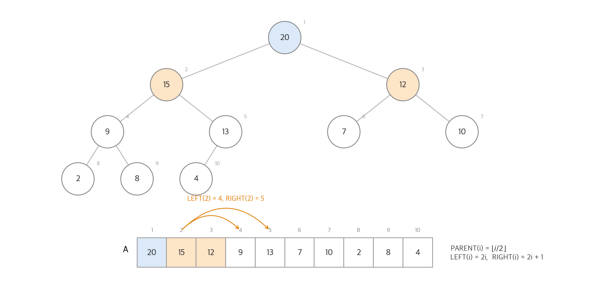
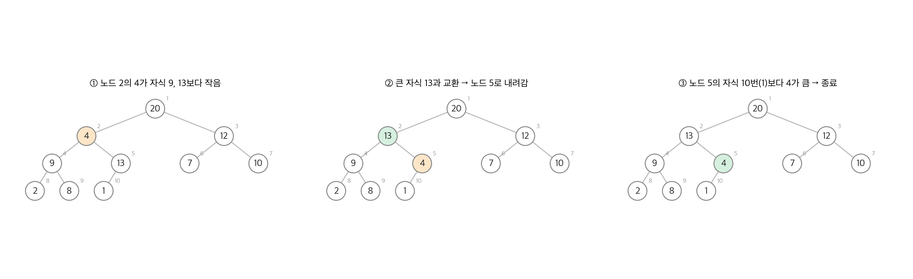
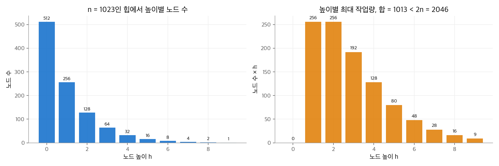
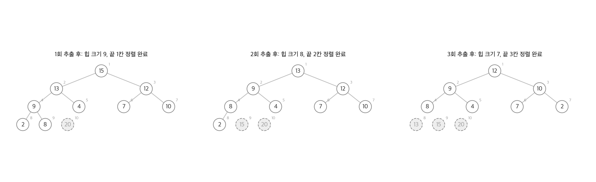

# 6. 힙 정렬

힙 정렬은 병합 정렬처럼 $O(n \lg n)$ 시간에 정렬하고, 삽입 정렬처럼 추가 배열 없이 제자리에서 정렬합니다. 두 장점을 함께 주는 열쇠는 **힙(heap)** 이라는 자료 구조입니다. 힙은 배열 하나에 완전 이진 트리를 담고, "부모가 자식보다 크다"는 약한 순서만 유지합니다. 이 약한 순서만으로 최댓값을 $O(1)$ 에 찾고 $O(\lg n)$ 에 꺼낼 수 있습니다. 이 장의 후반은 같은 힙으로 **우선순위 큐(priority queue)** 를 만듭니다. 우선순위 큐는 [22장](22-single-source-sp.md)의 Dijkstra 알고리즘, [21장](21-mst.md)의 Prim 알고리즘, 작업 스케줄러가 씁니다.

!!! info "원문과 자료"
    - 원문: Cormen, Leiserson, Rivest, Stein, *Introduction to Algorithms*, 4th ed. (MIT Press, 2022), 6장 Heapsort (6.1~6.5)
    - [MIT Press 책 페이지](https://mitpress.mit.edu/9780262046305/introduction-to-algorithms/)
    - [MIT OCW 6.006 Introduction to Algorithms (Spring 2020), Lecture 8: Binary Heaps](https://ocw.mit.edu/courses/6-006-introduction-to-algorithms-spring-2020/)
    - 함께 읽기: [7. 퀵 정렬](07-quicksort.md), [8. 선형 시간 정렬](08-linear-sorting.md)

## 1. 힙

### 배열로 표현한 완전 이진 트리

**이진 힙(binary heap)** 은 배열 $A[1 : n]$ 에 담은 거의 완전한 이진 트리입니다. 트리는 마지막 층을 뺀 모든 층이 꽉 차 있고, 마지막 층은 왼쪽부터 채웁니다. 이 모양 덕분에 포인터 없이 인덱스 계산만으로 부모와 자식을 찾습니다.

$$
\text{PARENT}(i) = \lfloor i/2 \rfloor, \qquad \text{LEFT}(i) = 2i, \qquad \text{RIGHT}(i) = 2i + 1
$$

배열 길이와 힙 크기는 다를 수 있습니다. $A.\mathit{heap\text{-}size}$ 는 배열 앞쪽 중 힙에 속한 원소 수입니다. 힙 정렬은 이 값을 줄여 가며 배열 뒤쪽을 정렬 결과로 씁니다.

### 힙 속성

**최대 힙(max-heap)** 은 루트가 아닌 모든 노드 $i$ 에서 $A[\text{PARENT}(i)] \ge A[i]$ 를 만족합니다. 따라서 최댓값은 루트 $A[1]$ 에 있습니다. **최소 힙(min-heap)** 은 부등호가 반대입니다. 힙 정렬은 최대 힙을 쓰고, Python의 `heapq` 는 최소 힙을 씁니다.

힙 속성은 형제 사이의 순서를 정하지 않습니다. 아래 그림에서 노드 2의 15와 노드 3의 12는 순서가 정해져 있지 않습니다. 이 느슨함 때문에 힙은 정렬된 배열보다 유지 비용이 작습니다.

<figure markdown>

<figcaption markdown>
<span class="fig-title"><b>Figure 1.</b> 최대 힙의 트리와 배열 표현</span>

트리의 층을 위에서 아래로, 왼쪽에서 오른쪽으로 읽은 순서가 배열 순서입니다. 자식 인덱스는 $2i$, $2i+1$ 입니다.
</figcaption>
</figure>

### 높이

노드의 **높이** 는 그 노드에서 잎까지 내려가는 가장 긴 경로의 간선 수입니다. 원소가 $n$ 개인 힙의 높이는 $\lfloor \lg n \rfloor$ 입니다. 높이 $h$ 인 힙의 원소 수는 $2^h$ 이상 $2^{h+1} - 1$ 이하이기 때문입니다. 이 장의 기본 연산은 모두 트리의 높이에 비례하므로 $O(\lg n)$ 입니다.

## 2. 힙 속성 유지: MAX-HEAPIFY

### 절차

MAX-HEAPIFY$(A, i)$ 는 노드 $i$ 의 두 서브트리가 이미 최대 힙이라고 가정합니다. $A[i]$ 만 자식보다 작을 수 있습니다. 절차는 $A[i]$ 를 아래로 "흘려 내려" 힙 속성을 되찾습니다.

```text
MAX-HEAPIFY(A, i)
1  l = LEFT(i)
2  r = RIGHT(i)
3  if l ≤ A.heap-size and A[l] > A[i]
4      largest = l
5  else largest = i
6  if r ≤ A.heap-size and A[r] > A[largest]
7      largest = r
8  if largest ≠ i
9      A[i]와 A[largest]를 교환한다
10     MAX-HEAPIFY(A, largest)
```

세 값 $A[i], A[l], A[r]$ 중 가장 큰 값을 위로 올립니다. 교환이 일어나면 내려간 값이 그 아래 서브트리의 힙 속성을 깰 수 있으므로 재귀합니다.

<figure markdown>

<figcaption markdown>
<span class="fig-title"><b>Figure 2.</b> MAX-HEAPIFY의 동작</span>

노드 2의 값 4가 더 큰 자식 13과 교환되며 한 층 내려가고, 더 큰 자식이 없는 위치에서 멈춥니다.
</figcaption>
</figure>

### 실행 시간

한 번의 호출은 세 값을 비교하는 $\Theta(1)$ 작업을 하고, 많아야 한 서브트리로 재귀합니다. 자식 서브트리의 크기는 많아야 $2n/3$ 입니다. 마지막 층이 정확히 절반만 찼을 때 왼쪽 서브트리가 가장 무겁습니다. 따라서

$$
T(n) \le T(2n/3) + \Theta(1)
$$

이고, 마스터 정리의 경우 2(4장)에 따라 $T(n) = O(\lg n)$ 입니다. 높이 $h$ 인 노드에서 호출하면 $O(h)$ 라고 써도 같습니다.

## 3. 힙 만들기: BUILD-MAX-HEAP

### 아래에서 위로 쌓기

배열 $A[1 : n]$ 을 최대 힙으로 바꿉니다. $A[\lfloor n/2 \rfloor + 1 : n]$ 의 원소는 모두 잎이고, 잎 하나는 그 자체로 힙입니다. 그러므로 마지막 내부 노드부터 루트까지 거꾸로 MAX-HEAPIFY를 부르면 됩니다.

```text
BUILD-MAX-HEAP(A, n)
1  A.heap-size = n
2  for i = ⌊n/2⌋ downto 1
3      MAX-HEAPIFY(A, i)
```

루프 불변식은 "반복 $i$ 직전에 노드 $i+1, \dots, n$ 은 각각 최대 힙의 루트"입니다. 노드 $i$ 의 자식은 $i$ 보다 번호가 크므로 이미 힙의 루트입니다. 따라서 MAX-HEAPIFY의 전제가 성립합니다.

**수치 예시.** $A = \langle 7, 2, 12, 9, 4, 10, 20, 8, 15, 13 \rangle$, $n = 10$ 입니다. $i = 5$ 부터 1까지 진행합니다.

| 단계 | 처리한 노드 | 배열 상태 |
| --- | --- | --- |
| 시작 | - | 7, 2, 12, 9, 4, 10, 20, 8, 15, 13 |
| $i = 5$ | 4 ↔ 13 | 7, 2, 12, 9, **13**, 10, 20, 8, 15, **4** |
| $i = 4$ | 9 ↔ 15 | 7, 2, 12, **15**, 13, 10, 20, 8, **9**, 4 |
| $i = 3$ | 12 ↔ 20 | 7, 2, **20**, 15, 13, 10, **12**, 8, 9, 4 |
| $i = 2$ | 2 ↔ 15 ↔ 9 | 7, **15**, 20, **9**, 13, 10, 12, 8, **2**, 4 |
| $i = 1$ | 7 ↔ 20 ↔ 12 | **20**, 15, **12**, 9, 13, 10, **7**, 8, 2, 4 |

$i = 2$ 에서 값 2는 두 층을 내려갑니다. 위쪽 노드일수록 멀리 내려갈 수 있지만, 위쪽 노드는 개수가 적습니다.

### 선형 시간 상한

호출이 $O(n)$ 번이고 각 호출이 $O(\lg n)$ 이므로 $O(n \lg n)$ 은 바로 나옵니다. 더 정확히 세면 $O(n)$ 입니다. 크기 $n$ 인 힙에서 높이 $h$ 인 노드는 많아야 $\lceil n/2^{h+1} \rceil$ 개이고, 각 노드의 비용은 $O(h)$ 입니다.

$$
\sum_{h=0}^{\lfloor \lg n \rfloor} \left\lceil \frac{n}{2^{h+1}} \right\rceil O(h)
= O\!\left(n \sum_{h=0}^{\infty} \frac{h}{2^h}\right) = O(2n) = O(n)
$$

마지막 단계는 $\sum_{h \ge 0} h x^h = x/(1-x)^2$ 에 $x = 1/2$ 를 넣은 값 2입니다. 노드의 절반은 높이 0의 잎이라 일을 하지 않고, 높이가 큰 노드는 지수적으로 드뭅니다.

<figure markdown>

<figcaption markdown>
<span class="fig-title"><b>Figure 3.</b> BUILD-MAX-HEAP의 높이별 작업량</span>

노드 수는 높이마다 절반으로 줄고(왼쪽), 노드 수 × 높이의 합은 $2n$ 보다 작습니다(오른쪽).
</figcaption>
</figure>

## 4. 힙 정렬 알고리즘

### 절차

최대 힙의 루트는 최댓값입니다. 루트를 배열 끝과 바꾸고, 힙 크기를 1 줄이고, 새 루트에서 MAX-HEAPIFY를 부릅니다. 이 과정을 반복하면 배열 끝에서부터 큰 값이 쌓입니다.

```text
HEAPSORT(A, n)
1  BUILD-MAX-HEAP(A, n)
2  for i = n downto 2
3      A[1]과 A[i]를 교환한다
4      A.heap-size = A.heap-size - 1
5      MAX-HEAPIFY(A, 1)
```

<figure markdown>

<figcaption markdown>
<span class="fig-title"><b>Figure 4.</b> 힙 정렬의 추출 과정</span>

루트 추출을 한 번 할 때마다 힙이 한 칸 줄고, 점선 회색 칸(정렬 완료 구간)이 배열 끝에서 늘어납니다.
</figcaption>
</figure>

### 성질

- **실행 시간.** BUILD-MAX-HEAP이 $O(n)$, MAX-HEAPIFY $n-1$ 번이 $O(n \lg n)$ 입니다. 합은 $O(n \lg n)$ 입니다. 원소가 모두 다르면 최선의 경우도 $\Omega(n \lg n)$ 입니다.
- **제자리 정렬.** 배열 밖에 상수 개의 변수만 씁니다.
- **안정성 없음.** 루트와 끝 원소를 바꾸는 단계에서 같은 키의 상대 순서가 바뀔 수 있습니다.
- **실제 성능.** 비교 횟수의 상한은 퀵 정렬의 기대값보다 나쁘지 않지만, 접근 패턴이 배열 전체로 흩어져 캐시 효율이 낮습니다. 실무 라이브러리는 보통 퀵 정렬을 쓰고, 재귀가 너무 깊어지면 힙 정렬로 바꿉니다(인트로 정렬, 7장 참고).

```python
def max_heapify(a, i, n):
    """0-기반 인덱스: 자식은 2i+1, 2i+2."""
    while True:
        l, r, m = 2 * i + 1, 2 * i + 2, i
        if l < n and a[l] > a[m]: m = l
        if r < n and a[r] > a[m]: m = r
        if m == i: return
        a[i], a[m] = a[m], a[i]
        i = m

def heapsort(a):
    n = len(a)
    for i in range(n // 2 - 1, -1, -1):
        max_heapify(a, i, n)
    for end in range(n - 1, 0, -1):
        a[0], a[end] = a[end], a[0]
        max_heapify(a, 0, end)
    return a
```

재귀를 `while` 반복으로 바꿨습니다. 꼬리 재귀이므로 동작은 같고 호출 스택을 쓰지 않습니다.

## 5. 우선순위 큐

### 연산

**최대 우선순위 큐(max-priority queue)** 는 키가 있는 원소의 집합 $S$ 를 관리하고 다음 연산을 지원합니다.

| 연산 | 뜻 | 힙 구현 | 실행 시간 |
| --- | --- | --- | --- |
| MAXIMUM$(S)$ | 키가 가장 큰 원소를 돌려줍니다. | $A[1]$ 을 읽습니다. | $\Theta(1)$ |
| EXTRACT-MAX$(S)$ | 키가 가장 큰 원소를 지우고 돌려줍니다. | 루트를 마지막 원소로 바꾸고 MAX-HEAPIFY$(A, 1)$ 을 부릅니다. | $O(\lg n)$ |
| INCREASE-KEY$(S, x, k)$ | 원소 $x$ 의 키를 더 큰 값 $k$ 로 바꿉니다. | 키를 바꾼 뒤 부모보다 작아질 때까지 위로 올립니다. | $O(\lg n)$ |
| INSERT$(S, x, k)$ | 키 $k$ 인 원소 $x$ 를 넣습니다. | 끝에 키 $-\infty$ 로 넣고 INCREASE-KEY를 부릅니다. | $O(\lg n)$ |

최소 우선순위 큐는 MINIMUM, EXTRACT-MIN, DECREASE-KEY, INSERT를 같은 방식으로 지원합니다.

### 키를 올리는 절차

INCREASE-KEY는 MAX-HEAPIFY의 반대 방향입니다. 키가 커진 노드는 부모보다 커질 수 있으므로, 부모와 비교해 교환하며 위로 올라갑니다. 올라가는 경로의 길이는 높이 $\lfloor \lg n \rfloor$ 를 넘지 않습니다.

```text
MAX-HEAP-INCREASE-KEY(A, x, k)
1  if k < x.key
2      error "새 키가 현재 키보다 작음"
3  x.key = k
4  i = 배열에서 x의 인덱스
5  while i > 1 and A[PARENT(i)].key < A[i].key
6      A[i]와 A[PARENT(i)]를 교환하고, 응용 객체가 가진 인덱스 정보도 갱신한다
7      i = PARENT(i)
```

4판은 힙 원소를 **응용 객체와 연결된 레코드** 로 봅니다. 응용(예: 작업 스케줄러의 작업 객체)이 "이 작업의 우선순위를 올려라"라고 요청하려면 그 객체가 힙의 어느 칸에 있는지 알아야 합니다. 그래서 교환할 때마다 객체 쪽에 저장한 배열 인덱스, 즉 **핸들(handle)** 도 함께 고칩니다. Dijkstra 알고리즘의 DECREASE-KEY가 이 핸들을 씁니다.

**수치 예시.** Figure 1의 힙에서 노드 9의 키 8을 18로 올립니다. 부모 노드 4의 9보다 크므로 교환합니다. 다시 부모 노드 2의 15보다 크므로 교환합니다. 루트 20보다는 작으므로 멈춥니다. 두 번 교환했고, 최종 배열은 $\langle 20, 18, 12, 15, 13, 7, 10, 2, 9, 4 \rangle$ 입니다.

### 정렬과 우선순위 큐의 관계

정렬을 우선순위 큐로 바꿔 생각할 수 있습니다. 원소 $n$ 개를 INSERT하고 EXTRACT-MAX를 $n$ 번 하면 큰 순서로 나옵니다. 힙으로 구현하면 $O(n \lg n)$ 이고, 힙 정렬은 이 과정을 배열 하나 안에서 합니다. 8장은 비교만 쓰는 정렬이 $\Omega(n \lg n)$ 보다 빠를 수 없음을 보입니다. 따라서 비교 기반 우선순위 큐도 INSERT와 EXTRACT-MAX를 모두 $o(\lg n)$ 에 할 수는 없습니다.

## 6. 정리

- 힙은 배열 하나에 완전 이진 트리를 담습니다. 부모-자식 관계는 인덱스 계산 $\lfloor i/2 \rfloor$, $2i$, $2i+1$ 로 찾습니다.
- MAX-HEAPIFY는 값 하나를 아래로 내려 $O(\lg n)$ 에 힙 속성을 복구합니다.
- BUILD-MAX-HEAP은 잎이 아닌 노드를 아래에서 위로 처리하고, 높이별로 세면 $O(n)$ 입니다.
- 힙 정렬은 $O(n \lg n)$ 제자리 정렬이지만 안정적이지 않고 캐시 효율이 낮습니다.
- 우선순위 큐의 네 연산은 모두 $O(\lg n)$ 이하이고, 그래프 알고리즘은 핸들을 통해 DECREASE-KEY를 씁니다.
