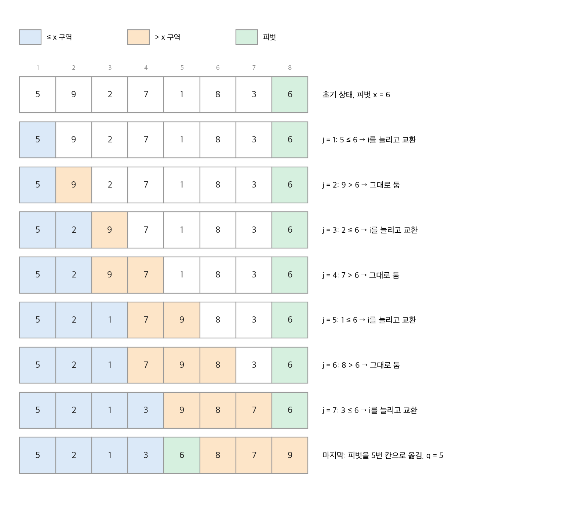
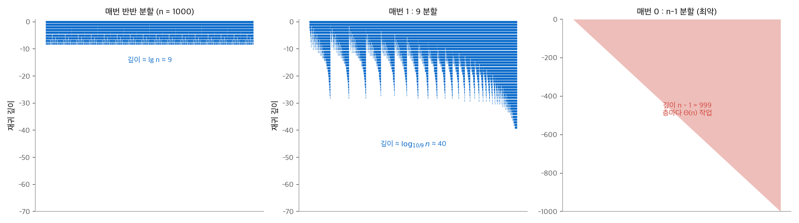
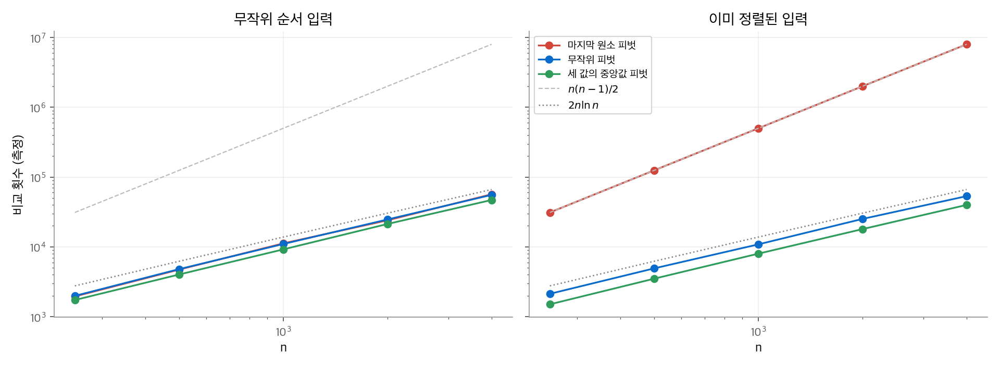
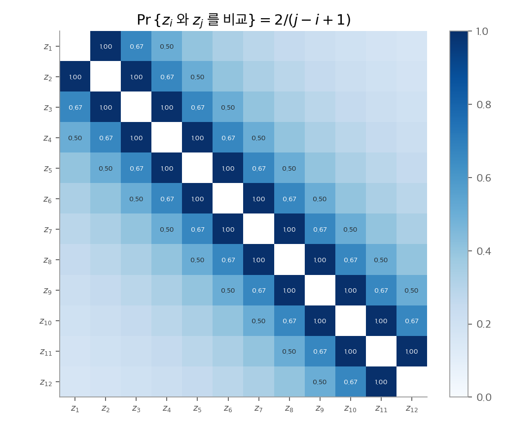

# 7. 퀵 정렬

퀵 정렬의 최악 실행 시간은 $\Theta(n^2)$ 입니다. 그런데도 실무에서 가장 많이 쓰는 정렬입니다. 기대 실행 시간이 $\Theta(n \lg n)$ 이고 숨은 상수가 작으며, 제자리에서 정렬하기 때문입니다. 이 장은 분할 절차 PARTITION에서 시작합니다. 이어서 분할의 균형이 실행 시간을 어떻게 정하는지 보고, 피벗을 무작위로 골라 나쁜 입력을 없앱니다. 마지막으로 5장의 지시 확률 변수로 비교 횟수의 기댓값을 정확히 구합니다.

!!! info "원문과 자료"
    - 원문: Cormen, Leiserson, Rivest, Stein, *Introduction to Algorithms*, 4th ed. (MIT Press, 2022), 7장 Quicksort (7.1~7.4, 문제 7-1 Hoare 분할, 7-2 같은 키, 7-4 스택 깊이, 7-5 세 값의 중앙값)
    - [MIT Press 책 페이지](https://mitpress.mit.edu/9780262046305/introduction-to-algorithms/)
    - [MIT OCW 6.046J (Spring 2015), Lecture 4: Randomized Quicksort](https://ocw.mit.edu/courses/6-046j-design-and-analysis-of-algorithms-spring-2015/)
    - 함께 읽기: [5. 확률적 분석과 무작위 알고리즘](05-randomized.md), [6. 힙 정렬](06-heapsort.md), [8. 선형 시간 정렬](08-linear-sorting.md)

## 1. 퀵 정렬의 구조

### 분할 정복의 세 단계

부분 배열 $A[p : r]$ 을 정렬하는 분할 정복입니다.

1. **분할(divide).** 피벗 $A[q]$ 를 기준으로 $A[p : r]$ 을 재배치합니다. 왼쪽 $A[p : q-1]$ 의 원소는 모두 피벗 이하이고, 오른쪽 $A[q+1 : r]$ 의 원소는 모두 피벗 이상입니다.
2. **정복(conquer).** 두 부분 배열을 재귀로 정렬합니다.
3. **결합(combine).** 할 일이 없습니다. 두 부분이 정렬되면 전체가 정렬됩니다.

[병합 정렬(2장)](02-getting-started.md)은 분할이 쉽고 결합(병합)에 일을 합니다. 퀵 정렬은 반대로 분할에 일을 하고 결합이 없습니다. 결합 단계에 보조 배열이 필요 없으므로 제자리 정렬이 됩니다.

```text
QUICKSORT(A, p, r)
1  if p < r
2      q = PARTITION(A, p, r)        // 피벗은 A[q]에 자리 잡는다
3      QUICKSORT(A, p, q - 1)
4      QUICKSORT(A, q + 1, r)
```

### PARTITION

책의 PARTITION은 마지막 원소 $x = A[r]$ 을 피벗으로 씁니다. 이 방식을 흔히 Lomuto 분할이라고 부릅니다.

```text
PARTITION(A, p, r)
1  x = A[r]                          // 피벗
2  i = p - 1                         // 낮은 쪽의 마지막 인덱스
3  for j = p to r - 1
4      if A[j] ≤ x
5          i = i + 1
6          A[i]와 A[j]를 교환한다
7  A[i + 1]과 A[r]을 교환한다       // 피벗을 두 쪽 사이로
8  return i + 1
```

루프 동안 배열은 네 구역으로 나뉩니다. 이 구역 구분이 루프 불변식입니다.

| 구역 | 인덱스 범위 | 성질 |
| --- | --- | --- |
| 낮은 쪽 | $p \le k \le i$ | $A[k] \le x$ |
| 높은 쪽 | $i + 1 \le k \le j - 1$ | $A[k] > x$ |
| 미확인 | $j \le k \le r - 1$ | 아직 보지 않음 |
| 피벗 | $k = r$ | $A[k] = x$ |

$A[j] > x$ 이면 $j$ 만 늘어 높은 쪽이 한 칸 넓어집니다. $A[j] \le x$ 이면 높은 쪽의 첫 원소와 $A[j]$ 를 바꿔 낮은 쪽을 한 칸 넓힙니다. 루프가 끝나면 미확인 구역이 비고, 7행이 피벗을 두 쪽 사이에 넣습니다. 각 원소를 한 번씩 보므로 실행 시간은 $\Theta(n)$, $n = r - p + 1$ 입니다.

<figure markdown>

<figcaption markdown>
<span class="fig-title"><b>Figure 1.</b> PARTITION 손계산</span>

$A = \langle 5,9,2,7,1,8,3,6 \rangle$, 피벗 6입니다. 파란 구역(≤ 6)과 주황 구역(> 6)이 자라고, 마지막에 피벗이 5번 칸으로 갑니다.
</figcaption>
</figure>

## 2. 분할의 균형과 성능

### 최악의 분할

분할이 매번 크기 $n-1$ 과 $0$ 으로 나뉘면 재귀식은

$$
T(n) = T(n-1) + T(0) + \Theta(n) = T(n-1) + \Theta(n) = \Theta(n^2)
$$

입니다. 마지막 원소를 피벗으로 쓰면 **이미 정렬된 입력** 이 정확히 이 경우입니다. 같은 입력에서 삽입 정렬은 $O(n)$ 입니다. 흔한 입력에서 가장 나쁘다는 점이 결정적 퀵 정렬의 약점입니다.

### 최선의 분할과 한쪽으로 치우친 분할

매번 반반으로 나뉘면 $T(n) = 2T(n/2) + \Theta(n) = \Theta(n \lg n)$ 입니다. 놀라운 점은 분할이 **상수 비율로만 치우치면** 같은 점근 시간이 나온다는 것입니다. 매번 1 : 9로 나뉜다고 합니다.

$$
T(n) = T(n/10) + T(9n/10) + \Theta(n)
$$

재귀 트리의 각 층 비용은 많아야 $cn$ 입니다. 가장 긴 경로는 매번 $9/10$ 쪽으로 가므로 깊이가 $\log_{10/9} n = \Theta(\lg n)$ 입니다. 따라서 $T(n) = O(n \lg n)$ 입니다. 99 : 1 분할도 깊이가 $\log_{100/99} n$ 일 뿐이므로 $O(n \lg n)$ 입니다. 상수 비율 분할은 밑만 바꾸고 로그를 유지합니다.

<figure markdown>

<figcaption markdown>
<span class="fig-title"><b>Figure 2.</b> 분할 비율과 재귀 깊이</span>

$n = 1000$ 에서 반반 분할은 깊이 약 9, 1 : 9 분할은 약 40입니다. 0 : $n-1$ 분할은 깊이가 999로, 전혀 다른 크기입니다.
</figcaption>
</figure>

### 좋은 분할과 나쁜 분할이 섞일 때

무작위 입력에서는 좋은 분할과 나쁜 분할이 섞입니다. 직관을 위해 둘이 번갈아 나온다고 가정합니다. 크기 $n$ 이 먼저 $0$ 과 $n-1$ 로 나쁘게 나뉘고, 이어서 $n-1$ 이 반반으로 나뉩니다. 두 층의 비용 합은 $\Theta(n) + \Theta(n-1) = \Theta(n)$ 이고 결과는 반반 분할 한 번과 같은 모양입니다. 나쁜 분할의 비용이 좋은 분할에 흡수됩니다.

## 3. 무작위 퀵 정렬

### 무작위 피벗

5장의 고용 문제에서는 입력 전체를 섞었습니다. 퀵 정렬에서는 더 간단한 방법이 있습니다. 피벗을 $A[p : r]$ 에서 균등하게 고르고 $A[r]$ 과 바꾼 뒤 PARTITION을 부릅니다. 이 방법을 **무작위 표본 추출(random sampling)** 이라고 합니다.

```text
RANDOMIZED-PARTITION(A, p, r)
1  i = RANDOM(p, r)
2  A[r]과 A[i]를 교환한다
3  return PARTITION(A, p, r)
```

이제 기대 실행 시간은 입력 순서와 무관합니다. 정렬된 입력도, 역순 입력도 특별히 나쁘지 않습니다. 나쁜 경우는 난수가 연속으로 나쁠 때만 생기고, 그 확률은 매우 작습니다.

### 측정: 정렬된 입력과 무작위 입력

세 가지 피벗 규칙으로 비교 횟수를 직접 세었습니다. PARTITION의 4행 비교를 셉니다. 재귀 대신 명시적 스택을 써서 깊이 4,000의 재귀도 실행했습니다.

| 입력 ($n = 4000$) | 마지막 원소 피벗 | 무작위 피벗 | 세 값의 중앙값 피벗 |
| --- | --- | --- | --- |
| 무작위 순서 (5회 평균) | 56,738 | 55,590 | 46,967 |
| 이미 정렬됨 | **7,998,000** | 53,333 | 39,917 |

정렬된 입력에서 마지막 원소 피벗의 비교 횟수는 정확히 $n(n-1)/2 = 7{,}998{,}000$ 입니다. 무작위 피벗은 두 입력에서 거의 같은 값을 보입니다. 4절의 이론값 $2(n+1)H_n - 4n \approx 54{,}989$ 와도 맞습니다. 세 값의 중앙값 피벗은 정렬된 입력에서 매번 정확한 중앙값을 골라 오히려 가장 빠릅니다.

<figure markdown>

<figcaption markdown>
<span class="fig-title"><b>Figure 3.</b> 피벗 규칙별 비교 횟수 측정</span>

무작위 입력에서는 세 규칙이 모두 $2n\ln n$ 근처입니다. 정렬된 입력에서는 마지막 원소 피벗만 $n(n-1)/2$ 로 올라갑니다.
</figcaption>
</figure>

!!! note "세 값의 중앙값도 최악이 있습니다"
    첫 원소, 가운데 원소, 마지막 원소의 중앙값을 쓰는 규칙은 결정적입니다. 이 규칙을 노리고 만든 입력(median-of-3 killer)에서는 여전히 $\Theta(n^2)$ 입니다. 기대 시간을 모든 입력에서 보장하는 것은 무작위 피벗뿐입니다. 무작위로 세 원소를 골라 그 중앙값을 쓰면 두 장점을 함께 얻습니다(문제 7-5).

## 4. 퀵 정렬의 분석

### 최악의 경우

$T(n) = \max_{0 \le q \le n-1}\big(T(q) + T(n-1-q)\big) + \Theta(n)$ 입니다. 대입법으로 $T(n) \le cn^2$ 을 추측해 넣습니다.

$$
T(n) \le \max_{0 \le q \le n-1}\big(cq^2 + c(n-1-q)^2\big) + \Theta(n)
$$

$q^2 + (n-1-q)^2$ 은 $q$ 에 대해 아래로 볼록한 함수입니다. 따라서 최댓값은 구간 끝 $q = 0$ 또는 $q = n-1$ 에서 나오고 그 값은 $(n-1)^2$ 입니다. 그러므로 $T(n) \le c(n-1)^2 + \Theta(n) \le cn^2$ 이고($c$ 를 충분히 크게), $T(n) = O(n^2)$ 입니다. 2절의 예로 $\Omega(n^2)$ 도 성립하므로 최악은 $\Theta(n^2)$ 입니다.

### 기대 실행 시간: 비교 횟수 세기

실행 시간은 PARTITION 4행의 비교 횟수 $X$ 에 $O(n)$ 을 더한 값입니다. PARTITION 호출은 많아야 $n$ 번이고, 비교 외의 작업은 호출당 상수이기 때문입니다. 그래서 $\mathrm{E}[X]$ 만 구하면 됩니다.

원소를 크기순으로 $z_1 < z_2 < \dots < z_n$ 이라고 부릅니다. 두 원소는 많아야 한 번 비교됩니다. 비교는 항상 피벗과의 비교이고, 피벗은 그 분할 뒤로 다시 비교에 쓰이지 않기 때문입니다. 따라서

$$
X = \sum_{i=1}^{n-1}\sum_{j=i+1}^{n} X_{ij}, \qquad X_{ij} = I\{z_i \text{와 } z_j \text{를 비교함}\}
$$

입니다. $Z_{ij} = \{z_i, z_{i+1}, \dots, z_j\}$ 를 생각합니다. $Z_{ij}$ 의 원소 중 하나가 피벗이 되기 전까지 $Z_{ij}$ 는 같은 부분 배열에 함께 있습니다. 처음으로 $Z_{ij}$ 에서 고른 피벗이 결과를 정합니다.

- 그 피벗이 $z_i$ 나 $z_j$ 이면 둘은 비교됩니다.
- 그 피벗이 사이의 $z_k$ ($i < k < j$) 이면 $z_i$ 와 $z_j$ 는 서로 다른 쪽으로 갈라져 다시는 비교되지 않습니다.

피벗을 균등하게 고르므로 $Z_{ij}$ 의 $j - i + 1$ 개 원소가 "처음 피벗"이 될 확률은 모두 같습니다.

$$
\Pr\{z_i \text{와 } z_j \text{를 비교}\} = \frac{2}{j - i + 1}
$$

<figure markdown>

<figcaption markdown>
<span class="fig-title"><b>Figure 4.</b> 원소 쌍이 비교될 확률</span>

크기 순위가 이웃한 쌍은 반드시 비교되고(확률 1), 순위 차이가 커질수록 사이 원소가 먼저 피벗이 되어 비교 확률이 줄어듭니다.
</figcaption>
</figure>

이제 선형성으로 더합니다. $k = j - i$ 로 바꾸면

$$
\mathrm{E}[X] = \sum_{i=1}^{n-1}\sum_{j=i+1}^{n}\frac{2}{j-i+1} = \sum_{i=1}^{n-1}\sum_{k=1}^{n-i}\frac{2}{k+1} < \sum_{i=1}^{n-1}\sum_{k=1}^{n}\frac{2}{k} = \sum_{i=1}^{n-1} O(\lg n) = O(n \lg n)
$$

입니다. 원소가 모두 다르면 무작위 퀵 정렬의 기대 실행 시간은 $O(n \lg n)$ 이고, 8장의 하한 때문에 $\Theta(n \lg n)$ 입니다.

**수치 예시.** $n = 4$ 이면 쌍은 6개입니다. 순위 차이 1인 쌍 3개는 확률 1, 차이 2인 쌍 2개는 $2/3$, 차이 3인 쌍 1개는 $1/2$ 입니다. 기대 비교 횟수는 $3 + 4/3 + 1/2 = 29/6 \approx 4.83$ 입니다. 4개 원소를 정렬하는 결정 트리 하한 $\lceil \lg 4! \rceil = 5$ 에 가깝습니다. 하한은 최악 비교 횟수에 대한 값이므로 평균이 그보다 작을 수 있습니다.

더 정확한 값은 재귀식 $C(n) = n - 1 + \frac{2}{n}\sum_{k=0}^{n-1} C(k)$ 를 풀어 얻습니다. 결과는 $C(n) = 2(n+1)H_n - 4n \approx 2n \ln n$ 입니다. $2 \ln 2 \approx 1.39$ 이므로 무작위 퀵 정렬은 평균적으로 $1.39\, n \lg n$ 번 비교합니다.

## 5. 실무에서의 변형

### Hoare 분할

원래 Hoare가 제안한 분할은 양 끝에서 안쪽으로 포인터 두 개를 움직입니다. 왼쪽 포인터는 피벗 이상인 원소에서, 오른쪽 포인터는 피벗 이하인 원소에서 멈추고 둘을 바꿉니다(문제 7-1). 교환 횟수가 Lomuto 분할의 약 3분의 1이고, 모든 원소가 같을 때도 균형 있게 나눕니다. 대신 피벗이 최종 위치에 놓이지 않으므로 재귀 범위가 $A[p : j]$ 와 $A[j+1 : r]$ 로 바뀝니다.

### 같은 키가 많을 때

모든 원소가 같으면 Lomuto 분할은 매번 $n-1 : 0$ 으로 나뉘어 $\Theta(n^2)$ 입니다. 해법은 **3방향 분할** 입니다. 배열을 "피벗보다 작음 / 같음 / 큼"으로 나누고, 같은 구역은 재귀에서 뺍니다(문제 7-2). 키 종류가 적은 입력에서는 오히려 선형 시간에 가까워집니다.

### 스택 깊이와 작은 부분 배열

- **스택 깊이.** 두 재귀 중 작은 쪽만 재귀로 부르고 큰 쪽은 반복문으로 처리하면 스택 깊이가 최악에도 $O(\lg n)$ 입니다(문제 7-4).
- **작은 부분 배열.** 크기가 $k$ 이하인 부분 배열은 건드리지 않고 마지막에 삽입 정렬을 한 번 합니다. 전체 비용은 $O(nk + n\lg(n/k))$ 이고, 실무 값은 보통 $k = 16$ 안팎입니다.
- **인트로 정렬(introsort).** 재귀 깊이가 $2\lg n$ 을 넘으면 그 부분 배열을 [힙 정렬](06-heapsort.md)로 바꿉니다. 최악을 $O(n \lg n)$ 으로 묶으면서 평균 성능은 퀵 정렬과 같습니다. C++ `std::sort` 가 이 방식입니다.

```python
import random

def quicksort(a, lo=0, hi=None):
    """무작위 피벗 + Lomuto 분할, 작은 쪽만 재귀해 스택 깊이 O(lg n)."""
    if hi is None:
        hi = len(a) - 1
    while lo < hi:
        k = random.randint(lo, hi)
        a[k], a[hi] = a[hi], a[k]
        x, i = a[hi], lo - 1
        for j in range(lo, hi):
            if a[j] <= x:
                i += 1
                a[i], a[j] = a[j], a[i]
        a[i + 1], a[hi] = a[hi], a[i + 1]
        q = i + 1
        if q - lo < hi - q:
            quicksort(a, lo, q - 1)
            lo = q + 1
        else:
            quicksort(a, q + 1, hi)
            hi = q - 1
    return a
```

## 6. 정리

| 경우 | 분할 모양 | 실행 시간 |
| --- | --- | --- |
| 최악 | 매번 $n-1 : 0$ (결정적 피벗 + 정렬된 입력, 모든 키가 같은 입력) | $\Theta(n^2)$ |
| 최선 | 매번 반반 | $\Theta(n \lg n)$ |
| 상수 비율 분할 | 매번 $\alpha : 1-\alpha$ | $\Theta(n \lg n)$ |
| 무작위 피벗의 기대값 | 원소가 모두 다름 | $\Theta(n \lg n)$, 비교 약 $2n \ln n$ |

- 퀵 정렬은 분할에 일을 하고 결합을 생략하므로 제자리 정렬입니다.
- 분할이 상수 비율로만 균형을 이루면 $O(n \lg n)$ 입니다. 문제는 한쪽이 상수 크기로 떨어지는 분할입니다.
- 무작위 피벗은 나쁜 입력을 없앱니다. 기대값 분석은 쌍 $(z_i, z_j)$ 가 비교될 확률 $2/(j-i+1)$ 하나로 끝납니다.
- 실무 구현은 Hoare 분할이나 3방향 분할, 작은 쪽 우선 재귀, 작은 부분 배열의 삽입 정렬, 깊이 제한 후 힙 정렬을 함께 씁니다.
