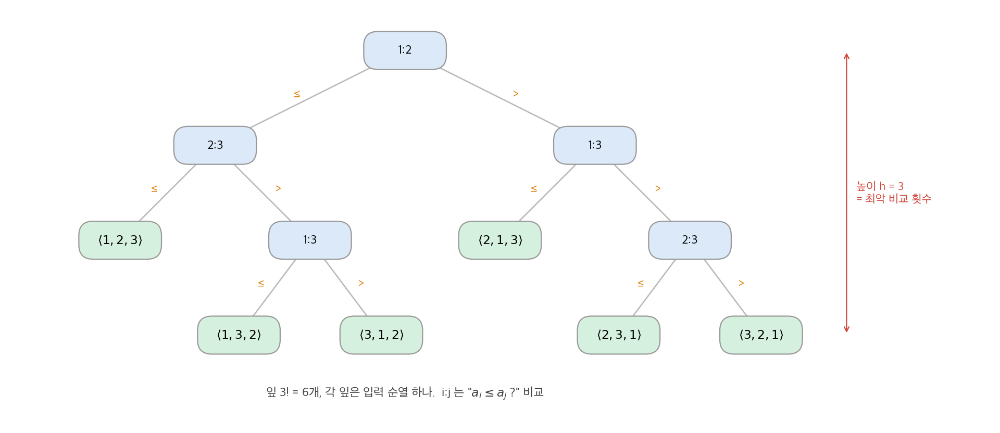
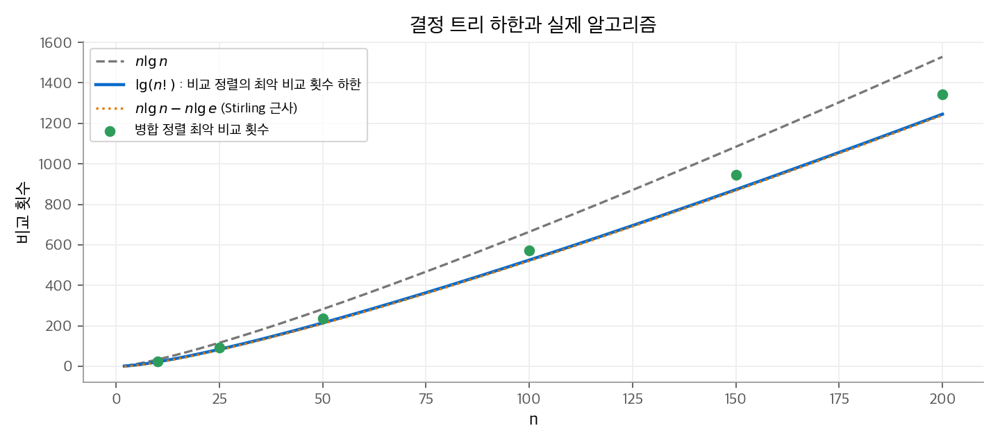
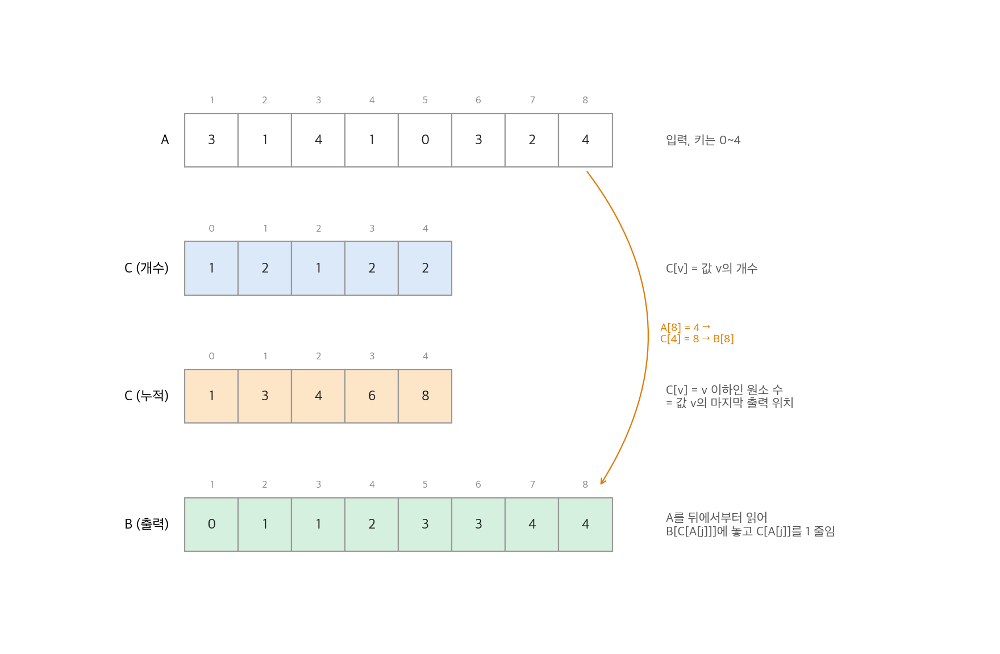
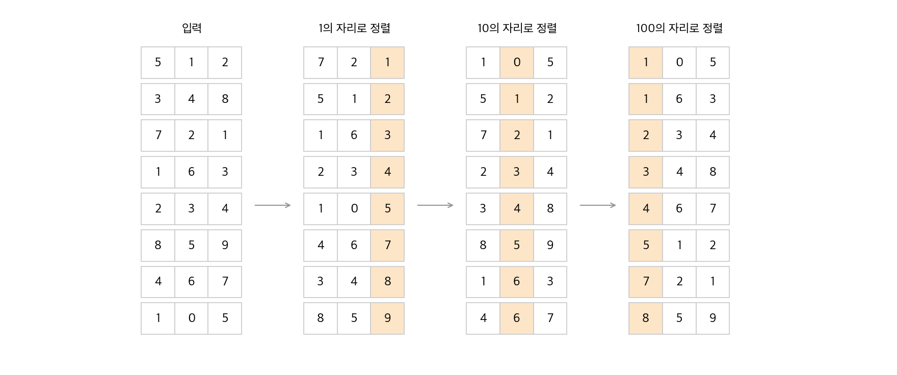
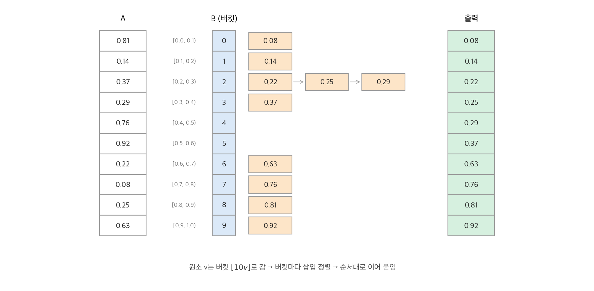

# 8. 선형 시간 정렬

병합 정렬, 힙 정렬, 퀵 정렬은 모두 원소끼리 비교해서만 순서를 알아냅니다. 이런 정렬을 **비교 정렬(comparison sort)** 이라고 합니다. 이 장의 전반부는 어떤 비교 정렬도 최악에 $\Omega(n \lg n)$ 번 비교해야 함을 증명합니다. 후반부는 비교 외의 정보를 써서 이 하한을 피하는 세 정렬을 다룹니다. 계수 정렬은 키가 작은 정수라는 사실을, 기수 정렬은 키를 자릿수로 나눌 수 있다는 사실을, 버킷 정렬은 키가 균등 분포를 따른다는 사실을 씁니다.

!!! info "원문과 자료"
    - 원문: Cormen, Leiserson, Rivest, Stein, *Introduction to Algorithms*, 4th ed. (MIT Press, 2022), 8장 Sorting in Linear Time (8.1~8.4)
    - [MIT Press 책 페이지](https://mitpress.mit.edu/9780262046305/introduction-to-algorithms/)
    - [MIT OCW 6.006 Introduction to Algorithms (Spring 2020), Lecture 5: Linear Sorting](https://ocw.mit.edu/courses/6-006-introduction-to-algorithms-spring-2020/)
    - 함께 읽기: [5. 확률적 분석과 무작위 알고리즘](05-randomized.md), [6. 힙 정렬](06-heapsort.md), [7. 퀵 정렬](07-quicksort.md)

## 1. 비교 정렬의 하한

### 결정 트리 모델

비교 정렬은 입력 $\langle a_1, \dots, a_n \rangle$ 의 원소 값을 직접 보지 않고, $a_i \le a_j$ 같은 비교 결과만 씁니다. 원소가 모두 다르다고 가정하면 비교는 $a_i \le a_j$ 하나로 충분합니다.

정렬 알고리즘 하나와 입력 크기 $n$ 을 고정하면, 알고리즘의 모든 실행 경로를 **결정 트리(decision tree)** 로 그릴 수 있습니다.

- 내부 노드 $i : j$ 는 비교 $a_i \le a_j$ 입니다. 결과가 참이면 왼쪽, 거짓이면 오른쪽으로 갑니다.
- 잎은 출력 순열 $\langle \pi(1), \dots, \pi(n) \rangle$ 이고, $a_{\pi(1)} \le a_{\pi(2)} \le \dots \le a_{\pi(n)}$ 을 뜻합니다.
- 입력 하나의 실행은 루트에서 잎까지의 경로 하나입니다. 경로 길이가 그 입력의 비교 횟수입니다.

따라서 **최악 비교 횟수 = 결정 트리의 높이** 입니다.

<figure markdown>

<figcaption markdown>
<span class="fig-title"><b>Figure 1.</b> 원소 3개를 정렬하는 결정 트리</span>

삽입 정렬이 $n = 3$ 에서 만드는 결정 트리입니다. 잎 6개가 3! 개의 순열에 하나씩 대응하고 높이는 3입니다.
</figcaption>
</figure>

### 정리와 증명

**정리 8.1.** 모든 비교 정렬은 최악의 경우 $\Omega(n \lg n)$ 번 비교합니다.

정확한 정렬이라면 $n!$ 개의 순열이 모두 어떤 잎에 나타나야 합니다. 그렇지 않으면 빠진 순열을 입력으로 줄 때 틀린 답을 냅니다. 높이 $h$ 인 이진 트리의 잎은 많아야 $2^h$ 개입니다. 따라서

$$
n! \le \ell \le 2^h \quad\Longrightarrow\quad h \ge \lg(n!) = \Omega(n \lg n)
$$

입니다. 마지막 단계는 Stirling 근사 $\lg(n!) = n\lg n - n\lg e + O(\lg n)$ 입니다. 더 간단히, 곱 $n!$ 의 위쪽 절반 인수는 모두 $n/2$ 이상이므로 $n! \ge (n/2)^{n/2}$ 이고 $\lg(n!) \ge \frac{n}{2}\lg\frac{n}{2}$ 입니다.

**따름정리 8.2.** 힙 정렬과 병합 정렬은 점근적으로 최적인 비교 정렬입니다. 두 정렬의 상한 $O(n \lg n)$ 이 하한과 같습니다.

**수치 예시.**

| $n$ | 하한 $\lceil \lg n! \rceil$ | 병합 정렬 최악 | 삽입 정렬 최악 $n(n-1)/2$ |
| --- | --- | --- | --- |
| 3 | 3 | 3 | 3 |
| 10 | 22 | 25 | 45 |
| 100 | 525 | 573 | 4,950 |

$n = 10$ 이면 순열이 $10! = 3{,}628{,}800$ 개이고 $\lg(10!) \approx 21.8$ 입니다. 비교 한 번은 정보 1비트를 주므로, 3,628,800가지 중 하나를 가려내려면 22비트가 필요합니다. 정보 이론의 관점에서 보면 하한은 "답을 적는 데 필요한 비트 수"입니다.

<figure markdown>

<figcaption markdown>
<span class="fig-title"><b>Figure 2.</b> 결정 트리 하한과 실제 알고리즘</span>

$\lg(n!)$ 은 $n \lg n$ 보다 약 $1.44n$ 작게 자라고, 병합 정렬의 최악 비교 횟수는 그 하한 바로 위에 있습니다.
</figcaption>
</figure>

!!! note "하한이 말하지 않는 것"
    이 하한은 비교만 쓰는 모델에 대한 것입니다. 키가 정수이면 배열 인덱스로 쓰거나 비트를 볼 수 있습니다. 이 연산은 결정 트리의 이진 분기가 아니므로 하한이 적용되지 않습니다. 이후 세 절의 정렬이 이 틈을 씁니다.

## 2. 계수 정렬

### 절차

**계수 정렬(counting sort)** 은 각 입력이 $0$ 이상 $k$ 이하의 정수라고 가정합니다. 각 값 $v$ 에 대해 "$v$ 이하인 원소가 몇 개인가"를 세면 $v$ 가 출력의 어느 칸에 들어갈지 바로 압니다.

```text
COUNTING-SORT(A, n, k)
1   B[1 : n]과 C[0 : k]를 새 배열로 만든다
2   for i = 0 to k
3       C[i] = 0
4   for j = 1 to n
5       C[A[j]] = C[A[j]] + 1            // C[i] = 값 i의 개수
6   for i = 1 to k
7       C[i] = C[i] + C[i - 1]           // C[i] = i 이하인 원소 수
8   for j = n downto 1                   // 뒤에서부터 읽어 안정성을 지킨다
9       B[C[A[j]]] = A[j]
10      C[A[j]] = C[A[j]] - 1
11  return B
```

### 손계산

$A = \langle 3, 1, 4, 1, 0, 3, 2, 4 \rangle$, $n = 8$, $k = 4$ 입니다.

1. 개수를 셉니다. $C = \langle 1, 2, 1, 2, 2 \rangle$ (값 0이 1개, 값 1이 2개, …).
2. 누적합을 냅니다. $C = \langle 1, 3, 4, 6, 8 \rangle$. 예를 들어 3 이하인 원소는 6개이므로, 마지막 3은 출력의 6번 칸에 갑니다.
3. $A$ 를 뒤에서부터 읽습니다. $A[8] = 4$ 는 $B[C[4]] = B[8]$ 에 놓고 $C[4]$ 를 7로 줄입니다. $A[7] = 2$ 는 $B[4]$ 에 놓습니다. $A[6] = 3$ 은 $B[6]$ 에 놓고 $C[3]$ 을 5로 줄입니다.
4. 끝까지 진행하면 $B = \langle 0, 1, 1, 2, 3, 3, 4, 4 \rangle$ 입니다.

<figure markdown>

<figcaption markdown>
<span class="fig-title"><b>Figure 3.</b> 계수 정렬 손계산</span>

개수 배열의 누적합이 각 값의 마지막 출력 위치가 됩니다. 예: $A[8] = 4$ 는 $C[4] = 8$ 번 칸으로 갑니다.
</figcaption>
</figure>

### 성질

- **실행 시간.** 2~3행이 $\Theta(k)$, 4~5행이 $\Theta(n)$, 6~7행이 $\Theta(k)$, 8~10행이 $\Theta(n)$ 입니다. 합은 $\Theta(n + k)$ 이고, $k = O(n)$ 이면 $\Theta(n)$ 입니다.
- **비교 없음.** 어떤 원소끼리도 비교하지 않습니다. 키를 인덱스로 씁니다.
- **안정성.** 같은 값이 입력 순서대로 출력에 나옵니다. 8행이 뒤에서부터 읽고, 같은 값의 자리를 뒤에서부터 채우기 때문입니다. 이 성질은 키에 다른 데이터가 붙어 있을 때 중요하고, 다음 절의 기수 정렬이 이 성질에 기댑니다.
- **한계.** $k$ 가 $n$ 보다 훨씬 크면 쓸 수 없습니다. 32비트 정수 100개를 정렬하려고 길이 $2^{32}$ 인 $C$ 를 만들 수는 없습니다.

## 3. 기수 정렬

### 낮은 자리부터 정렬하기

**기수 정렬(radix sort)** 은 $d$ 자리 수를 가장 낮은 자리부터 한 자리씩 정렬합니다. 각 자리의 정렬은 반드시 **안정 정렬** 이어야 합니다.

```text
RADIX-SORT(A, n, d)
1  for i = 1 to d
2      안정 정렬로 배열 A[1 : n]을 i번째 자리 기준으로 정렬한다
```

직관에 반하는 점은 "가장 중요한 자리를 마지막에" 정렬한다는 것입니다. 높은 자리부터 정렬하면 같은 높은 자리를 가진 묶음마다 따로 재귀해야 하고, 묶음 관리가 복잡해집니다. 낮은 자리부터 하면 매번 배열 전체를 한 번에 정렬하면 됩니다.

<figure markdown>

<figcaption markdown>
<span class="fig-title"><b>Figure 4.</b> 기수 정렬 손계산</span>

3자리 수 8개를 1의 자리, 10의 자리, 100의 자리 순서로 안정 정렬합니다. 주황 칸이 각 단계의 정렬 기준입니다.
</figcaption>
</figure>

### 정확성

$i$ 번째 단계가 끝나면 배열은 낮은 $i$ 자리 기준으로 정렬되어 있습니다. 이를 귀납법으로 보입니다. $i$ 번째 자리 정렬 뒤 두 수 $a, b$ 를 생각합니다.

- $i$ 번째 자리가 다르면 그 자리가 순서를 정하고, 정렬이 그 순서를 만들었습니다.
- $i$ 번째 자리가 같으면 안정 정렬이 이전 순서를 유지합니다. 귀납 가정에 따라 이전 순서는 낮은 $i-1$ 자리 기준으로 맞습니다.

Figure 4에서 확인합니다. 10의 자리 단계에서 163과 467은 10의 자리가 같은 6입니다. 직전 단계에서 163이 467보다 앞에 있었으므로(1의 자리 3 < 7), 안정 정렬은 이 순서를 유지합니다. 100의 자리 단계에서 105와 163은 100의 자리가 같은 1입니다. 직전 단계의 순서(105가 앞)가 그대로 남아 최종 순서가 맞습니다. 자리 정렬이 안정적이지 않으면 이 두 쌍의 순서가 뒤바뀔 수 있습니다.

### 실행 시간과 자릿수 고르기

**보조정리 8.3.** $n$ 개의 $d$ 자리 수가 있고 각 자리가 $k$ 가지 값을 가지면, 각 자리를 계수 정렬로 처리하는 기수 정렬은 $\Theta(d(n + k))$ 시간에 정렬합니다.

**보조정리 8.4.** $n$ 개의 $b$ 비트 수와 양의 정수 $r \le b$ 가 있습니다. $r$ 비트를 한 자리로 묶으면 $d = \lceil b/r \rceil$ 자리이고 각 자리는 $0 \sim 2^r - 1$ 입니다. 실행 시간은 $\Theta((b/r)(n + 2^r))$ 입니다.

$r$ 은 두 힘의 균형입니다. $r$ 을 키우면 단계 수 $b/r$ 이 줄지만 계수 배열 크기 $2^r$ 이 늘어납니다.

- $b < \lfloor \lg n \rfloor$ 이면 $r = b$ 로 한 번에 계수 정렬합니다. 시간은 $\Theta(n)$ 입니다.
- $b \ge \lfloor \lg n \rfloor$ 이면 $r = \lfloor \lg n \rfloor$ 이 최적입니다. 시간은 $\Theta(bn/\lg n)$ 입니다.

**수치 예시.** 32비트 정수 $n = 2^{16} = 65{,}536$ 개를 정렬합니다. $r = 16$ 이면 두 단계이고, 단계마다 계수 배열 크기가 $2^{16} = n$ 입니다. 총 작업은 약 $2 \times (n + n) = 4n$ 입니다. 비교 정렬의 하한 $\lg(n!) \approx n(16 - 1.44) \approx 14.6n$ 번 비교보다 단계 수가 작습니다. 다만 기수 정렬은 제자리 정렬이 아니고, 계수 배열과 출력 배열이 캐시를 많이 씁니다. 그래서 실제 시간에서는 잘 다듬은 퀵 정렬이 이길 때도 있습니다.

## 4. 버킷 정렬

### 절차

**버킷 정렬(bucket sort)** 은 입력이 구간 $[0, 1)$ 에서 독립적이고 균등하게 뽑혔다고 가정합니다. 구간을 같은 크기의 버킷 $n$ 개로 나누고, 원소를 버킷에 나눠 담고, 버킷마다 정렬해 이어 붙입니다.

```text
BUCKET-SORT(A, n)
1  B[0 : n - 1]을 새 배열로 만든다
2  for i = 0 to n - 1
3      B[i]를 빈 리스트로 만든다
4  for i = 1 to n
5      A[i]를 리스트 B[⌊n · A[i]⌋]에 넣는다
6  for i = 0 to n - 1
7      리스트 B[i]를 삽입 정렬로 정렬한다
8  B[0], B[1], …, B[n - 1]을 순서대로 이어 붙여 돌려준다
```

$x < y$ 이면 $\lfloor nx \rfloor \le \lfloor ny \rfloor$ 이므로, 다른 버킷에 든 원소는 버킷 순서가 곧 값의 순서입니다. 같은 버킷 안의 순서는 7행이 맞춥니다.

<figure markdown>

<figcaption markdown>
<span class="fig-title"><b>Figure 5.</b> 버킷 정렬 손계산</span>

$n = 10$ 개의 값을 버킷 $\lfloor 10v \rfloor$ 에 담습니다. 버킷 2에만 세 원소가 모이고, 버킷 4와 5는 비어 있습니다.
</figcaption>
</figure>

### 기대 실행 시간

$n_i$ 를 버킷 $i$ 에 든 원소 수라고 합니다. 삽입 정렬은 이차 시간이므로

$$
T(n) = \Theta(n) + \sum_{i=0}^{n-1} O(n_i^2)
$$

입니다. 기댓값을 구하려면 $\mathrm{E}[n_i^2]$ 이 필요합니다. 지시 변수 $X_{ij} = I\{A[j] \text{가 버킷 } i \text{에 들어감}\}$ 을 쓰면 $n_i = \sum_j X_{ij}$ 이고 $\Pr\{X_{ij} = 1\} = 1/n$ 입니다. 제곱을 펼칩니다.

$$
\mathrm{E}[n_i^2] = \sum_{j} \mathrm{E}[X_{ij}^2] + \sum_{j \ne k} \mathrm{E}[X_{ij} X_{ik}] = n \cdot \frac{1}{n} + n(n-1) \cdot \frac{1}{n^2} = 2 - \frac{1}{n}
$$

$X_{ij}^2 = X_{ij}$ 이고, $j \ne k$ 이면 두 원소가 독립이므로 $\mathrm{E}[X_{ij}X_{ik}] = 1/n^2$ 입니다. 따라서

$$
\mathrm{E}[T(n)] = \Theta(n) + n \cdot O(2 - 1/n) = \Theta(n)
$$

입니다. $n_i$ 는 이항 분포 $b(n, 1/n)$ 을 따르므로 $\mathrm{E}[n_i^2] = \mathrm{Var}[n_i] + \mathrm{E}[n_i]^2 = (1 - 1/n) + 1$ 로도 같은 값을 얻습니다. 이 계산은 [5장](05-randomized.md)의 공과 상자 모델 그대로입니다.

입력이 균등하지 않아도 **버킷 크기 제곱의 합이 입력 크기에 선형** 이면 선형 시간입니다. 반대로 모든 원소가 한 버킷에 몰리면 삽입 정렬 한 번이 되어 $\Theta(n^2)$ 입니다. 버킷 안의 정렬을 병합 정렬로 바꾸면 최악을 $O(n \lg n)$ 으로 묶을 수 있습니다.

## 5. 정리

| 정렬 | 가정 | 최악 | 평균·기대 | 제자리 | 안정 |
| --- | --- | --- | --- | --- | --- |
| [삽입 정렬](02-getting-started.md) | 비교 | $\Theta(n^2)$ | $\Theta(n^2)$ | 예 | 예 |
| [병합 정렬](02-getting-started.md) | 비교 | $\Theta(n \lg n)$ | $\Theta(n \lg n)$ | 아니요 | 예 |
| [힙 정렬](06-heapsort.md) | 비교 | $O(n \lg n)$ | - | 예 | 아니요 |
| [퀵 정렬](07-quicksort.md) | 비교 | $\Theta(n^2)$ | $\Theta(n \lg n)$ (기대) | 예 | 아니요 |
| 계수 정렬 | 정수 키 $0 \sim k$ | $\Theta(n + k)$ | $\Theta(n + k)$ | 아니요 | 예 |
| 기수 정렬 | $d$ 자리, 자리당 $k$ 값 | $\Theta(d(n + k))$ | $\Theta(d(n + k))$ | 아니요 | 예 |
| 버킷 정렬 | $[0,1)$ 균등 분포 | $\Theta(n^2)$ | $\Theta(n)$ (평균) | 아니요 | 예 (삽입 정렬 사용 시) |

- 비교 정렬의 하한 $\Omega(n \lg n)$ 은 결정 트리의 잎 수 $n!$ 에서 나옵니다. 힙 정렬과 병합 정렬은 이 하한을 맞춥니다.
- 선형 시간 정렬은 비교 외의 정보(정수 범위, 자릿수, 분포)를 씁니다. 하한을 깨는 것이 아니라 하한의 모델 밖으로 나갑니다.
- 계수 정렬의 안정성은 기수 정렬의 정확성을 지탱합니다.
- 버킷 정렬의 선형 시간은 입력 분포에 대한 평균입니다. 분석 도구는 5장의 지시 확률 변수입니다.
