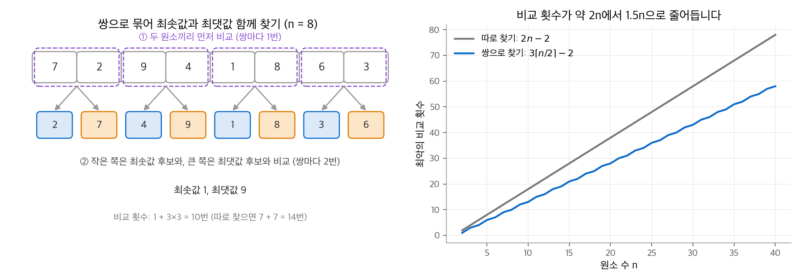
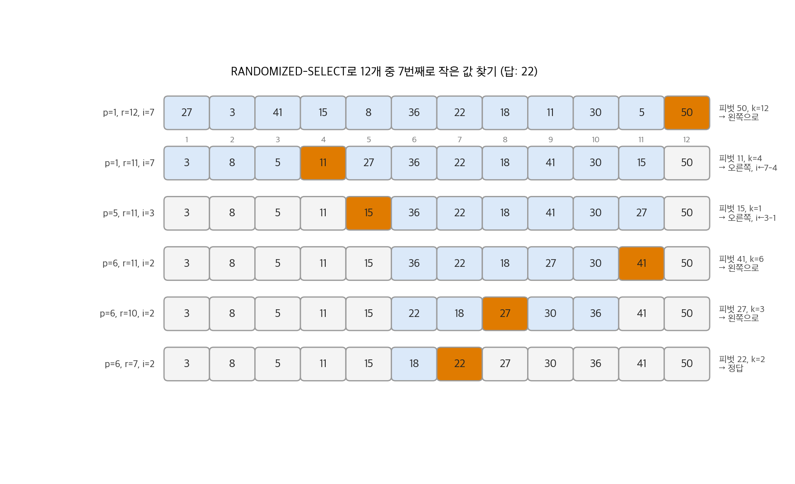
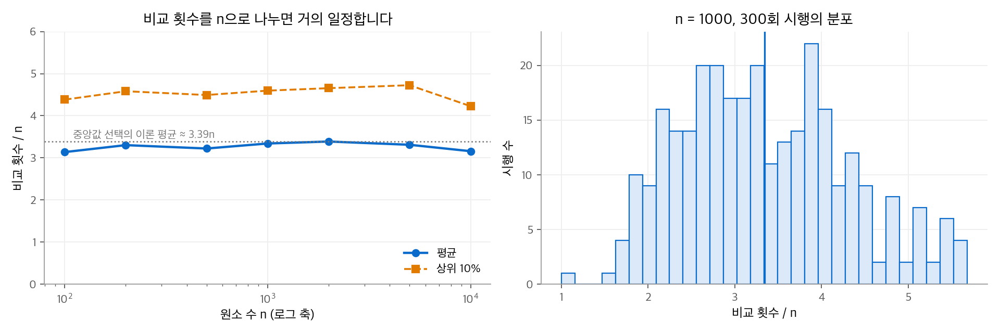
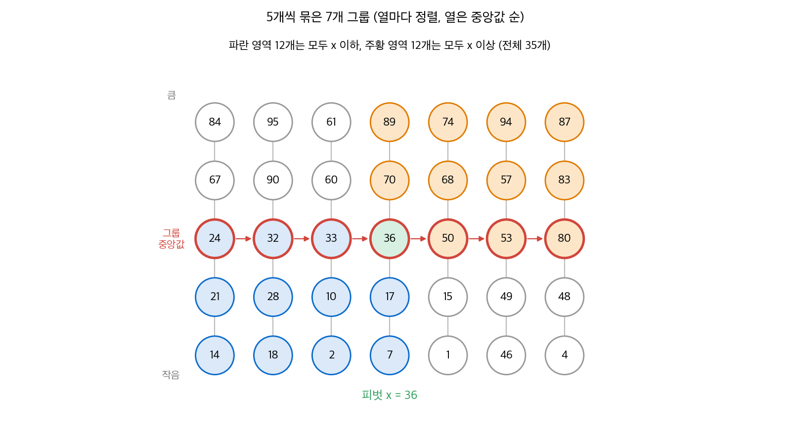

# 9. 중앙값과 순서 통계량

$n$ 개 원소 중 $i$ 번째로 작은 원소를 **$i$ 번째 순서 통계량(order statistic)** 이라고 합니다. 최솟값은 1번째, 최댓값은 $n$ 번째 순서 통계량입니다. **중앙값(median)** 은 가운데 순서 통계량입니다. $n$ 이 홀수이면 $i = (n+1)/2$ 하나이고, 짝수이면 $i = n/2$ (하위 중앙값)와 $i = n/2 + 1$ (상위 중앙값) 두 개입니다. 이 장은 하위 중앙값을 "중앙값"이라고 부릅니다.

**선택 문제(selection problem)** 는 서로 다른 $n$ 개 수와 정수 $i$ 가 주어질 때 $i$ 번째 순서 통계량을 찾는 문제입니다. 정렬하고 $i$ 번째를 읽으면 $O(n \lg n)$ 입니다. 이 장의 결론은 선택이 정렬보다 쉽다는 것입니다. 기댓값으로 $\Theta(n)$ 인 무작위 알고리즘과 최악에도 $\Theta(n)$ 인 결정적 알고리즘이 있습니다.

!!! info "원문과 자료"
    - 원문: CLRS 4판 9장 Medians and Order Statistics (9.1~9.3).
    - 생략: 연습 문제와 장 끝 문제(가중 중앙값, 작은 순서 통계량, Problem 9-1~9-4).
    - 함께 읽기: [7. 퀵 정렬](07-quicksort.md)(분할 함수), [8. 선형 시간 정렬](08-linear-sorting.md)(비교 정렬의 하한), [4. 분할 정복](04-divide-and-conquer.md)(치환법), [17. 자료 구조 확장](17-augmenting.md)(동적 집합의 순서 통계량)

## 1. 최솟값과 최댓값

### 최솟값에는 비교가 $n-1$ 번 필요합니다

최솟값은 배열을 한 번 훑으면 찾습니다. 비교는 $n - 1$ 번입니다.

```python
def minimum(A):
    m = A[0]
    for x in A[1:]:
        if x < m:
            m = x
    return m
```

$n - 1$ 번은 하한이기도 합니다. 비교 하나를 경기 하나로 생각합니다. 최솟값이 아닌 원소는 모두 적어도 한 번 져야 합니다. 경기 한 번에 패자는 한 명이므로 $n - 1$ 번보다 적게 비교할 수 없습니다.

### 최솟값과 최댓값을 함께 찾기

둘을 따로 찾으면 $2n - 2$ 번 비교합니다. 원소를 둘씩 묶으면 줄일 수 있습니다.

1. 두 원소끼리 먼저 비교합니다.
2. 작은 쪽은 지금까지의 최솟값과 비교합니다.
3. 큰 쪽은 지금까지의 최댓값과 비교합니다.

원소 2개마다 비교가 3번이므로 원소 하나에 1.5번입니다. $n$ 이 홀수이면 첫 원소로 최솟값과 최댓값을 모두 초기화하고 나머지를 쌍으로 처리합니다. 비교는 $3\lfloor n/2 \rfloor$ 번입니다. $n$ 이 짝수이면 처음 두 원소를 한 번 비교해 초기화합니다. 비교는 $1 + 3(n-2)/2 = 3n/2 - 2$ 번입니다. 두 경우 모두 $3\lceil n/2 \rceil - 2$ 로 쓸 수 있고, 이 값은 $3\lfloor n/2 \rfloor$ 이하입니다.

<figure markdown>

<figcaption markdown>
<span class="fig-title"><b>Figure 1.</b> 쌍으로 묶어 최솟값과 최댓값 찾기</span>

쌍 안에서 먼저 비교하면 원소 하나에 비교가 1.5번으로 줄어듭니다.
</figcaption>
</figure>

```python
def min_max(A):
    n = len(A)
    if n % 2:
        lo = hi = A[0]; start = 1
    else:
        lo, hi = (A[0], A[1]) if A[0] < A[1] else (A[1], A[0]); start = 2
    for j in range(start, n, 2):
        a, b = A[j], A[j + 1]
        if a > b:
            a, b = b, a          # 비교 1: 쌍 안에서
        if a < lo: lo = a        # 비교 2: 작은 쪽과 최솟값
        if b > hi: hi = b        # 비교 3: 큰 쪽과 최댓값
    return lo, hi

print(min_max([7, 2, 9, 4, 1, 8, 6, 3]))   # (1, 9)
```

$n = 8$ 이면 비교는 $1 + 3 \times 3 = 10$ 번입니다. 따로 찾으면 $7 + 7 = 14$ 번입니다. 원문 연습 문제는 이 $\lceil 3n/2 \rceil - 2$ 가 최악의 경우 하한임을 증명하게 합니다.

## 2. 기댓값 선형 시간 선택

### RANDOMIZED-SELECT

**RANDOMIZED-SELECT** 는 퀵 정렬의 분할을 그대로 씁니다. 차이는 분할 뒤 한쪽만 재귀한다는 점입니다. 퀵 정렬은 양쪽을 모두 정렬해야 하지만, 선택은 답이 있는 쪽만 보면 됩니다.

1. 부분 배열 $A[p:r]$ 에서 피벗을 무작위로 고르고 분할합니다. 피벗의 위치를 $q$ 라고 합니다.
2. 왼쪽 부분과 피벗을 합한 원소 수 $k = q - p + 1$ 을 셉니다.
3. $i = k$ 이면 피벗이 답입니다.
4. $i < k$ 이면 왼쪽 $A[p : q-1]$ 에서 $i$ 번째를 찾습니다.
5. $i > k$ 이면 오른쪽 $A[q+1 : r]$ 에서 $(i - k)$ 번째를 찾습니다.

```python
import random

def partition(A, p, r):
    """Lomuto 분할: A[r]을 피벗으로 쓰고 피벗의 최종 위치를 돌려줍니다."""
    x, s = A[r], p - 1
    for j in range(p, r):
        if A[j] <= x:
            s += 1
            A[s], A[j] = A[j], A[s]
    A[s + 1], A[r] = A[r], A[s + 1]
    return s + 1

def randomized_select(A, p, r, i):
    """A[p..r] (0부터 세는 양 끝 포함 구간)에서 i번째(1부터)로 작은 값."""
    while True:
        if p == r:
            return A[p]
        t = random.randint(p, r)
        A[t], A[r] = A[r], A[t]
        q = partition(A, p, r)
        k = q - p + 1
        if i == k:
            return A[q]
        if i < k:
            r = q - 1
        else:
            p, i = q + 1, i - k

A = [27, 3, 41, 15, 8, 36, 22, 50, 11, 30, 5, 18]
print(randomized_select(A[:], 0, len(A) - 1, 7))   # 22
```

재귀 호출이 꼬리 호출이므로 위 코드는 반복문으로 바꿨습니다. 원문의 의사 코드와 동작은 같습니다.

### 실행 예

12개 원소에서 7번째로 작은 값을 찾습니다. 정렬하면 3, 5, 8, 11, 15, 18, **22**, 27, 30, 36, 41, 50 이므로 답은 22입니다. 아래 그림은 피벗을 실제로 무작위로 뽑은 한 번의 실행입니다.

<figure markdown>

<figcaption markdown>
<span class="fig-title"><b>Figure 2.</b> RANDOMIZED-SELECT 실행 과정</span>

파란 칸이 아직 후보인 부분 배열이고, 주황 칸이 그 단계의 피벗입니다.
</figcaption>
</figure>

| 단계 | 구간 (1부터) | $i$ | 피벗 | $k$ | 다음 행동 |
| --- | --- | --- | --- | --- | --- |
| 1 | 1~12 | 7 | 50 | 12 | $i < k$: 왼쪽 1~11 |
| 2 | 1~11 | 7 | 11 | 4 | $i > k$: 오른쪽 5~11, $i = 7 - 4 = 3$ |
| 3 | 5~11 | 3 | 15 | 1 | $i > k$: 오른쪽 6~11, $i = 3 - 1 = 2$ |
| 4 | 6~11 | 2 | 41 | 6 | $i < k$: 왼쪽 6~10 |
| 5 | 6~10 | 2 | 27 | 3 | $i < k$: 왼쪽 6~7 |
| 6 | 6~7 | 2 | 22 | 2 | $i = k$: 답 22 |

1단계와 3단계는 운이 나빴습니다. 최댓값 50과 구간의 최솟값 15가 피벗이 되어 원소가 하나만 줄었습니다. 그래도 2단계에서 구간이 11개에서 7개로 크게 줄었습니다.

### 최악은 $\Theta(n^2)$ 입니다

피벗이 매번 남은 원소 중 가장 큰 값이면, 최솟값을 찾을 때도 한 단계에 원소가 하나씩만 줄어듭니다. 점화식은 퀵 정렬의 최악과 같은 $T(n) = T(n-1) + \Theta(n)$ 이고 해는 $\Theta(n^2)$ 입니다. 하지만 피벗이 무작위이므로 특정 입력이 항상 최악을 만들지는 않습니다.

### 기댓값이 $\Theta(n)$ 인 이유

직관은 이렇습니다. 피벗이 정렬 순서의 **가운데 절반**(2사분위와 3사분위)에 떨어지면, 답이 없는 쪽에 적어도 1/4이 있습니다. 그 부분을 버리면 남은 원소는 3/4 이하입니다. 매번 이렇게 되면 $T(n) = T(3n/4) + \Theta(n)$ 이고, 마스터 정리 3번 경우로 $\Theta(n)$ 입니다.

원문은 이 직관을 다음 정의로 엄밀하게 만듭니다.

- $A^{(j)}$ 는 $j$ 번째 분할 뒤에도 후보로 남은 원소의 집합입니다. $A^{(0)}$ 은 전체입니다.
- $j$ 번째 분할이 $|A^{(j)}| \le \tfrac{3}{4}|A^{(j-1)}|$ 를 만족하면 **도움이 된(helpful)** 분할이라고 합니다.

**보조 정리 9.1.** 분할이 도움이 될 확률은 1/2 이상입니다.

가운데 절반을 "가장 작은 $\lceil n/4 \rceil - 1$ 개와 가장 큰 $\lceil n/4 \rceil - 1$ 개를 뺀 나머지"로 정의합니다. 피벗이 여기에 떨어지면 피벗과 한쪽의 $\lceil n/4 \rceil - 1$ 개 이상이 버려집니다. 따라서 남는 원소는 $n - \lceil n/4 \rceil = \lfloor 3n/4 \rfloor$ 개 이하입니다. 피벗이 가운데 절반 밖에 떨어질 확률은 다음과 같습니다.

$$
\frac{2(\lceil n/4 \rceil - 1)}{n} \le \frac{2\big((n/4 + 1) - 1\big)}{n} = \frac{1}{2}
$$

**정리 9.2.** 서로 다른 $n$ 개 원소에서 RANDOMIZED-SELECT의 기대 실행 시간은 $\Theta(n)$ 입니다.

증명은 분할의 열을 **세대(generation)** 로 나눕니다. 세대 $k$ 는 $k$ 번째 도움이 된 분할의 결과에서 시작해 다음 도움이 된 분할 직전까지입니다. 세대 $k$ 의 첫 집합 크기를 $n_k$ 라고 하면 $n_k \le (3/4)^k n$ 입니다. 세대 안의 집합은 모두 크기가 $n_k$ 이하입니다. 한 세대의 길이(분할 횟수) $X_k$ 는 성공 확률이 1/2 이상인 기하 분포를 따르므로 $\mathbb{E}[X_k] \le 2$ 입니다. 각 분할이 비교를 원소 수만큼 하므로 전체 비교 수의 기댓값은 다음과 같습니다.

$$
\mathbb{E}\Big[\sum_k X_k \, n_k\Big] \le \sum_{k \ge 0} \mathbb{E}[X_k] \left(\frac{3}{4}\right)^k n \le 2n \sum_{k \ge 0} \left(\frac{3}{4}\right)^k = 8n
$$

$X_k$ 와 $n_k$ 가 독립이 아니어서 원문은 $n_k$ 대신 상한 $(3/4)^k n$ 을 먼저 넣고 기댓값을 취합니다. 상수 8은 느슨한 상한입니다. 중앙값을 찾을 때의 정확한 기대 비교 횟수는 약 $2(1 + \ln 2)n \approx 3.39n$ 입니다.

<figure markdown>

<figcaption markdown>
<span class="fig-title"><b>Figure 3.</b> RANDOMIZED-SELECT의 비교 횟수</span>

중앙값을 찾을 때 비교 횟수를 $n$ 으로 나눈 값은 $n$ 이 커져도 3.3 근처에 머뭅니다.
</figcaption>
</figure>

실험에서 $n = 100$ 부터 $10^4$ 까지 평균은 $3.1n$ ~ $3.4n$ 이었습니다. 300회 중 가장 나쁜 경우도 $6n$ 을 넘지 않았습니다. 이론 상한 $8n$ 과 실제 평균 사이에 여유가 크다는 것을 확인할 수 있습니다.

## 3. 최악 선형 시간 선택

### 좋은 피벗을 재귀로 고릅니다

**SELECT** 는 피벗을 무작위로 고르지 않고, 반드시 좋은 분할을 만드는 피벗을 계산합니다. 피벗은 "5개씩 묶은 그룹 중앙값들의 중앙값"입니다. 이 피벗을 찾는 데 SELECT 자신을 재귀로 부릅니다. 따라서 재귀 호출은 두 번입니다. 한 번은 피벗을 찾고, 한 번은 답이 있는 쪽에서 계속 찾습니다.

4판의 SELECT는 다음 순서로 동작합니다.

1. 원소 수가 5의 배수가 될 때까지 최솟값을 하나씩 떼어냅니다. 이 반복은 0~4번입니다. $i = 1$ 이면 뗀 최솟값이 답입니다. 그렇지 않으면 $i$ 를 1 줄입니다.
2. 원소를 $g = n/5$ 개 그룹으로 나눕니다. 그룹 $j$ 는 $A[j], A[j+g], A[j+2g], A[j+3g], A[j+4g]$ 입니다.
3. 그룹마다 5개를 정렬합니다. 그러면 그룹 중앙값이 모두 가운데 1/5 구간 $A[p+2g : p+3g-1]$ 에 모입니다.
4. 그 구간에서 SELECT를 재귀로 불러 중앙값들의 중앙값 $x$ 를 찾습니다.
5. $x$ 를 피벗으로 분할하고, RANDOMIZED-SELECT와 같은 방법으로 한쪽에서 재귀합니다.

그룹을 연속 구간이 아니라 간격 $g$ 로 뽑는 이유는 3단계 뒤 그룹 중앙값이 한 구간에 모이게 하기 위해서입니다. 그러면 4단계에서 중앙값들을 따로 복사하지 않아도 됩니다.

```python
def select(A, p, r, i):
    """최악 Θ(n) 선택. A[p..r]에서 i번째(1부터)로 작은 값."""
    while (r - p + 1) % 5 != 0:
        for j in range(p + 1, r + 1):          # 최솟값을 A[p]로
            if A[p] > A[j]:
                A[p], A[j] = A[j], A[p]
        if i == 1:
            return A[p]
        p, i = p + 1, i - 1
    g = (r - p + 1) // 5
    for j in range(p, p + g):                   # 그룹마다 정렬
        idx = [j + t * g for t in range(5)]
        vals = sorted(A[t] for t in idx)
        for t, v in zip(idx, vals):
            A[t] = v
    x = select(A, p + 2 * g, p + 3 * g - 1, (g + 1) // 2)   # ⌈g/2⌉번째
    t = A.index(x, p, r + 1)                    # x를 끝으로 옮겨 분할
    A[t], A[r] = A[r], A[t]
    q = partition(A, p, r)
    k = q - p + 1
    if i == k:
        return A[q]
    if i < k:
        return select(A, p, q - 1, i)
    return select(A, q + 1, r, i - k)

import random
B = random.sample(range(10**6), 1001)
assert select(B[:], 0, 1000, 501) == sorted(B)[500]
```

### 피벗이 남기는 원소는 $7n/10$ 이하입니다

아래 그림은 35개 원소를 그룹 7개로 나눈 예입니다. 각 열이 정렬된 그룹이고, 열은 그룹 중앙값 순서로 놓았습니다. 실제 알고리즘은 열을 이렇게 정렬하지 않습니다. 그림은 크기 관계를 보이기 위해 정렬해서 그렸습니다.

<figure markdown>

<figcaption markdown>
<span class="fig-title"><b>Figure 4.</b> 중앙값들의 중앙값</span>

파란 영역은 모두 $x$ 이하, 주황 영역은 모두 $x$ 이상이므로 어느 쪽 분할도 흰 원소와 반대 영역만 담습니다.
</figcaption>
</figure>

- $x$ 이상인 그룹 중앙값은 $\lfloor g/2 \rfloor + 1$ 개입니다. 각 그룹에서 중앙값 위의 두 원소도 $x$ 이상입니다. 따라서 $x$ 이상인 원소가 $3(\lfloor g/2 \rfloor + 1) \ge 3g/2$ 개 이상 있습니다.
- 같은 논리로 $x$ 이하인 원소도 $3\lceil g/2 \rceil \ge 3g/2$ 개 이상 있습니다.
- 왼쪽 분할에는 주황 영역이 들어가지 못합니다. 따라서 왼쪽 분할의 크기는 $5g - 3g/2 = 7g/2 \le 7n/10$ 이하입니다. 오른쪽 분할도 마찬가지입니다.

그림의 예에서 $g = 7$ 이면 파란 영역과 주황 영역이 각각 12개입니다. 어느 쪽으로 재귀해도 원소는 $35 - 12 = 23$ 개 이하이고, $7 \cdot 35 / 10 = 24.5$ 보다 작습니다.

### 점화식

재귀 바깥의 작업은 모두 $\Theta(n)$ 입니다. 최솟값 떼기는 최대 4번 $\Theta(n)$ 입니다. 그룹 정렬은 그룹당 상수 시간이고, 분할은 $\Theta(n)$ 입니다. 재귀는 피벗 찾기 $T(n/5)$ 와 한쪽 분할 $T(7n/10)$ 입니다.

$$
T(n) \le T(n/5) + T(7n/10) + \Theta(n)
$$

$T(n) \le cn$ 을 가정하고 대입합니다.

$$
T(n) \le \frac{cn}{5} + \frac{7cn}{10} + \Theta(n) = cn - \frac{cn}{10} + \Theta(n) \le cn
$$

마지막 부등식은 $c/10$ 이 $\Theta(n)$ 의 상수보다 크게 $c$ 를 고르면 성립합니다. 핵심은 $1/5 + 7/10 = 9/10 < 1$ 입니다. 두 재귀 호출의 크기 합이 $n$ 보다 일정 비율 작으므로 재귀 트리의 각 층 작업이 등비수열로 줄어듭니다.

### 그룹 크기가 5인 이유

그룹 크기를 홀수 $s$ 로 바꿉니다. 그룹은 $n/s$ 개이고, 그 절반의 그룹에서 $(s+1)/2$ 개씩이 $x$ 이상입니다. 따라서 $x$ 이상인 원소는 약 $\tfrac{s+1}{4s} n$ 개이고, 분할 재귀의 크기는 약 $\tfrac{3s-1}{4s} n$ 입니다.

| 그룹 크기 $s$ | 피벗 재귀 | 분할 재귀 (대략) | 합 | 선형인가 |
| --- | --- | --- | --- | --- |
| 3 | $n/3$ | $2n/3$ | $n$ | 아니요, $\Theta(n \lg n)$ |
| 5 | $n/5$ | $7n/10$ | $9n/10$ | 예 |
| 7 | $n/7$ | $5n/7$ | $6n/7$ | 예 |

크기 3이면 합이 정확히 $n$ 이 되어 각 층의 작업이 줄지 않습니다. 크기 5가 선형이 되는 가장 작은 홀수입니다. 원문 연습 문제는 크기 7도 선형임을 보이게 합니다.

### 실용성과 하한

SELECT는 상수가 커서 실제로는 RANDOMIZED-SELECT보다 느립니다. 원문도 이 알고리즘을 주로 이론적 관심사로 소개합니다. 표준 라이브러리는 보통 무작위 피벗이나 중앙값 추정을 쓰는 introselect를 씁니다. 예를 들어 C++ `std::nth_element` 와 NumPy `np.partition` 이 그렇습니다.

두 선택 알고리즘은 모두 비교만 씁니다. 그런데도 [8장](08-linear-sorting.md)의 $\Omega(n \lg n)$ 하한에 걸리지 않습니다. 하한은 전체 순서를 알아내야 하는 정렬에 대한 것입니다. 선택은 $i$ 번째 원소 하나와, 그보다 작은 원소 집합과 큰 원소 집합만 알아내면 됩니다. 따라서 "정렬한 뒤 인덱스로 읽기"는 비교 모델에서 점근적으로 비효율적인 방법입니다.

## 정리

| 문제 | 알고리즘 | 비교 또는 시간 |
| --- | --- | --- |
| 최솟값 | 한 번 훑기 | $n - 1$ (최적) |
| 최솟값과 최댓값 | 쌍으로 비교 | $3\lceil n/2 \rceil - 2$ (최적) |
| $i$ 번째 순서 통계량 | RANDOMIZED-SELECT | 기댓값 $\Theta(n)$, 최악 $\Theta(n^2)$ |
| $i$ 번째 순서 통계량 | SELECT (중앙값들의 중앙값) | 최악 $\Theta(n)$ |

- 선택은 분할 뒤 한쪽만 재귀하므로, 정렬보다 쉽습니다.
- 무작위 피벗은 절반 이상의 확률로 남은 원소를 3/4 이하로 줄입니다. 이것만으로 기댓값이 선형이 됩니다.
- 결정적 선형 시간은 "두 재귀 크기의 합이 $9n/10$" 이라는 성질에서 나옵니다.
