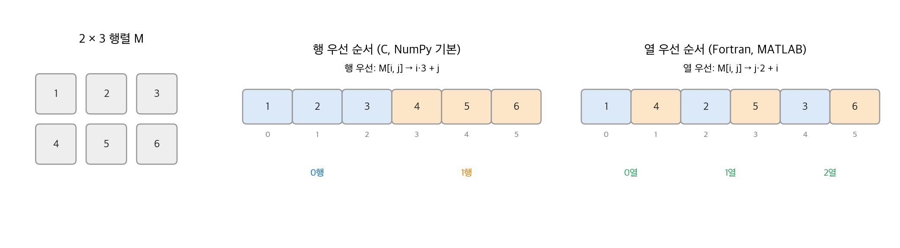
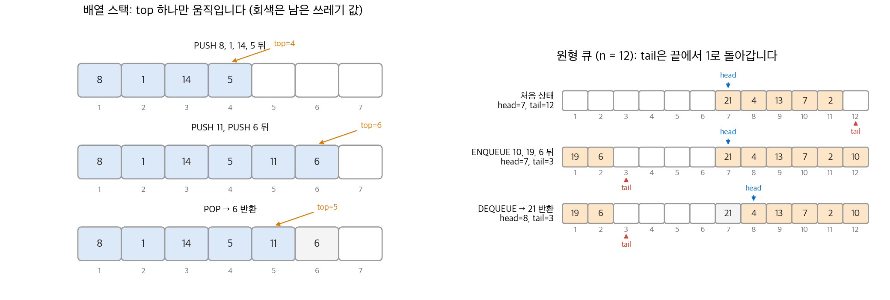
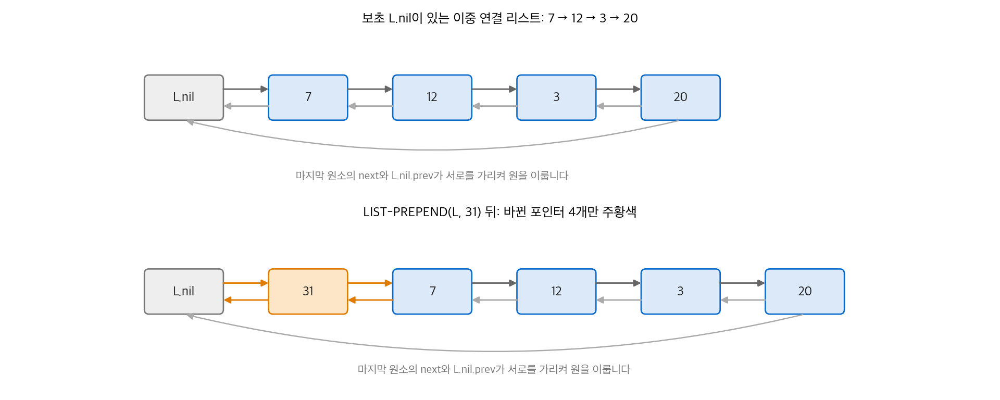
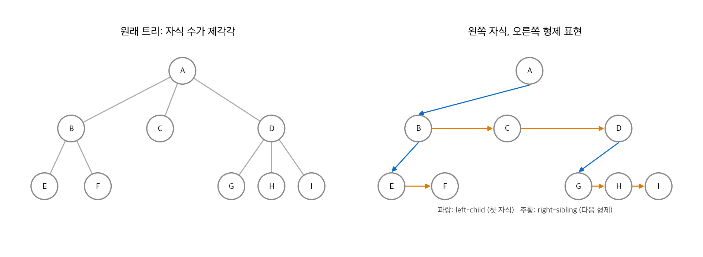

# 10. 기본 자료 구조

이 장은 동적 집합(dynamic set)을 표현하는 가장 단순한 구조를 다룹니다. 동적 집합은 알고리즘이 실행되는 동안 원소가 들어오고 나가는 집합입니다. 배열과 행렬은 연속된 메모리에 원소를 놓고, 스택과 큐는 배열 위에서 삭제할 원소를 미리 정합니다. 연결 리스트와 루트 트리는 포인터로 원소 사이의 순서와 계층을 표현합니다. 뒤의 해시 테이블, 이진 탐색 트리, 그래프 알고리즘은 모두 이 구조 위에 세워집니다.

!!! info "원문과 자료"
    - 원문: CLRS 4판 10장 Elementary Data Structures (10.1~10.3).
    - 생략: 연습 문제와 장 끝 문제(정렬·비정렬 리스트의 연산 비교, 정렬된 압축 리스트 탐색).
    - 4판은 3판의 10.3절 "포인터와 객체의 구현"(배열로 포인터 흉내 내기)을 뺐습니다. 이 노트도 다루지 않습니다.
    - 함께 읽기: [11. 해시 테이블](11-hash-tables.md)(체이닝의 연결 리스트), [12. 이진 탐색 트리](12-bst.md)(이진 트리 표현), [20. 기본 그래프 알고리즘](20-graph-basics.md)(인접 리스트)

## 1. 배열

### 주소 계산

배열은 메모리의 연속된 바이트에 저장됩니다. 첫 원소의 인덱스를 $s$, 시작 주소를 $a$, 원소 하나의 크기를 $b$ 바이트라고 합니다. 그러면 $i$ 번째 원소는 다음 바이트 범위를 차지합니다.

$$
a + b(i - s) \;\;\text{부터}\;\; a + b(i - s + 1) - 1 \;\;\text{까지}
$$

예를 들어 4바이트 정수 배열이 주소 1000에서 시작하고 인덱스가 1부터이면, 5번째 원소는 $1000 + 4 \cdot 4 = 1016$ 부터 1019까지입니다. 주소 계산이 곱셈 하나와 덧셈 하나이므로 RAM 모델에서 어떤 원소든 상수 시간에 접근합니다.

원소 크기가 다르면 이 식을 쓸 수 없습니다. 이때 배열에는 객체 자체 대신 객체를 가리키는 포인터를 넣습니다. 포인터는 크기가 같으므로 식으로 포인터의 위치를 찾고, 포인터를 한 번 따라가 객체에 접근합니다. Python의 `list` 가 이 방식입니다.

## 2. 행렬

### 행 우선과 열 우선

$m \times n$ 행렬은 보통 1차원 배열 하나에 저장합니다. **행 우선(row-major)** 은 행을 차례로 놓고, **열 우선(column-major)** 은 열을 차례로 놓습니다. 인덱스가 0부터이면 $M[i, j]$ 의 위치는 다음과 같습니다.

| 저장 순서 | 0부터 셀 때 | 1부터 셀 때 |
| --- | --- | --- |
| 행 우선 | $ni + j$ | $n(i-1) + j$ |
| 열 우선 | $i + mj$ | $i + m(j-1)$ |

<figure markdown>

<figcaption markdown>
<span class="fig-title"><b>Figure 1.</b> 행 우선과 열 우선 저장</span>

같은 $2 \times 3$ 행렬이 저장 순서에 따라 1차원 배열의 다른 위치에 놓입니다.
</figcaption>
</figure>

$M = \begin{pmatrix} 1 & 2 & 3 \\ 4 & 5 & 6 \end{pmatrix}$ 에서 1부터 세면 $M[2, 1] = 4$ 입니다. 행 우선 위치는 $3(2-1) + 1 = 4$ 이고, 열 우선 위치는 $2 + 2(1-1) = 2$ 입니다. 그림의 배열(0부터 표시)에서 각각 인덱스 3과 1입니다.

```python
import numpy as np
M = np.array([[1, 2, 3], [4, 5, 6]])
print(M.ravel(order="C"))   # [1 2 3 4 5 6]  행 우선
print(M.ravel(order="F"))   # [1 4 2 5 3 6]  열 우선
```

### 다른 표현

- **여러 배열 표현**: 행마다 배열을 하나씩 두고, 행 배열을 가리키는 포인터 배열을 둡니다. 원소 $M[i, j]$ 는 `A[i][j]` 입니다. 행 길이가 달라도 되므로 **들쭉날쭉한 배열(ragged array)** 을 만들 수 있습니다. 단일 배열 표현보다 보통 느립니다.
- **블록 표현**: 행렬을 작은 블록으로 나누고 블록마다 연속으로 저장합니다. $4 \times 4$ 행렬을 $2 \times 2$ 블록으로 나누면 왼쪽 위 블록 4개 원소가 먼저 오고, 오른쪽 위 블록이 이어집니다. 블록 하나가 캐시에 들어가므로 행렬 곱셈 같은 연산에서 캐시 적중률이 높습니다.

저장 순서는 성능에 직접 영향을 줍니다. 행 우선 배열을 열 방향으로 훑으면 원소 하나마다 $n$ 칸씩 건너뛰므로 캐시 블록을 거의 재사용하지 못합니다.

## 3. 스택과 큐

스택과 큐는 DELETE 연산이 지울 원소를 미리 정해 둔 동적 집합입니다.

- **스택(stack)** 은 가장 최근에 넣은 원소를 지웁니다. 이 정책을 **후입 선출(LIFO, last-in first-out)** 이라고 합니다. 삽입은 PUSH, 삭제는 POP이라고 부릅니다.
- **큐(queue)** 는 가장 오래 있던 원소를 지웁니다. 이 정책을 **선입 선출(FIFO, first-in first-out)** 이라고 합니다. 삽입은 ENQUEUE, 삭제는 DEQUEUE라고 부릅니다.

### 배열 스택

크기 $n$ 인 배열 $S[1:n]$ 과 속성 `S.top` 으로 스택을 만듭니다. `S.top` 은 가장 최근에 넣은 원소의 인덱스입니다. 원소는 $S[1 : S.top]$ 에 있고, $S[1]$ 이 바닥, $S[S.top]$ 이 꼭대기입니다. `S.top = 0` 이면 스택이 비어 있습니다.

```python
class Stack:
    def __init__(self, n):
        self.S, self.top = [None] * (n + 1), 0     # S[1..n] 사용

    def empty(self):
        return self.top == 0

    def push(self, x):
        if self.top == len(self.S) - 1:
            raise OverflowError("overflow")
        self.top += 1
        self.S[self.top] = x

    def pop(self):
        if self.empty():
            raise IndexError("underflow")
        self.top -= 1
        return self.S[self.top + 1]
```

빈 스택에서 POP하면 **언더플로(underflow)**, 꽉 찬 스택에 PUSH하면 **오버플로(overflow)** 입니다. 세 연산은 모두 $O(1)$ 입니다.

### 원형 큐

크기 $n$ 인 배열 $Q[1:n]$ 으로 원소를 최대 $n - 1$ 개 담는 큐를 만듭니다.

- `Q.head` 는 큐의 머리, 곧 다음에 꺼낼 원소의 위치입니다.
- `Q.tail` 은 다음 원소를 넣을 위치입니다.
- 원소는 `Q.head`, `Q.head + 1`, ..., `Q.tail - 1` 에 있고, 위치 $n$ 다음은 위치 1입니다. 배열의 끝과 처음이 이어진 원처럼 동작합니다.
- `Q.head == Q.tail` 이면 큐가 비어 있습니다. `Q.head == Q.tail + 1` 이면 (또는 head가 1이고 tail이 $n$ 이면) 큐가 꽉 찼습니다.

칸 하나를 비워 두는 이유는 빈 큐와 꽉 찬 큐를 구별하기 위해서입니다. $n$ 칸을 모두 쓰면 두 상태 모두 `head == tail` 이 됩니다.

<figure markdown>

<figcaption markdown>
<span class="fig-title"><b>Figure 2.</b> 배열 스택과 원형 큐</span>

스택은 top만, 큐는 head와 tail을 움직이고, 큐의 tail은 배열 끝에서 1로 돌아갑니다.
</figcaption>
</figure>

```python
class Queue:
    def __init__(self, n):
        self.Q, self.n = [None] * (n + 1), n        # Q[1..n] 사용
        self.head = self.tail = 1

    def enqueue(self, x):
        nxt = 1 if self.tail == self.n else self.tail + 1
        if nxt == self.head:
            raise OverflowError("overflow")
        self.Q[self.tail] = x
        self.tail = nxt

    def dequeue(self):
        if self.head == self.tail:
            raise IndexError("underflow")
        x = self.Q[self.head]
        self.head = 1 if self.head == self.n else self.head + 1
        return x
```

그림의 큐는 $n = 12$ 이고 처음에 위치 7~11에 원소 5개가 있습니다. ENQUEUE 3번 뒤에는 10이 위치 12에, 19와 6이 위치 1과 2에 들어가고 tail은 3이 됩니다. 이어서 DEQUEUE하면 위치 7의 21을 돌려주고 head는 8이 됩니다. 21은 배열에 남아 있지만 큐의 원소가 아닙니다.

## 4. 연결 리스트

### 이중 연결 리스트

**연결 리스트(linked list)** 는 원소 사이의 순서를 인덱스가 아니라 원소 안의 포인터로 정합니다. 이중 연결 리스트의 원소는 `key`, `next`, `prev` 속성을 가집니다. `L.head` 는 첫 원소를 가리킵니다. 첫 원소의 `prev` 와 마지막 원소의 `next` 는 NIL입니다.

| 연산 | 동작 | 시간 |
| --- | --- | --- |
| LIST-SEARCH$(L, k)$ | 머리부터 `next` 를 따라가며 키 $k$ 를 찾습니다 | 최악 $\Theta(n)$ |
| LIST-PREPEND$(L, x)$ | $x$ 를 머리 앞에 붙입니다 | $O(1)$ |
| LIST-INSERT$(x, y)$ | $x$ 를 원소 $y$ 바로 뒤에 넣습니다 | $O(1)$ |
| LIST-DELETE$(L, x)$ | 포인터 $x$ 가 가리키는 원소를 뺍니다 | $O(1)$ |

LIST-DELETE는 원소의 포인터를 받으므로 $O(1)$ 입니다. 키로 지우려면 먼저 LIST-SEARCH를 해야 하므로 $\Theta(n)$ 이 됩니다.

배열과 비교하면 장단점이 반대입니다. 배열은 $k$ 번째 원소에 $O(1)$ 에 접근하지만 맨 앞에 넣거나 빼려면 원소를 모두 밀어야 하므로 $\Theta(n)$ 입니다. 연결 리스트는 맨 앞 삽입·삭제가 $O(1)$ 이지만 $k$ 번째 원소에 가려면 $\Theta(k)$ 입니다.

### 보초

경계 조건이 코드를 복잡하게 만듭니다. LIST-DELETE는 $x$ 가 머리인지, 꼬리인지 따로 확인해야 합니다. **보초(sentinel)** 는 경계 조건을 없애는 가짜 원소 `L.nil` 입니다.

- NIL을 가리키던 포인터는 모두 `L.nil` 을 가리킵니다.
- 리스트는 원형이 됩니다. `L.nil.next` 가 머리, `L.nil.prev` 가 꼬리입니다. 머리의 `prev` 와 꼬리의 `next` 는 `L.nil` 입니다.
- 빈 리스트는 `L.nil` 하나이고, `L.nil.next` 와 `L.nil.prev` 가 모두 자기 자신입니다.

<figure markdown>

<figcaption markdown>
<span class="fig-title"><b>Figure 3.</b> 보초가 있는 원형 이중 연결 리스트</span>

머리 앞에 원소를 넣을 때 바뀌는 포인터는 새 원소 양쪽의 4개뿐입니다.
</figcaption>
</figure>

```python
class Node:
    def __init__(self, key=None):
        self.key, self.prev, self.next = key, self, self

class SentinelList:
    def __init__(self):
        self.nil = Node()                 # 빈 리스트: nil이 자신을 가리킴

    def insert(self, x, y):              # LIST-INSERT'(x, y): y 뒤에 x
        x.next = y.next
        x.prev = y
        y.next.prev = x
        y.next = x

    def prepend(self, x):
        self.insert(x, self.nil)

    def delete(self, x):                 # LIST-DELETE'(x): 분기가 없습니다
        x.prev.next = x.next
        x.next.prev = x.prev

    def search(self, k):                 # LIST-SEARCH'(L, k)
        self.nil.key = k                 # 보초에 키를 넣어 반드시 찾게 함
        x = self.nil.next
        while x.key != k:
            x = x.next
        self.nil.key = None
        return None if x is self.nil else x

L = SentinelList()
for k in [20, 3, 12, 7]:
    L.prepend(Node(k))                   # 7 → 12 → 3 → 20
L.prepend(Node(31))
print(L.search(3).key, L.search(99))     # 3 None
```

머리에 넣기(prepend)는 `y = L.nil` 로 INSERT를 부르는 것입니다. 꼬리에 넣기는 `y = L.nil.prev` 로 부릅니다. 두 연산 모두 따로 코드를 쓰지 않아도 됩니다.

4판의 LIST-SEARCH′는 보초를 한 번 더 활용합니다. 원래 탐색 루프는 매 반복마다 "끝에 도달했는가"와 "키가 같은가"를 함께 검사합니다. 보초의 키에 찾는 키를 넣어 두면 루프는 반드시 멈추므로 키 비교 하나만 하면 됩니다. 점근 시간은 같고 상수만 줄어듭니다.

보초는 공짜가 아닙니다. 작은 리스트를 아주 많이 만들면 보초마다 메모리를 씁니다. 원문은 보초를 코드가 실제로 단순해질 때만 쓰라고 권합니다.

## 5. 루트 트리 표현

### 이진 트리

이진 트리의 노드는 `p` (부모), `left` (왼쪽 자식), `right` (오른쪽 자식) 포인터를 가집니다. 루트의 `p` 는 NIL입니다. 자식이 없으면 해당 포인터가 NIL입니다. 트리 $T$ 의 속성 `T.root` 가 루트를 가리키고, `T.root` 가 NIL이면 트리가 비어 있습니다. [12장](12-bst.md)의 이진 탐색 트리가 이 표현을 씁니다.

### 자식 수에 제한이 없는 트리

자식 수의 상한 $k$ 가 있으면 자식 포인터를 $k$ 개 두면 됩니다. 하지만 대부분의 노드가 자식이 적으면 메모리가 낭비됩니다. 상한이 없으면 이 방법을 쓸 수 없습니다.

**왼쪽 자식, 오른쪽 형제(left-child, right-sibling) 표현** 은 자식 수와 상관없이 노드마다 포인터 3개만 씁니다.

- `x.left_child` 는 $x$ 의 가장 왼쪽 자식을 가리킵니다.
- `x.right_sibling` 은 $x$ 바로 오른쪽의 형제를 가리킵니다.
- `x.p` 는 부모를 가리킵니다.

자식이 $d$ 개인 노드의 자식들은 첫 자식에서 시작하는 단일 연결 리스트가 됩니다. 노드가 $n$ 개이면 공간은 $O(n)$ 입니다.

<figure markdown>

<figcaption markdown>
<span class="fig-title"><b>Figure 4.</b> 왼쪽 자식, 오른쪽 형제 표현</span>

자식이 몇 개든 노드마다 첫 자식 포인터와 다음 형제 포인터 두 개로 표현합니다.
</figcaption>
</figure>

```python
class TNode:
    def __init__(self, key):
        self.key, self.p, self.left_child, self.right_sibling = key, None, None, None

def add_children(u, keys):
    prev = None
    for k in keys:
        c = TNode(k); c.p = u
        if prev is None: u.left_child = c
        else: prev.right_sibling = c
        prev = c
    return u

def preorder(x, depth=0):
    while x:
        print("  " * depth + x.key)
        preorder(x.left_child, depth + 1)
        x = x.right_sibling
```

그림의 트리에서 D의 자식 G, H, I를 찾으려면 `D.left_child` 로 G에 간 뒤 `right_sibling` 을 두 번 따라갑니다. $i$ 번째 자식에 가는 시간은 $\Theta(i)$ 입니다. 이 표현은 그 비용 대신 공간을 아낍니다.

### 다른 표현

용도에 따라 포인터를 줄이거나 바꿉니다. [6장](06-heapsort.md)의 힙은 완전 이진 트리를 배열 하나에 저장하고, 부모와 자식을 인덱스 계산으로 찾습니다. [19장](19-disjoint-sets.md)의 서로소 집합 포리스트는 트리를 위로만 올라가므로 부모 포인터만 둡니다.

## 정리

| 구조 | 접근 | 앞 삽입·삭제 | 특징 |
| --- | --- | --- | --- |
| 배열 | $k$ 번째 원소 $O(1)$ | $\Theta(n)$ | 주소 계산, 연속 메모리 |
| 스택 (배열) | 꼭대기만 | PUSH·POP $O(1)$ | LIFO, top 하나 |
| 큐 (원형 배열) | 머리만 | ENQUEUE·DEQUEUE $O(1)$ | FIFO, 칸 하나는 비움 |
| 이중 연결 리스트 | $k$ 번째 원소 $\Theta(k)$ | $O(1)$ | 보초로 경계 조건 제거 |
| 왼쪽 자식·오른쪽 형제 트리 | $i$ 번째 자식 $\Theta(i)$ | 자식 추가 $O(1)$ | 노드당 포인터 3개 |

- 배열은 접근이 빠르고 중간 삽입이 느립니다. 연결 리스트는 그 반대입니다.
- 원형 버퍼와 보초는 모두 "끝"을 없애 경계 조건을 단순하게 만드는 방법입니다.
- 트리 표현은 자주 하는 연산(자식 순회, 부모 찾기)에 맞춰 포인터를 고릅니다.
