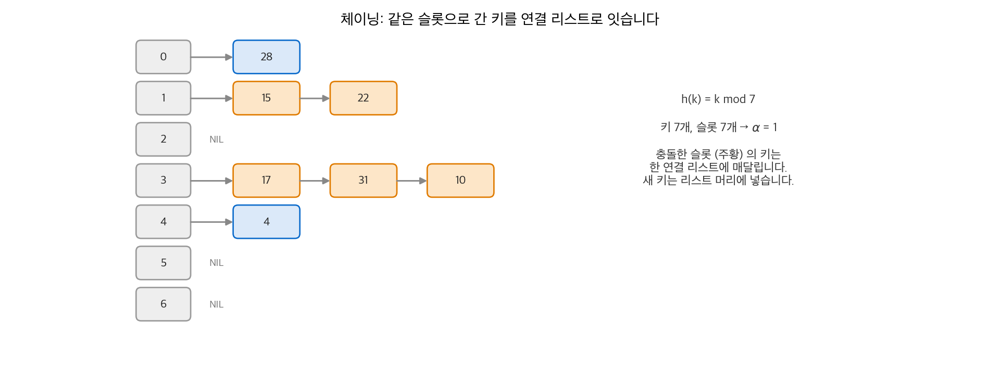
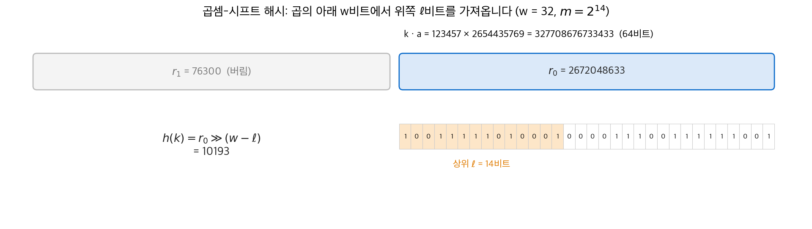
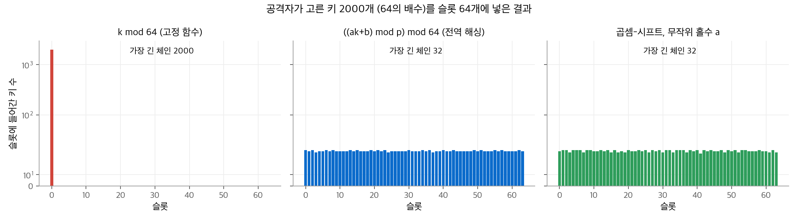
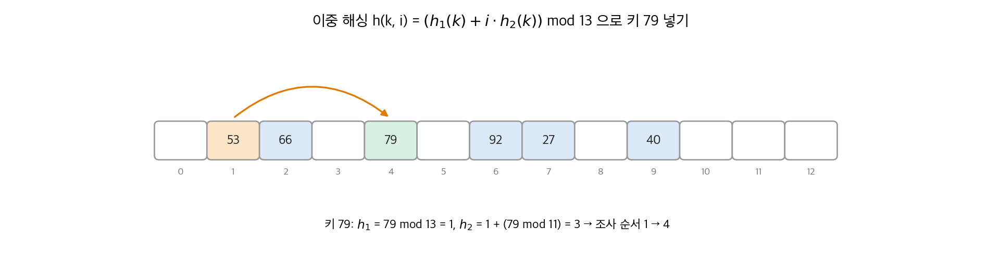
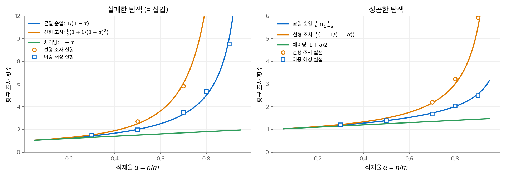
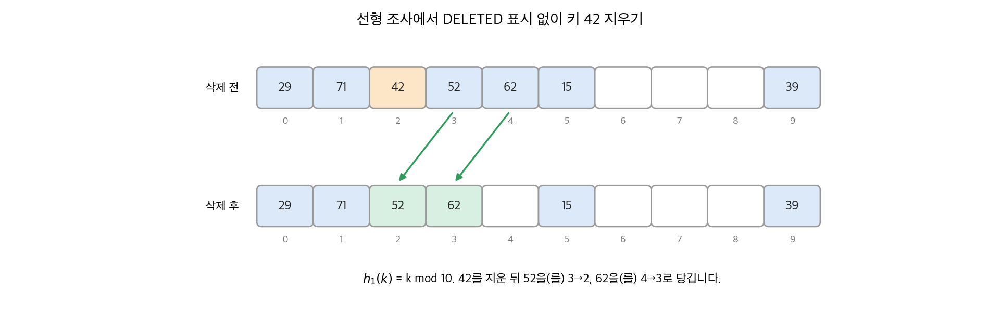

# 11. 해시 테이블

많은 응용은 INSERT, SEARCH, DELETE 세 연산만 쓰는 동적 집합이 필요합니다. 이런 집합을 **사전(dictionary)** 이라고 합니다. 컴파일러의 심볼 테이블, Python의 `dict`, 데이터베이스의 해시 인덱스가 예입니다. **해시 테이블(hash table)** 은 사전을 구현하는 대표 구조입니다. 최악 탐색 시간은 연결 리스트와 같은 $\Theta(n)$ 이지만, 합리적인 가정 아래 평균 탐색 시간은 $O(1)$ 입니다.

이 장의 핵심은 두 가지입니다. 첫째, 충돌을 해결하는 방법(체이닝과 개방 주소법)과 그 분석입니다. 둘째, 해시 함수를 고르는 방법입니다. 4판은 이 부분을 크게 바꿨습니다. 고정된 해시 함수 대신 무작위로 고른 해시 함수를 권하고, 캐시가 있는 현대 컴퓨터에서 선형 조사가 유리하다는 실용 절을 새로 넣었습니다.

!!! info "원문과 자료"
    - 원문: CLRS 4판 11장 Hash Tables (11.1~11.5).
    - 생략: 연습 문제와 장 끝 문제(최장 조사 길이, 정적 집합 탐색, 체인 길이 상한, 인증 코드).
    - 별표 절 11.5.2(계층 메모리용 해시 함수)는 wee 해시 함수만 요약합니다.
    - 함께 읽기: [5. 확률적 분석과 무작위 알고리즘](05-randomized.md)(지시 확률 변수), [10. 기본 자료 구조](10-elementary-ds.md)(연결 리스트), [31. 정수론 알고리즘](31-number-theory.md)(모듈러 역원), [32. 문자열 매칭](32-string-matching.md)(Rabin-Karp의 롤링 해시)

## 1. 직접 주소 테이블

키가 전체 집합(universe) $U = \{0, 1, \ldots, m-1\}$ 에서 오고 $m$ 이 작으면, 크기 $m$ 인 배열 $T$ 를 두고 키 $k$ 를 칸 $T[k]$ 에 넣습니다. 이 배열을 **직접 주소 테이블(direct-address table)** 이라고 하고, 각 칸을 **슬롯(slot)** 이라고 합니다. 세 연산은 모두 $O(1)$ 입니다.

```python
T = [None] * m
def direct_insert(x): T[x.key] = x
def direct_search(k): return T[k]
def direct_delete(x): T[x.key] = None
```

문제는 공간입니다. $|U|$ 가 크면 배열을 만들 수 없습니다. 64비트 정수 키라면 슬롯이 $2^{64}$ 개 필요합니다. 실제로 저장하는 키 집합 $K$ 가 $U$ 보다 훨씬 작으면 대부분의 슬롯이 비어 낭비됩니다.

## 2. 해시 테이블과 체이닝

### 해시 함수

해시 테이블은 크기를 $|K|$ 에 비례하게 $\Theta(|K|)$ 로 줄입니다. 키 $k$ 를 슬롯 $k$ 가 아니라 슬롯 $h(k)$ 에 넣습니다. $h$ 는 **해시 함수(hash function)** 입니다.

$$
h : U \to \{0, 1, \ldots, m - 1\}
$$

$h(k)$ 를 키 $k$ 의 **해시 값** 이라고 하고, "$k$ 가 슬롯 $h(k)$ 로 해시된다"고 말합니다. $|U| > m$ 이므로 두 키가 같은 슬롯으로 가는 **충돌(collision)** 을 피할 수 없습니다. 비둘기집 원리 때문입니다. 따라서 충돌을 줄이는 해시 함수와 충돌을 처리하는 방법이 모두 필요합니다.

### 체이닝

**체이닝(chaining)** 은 같은 슬롯으로 간 원소를 한 연결 리스트에 담습니다. 슬롯 $j$ 는 해시 값이 $j$ 인 원소 리스트의 머리를 가리킵니다.

- CHAINED-HASH-INSERT$(T, x)$: $x$ 를 리스트 $T[h(x.key)]$ 의 머리에 넣습니다. $O(1)$ 입니다.
- CHAINED-HASH-SEARCH$(T, k)$: 리스트 $T[h(k)]$ 에서 키 $k$ 를 찾습니다. 리스트 길이에 비례합니다.
- CHAINED-HASH-DELETE$(T, x)$: 리스트가 이중 연결이면 $O(1)$ 입니다. 단일 연결이면 $x$ 의 앞 원소를 찾아야 하므로 탐색과 같은 시간이 듭니다.

<figure markdown>

<figcaption markdown>
<span class="fig-title"><b>Figure 1.</b> 체이닝으로 충돌 해결</span>

같은 슬롯으로 간 키는 그 슬롯의 연결 리스트에 차례로 매달립니다.
</figcaption>
</figure>

그림은 키 10, 22, 31, 4, 15, 28, 17을 이 순서로 $h(k) = k \bmod 7$ 에 넣은 결과입니다. 10, 31, 17은 나머지가 3이라 슬롯 3에 매달리고, 마지막에 넣은 17이 머리에 있습니다.

```python
m = 7
table = [[] for _ in range(m)]
for k in [10, 22, 31, 4, 15, 28, 17]:
    table[k % m].insert(0, k)          # 리스트 머리에 삽입
for j, chain in enumerate(table):
    print(j, chain)
# 0 [28]
# 1 [15, 22]
# 2 []
# 3 [17, 31, 10]
# 4 [4]
# 5 []
# 6 []
```

$\alpha = 1$ 인데도 가장 긴 체인은 3이고 빈 슬롯은 3개입니다. 무작위 해시 값이라도 슬롯마다 원소 수는 고르지 않습니다. 분석은 이 길이의 기댓값을 다룹니다.

### 적재율과 독립 균일 해싱

슬롯이 $m$ 개이고 원소가 $n$ 개이면 **적재율(load factor)** 은 $\alpha = n/m$ 입니다. 체인의 평균 길이입니다. $\alpha$ 는 1보다 작을 수도, 클 수도 있습니다.

분석에는 이상화된 가정이 필요합니다. **독립 균일 해싱(independent uniform hashing)** 은 각 키의 해시 값이 $\{0, \ldots, m-1\}$ 에서 균일하고, 서로 다른 키의 해시 값이 서로 독립이라는 가정입니다. 이런 함수를 **무작위 오라클(random oracle)** 이라고도 합니다. 같은 키는 물론 항상 같은 값으로 갑니다.

**정리 11.1.** 독립 균일 해싱 아래, 체이닝 해시 테이블에서 실패한 탐색은 평균 $\Theta(1 + \alpha)$ 시간이 걸립니다.

찾는 키 $k$ 는 슬롯 $h(k)$ 로 갑니다. 그 리스트의 기대 길이는 $\alpha$ 이고, 실패한 탐색은 리스트 전체를 봅니다. 해시 계산 1을 더하면 $\Theta(1 + \alpha)$ 입니다.

**정리 11.2.** 같은 가정 아래 성공한 탐색도 평균 $\Theta(1 + \alpha)$ 입니다.

원소 $x$ 를 찾을 때 보는 원소 수는 "$x$ 보다 나중에 들어와 같은 리스트에서 $x$ 앞에 있는 원소 수 + 1"입니다. $x_i$ 를 $i$ 번째로 넣은 원소라 하고, 지시 확률 변수 $X_{ij} = I\{h(k_i) = h(k_j)\}$ 를 씁니다. $\Pr\{h(k_i) = h(k_j)\} = 1/m$ 이므로 다음과 같습니다.

$$
\mathbb{E}\left[\frac{1}{n}\sum_{i=1}^{n}\Big(1 + \sum_{j=i+1}^{n} X_{ij}\Big)\right]
= 1 + \frac{1}{nm}\sum_{i=1}^{n}(n - i)
= 1 + \frac{n-1}{2m}
= 1 + \frac{\alpha}{2} - \frac{\alpha}{2n}
$$

$n = O(m)$ 이면 $\alpha = O(1)$ 이므로 모든 연산이 평균 $O(1)$ 입니다. 분석은 균일성과 쌍마다의 충돌 확률 $1/m$ 만 씁니다. 이 관찰이 3절의 전역 해싱으로 이어집니다.

## 3. 해시 함수

### 좋은 해시 함수란

좋은 해시 함수는 독립 균일 해싱을 근사합니다. 하지만 키의 분포를 모르고, 키가 독립적으로 뽑히지도 않습니다. 실제 키에는 패턴이 많습니다. 예를 들어 변수 이름 `pt` 와 `pts` 처럼 비슷한 문자열이 함께 나옵니다. 이 절은 키를 자연수로 생각합니다. 문자열 같은 키는 바이트를 이어 붙여 큰 수로 해석합니다.

4판은 해시 함수를 두 가지로 나눕니다.

- **정적 해싱(static hashing)**: 고정된 해시 함수 하나를 씁니다. 무작위성은 입력 키의 분포에만 있습니다. 원문은 더 이상 권하지 않습니다.
- **무작위 해싱(random hashing)**: 프로그램 시작 때 해시 함수 집합(family)에서 함수 하나를 무작위로 고릅니다. 키와 독립적으로 고르므로 특정 입력이 항상 최악이 되지 않습니다.

### 나눗셈 방법과 곱셈 방법

**나눗셈 방법(division method)** 은 $h(k) = k \bmod m$ 입니다. 나눗셈 하나라 빠릅니다. $m$ 이 2의 거듭제곱에서 멀리 떨어진 소수일 때 잘 동작하는 경향이 있습니다. 하지만 평균 성능을 보장하지 않습니다. 테이블 크기가 소수여야 한다는 제약도 생깁니다.

**곱셈 방법(multiplication method)** 은 상수 $0 < A < 1$ 을 곱하고 소수 부분을 $m$ 배합니다.

$$
h(k) = \lfloor m \,(kA \bmod 1) \rfloor
$$

여기서 $kA \bmod 1 = kA - \lfloor kA \rfloor$ 입니다. $m$ 의 값이 중요하지 않다는 것이 장점입니다.

### 곱셈-시프트 방법

곱셈 방법은 $m = 2^\ell$ 일 때 가장 빠르게 구현됩니다. $w$ 를 기계 워드의 비트 수라 하고, $w$ 비트 정수 $a = A \cdot 2^w$ 를 고릅니다. **곱셈-시프트(multiply-shift)** 해시 함수는 다음과 같습니다.

$$
h_a(k) = (ka \bmod 2^w) \ggg (w - \ell)
$$

$ka$ 는 $2w$ 비트이고 $r_1 2^w + r_0$ 으로 씁니다. $\bmod 2^w$ 는 위쪽 워드 $r_1$ 을 버리고 아래쪽 워드 $r_0$ 만 남깁니다. 논리 오른쪽 시프트 $\ggg (w - \ell)$ 은 $r_0$ 의 상위 $\ell$ 비트를 꺼냅니다. 곱셈, 뺄셈, 시프트 명령 세 개로 구현됩니다. 곱셈이 $w$ 비트 결과만 내는 기계에서도 동작합니다.

<figure markdown>

<figcaption markdown>
<span class="fig-title"><b>Figure 2.</b> 곱셈-시프트 해시</span>

곱의 아래 $w$ 비트 $r_0$ 에서 상위 $\ell$ 비트가 해시 값입니다.
</figcaption>
</figure>

예: $w = 32$, $\ell = 14$ ($m = 16384$), $k = 123457$, Knuth가 제안한 $a = 2654435769$ ($\approx 2^{32}(\sqrt5 - 1)/2$) 입니다.

- $ka = 327708676733433 = 76300 \cdot 2^{32} + 2672048633$ 이므로 $r_1 = 76300$, $r_0 = 2672048633$ 입니다.
- $r_0$ 의 상위 14비트는 $2672048633 \ggg 18 = 10193$ 입니다.

```python
def multiply_shift(k, a, w=32, l=14):
    return ((k * a) % (1 << w)) >> (w - l)

print(multiply_shift(123457, 2654435769))   # 10193
```

곱셈-시프트도 고정된 $a$ 를 쓰면 정적 해싱이라 평균 성능을 보장하지 않습니다. 시작할 때 $a$ 를 **무작위 홀수** 로 고르면 무작위 해싱이 됩니다.

### 무작위 해싱과 전역 해싱

고정된 해시 함수에는 항상 나쁜 입력이 있습니다. 해시 함수를 아는 공격자는 모두 한 슬롯으로 가는 키 $n$ 개를 골라 탐색 시간을 $\Theta(n)$ 으로 만들 수 있습니다. 2011년에 여러 웹 프레임워크가 이 방식의 서비스 거부 공격(hash flooding)을 받았습니다. 이후 Python, Ruby, Perl 등은 프로세스마다 무작위 시드를 쓰는 해시로 바꿨습니다.

함수 집합 $\mathcal{H}$ 가 다음 조건을 만족하면 **전역(universal)** 이라고 합니다. 서로 다른 모든 키 쌍 $k_1 \ne k_2$ 에 대해 $h(k_1) = h(k_2)$ 인 함수가 $|\mathcal{H}|/m$ 개 이하입니다. 즉 $h$ 를 무작위로 고르면 충돌 확률이 $1/m$ 이하입니다.

**따름 정리 11.3.** 전역 해싱과 체이닝을 쓰고 처음에 빈 슬롯 $m$ 개 테이블에서, INSERT가 $n = O(m)$ 번 들어 있는 연산 $s$ 개는 기댓값 $\Theta(s)$ 시간에 처리됩니다.

정리 11.2의 분석은 충돌 확률 $1/m$ 만 썼습니다. 전역 집합은 이 확률을 보장하므로 같은 결론이 나옵니다. 중요한 점은 기댓값이 해시 함수 선택에 대한 것이라는 점입니다. 공격자가 키를 어떻게 골라도 성립합니다.

<figure markdown>

<figcaption markdown>
<span class="fig-title"><b>Figure 3.</b> 공격 키에서 고정 해시와 무작위 해시</span>

64의 배수 2000개는 $k \bmod 64$ 에서 모두 슬롯 0으로 가지만, 무작위로 고른 함수에서는 고르게 퍼집니다.
</figcaption>
</figure>

원문은 해시 함수 집합의 성질을 몇 가지로 정리합니다. $h$ 는 $\mathcal{H}$ 에서 균일하게 고른 함수입니다.

| 성질 | 정의 |
| --- | --- |
| 균일(uniform) | 모든 키 $k$ 와 슬롯 $q$ 에 대해 $\Pr\{h(k) = q\} = 1/m$ |
| 전역(universal) | 서로 다른 $k_1, k_2$ 에 대해 $\Pr\{h(k_1) = h(k_2)\} \le 1/m$ |
| $\epsilon$-전역 | 서로 다른 $k_1, k_2$ 에 대해 $\Pr\{h(k_1) = h(k_2)\} \le \epsilon$ |
| $d$-독립 | 서로 다른 $k_1, \ldots, k_d$ 와 임의의 $q_1, \ldots, q_d$ 에 대해 $\Pr\{h(k_i) = q_i,\ \forall i\} = 1/m^d$ |

전역 집합은 균일하지 않을 수 있습니다. 예를 들어 항등 함수 하나뿐인 집합은 $U = \{0, \ldots, m-1\}$ 에서 충돌 확률이 0이므로 전역이지만, 각 키의 해시 값이 고정되어 있습니다.

### 정수론 기반 전역 집합

모든 키보다 큰 소수 $p$ 를 고릅니다. $a \in \{1, \ldots, p-1\}$, $b \in \{0, \ldots, p-1\}$ 에 대해 다음 함수를 정의합니다.

$$
h_{ab}(k) = \big((ak + b) \bmod p\big) \bmod m, \qquad
\mathcal{H}_{pm} = \{h_{ab}\}
$$

함수는 $p(p-1)$ 개이고 $m$ 은 소수일 필요가 없습니다. 예: $p = 17$, $m = 6$, $a = 5$, $b = 2$ 이면 $h_{5,2}(11) = (57 \bmod 17) \bmod 6 = 6 \bmod 6 = 0$ 입니다.

**정리 11.4.** $\mathcal{H}_{pm}$ 은 전역입니다.

증명의 줄기는 두 단계입니다.

1. **mod $p$ 단계에서는 충돌이 없습니다.** $r_1 = (ak_1 + b) \bmod p$, $r_2 = (ak_2 + b) \bmod p$ 라 하면 $r_1 - r_2 \equiv a(k_1 - k_2) \pmod p$ 입니다. $p$ 가 소수이고 $a$ 와 $k_1 - k_2$ 가 0이 아니므로 곱도 0이 아닙니다. 따라서 $r_1 \ne r_2$ 입니다.
2. **$(a, b)$ 와 $(r_1, r_2)$ 는 일대일 대응입니다.** $a = (r_1 - r_2)(k_1 - k_2)^{-1} \bmod p$, $b = (r_1 - ak_1) \bmod p$ 로 되돌릴 수 있습니다. 쌍의 개수도 $p(p-1)$ 로 같습니다. 따라서 $(a, b)$ 를 균일하게 고르면 $(r_1, r_2)$ 는 서로 다른 값의 쌍 중 균일합니다.

이제 충돌은 $r_1 \equiv r_2 \pmod m$ 인 경우뿐입니다. $r_1$ 을 고정하면 남은 $p - 1$ 개 값 중 $r_1$ 과 mod $m$ 이 같은 값은 $\lceil p/m \rceil - 1 \le (p-1)/m$ 개 이하입니다. 따라서 충돌 확률은 $1/m$ 이하입니다.

### 곱셈-시프트 기반 $2/m$-전역 집합

원문이 실무에 권하는 집합은 홀수 상수를 쓰는 곱셈-시프트 함수 전체입니다.

$$
\mathcal{H} = \{h_a : a \text{ 는 홀수},\ 1 \le a < 2^w\}
$$

**정리 11.5.** 이 집합은 $2/m$-전역입니다. (원문은 증명을 생략합니다.)

충돌 확률 상한이 전역 집합의 두 배입니다. 하지만 계산이 명령 세 개라서 실무에서는 속도 이득이 더 큽니다. 그림 3의 오른쪽이 이 함수의 결과입니다.

### 긴 입력의 해싱

문자열이나 벡터처럼 한 워드에 들어가지 않는 입력도 있습니다.

- **정수론 방법**: 입력을 $\mathbb{Z}_p$ 의 원소 $d$ 개로 나누고 다항식으로 해시합니다. 원문 연습 문제는 이 집합이 $(d-1)/p$-전역임을 보이게 합니다.
- **암호 해시**: SHA-256 같은 함수는 임의 길이 입력을 고정 길이로 바꿉니다. $h(k) = \text{SHA-256}(k) \bmod m$ 으로 쓰고, 무작위 **솔트** $a$ 를 붙여 $h_a(k) = \text{SHA-256}(a \,\|\, k) \bmod m$ 으로 집합을 만듭니다. AES 명령(AES-NI)을 지원하는 CPU에서는 AES 기반 MAC도 충분히 빠릅니다.

## 4. 개방 주소법

### 테이블 안에서 빈 슬롯 찾기

**개방 주소법(open addressing)** 은 모든 원소를 테이블 안에 둡니다. 슬롯에는 원소 하나나 NIL이 들어갑니다. 따라서 테이블이 꽉 찰 수 있고, $\alpha \le 1$ 입니다. 포인터가 없으므로 같은 메모리에 슬롯을 더 많이 둘 수 있습니다.

삽입은 빈 슬롯을 찾을 때까지 슬롯을 차례로 **조사(probe)** 합니다. 조사 순서는 키마다 다릅니다. 해시 함수가 조사 번호 $i$ 를 둘째 입력으로 받습니다.

$$
h : U \times \{0, 1, \ldots, m-1\} \to \{0, 1, \ldots, m-1\}
$$

모든 키의 **조사 순서** $\langle h(k, 0), h(k, 1), \ldots, h(k, m-1) \rangle$ 은 $\langle 0, 1, \ldots, m-1 \rangle$ 의 순열이어야 합니다. 그래야 테이블이 거의 차도 빈 슬롯을 결국 찾습니다.

```python
def hash_insert(T, k, h):
    m = len(T)
    for i in range(m):
        q = h(k, i)
        if T[q] is None:
            T[q] = k
            return q
    raise OverflowError("hash table overflow")

def hash_search(T, k, h):
    m = len(T)
    for i in range(m):
        q = h(k, i)
        if T[q] == k:
            return q
        if T[q] is None:          # 빈 슬롯: k가 있었다면 여기 들어갔을 것
            return None
    return None
```

탐색은 삽입과 같은 조사 순서를 따릅니다. 빈 슬롯을 만나면 실패로 끝냅니다. 키가 있었다면 그 빈 슬롯이나 더 앞에 들어갔을 것이기 때문입니다.

### 삭제가 어려운 이유

슬롯 $q$ 의 키를 지우고 NIL을 넣으면 안 됩니다. 삽입할 때 $q$ 를 지나간 다른 키를 더 이상 찾지 못합니다. 한 가지 해결책은 특수 값 DELETED를 넣는 것입니다. INSERT는 DELETED를 빈 슬롯처럼 쓰고, SEARCH는 DELETED를 건너뜁니다. 그러면 탐색 시간이 더 이상 $\alpha$ 에만 의존하지 않습니다. 그래서 삭제가 잦으면 보통 체이닝을 씁니다. 5절에서 선형 조사는 DELETED 없이도 삭제할 수 있음을 봅니다.

### 이중 해싱

분석은 **독립 균일 순열 해싱(independent uniform permutation hashing)** 을 가정합니다. 각 키의 조사 순서가 $m!$ 개 순열 중 균일하게 뽑힌다는 가정입니다. 실제로 구현하기 어려우므로 이중 해싱으로 근사합니다.

**이중 해싱(double hashing)** 은 보조 해시 함수 $h_1$, $h_2$ 를 씁니다.

$$
h(k, i) = \big(h_1(k) + i \, h_2(k)\big) \bmod m
$$

첫 조사는 $h_1(k)$ 이고, 이후 $h_2(k)$ 만큼씩 건너뜁니다. 테이블 전체를 조사하려면 $h_2(k)$ 가 $m$ 과 서로소여야 합니다. 두 가지 방법이 흔합니다.

- $m$ 을 2의 거듭제곱으로 하고 $h_2$ 가 항상 홀수를 내게 합니다.
- $m$ 을 소수로 하고 $h_2$ 가 $1 \le h_2(k) < m$ 을 내게 합니다. 예: $h_1(k) = k \bmod m$, $h_2(k) = 1 + (k \bmod m')$, $m' = m - 1$.

$m$ 이 소수이거나 2의 거듭제곱이면 $(h_1(k), h_2(k))$ 쌍마다 다른 조사 순서가 나와 $\Theta(m^2)$ 개 순서가 있습니다. $m!$ 보다 훨씬 적지만, 실험에서 이상적인 경우에 가깝게 동작합니다.

<figure markdown>

<figcaption markdown>
<span class="fig-title"><b>Figure 4.</b> 이중 해싱으로 키 넣기</span>

키 79는 첫 슬롯 1이 차 있어 $h_2 = 3$ 만큼 건너뛴 슬롯 4에 들어갑니다.
</figcaption>
</figure>

그림의 테이블은 $m = 13$, $h_1(k) = k \bmod 13$, $h_2(k) = 1 + (k \bmod 11)$ 입니다. 먼저 넣은 53, 66, 27, 92, 40은 모두 $h_1 = 1$ 입니다. 그런데 $h_2$ 가 각각 10, 1, 6, 5, 8로 달라서 서로 다른 슬롯으로 흩어졌습니다. 선형 조사였다면 다섯 키가 슬롯 1~5에 한 덩어리로 붙었을 것입니다.

### 선형 조사

**선형 조사(linear probing)** 는 $h_2(k) = 1$ 인 이중 해싱입니다.

$$
h(k, i) = \big(h_1(k) + i\big) \bmod m
$$

$h_1(k)$ 가 조사 순서 전체를 정하므로 순서가 $m$ 개뿐입니다. 차 있는 슬롯이 연속으로 이어진 덩어리가 생기고, 덩어리에 떨어진 키는 덩어리 끝까지 가야 합니다. 그래서 덩어리가 점점 커집니다. 이 현상을 **1차 군집(primary clustering)** 이라고 합니다.

### 조사 횟수 분석

삭제가 없고 $\alpha < 1$ 이라고 가정합니다.

**정리 11.6.** 독립 균일 순열 해싱 아래, 실패한 탐색의 기대 조사 횟수는 $1/(1 - \alpha)$ 이하입니다.

실패한 탐색에서 마지막을 뺀 모든 조사는 차 있는 슬롯을 봅니다. $X$ 를 조사 횟수라 하면, $i$ 번째 조사가 일어날 확률은 처음 $i - 1$ 번이 모두 차 있을 확률입니다.

$$
\Pr\{X \ge i\} = \frac{n}{m} \cdot \frac{n-1}{m-1} \cdots \frac{n-i+2}{m-i+2} \le \alpha^{i-1}
$$

따라서 $\mathbb{E}[X] = \sum_{i \ge 1} \Pr\{X \ge i\} \le \sum_{i \ge 0} \alpha^i = 1/(1-\alpha)$ 입니다. 해석은 간단합니다. 첫 조사는 항상 하고, 확률 약 $\alpha$ 로 둘째 조사를, 약 $\alpha^2$ 으로 셋째 조사를 합니다.

**따름 정리 11.7.** 삽입의 기대 조사 횟수도 $1/(1 - \alpha)$ 이하입니다. 삽입은 실패한 탐색과 같은 순서로 빈 슬롯을 찾기 때문입니다.

**정리 11.8.** 성공한 탐색의 기대 조사 횟수는 다음 값 이하입니다.

$$
\frac{1}{\alpha} \ln \frac{1}{1 - \alpha}
$$

$(i+1)$ 번째로 넣은 키를 찾는 조사는 그 키를 넣을 때와 같습니다. 그때 적재율은 $i/m$ 이었으므로 기대 조사 횟수는 $m/(m - i)$ 이하입니다. $n$ 개 키에 대해 평균하고 적분으로 위에서 누릅니다.

$$
\frac{1}{n}\sum_{i=0}^{n-1}\frac{m}{m-i} = \frac{1}{\alpha}\sum_{k=m-n+1}^{m}\frac{1}{k} \le \frac{1}{\alpha}\int_{m-n}^{m}\frac{dx}{x} = \frac{1}{\alpha}\ln\frac{m}{m-n}
$$

| $\alpha$ | 실패 (상한) | 성공 (상한) |
| --- | --- | --- |
| 0.5 | 2 | 1.387 |
| 0.75 | 4 | 1.848 |
| 0.9 | 10 | 2.559 |

<figure markdown>

<figcaption markdown>
<span class="fig-title"><b>Figure 5.</b> 적재율과 평균 조사 횟수</span>

이중 해싱 실험은 균일 순열 곡선을 따르고, 선형 조사는 $\alpha$ 가 커질수록 1차 군집 때문에 더 빨리 나빠집니다.
</figcaption>
</figure>

선형 조사의 곡선은 원문이 아니라 Knuth의 고전적 분석입니다. 해시 값이 완전히 무작위라고 가정하면, 실패 탐색은 $\tfrac{1}{2}(1 + 1/(1-\alpha)^2)$, 성공 탐색은 $\tfrac12(1 + 1/(1-\alpha))$ 번입니다. 실험은 슬롯 4001개 테이블에서 측정했습니다. $\alpha = 0.9$ 에서 이중 해싱의 실패 탐색은 9.5번으로 상한 10에 가깝습니다. 같은 $\alpha$ 에서 선형 조사의 이론값은 약 50번이라 그래프 밖에 있습니다.

## 5. 실용적 고려 사항

### 메모리 계층

RAM 모델은 모든 메모리 접근을 같은 비용으로 셉니다. 실제 CPU에는 레지스터, 여러 단계의 캐시, 주 메모리가 있습니다. 위 단계일수록 작고 빠릅니다. 캐시는 64바이트 같은 **캐시 블록** 단위로 주 메모리에서 데이터를 가져옵니다. 그래서 레지스터 안에서만 하는 복잡한 계산이 주 메모리 읽기 한 번보다 빠를 수 있습니다. 같은 캐시 블록을 다시 쓰는 것은 다른 블록을 가져오는 것보다 훨씬 쌉니다.

이 관점에서 조사 횟수는 거친 근사입니다. 4판은 이 사실에서 두 가지 결론을 끌어냅니다. 충돌 해결은 선형 조사가 좋고, 해시 함수는 레지스터 안에서 계산되는 복잡한 함수가 좋습니다.

### 선형 조사의 재평가

선형 조사는 RAM 모델에서 성능이 나빠 자주 무시됩니다. 하지만 연속된 조사가 대개 같은 캐시 블록 안에 있습니다. 8바이트 키라면 한 블록에 슬롯 8개가 들어갑니다. 조사 여러 번이 메모리 접근 한 번 비용으로 끝납니다.

**정리 11.9** (Pagh 외, Thorup). $h_1$ 이 5-독립이고 $\alpha \le 2/3$ 이면, 선형 조사의 탐색·삽입·삭제는 기댓값 상수 시간입니다. $\alpha = 1 - \epsilon$ 이면 기대 시간은 $O(1/\epsilon^2)$ 입니다.

5-독립이 필요하다는 점은 자명하지 않습니다. 원문은 증명을 생략하고 원 논문을 가리킵니다. 실무에서 이 조건은 "해시 함수가 충분히 무작위여야 한다"로 읽습니다. 곱셈-시프트처럼 약한 함수와 선형 조사를 같이 쓰면 정렬된 키 같은 입력에서 군집이 생길 수 있습니다.

### DELETED 없이 선형 조사에서 지우기

선형 조사에서는 모든 키가 같은 순환 순서를 따르고 시작점만 다릅니다. 그래서 지운 자리를 즉시 메울 수 있습니다. 조사 번호의 역함수를 씁니다.

$$
g(k, q) = \big(q - h_1(k)\big) \bmod m
$$

$g(k, q)$ 는 키 $k$ 가 슬롯 $q$ 에 도달하는 조사 번호입니다. LINEAR-PROBING-HASH-DELETE$(T, q)$ 는 다음 순서로 동작합니다.

1. $T[q]$ 를 NIL로 비웁니다.
2. $q$ 다음 슬롯부터 $q'$ 를 하나씩 늘리며 키 $k' = T[q']$ 를 봅니다. $k'$ 가 NIL이면 끝냅니다.
3. $g(k', q) < g(k', q')$ 이면 $k'$ 를 넣을 때 $q$ 를 지나쳤다는 뜻입니다. 이제 $q$ 가 비었으므로 $k'$ 를 찾지 못하게 됩니다. $k'$ 를 $q$ 로 옮기고, $q \leftarrow q'$ 로 바꿔 1단계부터 반복합니다.
4. 그렇지 않으면 $k'$ 는 그대로 두고 2단계를 계속합니다.

```python
def lp_delete(T, q, h1):
    m = len(T)
    while True:
        T[q] = None
        qq = q
        while True:
            qq = (qq + 1) % m
            k = T[qq]
            if k is None:
                return
            if (q - h1(k)) % m < (qq - h1(k)) % m:   # g(k, q) < g(k, q')
                break
        T[q] = k          # k를 빈 자리 q로 당기고, 이제 q'가 빈 자리
        q = qq

m = 10; h1 = lambda k: k % m
T = [None] * m
for k in [71, 42, 52, 15, 62, 39, 29]:
    q = h1(k)
    while T[q] is not None:
        q = (q + 1) % m
    T[q] = k
print(T)   # [29, 71, 42, 52, 62, 15, None, None, None, 39]
lp_delete(T, T.index(42), h1)
print(T)   # [29, 71, 52, 62, None, 15, None, None, None, 39]
```

<figure markdown>

<figcaption markdown>
<span class="fig-title"><b>Figure 6.</b> 선형 조사에서 지우기</span>

42를 지운 뒤 52와 62가 한 칸씩 당겨져, 남은 키를 모두 다시 찾을 수 있습니다.
</figcaption>
</figure>

42를 지우면 슬롯 2가 빕니다. 슬롯 3의 52는 $h_1 = 2$ 라서 $g(52, 2) = 0 < g(52, 3) = 1$ 입니다. 52를 슬롯 2로 옮기면 슬롯 3이 빕니다. 슬롯 4의 62는 $h_1 = 2$ 라서 $g(62, 3) = 1 < g(62, 4) = 2$ 입니다. 62를 슬롯 3으로 옮깁니다. 슬롯 5의 15는 $h_1 = 5$ 라서 $g(15, 4) = 9 > g(15, 5) = 0$ 입니다. 15는 옮기지 않습니다. 슬롯 6이 비어 있으므로 끝납니다.

삽입, 탐색, 삭제의 시간은 모두 "$h_1(k)$ 에서 다음 빈 슬롯까지의 거리"에 비례합니다.

### wee 해시 함수

선형 조사는 5-독립처럼 무작위성이 높은 해시 함수와 함께 쓸 때 가장 좋습니다. 메모리 계층이 있으면 이런 함수도 싸게 계산할 수 있습니다. 4판은 덧셈, 곱셈, 워드 절반 교환만 쓰는 **wee 해시 함수** 를 이 책을 위해 새로 제안합니다. RC6 암호와 관련된 구조이고, 레지스터 안에서만 계산됩니다.

$w$ 를 워드 크기(짝수), $a$ 를 홀수, $\text{swap}(x)$ 를 $w$ 비트 $x$ 의 두 절반을 바꾼 값이라고 합니다.

$$
f_a(k) = \text{swap}\big((2k^2 + ak) \bmod 2^w\big)
$$

$f_a^{(r)}$ 은 $f_a$ 를 $r$ 번 반복한 함수입니다. 홀수 $a$ 에 대해 $f_a^{(r)}$ 은 일대일입니다. 암호학자의 눈으로 보면 키가 $a$ 이고 라운드가 $r$ 인 단순한 블록 암호입니다. 한 워드 이하인 $t$ 비트 입력의 wee 해시는 다음과 같습니다.

$$
h_{a,b,t,r}(k) = f_{a + 2t}^{(r)}(k + b) \bmod m
$$

- $b$ 를 더해 입력을 무작위로 옮깁니다. 길이 0인 입력도 고정된 해시 값을 갖지 않습니다.
- $a$ 에 $2t$ 를 더해 길이가 다른 입력을 다르게 해시합니다. $t$ 대신 $2t$ 를 써서 $a + 2t$ 가 홀수로 남게 합니다.
- 권장값은 $a$ 를 무작위 홀수 $w$ 비트 워드, $b$ 를 무작위 $w$ 비트 워드, $r = 4$ 로 두는 것입니다.

곱셈은 낮은 비트의 변화를 높은 비트로만 퍼뜨립니다. swap이 높은 절반을 낮은 절반으로 보내므로, 라운드를 반복하면 한 비트의 변화가 모든 비트로 퍼집니다.

긴 입력은 $w$ 비트 워드 $\langle k_1, \ldots, k_u \rangle$ 로 자르고 CBC-MAC처럼 앞의 결과를 다음 워드에 더해 이어 갑니다.

```python
W = 64; MASK = (1 << W) - 1

def swap(x):
    return ((x >> (W // 2)) | (x << (W // 2))) & MASK

def f(a, k):
    return swap((2 * k * k + a * k) & MASK)

def wee(words, a, b, t, r, m):
    """words: 입력을 64비트로 자른 리스트(낮은 워드부터), t: 입력 비트 길이."""
    q = b
    for ki in words:
        x = (ki + q) & MASK
        for _ in range(r):
            x = f(a + 2 * t, x)
        q = x
    return q % m

print([wee([k], 123, 0x9E3779B97F4A7C15, 64, 4, 1000) for k in range(5)])
# [825, 104, 303, 649, 306]
```

저자들의 미발표 실험(2019년 MacBook Pro, $w = 64$, $a = 123$)에서 wee 해시 계산은 큰 테이블의 무작위 슬롯 조사 한 번보다 2~10배 빨랐습니다. 해시 계산 비용이 메모리 접근 비용에 가려진다는 뜻입니다.

## 정리

| 방법 | 적재율 | 탐색 (평균) | 삭제 | 비고 |
| --- | --- | --- | --- | --- |
| 직접 주소 | – | $O(1)$ | $O(1)$ | 전체 집합이 작을 때만 |
| 체이닝 | 제한 없음 | $\Theta(1 + \alpha)$ | $O(1)$ (이중 연결) | 전역 해싱이면 공격 키에도 성립 |
| 개방 주소 (이중 해싱) | $\alpha < 1$ | 실패 $\le 1/(1-\alpha)$ | DELETED 필요 | 포인터 없음 |
| 선형 조사 | $\alpha \le 2/3$ 권장 | 5-독립이면 $O(1)$ | 당기기로 직접 | 캐시에 유리 |

- 해시 테이블의 평균 $O(1)$ 은 해시 함수의 무작위성에서 나옵니다. 키의 무작위성에 기대지 않으려면 함수를 무작위로 고릅니다.
- 체이닝 분석은 충돌 확률 $1/m$ 만 쓰므로 전역 해싱으로 충분합니다.
- 실제 기계에서는 조사 횟수보다 캐시 블록 접근 횟수가 중요합니다. 그래서 선형 조사와 레지스터 안에서 계산되는 강한 해시 함수가 좋은 조합입니다.
