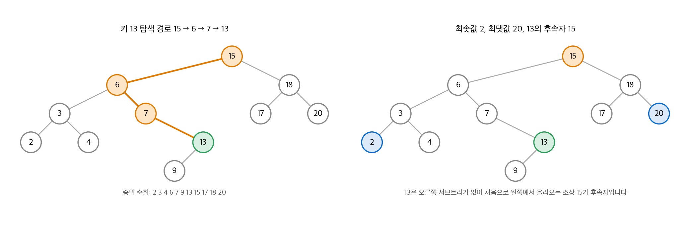
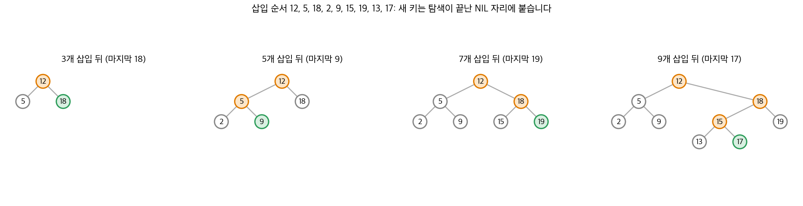
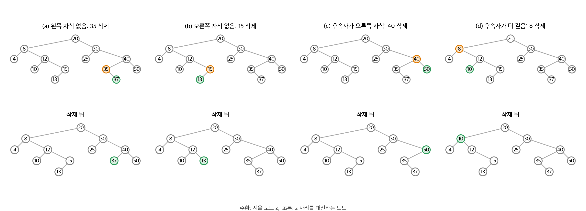
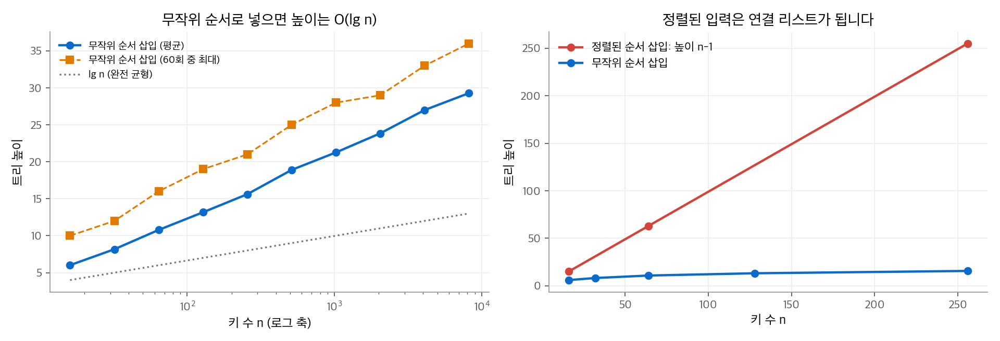

# 12. 이진 탐색 트리

**이진 탐색 트리(binary search tree, BST)** 는 동적 집합 연산을 거의 모두 지원합니다. SEARCH, MINIMUM, MAXIMUM, PREDECESSOR, SUCCESSOR, INSERT, DELETE입니다. 해시 테이블과 달리 키의 순서를 유지하므로, 최솟값이나 다음 키를 찾는 연산도 빠릅니다. 하나의 구조를 사전으로도, 우선순위 큐로도 쓸 수 있습니다.

모든 기본 연산의 시간은 트리의 높이 $h$ 에 비례하는 $O(h)$ 입니다. 노드가 $n$ 개인 완전 이진 트리는 높이가 $\Theta(\lg n)$ 이지만, 노드가 한 줄로 늘어서면 높이가 $n - 1$ 입니다. 이 장은 높이를 제한하지 않는 기본 BST를 다룹니다. 높이를 $O(\lg n)$ 으로 보장하는 방법은 [13장](13-red-black-trees.md)의 레드-블랙 트리가 다룹니다.

!!! info "원문과 자료"
    - 원문: CLRS 4판 12장 Binary Search Trees (12.1~12.3).
    - 생략: 연습 문제와 장 끝 문제(같은 키가 있는 BST, 기수 트리, 무작위로 만든 BST의 평균 깊이, 서로 다른 BST의 개수).
    - 3판의 12.4절 "무작위로 만든 이진 탐색 트리"는 4판에서 장 끝 문제로 옮겨졌습니다. 이 노트는 결과만 실험으로 확인합니다.
    - 함께 읽기: [10. 기본 자료 구조](10-elementary-ds.md)(이진 트리 표현), [13. 레드-블랙 트리](13-red-black-trees.md), [17. 자료 구조 확장](17-augmenting.md)(순서 통계 트리)

## 1. 이진 탐색 트리란

### BST 성질

각 노드는 `key`, `left`, `right`, `p` 속성을 가집니다. 트리 $T$ 의 `T.root` 가 루트를 가리킵니다. 키는 다음 **이진 탐색 트리 성질** 을 만족합니다.

> 노드 $x$ 의 왼쪽 서브트리에 있는 노드 $y$ 는 $y.key \le x.key$ 이고, 오른쪽 서브트리에 있는 노드 $y$ 는 $y.key \ge x.key$ 입니다.

성질은 자식만이 아니라 서브트리 전체에 대해 성립해야 합니다. 같은 키 집합으로 높이가 다른 BST를 여러 개 만들 수 있습니다.

### 중위 순회

BST 성질 덕분에 **중위 순회(inorder tree walk)** 는 키를 정렬된 순서로 출력합니다. 왼쪽 서브트리, 루트, 오른쪽 서브트리 순서로 방문합니다. 루트를 먼저 방문하면 **전위 순회(preorder)**, 마지막에 방문하면 **후위 순회(postorder)** 입니다.

```python
class Node:
    def __init__(self, key):
        self.key, self.left, self.right, self.p = key, None, None, None

class BST:
    def __init__(self):
        self.root = None

def inorder(x, out):
    if x is not None:
        inorder(x.left, out)
        out.append(x.key)
        inorder(x.right, out)
    return out
```

**정리 12.1.** 노드가 $n$ 개이면 INORDER-TREE-WALK는 $\Theta(n)$ 시간이 걸립니다.

모든 노드를 방문하므로 $\Omega(n)$ 입니다. 상한은 치환법으로 보입니다. 왼쪽 서브트리에 노드가 $k$ 개, 오른쪽에 $n - k - 1$ 개이면 $T(n) \le T(k) + T(n-k-1) + d$ 입니다. $T(n) \le (c + d)n + c$ 를 가정하고 대입하면 성립합니다. 빈 트리의 비용을 $c$, 노드 하나당 추가 비용을 $d$ 로 둔 것입니다.

## 2. 질의

### 탐색

TREE-SEARCH는 루트에서 출발해 키를 비교하며 한쪽 자식으로 내려갑니다. 찾는 키가 작으면 왼쪽, 크면 오른쪽입니다. 방문한 노드는 루트에서 내려가는 한 경로이므로 $O(h)$ 입니다. 재귀 버전보다 반복 버전이 대부분의 컴퓨터에서 빠릅니다.

```python
def tree_search(x, k):
    while x is not None and k != x.key:
        x = x.left if k < x.key else x.right
    return x
```

### 최솟값과 최댓값

최솟값은 왼쪽 자식을 끝까지 따라간 노드입니다. 최댓값은 오른쪽 자식을 끝까지 따라간 노드입니다. BST 성질에서 바로 나옵니다. 둘 다 $O(h)$ 입니다.

```python
def tree_minimum(x):
    while x.left is not None:
        x = x.left
    return x

def tree_maximum(x):
    while x.right is not None:
        x = x.right
    return x
```

### 후속자와 선행자

노드 $x$ 의 **후속자(successor)** 는 중위 순회에서 $x$ 바로 다음 노드입니다. 키가 모두 다르면 $x.key$ 보다 큰 키 중 가장 작은 키를 가진 노드입니다. 키를 비교하지 않고 트리 구조만으로 찾습니다. 두 경우가 있습니다.

1. $x$ 의 오른쪽 서브트리가 비어 있지 않으면, 후속자는 그 서브트리의 최솟값입니다.
2. 오른쪽 서브트리가 비어 있으면, $x$ 에서 위로 올라갑니다. 어떤 조상의 **왼쪽** 자식에서 올라오는 첫 순간, 그 조상이 후속자입니다. 그런 조상이 없으면 $x$ 가 최댓값이고 후속자는 NIL입니다.

경우 2의 이유는 이렇습니다. $x$ 가 조상 $y$ 의 왼쪽 서브트리에 있으면 $y$ 는 $x$ 보다 큽니다. 위로 올라가며 처음 만나는 그런 $y$ 가 가장 작은 후보입니다.

```python
def tree_successor(x):
    if x.right is not None:
        return tree_minimum(x.right)       # 경우 1
    y = x.p
    while y is not None and x is y.right:  # 오른쪽 자식에서 올라오는 동안 계속
        x, y = y, y.p
    return y                                # 경우 2
```

TREE-PREDECESSOR는 left와 right를 바꾼 대칭입니다.

<figure markdown>

<figcaption markdown>
<span class="fig-title"><b>Figure 1.</b> 탐색, 최솟값, 최댓값, 후속자</span>

키 13을 찾는 경로는 루트에서 내려가는 한 경로이고, 오른쪽 서브트리가 없는 13의 후속자는 조상 15입니다.
</figcaption>
</figure>

그림의 트리는 키 15, 6, 18, 3, 7, 17, 20, 2, 4, 13, 9를 이 순서로 넣어 만들었습니다.

- 13 탐색: $13 < 15$ 라 왼쪽, $13 > 6$ 이라 오른쪽, $13 > 7$ 이라 오른쪽으로 가서 찾습니다. 비교는 4번입니다.
- 13의 후속자: 13은 오른쪽 자식이 없습니다. 13은 7의 오른쪽 자식, 7은 6의 오른쪽 자식, 6은 15의 왼쪽 자식입니다. 따라서 후속자는 15입니다.
- 6의 후속자: 6은 오른쪽 서브트리(7, 13, 9)가 있으므로 그 최솟값 7이 후속자입니다.

**정리 12.2.** 높이가 $h$ 인 BST에서 SEARCH, MINIMUM, MAXIMUM, SUCCESSOR, PREDECESSOR는 모두 $O(h)$ 입니다. 각 연산은 한 경로를 내려가거나 올라가기만 합니다.

## 3. 삽입과 삭제

### 삽입

TREE-INSERT$(T, z)$ 는 `z.left = z.right = NIL` 인 새 노드 $z$ 를 받습니다. 루트에서 탐색하듯 내려가고, 포인터 $y$ 가 $x$ 의 부모를 따라옵니다. $x$ 가 NIL이 되면 그 자리에 $z$ 를 붙입니다. 새 노드는 항상 잎(leaf)이 됩니다.

```python
def tree_insert(T, z):
    x, y = T.root, None           # y는 x의 부모를 따라감
    while x is not None:
        y = x
        x = x.left if z.key < x.key else x.right
    z.p = y
    if y is None:
        T.root = z                # 빈 트리
    elif z.key < y.key:
        y.left = z
    else:
        y.right = z

T = BST()
for k in [12, 5, 18, 2, 9, 15, 19, 13, 17]:
    tree_insert(T, Node(k))
print(inorder(T.root, []))        # [2, 5, 9, 12, 13, 15, 17, 18, 19]
```

<figure markdown>

<figcaption markdown>
<span class="fig-title"><b>Figure 2.</b> 삽입 순서에 따른 트리 변화</span>

새 키는 탐색 경로(주황) 끝의 빈 자리에 잎으로 붙습니다(초록).
</figcaption>
</figure>

마지막 키 17은 $17 > 12$ 라 오른쪽, $17 < 18$ 이라 왼쪽, $17 > 15$ 라 오른쪽으로 가서 15의 오른쪽 자식이 됩니다. 시간은 내려간 경로 길이인 $O(h)$ 입니다.

### 삭제의 세 경우

노드 $z$ 를 지우는 경우는 세 가지입니다.

1. $z$ 에 자식이 없으면, 부모에서 $z$ 를 가리키던 포인터를 NIL로 바꿉니다.
2. $z$ 에 자식이 하나 있으면, 그 자식을 $z$ 자리로 올립니다.
3. $z$ 에 자식이 둘 있으면, $z$ 의 후속자 $y$ 를 찾아 $z$ 자리에 놓습니다. $y$ 는 $z$ 의 오른쪽 서브트리의 최솟값이므로 왼쪽 자식이 없습니다. $z$ 의 왼쪽 서브트리는 $y$ 의 왼쪽 자식이 됩니다.

경우 3이 까다롭습니다. $y$ 가 $z$ 의 오른쪽 자식인지, 더 깊은 곳에 있는지에 따라 처리가 다릅니다.

### TRANSPLANT

먼저 서브트리를 옮기는 보조 함수를 둡니다. TRANSPLANT$(T, u, v)$ 는 $u$ 를 루트로 하는 서브트리를 $v$ 를 루트로 하는 서브트리로 바꿉니다. $u$ 의 부모가 $v$ 를 자식으로 가지게 하고, $v$ 의 부모를 $u$ 의 부모로 바꿉니다. $v$ 의 자식은 바꾸지 않습니다. 호출한 쪽이 처리합니다.

```python
def transplant(T, u, v):
    if u.p is None:
        T.root = v
    elif u is u.p.left:
        u.p.left = v
    else:
        u.p.right = v
    if v is not None:
        v.p = u.p
```

### TREE-DELETE

4판의 TREE-DELETE는 네 경우로 나눠 처리합니다.

| 경우 | 조건 | 처리 |
| --- | --- | --- |
| (a) | $z$ 의 왼쪽 자식이 없음 | 오른쪽 자식(NIL일 수 있음)으로 $z$ 를 바꿉니다 |
| (b) | 오른쪽 자식이 없음 | 왼쪽 자식으로 $z$ 를 바꿉니다 |
| (c) | 자식 둘, 후속자 $y$ 가 $z$ 의 오른쪽 자식 | $y$ 로 $z$ 를 바꾸고, $z$ 의 왼쪽 서브트리를 $y$ 에 붙입니다 |
| (d) | 자식 둘, $y$ 가 더 깊음 | 먼저 $y$ 를 $y$ 의 오른쪽 자식으로 바꾸고, $z$ 의 오른쪽 서브트리를 $y$ 에 붙인 뒤 (c)처럼 처리합니다 |

자식이 없는 경우는 (a)에 포함됩니다. 오른쪽 자식 NIL로 $z$ 를 바꾸기 때문입니다.

```python
def tree_delete(T, z):
    if z.left is None:
        transplant(T, z, z.right)                  # (a)
    elif z.right is None:
        transplant(T, z, z.left)                   # (b)
    else:
        y = tree_minimum(z.right)                  # 후속자
        if y is not z.right:                       # (d) 먼저 y를 꺼냄
            transplant(T, y, y.right)
            y.right = z.right
            y.right.p = y
        transplant(T, z, y)                        # (c), (d) 공통
        y.left = z.left
        y.left.p = y
```

<figure markdown>

<figcaption markdown>
<span class="fig-title"><b>Figure 3.</b> 삭제의 네 경우</span>

위가 삭제 전, 아래가 삭제 뒤이며 초록 노드가 지운 노드 $z$ 자리를 대신합니다.
</figcaption>
</figure>

그림은 같은 트리(20, 8, 30, 4, 12, 25, 40, 10, 15, 35, 50, 13, 37 순서로 삽입)에서 네 경우를 하나씩 보여 줍니다.

- (a) 35는 왼쪽 자식이 없습니다. 오른쪽 자식 37이 35 자리로 올라가 40의 왼쪽 자식이 됩니다.
- (b) 15는 오른쪽 자식이 없습니다. 왼쪽 자식 13이 15 자리로 올라갑니다.
- (c) 40의 후속자는 오른쪽 자식 50입니다. 50이 40 자리로 올라가고, 40의 왼쪽 서브트리(35, 37)가 50의 왼쪽에 붙습니다.
- (d) 8의 후속자는 12의 왼쪽 자식 10입니다. 10은 오른쪽 자식이 없으므로 NIL이 10 자리를 대신합니다. 10이 12를 오른쪽 자식으로 받고, 8 자리로 올라가 4를 왼쪽 자식으로 받습니다.

어느 경우든 중위 순회 순서는 $z$ 하나만 빠지고 그대로 유지됩니다.

```python
T = BST()
for k in [20, 8, 30, 4, 12, 25, 40, 10, 15, 35, 50, 13, 37]:
    tree_insert(T, Node(k))
tree_delete(T, tree_search(T.root, 8))
print(inorder(T.root, []))   # [4, 10, 12, 13, 15, 20, 25, 30, 35, 37, 40, 50]
print(T.root.left.key, T.root.left.left.key, T.root.left.right.key)   # 10 4 12
```

**정리 12.3.** 높이가 $h$ 인 BST에서 INSERT와 DELETE는 $O(h)$ 입니다. DELETE는 TREE-MINIMUM 한 번과 상수 번의 포인터 변경만 합니다.

### 왜 후속자로 바꾸는가

2판까지의 방법은 $y$ 의 키를 $z$ 에 복사하고 $y$ 노드를 지웠습니다. 4판의 방법은 노드 자체를 옮깁니다. 키 복사 방식은 호출자가 $z$ 를 지우라고 했는데 실제로는 다른 노드 $y$ 가 사라집니다. 그러면 다른 곳에서 $y$ 를 가리키던 포인터가 무효가 됩니다. 노드를 옮기는 방식은 정확히 $z$ 만 트리에서 빠집니다.

## 4. 높이

모든 연산이 $O(h)$ 이므로 높이가 성능을 정합니다. 높이는 삽입 순서에 따라 크게 달라집니다.

- 키를 정렬된 순서로 넣으면 모든 노드가 오른쪽 자식으로만 이어집니다. 트리는 연결 리스트가 되고 높이는 $n - 1$ 입니다.
- 서로 다른 키 $n$ 개를 무작위 순서로 넣어 만든 트리를 **무작위로 만든 BST(randomly built BST)** 라고 합니다. 이 트리의 기대 높이는 $O(\lg n)$ 입니다. 원문은 평균 노드 깊이가 $O(\lg n)$ 임을 장 끝 문제로 증명하게 합니다.

<figure markdown>

<figcaption markdown>
<span class="fig-title"><b>Figure 4.</b> 삽입 순서와 트리 높이</span>

무작위 순서로 넣으면 높이가 $\lg n$ 의 약 2~3배에 머물고, 정렬된 순서로 넣으면 $n - 1$ 이 됩니다.
</figcaption>
</figure>

실험에서 $n = 1024$ 개 키를 무작위 순서로 넣은 트리의 평균 높이는 21.3이었습니다. 완전 균형 트리의 높이 $\lg 1024 = 10$ 의 약 2.1배입니다. 60회 중 가장 높은 트리도 28이었습니다. 같은 키를 정렬된 순서로 넣으면 높이는 1023입니다.

무작위 순서는 입력을 통제할 수 있을 때만 기대할 수 있습니다. 실제 입력은 정렬되어 있거나 거의 정렬된 경우가 많습니다. 그래서 실무에서는 [13장](13-red-black-trees.md)의 레드-블랙 트리처럼 회전으로 높이를 $O(\lg n)$ 으로 보장하는 균형 트리를 씁니다.

연결 고리 하나를 적어 둡니다. 무작위로 만든 BST에서 키를 넣을 때 하는 비교는 [7장](07-quicksort.md) 퀵 정렬의 비교와 정확히 대응합니다. 첫 키가 루트, 곧 첫 피벗이 되고, 각 서브트리가 재귀 분할에 해당합니다. 따라서 평균 노드 깊이는 퀵 정렬의 평균 비교 횟수를 $n$ 으로 나눈 값, 곧 $O(\lg n)$ 입니다.

## 정리

| 연산 | 시간 | 핵심 동작 |
| --- | --- | --- |
| INORDER-TREE-WALK | $\Theta(n)$ | 왼쪽, 루트, 오른쪽 순서로 정렬 출력 |
| SEARCH | $O(h)$ | 비교하며 한 경로를 내려감 |
| MINIMUM, MAXIMUM | $O(h)$ | 왼쪽 또는 오른쪽 끝까지 내려감 |
| SUCCESSOR, PREDECESSOR | $O(h)$ | 오른쪽 서브트리의 최솟값, 없으면 왼쪽에서 올라오는 첫 조상 |
| INSERT | $O(h)$ | 탐색이 끝난 NIL 자리에 잎으로 붙임 |
| DELETE | $O(h)$ | TRANSPLANT로 자식 또는 후속자를 올림 |

- BST 성질은 서브트리 전체에 대한 순서 조건이고, 중위 순회가 정렬 순서를 만듭니다.
- 삭제는 자식 수와 후속자 위치에 따라 네 경우로 나뉩니다. TRANSPLANT 하나로 모두 표현합니다.
- 높이는 무작위 삽입이면 $O(\lg n)$, 정렬된 삽입이면 $n - 1$ 입니다. 최악을 막으려면 균형 트리가 필요합니다.
