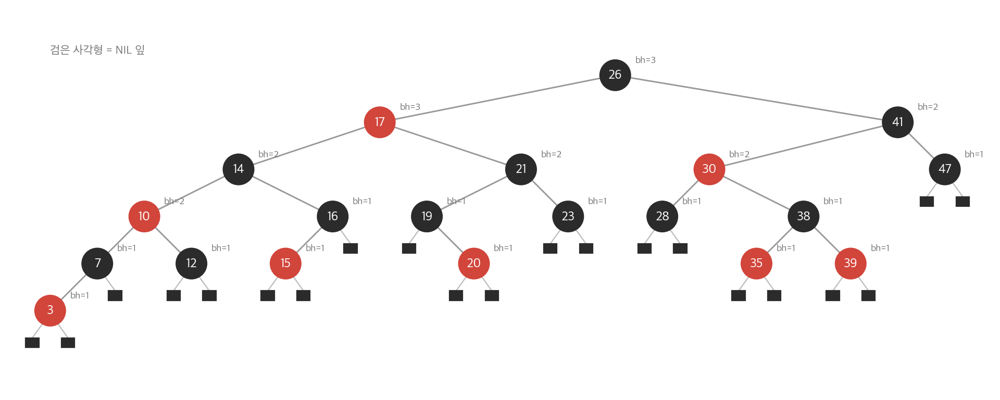
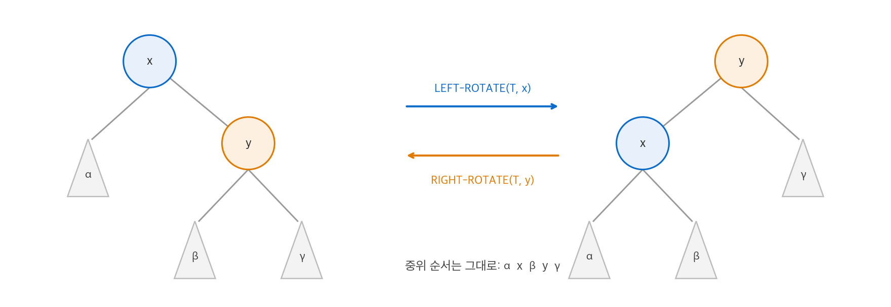
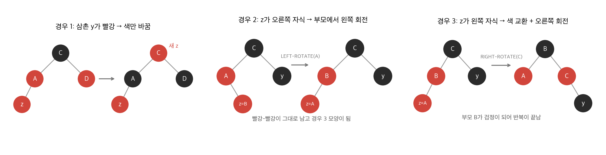
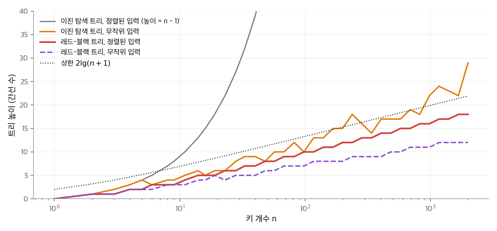

# 13. 레드-블랙 트리

[12장](12-bst.md)의 이진 탐색 트리는 높이가 $h$ 일 때 탐색, 삽입, 삭제를 $O(h)$ 에 합니다.
문제는 $h$ 를 보장할 수 없다는 점입니다. 키를 정렬된 순서로 넣으면 트리는 연결 리스트가 되고 $h = n - 1$ 입니다.
**레드-블랙 트리**(red-black tree)는 노드마다 색 비트 하나를 더하고, 색에 규칙을 걸어 높이를 $2 \lg(n+1)$ 이하로 묶습니다.
규칙이 깨지면 색 바꾸기와 **회전**(rotation)으로 고칩니다. 결론은 모든 동적 집합 연산이 최악의 경우에도 $O(\lg n)$ 이라는 것입니다.

!!! info "원문과 자료"
    - 원문: CLRS 4판 13장 Red-Black Trees (13.1 Properties of red-black trees, 13.2 Rotations, 13.3 Insertion, 13.4 Deletion)
    - 책 페이지: [MIT Press, Introduction to Algorithms, 4th ed.](https://mitpress.mit.edu/9780262046305/introduction-to-algorithms/)
    - 강의: [MIT OCW 6.046J Design and Analysis of Algorithms (Spring 2015)](https://ocw.mit.edu/courses/6-046j-design-and-analysis-of-algorithms-spring-2015/)
    - 함께 읽기: [12. 이진 탐색 트리](12-bst.md), [17. 자료 구조 확장](17-augmenting.md), [18. B-트리](18-b-trees.md)
    - 장 끝 문제(영속 동적 집합, AVL 트리 등)는 옮기지 않았습니다. 6절에서 AVL 트리와의 차이만 짧게 적습니다.

## 1. 레드-블랙 성질

### 다섯 가지 규칙

노드는 `key`, `left`, `right`, `p`(부모)에 더해 `color` 를 가집니다. 값은 RED 또는 BLACK입니다.
자식이나 부모가 없으면 그 포인터는 NIL을 가리킵니다. 레드-블랙 트리에서는 NIL을 **잎**(leaf)으로 보고, 키를 가진 노드를 **내부 노드**라고 부릅니다.
이진 탐색 트리가 다음 다섯 성질을 만족하면 레드-블랙 트리입니다.

1. 모든 노드는 빨강 또는 검정입니다.
2. 루트는 검정입니다.
3. 모든 잎(NIL)은 검정입니다.
4. 빨간 노드의 두 자식은 모두 검정입니다. 즉 빨강이 연속해서 나오지 않습니다.
5. 각 노드에서 자손 잎까지 가는 모든 단순 경로에는 같은 수의 검은 노드가 있습니다.

구현에서는 NIL마다 노드를 만들지 않습니다. 검은 **센티널**(sentinel) 노드 `T.nil` 하나를 두고, 모든 잎 포인터와 루트의 부모 포인터가 이 노드를 가리키게 합니다.
센티널 덕분에 "자식이 NIL이면 검정"을 따로 검사하지 않고 `x.color` 를 바로 읽을 수 있습니다.

### 검은 높이

노드 $x$ 에서 잎까지 내려가는 경로에 있는 검은 노드 수를 $x$ 의 **검은 높이**(black-height) $\mathrm{bh}(x)$ 라고 합니다. $x$ 자신은 세지 않고 잎(NIL)은 셉니다.
성질 5가 있으므로 이 값은 어느 경로를 골라도 같습니다. 트리의 검은 높이는 루트의 검은 높이입니다.

<figure markdown>

<figcaption markdown>
<span class="fig-title"><b>Figure 1.</b> 레드-블랙 트리와 노드별 검은 높이</span>

키 20개를 차례로 삽입해 만든 트리입니다. 빨간 노드의 자식은 모두 검정이고, 루트에서 어느 NIL로 가도 검은 노드는 3개입니다.
</figcaption>
</figure>

Figure 1의 루트 26에서 가장 긴 경로는 26 → 17 → 14 → 10 → 7 → 3 → NIL이고 가장 짧은 경로는 26 → 41 → 47 → NIL입니다.
긴 경로에는 노드가 6개, 짧은 경로에는 3개 있습니다. 두 경로 모두 검은 노드(NIL 포함)는 3개입니다. 긴 경로의 나머지는 빨강이 끼어든 것입니다.

### 높이의 상한

**보조 정리.** 내부 노드가 $n$ 개인 레드-블랙 트리의 높이는 최대 $2 \lg(n+1)$ 입니다.

증명은 두 단계입니다.

1. 노드 $x$ 를 루트로 하는 부분 트리에는 내부 노드가 $2^{\mathrm{bh}(x)} - 1$ 개 이상 있습니다. 높이에 대한 귀납법으로 보입니다.
    - 높이가 0이면 $x$ 는 잎이고 $\mathrm{bh}(x) = 0$ 이므로 $2^0 - 1 = 0$ 개 이상입니다.
    - 높이가 양수이면 각 자식의 검은 높이는 $\mathrm{bh}(x)$ (자식이 빨강) 또는 $\mathrm{bh}(x) - 1$ (자식이 검정)입니다. 귀납 가정으로 각 자식 부분 트리에 내부 노드가 $2^{\mathrm{bh}(x)-1} - 1$ 개 이상 있습니다. 따라서 $x$ 의 부분 트리에는 $2(2^{\mathrm{bh}(x)-1} - 1) + 1 = 2^{\mathrm{bh}(x)} - 1$ 개 이상 있습니다.
2. 높이가 $h$ 이면 성질 4에 의해 루트에서 잎까지의 경로에서 노드의 절반 이상이 검정입니다. 따라서 $\mathrm{bh}(\text{root}) \ge h/2$ 입니다. 1단계에 넣으면 $n \ge 2^{h/2} - 1$ 이고, 정리하면 $h \le 2 \lg(n+1)$ 입니다.

이 보조 정리로 SEARCH, MINIMUM, MAXIMUM, SUCCESSOR, PREDECESSOR는 12장의 코드를 그대로 써도 $O(\lg n)$ 입니다.
INSERT와 DELETE는 트리를 바꾸므로 성질이 깨질 수 있습니다. 2~4절은 깨진 성질을 $O(\lg n)$ 에 되돌리는 방법입니다.

## 2. 회전

### 연산의 정의

회전은 이진 탐색 트리 성질을 보존하면서 포인터 몇 개만 바꾸는 국소 연산입니다.
**왼쪽 회전**(left rotation) LEFT-ROTATE$(T, x)$ 는 $x$ 의 오른쪽 자식 $y$ 를 $x$ 의 자리로 올립니다. $x$ 는 $y$ 의 왼쪽 자식이 되고, $y$ 의 원래 왼쪽 부분 트리 $\beta$ 는 $x$ 의 오른쪽 부분 트리가 됩니다.
**오른쪽 회전**은 그 역연산입니다.

<figure markdown>

<figcaption markdown>
<span class="fig-title"><b>Figure 2.</b> 왼쪽 회전과 오른쪽 회전</span>

부분 트리 $\beta$ 만 부모를 바꿉니다. 중위 순회 순서 $\alpha, x, \beta, y, \gamma$ 는 바뀌지 않습니다.
</figcaption>
</figure>

### 코드

센티널을 쓰는 구현입니다. 3절과 4절의 코드도 같은 클래스에 들어갑니다.

```python
RED, BLACK = 0, 1

class Node:
    def __init__(self, key, color=RED, nil=None):
        self.key, self.color = key, color
        self.left = self.right = self.p = nil

class RBTree:
    def __init__(self):
        self.nil = Node(None, BLACK)      # 모든 잎과 루트의 부모를 대신하는 센티널
        self.root = self.nil

    def left_rotate(self, x):
        y = x.right
        x.right = y.left                  # y의 왼쪽 부분 트리 β를 x의 오른쪽으로 옮깁니다.
        if y.left is not self.nil:
            y.left.p = x
        y.p = x.p                         # x의 부모를 y에 연결합니다.
        if x.p is self.nil:
            self.root = y
        elif x is x.p.left:
            x.p.left = y
        else:
            x.p.right = y
        y.left = x                        # x를 y의 왼쪽 자식으로 둡니다.
        x.p = y
```

`right_rotate` 는 `left` 와 `right`, `x` 와 `y` 를 바꾸어 씁니다. 두 연산은 포인터를 상수 개만 바꾸므로 $O(1)$ 입니다.

## 3. 삽입

### 전략

새 노드 $z$ 를 12장의 TREE-INSERT처럼 잎 자리에 붙이고 **빨강**으로 칠합니다.
빨강으로 칠하면 어느 경로의 검은 노드 수도 바뀌지 않으므로 성질 5가 유지됩니다.
깨질 수 있는 성질은 두 가지뿐입니다.

- 성질 2: $z$ 가 루트이면 루트가 빨강입니다.
- 성질 4: $z$ 의 부모가 빨강이면 빨강이 연속합니다.

RB-INSERT-FIXUP은 성질 4의 위반을 위쪽으로 옮기거나 회전으로 없앱니다. 마지막에 루트를 검정으로 칠해 성질 2를 고칩니다.

### 세 가지 경우

$z$ 의 부모 $z.p$ 가 빨강이면 $z.p$ 는 루트가 아니므로 조부모 $z.p.p$ 가 있고, 조부모는 검정입니다.
$z.p$ 가 조부모의 왼쪽 자식인 경우만 봅니다. 오른쪽 자식인 경우는 좌우를 바꾼 대칭입니다.
삼촌 $y = z.p.p.\text{right}$ 의 색과 $z$ 의 위치에 따라 경우가 나뉩니다.

| 경우 | 조건 | 처리 | 이후 |
| --- | --- | --- | --- |
| 1 | 삼촌 $y$ 가 빨강 | $z.p$ 와 $y$ 를 검정으로, $z.p.p$ 를 빨강으로 칠합니다. | $z \leftarrow z.p.p$ 로 두 단계 올라가 반복합니다. |
| 2 | $y$ 가 검정, $z$ 가 오른쪽 자식 | $z \leftarrow z.p$ 로 두고 LEFT-ROTATE$(z)$ 합니다. | 경우 3의 모양이 됩니다. |
| 3 | $y$ 가 검정, $z$ 가 왼쪽 자식 | $z.p$ 를 검정, $z.p.p$ 를 빨강으로 칠하고 RIGHT-ROTATE$(z.p.p)$ 합니다. | $z.p$ 가 검정이므로 반복이 끝납니다. |

<figure markdown>

<figcaption markdown>
<span class="fig-title"><b>Figure 3.</b> RB-INSERT-FIXUP의 세 가지 경우</span>

경우 1은 색만 바꾸고 위반을 조부모로 올립니다. 경우 2는 회전으로 경우 3을 만들고, 경우 3은 회전 한 번으로 위반을 없앱니다.
</figcaption>
</figure>

각 경우가 성질 5를 지키는지 확인합니다.

- 경우 1: $z.p.p$ 의 검정이 두 자식으로 내려갑니다. $z.p.p$ 아래 어느 경로에서도 검은 노드 수가 같습니다.
- 경우 2: $z$ 와 $z.p$ 가 모두 빨강이므로 회전해도 어느 경로의 검은 노드 수도 바뀌지 않습니다.
- 경우 3: 검정이 된 $z.p$ 가 원래 검정이던 $z.p.p$ 의 자리로 올라갑니다. 각 부분 트리 위에 놓인 검은 노드 수는 회전 전과 같습니다.

### 코드

```python
    def insert(self, key):
        z = Node(key, RED, self.nil)
        y, x = self.nil, self.root
        while x is not self.nil:          # 12장의 TREE-INSERT와 같은 하강
            y = x
            x = x.left if z.key < x.key else x.right
        z.p = y
        if y is self.nil:
            self.root = z
        elif z.key < y.key:
            y.left = z
        else:
            y.right = z
        self.insert_fixup(z)

    def insert_fixup(self, z):
        while z.p.color == RED:
            if z.p is z.p.p.left:
                y = z.p.p.right           # 삼촌
                if y.color == RED:        # 경우 1
                    z.p.color = y.color = BLACK
                    z.p.p.color = RED
                    z = z.p.p
                else:
                    if z is z.p.right:    # 경우 2
                        z = z.p
                        self.left_rotate(z)
                    z.p.color = BLACK     # 경우 3
                    z.p.p.color = RED
                    self.right_rotate(z.p.p)
            else:
                ...                       # 위와 좌우가 바뀐 대칭
        self.root.color = BLACK
```

### 수치 예

빈 트리에 41, 38, 31, 12, 19, 8을 차례로 넣습니다. 표기 `k(R)` 은 빨간 노드, `k(B)` 는 검은 노드입니다.

| 삽입 | 일어난 경우 | 결과 트리 (루트(왼쪽, 오른쪽)) |
| --- | --- | --- |
| 41 | $z$ 가 루트이므로 검정으로 칠합니다. | 41(B) |
| 38 | 부모 41이 검정입니다. 고칠 것이 없습니다. | 41(B)(38(R), ·) |
| 31 | 삼촌이 NIL(검정)이고 $z$ 가 왼쪽 자식이므로 경우 3입니다. 41에서 오른쪽 회전합니다. | 38(B)(31(R), 41(R)) |
| 12 | 삼촌 41이 빨강이므로 경우 1입니다. 31, 41을 검정, 38을 빨강으로 칠한 뒤 루트를 검정으로 되돌립니다. | 38(B)(31(B)(12(R), ·), 41(B)) |
| 19 | 19는 12의 오른쪽 자식이고 삼촌은 NIL입니다. 경우 2로 12에서 왼쪽 회전하고, 경우 3으로 31에서 오른쪽 회전합니다. | 38(B)(19(B)(12(R), 31(R)), 41(B)) |
| 8 | 삼촌 31이 빨강이므로 경우 1입니다. 19가 빨강이 되고, 19의 부모 38은 검정이므로 끝납니다. | 38(B)(19(R)(12(B)(8(R), ·), 31(B)), 41(B)) |

### 실행 시간

하강은 $O(\lg n)$ 입니다. 고정 단계의 `while` 루프는 경우 1에서만 반복하고, 반복할 때마다 $z$ 가 두 단계 올라갑니다. 따라서 최대 $O(\lg n)$ 번 반복합니다.
경우 2나 3이 나오면 루프가 끝납니다. 따라서 **회전은 최대 2번**입니다. 회전 수가 상수라는 점은 [17장](17-augmenting.md)에서 노드에 정보를 더할 때 중요합니다.

## 4. 삭제

### 지울 노드와 빠지는 색

삭제는 12장의 TREE-DELETE를 따르되, 부분 트리를 옮기는 RB-TRANSPLANT를 센티널에 맞게 고쳐 씁니다.
핵심은 "어느 색이 트리에서 빠지는가"입니다.

- $z$ 의 자식이 하나 이하이면 $z$ 자신이 빠집니다. $y = z$ 로 둡니다.
- 자식이 둘이면 $z$ 의 후속자 $y$ 가 $z$ 의 자리로 옮겨 가고 $z$ 의 색을 물려받습니다. 이때 실제로 빠지는 것은 $y$ 의 원래 자리와 원래 색입니다.

$x$ 는 $y$ 의 원래 자리로 들어오는 노드입니다(센티널일 수 있음). $y$ 의 원래 색이 빨강이면 성질이 깨지지 않습니다. 검은 높이가 바뀌지 않고, 빨간 노드는 루트가 아니었기 때문입니다.
$y$ 의 원래 색이 검정이면 $y$ 가 있던 경로마다 검은 노드가 하나 모자랍니다.

### 여분의 검정

CLRS는 모자란 검정을 $x$ 가 "여분의 검정"을 하나 더 가진다고 보아 처리합니다. 그러면 성질 5는 유지되고, 대신 $x$ 가 **이중 검정**(doubly black)이거나 **빨강-검정**이 되어 성질 1이 깨집니다.

- $x$ 가 빨강-검정이면 $x$ 를 검정으로 칠하면 끝납니다.
- $x$ 가 루트이면 여분의 검정을 그냥 버립니다. 모든 경로에서 하나씩 줄어들 뿐입니다.
- 그 밖에는 RB-DELETE-FIXUP이 여분의 검정을 위로 올리거나 회전으로 형제 쪽에 넘깁니다.

### 네 가지 경우

$x$ 가 왼쪽 자식인 경우만 봅니다. 형제를 $w = x.p.\text{right}$ 라고 합니다. $x$ 가 이중 검정이므로 $w$ 는 센티널이 아닙니다.

| 경우 | 조건 | 처리 | 이후 |
| --- | --- | --- | --- |
| 1 | $w$ 가 빨강 | $w$ 를 검정, $x.p$ 를 빨강으로 칠하고 LEFT-ROTATE$(x.p)$ 합니다. | 새 형제는 검정입니다. 경우 2, 3, 4 중 하나로 갑니다. |
| 2 | $w$ 가 검정, $w$ 의 두 자식이 검정 | $w$ 를 빨강으로 칠해 $x$ 와 $w$ 에서 검정을 하나씩 뺍니다. | 여분의 검정이 $x.p$ 로 올라갑니다. $x \leftarrow x.p$ 로 반복합니다. |
| 3 | $w$ 가 검정, $w.\text{left}$ 가 빨강, $w.\text{right}$ 가 검정 | $w.\text{left}$ 와 $w$ 의 색을 바꾸고 RIGHT-ROTATE$(w)$ 합니다. | 경우 4의 모양이 됩니다. |
| 4 | $w$ 가 검정, $w.\text{right}$ 가 빨강 | $w$ 가 $x.p$ 의 색을 받고, $x.p$ 와 $w.\text{right}$ 를 검정으로 칠한 뒤 LEFT-ROTATE$(x.p)$ 합니다. | 여분의 검정이 없어집니다. $x \leftarrow$ 루트로 두어 끝냅니다. |

경우 1에서 2로 간 뒤에는 $x.p$ 가 빨강입니다. 따라서 새 $x$ 가 빨강-검정이 되어 루프가 바로 끝납니다.
결국 루프를 여러 번 도는 것은 경우 2가 연속할 때뿐이고, 그때마다 $x$ 가 한 단계 올라갑니다.

### 코드

```python
    def transplant(self, u, v):
        if u.p is self.nil:
            self.root = v
        elif u is u.p.left:
            u.p.left = v
        else:
            u.p.right = v
        v.p = u.p                         # v가 센티널이어도 대입합니다.

    def delete(self, z):
        y, y_color = z, z.color
        if z.left is self.nil:
            x = z.right
            self.transplant(z, z.right)
        elif z.right is self.nil:
            x = z.left
            self.transplant(z, z.left)
        else:
            y = self.minimum(z.right)     # z의 후속자 y가 z 자리로 옵니다.
            y_color = y.color
            x = y.right
            if y is not z.right:
                self.transplant(y, y.right)
                y.right = z.right
                y.right.p = y
            else:
                x.p = y
            self.transplant(z, y)
            y.left = z.left
            y.left.p = y
            y.color = z.color
        if y_color == BLACK:              # 검은 노드가 빠졌을 때만 고칩니다.
            self.delete_fixup(x)

    def delete_fixup(self, x):
        while x is not self.root and x.color == BLACK:
            if x is x.p.left:
                w = x.p.right             # 형제
                if w.color == RED:        # 경우 1
                    w.color = BLACK
                    x.p.color = RED
                    self.left_rotate(x.p)
                    w = x.p.right
                if w.left.color == BLACK and w.right.color == BLACK:
                    w.color = RED         # 경우 2
                    x = x.p
                else:
                    if w.right.color == BLACK:  # 경우 3
                        w.left.color = BLACK
                        w.color = RED
                        self.right_rotate(w)
                        w = x.p.right
                    w.color = x.p.color   # 경우 4
                    x.p.color = BLACK
                    w.right.color = BLACK
                    self.left_rotate(x.p)
                    x = self.root
            else:
                ...                       # 위와 좌우가 바뀐 대칭
        x.color = BLACK
```

`transplant` 의 마지막 줄은 $v$ 가 센티널이어도 부모를 대입합니다. 그래서 `delete_fixup` 은 $x$ 가 센티널일 때도 `x.p` 로 위로 올라갈 수 있습니다.

이 코드를 무작위 키로 확인했습니다. 크기 1~200의 트리 200개에 삽입한 뒤 키의 2/3를 무작위 순서로 지웠습니다. 연산마다 성질 4, 5와 중위 순서를 검사했고 모두 통과했습니다.

### 실행 시간

삭제 본체는 후속자를 찾는 데 $O(\lg n)$ 입니다. 고정 단계에서 경우 1, 3, 4는 상수 번 회전한 뒤 끝나고, 경우 2는 회전 없이 $x$ 를 한 단계 올립니다.
따라서 삭제 전체는 $O(\lg n)$ 이고 **회전은 최대 3번**입니다.

## 5. 높이 실험

키를 정렬된 순서와 무작위 순서로 넣고 높이(간선 수)를 쟀습니다.

<figure markdown>

<figcaption markdown>
<span class="fig-title"><b>Figure 4.</b> 입력 순서에 따른 트리 높이</span>

정렬된 입력에서 일반 이진 탐색 트리는 높이가 $n - 1$ 이지만, 레드-블랙 트리는 입력 순서와 관계없이 $2\lg(n+1)$ 아래에 머뭅니다.
</figcaption>
</figure>

| $n$ | 일반 BST, 정렬 입력 | 일반 BST, 무작위 입력 | 레드-블랙, 정렬 입력 | $2 \lg(n+1)$ |
| --- | --- | --- | --- | --- |
| 1,995 | 1,994 | 29 | 18 | 21.9 |

무작위 입력의 일반 이진 탐색 트리도 기대 높이가 $O(\lg n)$ 입니다(12장). 그러나 이것은 입력이 무작위일 때의 기대값이고, 레드-블랙 트리는 어떤 입력에서도 최악을 보장합니다.

## 6. 정리

| 연산 | 실행 시간 | 회전 수 |
| --- | --- | --- |
| SEARCH, MINIMUM, MAXIMUM, SUCCESSOR, PREDECESSOR | $O(\lg n)$ | 0 |
| INSERT | $O(\lg n)$ | 최대 2 |
| DELETE | $O(\lg n)$ | 최대 3 |

- 다섯 성질 중 성질 4(빨강 연속 금지)와 성질 5(검은 높이 일정)가 높이를 $2 \lg(n+1)$ 이하로 묶습니다.
- 삽입은 새 노드를 빨강으로 칠해 성질 5를 지키고, 성질 4의 위반을 세 경우로 고칩니다.
- 삭제는 빠진 검정을 여분의 검정으로 보고 성질 5를 지키며, 네 경우로 여분의 검정을 없앱니다.
- 고정 단계에서 반복하는 경우(삽입의 경우 1, 삭제의 경우 2)는 회전 없이 색만 바꿉니다. 그래서 회전 수가 상수입니다.

장 끝 문제의 **AVL 트리**는 각 노드의 두 부분 트리 높이 차이를 1 이하로 유지합니다. 높이가 약 $1.44 \lg n$ 이하로 레드-블랙 트리보다 낮아 탐색이 조금 빠릅니다. 그러나 삭제 한 번에 $O(\lg n)$ 번 회전할 수 있습니다.
Java의 `TreeMap`, C++ 표준 라이브러리의 `std::map` 구현(libstdc++), Linux 커널의 스케줄러 자료 구조가 레드-블랙 트리를 씁니다.
