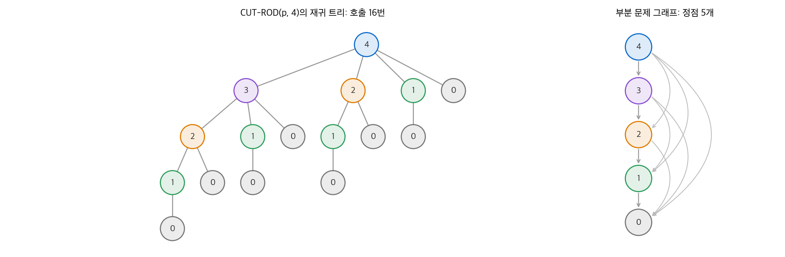
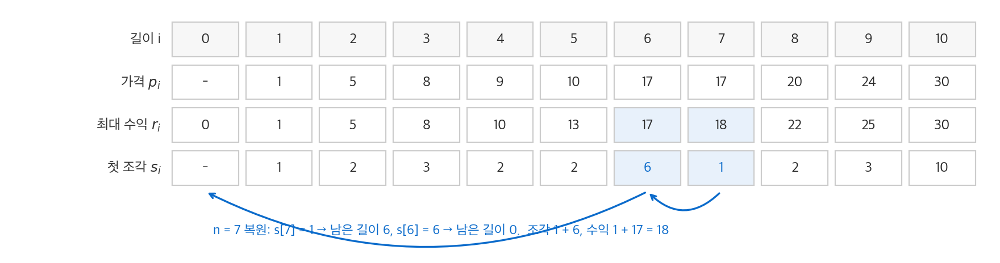
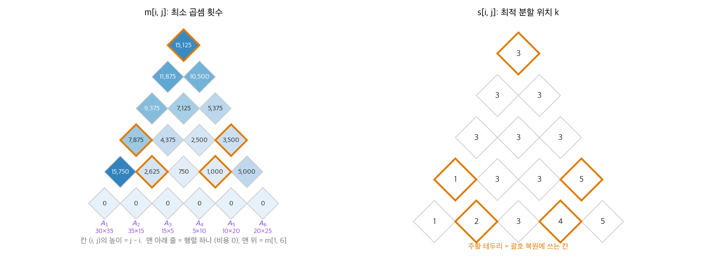
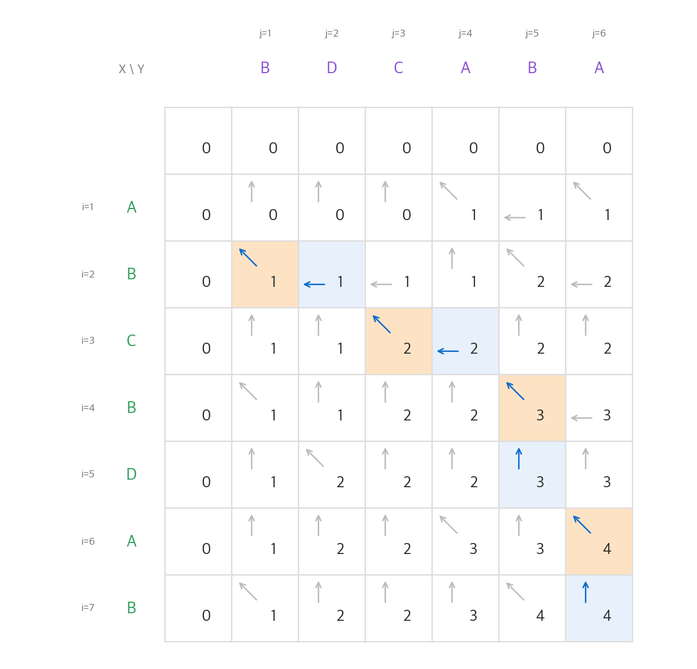
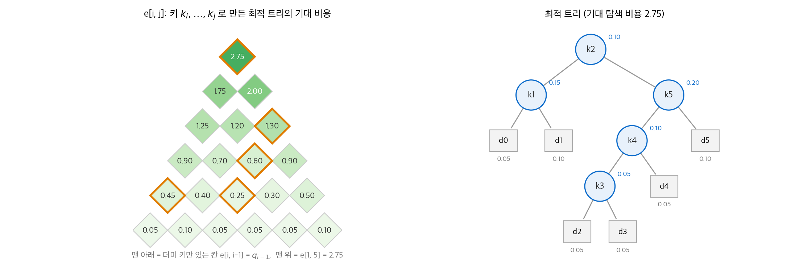

# 14. 동적 계획법

[4장](04-divide-and-conquer.md)의 분할 정복은 문제를 서로 겹치지 않는 부분 문제로 나눕니다.
부분 문제가 **겹치면** 분할 정복은 같은 부분 문제를 여러 번 풉니다. **동적 계획법**(dynamic programming)은 각 부분 문제를 한 번만 풀고 답을 표에 저장합니다.
이 장은 네 가지 최적화 문제(막대 자르기, 행렬 연쇄 곱셈, 최장 공통 부분 수열, 최적 이진 탐색 트리)로 같은 설계 절차를 반복합니다.
결론은 지수 시간이 걸리던 완전 탐색이 부분 문제 수 × 선택지 수의 다항 시간으로 줄어든다는 것입니다.

!!! info "원문과 자료"
    - 원문: CLRS 4판 14장 Dynamic Programming (14.1 Rod cutting, 14.2 Matrix-chain multiplication, 14.3 Elements of dynamic programming, 14.4 Longest common subsequence, 14.5 Optimal binary search trees)
    - 책 페이지: [MIT Press, Introduction to Algorithms, 4th ed.](https://mitpress.mit.edu/9780262046305/introduction-to-algorithms/)
    - 강의: [MIT OCW 6.006 Introduction to Algorithms (Spring 2020), Lectures 15–18 Dynamic Programming](https://ocw.mit.edu/courses/6-006-introduction-to-algorithms-spring-2020/)
    - 함께 읽기: [4. 분할 정복](04-divide-and-conquer.md), [15. 탐욕 알고리즘](15-greedy.md), [23. 모든 쌍 최단 경로](23-all-pairs-sp.md)
    - 장 끝 문제(외판원 bitonic 경로, 편집 거리, 비터비 알고리즘, seam carving 등)는 옮기지 않았습니다.

## 0. 설계 절차

CLRS는 동적 계획법 알고리즘을 네 단계로 만듭니다.

1. 최적해의 구조를 특징짓습니다. 최적해 안에 부분 문제의 최적해가 들어 있음을 보입니다.
2. 최적해의 값을 부분 문제의 값으로 재귀적으로 정의합니다(점화식).
3. 값을 계산합니다. 보통 작은 부분 문제부터 표를 채우는 **상향식**(bottom-up)으로 계산합니다.
4. 저장해 둔 선택 정보로 최적해 자체를 복원합니다. 값만 필요하면 이 단계는 생략합니다.

1~4절의 네 문제는 모두 이 순서를 따릅니다. 5절은 이 절차가 통하는 조건을 정리합니다.

## 1. 막대 자르기

### 문제

길이 $n$ 인 막대를 정수 길이 조각으로 잘라 팝니다. 길이 $i$ 조각의 가격은 $p_i$ 입니다. 자르는 비용은 없습니다. 수익 $r_n$ 을 최대로 만드는 자르기를 찾습니다.
이 장에서 쓰는 가격표는 다음과 같습니다.

| 길이 $i$ | 1 | 2 | 3 | 4 | 5 | 6 | 7 | 8 | 9 | 10 |
| --- | --- | --- | --- | --- | --- | --- | --- | --- | --- | --- |
| 가격 $p_i$ | 1 | 5 | 8 | 9 | 10 | 17 | 17 | 20 | 24 | 30 |

길이 4 막대는 자르는 방법이 $2^{3} = 8$ 가지입니다. 각 정수 위치(1, 2, 3)에서 자를지 말지를 고르기 때문입니다. 그중 2 + 2로 자르면 수익이 $5 + 5 = 10$ 으로 최대입니다.
길이 $n$ 이면 방법이 $2^{n-1}$ 가지이므로 모두 시도할 수는 없습니다.

### 최적 부분 구조와 점화식

최적해에서 왼쪽 끝의 첫 조각 길이를 $i$ 라고 합시다. 나머지 길이 $n - i$ 부분도 최적으로 잘려 있어야 합니다. 그렇지 않으면 그 부분을 더 나은 자르기로 바꿔 전체 수익을 늘릴 수 있기 때문입니다.
따라서 다음 점화식이 성립합니다. $r_0 = 0$ 입니다.

$$
r_n = \max_{1 \le i \le n} \big( p_i + r_{n-i} \big)
$$

### 단순 재귀는 지수 시간

점화식을 그대로 재귀 함수로 옮기면 다음과 같습니다.

```python
def cut_rod(p, n):
    if n == 0:
        return 0
    q = -math.inf
    for i in range(1, n + 1):             # 첫 조각의 길이 i
        q = max(q, p[i] + cut_rod(p, n - i))
    return q
```

호출 횟수를 $T(n)$ 이라고 하면 $T(0) = 1$, $T(n) = 1 + \sum_{j=0}^{n-1} T(j)$ 입니다. 이 점화식의 해는 $T(n) = 2^n$ 입니다.
실제로 측정하면 $n$ 이 2 늘 때마다 약 4배 느려집니다($n = 16, 18, 20, 22$ 에서 9.3, 39.1, 152, 614 ms).

<figure markdown>

<figcaption markdown>
<span class="fig-title"><b>Figure 1.</b> 재귀 트리와 부분 문제 그래프</span>

재귀 트리에서는 같은 길이(같은 색)가 반복해서 풀립니다. 서로 다른 부분 문제는 길이 0~4의 5개뿐입니다.
</figcaption>
</figure>

### 메모이제이션과 상향식

서로 다른 부분 문제는 $r_0, \ldots, r_n$ 의 $n + 1$ 개뿐입니다. 두 가지 방법으로 각 부분 문제를 한 번만 풉니다.

- **메모이제이션을 쓰는 하향식**(top-down with memoization): 재귀 구조는 그대로 두고, 답을 표에 저장한 뒤 다시 부르면 표에서 꺼냅니다.
- **상향식**: 부분 문제를 크기 순서로 정렬해 작은 것부터 풉니다. 큰 문제를 풀 때 필요한 작은 답은 이미 표에 있습니다.

```python
def memoized_cut_rod(p, n):
    r = [-math.inf] * (n + 1)
    def aux(n):
        if r[n] >= 0:                     # 이미 푼 부분 문제
            return r[n]
        q = 0 if n == 0 else max(p[i] + aux(n - i) for i in range(1, n + 1))
        r[n] = q
        return q
    return aux(n)

def extended_bottom_up_cut_rod(p, n):
    r = [0] * (n + 1)
    s = [0] * (n + 1)
    for j in range(1, n + 1):             # 작은 길이부터 채웁니다.
        q = -math.inf
        for i in range(1, j + 1):
            if q < p[i] + r[j - i]:
                q = p[i] + r[j - i]
                s[j] = i                  # 최적의 첫 조각 길이
        r[j] = q
    return r, s
```

두 방법 모두 $\Theta(n^2)$ 입니다. 상향식은 이중 루프의 반복 횟수 $1 + 2 + \cdots + n$ 으로 바로 보입니다.
하향식은 부분 문제마다 한 번씩 루프를 돌고, 크기 $j$ 문제의 루프가 $j$ 번 돕니다. 상향식은 재귀 호출 비용이 없어 상수 인자가 작습니다.
같은 가격표에서 $n = 22$ 를 상향식으로 풀면 약 17 μs가 걸립니다. 단순 재귀는 614 ms였습니다.

**부분 문제 그래프**(subproblem graph)는 부분 문제를 정점으로, "풀 때 직접 필요한 부분 문제"를 간선으로 그린 방향 그래프입니다(Figure 1 오른쪽).
상향식 순서는 이 그래프의 역위상 순서입니다([20장](20-graph-basics.md)). 실행 시간은 보통 정점 수와 간선 수의 합에 비례합니다.

### 해 복원

`s[j]` 는 길이 $j$ 의 최적해에서 첫 조각의 길이입니다. `s[n]` 을 자르고 남은 길이에서 다시 `s` 를 읽으면 조각 목록이 나옵니다.

```python
def cut_rod_solution(p, n):
    r, s = extended_bottom_up_cut_rod(p, n)
    pieces = []
    while n > 0:
        pieces.append(s[n])
        n -= s[n]
    return pieces
```

<figure markdown>

<figcaption markdown>
<span class="fig-title"><b>Figure 2.</b> 막대 자르기 표와 해 복원</span>

$r_7 = 18$ 은 $s_7 = 1$, $s_6 = 6$ 을 차례로 읽어 1 + 6으로 복원합니다.
</figcaption>
</figure>

길이 9는 $s_9 = 3$, $s_6 = 6$ 이므로 3 + 6으로 자르고 수익은 $8 + 17 = 25$ 입니다. 길이 10은 $s_{10} = 10$ 이므로 자르지 않는 것이 최적입니다.

## 2. 행렬 연쇄 곱셈

### 문제

행렬 $A_1 A_2 \cdots A_n$ 의 곱을 계산합니다. $A_i$ 의 크기는 $p_{i-1} \times p_i$ 입니다.
행렬 곱셈은 결합 법칙이 성립하므로 괄호를 어떻게 쳐도 결과는 같습니다. 그러나 스칼라 곱셈 횟수는 크게 다릅니다. $p \times q$ 와 $q \times r$ 행렬의 곱은 $pqr$ 번 곱합니다.

예를 들어 $10 \times 100$, $100 \times 5$, $5 \times 50$ 인 세 행렬을 생각합니다.

- $((A_1 A_2) A_3)$: $10 \cdot 100 \cdot 5 + 10 \cdot 5 \cdot 50 = 7{,}500$ 번
- $(A_1 (A_2 A_3))$: $100 \cdot 5 \cdot 50 + 10 \cdot 100 \cdot 50 = 75{,}000$ 번

괄호 치는 방법의 수 $P(n)$ 은 $P(n) = \sum_{k=1}^{n-1} P(k) P(n-k)$ 를 만족합니다. 이 수는 카탈란 수 $1, 1, 2, 5, 14, 42, 132, \ldots$ 이고 $\Omega(4^n / n^{3/2})$ 로 늘어납니다. 모두 시도할 수 없습니다.

### 점화식

$A_{i..j}$ 를 $A_i \cdots A_j$ 의 곱이라고 하고, 이를 계산하는 최소 곱셈 횟수를 $m[i, j]$ 라고 합니다.
최적 괄호에서 마지막 곱셈이 $A_{i..k}$ 와 $A_{k+1..j}$ 를 곱한다고 합시다. 두 부분도 최적으로 괄호를 쳐야 합니다. 따라서 다음이 성립합니다.

$$
m[i, j] =
\begin{cases}
0 & i = j \\
\displaystyle \min_{i \le k < j} \big( m[i, k] + m[k+1, j] + p_{i-1}\, p_k\, p_j \big) & i < j
\end{cases}
$$

최소를 주는 $k$ 를 $s[i, j]$ 에 저장합니다. 부분 문제는 $1 \le i \le j \le n$ 인 쌍이므로 $\Theta(n^2)$ 개입니다.

### 상향식 계산

$m[i, j]$ 는 길이가 더 짧은 사슬의 값만 씁니다. 따라서 사슬 길이 $l = 2, 3, \ldots, n$ 순서로 채웁니다.

```python
def matrix_chain_order(d):
    n = len(d) - 1                        # A_i 는 d[i-1] x d[i]
    m = [[0] * (n + 1) for _ in range(n + 1)]
    s = [[0] * (n + 1) for _ in range(n + 1)]
    for l in range(2, n + 1):             # 사슬 길이
        for i in range(1, n - l + 2):
            j = i + l - 1
            m[i][j] = math.inf
            for k in range(i, j):         # 분할 위치
                q = m[i][k] + m[k + 1][j] + d[i - 1] * d[k] * d[j]
                if q < m[i][j]:
                    m[i][j], s[i][j] = q, k
    return m, s

def parens(s, i, j):
    if i == j:
        return f"A{i}"
    return "(" + parens(s, i, s[i][j]) + parens(s, s[i][j] + 1, j) + ")"
```

루프가 세 겹이고 각각 최대 $n$ 번 돌므로 $O(n^3)$ 입니다. 정확히 세면 $\Theta(n^3)$ 이고 메모리는 $\Theta(n^2)$ 입니다.

### 수치 예

여섯 행렬의 크기가 $p = \langle 30, 35, 15, 5, 10, 20, 25 \rangle$ 일 때 표를 채웁니다.

<figure markdown>

<figcaption markdown>
<span class="fig-title"><b>Figure 3.</b> 행렬 연쇄 곱셈의 $m$ 표와 $s$ 표</span>

표를 45도 돌려 그렸습니다. 아래 줄부터 위로 채우고, 주황 칸을 따라 $s$ 를 읽으면 최적 괄호가 나옵니다.
</figcaption>
</figure>

칸 하나의 계산을 따라가 봅니다. $m[2, 5]$ 는 분할 위치 $k = 2, 3, 4$ 를 비교합니다.

| $k$ | $m[2,k] + m[k+1,5] + p_1 p_k p_5$ | 값 |
| --- | --- | --- |
| 2 | $0 + 2{,}500 + 35 \cdot 15 \cdot 20$ | 13,000 |
| 3 | $2{,}625 + 1{,}000 + 35 \cdot 5 \cdot 20$ | **7,125** |
| 4 | $4{,}375 + 0 + 35 \cdot 10 \cdot 20$ | 11,375 |

따라서 $m[2, 5] = 7{,}125$, $s[2, 5] = 3$ 입니다. 전체 답은 $m[1, 6] = 15{,}125$ 입니다.
$s[1, 6] = 3$ 에서 $A_{1..3}$ 과 $A_{4..6}$ 으로 나누고, $s[1, 3] = 1$, $s[4, 6] = 5$ 를 읽으면 최적 괄호는 $((A_1 (A_2 A_3))((A_4 A_5) A_6))$ 입니다.
왼쪽부터 차례로 곱하면 40,500번이므로 최적 괄호는 곱셈 횟수를 약 37%로 줄입니다.

## 3. 동적 계획법의 요소

### 최적 부분 구조

문제의 최적해가 부분 문제의 최적해를 포함하면 **최적 부분 구조**(optimal substructure)가 있다고 합니다.
증명은 보통 **잘라 붙이기**(cut-and-paste) 논증을 씁니다. 최적해 안의 부분 해가 최적이 아니라고 가정합니다. 그 부분을 더 나은 해로 바꿔 붙이면 전체가 더 좋아지므로 모순입니다.

최적 부분 구조가 문제마다 다른 점은 두 가지입니다.

- 최적해가 쓰는 부분 문제의 수: 막대 자르기는 1개($r_{n-i}$), 행렬 연쇄는 2개($m[i,k]$, $m[k+1,j]$)입니다.
- 어느 부분 문제를 쓸지 정하는 선택지의 수: 막대 자르기는 $n$ 개, 행렬 연쇄는 $j - i$ 개입니다.

실행 시간은 대략 (부분 문제 수) × (선택지 수)입니다. 막대 자르기는 $\Theta(n) \times O(n) = O(n^2)$, 행렬 연쇄는 $\Theta(n^2) \times O(n) = O(n^3)$ 입니다.

### 최적 부분 구조가 없는 예

가중치 없는 방향 그래프에서 두 문제를 비교합니다.

- **최단 경로**: $u$ 에서 $v$ 로 가는 최단 경로가 $w$ 를 지나면, $u \to w$ 구간과 $w \to v$ 구간도 각각 최단 경로입니다. 최적 부분 구조가 있습니다.
- **최장 단순 경로**: 네 정점 $q, r, s, t$ 가 $q - r - t - s - q$ 의 순환을 이루고, 간선이 양방향이라고 합시다. $q \to r \to t$ 는 $q$ 에서 $t$ 로 가는 최장 단순 경로입니다. 그러나 앞부분 $q \to r$ 은 $q$ 에서 $r$ 로 가는 최장 단순 경로가 아닙니다. 그 경로는 $q \to s \to t \to r$ 입니다. 거꾸로 $q \to r$ 과 $r \to t$ 의 최장 단순 경로($q \to s \to t \to r$, $r \to q \to s \to t$)를 이어 붙이면 정점이 겹쳐 단순 경로가 아닙니다.

차이는 부분 문제의 **독립성**입니다. 최단 경로의 두 부분은 정점을 공유하지 않습니다. 최장 단순 경로의 두 부분은 서로 쓰는 정점을 제한합니다.
최장 단순 경로 문제는 NP-완전이며([34장](34-np-completeness.md)), 다항 시간 동적 계획법이 알려져 있지 않습니다.

### 겹치는 부분 문제

재귀 알고리즘이 같은 부분 문제를 반복해서 풀면 **겹치는 부분 문제**(overlapping subproblems)가 있다고 합니다.
병합 정렬은 부분 문제가 겹치지 않으므로 표를 만들 이유가 없습니다. 막대 자르기는 $n + 1$ 개 부분 문제를 $2^n$ 번 호출합니다.
행렬 연쇄를 단순 재귀로 풀면 $\Omega(2^n)$ 이지만 부분 문제는 $\Theta(n^2)$ 개뿐입니다.

### 하향식과 상향식의 선택

| 기준 | 메모이제이션 (하향식) | 상향식 |
| --- | --- | --- |
| 점근 실행 시간 | 같습니다. | 같습니다. |
| 상수 인자 | 재귀 호출과 표 검사 비용이 있습니다. | 대개 작습니다. |
| 풀지 않아도 되는 부분 문제 | 건너뜁니다. | 모두 풉니다. |
| 메모리 절약 | 어렵습니다. | 필요한 줄만 남겨 줄일 수 있습니다(4절). |

## 4. 최장 공통 부분 수열

### 문제

수열 $Z$ 가 $X$ 에서 원소 몇 개를 지워 얻어지면 $Z$ 는 $X$ 의 **부분 수열**(subsequence)입니다. 원소가 연속할 필요는 없습니다.
두 수열 $X = \langle x_1, \ldots, x_m \rangle$, $Y = \langle y_1, \ldots, y_n \rangle$ 의 **최장 공통 부분 수열**(LCS, longest common subsequence)을 찾습니다.
예를 들어 $X = \text{ABCBDAB}$, $Y = \text{BDCABA}$ 의 LCS는 길이 4이고, BCBA가 그중 하나입니다.
`diff` 같은 파일 비교 도구와 DNA 서열 비교가 이 문제를 씁니다.

### 최적 부분 구조

$X_i$ 를 $X$ 의 앞 $i$ 개 원소로 된 접두사라고 합니다. $Z = \langle z_1, \ldots, z_k \rangle$ 가 $X$ 와 $Y$ 의 LCS이면 다음이 성립합니다.

1. $x_m = y_n$ 이면 $z_k = x_m = y_n$ 이고 $Z_{k-1}$ 은 $X_{m-1}$ 과 $Y_{n-1}$ 의 LCS입니다.
2. $x_m \ne y_n$ 이고 $z_k \ne x_m$ 이면 $Z$ 는 $X_{m-1}$ 과 $Y$ 의 LCS입니다.
3. $x_m \ne y_n$ 이고 $z_k \ne y_n$ 이면 $Z$ 는 $X$ 와 $Y_{n-1}$ 의 LCS입니다.

$c[i, j]$ 를 $X_i$ 와 $Y_j$ 의 LCS 길이라고 하면 다음 점화식이 나옵니다.

$$
c[i, j] =
\begin{cases}
0 & i = 0 \text{ 또는 } j = 0 \\
c[i-1, j-1] + 1 & i, j > 0,\ x_i = y_j \\
\max\big(c[i, j-1],\ c[i-1, j]\big) & i, j > 0,\ x_i \ne y_j
\end{cases}
$$

이 문제는 조건에 따라 고려할 부분 문제가 달라집니다. 두 원소가 같으면 부분 문제 하나만 보고, 다르면 둘을 봅니다.

### 계산과 복원

```python
def lcs_length(x, y):
    m, n = len(x), len(y)
    c = [[0] * (n + 1) for _ in range(m + 1)]
    for i in range(1, m + 1):
        for j in range(1, n + 1):
            if x[i - 1] == y[j - 1]:
                c[i][j] = c[i - 1][j - 1] + 1
            else:
                c[i][j] = max(c[i - 1][j], c[i][j - 1])
    return c

def lcs(x, y):
    c = lcs_length(x, y)
    i, j, out = len(x), len(y), []
    while i > 0 and j > 0:                # 표의 오른쪽 아래에서 거꾸로 따라갑니다.
        if x[i - 1] == y[j - 1]:
            out.append(x[i - 1]); i -= 1; j -= 1
        elif c[i - 1][j] >= c[i][j - 1]:
            i -= 1
        else:
            j -= 1
    return "".join(reversed(out))
```

표를 채우는 데 $\Theta(mn)$, 복원하는 데 $O(m + n)$ 이 걸립니다.
CLRS는 화살표 표 $b$ 를 따로 저장합니다. 위 코드는 $c$ 의 세 이웃 값만 보고 화살표를 다시 계산하므로 $b$ 가 필요 없습니다.

<figure markdown>

<figcaption markdown>
<span class="fig-title"><b>Figure 4.</b> LCS 표와 역추적 경로</span>

$c[7, 6] = 4$ 에서 화살표를 거꾸로 따라갑니다. 대각 화살표가 있는 주황 칸의 문자 B, C, B, A가 LCS입니다.
</figcaption>
</figure>

### 메모리 줄이기

길이만 필요하면 $c$ 의 두 줄만 있으면 됩니다. $c[i, \cdot]$ 는 $c[i-1, \cdot]$ 만 쓰기 때문입니다. 짧은 수열 쪽을 열로 두면 메모리는 $O(\min(m, n))$ 입니다.
복원까지 하면서 메모리를 줄이려면 분할 정복을 섞은 Hirschberg 알고리즘이 필요합니다. 이 방법은 책 범위 밖입니다.

## 5. 최적 이진 탐색 트리

### 문제

서로 다른 키 $k_1 < k_2 < \cdots < k_n$ 과 각 키를 찾을 확률 $p_i$ 가 있습니다. 트리에 없는 값을 찾을 수도 있으므로 **더미 키** $d_0, \ldots, d_n$ 을 둡니다. $d_i$ 는 $k_i$ 와 $k_{i+1}$ 사이의 값이고, 그 확률은 $q_i$ 입니다.
$\sum p_i + \sum q_i = 1$ 입니다. 탐색 비용은 방문한 노드 수(깊이 + 1)입니다. 기대 탐색 비용을 최소로 하는 이진 탐색 트리를 만듭니다.

$$
\mathbb{E}[\text{탐색 비용}] = \sum_{i=1}^{n} (\mathrm{depth}(k_i) + 1)\, p_i + \sum_{i=0}^{n} (\mathrm{depth}(d_i) + 1)\, q_i
= 1 + \sum_{i=1}^{n} \mathrm{depth}(k_i)\, p_i + \sum_{i=0}^{n} \mathrm{depth}(d_i)\, q_i
$$

예제 확률은 다음과 같습니다.

| $i$ | 0 | 1 | 2 | 3 | 4 | 5 |
| --- | --- | --- | --- | --- | --- | --- |
| $p_i$ | | 0.15 | 0.10 | 0.05 | 0.10 | 0.20 |
| $q_i$ | 0.05 | 0.10 | 0.05 | 0.05 | 0.05 | 0.10 |

높이가 가장 낮은 트리가 최적은 아닙니다. 확률이 가장 큰 키를 루트에 두는 트리도 최적이 아닙니다. 이 예에서 확률이 가장 큰 $k_5$ 를 루트로 두면 가장 좋은 트리도 기대 비용이 2.85입니다.

### 점화식

키 $k_i, \ldots, k_j$ 로 만든 부분 트리에는 더미 키 $d_{i-1}, \ldots, d_j$ 가 잎으로 붙습니다. 최적 트리의 부분 트리도 그 키 범위에서 최적입니다.
$e[i, j]$ 를 키 $k_i..k_j$ 로 만든 최적 트리의 기대 비용, $w(i, j) = \sum_{l=i}^{j} p_l + \sum_{l=i-1}^{j} q_l$ 을 그 부분 트리의 확률 합이라고 합니다.
루트 $k_r$ 아래로 부분 트리가 붙으면 모든 노드의 깊이가 1 늘어나므로 비용이 $w$ 만큼 늘어납니다. 따라서 다음 점화식이 성립합니다.

$$
e[i, j] =
\begin{cases}
q_{i-1} & j = i - 1 \\
\displaystyle \min_{i \le r \le j} \big( e[i, r-1] + e[r+1, j] + w(i, j) \big) & i \le j
\end{cases}
$$

$w(i, j) = w(i, j-1) + p_j + q_j$ 이므로 $w$ 도 표에 누적해 상수 시간에 구합니다.

```python
def optimal_bst(p, q):
    n = len(p) - 1                        # p[1..n], q[0..n]
    e = [[0.0] * (n + 1) for _ in range(n + 2)]
    w = [[0.0] * (n + 1) for _ in range(n + 2)]
    root = [[0] * (n + 1) for _ in range(n + 1)]
    for i in range(1, n + 2):
        e[i][i - 1] = w[i][i - 1] = q[i - 1]
    for l in range(1, n + 1):
        for i in range(1, n - l + 2):
            j = i + l - 1
            e[i][j] = math.inf
            w[i][j] = w[i][j - 1] + p[j] + q[j]
            for r in range(i, j + 1):     # 루트 후보 k_r
                t = e[i][r - 1] + e[r + 1][j] + w[i][j]
                if t < e[i][j]:
                    e[i][j], root[i][j] = t, r
    return e, root
```

행렬 연쇄와 같은 구조이므로 $\Theta(n^3)$ 입니다. Knuth는 $\mathrm{root}[i, j-1] \le \mathrm{root}[i, j] \le \mathrm{root}[i+1, j]$ 임을 보였습니다. 루트 후보를 이 범위로 줄이면 $\Theta(n^2)$ 이 됩니다.

### 수치 예

<figure markdown>

<figcaption markdown>
<span class="fig-title"><b>Figure 5.</b> 최적 이진 탐색 트리의 $e$ 표와 결과 트리</span>

$e[1, 5] = 2.75$ 이고 루트는 $k_2$ 입니다. 주황 칸은 트리를 복원할 때 쓰는 부분 문제입니다.
</figcaption>
</figure>

$\mathrm{root}[1, 5] = 2$ 이므로 루트는 $k_2$ 입니다. 왼쪽은 $\mathrm{root}[1, 1] = 1$ 로 $k_1$ 하나입니다.
오른쪽은 $\mathrm{root}[3, 5] = 5$ 로 $k_5$ 가 루트이고, 그 왼쪽은 $\mathrm{root}[3, 4] = 4$ 로 $k_4$, 다시 그 왼쪽은 $k_3$ 입니다.
결과 트리의 깊이는 3이지만 확률이 큰 $k_1$, $k_5$ 가 얕은 곳에 있어 기대 비용이 2.75로 최소입니다.

## 6. 정리

| 문제 | 부분 문제 | 선택지 | 실행 시간 | 메모리 |
| --- | --- | --- | --- | --- |
| 막대 자르기 | $r_j$, $0 \le j \le n$ | 첫 조각 길이 $i$ | $\Theta(n^2)$ | $\Theta(n)$ |
| 행렬 연쇄 곱셈 | $m[i, j]$ | 분할 위치 $k$ | $\Theta(n^3)$ | $\Theta(n^2)$ |
| 최장 공통 부분 수열 | $c[i, j]$ | 최대 2개 | $\Theta(mn)$ | $\Theta(mn)$, 길이만 구하면 $O(\min(m,n))$ |
| 최적 이진 탐색 트리 | $e[i, j]$ | 루트 $k_r$ | $\Theta(n^3)$ | $\Theta(n^2)$ |

- 동적 계획법이 통하려면 최적 부분 구조와 겹치는 부분 문제가 모두 있어야 합니다.
- 부분 문제는 독립이어야 합니다. 최장 단순 경로처럼 부분 해가 서로 쓰는 자원을 제한하면 최적 부분 구조가 깨집니다.
- 표를 채우는 순서는 부분 문제 그래프의 역위상 순서입니다. 실행 시간은 부분 문제 수와 선택지 수의 곱으로 어림합니다.
- 값과 함께 선택(`s`, `root`)을 저장하면 최적해를 복원할 수 있습니다.

[15장](15-greedy.md)의 탐욕 알고리즘은 최적 부분 구조를 같이 쓰지만, 선택지를 모두 비교하지 않고 하나만 고릅니다.
[23장](23-all-pairs-sp.md)의 Floyd-Warshall 알고리즘도 이 장과 같은 절차로 만든 동적 계획법입니다.
