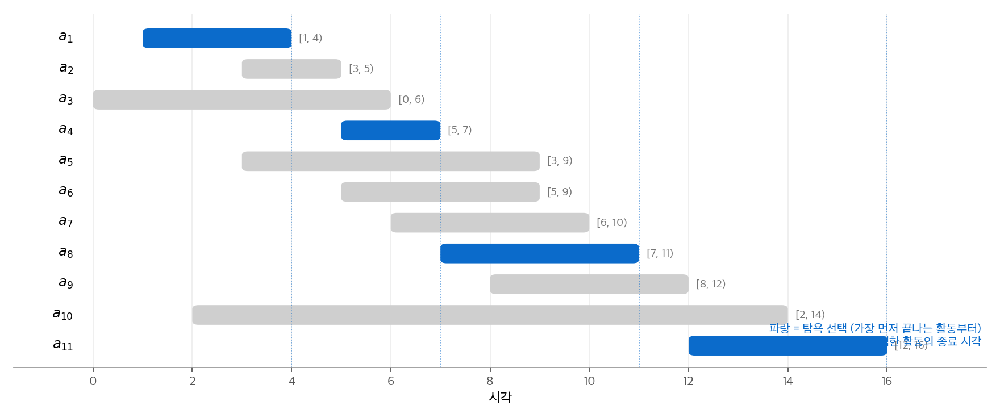
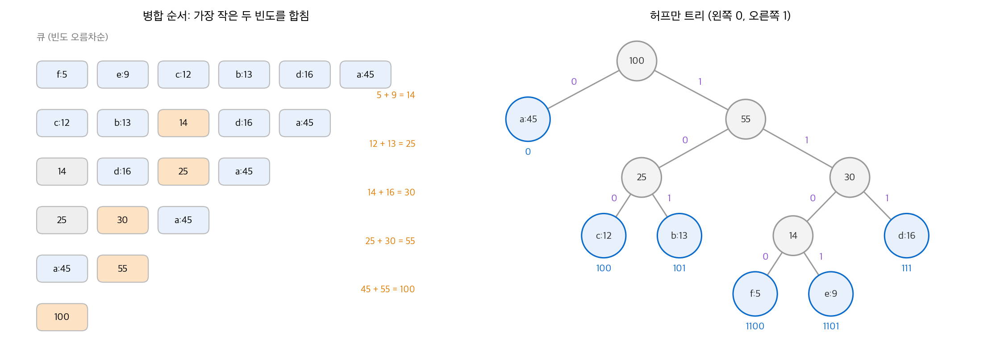
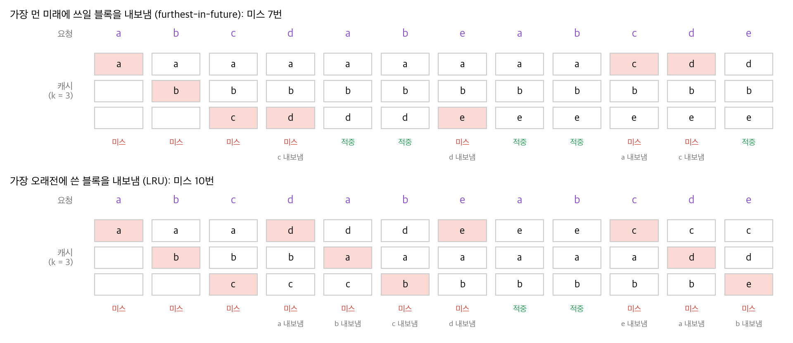

# 15. 탐욕 알고리즘

[14장](14-dynamic-programming.md)의 동적 계획법은 선택지를 모두 비교한 뒤 가장 좋은 것을 고릅니다.
**탐욕 알고리즘**(greedy algorithm)은 비교하지 않습니다. 매 단계에서 지금 가장 좋아 보이는 선택 하나를 하고, 남은 부분 문제 하나만 풉니다.
이 방법이 항상 최적해를 주지는 않습니다. 이 장은 탐욕 선택이 최적임을 증명하는 방법을 활동 선택, 허프만 부호, 오프라인 캐싱의 세 문제로 보여 줍니다.

!!! info "원문과 자료"
    - 원문: CLRS 4판 15장 Greedy Algorithms (15.1 An activity-selection problem, 15.2 Elements of the greedy strategy, 15.3 Huffman codes, 15.4 Offline caching)
    - 책 페이지: [MIT Press, Introduction to Algorithms, 4th ed.](https://mitpress.mit.edu/9780262046305/introduction-to-algorithms/)
    - 강의: [MIT OCW 6.046J Design and Analysis of Algorithms (Spring 2015)](https://ocw.mit.edu/courses/6-046j-design-and-analysis-of-algorithms-spring-2015/)
    - 함께 읽기: [14. 동적 계획법](14-dynamic-programming.md), [21. 최소 신장 트리](21-mst.md), [22. 단일 출발점 최단 경로](22-single-source-sp.md), [27. 온라인 알고리즘](27-online.md)
    - 장 끝 문제(거스름돈, 평균 완료 시간 최소화 스케줄링, 매트로이드 등)는 옮기지 않았습니다.

## 1. 활동 선택 문제

### 문제

회의실 하나를 쓰려는 활동 $n$ 개가 있습니다. 활동 $a_i$ 는 반열린 구간 $[s_i, f_i)$ 동안 회의실을 씁니다.
두 구간이 겹치지 않으면 두 활동은 **양립**(compatible)합니다. 즉 $s_i \ge f_j$ 또는 $s_j \ge f_i$ 입니다.
서로 양립하는 활동을 최대 개수로 고릅니다. 활동은 종료 시각 오름차순 $f_1 \le f_2 \le \cdots \le f_n$ 으로 정렬되어 있다고 가정합니다.

| $i$ | 1 | 2 | 3 | 4 | 5 | 6 | 7 | 8 | 9 | 10 | 11 |
| --- | --- | --- | --- | --- | --- | --- | --- | --- | --- | --- | --- |
| $s_i$ | 1 | 3 | 0 | 5 | 3 | 5 | 6 | 7 | 8 | 2 | 12 |
| $f_i$ | 4 | 5 | 6 | 7 | 9 | 9 | 10 | 11 | 12 | 14 | 16 |

$\{a_3, a_9, a_{11}\}$ 은 양립하지만 최대는 아닙니다. $\{a_1, a_4, a_8, a_{11}\}$ 과 $\{a_2, a_4, a_9, a_{11}\}$ 이 최대(4개)입니다.

### 동적 계획법으로 보기

$S_{ij}$ 를 $a_i$ 가 끝난 뒤 시작하고 $a_j$ 가 시작하기 전에 끝나는 활동의 집합이라고 합니다.
$S_{ij}$ 의 최대 양립 집합이 $a_k$ 를 포함하면, 나머지는 $S_{ik}$ 와 $S_{kj}$ 의 최대 양립 집합입니다. 잘라 붙이기 논증으로 보입니다.
따라서 $c[i, j] = \max_{a_k \in S_{ij}} \big(c[i, k] + c[k, j] + 1\big)$ 이라는 점화식을 세울 수 있습니다. 이 방법은 부분 문제가 $\Theta(n^2)$ 개이고 선택지가 $O(n)$ 개입니다.

### 탐욕 선택

선택지를 모두 비교할 필요가 없습니다. **가장 먼저 끝나는 활동을 고르면** 됩니다. 그러면 회의실이 가장 빨리 비고, 남은 시간에 가장 많은 활동을 넣을 수 있습니다.

**정리.** 비어 있지 않은 부분 문제 $S_k$ (활동 $a_k$ 가 끝난 뒤 시작하는 활동의 집합)에서, 종료 시각이 가장 이른 활동 $a_m$ 은 $S_k$ 의 어떤 최대 양립 집합에 포함됩니다.

증명은 **교환 논증**(exchange argument)입니다.

1. $A_k$ 를 $S_k$ 의 최대 양립 집합, $a_j$ 를 그 안에서 가장 먼저 끝나는 활동이라고 합니다.
2. $a_j = a_m$ 이면 증명이 끝납니다.
3. 아니면 $A_k' = A_k - \{a_j\} \cup \{a_m\}$ 을 만듭니다. $f_m \le f_j$ 이므로 $a_m$ 은 $A_k$ 의 나머지 활동과 겹치지 않습니다.
4. $|A_k'| = |A_k|$ 이므로 $A_k'$ 도 최대이고 $a_m$ 을 포함합니다.

탐욕 선택을 하면 부분 문제가 하나($S_m$)만 남습니다. 동적 계획법에서는 두 개($S_{ik}$, $S_{kj}$)가 남았습니다.

### 코드

재귀 형태도 가능하지만 꼬리 재귀이므로 반복문으로 바로 씁니다.

```python
def greedy_activity_selector(s, f):
    n = len(s)                            # f 는 오름차순으로 정렬되어 있습니다.
    chosen = [0]
    k = 0                                 # 마지막으로 고른 활동
    for m in range(1, n):
        if s[m] >= f[k]:                  # 앞 활동이 끝난 뒤에 시작하면 고릅니다.
            chosen.append(m)
            k = m
    return chosen
```

활동을 한 번씩만 보므로 $\Theta(n)$ 입니다. 정렬되어 있지 않으면 정렬에 $O(n \lg n)$ 이 더 듭니다.

<figure markdown>

<figcaption markdown>
<span class="fig-title"><b>Figure 1.</b> 활동 선택의 탐욕 실행</span>

종료 시각 순으로 훑으며 앞 활동이 끝난 뒤 시작하는 활동만 고릅니다. 결과는 $a_1, a_4, a_8, a_{11}$ 입니다.
</figcaption>
</figure>

실행 과정은 다음과 같습니다. $a_1$ 을 고르면 $f = 4$ 입니다. $a_2$ ($s = 3$), $a_3$ ($s = 0$)은 4보다 먼저 시작하므로 건너뜁니다.
$a_4$ ($s = 5$)를 고르면 $f = 7$ 입니다. $a_5, a_6, a_7$ 을 건너뛰고 $a_8$ ($s = 7$)을 고르면 $f = 11$ 입니다. $a_9, a_{10}$ 을 건너뛰고 $a_{11}$ 을 고릅니다.

모든 탐욕 기준이 통하지는 않습니다. "가장 짧은 활동부터"는 짧은 활동 하나가 긴 활동 둘을 막을 때 실패합니다. "가장 먼저 시작하는 활동부터"는 일찍 시작해 오래 쓰는 활동 하나에 실패합니다.

## 2. 탐욕 전략의 요소

### 두 가지 성질

탐욕 알고리즘이 최적이려면 두 성질이 필요합니다.

- **탐욕 선택 성질**(greedy-choice property): 국소적으로 최적인 선택을 해도 전역 최적해에 도달할 수 있습니다. 보통 교환 논증으로 증명합니다.
- **최적 부분 구조**: 탐욕 선택 뒤에 남은 부분 문제의 최적해와 그 선택을 합치면 원래 문제의 최적해가 됩니다.

동적 계획법은 부분 문제를 먼저 풀고 선택합니다(상향식). 탐욕 알고리즘은 먼저 선택하고 남은 부분 문제를 풉니다(하향식). 그래서 부분 문제의 답에 의존하지 않고 선택할 수 있어야 합니다.

### 0-1 배낭과 분할 가능 배낭

두 배낭 문제는 같은 최적 부분 구조를 가지지만 탐욕 선택 성질은 한쪽에만 있습니다.
도둑이 무게 $W$ 까지 담을 수 있고, 물건 $i$ 는 가치 $v_i$, 무게 $w_i$ 입니다.

- **0-1 배낭**(0-1 knapsack): 물건을 통째로 담거나 두고 갑니다.
- **분할 가능 배낭**(fractional knapsack): 물건의 일부만 담을 수 있습니다.

분할 가능 배낭은 단위 무게당 가치 $v_i / w_i$ 가 큰 물건부터 담으면 최적입니다.

```python
def fractional_knapsack(items, W):
    total = 0.0
    for v, w in sorted(items, key=lambda it: it[0] / it[1], reverse=True):
        take = min(w, W)                  # 단위 무게당 가치가 큰 것부터 담습니다.
        total += v * take / w
        W -= take
        if W == 0:
            break
    return total
```

$W = 50$ 이고 물건이 (가치, 무게) = (60, 10), (100, 20), (120, 30)이라고 합니다. 단위 가치는 6, 5, 4입니다.

| 문제 | 탐욕 선택 결과 | 최적해 |
| --- | --- | --- |
| 분할 가능 | 물건 1, 2를 모두, 물건 3의 2/3를 담아 $60 + 100 + 80 = 240$ | 240 (탐욕과 같음) |
| 0-1 | 물건 1, 2를 담고 물건 3은 안 들어가 $160$ | 물건 2, 3을 담아 $220$ |

0-1 배낭에서는 물건 1을 담은 선택이 빈 공간 20을 남겨 손해를 봅니다. 물건을 담을지 정하려면 담은 경우와 안 담은 경우의 부분 문제를 비교해야 합니다. 이것은 동적 계획법의 방식입니다. $O(nW)$ 에 풉니다.

## 3. 허프만 부호

### 문제

문자 10만 개짜리 파일을 이진 부호로 압축합니다. 문자 빈도(천 단위)는 다음과 같습니다.

| 문자 | a | b | c | d | e | f |
| --- | --- | --- | --- | --- | --- | --- |
| 빈도(천) | 45 | 13 | 12 | 16 | 9 | 5 |
| 고정 길이 부호 | 000 | 001 | 010 | 011 | 100 | 101 |
| 허프만 부호 | 0 | 101 | 100 | 111 | 1101 | 1100 |

고정 길이 부호는 문자마다 3비트이므로 30만 비트입니다. 위의 가변 길이 부호는 다음 비트 수가 듭니다.

$$
(45 \cdot 1 + 13 \cdot 3 + 12 \cdot 3 + 16 \cdot 3 + 9 \cdot 4 + 5 \cdot 4) \cdot 1{,}000 = 224{,}000
$$

약 25%를 줄입니다. 이 표의 부호가 이 빈도에서 최적입니다.

### 접두사 부호와 트리

어떤 부호어도 다른 부호어의 접두사가 아니면 **접두사 부호**(prefix code)입니다. 접두사 부호는 구분 기호 없이 앞에서부터 바로 해독할 수 있습니다.
예를 들어 `001011101` 은 0 · 0 · 101 · 1101로 나뉘어 aabe입니다.

접두사 부호는 이진 트리로 나타냅니다. 왼쪽 간선은 0, 오른쪽 간선은 1이고 문자는 잎에 있습니다. 부호어 길이는 잎의 깊이입니다.
최적 부호는 항상 **완전 이진 트리**(full binary tree)입니다. 자식이 하나인 내부 노드가 있으면 그 노드를 없애 부호를 줄일 수 있기 때문입니다.
트리 $T$ 의 비용은 다음과 같습니다. $c.\mathit{freq}$ 는 문자 $c$ 의 빈도, $d_T(c)$ 는 잎의 깊이입니다.

$$
B(T) = \sum_{c \in C} c.\mathit{freq} \cdot d_T(c)
$$

### 알고리즘

허프만 알고리즘은 빈도가 가장 작은 두 노드를 합치는 일을 $n - 1$ 번 반복합니다. 합친 노드의 빈도는 두 빈도의 합입니다.

```python
def huffman(freq):
    tie = itertools.count()               # 빈도가 같을 때 비교할 순번
    q = [(w, next(tie), ch) for ch, w in freq.items()]
    heapq.heapify(q)
    for _ in range(len(freq) - 1):        # n - 1 번 합칩니다.
        wx, _, x = heapq.heappop(q)
        wy, _, y = heapq.heappop(q)
        heapq.heappush(q, (wx + wy, next(tie), (x, y)))
    return q[0][2]

def codes(tree, prefix=""):
    if isinstance(tree, str):
        return {tree: prefix or "0"}
    left, right = tree
    return {**codes(left, prefix + "0"), **codes(right, prefix + "1")}
```

최소 우선순위 큐를 이진 힙으로 만들면([6장](06-heapsort.md)) 연산 하나가 $O(\lg n)$ 이므로 전체는 $O(n \lg n)$ 입니다.

<figure markdown>

<figcaption markdown>
<span class="fig-title"><b>Figure 2.</b> 허프만 트리의 병합 순서와 결과</span>

가장 작은 두 빈도를 다섯 번 합치면(5+9, 12+13, 14+16, 25+30, 45+55) 트리가 완성됩니다. 빈도가 큰 a는 1비트, 작은 e와 f는 4비트를 받습니다.
</figcaption>
</figure>

### 정확성

두 보조 정리로 증명합니다.

1. **탐욕 선택 성질.** 빈도가 가장 작은 두 문자 $x, y$ 가 같은 부모 아래에서 가장 깊은 형제 잎인 최적 트리가 있습니다.
   임의의 최적 트리에서 가장 깊은 형제 잎 $a, b$ 를 고르고 $x$ 와 $a$, $y$ 와 $b$ 를 바꿉니다. $x$ 의 빈도가 $a$ 이하이고 $a$ 의 깊이가 $x$ 이상이므로 비용은 늘지 않습니다.
   $B(T) - B(T') = (a.\mathit{freq} - x.\mathit{freq})(d_T(a) - d_T(x)) \ge 0$ 입니다.
2. **최적 부분 구조.** $x, y$ 를 빈도 $x.\mathit{freq} + y.\mathit{freq}$ 인 새 문자 $z$ 로 바꾼 알파벳 $C'$ 을 생각합니다. $C'$ 의 최적 트리 $T'$ 에서 잎 $z$ 를 자식 $x, y$ 를 가진 내부 노드로 바꾸면 $C$ 의 최적 트리가 됩니다.
   $B(T) = B(T') + x.\mathit{freq} + y.\mathit{freq}$ 이고, 더 나은 $T$ 가 있다면 그로부터 더 나은 $T'$ 을 만들 수 있어 모순이기 때문입니다.

두 보조 정리를 합치면 허프만 알고리즘이 최적 접두사 부호를 만듭니다.

## 4. 오프라인 캐싱

### 문제

캐시에는 블록이 최대 $k$ 개 들어갑니다. 블록 요청 열 $b_1, b_2, \ldots, b_n$ 을 차례로 처리합니다.
요청한 블록이 캐시에 있으면 **적중**(hit)이고, 없으면 **미스**(miss)입니다. 미스가 나면 블록을 캐시에 넣고, 캐시가 가득 차 있으면 블록 하나를 내보냅니다.
**오프라인**(offline) 문제에서는 요청 열 전체를 미리 압니다. 미스 수를 최소로 하는 내보내기 순서를 찾습니다.

### 가장 먼 미래 전략

**가장 먼 미래**(furthest-in-future) 전략은 캐시에 있는 블록 중 다음 요청이 가장 늦게 오는 블록을 내보냅니다. 다시 요청되지 않는 블록이 있으면 그 블록을 먼저 내보냅니다.
이 전략을 제안한 Belady의 이름을 따서 Belady의 최적 알고리즘이라고도 부릅니다.

```python
def furthest_in_future(requests, k):
    cache, misses = set(), 0
    for t, b in enumerate(requests):
        if b in cache:
            continue
        misses += 1
        if len(cache) == k:
            def next_use(x):              # 다음 요청 시점, 없으면 무한대
                rest = requests[t + 1:]
                return rest.index(x) if x in rest else float("inf")
            cache.remove(max(cache, key=next_use))
        cache.add(b)
    return misses
```

이 구현은 미스마다 캐시의 블록 $k$ 개에 대해 남은 요청 열을 훑으므로 최악 $O(n^2 k)$ 입니다. 블록별 다음 요청 위치를 미리 계산하고 우선순위 큐에 넣으면 $O(n \lg k)$ 입니다.

<figure markdown>

<figcaption markdown>
<span class="fig-title"><b>Figure 3.</b> 가장 먼 미래 전략과 LRU의 캐시 상태</span>

같은 요청 열(k = 3)에서 가장 먼 미래 전략은 미스 7번, LRU는 미스 10번입니다. 빨간 칸은 미스로 새로 들어온 블록입니다.
</figcaption>
</figure>

요청 열 a b c d a b e a b c d e에서 네 번째 요청 d가 미스입니다. 캐시의 a, b, c 중 다음 요청은 a가 5번째, b가 6번째, c가 10번째입니다. 따라서 c를 내보냅니다.
LRU(least recently used)는 가장 오래전에 쓴 a를 내보냅니다. 그 결과 곧 a와 b가 연달아 미스가 됩니다.

### 정확성

부분 문제를 (현재 캐시 내용 $C$, 남은 요청의 시작 위치 $i$)로 정의하면 최적 부분 구조가 있습니다.
탐욕 선택 성질은 교환 논증으로 보입니다.

1. 미스에서 가장 먼 미래 블록 $z$ 대신 다른 블록 $x$ 를 내보내는 최적해 $S$ 가 있다고 합니다.
2. $z$ 를 내보내는 해 $S'$ 을 만듭니다. $S'$ 은 $x$ 가 다시 요청되거나 $S$ 가 $z$ 를 내보낼 때까지 $S$ 를 따라 하고, 그 시점에 두 캐시를 같게 맞춥니다.
3. $x$ 의 다음 요청이 $z$ 보다 먼저 오므로, 그 사이에 $S'$ 이 추가로 내는 미스는 $S$ 의 미스로 상쇄됩니다. 따라서 $S'$ 의 미스 수는 $S$ 이하입니다.

실제 캐시는 미래 요청을 모르므로 이 전략을 쓸 수 없습니다. 그래도 최적값을 알려 주므로 LRU 같은 **온라인** 전략을 평가하는 기준이 됩니다. 이 비교는 [27장](27-online.md)에서 다룹니다.

## 5. 정리

| 문제 | 탐욕 선택 | 증명 방법 | 실행 시간 |
| --- | --- | --- | --- |
| 활동 선택 | 가장 먼저 끝나는 활동 | 교환 논증 | $\Theta(n)$ (정렬 후) |
| 분할 가능 배낭 | 단위 무게당 가치가 가장 큰 물건 | 교환 논증 | $O(n \lg n)$ |
| 허프만 부호 | 빈도가 가장 작은 두 노드 합치기 | 교환 논증 + 최적 부분 구조 | $O(n \lg n)$ |
| 오프라인 캐싱 | 다음 요청이 가장 늦은 블록 내보내기 | 교환 논증 | $O(n \lg k)$ |

- 탐욕 알고리즘은 탐욕 선택 성질과 최적 부분 구조가 모두 있을 때 최적입니다.
- 탐욕 선택 성질은 "최적해 하나를 탐욕 선택을 포함하도록 바꿔도 나빠지지 않는다"는 교환 논증으로 보입니다.
- 0-1 배낭처럼 최적 부분 구조만 있고 탐욕 선택 성질이 없으면 동적 계획법을 씁니다.
- 탐욕 기준을 잘못 고르면 그럴듯해도 틀립니다. 반례를 먼저 찾아보는 것이 좋습니다.

[21장](21-mst.md)의 Kruskal·Prim 알고리즘과 [22장](22-single-source-sp.md)의 Dijkstra 알고리즘도 탐욕 알고리즘입니다. 이 장의 교환 논증과 같은 방식으로 증명합니다.
