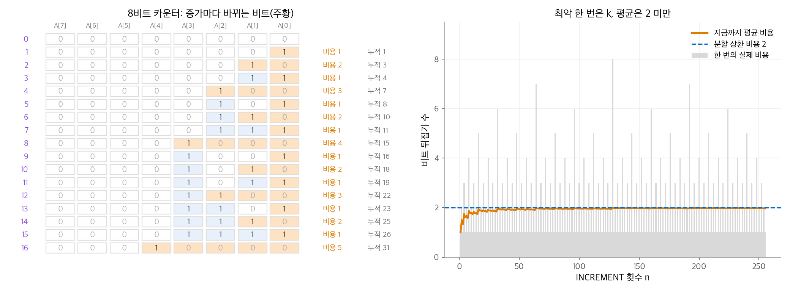
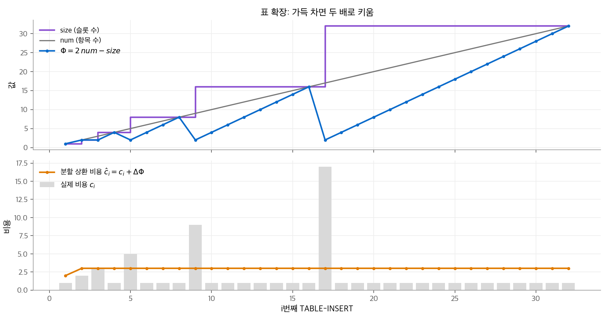
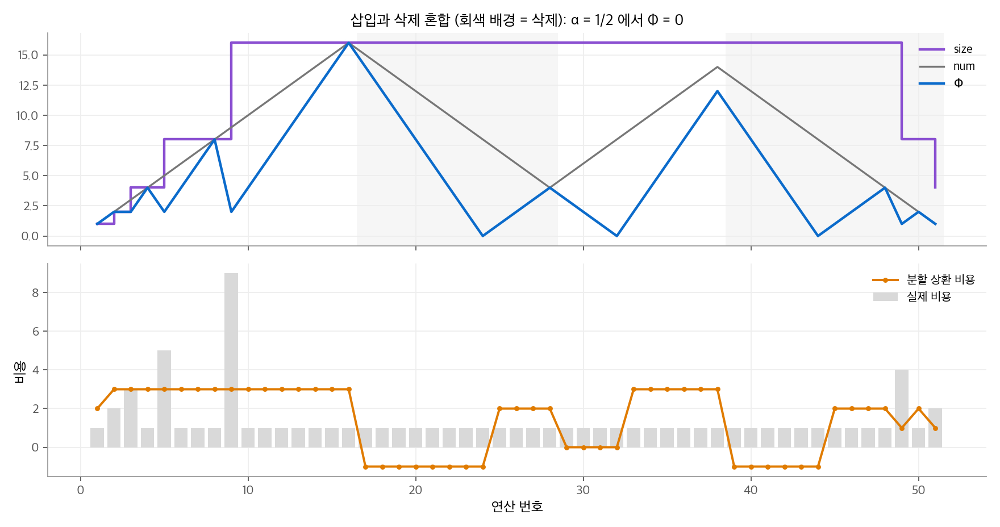

# 16. 분할 상환 분석

연산 하나의 최악 비용에 연산 수를 곱하면 실행 시간의 상한이 나옵니다. 그러나 이 상한은 너무 클 때가 많습니다.
비싼 연산이 드물게만 일어나고, 그 연산이 뒤의 연산을 싸게 만들기 때문입니다.
**분할 상환 분석**(amortized analysis)은 연산 $n$ 개의 **전체** 최악 비용을 구하고, 그 값을 연산마다 나누어 평균 비용을 매깁니다.
확률을 쓰지 않으므로 평균 사례 분석과 다릅니다. 어떤 연산 열에서도 성립하는 최악 보장입니다.

이 장은 세 가지 방법(집계 분석, 회계 방법, 퍼텐셜 방법)을 같은 두 예제(다중 팝 스택, 이진 카운터)에 적용합니다. 마지막으로 크기가 바뀌는 동적 테이블을 분석합니다.

!!! info "원문과 자료"
    - 원문: CLRS 4판 16장 Amortized Analysis (16.1 Aggregate analysis, 16.2 The accounting method, 16.3 The potential method, 16.4 Dynamic tables)
    - 책 페이지: [MIT Press, Introduction to Algorithms, 4th ed.](https://mitpress.mit.edu/9780262046305/introduction-to-algorithms/)
    - 강의: [MIT OCW 6.046J Design and Analysis of Algorithms (Spring 2015), Lecture 5 Amortization](https://ocw.mit.edu/courses/6-046j-design-and-analysis-of-algorithms-spring-2015/)
    - 함께 읽기: [10. 기본 자료 구조](10-elementary-ds.md), [11. 해시 테이블](11-hash-tables.md), [19. 서로소 집합 자료 구조](19-disjoint-sets.md)
    - 장 끝 문제(비트 반전 카운터, 동적 이진 탐색, 무게 균형 트리 등)는 옮기지 않았습니다.

## 1. 집계 분석

### 방법

**집계 분석**(aggregate analysis)은 연산 $n$ 개의 전체 비용 $T(n)$ 의 상한을 직접 구합니다. 연산 하나의 분할 상환 비용은 $T(n)/n$ 입니다.
연산 종류가 여러 개여도 모두 같은 분할 상환 비용을 받습니다.

### 다중 팝 스택

스택에 PUSH와 POP($O(1)$)에 더해 MULTIPOP$(S, k)$ 가 있습니다. 이 연산은 원소를 $\min(s, k)$ 개 꺼냅니다. $s$ 는 스택 크기입니다.
MULTIPOP 하나는 최악 $O(n)$ 이므로, 연산 $n$ 개에 $O(n^2)$ 이라는 상한이 바로 나옵니다. 이 상한은 정확하지 않습니다.

빈 스택에서 시작하면 꺼낸 원소 수는 넣은 원소 수를 넘을 수 없습니다. PUSH는 최대 $n$ 번이므로 POP과 MULTIPOP 안의 꺼내기도 모두 합쳐 최대 $n$ 번입니다.
따라서 연산 $n$ 개의 전체 비용은 $O(n)$ 이고 연산 하나의 분할 상환 비용은 $O(1)$ 입니다.

### 이진 카운터

$k$ 비트 배열 `A[0..k-1]` 로 0부터 세는 카운터를 만듭니다. `A[0]` 이 가장 낮은 자리입니다.
INCREMENT는 낮은 자리부터 연속한 1을 0으로 바꾸고, 처음 만난 0을 1로 바꿉니다. 비용은 뒤집은 비트 수입니다.

```python
def increment(A):
    i = 0
    while i < len(A) and A[i] == 1:       # 낮은 자리의 1을 0으로 바꿉니다.
        A[i] = 0
        i += 1
    if i < len(A):
        A[i] = 1                          # 처음 만난 0을 1로 바꿉니다.
    return i + (1 if i < len(A) else 0)   # 뒤집은 비트 수
```

INCREMENT 하나는 최악 $k$ 비트를 뒤집습니다(모든 비트가 1일 때). 따라서 $n$ 번에 $O(nk)$ 라는 상한이 나옵니다.
더 정확히 세면 `A[0]` 은 매번, `A[1]` 은 2번에 한 번, `A[i]` 는 $2^i$ 번에 한 번 뒤집힙니다.

$$
\sum_{i=0}^{k-1} \left\lfloor \frac{n}{2^i} \right\rfloor < n \sum_{i=0}^{\infty} \frac{1}{2^i} = 2n
$$

따라서 0에서 시작한 INCREMENT $n$ 번은 $O(n)$ 이고 분할 상환 비용은 $O(1)$ 입니다. 16비트 카운터로 1,000번 세면 실제로 1,994번 뒤집힙니다.

<figure markdown>

<figcaption markdown>
<span class="fig-title"><b>Figure 1.</b> 이진 카운터의 비트 뒤집기</span>

비싼 증가(8 → 4비트, 16 → 5비트)는 드물고, 평균 비용은 2 아래에 머뭅니다.
</figcaption>
</figure>

## 2. 회계 방법

### 방법

**회계 방법**(accounting method)은 연산마다 실제 비용과 다른 요금, 즉 **분할 상환 비용** $\hat c_i$ 를 매깁니다.
요금이 실제 비용 $c_i$ 보다 크면 차액을 자료 구조의 특정 객체에 **크레디트**(credit)로 저장합니다. 요금이 실제 비용보다 작으면 저장한 크레디트로 차액을 냅니다.
조건은 하나입니다. 어떤 연산 열에서도 크레디트 잔액이 음수가 되면 안 됩니다.

$$
\sum_{i=1}^{n} \hat c_i \ge \sum_{i=1}^{n} c_i \quad (\text{모든 } n \text{ 에 대해})
$$

그러면 분할 상환 비용의 합이 실제 비용 합의 상한이 됩니다.

### 다중 팝 스택

요금을 다음과 같이 정합니다.

| 연산 | 실제 비용 | 분할 상환 비용 |
| --- | --- | --- |
| PUSH | 1 | 2 |
| POP | 1 | 0 |
| MULTIPOP | $\min(s, k)$ | 0 |

PUSH는 1을 실제 비용으로 내고, 나머지 1을 넣은 원소 위에 크레디트로 올려 둡니다. 스택의 모든 원소는 크레디트 1을 가집니다.
원소를 꺼낼 때(POP이든 MULTIPOP이든) 그 원소의 크레디트로 꺼내는 비용을 냅니다. 잔액은 스택 크기와 같으므로 음수가 되지 않습니다.
따라서 연산 $n$ 개의 전체 비용은 최대 $2n = O(n)$ 입니다.

### 이진 카운터

비트를 0에서 1로 바꿀 때 2를 받습니다. 1은 바꾸는 비용이고, 1은 그 비트 위에 크레디트로 둡니다. 1에서 0으로 바꿀 때는 그 비트의 크레디트로 냅니다.
INCREMENT는 0을 1로 최대 한 번 바꾸므로 분할 상환 비용은 최대 2입니다. 1인 비트마다 크레디트가 1씩 있으므로 잔액은 음수가 되지 않습니다.

## 3. 퍼텐셜 방법

### 방법

**퍼텐셜 방법**(potential method)은 크레디트를 객체마다 두지 않고, 자료 구조 전체의 함수 $\Phi$ 로 나타냅니다.
$D_0$ 을 처음 자료 구조, $D_i$ 를 $i$ 번째 연산 뒤의 자료 구조라고 합니다. **퍼텐셜 함수**(potential function) $\Phi$ 는 각 $D_i$ 에 실수 $\Phi(D_i)$ 를 줍니다.
분할 상환 비용을 다음과 같이 정의합니다.

$$
\hat c_i = c_i + \Phi(D_i) - \Phi(D_{i-1})
$$

$n$ 개를 더하면 가운데 항이 서로 지워집니다(망원 합).

$$
\sum_{i=1}^{n} \hat c_i = \sum_{i=1}^{n} c_i + \Phi(D_n) - \Phi(D_0)
$$

모든 $i$ 에서 $\Phi(D_i) \ge \Phi(D_0)$ 이면 분할 상환 비용의 합이 실제 비용 합의 상한입니다. 보통 $\Phi(D_0) = 0$ 이고 $\Phi \ge 0$ 이 되게 고릅니다.
퍼텐셜이 늘어나는 연산은 미래를 위해 저축하고, 줄어드는 연산은 저축한 퍼텐셜로 비용을 냅니다.

### 다중 팝 스택

$\Phi$ = 스택의 원소 수로 둡니다. 빈 스택에서 시작하므로 $\Phi(D_0) = 0$ 이고 항상 $\Phi \ge 0$ 입니다.

| 연산 | $c_i$ | $\Delta\Phi$ | $\hat c_i$ |
| --- | --- | --- | --- |
| PUSH | 1 | $+1$ | 2 |
| POP | 1 | $-1$ | 0 |
| MULTIPOP ($k' = \min(s, k)$ 개) | $k'$ | $-k'$ | 0 |

### 이진 카운터

$\Phi$ = 카운터에서 1인 비트 수 $b_i$ 로 둡니다. $i$ 번째 INCREMENT가 1을 $t_i$ 개 0으로 바꾼다고 합니다.
실제 비용은 최대 $t_i + 1$ 이고, 1인 비트 수는 $b_i \le b_{i-1} - t_i + 1$ 입니다.

$$
\hat c_i \le (t_i + 1) + (b_{i-1} - t_i + 1) - b_{i-1} = 2
$$

카운터가 0에서 시작하지 않아도 이 방법은 쓸 수 있습니다. 처음 1의 개수가 $b_0$ 이면 $\sum c_i \le 2n - b_n + b_0 \le 2n + b_0$ 입니다. $b_0 \le k$ 이므로 $n = \Omega(k)$ 이면 전체 비용은 $O(n)$ 입니다.

### 세 방법의 관계

| 방법 | 크레디트를 두는 곳 | 연산마다 다른 분할 상환 비용 | 쓰기 좋은 상황 |
| --- | --- | --- | --- |
| 집계 분석 | 두지 않음 | 불가(모두 같은 값) | 전체 비용을 직접 셀 수 있을 때 |
| 회계 방법 | 객체마다 | 가능 | 객체별로 "미리 낸 비용"이 자연스러울 때 |
| 퍼텐셜 방법 | 자료 구조 전체 | 가능 | 구조의 상태 하나로 저축량을 쓸 수 있을 때 |

세 방법 모두 분석 도구일 뿐입니다. 코드에 크레디트나 퍼텐셜을 넣지 않습니다.

## 4. 동적 테이블

### 표 확장

미리 크기를 알 수 없는 표에 항목을 계속 넣습니다. 표가 가득 차면 두 배 크기의 표를 새로 할당하고 항목을 모두 옮깁니다.
`num` 을 항목 수, `size` 를 슬롯 수라고 하면 **적재율**(load factor)은 $\alpha = \mathit{num} / \mathit{size}$ 입니다. 확장만 하면 $\alpha \ge 1/2$ 이 유지됩니다.
Python의 `list` 와 C++의 `std::vector` 가 이 방식으로 늘어납니다. 두 구현은 배율(Python 약 1.125, `vector` 는 구현에 따라 1.5 또는 2)이 다릅니다. 배율이 1보다 큰 상수이면 분석 방법은 같고 상수만 바뀝니다.

```python
class DynamicTable:
    def __init__(self, shrink_at=0.25):
        self.size, self.num, self.cost = 0, 0, 0
        self.shrink_at = shrink_at

    def _resize(self, new_size):
        self.cost += self.num             # 항목을 모두 새 표로 옮깁니다.
        self.size = new_size

    def insert(self):
        if self.num == self.size:         # 가득 차면 두 배로 키웁니다.
            self._resize(max(1, 2 * self.size))
        self.num += 1
        self.cost += 1                    # 기본 삽입

    def delete(self):
        self.num -= 1
        self.cost += 1                    # 기본 삭제
        if self.size > 1 and self.num < self.shrink_at * self.size:
            self._resize(self.size // 2)  # 너무 비면 반으로 줄입니다.
```

### 세 방법으로 분석

$i$ 번째 삽입의 비용은 $i - 1$ 이 2의 거듭제곱이면 $i$ (옮기기 $i - 1$ + 삽입 1), 아니면 1입니다.

- **집계 분석.** $n$ 번 삽입의 전체 비용은 $n + \sum_{j=0}^{\lfloor \lg n \rfloor} 2^j < n + 2n = 3n$ 입니다. 실제로 1,024번 넣으면 비용이 2,047입니다.
- **회계 방법.** 삽입마다 3을 받습니다. 1은 삽입 비용, 1은 자기가 나중에 옮겨질 비용, 1은 표의 앞쪽 절반에서 이미 옮겨진 항목 하나의 옮기기 비용입니다. 확장 직후 크레디트는 0이고, 다음 확장 전까지 새로 넣은 항목이 옮길 비용을 모두 모읍니다.
- **퍼텐셜 방법.** $\Phi = 2 \cdot \mathit{num} - \mathit{size}$ 로 둡니다. 확장 직후 $\mathit{num} = \mathit{size}/2$ 이므로 $\Phi = 0$ 이고, 가득 차면 $\Phi = \mathit{size}$ 가 되어 옮기기 비용을 낼 수 있습니다.

퍼텐셜 방법으로 계산합니다. 확장이 없는 삽입은 $\hat c_i = 1 + 2 = 3$ 입니다.
확장하는 삽입은 $\mathit{num}_{i-1} = \mathit{size}_{i-1} = s$ 에서 $\mathit{size}_i = 2s$ 가 되므로 다음과 같습니다.

$$
\hat c_i = (s + 1) + \big(2(s + 1) - 2s\big) - (2s - s) = (s + 1) + 2 - s = 3
$$

<figure markdown>

<figcaption markdown>
<span class="fig-title"><b>Figure 2.</b> 표 확장의 실제 비용과 분할 상환 비용</span>

퍼텐셜은 확장 직전에 최대가 되어 옮기기 비용을 내고 0으로 돌아갑니다. 분할 상환 비용은 첫 삽입(2)을 빼면 항상 3입니다.
</figcaption>
</figure>

### 표 축소

삭제가 많으면 표가 너무 비므로 메모리를 줄이고 싶습니다. 단순한 규칙은 적재율이 $1/2$ 아래로 내려가면 반으로 줄이는 것입니다. 이 규칙은 실패합니다.
표가 가득 찬 상태에서 삽입, 삭제, 삭제, 삽입을 반복하면, 삽입이 확장을 일으키고 두 번째 삭제가 다시 축소를 일으킵니다. 연산마다 $\Theta(n)$ 을 옮기므로 전체가 $\Theta(n^2)$ 입니다.

해결책은 확장과 축소의 문턱을 떼어 두는 것입니다. 가득 차면 두 배로 늘리고, 적재율이 **1/4** 아래로 내려가면 반으로 줄입니다.
그러면 적재율은 항상 $1/4$ 이상이고, 확장이나 축소 직후 적재율은 $1/2$ 입니다.
위 코드에서 `shrink_at` 만 바꿔 같은 연산 1,024개를 실행했습니다. 크기 512의 가득 찬 표에서 시작했습니다.

| 축소 문턱 | 연산 1,024개의 비용 |
| --- | --- |
| $\alpha < 1/2$ | 262,912 |
| $\alpha < 1/4$ | 1,536 |

### 축소를 포함한 퍼텐셜

퍼텐셜은 $\alpha = 1/2$ 에서 0이고, 적재율이 $1/2$ 에서 멀어질수록 커지도록 정합니다.

$$
\Phi(T) =
\begin{cases}
2\,(\mathit{num} - \mathit{size}/2) & \alpha \ge 1/2 \\
\mathit{size}/2 - \mathit{num} & \alpha < 1/2
\end{cases}
$$

$\alpha$ 가 1에 닿으면 $\Phi = \mathit{size}$ 로 확장 비용을 내고, $1/4$ 에 닿으면 $\Phi = \mathit{size}/4 = \mathit{num}$ 으로 축소 비용을 냅니다.
경우를 나누어 계산하면 삽입의 분할 상환 비용은 최대 3, 삭제는 최대 2입니다. 따라서 삽입과 삭제 $n$ 개의 전체 비용은 $O(n)$ 입니다.

<figure markdown>

<figcaption markdown>
<span class="fig-title"><b>Figure 3.</b> 삽입과 삭제를 섞은 연산 열의 퍼텐셜</span>

$\Phi$ 는 $\alpha = 1/2$ 에서 0이고, 확장이나 축소 직전에 옮길 항목 수만큼 쌓입니다. 분할 상환 비용은 삽입 3, 삭제 2 이하입니다.
</figcaption>
</figure>

$\alpha \ge 1/2$ 에서 삭제하면 퍼텐셜이 2 줄어들어 분할 상환 비용이 $1 - 2 = -1$ 이 됩니다. 분할 상환 비용은 음수가 될 수도 있습니다. 합에 대한 상한만 지키면 됩니다.

## 5. 정리

| 예제 | 연산 하나의 최악 비용 | 분할 상환 비용 | 퍼텐셜 함수 |
| --- | --- | --- | --- |
| 다중 팝 스택 | $O(n)$ | $O(1)$ (PUSH 2) | 스택의 원소 수 |
| 이진 카운터 | $O(k)$ | 2 | 1인 비트 수 |
| 동적 테이블, 확장만 | $O(n)$ | 3 | $2\,\mathit{num} - \mathit{size}$ |
| 동적 테이블, 확장과 축소 | $O(n)$ | 삽입 3, 삭제 2 | 적재율에 따라 두 식 |

- 분할 상환 분석은 확률을 쓰지 않는 최악 보장입니다. 연산 열의 전체 비용을 연산마다 나눕니다.
- 회계 방법과 퍼텐셜 방법은 싼 연산에서 미리 걷어 비싼 연산에 씁니다. 잔액(크레디트, $\Phi - \Phi_0$)이 음수가 되지 않아야 합니다.
- 동적 테이블은 확장 문턱(가득 참)과 축소 문턱(1/4)을 떼어 두어야 확장과 축소가 번갈아 일어나지 않습니다.

[19장](19-disjoint-sets.md)의 서로소 집합 자료 구조와 Fibonacci 힙 같은 자료 구조는 이 장의 퍼텐셜 방법으로 분석합니다. [11장](11-hash-tables.md)의 해시 테이블도 적재율을 유지할 때 같은 표 확장을 씁니다.
