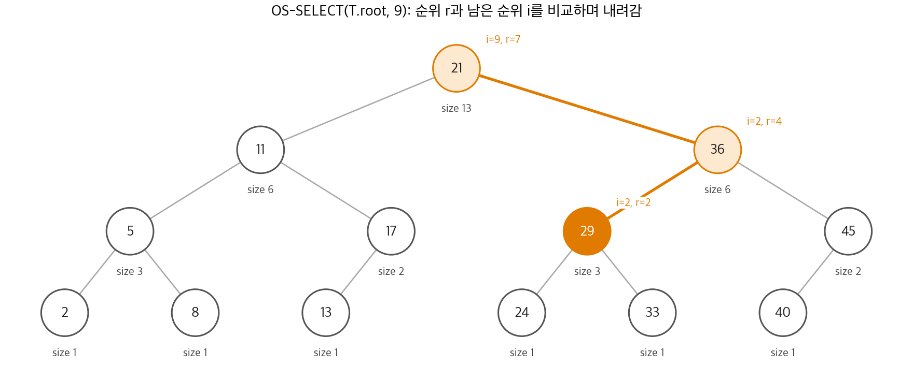
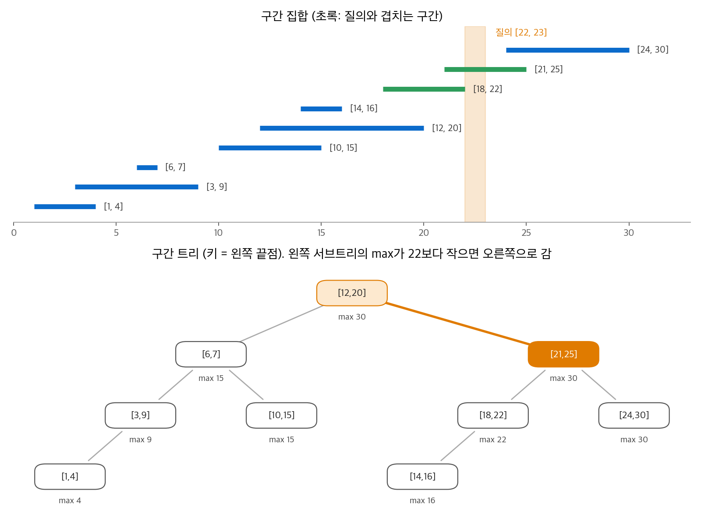

# 17. 자료 구조 확장

실무에서 필요한 자료 구조는 교과서의 자료 구조와 조금씩 다릅니다. 그렇다고 매번 새 자료 구조를 처음부터 설계하지는 않습니다. 대부분은 이미 아는 자료 구조의 노드에 **속성 하나를 더 저장(augment)** 하고, 그 속성을 쓰는 연산을 추가하면 됩니다. 이 장은 13장의 레드-블랙 트리를 두 번 확장합니다. 첫째는 $i$ 번째로 작은 원소를 $O(\lg n)$ 에 찾는 **순서 통계 트리** 입니다. 둘째는 주어진 구간과 겹치는 구간을 $O(\lg n)$ 에 찾는 **구간 트리** 입니다. 두 예 사이에서 "어떤 속성이면 비용 없이 유지할 수 있는가"라는 일반 원칙을 세웁니다.

!!! info "원문과 자료"
    - 원문: Cormen, Leiserson, Rivest, Stein, *Introduction to Algorithms*, 4th ed. (MIT Press, 2022), 17장 Augmenting Data Structures (17.1~17.3)
    - [MIT Press 책 페이지](https://mitpress.mit.edu/9780262046305/introduction-to-algorithms/)
    - 함께 읽기: [12. 이진 탐색 트리](12-bst.md), [13. 레드-블랙 트리](13-red-black-trees.md), [9. 중앙값과 순서 통계량](09-order-statistics.md)

## 1. 순서 통계 트리

### 문제

9장은 정렬되지 않은 $n$ 개 원소에서 $i$ 번째로 작은 원소를 $O(n)$ 에 찾았습니다. 집합이 계속 바뀌면서 이 질의가 반복되면 매번 $O(n)$ 은 비쌉니다. 원하는 연산은 두 가지입니다.

- OS-SELECT$(x, i)$: $x$ 를 루트로 하는 서브트리에서 $i$ 번째로 작은 키를 가진 노드를 돌려줍니다.
- OS-RANK$(T, x)$: 노드 $x$ 의 순위, 즉 중위 순회에서 $x$ 의 위치를 돌려줍니다.

**순서 통계 트리(order-statistic tree)** 는 레드-블랙 트리의 각 노드에 서브트리의 노드 개수 $x.size$ 를 더 저장합니다. 경계 노드 $T.nil$ 의 size는 0입니다.

$$
x.size = x.left.size + x.right.size + 1
$$

키가 모두 다르면 $x$ 의 서브트리 안에서 $x$ 의 순위는 $x.left.size + 1$ 입니다. 키가 같은 원소가 있으면 "중위 순회의 위치"를 순위로 정의합니다.

### OS-SELECT

```text
OS-SELECT(x, i)
1  r = x.left.size + 1          // x의 서브트리 안에서 x의 순위
2  if i == r
3      return x
4  elseif i < r
5      return OS-SELECT(x.left, i)
6  else return OS-SELECT(x.right, i - r)
```

$i < r$ 이면 답은 왼쪽 서브트리에 있습니다. $i > r$ 이면 답은 오른쪽 서브트리에 있고, 왼쪽 서브트리와 $x$ 를 합친 $r$ 개를 건너뛰었으므로 오른쪽에서는 $i - r$ 번째를 찾습니다. 재귀마다 한 층 내려가므로 실행 시간은 $O(h) = O(\lg n)$ 입니다.

<figure markdown>

<figcaption markdown>
<span class="fig-title"><b>Figure 1.</b> OS-SELECT의 탐색 경로</span>

각 노드에서 남은 순위 $i$ 와 노드의 순위 $r$ 을 비교해 한쪽으로만 내려갑니다.
</figcaption>
</figure>

**수치 예시.** Figure 1의 트리는 키 13개(2, 5, 8, 11, 13, 17, 21, 24, 29, 33, 36, 40, 45)를 담습니다. OS-SELECT(root, 9)를 따라갑니다.

| 노드 | $i$ | $r = x.left.size + 1$ | 판단 |
| --- | --- | --- | --- |
| 21 | 9 | 6 + 1 = 7 | $i > r$: 오른쪽으로, $i = 9 - 7 = 2$ |
| 36 | 2 | 3 + 1 = 4 | $i < r$: 왼쪽으로 |
| 29 | 2 | 1 + 1 = 2 | $i = r$: 찾음 |

정렬하면 아홉 번째 키는 29입니다. 세 노드만 보고 답을 찾았습니다.

### OS-RANK

```text
OS-RANK(T, x)
1  r = x.left.size + 1          // x의 서브트리 안에서 x의 순위
2  y = x
3  while y ≠ T.root
4      if y == y.p.right        // 오른쪽 자식이면 부모와 부모의 왼쪽 서브트리를 앞에 더한다
5          r = r + y.p.left.size + 1
6      y = y.p
7  return r
```

루프 불변식은 "반복 시작 시점에 $r$ 은 $y$ 를 루트로 하는 서브트리 안에서 $x$ 의 순위"입니다. $y$ 가 부모의 오른쪽 자식이면, 부모 서브트리에서 $x$ 앞에 부모의 왼쪽 서브트리와 부모 자신이 더 옵니다. 왼쪽 자식이면 앞에 추가되는 노드가 없습니다. 루트에 도착하면 $r$ 은 전체 순위입니다. 한 번 반복할 때마다 한 층 올라가므로 $O(\lg n)$ 입니다.

**수치 예시.** Figure 1에서 키 33의 순위를 구합니다. 33은 왼쪽 자식이 없으므로 $r = 1$ 에서 시작합니다. 33은 29의 오른쪽 자식이므로 $r = 1 + 1 + 1 = 3$ 입니다. 29는 36의 왼쪽 자식이므로 그대로 3입니다. 36은 21의 오른쪽 자식이므로 $r = 3 + 6 + 1 = 10$ 입니다. 정렬한 목록에서 33은 실제로 열 번째입니다.

### size 유지하기

size 속성이 쓸모 있으려면 삽입과 삭제가 size를 $O(\lg n)$ 안에 고쳐야 합니다. 레드-블랙 트리의 삽입은 두 단계로 일어납니다.

1. 루트에서 내려가 새 노드를 잎 자리에 붙입니다. 내려가는 경로의 모든 노드의 size를 1씩 늘립니다. 새 노드의 size는 1입니다. 경로 길이는 $O(\lg n)$ 입니다.
2. 색을 고치면서 회전을 많아야 두 번 합니다. 회전 하나는 두 노드의 서브트리만 바꿉니다. 따라서 회전마다 두 노드의 size만 다시 계산합니다.

LEFT-ROTATE$(T, x)$ 에서 $y = x.right$ 라면 다음 두 줄을 회전 끝에 덧붙입니다.

```text
y.size = x.size                          // y가 x의 자리를 그대로 이어받는다
x.size = x.left.size + x.right.size + 1  // x는 서브트리가 줄었으므로 다시 계산한다
```

삭제도 같습니다. 실제로 빠지는 노드의 원래 위치에서 루트까지 올라가며 size를 1씩 줄이고, 회전 세 번 이하에서 size를 다시 계산합니다. 삽입과 삭제 모두 $O(\lg n)$ 을 유지합니다.

### 구현

```python
class Node:
    def __init__(self, key):
        self.key, self.left, self.right, self.size = key, None, None, 1

def size(x):
    return x.size if x else 0

def os_select(x, i):
    while True:
        r = size(x.left) + 1
        if i == r:
            return x
        if i < r:
            x = x.left
        else:
            x, i = x.right, i - r

def os_rank(path_to_x):
    """루트에서 x까지의 노드 목록을 받아 순위를 계산합니다(부모 포인터 대신)."""
    x = path_to_x[-1]
    r = size(x.left) + 1
    for parent, child in zip(reversed(path_to_x[:-1]), reversed(path_to_x[1:])):
        if child is parent.right:
            r += size(parent.left) + 1
    return r
```

부모 포인터 대신 경로 목록을 받는 점만 의사 코드와 다릅니다. 균형을 맞추는 회전은 13장의 구현을 그대로 쓰고, 회전 끝에 size 두 개만 고칩니다.

## 2. 자료 구조를 확장하는 방법

### 네 단계

순서 통계 트리를 만든 과정을 일반화하면 네 단계가 됩니다.

1. 바탕 자료 구조를 고릅니다. 위에서는 레드-블랙 트리였습니다.
2. 추가로 저장할 정보를 정합니다. 위에서는 size였습니다.
3. 바탕 자료 구조의 기본 연산이 그 정보를 유지할 수 있는지 확인합니다. 비용이 점근적으로 늘지 않아야 합니다.
4. 새 연산을 만듭니다. 위에서는 OS-SELECT와 OS-RANK였습니다.

순서는 이론상의 순서입니다. 실제 설계에서는 4단계의 연산을 먼저 생각하고, 그 연산에 필요한 정보를 2단계로 정하는 경우가 많습니다.

### 언제 유지 비용이 공짜인가

3단계에서 매번 회전 코드를 들여다볼 필요는 없습니다. 다음 정리가 대부분의 경우를 해결합니다.

!!! note "정리 17.1 (레드-블랙 트리 확장)"
    레드-블랙 트리의 노드 속성 $f$ 가 있다고 합시다. 모든 노드 $x$ 에서 $x.f$ 를 $x$ 자신의 정보와 두 자식의 정보($x.left.f$, $x.right.f$ 포함)만으로 $O(1)$ 에 계산할 수 있다고 합시다. 그러면 삽입과 삭제는 $f$ 를 유지하면서도 $O(\lg n)$ 시간에 끝납니다.

근거는 정보가 흐르는 방향입니다. 노드 $x$ 의 $f$ 가 바뀌면 영향을 받는 노드는 $x$ 의 조상뿐입니다. 삽입이나 삭제로 바뀌는 지점에서 루트까지 올라가며 $f$ 를 다시 계산하면 $O(\lg n)$ 입니다. 회전은 두 노드의 자식만 바꾸므로, 그 두 노드와 조상만 다시 계산하면 됩니다.

| 속성 | 자식으로 계산 가능? | 유지 비용 |
| --- | --- | --- |
| 서브트리 크기 size | 예: $x.left.size + x.right.size + 1$ | $O(\lg n)$ |
| 서브트리 최댓값 max | 예: 세 값의 최댓값 | $O(\lg n)$ |
| 서브트리 키의 합 | 예: 세 값의 합 | $O(\lg n)$ |
| 노드의 깊이 | 아니요: 부모에 의존 | 회전 한 번에 서브트리 전체가 바뀔 수 있음 |
| 노드의 순위 | 아니요: 다른 서브트리에 의존 | 삽입 한 번에 $\Theta(n)$ 개가 바뀔 수 있음 |

순위를 직접 저장하지 않고 size를 저장하는 이유가 마지막 행입니다. 순위는 원소 하나를 넣을 때 그보다 큰 모든 원소의 값이 바뀝니다. size는 경로 위의 노드만 바뀝니다.

## 3. 구간 트리

### 구간 겹침

닫힌 구간 $[t_1, t_2]$ 를 객체 $i$ 로 쓰고, $i.low = t_1$, $i.high = t_2$ 라고 합니다. 두 구간 $i$, $i'$ 는 셋 중 하나의 관계에 있습니다. 이 성질을 **구간 삼분법(interval trichotomy)** 이라고 합니다.

| 관계 | 조건 |
| --- | --- |
| 겹친다 | $i.low \le i'.high$ 이고 $i'.low \le i.high$ |
| $i$ 가 $i'$ 의 왼쪽에 있다 | $i.high < i'.low$ |
| $i$ 가 $i'$ 의 오른쪽에 있다 | $i'.high < i.low$ |

**구간 트리(interval tree)** 는 동적 구간 집합에서 다음 세 연산을 지원합니다.

- INTERVAL-INSERT$(T, x)$: 구간 $x.int$ 를 담은 노드 $x$ 를 넣습니다.
- INTERVAL-DELETE$(T, x)$: 노드 $x$ 를 뺍니다.
- INTERVAL-SEARCH$(T, i)$: 구간 $i$ 와 겹치는 구간을 담은 노드 하나를 돌려줍니다. 없으면 $T.nil$ 을 돌려줍니다.

일정 관리에서 "이 시간대와 겹치는 회의가 있는가", 회로 설계에서 "이 선분과 겹치는 선분이 있는가" 같은 질의가 이 연산입니다.

### 네 단계 적용

1. **바탕 자료 구조**: 레드-블랙 트리입니다. 노드 $x$ 는 구간 $x.int$ 를 담고, 키는 왼쪽 끝점 $x.int.low$ 입니다. 중위 순회는 구간을 왼쪽 끝점 순서로 나열합니다.
2. **추가 정보**: $x.max$ 는 $x$ 의 서브트리에 있는 모든 구간의 오른쪽 끝점 중 최댓값입니다.
3. **유지**: $x.max = \max(x.int.high,\ x.left.max,\ x.right.max)$ 이므로 정리 17.1에 따라 삽입과 삭제가 $O(\lg n)$ 입니다.
4. **새 연산**: INTERVAL-SEARCH입니다.

### INTERVAL-SEARCH

```text
INTERVAL-SEARCH(T, i)
1  x = T.root
2  while x ≠ T.nil and i가 x.int와 겹치지 않음
3      if x.left ≠ T.nil and x.left.max ≥ i.low
4          x = x.left        // 왼쪽에 i.low 이상에서 끝나는 구간이 있다
5      else x = x.right      // 왼쪽의 모든 구간은 i.low 전에 끝난다
6  return x
```

한 층에 노드 하나만 보므로 $O(\lg n)$ 입니다. 어려운 점은 한쪽만 보고도 답을 놓치지 않는다는 정확성입니다.

<figure markdown>

<figcaption markdown>
<span class="fig-title"><b>Figure 2.</b> 구간 집합과 구간 트리</span>

키는 왼쪽 끝점이고, 각 노드의 max는 서브트리 구간의 오른쪽 끝점 최댓값입니다.
</figcaption>
</figure>

**수치 예시.** Figure 2에서 질의 $i = [22, 23]$ 을 찾습니다.

| 노드 | 겹침? | 왼쪽 자식의 max | 판단 |
| --- | --- | --- | --- |
| [12, 20] | 아니요 ($20 < 22$) | 15 | $15 < 22$: 오른쪽으로 |
| [21, 25] | 예 | - | 반환 |

왼쪽 서브트리의 max가 15라는 정보 하나로, 그 서브트리의 구간 4개가 모두 22보다 먼저 끝난다는 것을 압니다.

### 정확성

두 경우로 나눕니다. 핵심은 "한쪽으로 내려가면 다른 쪽에는 답이 없다"입니다.

**오른쪽으로 갈 때.** 왼쪽 자식이 없거나 $x.left.max < i.low$ 입니다. 왼쪽 서브트리의 모든 구간 $i'$ 는 $i'.high \le x.left.max < i.low$ 이므로 $i$ 의 왼쪽에 있습니다. 따라서 왼쪽 서브트리에는 답이 없습니다.

**왼쪽으로 갈 때.** $x.left.max \ge i.low$ 입니다. max의 정의에 따라 왼쪽 서브트리에 $i'.high = x.left.max \ge i.low$ 인 구간 $i'$ 가 있습니다. 왼쪽 서브트리에 답이 없다고 가정합니다. 그러면 $i'$ 는 $i$ 와 겹치지 않고, $i'.high \ge i.low$ 이므로 $i$ 의 오른쪽에 있습니다. 즉 $i.high < i'.low$ 입니다. 트리의 키 순서에 따라 오른쪽 서브트리의 모든 구간 $i''$ 는 $i'.low \le i''.low$ 를 만족합니다. 따라서

$$
i.high < i'.low \le i''.low
$$

이고, $i''$ 도 $i$ 의 오른쪽에 있습니다. 오른쪽 서브트리에도 답이 없습니다. 결국 왼쪽으로 내려가는 판단은 "답이 있다면 왼쪽에 있다"는 뜻이 됩니다.

이 논증은 답을 **하나** 찾을 때만 성립합니다. 겹치는 구간을 **모두** 찾으려면 양쪽 서브트리를 조건부로 모두 방문해야 하고, 실행 시간은 출력 개수 $k$ 에 대해 $O(\min(n, k \lg n))$ 이 됩니다.

### 구현

```python
class INode:
    def __init__(self, low, high):
        self.low, self.high = low, high
        self.left = self.right = None
        self.max = high

def overlaps(a_low, a_high, b_low, b_high):
    return a_low <= b_high and b_low <= a_high

def interval_search(root, low, high):
    x = root
    while x is not None and not overlaps(x.low, x.high, low, high):
        if x.left is not None and x.left.max >= low:
            x = x.left
        else:
            x = x.right
    return x
```

## 4. 정리

- 자료 구조를 확장하려면 바탕 구조, 추가 정보, 정보 유지, 새 연산의 네 단계를 거칩니다.
- 순서 통계 트리는 size를 저장하고, OS-SELECT와 OS-RANK를 $O(\lg n)$ 에 수행합니다. 순위를 직접 저장하면 유지 비용이 $\Theta(n)$ 이 됩니다.
- 정리 17.1: 노드 속성을 자신과 두 자식만으로 계산할 수 있으면 레드-블랙 트리의 삽입과 삭제가 $O(\lg n)$ 을 유지합니다. 회전은 두 노드만 다시 계산하면 됩니다.
- 구간 트리는 왼쪽 끝점을 키로, 서브트리의 최대 오른쪽 끝점을 추가 정보로 씁니다. INTERVAL-SEARCH는 max 하나로 서브트리 전체를 배제하며 $O(\lg n)$ 에 겹치는 구간을 찾습니다.
