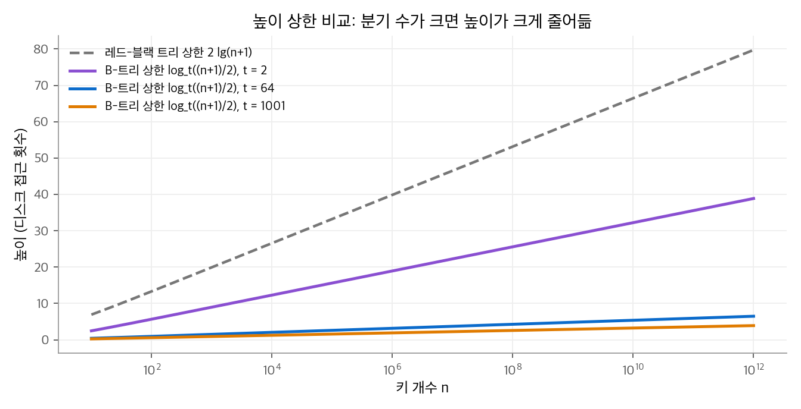
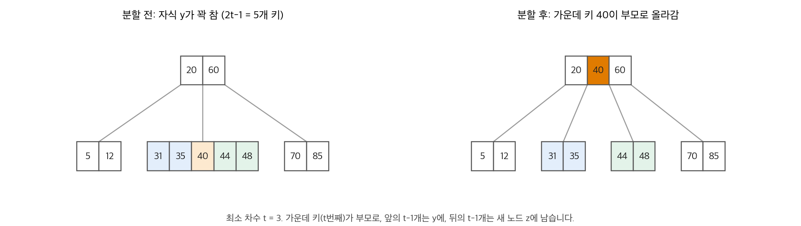
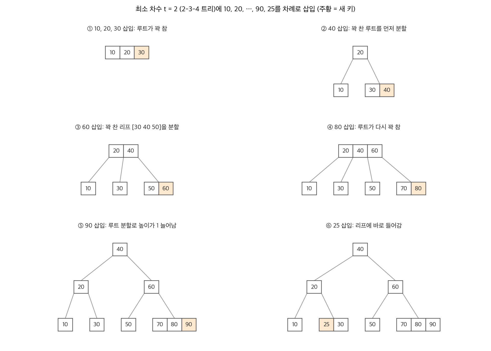

# 18. B-트리

**B-트리(B-tree)** 는 디스크나 SSD처럼 느린 보조 기억 장치를 위한 균형 탐색 트리입니다. 레드-블랙 트리처럼 높이가 $O(\lg n)$ 이지만, 노드 하나가 키 수백~수천 개와 자식을 그만큼 가집니다. 그래서 로그의 밑이 커지고 높이가 크게 낮아집니다. 높이는 곧 디스크 접근 횟수이므로, 키 10억 개도 디스크를 두세 번만 읽고 찾습니다. 데이터베이스와 파일 시스템의 색인은 대부분 B-트리나 그 변형(B+-트리)입니다. 이 장은 B-트리의 정의와 높이, 탐색, 분할을 이용한 삽입, 삭제를 다룹니다.

!!! info "원문과 자료"
    - 원문: Cormen, Leiserson, Rivest, Stein, *Introduction to Algorithms*, 4th ed. (MIT Press, 2022), 18장 B-Trees (18.1~18.3)
    - [MIT Press 책 페이지](https://mitpress.mit.edu/9780262046305/introduction-to-algorithms/)
    - 함께 읽기: [12. 이진 탐색 트리](12-bst.md), [13. 레드-블랙 트리](13-red-black-trees.md)

## 1. 보조 기억 장치의 비용 모델

### 블록 단위 접근

디스크는 바이트 하나가 아니라 **블록(block)** 또는 **페이지(page)** 단위로 읽고 씁니다. 블록 크기는 보통 수 KB입니다. 블록 하나를 가져오는 시간은 그 블록 안의 데이터를 처리하는 시간보다 훨씬 깁니다. 따라서 B-트리 알고리즘의 비용은 두 가지로 셉니다.

- **디스크 접근 횟수**: 노드 하나는 블록 하나에 저장합니다. 노드를 읽는 연산을 DISK-READ, 쓰는 연산을 DISK-WRITE라고 부릅니다.
- **CPU 시간**: 메모리에 올라온 노드 안에서 키를 비교하고 옮기는 시간입니다.

알고리즘은 한 번에 상수 개의 노드만 메모리에 두면 됩니다. 루트 노드는 보통 메모리에 상주시킵니다.

### 분기 수가 크면 높이가 낮다

노드 하나가 블록을 꽉 채우도록 키를 많이 담으면 **분기 수(branching factor)**, 즉 자식 수가 커집니다. 분기 수가 1001인 B-트리는 높이 2에서 키를 $1000 \times (1 + 1001 + 1001^2) \approx 10^9$ 개까지 담을 수 있습니다. 루트를 메모리에 두면 어떤 키든 디스크 접근 두 번으로 찾습니다. 같은 키 개수를 이진 트리에 넣으면 균형이 완벽해도 높이가 29 이상입니다.

## 2. B-트리의 정의

### 다섯 가지 성질

루트가 $T.root$ 인 B-트리 $T$ 는 다음 성질을 만족합니다.

1. 모든 노드 $x$ 는 키 개수 $x.n$, 오름차순으로 저장한 키 $x.key_1 \le x.key_2 \le \cdots \le x.key_{x.n}$, 잎인지 나타내는 $x.leaf$ 를 가집니다.
2. 내부 노드 $x$ 는 자식 포인터 $x.c_1, \dots, x.c_{x.n+1}$ 을 가집니다. 잎은 자식이 없습니다.
3. 키가 자식 서브트리의 키 범위를 나눕니다. $k_i$ 가 서브트리 $x.c_i$ 의 임의의 키이면 $k_1 \le x.key_1 \le k_2 \le x.key_2 \le \cdots \le x.key_{x.n} \le k_{x.n+1}$ 입니다.
4. 모든 잎은 깊이가 같습니다. 이 깊이가 트리의 높이 $h$ 입니다.
5. 정수 $t \ge 2$ 를 **최소 차수(minimum degree)** 라고 하고, 노드의 키 개수를 제한합니다.
    - 루트가 아닌 노드는 키를 $t - 1$ 개 이상 가집니다. 따라서 루트가 아닌 내부 노드는 자식이 $t$ 개 이상입니다. 비어 있지 않은 트리의 루트는 키가 1개 이상입니다.
    - 모든 노드는 키를 $2t - 1$ 개 이하로 가집니다. 키가 정확히 $2t - 1$ 개인 노드를 **꽉 찬(full)** 노드라고 합니다.

$t = 2$ 이면 내부 노드의 자식이 2, 3, 4개이므로 **2-3-4 트리** 라고 부릅니다. 실제 시스템은 블록 크기에 맞춰 $t$ 를 수백 이상으로 잡습니다.

### 높이의 상한

!!! note "정리 18.1"
    $n \ge 1$ 이면, 키가 $n$ 개이고 최소 차수가 $t \ge 2$ 인 모든 B-트리의 높이 $h$ 는 다음을 만족합니다.

    $$
    h \le \log_t \frac{n + 1}{2}
    $$

**증명.** 키가 가장 적은 B-트리를 셉니다. 루트는 키가 1개 이상이므로 깊이 1에 노드가 2개 이상 있습니다. 나머지 노드는 자식이 $t$ 개 이상이므로 깊이 $d$ 에 노드가 $2t^{d-1}$ 개 이상 있습니다. 루트 외의 노드는 키가 $t - 1$ 개 이상입니다. 따라서

$$
n \ge 1 + (t - 1) \sum_{d=1}^{h} 2t^{d-1} = 1 + 2(t - 1) \cdot \frac{t^h - 1}{t - 1} = 2t^h - 1
$$

이고, $t^h \le (n + 1)/2$ 입니다. 양변에 밑이 $t$ 인 로그를 취하면 정리가 나옵니다. ▪

레드-블랙 트리의 높이 상한은 $2 \lg(n + 1)$ 입니다(13장). 두 상한 모두 $O(\lg n)$ 이지만, B-트리는 로그의 밑이 $t$ 이므로 약 $\lg t$ 배 낮습니다.

<figure markdown>

<figcaption markdown>
<span class="fig-title"><b>Figure 1.</b> 높이 상한 비교</span>

$t = 1001$ 이면 키가 $10^{12}$ 개여도 높이 상한이 4 이하입니다.
</figcaption>
</figure>

**수치 예시.** $t = 1001$, $n = 10^9$ 이면 $\log_{1001}(5 \times 10^8) = 20.03 / 6.91 \approx 2.9$ 이므로 $h \le 2$ 입니다. 같은 $n$ 에서 레드-블랙 트리 상한은 $2 \lg(10^9 + 1) \approx 59.8$ 입니다.

## 3. 탐색과 빈 트리 만들기

### B-TREE-SEARCH

이진 탐색 트리의 탐색과 같지만, 노드마다 두 갈래가 아니라 $x.n + 1$ 갈래로 나뉩니다.

```text
B-TREE-SEARCH(x, k)
1  i = 1
2  while i ≤ x.n and k > x.key[i]     // k 이상인 첫 키를 찾는다
3      i = i + 1
4  if i ≤ x.n and k == x.key[i]
5      return (x, i)
6  elseif x.leaf
7      return NIL
8  else DISK-READ(x.c[i])
9      return B-TREE-SEARCH(x.c[i], k)
```

방문하는 노드는 루트에서 잎까지의 경로 하나이므로 디스크 접근은 $O(h) = O(\log_t n)$ 번입니다. 노드마다 선형 탐색이 $O(t)$ 이므로 CPU 시간은 $O(t h) = O(t \log_t n)$ 입니다. 노드 안에서 이진 탐색을 하면 CPU 시간을 $O(\lg t \cdot \log_t n) = O(\lg n)$ 으로 줄일 수 있습니다.

### B-TREE-CREATE

빈 잎 노드 하나를 할당하고 루트로 지정합니다. 디스크 접근 $O(1)$ 번, CPU 시간 $O(1)$ 입니다.

## 4. 삽입

### 꽉 찬 노드 분할

이진 탐색 트리처럼 새 키는 잎에 들어갑니다. 그런데 그 잎이 꽉 찼으면 키를 더 넣을 수 없습니다. 이때 꽉 찬 노드 $y$ 를 **가운데 키(median key)** $y.key_t$ 를 기준으로 둘로 나눕니다. 가운데 키는 부모로 올라가 두 노드를 가르는 키가 됩니다.

<figure markdown>

<figcaption markdown>
<span class="fig-title"><b>Figure 2.</b> B-TREE-SPLIT-CHILD</span>

키 5개인 꽉 찬 노드가 키 2개짜리 두 노드로 나뉘고, 가운데 키 40이 부모로 올라갑니다.
</figcaption>
</figure>

```text
B-TREE-SPLIT-CHILD(x, i)        // x는 꽉 차지 않았고, x.c[i]는 꽉 찼다
1  y = x.c[i]
2  z = ALLOCATE-NODE()
3  z.leaf = y.leaf
4  z.n = t - 1
5  for j = 1 to t - 1           // y의 뒤쪽 키 t-1개를 z로 옮긴다
6      z.key[j] = y.key[j + t]
7  if not y.leaf
8      for j = 1 to t           // 자식도 t개를 옮긴다
9          z.c[j] = y.c[j + t]
10 y.n = t - 1
11 for j = x.n + 1 downto i + 1 // x에 z를 가리킬 자리를 만든다
12     x.c[j + 1] = x.c[j]
13 x.c[i + 1] = z
14 for j = x.n downto i
15     x.key[j + 1] = x.key[j]
16 x.key[i] = y.key[t]          // 가운데 키를 부모로 올린다
17 x.n = x.n + 1
18 DISK-WRITE(y)
19 DISK-WRITE(z)
20 DISK-WRITE(x)
```

부모 $x$ 는 꽉 차지 않았어야 합니다. 그래야 올라온 키를 받을 자리가 있습니다. CPU 시간은 키와 자식을 옮기는 $\Theta(t)$ 이고, 디스크 접근은 $O(1)$ 번입니다.

**수치 예시.** Figure 2에서 $t = 3$ 입니다. 꽉 찬 자식 $y = [31, 35, 40, 44, 48]$ 의 세 번째 키 40이 가운데 키입니다. 분할 뒤 $y = [31, 35]$, $z = [44, 48]$ 이 되고, 부모는 $[20, 60]$ 에서 $[20, 40, 60]$ 이 됩니다. 두 노드 모두 키가 $t - 1 = 2$ 개이므로 성질 5를 만족합니다.

### 내려가면서 미리 분할하기

삽입은 루트에서 잎으로 **한 번만** 내려갑니다. 내려가다가 꽉 찬 자식을 만나면, 그 자식으로 들어가기 전에 분할합니다. 그러면 어떤 노드를 분할하든 그 부모는 꽉 차 있지 않습니다. 부모는 바로 전 단계에서 이미 검사했기 때문입니다. 잎에 도착하면 잎도 꽉 차 있지 않으므로 키를 바로 넣습니다. 분할이 위로 연쇄되어 다시 올라갈 필요가 없습니다.

루트는 부모가 없으므로 따로 처리합니다. 루트가 꽉 찼으면 빈 노드 $s$ 를 새 루트로 만들고, 옛 루트를 $s$ 의 자식으로 두고 분할합니다. **B-트리의 높이는 루트를 분할할 때만, 위쪽으로 1 늘어납니다.** 이진 탐색 트리가 아래쪽으로 자라는 것과 반대입니다. 이 성질 덕분에 모든 잎의 깊이가 항상 같습니다.

```text
B-TREE-INSERT(T, k)
1  r = T.root
2  if r.n == 2t - 1
3      s = B-TREE-SPLIT-ROOT(T)    // 새 루트 s를 만들고 옛 루트를 분할한다
4      B-TREE-INSERT-NONFULL(s, k)
5  else B-TREE-INSERT-NONFULL(r, k)

B-TREE-INSERT-NONFULL(x, k)       // x는 꽉 차지 않았다
1  i = x.n
2  if x.leaf                       // 잎이면 자리를 만들고 넣는다
3      while i ≥ 1 and k < x.key[i]
4          x.key[i + 1] = x.key[i]
5          i = i - 1
6      x.key[i + 1] = k
7      x.n = x.n + 1
8      DISK-WRITE(x)
9  else while i ≥ 1 and k < x.key[i]   // 내려갈 자식을 찾는다
10         i = i - 1
11     i = i + 1
12     DISK-READ(x.c[i])
13     if x.c[i].n == 2t - 1       // 꽉 찼으면 들어가기 전에 분할한다
14         B-TREE-SPLIT-CHILD(x, i)
15         if k > x.key[i]         // 올라온 가운데 키와 비교해 갈 쪽을 다시 고른다
16             i = i + 1
17     B-TREE-INSERT-NONFULL(x.c[i], k)
```

디스크 접근은 층마다 $O(1)$ 번이므로 $O(h)$ 번이고, CPU 시간은 층마다 $O(t)$ 이므로 $O(t h) = O(t \log_t n)$ 입니다. 재귀는 꼬리 재귀라서 메모리에는 노드가 상수 개만 있으면 됩니다.

<figure markdown>

<figcaption markdown>
<span class="fig-title"><b>Figure 3.</b> 2-3-4 트리의 삽입 과정</span>

꽉 찬 노드는 들어가기 전에 분할하고, 높이는 루트를 분할할 때만 늘어납니다.
</figcaption>
</figure>

**수치 예시.** $t = 2$ 이면 노드는 키를 3개까지 가집니다. Figure 3은 10, 20, …, 90, 25를 차례로 넣습니다.

| 삽입 | 일어난 일 | 결과 |
| --- | --- | --- |
| 10, 20, 30 | 루트 잎에 차례로 들어감 | 루트 [10 20 30]이 꽉 참 |
| 40 | 루트를 먼저 분할(20이 새 루트), 40은 오른쪽 잎으로 | 높이 1 |
| 50 | 잎 [30 40]에 들어감 | 잎 [30 40 50]이 꽉 참 |
| 60 | 꽉 찬 잎을 분할(40이 루트로), 60은 [50]으로 | 루트 [20 40] |
| 70, 80 | 같은 방식으로 잎 분할 한 번 | 루트 [20 40 60]이 꽉 참 |
| 90 | 루트를 먼저 분할(40이 새 루트), 90은 [70 80]으로 | 높이 2 |
| 25 | 꽉 찬 노드를 만나지 않음 | 잎 [25 30] |

### 구현

```python
class BNode:
    def __init__(self, leaf=True):
        self.keys, self.children, self.leaf = [], [], leaf

def split_child(x, i, t):
    y = x.children[i]
    z = BNode(y.leaf)
    median = y.keys[t - 1]
    z.keys, y.keys = y.keys[t:], y.keys[:t - 1]
    if not y.leaf:
        z.children, y.children = y.children[t:], y.children[:t]
    x.children.insert(i + 1, z)
    x.keys.insert(i, median)

def insert(root, k, t):
    if len(root.keys) == 2 * t - 1:          # 루트가 꽉 찼으면 높이를 1 늘린다
        s = BNode(leaf=False)
        s.children = [root]
        split_child(s, 0, t)
        root = s
    x = root
    while not x.leaf:
        i = sum(1 for key in x.keys if k > key)
        if len(x.children[i].keys) == 2 * t - 1:
            split_child(x, i, t)
            if k > x.keys[i]:
                i += 1
        x = x.children[i]
    x.keys.append(k)
    x.keys.sort()
    return root
```

Figure 3은 이 코드로 만든 트리를 그렸습니다.

## 5. 삭제

### 원칙: 내려가기 전에 키를 채워 둔다

삭제는 삽입보다 경우가 많습니다. 키는 잎뿐 아니라 내부 노드에서도 지울 수 있고, 지운 뒤 노드의 키가 $t - 1$ 개 미만이 되면 안 됩니다. 삽입이 "꽉 찬 노드에 들어가지 않는다"를 지켰듯이, 삭제는 반대 원칙을 지킵니다.

> 재귀로 들어가는 노드는 루트가 아니라면 키를 **$t$ 개 이상** 가진다.

최소보다 하나 많으므로 키 하나를 지워도 성질 5가 깨지지 않습니다. 그래서 삭제도 루트에서 잎으로 한 번만 내려가며 끝납니다. 들어가려는 자식의 키가 $t - 1$ 개뿐이면, 형제에게서 키를 빌리거나 형제와 합쳐서 미리 $t$ 개로 만듭니다.

### 경우 정리

노드 $x$ 에서 키 $k$ 를 지운다고 합시다.

| 경우 | 상황 | 처리 |
| --- | --- | --- |
| 1 | $k$ 가 잎 $x$ 에 있음 | 그냥 지웁니다. |
| 2a | $k$ 가 내부 노드 $x$ 에 있고, $k$ 앞의 자식 $y$ 가 키를 $t$ 개 이상 가짐 | $y$ 서브트리에서 $k$ 의 직전 키 $k'$ 를 찾아 재귀로 지우고, $k$ 자리에 $k'$ 를 씁니다. |
| 2b | 2a가 아니고, $k$ 뒤의 자식 $z$ 가 키를 $t$ 개 이상 가짐 | 대칭으로 직후 키를 씁니다. |
| 2c | $y$ 와 $z$ 모두 키가 $t - 1$ 개 | $k$ 와 $z$ 를 $y$ 에 합쳐 키 $2t - 1$ 개 노드를 만들고, $y$ 에서 $k$ 를 재귀로 지웁니다. |
| 3a | $k$ 가 $x$ 에 없고, 들어갈 자식 $x.c_i$ 의 키가 $t - 1$ 개인데 바로 옆 형제가 $t$ 개 이상 | $x$ 의 가르는 키를 $x.c_i$ 로 내리고, 형제의 끝 키를 $x$ 로 올립니다. 형제의 자식 포인터 하나도 함께 옮깁니다. |
| 3b | 3a가 아니고, 바로 옆 형제도 키가 $t - 1$ 개 | $x$ 의 가르는 키를 가운데 두고 $x.c_i$ 와 형제를 합칩니다. |

경우 3a는 키를 회전으로 빌려 오는 것이고, 3b는 합치기입니다. 합치기로 루트의 키가 0개가 되면 루트를 지우고 유일한 자식을 새 루트로 삼습니다. **높이는 이때만, 위쪽에서 1 줄어듭니다.** 삽입에서 높이가 루트 분할로만 늘어난 것과 대칭입니다.

경우 2a와 2b는 직전 키나 직후 키를 찾으러 한 번 더 내려가지만, 그 경로도 루트에서 잎까지의 한 경로 위에 있습니다. 따라서 디스크 접근은 $O(h)$ 번, CPU 시간은 $O(t h) = O(t \log_t n)$ 입니다.

### 변형

- **B+-트리**: 위성 데이터(레코드)를 잎에만 두고 내부 노드에는 키와 포인터만 둡니다. 내부 노드의 분기 수가 커지고, 잎을 연결 리스트로 이으면 범위 질의가 빠릅니다. 데이터베이스 색인은 보통 이 형태입니다.
- **2-3-4 트리와 레드-블랙 트리**: 레드-블랙 트리의 검은 노드가 빨간 자식을 흡수하면 2-3-4 트리가 됩니다. 두 구조는 같은 균형 원리를 다른 표현으로 씁니다.

## 6. 정리

- B-트리는 노드 하나를 디스크 블록 하나에 맞추고, 최소 차수 $t$ 로 노드의 키 개수를 $t - 1$ 이상 $2t - 1$ 이하로 제한합니다.
- 정리 18.1에 따라 높이는 $\log_t((n + 1)/2)$ 이하입니다. 레드-블랙 트리보다 약 $\lg t$ 배 낮습니다.
- 탐색, 삽입, 삭제는 모두 디스크 접근 $O(\log_t n)$ 번, CPU 시간 $O(t \log_t n)$ 입니다.
- 삽입은 꽉 찬 노드를 내려가기 전에 분할해 한 번에 끝냅니다. 높이는 루트 분할로만 늘어납니다.
- 삭제는 들어갈 노드가 키를 $t$ 개 이상 갖도록 형제에게서 빌리거나 합칩니다. 높이는 루트가 비었을 때만 줄어듭니다.
