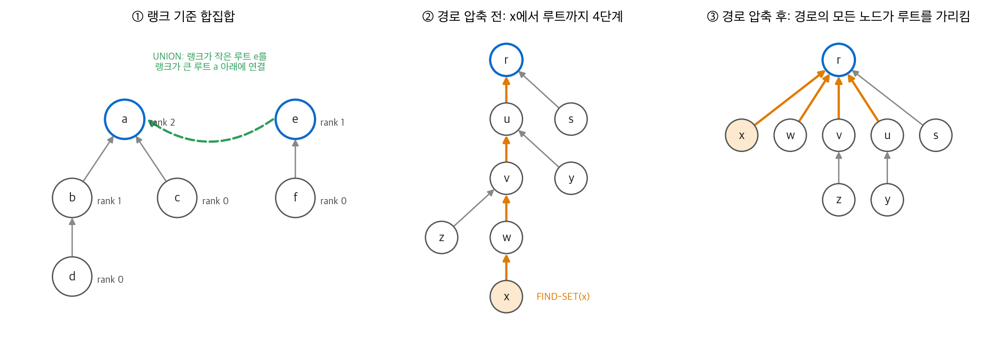
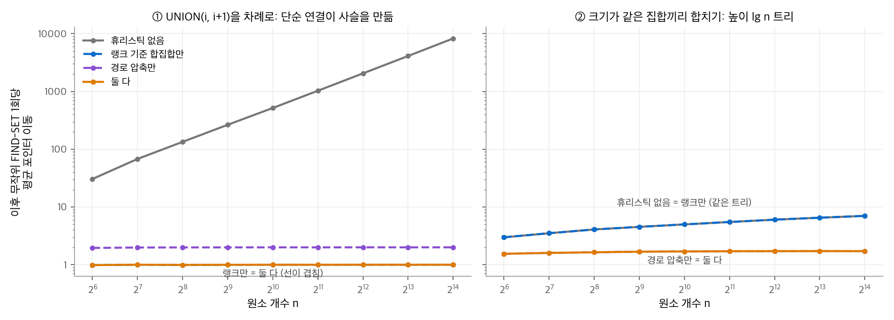

# 19. 서로소 집합 자료 구조

원소 $n$ 개를 겹치지 않는 그룹으로 나누고, 그룹을 계속 합치면서 "두 원소가 같은 그룹인가"를 묻는 문제가 자주 나옵니다. 그래프의 연결 요소, 21장의 Kruskal 최소 신장 트리, 이미지의 연결 영역 표시가 그 예입니다. 이 장은 이 문제를 푸는 **서로소 집합(disjoint-set)** 자료 구조를 다룹니다. 흔히 **union-find** 라고도 부릅니다. 연결 리스트로 단순하게 구현한 뒤, 트리 포리스트에 두 휴리스틱(랭크에 따른 합치기, 경로 압축)을 더합니다. 두 휴리스틱을 함께 쓰면 연산 $m$ 번이 $O(m\,\alpha(n))$ 에 끝납니다. $\alpha(n)$ 은 우주의 원자 수보다 큰 $n$ 에서도 4 이하인 함수입니다.

!!! info "원문과 자료"
    - 원문: Cormen, Leiserson, Rivest, Stein, *Introduction to Algorithms*, 4th ed. (MIT Press, 2022), 19장 Data Structures for Disjoint Sets (19.1~19.4)
    - [MIT Press 책 페이지](https://mitpress.mit.edu/9780262046305/introduction-to-algorithms/)
    - 19.4절(★)의 상한 증명은 핵심 아이디어만 요약합니다.
    - 함께 읽기: [16. 분할 상환 분석](16-amortized.md), [20. 기본 그래프 알고리즘](20-graph-basics.md), [21. 최소 신장 트리](21-mst.md)

## 1. 서로소 집합 연산

### 세 연산

서로소 집합 자료 구조는 동적 집합의 모음 $\mathcal{S} = \{S_1, S_2, \dots, S_k\}$ 를 유지합니다. 집합끼리는 공통 원소가 없습니다. 집합마다 원소 하나를 **대표(representative)** 로 정해 그 집합의 이름으로 씁니다. 집합이 바뀌지 않는 동안 대표를 두 번 물으면 같은 답이 나와야 합니다.

| 연산 | 동작 |
| --- | --- |
| MAKE-SET$(x)$ | 원소 $x$ 하나만 담은 새 집합을 만듭니다. $x$ 가 대표입니다. |
| UNION$(x, y)$ | $x$ 가 속한 집합 $S_x$ 와 $y$ 가 속한 집합 $S_y$ 를 합칩니다. 두 집합은 모음에서 사라지고 합집합이 들어옵니다. |
| FIND-SET$(x)$ | $x$ 가 속한 집합의 대표를 돌려줍니다. |

실행 시간은 두 매개변수로 셉니다. $n$ 은 MAKE-SET의 횟수, $m$ 은 세 연산을 모두 합친 횟수입니다. MAKE-SET도 $m$ 에 들어가므로 $m \ge n$ 입니다. UNION 한 번마다 집합 수가 하나 줄므로 UNION은 많아야 $n - 1$ 번입니다.

### 응용: 무방향 그래프의 연결 요소

간선을 하나씩 읽으며 양 끝점의 집합을 합치면 연결 요소가 나옵니다.

```text
CONNECTED-COMPONENTS(G)
1  for each vertex v ∈ G.V
2      MAKE-SET(v)
3  for each edge (u, v) ∈ G.E
4      if FIND-SET(u) ≠ FIND-SET(v)
5          UNION(u, v)

SAME-COMPONENT(u, v)
1  return FIND-SET(u) == FIND-SET(v)
```

**수치 예시.** 정점 1~8과 간선 (1,2), (3,4), (5,6), (2,3), (7,8), (1,4)를 이 순서로 처리합니다.

| 처리한 간선 | 집합 모음 |
| --- | --- |
| 초기 상태 | {1} {2} {3} {4} {5} {6} {7} {8} |
| (1,2) | {1,2} {3} {4} {5} {6} {7} {8} |
| (3,4) | {1,2} {3,4} {5} {6} {7} {8} |
| (5,6) | {1,2} {3,4} {5,6} {7} {8} |
| (2,3) | {1,2,3,4} {5,6} {7} {8} |
| (7,8) | {1,2,3,4} {5,6} {7,8} |
| (1,4) | 이미 같은 집합이므로 변화 없음 |

간선이 계속 추가되는 그래프라면 이 방법이 20장의 깊이 우선 탐색보다 유리합니다. 간선이 들어올 때마다 그래프 전체를 다시 탐색하지 않아도 되기 때문입니다.

## 2. 연결 리스트 표현

### 구조

집합 하나를 연결 리스트 하나로 표현합니다. 집합 객체는 리스트의 head와 tail을 가리킵니다. 각 원소는 다음 원소를 가리키고, **자기 집합 객체도 가리킵니다.** 대표는 리스트의 첫 원소입니다.

- MAKE-SET: 원소 하나짜리 리스트를 만듭니다. $O(1)$ 입니다.
- FIND-SET: 원소에서 집합 객체로, 다시 head로 갑니다. $O(1)$ 입니다.
- UNION$(x, y)$: $y$ 의 리스트를 $x$ 의 리스트 뒤에 붙입니다. 붙인 원소마다 집합 객체 포인터를 고쳐야 하므로 $y$ 집합의 크기만큼 시간이 걸립니다.

### 최악의 연산 순서

긴 리스트를 짧은 리스트 뒤에 계속 붙이면 비쌉니다. MAKE-SET을 $n$ 번 한 뒤 UNION$(x_2, x_1)$, UNION$(x_3, x_2)$, …, UNION$(x_n, x_{n-1})$ 을 하면 $i$ 번째 UNION은 포인터 $i$ 개를 고칩니다. 연산 $m = 2n - 1$ 번의 총 시간은

$$
n + \sum_{i=1}^{n-1} i = \Theta(n^2)
$$

이고, 연산 하나의 분할 상환 비용은 $\Theta(n)$ 입니다.

### 가중 합치기

리스트마다 길이를 저장하고, **항상 짧은 리스트를 긴 리스트 뒤에 붙입니다.** 이것을 **가중 합치기 휴리스틱(weighted-union heuristic)** 이라고 합니다.

!!! note "정리 19.1"
    연결 리스트 표현과 가중 합치기를 쓰면, MAKE-SET이 $n$ 번인 연산 $m$ 번의 총 시간은 $O(m + n \lg n)$ 입니다.

**증명.** 원소 $x$ 의 집합 객체 포인터가 몇 번 바뀌는지 셉니다. 포인터가 바뀔 때마다 $x$ 는 더 작은 쪽 집합에 있었습니다. 따라서 바뀐 뒤 $x$ 가 속한 집합의 크기는 이전의 두 배 이상입니다. $k$ 번 바뀌면 집합 크기가 $2^k$ 이상이고, 크기는 $n$ 을 넘지 않으므로 $k \le \lceil \lg n \rceil$ 입니다. 원소 $n$ 개의 포인터 변경은 모두 $O(n \lg n)$ 번입니다. 나머지 작업은 연산마다 $O(1)$ 이므로 $O(m)$ 입니다. ▪

## 3. 서로소 집합 포리스트

### 구조

집합 하나를 루트 트리 하나로 표현합니다. 각 노드는 부모 포인터 $x.p$ 만 가집니다. 루트는 자기 자신을 가리키고, 루트가 대표입니다. 집합 전체는 **서로소 집합 포리스트(disjoint-set forest)** 가 됩니다.

- FIND-SET$(x)$: $x$ 에서 부모 포인터를 따라 루트까지 올라갑니다. 지나간 경로를 **찾기 경로(find path)** 라고 합니다.
- UNION$(x, y)$: 한 루트가 다른 루트를 가리키게 합니다.

이대로는 연결 리스트보다 나을 것이 없습니다. 트리가 노드 $n$ 개짜리 사슬이 되면 FIND-SET이 $\Theta(n)$ 입니다. 두 휴리스틱이 이 문제를 고칩니다.

### 휴리스틱 1: 랭크에 따른 합치기

**랭크에 따른 합치기(union by rank)** 는 가중 합치기와 같은 생각입니다. 노드마다 **랭크(rank)** 를 둡니다. 랭크는 노드 높이의 상한입니다. 합칠 때는 **랭크가 작은 루트가 랭크가 큰 루트를 가리킵니다.** 두 랭크가 같을 때만 새 루트의 랭크를 1 올립니다.

### 휴리스틱 2: 경로 압축

**경로 압축(path compression)** 은 FIND-SET이 지나간 찾기 경로의 모든 노드가 루트를 직접 가리키게 바꿉니다. 랭크는 바꾸지 않습니다. 같은 경로를 다시 찾으면 한 단계로 끝납니다.

<figure markdown>

<figcaption markdown>
<span class="fig-title"><b>Figure 1.</b> 포리스트의 두 휴리스틱</span>

랭크가 작은 루트를 큰 루트 아래에 붙이고(①), FIND-SET이 지나간 노드를 모두 루트에 직접 연결합니다(②→③).
</figcaption>
</figure>

### 의사 코드

```text
MAKE-SET(x)
1  x.p = x
2  x.rank = 0

UNION(x, y)
1  LINK(FIND-SET(x), FIND-SET(y))

LINK(x, y)                     // x와 y는 루트
1  if x.rank > y.rank
2      y.p = x
3  else x.p = y
4      if x.rank == y.rank
5          y.rank = y.rank + 1

FIND-SET(x)
1  if x ≠ x.p                  // 루트가 아니면
2      x.p = FIND-SET(x.p)     // 루트를 찾고, x가 루트를 직접 가리키게 한다
3  return x.p
```

FIND-SET은 **두 번 지나가는(two-pass)** 방법입니다. 재귀로 올라가며 루트를 찾고, 재귀가 풀리며 내려오는 길에 각 노드의 부모를 루트로 바꿉니다.

**수치 예시.** Figure 1 ②의 트리에서 FIND-SET$(x)$ 를 부릅니다. 경로는 $x \to w \to v \to u \to r$ 이고 포인터를 4번 따라갑니다. 재귀가 풀리며 $u, v, w, x$ 의 부모가 모두 $r$ 이 됩니다(③). 원래 $v$ 의 자식이던 $z$ 는 여전히 $v$ 를 가리킵니다. 경로 밖의 노드는 바뀌지 않기 때문입니다. 이제 FIND-SET$(x)$ 를 다시 부르면 1단계로 끝나고, FIND-SET$(z)$ 는 2단계로 끝납니다.

### 휴리스틱의 효과

| 사용한 휴리스틱 | 연산 $m$ 번의 최악 실행 시간 |
| --- | --- |
| 없음 | $\Theta(m n)$ 까지 가능 |
| 랭크에 따른 합치기만 | $O(m \lg n)$ |
| 경로 압축만 ($f$ 는 FIND-SET 횟수) | $\Theta(n + f \cdot (1 + \log_{2 + f/n} n))$ |
| 둘 다 | $O(m\,\alpha(n))$ |

랭크에 따른 합치기만 써도 높이가 $\lfloor \lg n \rfloor$ 이하입니다. 랭크 $k$ 인 루트의 트리는 노드가 $2^k$ 개 이상이기 때문입니다. 경로 압축은 비싼 FIND-SET 한 번이 이후의 FIND-SET을 싸게 만듭니다. 이것은 16장의 분할 상환 분석으로 다룰 성질입니다.

<figure markdown>

<figcaption markdown>
<span class="fig-title"><b>Figure 2.</b> 휴리스틱 조합별 FIND-SET 비용</span>

휴리스틱이 없으면 사슬이 생겨 비용이 $n$ 에 비례하고, 경로 압축을 쓰면 비용이 거의 일정합니다.
</figcaption>
</figure>

Figure 2는 직접 측정한 결과입니다. 두 작업 순서로 포리스트를 만든 뒤, 무작위 FIND-SET을 $n$ 번 하며 포인터를 따라간 횟수를 셉니다.

- ① UNION$(i, i+1)$ 을 차례로 하면, 휴리스틱 없는 연결은 길이 $n$ 의 사슬을 만듭니다. $n = 2^{14}$ 에서 FIND-SET 한 번이 평균 8,257단계입니다. 랭크를 쓰면 매번 원소 하나짜리 트리가 큰 트리 밑에 붙으므로 평균 1단계입니다.
- ② 크기가 같은 집합끼리 합치면 랭크를 써도 높이 $\lg n$ 인 트리가 생깁니다. 랭크만 쓰면 평균 비용이 $\lg n$ 에 비례해 7단계까지 늘어납니다. 경로 압축을 더하면 1.7단계 근처에서 멈춥니다.

### 구현

```python
class DisjointSet:
    def __init__(self, n):
        self.parent = list(range(n))
        self.rank = [0] * n

    def find(self, x):
        root = x
        while self.parent[root] != root:       # 1단계: 루트를 찾는다
            root = self.parent[root]
        while self.parent[x] != root:          # 2단계: 경로를 압축한다
            self.parent[x], x = root, self.parent[x]
        return root

    def union(self, x, y):
        rx, ry = self.find(x), self.find(y)
        if rx == ry:
            return False
        if self.rank[rx] > self.rank[ry]:
            rx, ry = ry, rx                    # rx의 랭크가 작거나 같게 맞춘다
        self.parent[rx] = ry
        if self.rank[rx] == self.rank[ry]:
            self.rank[ry] += 1
        return True
```

`find` 는 재귀 대신 반복문 두 개로 같은 일을 합니다. Python의 재귀 깊이 제한을 피하려는 선택입니다. `union` 은 실제로 합쳤는지를 돌려주므로 Kruskal 알고리즘에서 사이클 검사에 바로 쓸 수 있습니다.

## 4. ★ 두 휴리스틱을 함께 쓴 경우의 분석

### 매우 빠르게 자라는 함수

정수 $k \ge 0$, $j \ge 1$ 에 대해 함수 $A_k(j)$ 를 다음과 같이 정의합니다. $A_{k-1}^{(j+1)}$ 은 $A_{k-1}$ 을 $j + 1$ 번 반복 적용한다는 뜻입니다.

$$
A_k(j) =
\begin{cases}
j + 1 & k = 0 \\
A_{k-1}^{(j+1)}(j) & k \ge 1
\end{cases}
$$

$k$ 를 **수준(level)** 이라고 부릅니다. 수준이 하나 오를 때마다 증가 속도가 폭발합니다.

| 수준 | 닫힌 형태 | $A_k(1)$ |
| --- | --- | --- |
| $k = 0$ | $j + 1$ | 2 |
| $k = 1$ | $2j + 1$ | 3 |
| $k = 2$ | $2^{j+1}(j + 1) - 1$ | 7 |
| $k = 3$ | - | $A_2(A_2(1)) = A_2(7) = 2^8 \cdot 8 - 1 = 2047$ |
| $k = 4$ | - | $A_3(2047) \gg A_2(2047) = 2^{2048} \cdot 2048 - 1 > 10^{80}$ |

$10^{80}$ 은 관측 가능한 우주의 원자 수로 흔히 드는 추정값입니다. 이 함수의 역함수를 다음과 같이 정의합니다.

$$
\alpha(n) = \min\{k : A_k(1) \ge n\}
$$

| $n$ 의 범위 | $\alpha(n)$ |
| --- | --- |
| $0 \le n \le 2$ | 0 |
| $n = 3$ | 1 |
| $4 \le n \le 7$ | 2 |
| $8 \le n \le 2047$ | 3 |
| $2048 \le n \le A_4(1)$ | 4 |

현실의 어떤 입력에서도 $\alpha(n) \le 4$ 입니다. 그래서 $O(m\,\alpha(n))$ 은 이론상 선형보다 아주 약간 크지만, 실제로는 선형입니다.

### 상한 증명의 개요

증명은 16장의 **퍼텐셜 방법(potential method)** 을 씁니다. 여기서는 구조만 요약합니다.

1. **랭크의 성질.** 루트가 아닌 노드의 랭크는 부모의 랭크보다 작습니다. 루트에서 멀어질수록 랭크가 엄격히 줄어듭니다. 노드가 루트가 아니게 되면 그 노드의 랭크는 더 바뀌지 않습니다. 부모의 랭크는 경로 압축으로 부모가 바뀔 때마다 커지기만 합니다. 랭크는 $n - 1$ 이하입니다.
2. **노드의 수준과 반복 횟수.** 루트가 아니고 랭크가 1 이상인 노드 $x$ 에 두 값을 정의합니다. $level(x)$ 는 $x.p.rank \ge A_k(x.rank)$ 를 만족하는 가장 큰 $k$ 이고, 범위는 $0 \le level(x) < \alpha(n)$ 입니다. $iter(x)$ 는 $x.p.rank \ge A_{level(x)}^{(i)}(x.rank)$ 를 만족하는 가장 큰 $i$ 이고, 범위는 $1 \le iter(x) \le x.rank$ 입니다. 두 값은 "부모의 랭크가 내 랭크보다 얼마나 멀리 앞서 있는가"를 거친 눈금($level$)과 고운 눈금($iter$)으로 잽니다.
3. **퍼텐셜.** 노드 $x$ 의 퍼텐셜은 루트이거나 랭크가 0이면 $\alpha(n) \cdot x.rank$ 이고, 그렇지 않으면 $(\alpha(n) - level(x)) \cdot x.rank - iter(x)$ 입니다. 어느 경우든 $0 \le \phi(x) \le \alpha(n) \cdot x.rank$ 입니다. 전체 퍼텐셜은 노드 퍼텐셜의 합입니다.
4. **연산별 분할 상환 비용.** MAKE-SET은 $O(1)$ 입니다. LINK는 랭크가 오르는 루트 하나의 퍼텐셜만 $\alpha(n)$ 만큼 늘고 다른 노드의 퍼텐셜은 늘지 않으므로 $O(\alpha(n))$ 입니다.
5. **FIND-SET의 핵심 단계.** 길이 $s$ 인 찾기 경로에서 예외 노드를 셉니다. 예외는 랭크가 0인 첫 노드, 루트, 그리고 수준 $k = 0, 1, \dots, \alpha(n) - 1$ 마다 그 수준을 가진 마지막 노드입니다. 예외는 $\alpha(n) + 2$ 개 이하입니다. 예외가 아닌 노드 $x$ 뒤에는 수준이 같은 노드 $y$ 가 경로에 더 있습니다. 경로 압축 뒤 $x$ 의 새 부모는 $y$ 의 부모보다 랭크가 크거나 같은 루트입니다. 그래서 $x.p.rank$ 가 충분히 커지고 $iter(x)$ 나 $level(x)$ 가 오릅니다. 결과적으로 $s - (\alpha(n) + 2)$ 개 이상의 노드에서 퍼텐셜이 1 이상 줄어듭니다. 이 감소분이 실제 비용 $O(s)$ 를 거의 모두 갚으므로 FIND-SET의 분할 상환 비용은 $O(\alpha(n))$ 입니다.

세 연산의 분할 상환 비용이 모두 $O(\alpha(n))$ 이므로 다음 정리가 나옵니다.

!!! note "정리 19.14"
    랭크에 따른 합치기와 경로 압축을 함께 쓰는 서로소 집합 포리스트에서, MAKE-SET이 $n$ 번인 연산 $m$ 번의 최악 실행 시간은 $O(m\,\alpha(n))$ 입니다.

이 상한은 개선할 수 없습니다. Tarjan은 특정 포인터 기계 모형에서 어떤 서로소 집합 자료 구조도 최악의 경우 $\Omega(m\,\alpha(n))$ 시간이 걸린다는 것을 보였습니다.

## 5. 정리

- 서로소 집합 자료 구조는 MAKE-SET, UNION, FIND-SET을 지원하고, 연결 요소와 Kruskal 알고리즘에 쓰입니다.
- 연결 리스트 표현은 FIND-SET이 $O(1)$ 이지만 UNION이 비쌉니다. 짧은 리스트를 긴 리스트에 붙이는 가중 합치기로 총 $O(m + n \lg n)$ 이 됩니다.
- 포리스트 표현은 두 휴리스틱을 씁니다. 랭크에 따른 합치기는 높이를 $\lg n$ 이하로 묶고, 경로 압축은 찾기 경로를 루트에 직접 연결합니다.
- 두 휴리스틱을 함께 쓰면 연산 $m$ 번이 $O(m\,\alpha(n))$ 입니다. 현실의 모든 $n$ 에서 $\alpha(n) \le 4$ 이므로 실제로는 선형 시간입니다.
