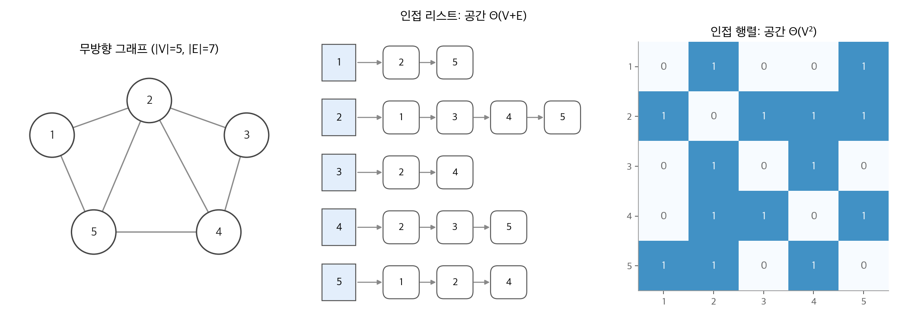
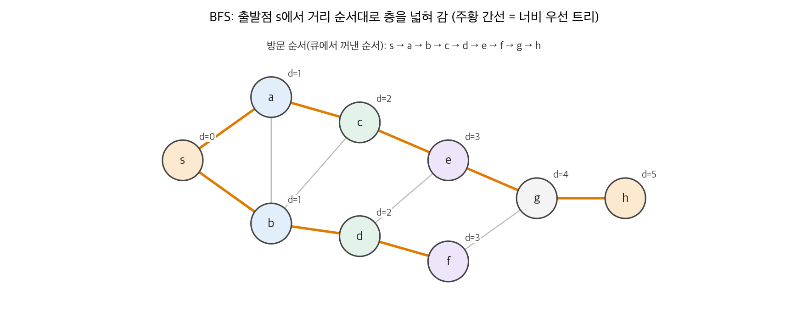
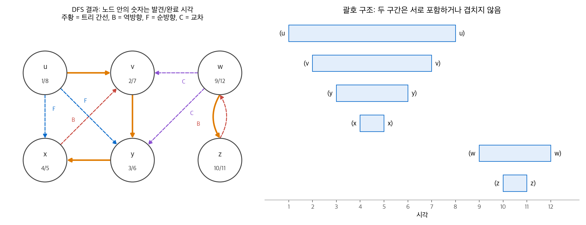
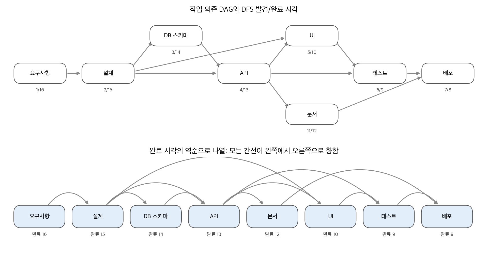
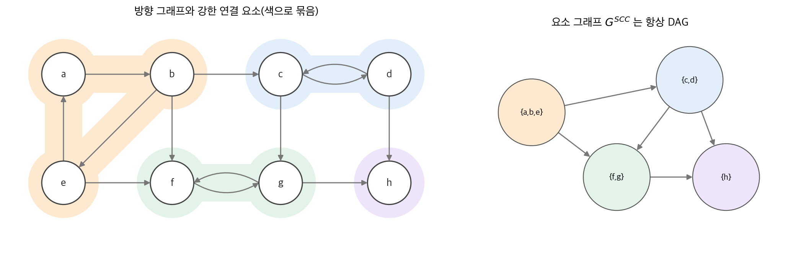

# 20. 기본 그래프 알고리즘

그래프 알고리즘의 대부분은 그래프를 **탐색(search)** 하는 데서 시작합니다. 탐색이란 간선을 따라 정점을 체계적으로 방문하는 일입니다. 이 장은 그래프를 메모리에 저장하는 두 방법을 먼저 비교합니다. 그다음 두 기본 탐색인 **너비 우선 탐색(BFS)** 과 **깊이 우선 탐색(DFS)** 을 다룹니다. BFS는 간선 개수로 잰 최단 거리를 구합니다. DFS가 남기는 발견·완료 시각은 그래프의 구조를 드러냅니다. 이 시각으로 **위상 정렬** 과 **강한 연결 요소** 를 모두 선형 시간에 구합니다. 21~25장의 알고리즘은 대부분 이 장의 탐색을 바탕으로 합니다.

!!! info "원문과 자료"
    - 원문: Cormen, Leiserson, Rivest, Stein, *Introduction to Algorithms*, 4th ed. (MIT Press, 2022), 20장 Elementary Graph Algorithms (20.1~20.5)
    - [MIT Press 책 페이지](https://mitpress.mit.edu/9780262046305/introduction-to-algorithms/)
    - 그래프와 트리의 용어 정의는 원문 부록 B.4~B.5에 있습니다.
    - 함께 읽기: [19. 서로소 집합 자료 구조](19-disjoint-sets.md), [21. 최소 신장 트리](21-mst.md), [22. 단일 출발점 최단 경로](22-single-source-sp.md)

## 1. 그래프 표현

### 인접 리스트와 인접 행렬

그래프 $G = (V, E)$ 를 저장하는 표준 방법은 두 가지입니다. 실행 시간은 정점 수 $|V|$ 와 간선 수 $|E|$ 로 씁니다. 점근 표기 안에서는 절댓값 기호를 빼고 $O(V + E)$ 처럼 씁니다.

- **인접 리스트(adjacency list)**: 정점 $u$ 마다 리스트 $Adj[u]$ 를 두고, 간선 $(u, v)$ 가 있는 모든 $v$ 를 담습니다.
- **인접 행렬(adjacency matrix)**: $|V| \times |V|$ 행렬 $A$ 에서 $(i, j) \in E$ 이면 $a_{ij} = 1$, 아니면 0입니다.

<figure markdown>

<figcaption markdown>
<span class="fig-title"><b>Figure 1.</b> 그래프의 두 가지 표현</span>

무방향 그래프는 간선마다 양쪽 리스트에 한 번씩 나타나고, 인접 행렬은 대칭입니다.
</figcaption>
</figure>

| 기준 | 인접 리스트 | 인접 행렬 |
| --- | --- | --- |
| 메모리 | $\Theta(V + E)$ | $\Theta(V^2)$ |
| 간선 $(u, v)$ 가 있는지 확인 | $O(\text{deg}(u))$ | $O(1)$ |
| $u$ 의 이웃을 모두 나열 | $\Theta(\text{deg}(u))$ | $\Theta(V)$ |
| 알맞은 그래프 | 희소 그래프 ($|E| \ll |V|^2$) | 조밀 그래프, 간선 확인이 잦은 경우 |

방향 그래프에서 모든 인접 리스트의 길이 합은 $|E|$ 입니다. 무방향 그래프에서는 간선 $(u, v)$ 가 $Adj[u]$ 와 $Adj[v]$ 에 모두 나타나므로 $2|E|$ 입니다. 가중 그래프는 리스트의 각 항목이나 행렬의 각 칸에 가중치 $w(u, v)$ 를 함께 저장합니다.

이 장의 알고리즘은 인접 리스트를 가정합니다. 실제 그래프는 대부분 희소하기 때문입니다. 정점의 속성은 $v.d$ 처럼 씁니다. 구현에서는 정점에 번호를 매기고 배열 `d[v]` 로 저장하면 됩니다.

## 2. 너비 우선 탐색

### 아이디어

출발점 $s$ 에서 시작해 거리 1인 정점을 모두 방문하고, 그다음 거리 2인 정점을 모두 방문합니다. 탐색의 경계가 물결처럼 한 겹씩 넓어집니다. 이때 거리는 간선 개수입니다. 이 순서를 지키는 도구는 선입선출 **큐(queue)** 입니다.

정점은 세 가지 색을 거칩니다. 흰색은 아직 발견하지 않은 정점, 회색은 발견했지만 이웃을 다 보지 않은 정점(큐 안의 정점), 검은색은 처리가 끝난 정점입니다. 정점마다 거리 $v.d$ 와 선행자 $v.\pi$ 를 기록합니다.

```text
BFS(G, s)
1  for each vertex u ∈ G.V - {s}
2      u.color = WHITE
3      u.d = ∞
4      u.π = NIL
5  s.color = GRAY
6  s.d = 0
7  s.π = NIL
8  Q = ∅
9  ENQUEUE(Q, s)
10 while Q ≠ ∅
11     u = DEQUEUE(Q)
12     for each vertex v in G.Adj[u]   // u의 이웃을 모두 본다
13         if v.color == WHITE          // 처음 발견한 정점이면
14             v.color = GRAY
15             v.d = u.d + 1
16             v.π = u
17             ENQUEUE(Q, v)
18     u.color = BLACK
```

### 실행 시간

초기화는 $O(V)$ 입니다. 정점은 흰색일 때만 큐에 들어가고 흰색으로 돌아오지 않으므로, 큐 연산은 정점마다 한 번씩 $O(V)$ 입니다. 인접 리스트는 정점을 꺼낼 때 한 번씩만 훑으므로 모두 $O(E)$ 입니다. 따라서 BFS는 $O(V + E)$, 즉 인접 리스트 크기에 선형입니다.

<figure markdown>

<figcaption markdown>
<span class="fig-title"><b>Figure 2.</b> 너비 우선 탐색</span>

같은 색은 같은 거리이고, 주황 간선은 각 정점을 처음 발견한 간선입니다.
</figcaption>
</figure>

**수치 예시.** Figure 2의 그래프에서 이웃을 알파벳 순서로 본다고 합시다.

| 꺼낸 정점 | 새로 발견한 정점 ($d$) | 큐 상태 (앞 → 뒤) |
| --- | --- | --- |
| - | $s$ (0) | $s$ |
| $s$ | $a$ (1), $b$ (1) | $a, b$ |
| $a$ | $c$ (2) | $b, c$ |
| $b$ | $d$ (2) | $c, d$ |
| $c$ | $e$ (3) | $d, e$ |
| $d$ | $f$ (3) | $e, f$ |
| $e$ | $g$ (4) | $f, g$ |
| $f$ | 없음 ($g$ 는 이미 회색) | $g$ |
| $g$ | $h$ (5) | $h$ |
| $h$ | 없음 | 비어 있음 |

$a$ 를 처리할 때 $b$ 는 이미 회색이므로 간선 $(a, b)$ 는 트리에 들어가지 않습니다. 큐 안의 정점은 언제나 거리가 $k$ 인 정점 뒤에 $k + 1$ 인 정점이 오는 순서입니다(따름정리 20.4).

### 최단 거리의 정확성

$\delta(s, v)$ 를 $s$ 에서 $v$ 로 가는 경로의 최소 간선 수라고 합니다. 경로가 없으면 $\infty$ 입니다.

!!! note "정리 20.5 (너비 우선 탐색의 정확성)"
    BFS를 출발점 $s$ 에서 실행하면, $s$ 에서 도달할 수 있는 모든 정점 $v$ 를 발견하고, 종료 시점에 모든 $v$ 에서 $v.d = \delta(s, v)$ 입니다. 또한 $v \ne s$ 이면, $s$ 에서 $v.\pi$ 까지의 최단 경로 뒤에 간선 $(v.\pi, v)$ 를 붙인 경로가 $s$ 에서 $v$ 까지의 최단 경로입니다.

증명의 뼈대는 세 단계입니다. 첫째, 간선 $(u, v)$ 가 있으면 $\delta(s, v) \le \delta(s, u) + 1$ 입니다. 둘째, BFS가 기록한 $v.d$ 는 항상 $\delta(s, v)$ 이상입니다. 셋째, 큐는 $d$ 값이 단조 증가하고 처음과 끝의 차이가 1 이하입니다. 이제 $v.d \ne \delta(s, v)$ 인 정점 중 $\delta$ 가 가장 작은 $v$ 를 골라 모순을 이끌어 냅니다. 그런 $v$ 의 최단 경로에서 바로 앞 정점 $u$ 는 $u.d = \delta(s, u)$ 이고, $u$ 를 꺼낼 때 $v$ 의 색이 무엇이든 $v.d \le u.d + 1 = \delta(s, v)$ 가 되어 모순입니다.

### 너비 우선 트리와 경로 출력

선행자 $\pi$ 가 만드는 부분 그래프를 **너비 우선 트리(breadth-first tree)** 라고 합니다. 이 트리는 $s$ 에서 도달할 수 있는 모든 정점을 담고, 트리 안의 $s$ 에서 $v$ 로 가는 유일한 경로가 최단 경로입니다. 경로는 $\pi$ 를 거꾸로 따라가 출력합니다.

```text
PRINT-PATH(G, s, v)
1  if v == s
2      print s
3  elseif v.π == NIL
4      print "no path from" s "to" v "exists"
5  else PRINT-PATH(G, s, v.π)
6      print v
```

Figure 2에서 $h$ 까지의 경로는 $s \to a \to c \to e \to g \to h$ 입니다. $s \to b \to d \to f \to g \to h$ 도 길이가 5입니다. 그러나 $g$ 를 처음 발견한 정점이 $e$ 이므로 앞의 경로가 트리에 남습니다. 최단 경로가 여러 개면 BFS는 이웃을 보는 순서에 따라 그중 하나를 고릅니다.

### 구현

```python
from collections import deque

def bfs(adj, s):
    dist, parent = {s: 0}, {s: None}
    q = deque([s])
    while q:
        u = q.popleft()
        for v in adj[u]:
            if v not in dist:            # 흰색 정점
                dist[v] = dist[u] + 1
                parent[v] = u
                q.append(v)
    return dist, parent
```

`dist` 에 들어 있는지가 흰색인지 아닌지를 대신합니다. 회색과 검은색을 구분할 필요는 없습니다.

## 3. 깊이 우선 탐색

### 아이디어

DFS는 가능한 한 깊이 들어갑니다. 방금 발견한 정점 $v$ 에서 아직 보지 않은 간선이 있으면 그 간선으로 더 들어갑니다. $v$ 의 간선을 모두 보면 $v$ 를 발견한 정점으로 **되돌아갑니다(backtrack).** 출발점에서 도달한 정점을 다 보면, 아직 발견하지 않은 정점에서 다시 시작합니다. 그래서 결과는 트리 하나가 아니라 **깊이 우선 포리스트(depth-first forest)** 입니다.

DFS는 정점마다 **시각 기록(timestamp)** 두 개를 남깁니다. $v.d$ 는 $v$ 를 처음 발견한 시각(회색이 된 시각)이고, $v.f$ 는 $v$ 의 인접 리스트를 다 본 시각(검은색이 된 시각)입니다. 시각은 1부터 $2|V|$ 까지의 정수이고, 모든 정점에서 $v.d < v.f$ 입니다.

```text
DFS(G)
1  for each vertex u ∈ G.V
2      u.color = WHITE
3      u.π = NIL
4  time = 0
5  for each vertex u ∈ G.V
6      if u.color == WHITE
7          DFS-VISIT(G, u)          // u는 새 깊이 우선 트리의 루트

DFS-VISIT(G, u)
1  time = time + 1                  // 흰색 정점 u를 방금 발견했다
2  u.d = time
3  u.color = GRAY
4  for each vertex v in G.Adj[u]    // u의 이웃을 모두 본다
5      if v.color == WHITE
6          v.π = u
7          DFS-VISIT(G, v)
8  time = time + 1
9  u.f = time
10 u.color = BLACK                  // u의 처리가 끝났다
```

DFS-VISIT은 정점마다 정확히 한 번 호출됩니다. 흰색 정점에서만 호출하고, 호출하자마자 회색으로 바꾸기 때문입니다. 인접 리스트를 모두 합쳐 한 번씩 훑으므로 실행 시간은 $\Theta(V + E)$ 입니다.

### 괄호 구조

발견을 "$(u$", 완료를 "$u)$" 로 적으면, 시간 순서로 늘어놓은 기록은 괄호가 올바르게 짝지어진 식이 됩니다.

!!! note "정리 20.7 (괄호 정리)"
    깊이 우선 탐색에서 임의의 두 정점 $u, v$ 에 대해 다음 셋 중 정확히 하나가 성립합니다.

    - 구간 $[u.d, u.f]$ 와 $[v.d, v.f]$ 가 서로소이고, 어느 쪽도 다른 쪽의 자손이 아닙니다.
    - $[u.d, u.f]$ 가 $[v.d, v.f]$ 안에 완전히 들어가고, $u$ 는 $v$ 의 자손입니다.
    - $[v.d, v.f]$ 가 $[u.d, u.f]$ 안에 완전히 들어가고, $v$ 는 $u$ 의 자손입니다.

근거는 재귀 호출의 성질입니다. $v$ 가 $u$ 가 회색인 동안 발견되면, $v$ 의 DFS-VISIT은 $u$ 의 호출 안에서 시작해 그 안에서 끝납니다. 그래서 $v$ 의 구간은 $u$ 의 구간 안에 들어갑니다. 두 구간이 일부만 겹치는 경우는 생기지 않습니다.

!!! note "정리 20.9 (흰색 경로 정리)"
    깊이 우선 포리스트에서 $v$ 가 $u$ 의 자손일 필요충분조건은, $u$ 를 발견하는 시각 $u.d$ 에 $u$ 에서 $v$ 로 가는 경로가 있고 그 경로의 정점이 모두 흰색인 것입니다.

### 간선 분류

DFS는 그래프의 간선을 네 종류로 나눕니다. 간선 $(u, v)$ 를 처음 볼 때 $v$ 의 색으로 종류를 압니다.

| 종류 | 정의 | 처음 볼 때 $v$ 의 색 |
| --- | --- | --- |
| 트리 간선 (T) | 깊이 우선 포리스트의 간선 | 흰색 |
| 역방향 간선 (B) | 자손에서 조상으로 가는 간선. 자기 루프 포함 | 회색 |
| 순방향 간선 (F) | 트리 간선이 아니면서 조상에서 자손으로 가는 간선 | 검은색, $u.d < v.d$ |
| 교차 간선 (C) | 나머지 모든 간선. 서로 조상·자손이 아닌 정점 사이 | 검은색, $u.d > v.d$ |

<figure markdown>

<figcaption markdown>
<span class="fig-title"><b>Figure 3.</b> 깊이 우선 탐색의 시각 기록과 간선 분류</span>

자손의 구간은 조상의 구간 안에 들어가고, 관계없는 두 정점의 구간은 겹치지 않습니다.
</figcaption>
</figure>

**수치 예시.** Figure 3의 방향 그래프에서 정점을 $u, v, w, x, y, z$ 순서로, 이웃을 알파벳 순서로 봅니다.

| 시각 | 사건 | 비고 |
| --- | --- | --- |
| 1 | $u$ 발견 | 첫 번째 트리의 루트 |
| 2 | $v$ 발견 | $(u, v)$ 는 트리 간선 |
| 3 | $y$ 발견 | $(v, y)$ 는 트리 간선 |
| 4 | $x$ 발견 | $(y, x)$ 는 트리 간선. 이어서 $(x, v)$ 를 보면 $v$ 가 회색이므로 역방향 간선 |
| 5~7 | $x, y, v$ 차례로 완료 | $u$ 로 복귀 |
| 8 | $u$ 완료 | 그 전에 $(u, x)$, $(u, y)$ 를 보면 검은색이고 $u.d$ 가 더 작으므로 순방향 간선. 첫 번째 트리 끝 |
| 9 | $w$ 발견 | 두 번째 트리의 루트. $(w, v)$, $(w, y)$ 는 교차 간선 |
| 10~11 | $z$ 발견, 완료 | $(w, z)$ 는 트리 간선, $(z, w)$ 는 역방향 간선 |
| 12 | $w$ 완료 | |

무방향 그래프에서는 간선이 트리 간선 아니면 역방향 간선입니다(정리 20.10). 순방향 간선과 교차 간선은 생기지 않습니다. 간선 $\{u, v\}$ 를 $u$ 쪽에서 먼저 볼 때 $v$ 가 흰색이면 트리 간선이고, 회색이면 역방향 간선이기 때문입니다.

## 4. 위상 정렬

### 문제

**방향 비순환 그래프(DAG, directed acyclic graph)** 는 사이클이 없는 방향 그래프입니다. DAG의 **위상 정렬(topological sort)** 은 정점을 일렬로 늘어놓되, 모든 간선 $(u, v)$ 에서 $u$ 가 $v$ 보다 앞에 오게 하는 순서입니다. 사이클이 있으면 그런 순서가 없습니다. 작업 사이의 선후 관계, 빌드 시스템의 의존성, 강의의 선수 과목이 DAG입니다.

### 알고리즘

```text
TOPOLOGICAL-SORT(G)
1  DFS(G)를 호출해 각 정점의 완료 시각 v.f를 계산한다
2  각 정점이 완료될 때마다 연결 리스트의 맨 앞에 넣는다
3  return 정점의 연결 리스트
```

결과는 완료 시각의 내림차순입니다. DFS가 $\Theta(V + E)$ 이고 리스트 앞에 넣기가 정점마다 $O(1)$ 이므로 전체도 $\Theta(V + E)$ 입니다.

### 정확성

!!! note "보조정리 20.11"
    방향 그래프 $G$ 가 비순환일 필요충분조건은, $G$ 의 깊이 우선 탐색이 역방향 간선을 만들지 않는 것입니다.

역방향 간선 $(u, v)$ 가 있으면 $v$ 는 $u$ 의 조상이므로, 트리 경로 $v \leadsto u$ 와 이 간선이 사이클을 이룹니다. 반대로 사이클 $c$ 가 있으면 $c$ 에서 가장 먼저 발견된 정점 $v$ 와 사이클에서 $v$ 바로 앞의 정점 $u$ 를 봅니다. $v.d$ 시점에 사이클의 나머지 정점은 모두 흰색이므로 흰색 경로 정리에 따라 $u$ 는 $v$ 의 자손입니다. 그래서 $(u, v)$ 는 역방향 간선입니다.

!!! note "정리 20.12"
    TOPOLOGICAL-SORT는 DAG의 위상 정렬을 만듭니다.

DAG의 임의의 간선 $(u, v)$ 에서 $v.f < u.f$ 임을 보이면 됩니다. DFS가 이 간선을 볼 때 $u$ 는 회색입니다. $v$ 가 회색이면 역방향 간선이므로 DAG에서는 불가능합니다. $v$ 가 흰색이면 $v$ 는 $u$ 의 자손이 되므로 $v.f < u.f$ 입니다. $v$ 가 검은색이면 이미 완료했으므로 역시 $v.f < u.f$ 입니다. ▪

<figure markdown>

<figcaption markdown>
<span class="fig-title"><b>Figure 4.</b> 작업 의존 DAG의 위상 정렬</span>

완료 시각이 큰 정점부터 나열하면 모든 간선이 왼쪽에서 오른쪽으로 향합니다.
</figcaption>
</figure>

**수치 예시.** Figure 4는 소프트웨어 작업 8개의 의존 관계입니다. DFS는 "요구사항"에서 시작해 설계 → DB 스키마 → API → UI → 테스트 → 배포까지 깊이 내려갑니다. 배포가 가장 먼저 완료되고(시각 8), 이어서 테스트(9), UI(10)가 완료됩니다. API로 돌아와 아직 흰색인 "문서"를 방문해 시각 11에 발견하고 12에 완료합니다. 나머지는 API(13), DB 스키마(14), 설계(15), 요구사항(16) 순서로 완료됩니다. 완료 시각의 역순은 다음과 같습니다.

$$
\text{요구사항} \to \text{설계} \to \text{DB 스키마} \to \text{API} \to \text{문서} \to \text{UI} \to \text{테스트} \to \text{배포}
$$

간선 11개가 모두 이 순서에서 앞쪽 정점에서 뒤쪽 정점으로 갑니다. 위상 정렬은 보통 하나가 아닙니다. 예를 들어 "문서"와 "UI"의 순서를 바꿔도 올바른 위상 정렬입니다.

### 구현

```python
def topological_sort(adj):
    seen, order = set(), []
    def visit(u):
        seen.add(u)
        for v in adj[u]:
            if v not in seen:
                visit(v)
        order.append(u)              # 완료 시점에 기록한다
    for u in adj:
        if u not in seen:
            visit(u)
    return order[::-1]               # 완료 시각의 내림차순
```

리스트 맨 앞에 넣는 대신 끝에 붙이고 마지막에 뒤집습니다. 결과는 같고, Python 리스트에서는 이쪽이 빠릅니다.

## 5. 강한 연결 요소

### 정의

방향 그래프 $G = (V, E)$ 의 **강한 연결 요소(SCC, strongly connected component)** 는 다음을 만족하는 최대 정점 집합 $C \subseteq V$ 입니다. $C$ 의 모든 정점 쌍 $u, v$ 에서 $u \leadsto v$ 경로와 $v \leadsto u$ 경로가 모두 있습니다. 즉 서로 도달할 수 있는 정점끼리 묶은 동치류입니다.

각 SCC를 정점 하나로 줄인 그래프를 **요소 그래프(component graph)** $G^{SCC}$ 라고 합니다. $G^{SCC}$ 는 항상 DAG입니다(보조정리 20.13). 두 요소 사이에 양방향 경로가 있다면 두 요소는 하나로 합쳐져야 하기 때문입니다.

### 알고리즘

알고리즘은 **전치 그래프(transpose)** $G^T = (V, E^T)$ 를 씁니다. $E^T = \{(u, v) : (v, u) \in E\}$, 즉 모든 간선의 방향을 뒤집은 그래프입니다. 인접 리스트로 $G^T$ 를 만드는 데 $\Theta(V + E)$ 가 걸립니다. $G$ 와 $G^T$ 의 SCC는 같습니다.

```text
STRONGLY-CONNECTED-COMPONENTS(G)
1  DFS(G)를 호출해 각 정점의 완료 시각 u.f를 계산한다
2  G^T를 만든다
3  DFS(G^T)를 호출하되, 주 반복문에서 정점을 u.f의 내림차순으로 고른다
4  3행의 깊이 우선 포리스트에서 트리 하나의 정점을 SCC 하나로 출력한다
```

DFS 두 번과 전치 한 번이므로 $\Theta(V + E)$ 입니다.

### 왜 동작하는가

$d(C)$ 와 $f(C)$ 를 각각 요소 $C$ 안의 가장 이른 발견 시각, 가장 늦은 완료 시각이라고 합시다.

!!! note "보조정리 20.14"
    서로 다른 SCC $C$, $C'$ 사이에 간선 $(u, v)$ 가 있고 $u \in C$, $v \in C'$ 이면, 1행의 DFS에서 $f(C) > f(C')$ 입니다.

이 보조정리에 따라 완료 시각이 가장 큰 정점 $x$ 가 속한 요소 $C$ 에는 다른 요소에서 들어오는 간선이 없습니다. 즉 $C$ 는 $G^{SCC}$ 의 원천입니다. $G^T$ 에서는 간선 방향이 뒤집히므로 $C$ 에서 다른 요소로 **나가는** 간선이 없습니다. 그래서 3행이 $x$ 에서 시작한 DFS는 정확히 $C$ 만 방문하고 멈춥니다. 다음 루트는 남은 정점 중 완료 시각이 가장 큰 정점입니다. $G^T$ 에서 그 정점의 요소가 나가는 간선은 이미 방문한 요소로만 갑니다. 그러므로 이번에도 자기 요소만 새로 방문합니다. 이 논증을 귀납으로 정리한 것이 정리 20.16입니다.

<figure markdown>

<figcaption markdown>
<span class="fig-title"><b>Figure 5.</b> 강한 연결 요소와 요소 그래프</span>

서로 도달할 수 있는 정점끼리 묶으면 네 요소가 생기고, 요소 사이의 간선은 사이클을 만들지 않습니다.
</figcaption>
</figure>

**수치 예시.** Figure 5의 그래프에서 정점과 이웃을 알파벳 순서로 봅니다.

1. 첫 번째 DFS는 $a$ 에서 시작해 모든 정점에 도달합니다. 완료 순서는 $h, d, f, g, c, e, b, a$ 입니다.
2. 완료 시각의 내림차순은 $a, b, e, c, g, f, d, h$ 입니다.
3. $G^T$ 에서 $a$ 부터 탐색합니다. $a$ 로 들어오던 간선은 $e \to a$ 뿐이므로 $G^T$ 에서 $a$ 는 $e$ 로, $e$ 는 $b$ 로 갑니다. $b$ 에서 갈 곳은 이미 방문한 $a$ 뿐입니다. 첫 요소는 $\{a, b, e\}$ 입니다.
4. 남은 정점 중 다음은 $c$ 입니다. $G^T$ 에서 $c$ 는 $b$(방문함)와 $d$ 로 갑니다. 두 번째 요소는 $\{c, d\}$ 입니다.
5. 같은 방식으로 $g$ 에서 $\{f, g\}$, 마지막으로 $h$ 에서 $\{h\}$ 를 얻습니다.

요소 그래프는 $\{a,b,e\} \to \{c,d\}$, $\{a,b,e\} \to \{f,g\}$, $\{c,d\} \to \{f,g\}$, $\{c,d\} \to \{h\}$, $\{f,g\} \to \{h\}$ 의 다섯 간선을 가진 DAG입니다.

### 구현

```python
def strongly_connected_components(adj):
    seen, finish = set(), []
    def dfs1(u):
        seen.add(u)
        for v in adj[u]:
            if v not in seen:
                dfs1(v)
        finish.append(u)                       # 완료 순서
    for u in adj:
        if u not in seen:
            dfs1(u)

    radj = {u: [] for u in adj}                # 전치 그래프
    for u in adj:
        for v in adj[u]:
            radj[v].append(u)

    comp = {}
    def dfs2(u, c):
        comp[u] = c
        for v in radj[u]:
            if v not in comp:
                dfs2(v, c)
    for u in reversed(finish):                 # 완료 시각의 내림차순
        if u not in comp:
            dfs2(u, len(set(comp.values())))
    return comp
```

이 방법을 흔히 Kosaraju 알고리즘이라고 부릅니다. Tarjan 알고리즘은 DFS 한 번으로 같은 결과를 내지만, 정점마다 저점(low-link) 값을 더 관리합니다.

## 6. 정리

- 인접 리스트는 $\Theta(V + E)$ 메모리로 희소 그래프에 알맞고, 인접 행렬은 $\Theta(V^2)$ 메모리로 간선 확인을 $O(1)$ 에 합니다.
- BFS는 큐로 거리 순서를 지키며 $O(V + E)$ 에 간선 수 기준 최단 거리와 너비 우선 트리를 구합니다.
- DFS는 $\Theta(V + E)$ 에 발견·완료 시각을 남깁니다. 시각 구간은 괄호 구조를 이루고, 간선은 트리·역방향·순방향·교차 간선으로 나뉩니다.
- 방향 그래프는 역방향 간선이 없을 때만 비순환입니다. DAG는 완료 시각의 내림차순으로 위상 정렬됩니다.
- 강한 연결 요소는 $G$ 의 DFS와 $G^T$ 의 DFS를 완료 시각 내림차순으로 이어서 $\Theta(V + E)$ 에 구합니다.
