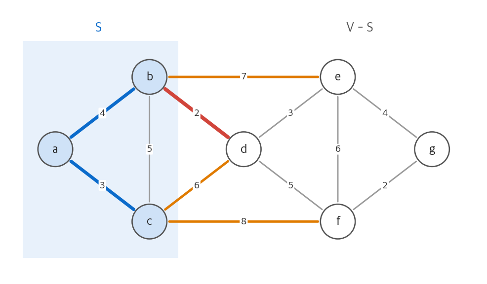
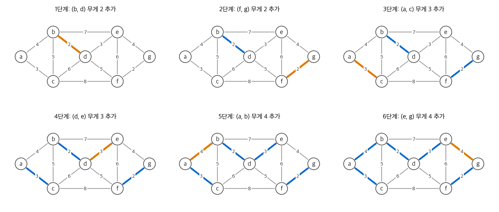
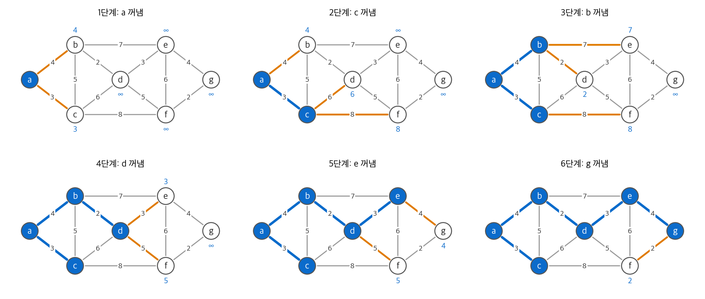

# 21. 최소 신장 트리

연결된 무방향 그래프 $G = (V, E)$ 의 각 간선 $(u, v)$ 에 가중치 $w(u, v)$ 가 있습니다.
모든 정점을 잇는 간선 부분 집합 중에서 가중치 합이 가장 작은 것을 찾습니다.
순환이 있으면 순환의 간선 하나를 빼도 연결이 유지되므로, 답은 항상 트리입니다.
이 트리를 **최소 신장 트리(MST, minimum spanning tree)** 라고 합니다.

$$
w(T) = \sum_{(u, v) \in T} w(u, v)
$$

회로 배선, 통신망 설계, 군집화(가장 무거운 MST 간선 $k-1$ 개를 지우면 $k$ 개 군집)가 대표적인 응용입니다.
이 장은 탐욕 알고리즘 두 개를 다룹니다. 두 알고리즘 모두 하나의 일반 규칙인 **컷 성질** 의 특수한 경우입니다.

!!! info "원문과 자료"
    - 원문: 21장 Minimum Spanning Trees (21.1 Growing a minimum spanning tree, 21.2 The algorithms of Kruskal and Prim)
    - 생략: 연습 문제. 장 끝 문제(두 번째로 좋은 MST, 희소 그래프의 MST, 다른 MST 알고리즘, 병목 신장 트리)와 관련 성질은 4절에서 요점만 적었습니다.
    - 함께 읽기: [15. 탐욕 알고리즘](15-greedy.md), [19. 서로소 집합 자료 구조](19-disjoint-sets.md), [6. 힙 정렬](06-heapsort.md)(우선순위 큐), [20. 기본 그래프 알고리즘](20-graph-basics.md)

## 1. MST를 키우는 일반 방법

### 안전한 간선

두 알고리즘은 간선 집합 $A$ 를 하나씩 키웁니다. 루프 내내 다음 불변식을 지킵니다.

> 반복을 시작할 때마다 $A$ 는 어떤 MST의 부분 집합입니다.

$A$ 에 $(u, v)$ 를 더해도 불변식이 유지되면, 그 간선을 $A$ 에 대해 **안전한 간선(safe edge)** 이라고 합니다.

```text
GENERIC-MST(G, w)
    A = ∅
    while A가 신장 트리가 아니다
        A에 대해 안전한 간선 (u, v)를 찾는다
        A = A ∪ {(u, v)}
    return A
```

초기화 때 $A = \varnothing$ 은 모든 MST의 부분 집합이므로 불변식이 성립합니다.
루프는 안전한 간선만 더하므로 불변식을 유지합니다.
루프가 끝나면 $A$ 는 신장 트리이면서 어떤 MST의 부분 집합입니다. 따라서 $A$ 자체가 MST입니다.
남은 문제는 "안전한 간선을 어떻게 찾는가"입니다.

### 컷과 가벼운 간선

용어 네 개를 정의합니다.

| 용어 | 정의 |
| --- | --- |
| 컷 $(S, V - S)$ | 정점 집합을 두 부분으로 나눈 것 |
| 컷을 가로지르는 간선 | 한 끝점이 $S$ 에, 다른 끝점이 $V - S$ 에 있는 간선 |
| 컷이 $A$ 를 존중한다 | $A$ 의 어떤 간선도 컷을 가로지르지 않는다 |
| 가벼운 간선(light edge) | 컷을 가로지르는 간선 중 가중치가 가장 작은 간선 |

**정리 (컷 성질).** $A$ 가 어떤 MST의 부분 집합이고, 컷 $(S, V - S)$ 가 $A$ 를 존중한다고 합시다.
이 컷을 가로지르는 가벼운 간선 $(u, v)$ 는 $A$ 에 대해 안전합니다.

<figure markdown>

<figcaption markdown>
<span class="fig-title"><b>Figure 1.</b> 컷 성질</span>

파란 간선 $A$ 는 컷을 가로지르지 않습니다. 가로지르는 간선(주황, 빨강) 중 가장 가벼운 $(b, d)$ 가 안전한 간선입니다.
</figcaption>
</figure>

Figure 1에서 $S = \{a, b, c\}$ 이고 $A = \{(a, b), (a, c)\}$ 입니다.
가로지르는 간선은 $(b, d)$ 2, $(c, d)$ 6, $(b, e)$ 7, $(c, f)$ 8 입니다. 가벼운 간선은 $(b, d)$ 입니다.

### 증명: 잘라 붙이기

$A \subseteq T$ 인 MST $T$ 가 있습니다. $(u, v) \in T$ 이면 증명이 끝납니다. $(u, v) \notin T$ 라고 합시다.

1. $T$ 에 $(u, v)$ 를 더하면 순환이 하나 생깁니다. $u \in S$ 이고 $v \in V - S$ 이므로, 이 순환은 컷을 한 번 더 가로질러야 합니다. 그 간선을 $(x, y)$ 라고 합니다.
2. 컷이 $A$ 를 존중하므로 $(x, y) \notin A$ 입니다.
3. $T' = T - \{(x, y)\} \cup \{(u, v)\}$ 는 다시 신장 트리입니다.
4. $(u, v)$ 가 가벼운 간선이므로 $w(u, v) \le w(x, y)$ 입니다. 따라서 $w(T') \le w(T)$ 이고 $T'$ 도 MST입니다.
5. $A \cup \{(u, v)\} \subseteq T'$ 이므로 $(u, v)$ 는 안전합니다.

### 따름 정리: 연결 요소 단위로 보기

$G_A = (V, A)$ 는 포리스트입니다. 처음에는 정점 $|V|$ 개가 각각 트리이고, 안전한 간선을 하나 더할 때마다 트리가 하나 줄어듭니다.
따라서 루프는 정확히 $|V| - 1$ 번 돕니다.

**따름 정리.** $C$ 가 $G_A$ 의 연결 요소(트리) 하나라고 합시다. $C$ 와 나머지 정점을 잇는 간선 중 가장 가벼운 간선은 $A$ 에 대해 안전합니다.

증명은 컷 $(V_C, V - V_C)$ 에 정리를 적용하면 됩니다. 이 컷은 $A$ 를 존중합니다.
Kruskal과 Prim은 이 따름 정리에서 "어느 연결 요소를 고르는가"만 다릅니다.

| 알고리즘 | $A$ 의 모양 | 고르는 간선 |
| --- | --- | --- |
| Kruskal | 여러 트리로 이루어진 포리스트 | 서로 다른 두 트리를 잇는 간선 중 전체에서 가장 가벼운 간선 |
| Prim | 하나의 트리 | 그 트리와 바깥 정점을 잇는 간선 중 가장 가벼운 간선 |

## 2. Kruskal 알고리즘

### 아이디어

간선을 가중치 오름차순으로 봅니다. 간선의 두 끝점이 다른 트리에 있으면 받고, 같은 트리에 있으면 버립니다.
같은 트리 안의 간선을 받으면 순환이 생기기 때문입니다.
받은 간선 $(u, v)$ 는 $u$ 가 속한 트리 $C$ 에서 나가는 간선 중 가장 가볍습니다. 더 가벼운 간선은 이미 모두 처리했기 때문입니다.
따라서 따름 정리로 안전합니다.

"두 정점이 같은 트리에 있는가"는 [19장](19-disjoint-sets.md)의 서로소 집합 자료 구조(`FIND-SET`, `UNION`)로 답합니다.

```python
def kruskal(vertices, edges):
    """edges: [(w, u, v)]. 최소 신장 트리의 간선 목록을 돌려줍니다."""
    parent = {v: v for v in vertices}

    def find(x):
        while parent[x] != x:
            parent[x] = parent[parent[x]]  # 경로 절반 압축
            x = parent[x]
        return x

    tree = []
    for w, u, v in sorted(edges):
        ru, rv = find(u), find(v)
        if ru != rv:  # 서로 다른 트리를 잇는 간선만 받습니다
            parent[ru] = rv
            tree.append((u, v, w))
    return tree
```

### 실행 예

정점 7개, 간선 12개인 그래프로 따라갑니다. 정렬한 간선 순서는 다음과 같습니다.

| 순서 | 간선 | 무게 | 결과 |
| --- | --- | --- | --- |
| 1 | $(b, d)$ | 2 | 받음 |
| 2 | $(f, g)$ | 2 | 받음 |
| 3 | $(a, c)$ | 3 | 받음 |
| 4 | $(d, e)$ | 3 | 받음 |
| 5 | $(a, b)$ | 4 | 받음. $\{a, c\}$ 와 $\{b, d, e\}$ 가 합쳐집니다 |
| 6 | $(e, g)$ | 4 | 받음. 트리가 하나가 됩니다 |
| 7~12 | $(b, c)$ 5, $(d, f)$ 5, $(c, d)$ 6, $(e, f)$ 6, $(b, e)$ 7, $(c, f)$ 8 | | 모두 버림 (같은 트리 안) |

<figure markdown>

<figcaption markdown>
<span class="fig-title"><b>Figure 2.</b> Kruskal 알고리즘의 실행 과정</span>

주황은 이번 단계에 받은 간선, 파랑은 이미 받은 간선입니다. 6단계에서 정점 7개가 간선 6개로 이어지고, MST 무게는 18입니다.
</figcaption>
</figure>

가중치가 같은 간선이 있으면 MST가 하나로 정해지지 않을 수 있습니다.
이 예에서 $(b, d)$ 와 $(f, g)$ 의 처리 순서를 바꿔도 결과는 같습니다. 반면 $(d, f)$ 가 4였다면 $(e, g)$ 와 $(d, f)$ 중 어느 쪽을 받아도 MST입니다.

### 실행 시간

| 단계 | 비용 |
| --- | --- |
| 간선 정렬 | $O(E \lg E)$ |
| `FIND-SET` $2E$ 번, `UNION` $V - 1$ 번 | $O(E \, \alpha(V))$ (랭크에 따른 합치기와 경로 압축) |

$\alpha$ 는 아주 느리게 자라는 함수이고, $|E| \ge |V| - 1$ 이므로 정렬이 전체를 지배합니다.
$|E| < |V|^2$ 이므로 $\lg E = O(\lg V)$ 이고, 전체 실행 시간은 $O(E \lg V)$ 입니다.

## 3. Prim 알고리즘

### 아이디어

루트 $r$ 에서 출발해 트리 하나를 키웁니다. 매 단계 "트리와 바깥을 잇는 가장 가벼운 간선"을 더합니다.
트리 정점 집합이 $S$ 인 컷이 $A$ 를 존중하므로, 이 간선은 컷 성질로 안전합니다.

가장 가벼운 간선을 빨리 찾기 위해 바깥 정점마다 두 값을 둡니다.

- $v.key$: $v$ 와 트리를 잇는 간선 중 가장 가벼운 간선의 가중치. 그런 간선이 없으면 $\infty$ 입니다.
- $v.\pi$: 그 간선의 트리 쪽 끝점.

바깥 정점을 $key$ 를 기준으로 최소 우선순위 큐에 넣습니다. `EXTRACT-MIN` 으로 꺼낸 정점 $u$ 를 간선 $(u.\pi, u)$ 와 함께 트리에 넣습니다.
그다음 $u$ 의 이웃 $v$ 마다 $w(u, v) < v.key$ 이면 $v.key$ 를 줄입니다(`DECREASE-KEY`).

```python
import heapq

def prim(adj, r):
    """adj[u] = [(v, w)]. 각 정점의 부모 pi를 돌려줍니다."""
    key = {v: float("inf") for v in adj}
    pi = {v: None for v in adj}
    key[r] = 0
    done = set()
    pq = [(0, r)]
    while pq:
        _, u = heapq.heappop(pq)
        if u in done:
            continue  # 오래된 항목은 건너뜁니다
        done.add(u)
        for v, w in adj[u]:
            if v not in done and w < key[v]:
                key[v], pi[v] = w, u
                heapq.heappush(pq, (w, v))
    return pi
```

Python의 `heapq` 에는 `DECREASE-KEY` 가 없습니다. 위 코드는 새 항목을 넣고, 꺼낼 때 이미 처리한 정점을 건너뜁니다.
큐에 항목이 최대 $|E|$ 개 쌓이지만 점근 실행 시간은 같습니다.

### 실행 예

같은 그래프에서 $r = a$ 로 시작합니다. 꺼내는 순서는 $a, c, b, d, e, g, f$ 입니다.

<figure markdown>

<figcaption markdown>
<span class="fig-title"><b>Figure 3.</b> Prim 알고리즘의 실행 과정</span>

파란 정점이 트리이고, 파란 숫자는 바깥 정점의 $key$ 입니다. 주황 간선은 각 바깥 정점의 현재 후보 $(v.\pi, v)$ 입니다.
</figcaption>
</figure>

| 단계 | 꺼낸 정점 | 더한 간선 | 바뀐 $key$ |
| --- | --- | --- | --- |
| 1 | $a$ | (루트) | $b: 4$, $c: 3$ |
| 2 | $c$ | $(a, c)$ 3 | $d: 6$, $f: 8$ |
| 3 | $b$ | $(a, b)$ 4 | $d: 6 \to 2$, $e: 7$ |
| 4 | $d$ | $(b, d)$ 2 | $e: 7 \to 3$, $f: 8 \to 5$ |
| 5 | $e$ | $(d, e)$ 3 | $g: 4$ |
| 6 | $g$ | $(e, g)$ 4 | $f: 5 \to 2$ |
| 7 | $f$ | $(g, f)$ 2 | 없음 |

결과 트리의 간선 집합은 Kruskal과 같고 무게도 18입니다. 두 알고리즘이 간선을 받는 순서만 다릅니다.

### 실행 시간

우선순위 큐의 구현에 따라 실행 시간이 달라집니다.

| 큐 구현 | `EXTRACT-MIN` ($V$ 번) | `DECREASE-KEY` ($E$ 번) | 합계 |
| --- | --- | --- | --- |
| 정렬하지 않은 배열 | $O(V)$ | $O(1)$ | $O(V^2)$ |
| 이진 힙 | $O(\lg V)$ | $O(\lg V)$ | $O(E \lg V)$ |
| 피보나치 힙 | $O(\lg V)$ (분할 상환) | $O(1)$ (분할 상환) | $O(E + V \lg V)$ |

밀집 그래프($|E| = \Theta(V^2)$)에서는 배열 구현이 $O(V^2)$ 로 가장 빠릅니다.
희소 그래프에서는 이진 힙으로 충분합니다. 피보나치 힙은 $|E|$ 가 $|V|$ 보다 점근적으로 빠르게 자라면 이진 힙보다 빠릅니다.
다만 상수 인자가 커서 실제 구현에서는 이진 힙을 더 많이 씁니다.

## 4. 장 끝 문제와 관련 성질

| 문제 | 요점 |
| --- | --- |
| 두 번째로 좋은 MST | MST $T$ 에 없는 간선 $(u, v)$ 를 더하고, 생긴 순환에서 가장 무거운 간선을 뺍니다. 모든 $(u, v)$ 를 시험하면 됩니다. 정점 쌍마다 트리 경로의 최대 간선을 미리 구하면 $O(V^2)$ 입니다. |
| MST의 유일성 | 모든 간선 가중치가 서로 다르면 MST는 하나뿐입니다. 컷 성질에서 가벼운 간선이 하나로 정해지기 때문입니다. |
| 희소 그래프의 MST | 각 정점에서 가장 가벼운 간선을 먼저 받고 그 간선으로 이어진 정점을 하나로 축약합니다. 한 번에 정점 수가 절반 이하로 줄어 Prim을 더 작은 그래프에서 돌립니다. |
| 다른 MST 알고리즘 | 무거운 간선부터 보며 연결을 끊지 않는 간선을 지우는 방법은 MST를 냅니다. 순환이 생길 때 그 순환의 가장 무거운 간선을 지우는 방법도 MST를 냅니다. |
| 병목 신장 트리 | 최대 간선 가중치를 최소로 하는 신장 트리입니다. 모든 MST는 병목 신장 트리입니다. |
| 순환 성질 | 어떤 순환에서 가장 무거운 간선(유일할 때)은 어떤 MST에도 속하지 않습니다. 컷 성질과 짝을 이룹니다. |

## 정리

- 컷 성질: $A$ 를 존중하는 컷을 가로지르는 가벼운 간선은 안전합니다. 증명은 교환 논법(잘라 붙이기)입니다.
- Kruskal은 전체 간선 중 가장 가벼운 "두 트리를 잇는 간선"을 고릅니다. 서로소 집합과 정렬로 $O(E \lg V)$ 입니다.
- Prim은 트리 하나에서 나가는 가장 가벼운 간선을 고릅니다. 이진 힙으로 $O(E \lg V)$, 피보나치 힙으로 $O(E + V \lg V)$ 입니다.
- Prim의 구조는 [22장](22-single-source-sp.md)의 Dijkstra와 거의 같습니다. 차이는 $key$ 에 "간선 하나의 가중치"를 넣는지 "출발점부터의 거리"를 넣는지입니다.
