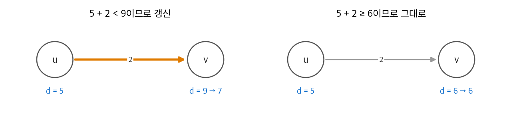
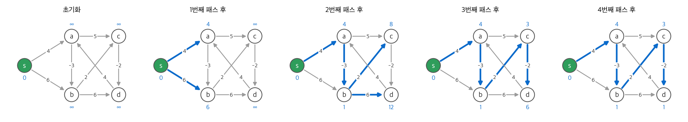
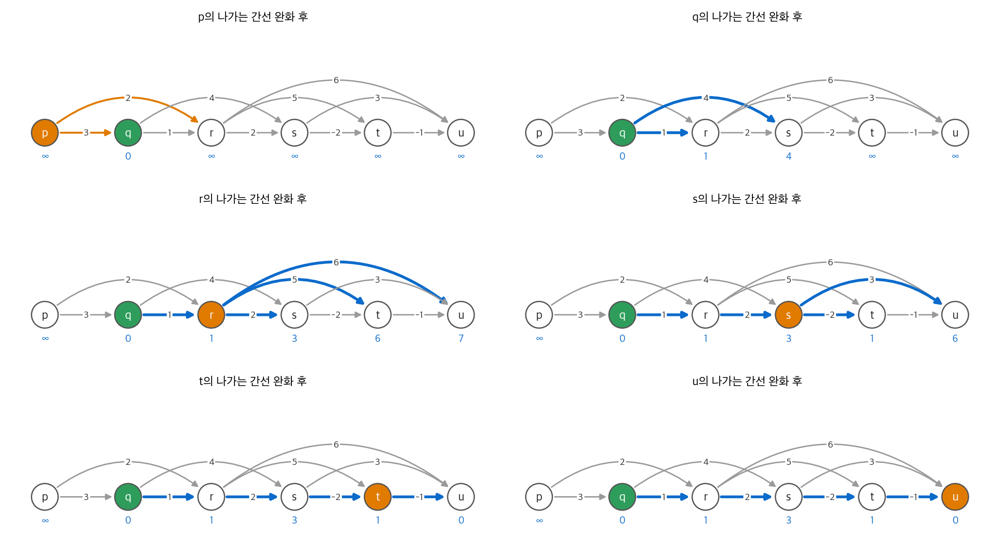
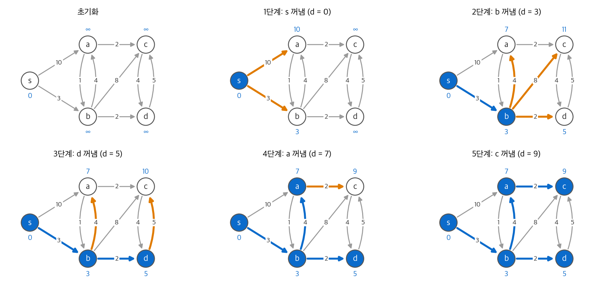
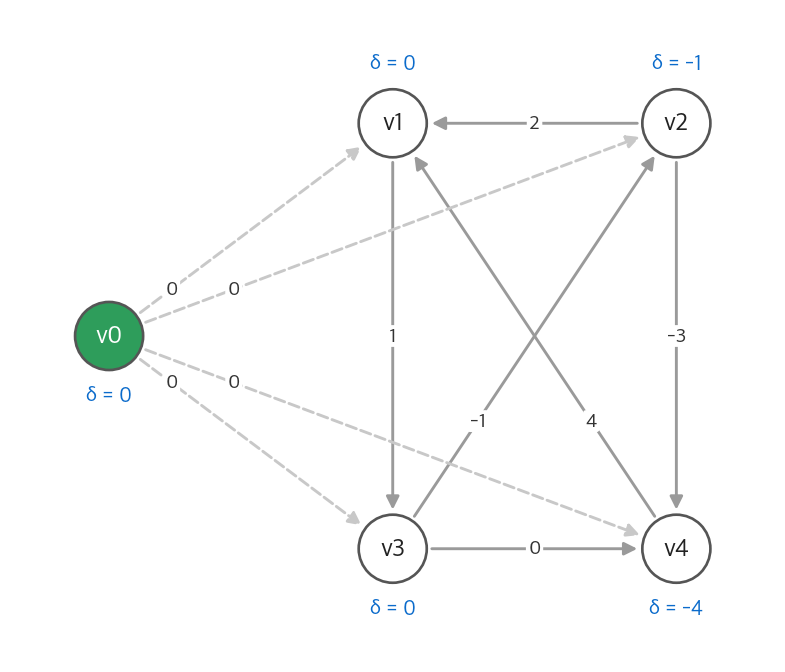

# 22. 단일 출발점 최단 경로

가중치가 있는 방향 그래프 $G = (V, E)$ 와 가중치 함수 $w : E \to \mathbb{R}$ 이 있습니다.
경로 $p = \langle v_0, v_1, \ldots, v_k \rangle$ 의 가중치는 간선 가중치의 합입니다.

$$
w(p) = \sum_{i=1}^{k} w(v_{i-1}, v_i)
$$

$u$ 에서 $v$ 로 가는 **최단 경로 가중치** $\delta(u, v)$ 는 모든 경로 가중치의 최솟값입니다. 경로가 없으면 $\delta(u, v) = \infty$ 입니다.
이 장은 출발점 $s$ 하나에서 모든 정점까지의 $\delta(s, v)$ 를 구합니다.
가중치가 모두 1이면 [20장](20-graph-basics.md)의 너비 우선 탐색으로 충분합니다. 이 장은 일반 가중치를 다룹니다.

!!! info "원문과 자료"
    - 원문: 22장 Single-Source Shortest Paths (도입부, 22.1 Bellman-Ford, 22.2 DAG, 22.3 Dijkstra, 22.4 Difference constraints, 22.5 Proofs of shortest-paths properties)
    - 생략: 연습 문제, 22.5의 증명 세부. 5절에서 성질과 증명의 요점만 적었습니다.
    - 함께 읽기: [21. 최소 신장 트리](21-mst.md)(Prim과 Dijkstra의 구조), [23. 모든 쌍 최단 경로](23-all-pairs-sp.md), [29. 선형 계획법](29-linear-programming.md), [14. 동적 계획법](14-dynamic-programming.md)

## 1. 문제의 구조

### 변형 문제

| 문제 | 구하는 것 | 푸는 방법 |
| --- | --- | --- |
| 단일 출발점 | $s$ 에서 모든 $v$ 까지 | 이 장 |
| 단일 도착점 | 모든 $v$ 에서 $t$ 까지 | 간선 방향을 뒤집고 단일 출발점으로 풉니다 |
| 단일 쌍 | $u$ 에서 $v$ 까지 | 점근적으로 단일 출발점보다 빠른 알고리즘이 알려져 있지 않습니다 |
| 모든 쌍 | 모든 $u, v$ | [23장](23-all-pairs-sp.md) |

### 최적 부분 구조

**보조 정리.** 최단 경로의 부분 경로는 최단 경로입니다.
$p = \langle v_0, \ldots, v_k \rangle$ 가 최단 경로이면, 그 안의 $v_i$ 에서 $v_j$ 까지 구간도 최단 경로입니다.
더 짧은 구간이 있으면 그 구간으로 바꿔 $p$ 보다 짧은 경로를 만들 수 있기 때문입니다.
이 성질 때문에 [14장](14-dynamic-programming.md)의 동적 계획법과 [15장](15-greedy.md)의 탐욕 방법이 모두 쓰입니다.

### 음수 가중치와 음수 순환

음수 가중치 간선은 문제가 되지 않습니다. 문제는 $s$ 에서 도달할 수 있는 **음수 순환** 입니다.
음수 순환을 여러 번 돌면 가중치가 한없이 작아집니다. 그 순환을 거쳐 갈 수 있는 정점 $v$ 는 $\delta(s, v) = -\infty$ 입니다.

최단 경로는 순환을 포함하지 않는다고 가정해도 됩니다.

- 음수 순환은 위의 이유로 제외합니다.
- 양수 순환은 빼면 더 짧아지므로 들어가지 않습니다.
- 가중치 0인 순환은 빼도 가중치가 같으므로 빼고 생각합니다.

따라서 최단 경로는 단순 경로이고, 간선은 많아야 $|V| - 1$ 개입니다.

### 경로 표현과 완화

각 정점에 두 속성을 둡니다.

- $v.d$: $s$ 에서 $v$ 까지의 **최단 경로 추정값**. 항상 $\delta(s, v)$ 의 상한입니다.
- $v.\pi$: 현재 경로에서 $v$ 바로 앞의 정점. $\pi$ 를 따라가면 **최단 경로 트리** 가 나옵니다.

모든 알고리즘은 같은 두 연산만 씁니다.

```text
INITIALIZE-SINGLE-SOURCE(G, s)
    for 각 정점 v
        v.d = ∞
        v.π = NIL
    s.d = 0

RELAX(u, v, w)
    if v.d > u.d + w(u, v)
        v.d = u.d + w(u, v)
        v.π = u
```

**완화(relaxation)** 는 "$u$ 를 거쳐 $v$ 로 가면 더 짧은가"를 확인하고, 짧으면 추정값을 고칩니다.

<figure markdown>

<figcaption markdown>
<span class="fig-title"><b>Figure 1.</b> 간선 완화</span>

$u.d + w(u, v)$ 가 $v.d$ 보다 작을 때만 $v.d$ 와 $v.\pi$ 를 바꿉니다.
</figcaption>
</figure>

이 장의 알고리즘은 "어떤 간선을, 몇 번, 어떤 순서로 완화하는가"만 다릅니다.

| 알고리즘 | 완화 순서 | 가중치 조건 | 실행 시간 |
| --- | --- | --- | --- |
| Bellman-Ford | 모든 간선을 $\lvert V \rvert - 1$ 번 | 임의 (음수 순환 검출) | $O(VE)$ |
| DAG 최단 경로 | 위상 정렬 순서로 한 번 | 임의, 그래프는 DAG | $\Theta(V + E)$ |
| Dijkstra | $d$ 가 가장 작은 정점부터 한 번 | 0 이상 | $O((V + E) \lg V)$ (이진 힙) |

## 2. Bellman-Ford 알고리즘

### 알고리즘

모든 간선을 완화하는 패스를 $|V| - 1$ 번 반복합니다. 그다음 한 번 더 확인해서 아직 완화되는 간선이 있으면 음수 순환이 있다고 보고합니다.

```python
def bellman_ford(vertices, edges, s):
    """edges: [(u, v, w)]. 음수 순환이 있으면 None을 돌려줍니다."""
    d = {v: float("inf") for v in vertices}
    d[s] = 0
    for _ in range(len(vertices) - 1):
        for u, v, w in edges:
            if d[u] + w < d[v]:
                d[v] = d[u] + w
    for u, v, w in edges:
        if d[u] + w < d[v]:
            return None
    return d
```

### 왜 $|V| - 1$ 번인가

최단 경로 $p = \langle s = v_0, v_1, \ldots, v_k = v \rangle$ 가 있고, $k \le |V| - 1$ 입니다.
첫 패스는 모든 간선을 완화하므로 $(v_0, v_1)$ 도 완화합니다. 그 뒤 $v_1.d = \delta(s, v_1)$ 입니다.
두 번째 패스가 $(v_1, v_2)$ 를 완화하면 $v_2.d = \delta(s, v_2)$ 입니다.
$i$ 번째 패스 뒤에는 간선 $i$ 개 이하인 최단 경로를 가진 정점이 모두 정확해집니다. 이것이 5절의 **경로 완화 성질** 입니다.

음수 순환 검출도 같은 논리입니다. 음수 순환 $c = \langle v_0, \ldots, v_k = v_0 \rangle$ 이 있는데 모든 간선이 $v_i.d \le v_{i-1}.d + w(v_{i-1}, v_i)$ 를 만족한다고 합시다.
순환을 따라 더하면 양변의 $d$ 합이 같아서 $0 \le \sum w(v_{i-1}, v_i)$ 가 됩니다. 이는 음수 순환이라는 가정과 모순입니다.

### 실행 예

간선 처리 순서를 일부러 나쁘게 정했습니다. 순서는 $(c,d), (b,d), (b,c), (a,c), (a,b), (d,a), (s,a), (s,b)$ 입니다.

<figure markdown>

<figcaption markdown>
<span class="fig-title"><b>Figure 2.</b> Bellman-Ford의 패스별 추정값</span>

파란 숫자는 각 패스 뒤의 $v.d$, 파란 간선은 $\pi$ 가 가리키는 간선입니다. 간선 3개짜리 최단 경로 $s \to a \to b \to c \to d$ 는 4번째 패스에서 확정됩니다.
</figcaption>
</figure>

| 패스 | $a$ | $b$ | $c$ | $d$ |
| --- | --- | --- | --- | --- |
| 초기 | $\infty$ | $\infty$ | $\infty$ | $\infty$ |
| 1 | 4 | 6 | $\infty$ | $\infty$ |
| 2 | 4 | 1 | 8 | 12 |
| 3 | 4 | 1 | 3 | 6 |
| 4 | 4 | 1 | 3 | 1 |

간선 순서가 좋으면 더 적은 패스로 끝나지만, 최악에는 $|V| - 1$ 번이 필요합니다.
간선 $(d, a)$ 의 가중치를 4에서 1로 바꾸면 순환 $a \to b \to c \to d \to a$ 의 가중치가 $-3 + 2 - 2 + 1 = -2$ 가 됩니다. 그러면 마지막 확인 단계에서 `None` 을 돌려줍니다.

### 실행 시간

초기화 $\Theta(V)$, 패스 $|V| - 1$ 번 각각 $\Theta(E)$, 확인 $O(E)$ 입니다. 합계는 $O(VE)$ 입니다.
한 패스에서 아무 추정값도 바뀌지 않으면 일찍 끝낼 수 있습니다.

## 3. DAG의 최단 경로

방향 비순환 그래프(DAG)에는 순환이 없으므로 음수 순환도 없습니다.
정점을 [20장](20-graph-basics.md)의 위상 정렬 순서로 보고, 각 정점에서 나가는 간선을 한 번씩 완화합니다.

```python
def dag_shortest_paths(order, adj, s):
    """order: 위상 정렬 순서. adj[u] = [(v, w)]."""
    d = {v: float("inf") for v in order}
    d[s] = 0
    for u in order:
        for v, w in adj[u]:
            if d[u] + w < d[v]:
                d[v] = d[u] + w
    return d
```

최단 경로 $\langle v_0, \ldots, v_k \rangle$ 의 정점은 위상 정렬 순서로 나타납니다. 따라서 간선들도 경로 순서대로 완화되고, 경로 완화 성질로 정확합니다.
위상 정렬 $\Theta(V + E)$ 와 완화 $\Theta(E)$ 를 합쳐 $\Theta(V + E)$ 입니다.

<figure markdown>

<figcaption markdown>
<span class="fig-title"><b>Figure 3.</b> DAG 최단 경로의 실행 과정</span>

정점은 위상 정렬 순서로 놓았고 출발점은 $q$ 입니다. 주황 정점은 이번에 처리한 정점이고, 파란 간선은 $\pi$ 가 가리키는 간선입니다.
</figcaption>
</figure>

$p$ 는 $q$ 보다 앞에 있어 도달할 수 없으므로 끝까지 $\infty$ 입니다.
$u$ 의 추정값은 $7 \to 6 \to 0$ 으로 바뀝니다. 마지막 값은 경로 $q \to r \to s \to t \to u$ 의 가중치 $1 + 2 - 2 - 1 = 0$ 입니다.

**응용: PERT 차트의 임계 경로.** 간선을 작업, 가중치를 작업 시간으로 둡니다. 가장 긴 경로가 전체 공정의 최소 소요 시간입니다.
가중치의 부호를 뒤집고 이 알고리즘을 돌리면 가장 긴 경로를 구할 수 있습니다. 일반 그래프의 최장 경로 문제는 NP-난해이지만 DAG에서는 선형 시간입니다.

## 4. Dijkstra 알고리즘

### 알고리즘

모든 간선 가중치가 0 이상이라고 가정합니다.
최단 거리가 확정된 정점 집합 $S$ 를 둡니다. 매 단계 $S$ 바깥에서 $d$ 가 가장 작은 정점 $u$ 를 꺼내 $S$ 에 넣고, $u$ 의 나가는 간선을 완화합니다.
"가장 가까운 것부터 확정한다"는 탐욕 전략입니다.

```python
import heapq

def dijkstra(adj, s):
    d = {v: float("inf") for v in adj}
    d[s] = 0
    pq = [(0, s)]
    done = set()
    while pq:
        du, u = heapq.heappop(pq)
        if u in done:
            continue
        done.add(u)  # 이 순간 d[u]가 최단 거리로 확정됩니다
        for v, w in adj[u]:
            if du + w < d[v]:
                d[v] = du + w
                heapq.heappush(pq, (d[v], v))
    return d
```

[21장](21-mst.md)의 Prim과 비교하면, 큐의 키가 $w(u, v)$ 에서 $u.d + w(u, v)$ 로 바뀐 것뿐입니다.

### 실행 예

<figure markdown>

<figcaption markdown>
<span class="fig-title"><b>Figure 4.</b> Dijkstra 알고리즘의 실행 과정</span>

파란 정점은 집합 $S$ 입니다. 파란 간선은 확정된 최단 경로 트리, 주황 간선은 아직 확정되지 않은 정점의 현재 $\pi$ 입니다.
</figcaption>
</figure>

| 단계 | 꺼낸 정점 | $a$ | $b$ | $c$ | $d$ |
| --- | --- | --- | --- | --- | --- |
| 초기 | | $\infty$ | $\infty$ | $\infty$ | $\infty$ |
| 1 | $s$ (0) | 10 | 3 | $\infty$ | $\infty$ |
| 2 | $b$ (3) | 7 | **3** | 11 | 5 |
| 3 | $d$ (5) | 7 | | 10 | **5** |
| 4 | $a$ (7) | **7** | | 9 | |
| 5 | $c$ (9) | | | **9** | |

$a$ 의 추정값은 직접 간선 10에서 $b$ 를 거친 $3 + 4 = 7$ 로 줄었습니다.
$c$ 는 $11 \to 10 \to 9$ 로 두 번 줄었습니다. 마지막 값은 $s \to b \to a \to c$ 경로의 $3 + 4 + 2$ 입니다.

### 정확성

**정리.** 가중치가 0 이상이면, $u$ 를 $S$ 에 넣는 순간 $u.d = \delta(s, u)$ 입니다.

증명은 모순법입니다. $u$ 가 처음으로 $u.d \ne \delta(s, u)$ 인 채 들어간 정점이라고 합시다.

1. $s$ 에서 $u$ 로 가는 최단 경로 $p$ 를 봅니다. $p$ 가 처음으로 $S$ 를 벗어나는 간선을 $(x, y)$ 라고 합니다. $x \in S$, $y \notin S$ 입니다.
2. $x$ 는 $u$ 보다 먼저 들어갔으므로 $x.d = \delta(s, x)$ 입니다. $x$ 를 넣을 때 $(x, y)$ 를 완화했으므로 $y.d = \delta(s, y)$ 입니다(수렴 성질).
3. 가중치가 0 이상이므로 경로에서 $y$ 는 $u$ 보다 가깝습니다. 따라서 $y.d = \delta(s, y) \le \delta(s, u) \le u.d$ 입니다.
4. 그런데 큐는 $u$ 를 골랐으므로 $u.d \le y.d$ 입니다. 위 부등식이 모두 등식이 되어 $u.d = \delta(s, u)$ 이고, 가정과 모순입니다.

3번 단계가 음수 간선에서 깨집니다. 음수 간선이 있으면 먼 정점을 거친 뒤 거리가 다시 줄어들 수 있습니다.

### 실행 시간

`INSERT` 와 `EXTRACT-MIN` 은 정점마다 한 번, `DECREASE-KEY` 는 간선마다 많아야 한 번입니다.

| 큐 구현 | 합계 |
| --- | --- |
| 배열 | $O(V^2 + E) = O(V^2)$ |
| 이진 힙 | $O((V + E) \lg V)$ |
| 피보나치 힙 | $O(V \lg V + E)$ |

## 5. 차분 제약과 최단 경로

### 차분 제약 시스템

[29장](29-linear-programming.md)의 선형 계획법에서 제약 행렬의 각 행에 1과 −1이 하나씩만 있는 특수한 경우입니다.
제약은 모두 $x_j - x_i \le b_k$ 꼴입니다. 작업 시작 시각 사이의 간격 제약이 이런 꼴입니다.
이 시스템은 최단 경로 문제로 풀 수 있습니다.

제약 하나의 해를 $x$ 라고 하면 모든 $x_i$ 에 같은 상수 $c$ 를 더한 $x + c$ 도 해입니다. 차이만 제약하기 때문입니다.

### 제약 그래프

변수 $x_1, \ldots, x_n$ 마다 정점 $v_1, \ldots, v_n$ 을 두고, 새 정점 $v_0$ 을 더합니다.

- 제약 $x_j - x_i \le b_k$ 마다 간선 $(v_i, v_j)$ 와 가중치 $b_k$ 를 둡니다.
- $v_0$ 에서 모든 $v_i$ 로 가중치 0인 간선을 둡니다.

**정리.** 제약 그래프에 음수 순환이 없으면 $x_i = \delta(v_0, v_i)$ 가 해입니다. 음수 순환이 있으면 해가 없습니다.

해가 되는 이유는 삼각 부등식입니다. 간선 $(v_i, v_j)$ 마다 $\delta(v_0, v_j) \le \delta(v_0, v_i) + w(v_i, v_j)$ 이므로 $x_j - x_i \le b_k$ 입니다.
음수 순환 $v_1 \to v_2 \to \cdots \to v_k \to v_1$ 이 있으면, 그 제약들을 모두 더한 좌변은 0이고 우변은 음수입니다. 이는 모순입니다.

### 실행 예

| 제약 | 간선 |
| --- | --- |
| $x_1 - x_2 \le 2$ | $(v_2, v_1)$, 2 |
| $x_2 - x_3 \le -1$ | $(v_3, v_2)$, −1 |
| $x_3 - x_1 \le 1$ | $(v_1, v_3)$, 1 |
| $x_4 - x_2 \le -3$ | $(v_2, v_4)$, −3 |
| $x_4 - x_3 \le 0$ | $(v_3, v_4)$, 0 |
| $x_1 - x_4 \le 4$ | $(v_4, v_1)$, 4 |

<figure markdown>

<figcaption markdown>
<span class="fig-title"><b>Figure 5.</b> 차분 제약의 제약 그래프</span>

점선은 $v_0$ 에서 나가는 가중치 0 간선입니다. Bellman-Ford로 구한 $\delta(v_0, v_i)$ 가 그대로 해가 됩니다.
</figcaption>
</figure>

Bellman-Ford는 $x = (0, -1, 0, -4)$ 를 돌려줍니다. 대입하면 여섯 제약이 모두 성립하고, $x_2 - x_3 = -1$, $x_4 - x_2 = -3$, $x_1 - x_4 = 4$ 는 등호로 성립합니다.
변수 $n$ 개, 제약 $m$ 개이면 그래프는 정점 $n + 1$ 개, 간선 $n + m$ 개이므로 $O(n^2 + nm)$ 시간에 풉니다.

## 6. 최단 경로 성질

22.5절은 완화만 쓰는 모든 알고리즘에 성립하는 성질을 증명합니다. 앞 절의 정확성 논증은 모두 이 성질에 기댑니다.

| 성질 | 내용 |
| --- | --- |
| 삼각 부등식 | 모든 간선 $(u, v)$ 에 대해 $\delta(s, v) \le \delta(s, u) + w(u, v)$ |
| 상한 성질 | 항상 $v.d \ge \delta(s, v)$. 한 번 $\delta(s, v)$ 가 되면 다시 바뀌지 않습니다 |
| 경로 없음 성질 | 경로가 없으면 항상 $v.d = \delta(s, v) = \infty$ |
| 수렴 성질 | $u.d = \delta(s, u)$ 인 상태에서 최단 경로의 마지막 간선 $(u, v)$ 를 완화하면 이후 $v.d = \delta(s, v)$ |
| 경로 완화 성질 | 최단 경로 $\langle v_0, \ldots, v_k \rangle$ 의 간선이 이 순서로 완화되면(사이에 다른 완화가 끼어도) $v_k.d = \delta(s, v_k)$ |
| 선행자 부분 그래프 성질 | 모든 $v.d = \delta(s, v)$ 가 되면 $\pi$ 가 만드는 그래프는 $s$ 를 루트로 하는 최단 경로 트리 |

## 7. 장 끝 문제의 요점

| 문제 | 요점 |
| --- | --- |
| 상자 겹치기 | $d$ 차원 상자가 다른 상자 안에 들어가는 관계는 DAG입니다. 가장 긴 겹치기 사슬은 DAG의 최장 경로입니다 |
| 차익 거래 | 환율 $R[i, j]$ 의 곱이 1보다 큰 순환을 찾습니다. 가중치를 $-\ln R[i, j]$ 로 두면 음수 순환 검출 문제가 됩니다 |
| Yen의 개선 | 정점을 임의 순서로 나누고 앞으로 가는 간선과 뒤로 가는 간선을 번갈아 완화하면 Bellman-Ford의 패스 수가 약 절반이 됩니다 |
| 최소 평균 순환 | 간선 평균 가중치가 가장 작은 순환을 $O(VE)$ 에 찾는 Karp 알고리즘 |
| Gabow 스케일링 | 정수 가중치의 비트를 위에서부터 하나씩 더하며 Dijkstra를 반복해 $O(E \lg W)$ 에 풉니다 |

## 정리

- 모든 알고리즘은 `RELAX` 만으로 추정값을 고치고, 완화 순서만 다릅니다.
- Bellman-Ford는 모든 간선을 $|V| - 1$ 번 완화해 음수 가중치를 다루고 음수 순환을 검출합니다. $O(VE)$ 입니다.
- DAG에서는 위상 정렬 순서로 한 번만 완화하면 됩니다. $\Theta(V + E)$ 입니다.
- Dijkstra는 가중치가 0 이상일 때 가장 가까운 정점부터 확정합니다. 이진 힙으로 $O((V + E) \lg V)$ 입니다.
- 차분 제약 시스템은 제약 그래프의 최단 경로로 풀립니다. 음수 순환이 있으면 해가 없습니다.
