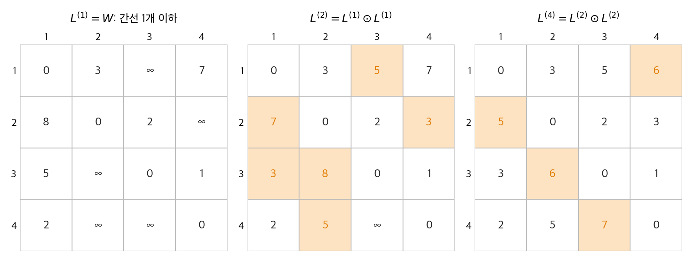
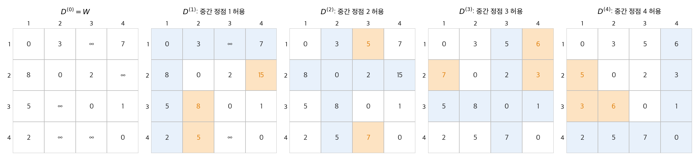
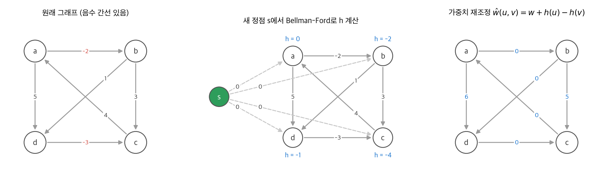

# 23. 모든 쌍 최단 경로

이번에는 모든 정점 쌍 $(i, j)$ 의 최단 경로 가중치 $\delta(i, j)$ 를 구합니다. 도로 지도의 거리표가 이 문제의 결과입니다.
[22장](22-single-source-sp.md)의 단일 출발점 알고리즘을 정점마다 한 번씩 돌려도 됩니다.

| 방법 | 실행 시간 | 조건 |
| --- | --- | --- |
| Dijkstra × $\lvert V \rvert$ (배열) | $O(V^3)$ | 가중치 0 이상 |
| Dijkstra × $\lvert V \rvert$ (이진 힙) | $O(VE \lg V)$ | 가중치 0 이상 |
| Bellman-Ford × $\lvert V \rvert$ | $O(V^2 E)$, 밀집 그래프에서 $O(V^4)$ | 임의 |

이 장은 음수 가중치를 허용하면서 더 빠른 세 방법을 다룹니다. 앞의 두 방법은 [14장](14-dynamic-programming.md)의 동적 계획법이고, 세 번째는 가중치를 바꿔 Dijkstra를 쓰게 합니다.

!!! info "원문과 자료"
    - 원문: 23장 All-Pairs Shortest Paths (23.1 Shortest paths and matrix multiplication, 23.2 The Floyd-Warshall algorithm, 23.3 Johnson's algorithm for sparse graphs)
    - 생략: 연습 문제. 장 끝 문제(동적 그래프의 추이적 폐포, ε-밀집 그래프)는 5절에서 요점만 적었습니다.
    - 함께 읽기: [22. 단일 출발점 최단 경로](22-single-source-sp.md), [14. 동적 계획법](14-dynamic-programming.md), [4. 분할 정복](04-divide-and-conquer.md)(행렬 곱셈)

## 1. 입력과 출력

정점을 $1, 2, \ldots, n$ 으로 번호 붙이고, 그래프를 $n \times n$ 가중치 행렬 $W = (w_{ij})$ 로 받습니다.

$$
w_{ij} =
\begin{cases}
0 & i = j \\
(i, j) \text{ 의 가중치} & i \ne j,\ (i, j) \in E \\
\infty & i \ne j,\ (i, j) \notin E
\end{cases}
$$

출력은 거리 행렬 $D = (d_{ij})$, $d_{ij} = \delta(i, j)$ 와 **선행자 행렬** $\Pi = (\pi_{ij})$ 입니다.
$\pi_{ij}$ 는 $i$ 에서 $j$ 로 가는 최단 경로에서 $j$ 바로 앞의 정점입니다. $\Pi$ 의 $i$ 번째 행은 $i$ 를 루트로 하는 최단 경로 트리입니다.
이 장 전체에서 음수 간선은 허용하지만 음수 순환은 없다고 가정합니다.

이 장의 예제 그래프는 정점 4개입니다. 간선은 $1 \to 2$ (3), $1 \to 4$ (7), $2 \to 1$ (8), $2 \to 3$ (2), $3 \to 1$ (5), $3 \to 4$ (1), $4 \to 1$ (2) 입니다.

## 2. 행렬 곱셈 방법

### 간선 수로 나눈 점화식

$l_{ij}^{(r)}$ 를 "간선 $r$ 개 이하를 쓰는 $i \to j$ 경로의 최소 가중치"로 정의합니다.

$$
l_{ij}^{(0)} =
\begin{cases}
0 & i = j \\
\infty & i \ne j
\end{cases}
\qquad
l_{ij}^{(r)} = \min_{1 \le k \le n} \left\{ l_{ik}^{(r-1)} + w_{kj} \right\}
$$

두 번째 식은 "마지막 간선 $(k, j)$ 를 고르고, 그 앞은 간선 $r - 1$ 개 이하로 간다"는 뜻입니다. $w_{jj} = 0$ 이므로 $k = j$ 는 $l_{ij}^{(r-1)}$ 을 그대로 둡니다.
음수 순환이 없으면 최단 경로는 간선 $n - 1$ 개 이하이므로 $\delta(i, j) = l_{ij}^{(n-1)}$ 입니다.

### 행렬 곱셈과의 대응

점화식 한 단계는 행렬 곱 $C = A \cdot B$ 의 $c_{ij} = \sum_k a_{ik} b_{kj}$ 와 모양이 같습니다.
$\sum$ 를 $\min$ 으로, $\cdot$ 를 $+$ 로 바꾸면 됩니다. 이 연산을 **min-plus 곱** 이라 하고 $A \odot B$ 로 씁니다.

$$
L^{(r)} = L^{(r-1)} \odot W
$$

min-plus 곱은 결합 법칙을 만족합니다. 따라서 $L^{(r)} = W^{\odot r}$ 이고, 거듭제곱을 제곱으로 빠르게 구할 수 있습니다.

$$
L^{(1)} = W,\quad L^{(2)} = W \odot W,\quad L^{(4)} = L^{(2)} \odot L^{(2)},\ \ldots,\ L^{(2^{\lceil \lg(n-1) \rceil})}
$$

$r \ge n - 1$ 이면 $L^{(r)} = L^{(n-1)}$ 이므로 목표를 넘어도 됩니다.

| 방법 | min-plus 곱 횟수 | 실행 시간 |
| --- | --- | --- |
| 한 간선씩 늘리기 (`SLOW-APSP`) | $n - 2$ | $\Theta(n^4)$ |
| 반복 제곱 (`FASTER-APSP`) | $\lceil \lg(n - 1) \rceil$ | $\Theta(n^3 \lg n)$ |

<figure markdown>

<figcaption markdown>
<span class="fig-title"><b>Figure 1.</b> 반복 제곱으로 구한 L 행렬</span>

주황 칸은 이전 행렬에서 바뀐 값입니다. $n = 4$ 이므로 곱 두 번으로 $L^{(4)} = L^{(3)} = D$ 에 도달합니다.
</figcaption>
</figure>

$L^{(2)}$ 의 $l_{24} = 3$ 은 $2 \to 3 \to 4$ (2 + 1) 입니다. $l_{43}$ 은 아직 $\infty$ 입니다. $4 \to 3$ 의 최단 경로 $4 \to 1 \to 2 \to 3$ 이 간선 3개이기 때문입니다.
$L^{(4)}$ 에서 $l_{43} = 2 + 3 + 2 = 7$ 이 됩니다.

곱셈과 덧셈이 아닌 min과 덧셈이라서, [4장](04-divide-and-conquer.md)의 Strassen 방법은 쓸 수 없습니다. Strassen은 뺄셈(덧셈의 역원)이 필요한데 min에는 역원이 없습니다.

## 3. Floyd-Warshall 알고리즘

### 중간 정점으로 나눈 점화식

부분 문제를 다르게 나눕니다. 경로 $\langle v_1, \ldots, v_l \rangle$ 의 양 끝을 뺀 정점을 **중간 정점** 이라고 합니다.
$d_{ij}^{(k)}$ 를 "중간 정점이 모두 $\{1, 2, \ldots, k\}$ 에 속하는 $i \to j$ 경로의 최소 가중치"로 정의합니다.

최적 경로 $p$ 에 대해 두 경우만 있습니다.

- $k$ 가 $p$ 의 중간 정점이 아니면, $p$ 의 중간 정점은 모두 $\{1, \ldots, k - 1\}$ 에 있습니다. 가중치는 $d_{ij}^{(k-1)}$ 입니다.
- $k$ 가 중간 정점이면, $p$ 는 $i \to k$ 와 $k \to j$ 로 나뉩니다. 단순 경로이므로 두 부분 모두 $k$ 를 중간 정점으로 쓰지 않습니다. 가중치는 $d_{ik}^{(k-1)} + d_{kj}^{(k-1)}$ 입니다.

$$
d_{ij}^{(0)} = w_{ij},
\qquad
d_{ij}^{(k)} = \min\left( d_{ij}^{(k-1)},\ d_{ik}^{(k-1)} + d_{kj}^{(k-1)} \right)
$$

$D^{(n)}$ 에서는 모든 정점이 중간 정점이 될 수 있으므로 $D^{(n)} = D$ 입니다.
행렬 곱셈 방법은 원소 하나에 $n$ 개 후보의 최솟값을 구합니다. Floyd-Warshall은 후보가 2개뿐이라서 단계마다 $\Theta(n^2)$ 입니다.

### 알고리즘

```python
def floyd_warshall(W):
    n = len(W)
    D = [row[:] for row in W]
    for k in range(n):
        for i in range(n):
            for j in range(n):
                if D[i][k] + D[k][j] < D[i][j]:
                    D[i][j] = D[i][k] + D[k][j]
    return D
```

삼중 루프이므로 $\Theta(n^3)$ 입니다. 코드가 짧고 상수 인자가 작아서 $n$ 이 수백 정도면 실제로도 빠릅니다.
행렬 하나만 덮어써도 됩니다. 단계 $k$ 에서 $d_{ik}$ 와 $d_{kj}$ 는 바뀌지 않기 때문입니다($d_{kk} = 0$ 이므로 $d_{ik} + d_{kk} = d_{ik}$).

### 실행 예

<figure markdown>

<figcaption markdown>
<span class="fig-title"><b>Figure 2.</b> Floyd-Warshall의 단계별 거리 행렬</span>

파란 행과 열은 단계 $k$ 에서 쓰는 $d_{ik}$ 와 $d_{kj}$ 입니다. 주황 칸은 $k$ 를 거치는 경로가 더 짧아서 바뀐 값입니다.
</figcaption>
</figure>

| 단계 | 바뀐 칸 | 새 경로 |
| --- | --- | --- |
| $k = 1$ | $d_{24} = 15$, $d_{32} = 8$, $d_{42} = 5$ | $2 \to 1 \to 4$, $3 \to 1 \to 2$, $4 \to 1 \to 2$ |
| $k = 2$ | $d_{13} = 5$, $d_{43} = 7$ | $1 \to 2 \to 3$, $4 \to 1 \to 2 \to 3$ |
| $k = 3$ | $d_{14} = 6$, $d_{21} = 7$, $d_{24} = 3$ | $1 \to 2 \to 3 \to 4$, $2 \to 3 \to 1$, $2 \to 3 \to 4$ |
| $k = 4$ | $d_{21} = 5$, $d_{31} = 3$, $d_{32} = 6$ | $2 \to 3 \to 4 \to 1$, $3 \to 4 \to 1$, $3 \to 4 \to 1 \to 2$ |

$d_{24}$ 는 $\infty \to 15 \to 3$ 으로 바뀝니다. $k = 1$ 에서 찾은 15는 나중에 더 짧은 경로로 대체됩니다.
최종 행렬은 Figure 1의 $L^{(4)}$ 와 같습니다.

### 선행자 행렬과 추이적 폐포

선행자도 같은 점화식으로 갱신합니다. $k$ 를 거치는 쪽이 더 짧으면 $\pi_{ij}^{(k)} = \pi_{kj}^{(k-1)}$, 아니면 $\pi_{ij}^{(k)} = \pi_{ij}^{(k-1)}$ 입니다.
경로는 $\pi_{ij}$ 를 따라 $j$ 에서 거꾸로 올라가며 출력합니다.

**추이적 폐포** 는 "$i$ 에서 $j$ 로 갈 수 있는가"만 묻습니다. 같은 루프에서 $\min$ 을 논리합 $\lor$ 로, $+$ 를 논리곱 $\land$ 로 바꿉니다.

$$
t_{ij}^{(k)} = t_{ij}^{(k-1)} \lor \left( t_{ik}^{(k-1)} \land t_{kj}^{(k-1)} \right)
$$

실행 시간은 $\Theta(n^3)$ 로 같지만, 비트 연산은 정수 덧셈보다 빠르고 메모리도 적게 씁니다.

## 4. 희소 그래프를 위한 Johnson 알고리즘

### 가중치 재조정

희소 그래프에서는 Dijkstra를 $|V|$ 번 돌리는 $O(VE \lg V)$ 가 $\Theta(V^3)$ 보다 빠릅니다. 문제는 음수 간선입니다.
Johnson 알고리즘은 최단 경로를 바꾸지 않으면서 모든 가중치를 0 이상으로 만드는 함수 $h : V \to \mathbb{R}$ 을 찾습니다.

$$
\hat{w}(u, v) = w(u, v) + h(u) - h(v)
$$

**보조 정리.** 임의의 $h$ 에 대해, 경로 $p = \langle v_0, \ldots, v_k \rangle$ 의 새 가중치는 다음과 같습니다.

$$
\hat{w}(p) = \sum_{i=1}^{k} \left( w(v_{i-1}, v_i) + h(v_{i-1}) - h(v_i) \right) = w(p) + h(v_0) - h(v_k)
$$

가운데 항이 서로 지워지는 망원 합입니다. 양 끝이 같은 모든 경로에 같은 상수 $h(v_0) - h(v_k)$ 가 더해지므로 최단 경로는 그대로입니다.
순환은 $v_0 = v_k$ 이므로 가중치가 바뀌지 않습니다. 음수 순환 여부도 그대로입니다.

### $h$ 고르기

새 정점 $s$ 를 더하고, $s$ 에서 모든 정점으로 가중치 0 간선을 둡니다. 그리고 $h(v) = \delta(s, v)$ 로 정합니다.
[22장](22-single-source-sp.md)의 삼각 부등식 $h(v) \le h(u) + w(u, v)$ 에서 바로 $\hat{w}(u, v) \ge 0$ 이 나옵니다.
$s$ 로 들어오는 간선이 없으므로 새 정점은 원래 그래프의 경로를 바꾸지 않습니다.

```python
def johnson(vertices, edges):
    s = object()  # 새 정점
    h = bellman_ford(list(vertices) + [s], edges + [(s, v, 0) for v in vertices], s)
    if h is None:
        return None  # 음수 순환
    adj = {v: [] for v in vertices}
    for u, v, w in edges:
        adj[u].append((v, w + h[u] - h[v]))  # 재조정한 가중치는 0 이상
    D = {}
    for u in vertices:
        du = dijkstra(adj, u)
        for v in vertices:
            D[u, v] = du[v] - h[u] + h[v]  # 원래 가중치로 되돌립니다
    return D
```

`bellman_ford` 와 `dijkstra` 는 [22장](22-single-source-sp.md)의 코드입니다.

### 실행 예

<figure markdown>

<figcaption markdown>
<span class="fig-title"><b>Figure 3.</b> Johnson 알고리즘의 가중치 재조정</span>

새 정점 $s$ 에서 구한 $h$ 로 가중치를 바꾸면 음수 간선 두 개가 모두 0 이상이 됩니다.
</figcaption>
</figure>

Bellman-Ford로 $h = (h(a), h(b), h(c), h(d)) = (0, -2, -4, -1)$ 을 얻습니다.

| 간선 | $w$ | $h(u) - h(v)$ | $\hat{w}$ |
| --- | --- | --- | --- |
| $a \to b$ | −2 | $0 - (-2) = 2$ | 0 |
| $b \to c$ | 3 | $-2 - (-4) = 2$ | 5 |
| $c \to a$ | 4 | $-4 - 0 = -4$ | 0 |
| $a \to d$ | 5 | $0 - (-1) = 1$ | 6 |
| $d \to c$ | −3 | $-1 - (-4) = 3$ | 0 |
| $b \to d$ | 1 | $-2 - (-1) = -1$ | 0 |

$a$ 에서 Dijkstra를 돌리면 $\hat{\delta}(a, c) = 0$ 입니다(경로 $a \to b \to d \to c$). 원래 거리는 $\hat{\delta}(a, c) - h(a) + h(c) = 0 - 0 - 4 = -4$ 이고, 원래 그래프의 $-2 + 1 - 3 = -4$ 와 같습니다.
이 경로의 간선은 $\hat{w}$ 가 모두 0입니다. 세 간선이 모두 $s$ 를 루트로 하는 최단 경로 트리($s \to a \to b \to d \to c$) 위에 있기 때문입니다.
그 트리의 간선에서는 삼각 부등식 $h(v) \le h(u) + w(u, v)$ 가 등호로 성립하고, 따라서 $\hat{w}(u, v) = 0$ 입니다.

### 실행 시간

| 단계 | 비용 |
| --- | --- |
| Bellman-Ford 한 번 | $O(VE)$ |
| 가중치 재조정 | $O(E)$ |
| Dijkstra $\lvert V \rvert$ 번 (피보나치 힙) | $O(V^2 \lg V + VE)$ |
| Dijkstra $\lvert V \rvert$ 번 (이진 힙) | $O(VE \lg V)$ |

희소 그래프($|E| = o(V^2)$)에서 Floyd-Warshall의 $\Theta(V^3)$ 보다 점근적으로 빠릅니다.

## 5. 장 끝 문제의 요점

| 문제 | 요점 |
| --- | --- |
| 동적 그래프의 추이적 폐포 | 간선을 하나 더할 때마다 폐포를 $O(V^2)$ 에 갱신합니다. 새 간선 $(u, v)$ 에 대해, $i$ 가 $u$ 에 닿고 $v$ 가 $j$ 에 닿으면 $t_{ij} = 1$ 로 둡니다 |
| ε-밀집 그래프 | $\lvert E \rvert = \Theta(V^{1+\varepsilon})$ 이면 $d$-진 힙으로 Dijkstra의 `DECREASE-KEY` 를 싸게 만들어, 피보나치 힙 없이 $O(VE)$ 시간을 얻습니다 |

## 정리

- 행렬 곱셈 방법은 "간선 수"로 부분 문제를 나눕니다. min-plus 반복 제곱으로 $\Theta(n^3 \lg n)$ 입니다.
- Floyd-Warshall은 "허용하는 중간 정점"으로 부분 문제를 나눕니다. 후보가 2개라서 $\Theta(n^3)$ 이고, 같은 루프로 추이적 폐포도 구합니다.
- Johnson은 $h(v) = \delta(s, v)$ 로 가중치를 재조정해 음수 간선을 없애고 Dijkstra를 $|V|$ 번 씁니다. 희소 그래프에서 $O(V^2 \lg V + VE)$ 입니다.
