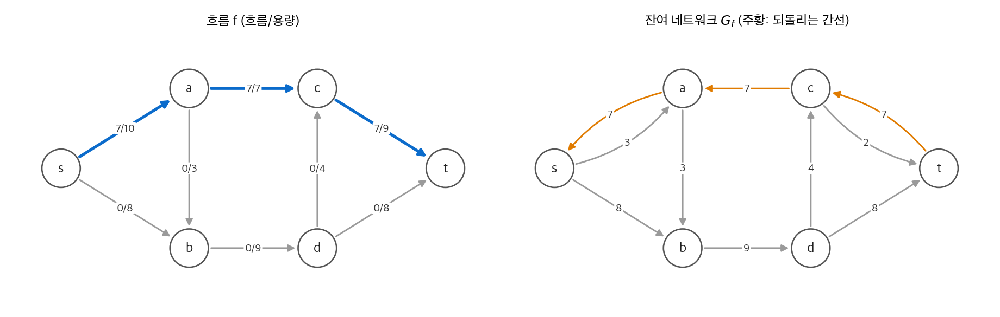
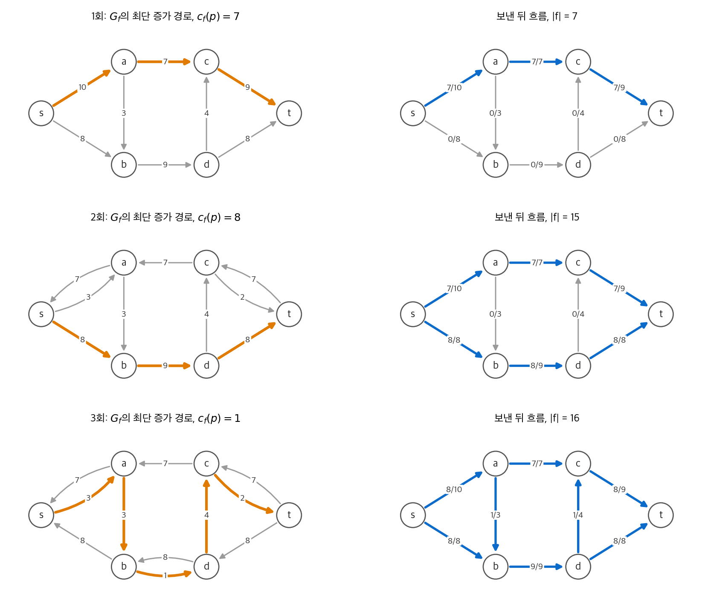
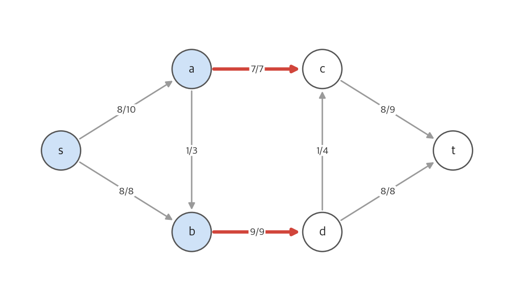
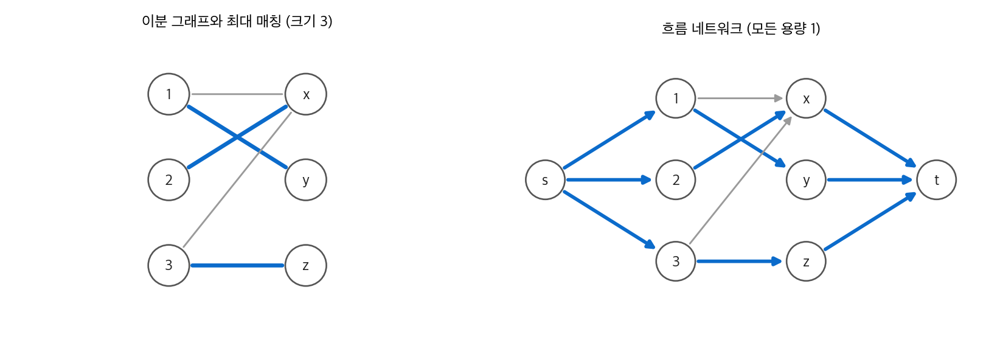

# 24. 최대 흐름

도로망의 화물, 송유관의 기름, 네트워크의 패킷처럼 무언가가 출발점에서 도착점으로 흐릅니다.
간선마다 한 번에 보낼 수 있는 양의 상한인 **용량** 이 있습니다. 정점은 받은 만큼 내보낼 뿐 쌓아 두지 않습니다.
이때 출발점에서 도착점으로 보낼 수 있는 최대량을 구하는 문제가 **최대 흐름 문제** 입니다.

이 장은 Ford-Fulkerson 방법과 그 구현인 Edmonds-Karp 알고리즘을 다룹니다.
핵심 결과는 **최대 흐름 최소 컷 정리** 입니다. 최대 흐름의 값은 출발점과 도착점을 가르는 가장 작은 컷의 용량과 같습니다.

!!! info "원문과 자료"
    - 원문: 24장 Maximum Flow (24.1 Flow networks, 24.2 The Ford-Fulkerson method, 24.3 Maximum bipartite matching)
    - 생략: 연습 문제. 장 끝 문제(탈출 문제, 최소 경로 덮개, 전문가 고용, 용량 스케일링, 전역 최소 컷 등)는 6절에서 요점만 적었습니다.
    - 함께 읽기: [20. 기본 그래프 알고리즘](20-graph-basics.md)(BFS), [25. 이분 그래프 매칭](25-bipartite-matching.md), [29. 선형 계획법](29-linear-programming.md)(최대 흐름의 LP 정식화)

## 1. 흐름 네트워크

### 정의

**흐름 네트워크** $G = (V, E)$ 는 방향 그래프입니다. 간선 $(u, v)$ 마다 용량 $c(u, v) \ge 0$ 이 있고, 간선이 없으면 $c(u, v) = 0$ 으로 둡니다.
특별한 두 정점 **출발점(source)** $s$ 와 **도착점(sink)** $t$ 가 있습니다. 모든 정점은 $s$ 에서 $t$ 로 가는 어떤 경로 위에 있다고 가정합니다.
또한 $(u, v)$ 와 $(v, u)$ 가 함께 있는 **역평행 간선** 과 자기 자신으로 가는 간선은 없다고 가정합니다.

**흐름** $f : V \times V \to \mathbb{R}$ 은 두 조건을 만족하는 함수입니다.

| 조건 | 식 | 뜻 |
| --- | --- | --- |
| 용량 제약 | $0 \le f(u, v) \le c(u, v)$ | 간선 용량을 넘지 않습니다 |
| 흐름 보존 | $\sum_{v} f(v, u) = \sum_{v} f(u, v)$, $u \in V - \{s, t\}$ | 들어온 양과 나간 양이 같습니다 |

흐름의 **값** 은 출발점에서 나간 양에서 들어온 양을 뺀 것입니다.

$$
|f| = \sum_{v \in V} f(s, v) - \sum_{v \in V} f(v, s)
$$

### 모델을 맞추는 두 가지 변환

| 상황 | 변환 |
| --- | --- |
| 역평행 간선 $(u, v)$, $(v, u)$ | 새 정점 $v'$ 을 만들어 $(u, v)$ 를 $(u, v')$, $(v', v)$ 로 나눕니다. 두 간선의 용량은 원래 용량과 같습니다 |
| 출발점·도착점이 여러 개 | 새 **초출발점** $s$ 에서 각 출발점으로, 각 도착점에서 새 **초도착점** $t$ 로 용량 $\infty$ 간선을 둡니다 |

## 2. 잔여 네트워크

### 잔여 용량

흐름 $f$ 가 있을 때, 간선을 따라 "흐름을 더 보낼 수 있는 양"과 "이미 보낸 흐름을 되돌릴 수 있는 양"을 생각합니다.
이것이 **잔여 용량** $c_f(u, v)$ 입니다.

$$
c_f(u, v) =
\begin{cases}
c(u, v) - f(u, v) & (u, v) \in E \\
f(v, u) & (v, u) \in E \\
0 & \text{그 밖}
\end{cases}
$$

역평행 간선이 없으므로 두 경우 중 하나만 해당합니다.
잔여 용량이 양수인 간선만 모은 그래프가 **잔여 네트워크** $G_f = (V, E_f)$ 입니다. $|E_f| \le 2|E|$ 입니다.

<figure markdown>

<figcaption markdown>
<span class="fig-title"><b>Figure 1.</b> 흐름과 잔여 네트워크</span>

왼쪽 흐름은 $s \to a \to c \to t$ 로 7을 보냅니다. 오른쪽 $G_f$ 에서 꽉 찬 $(a, c)$ 는 사라지고, 되돌리는 간선 $(c, a)$ 7이 생깁니다.
</figcaption>
</figure>

되돌리는 간선 $(v, u)$ 는 "이미 보낸 흐름을 취소한다"는 뜻입니다.
$u \to v$ 로 보낸 흐름을 줄이면, $u$ 는 그만큼을 다른 간선으로 보낼 수 있습니다.

### 증가

$G_f$ 의 흐름 $f'$ 이 있으면, 원래 흐름을 $f'$ 만큼 늘린 **증가(augmentation)** $f \uparrow f'$ 을 정의합니다.

$$
(f \uparrow f')(u, v) = f(u, v) + f'(u, v) - f'(v, u) \qquad (u, v) \in E
$$

정방향 잔여 간선의 흐름은 더하고, 되돌리는 간선의 흐름은 뺍니다.

**보조 정리.** $f \uparrow f'$ 은 $G$ 의 흐름이고 $|f \uparrow f'| = |f| + |f'|$ 입니다.

## 3. Ford-Fulkerson 방법

### 증가 경로

$G_f$ 에서 $s$ 에서 $t$ 로 가는 단순 경로 $p$ 를 **증가 경로(augmenting path)** 라고 합니다.
경로 위 잔여 용량의 최솟값이 $p$ 의 **잔여 용량** 입니다.

$$
c_f(p) = \min \{ c_f(u, v) : (u, v) \text{ 가 } p \text{ 위에 있다} \}
$$

$p$ 를 따라 $c_f(p)$ 만큼 보내는 $G_f$ 의 흐름을 $f_p$ 라고 하면, $f \uparrow f_p$ 의 값은 $|f| + c_f(p)$ 입니다. 흐름 값이 엄격히 늘어납니다.

Ford-Fulkerson 방법은 이 과정을 반복합니다.

```text
FORD-FULKERSON-METHOD(G, s, t)
    흐름 f를 0으로 초기화한다
    while G_f에 증가 경로 p가 있다
        f를 p를 따라 c_f(p)만큼 증가시킨다
    return f
```

"방법"이라고 부르는 이유는 증가 경로를 고르는 방법을 정하지 않았기 때문입니다. 고르는 방법에 따라 실행 시간이 크게 달라집니다.

### 컷

흐름 네트워크의 **컷** $(S, T)$ 는 $V$ 를 $s \in S$, $t \in T = V - S$ 로 나눈 것입니다.

| 양 | 정의 |
| --- | --- |
| 컷을 지나는 순흐름 | $f(S, T) = \sum_{u \in S} \sum_{v \in T} f(u, v) - \sum_{u \in S} \sum_{v \in T} f(v, u)$ |
| 컷의 용량 | $c(S, T) = \sum_{u \in S} \sum_{v \in T} c(u, v)$ |

용량은 $S$ 에서 $T$ 로 가는 간선만 셉니다. 순흐름은 거꾸로 가는 흐름을 뺍니다.

**보조 정리.** 모든 컷에서 $f(S, T) = |f|$ 입니다. 흐름 보존 때문에 $S$ 안의 정점에서 들어오고 나가는 양이 상쇄되기 때문입니다.

**따름 정리.** 모든 흐름 $f$ 와 모든 컷 $(S, T)$ 에 대해 $|f| \le c(S, T)$ 입니다.
$|f| = f(S, T) \le \sum_{u \in S, v \in T} f(u, v) \le c(S, T)$ 이기 때문입니다.

### 최대 흐름 최소 컷 정리

**정리.** 다음 세 조건은 동치입니다.

1. $f$ 는 최대 흐름입니다.
2. $G_f$ 에 증가 경로가 없습니다.
3. 어떤 컷 $(S, T)$ 에 대해 $|f| = c(S, T)$ 입니다.

증명은 순환 논법입니다.

- (1 ⇒ 2) 증가 경로가 있으면 흐름을 더 늘릴 수 있으므로 최대가 아닙니다.
- (2 ⇒ 3) $S$ 를 $G_f$ 에서 $s$ 가 도달할 수 있는 정점 집합으로 둡니다. $t \notin S$ 입니다. $u \in S$, $v \in T$ 인 원래 간선 $(u, v)$ 는 꽉 찼습니다. 아니면 $v$ 에 도달할 수 있기 때문입니다. 거꾸로 가는 간선 $(v, u)$ 의 흐름은 0입니다. 아니면 되돌리는 간선으로 $v$ 에 도달할 수 있기 때문입니다. 따라서 $|f| = f(S, T) = c(S, T)$ 입니다.
- (3 ⇒ 1) 따름 정리로 모든 흐름이 $c(S, T)$ 이하이므로, 그 값에 도달한 $f$ 는 최대입니다.

(2 ⇒ 3) 증명은 최소 컷을 찾는 방법이기도 합니다. 알고리즘이 끝난 뒤 $G_f$ 에서 BFS를 한 번 더 하면 됩니다.

### 기본 Ford-Fulkerson의 실행 시간

용량이 정수이면 증가마다 흐름 값이 1 이상 늘어납니다. 최대 흐름을 $f^*$ 라고 하면 증가는 많아야 $|f^*|$ 번입니다.
한 번의 증가는 경로 탐색 $O(E)$ 이므로 전체는 $O(E |f^*|)$ 입니다.

이 상한은 실제로 나타납니다. 정점 $s, u, v, t$ 와 간선 $s \to u$, $s \to v$, $u \to t$, $v \to t$ (용량 각각 $10^6$), $u \to v$ (용량 1) 인 네트워크를 봅니다.

- 나쁜 선택: $s \to u \to v \to t$ 와 $s \to v \to u \to t$ (되돌리는 간선 $v \to u$ 사용) 를 번갈아 고르면, 증가 한 번에 1씩 늘어 $2 \times 10^6$ 번이 걸립니다.
- 좋은 선택: $s \to u \to t$ 와 $s \to v \to t$ 를 고르면 두 번에 끝납니다.

용량이 무리수이면 Ford-Fulkerson이 끝나지 않을 수도 있고, 최대 흐름이 아닌 값으로 수렴할 수도 있습니다.

## 4. Edmonds-Karp 알고리즘

### 아이디어

증가 경로를 [20장](20-graph-basics.md)의 BFS로 찾습니다. 즉 $G_f$ 에서 간선 수가 가장 적은 경로를 고릅니다.
이렇게 하면 실행 시간이 용량과 무관하게 $O(VE^2)$ 가 됩니다.

```python
from collections import deque

def edmonds_karp(cap, s, t):
    """cap[u][v] = 용량. 최대 흐름 값을 돌려줍니다."""
    res = {u: dict(nbrs) for u, nbrs in cap.items()}
    for u in cap:
        for v in cap[u]:
            res.setdefault(v, {}).setdefault(u, 0)  # 되돌리는 간선
    flow = 0
    while True:
        par = {s: None}
        q = deque([s])
        while q and t not in par:  # BFS: 간선 수가 가장 적은 증가 경로
            u = q.popleft()
            for v, c in res[u].items():
                if c > 0 and v not in par:
                    par[v] = u
                    q.append(v)
        if t not in par:
            return flow
        path, v = [], t
        while par[v] is not None:
            path.append((par[v], v))
            v = par[v]
        cf = min(res[u][v] for u, v in path)
        for u, v in path:
            res[u][v] -= cf  # 정방향 잔여 용량 감소
            res[v][u] += cf  # 되돌리는 잔여 용량 증가
        flow += cf
```

코드는 흐름 $f$ 대신 잔여 용량 `res` 만 저장합니다. 원래 간선의 흐름은 $c(u, v)$ 에서 `res[u][v]` 를 뺀 값입니다.

### 실행 예

정점 6개, 간선 8개인 네트워크입니다. BFS는 증가 경로를 세 번 찾습니다.

<figure markdown>

<figcaption markdown>
<span class="fig-title"><b>Figure 2.</b> Edmonds-Karp 알고리즘의 실행 과정</span>

왼쪽은 잔여 네트워크와 BFS가 찾은 증가 경로(주황), 오른쪽은 그 경로로 보낸 뒤의 흐름입니다. 흐름 값은 7, 15, 16으로 늘어납니다.
</figcaption>
</figure>

| 회차 | 증가 경로 | 간선 수 | $c_f(p)$ | $\lvert f \rvert$ |
| --- | --- | --- | --- | --- |
| 1 | $s \to a \to c \to t$ | 3 | 7 | 7 |
| 2 | $s \to b \to d \to t$ | 3 | 8 | 15 |
| 3 | $s \to a \to b \to d \to c \to t$ | 5 | 1 | 16 |

세 번째 증가 뒤 $G_f$ 에서 $s$ 가 도달할 수 있는 정점은 $\{s, a, b\}$ 뿐입니다. 알고리즘이 끝납니다.
BFS가 찾는 경로 길이는 3, 3, 5로 줄지 않습니다. 이것이 아래 분석의 핵심 보조 정리입니다.

### 분석

$\delta_f(s, v)$ 를 $G_f$ 에서 $s$ 부터 $v$ 까지의 간선 수 거리라고 합시다.

**보조 정리 1.** Edmonds-Karp가 진행되는 동안 모든 정점 $v$ 의 $\delta_f(s, v)$ 는 줄지 않습니다.

증가는 최단 경로 위의 간선만 지우고, 그 간선의 반대 방향 간선만 새로 만듭니다.
새 간선 $(v, u)$ 는 거리 순서상 "뒤로 가는" 간선이라서 어떤 정점의 거리도 줄일 수 없습니다.

**보조 정리 2.** 전체 증가 횟수는 $O(VE)$ 입니다.

증가 경로에서 잔여 용량이 $c_f(p)$ 와 같은 간선을 **임계 간선** 이라고 합니다. 증가 뒤 임계 간선은 $G_f$ 에서 사라집니다.

1. $(u, v)$ 가 임계일 때 $\delta_f(s, v) = \delta_f(s, u) + 1$ 입니다.
2. $(u, v)$ 가 다시 나타나려면 $(v, u)$ 가 어떤 증가 경로에 있어야 합니다. 그때 $\delta_{f'}(s, u) = \delta_{f'}(s, v) + 1$ 입니다.
3. 보조 정리 1로 $\delta_{f'}(s, v) \ge \delta_f(s, v)$ 이므로 $\delta_{f'}(s, u) \ge \delta_f(s, u) + 2$ 입니다.
4. 거리는 $|V| - 2$ 를 넘을 수 없으므로 간선 하나가 임계가 되는 횟수는 $O(V)$ 입니다.
5. $E_f$ 의 간선 쌍은 $O(E)$ 개이고 증가마다 임계 간선이 하나 이상 있습니다. 따라서 증가는 $O(VE)$ 번입니다.

BFS 한 번이 $O(E)$ 이므로 전체 실행 시간은 $O(VE^2)$ 입니다.

### 최소 컷

<figure markdown>

<figcaption markdown>
<span class="fig-title"><b>Figure 3.</b> 최대 흐름과 최소 컷</span>

파란 정점이 $S = \{s, a, b\}$ 입니다. 컷을 지나는 빨간 간선 $(a, c)$, $(b, d)$ 는 꽉 찼고, 용량 합 $7 + 9 = 16$ 이 최대 흐름 값과 같습니다.
</figcaption>
</figure>

다른 컷과 비교하면 이 컷이 최소임을 확인할 수 있습니다.

| 컷의 $S$ | 지나는 간선 | 용량 |
| --- | --- | --- |
| $\{s\}$ | $(s, a)$ 10, $(s, b)$ 8 | 18 |
| $\{s, a, b\}$ | $(a, c)$ 7, $(b, d)$ 9 | **16** |
| $\{s, a, b, d\}$ | $(a, c)$ 7, $(d, c)$ 4, $(d, t)$ 8 | 19 |
| $V - \{t\}$ | $(c, t)$ 9, $(d, t)$ 8 | 17 |

## 5. 최대 이분 매칭

### 흐름으로 바꾸기

무방향 그래프의 **매칭** 은 끝점을 공유하지 않는 간선 집합입니다.
이분 그래프 $G = (L \cup R, E)$ 에서 크기가 가장 큰 매칭을 찾는 문제는 최대 흐름으로 풀립니다.

1. 새 정점 $s$, $t$ 를 더합니다.
2. $s$ 에서 $L$ 의 모든 정점으로, $R$ 의 모든 정점에서 $t$ 로 간선을 둡니다.
3. 원래 간선은 $L$ 에서 $R$ 방향으로 둡니다.
4. 모든 용량을 1로 둡니다.

<figure markdown>

<figcaption markdown>
<span class="fig-title"><b>Figure 4.</b> 이분 매칭과 대응하는 흐름 네트워크</span>

흐름 1이 지나는 $L \to R$ 간선(파랑)이 매칭입니다. 최대 흐름 3이 최대 매칭 $\{(1, y), (2, x), (3, z)\}$ 의 크기와 같습니다.
</figcaption>
</figure>

### 정수성 정리

흐름 값이 정수여도 각 간선의 흐름이 분수일 수 있습니다. 그러면 흐름에서 매칭을 읽을 수 없습니다.

**정리 (정수성).** 모든 용량이 정수이면, Ford-Fulkerson 방법이 찾는 최대 흐름은 모든 간선에서 정수 값을 가집니다.

증가마다 $c_f(p)$ 가 정수이므로 귀납법으로 증명됩니다.
용량이 1이면 각 간선의 흐름은 0 또는 1이고, $s$ 에서 각 $u \in L$ 로 들어오는 흐름이 1 이하라서 $u$ 는 많아야 한 간선으로 나갑니다.
따라서 흐름 1인 $L \to R$ 간선은 매칭이고, 매칭 크기는 흐름 값과 같습니다.

최대 매칭의 크기는 $\min(|L|, |R|) = O(V)$ 이하이므로 Ford-Fulkerson은 $O(VE)$ 시간에 끝납니다.
[25장](25-bipartite-matching.md)의 Hopcroft-Karp 알고리즘은 이를 $O(\sqrt{V} E)$ 로 줄입니다.

## 6. 장 끝 문제의 요점

| 문제 | 요점 |
| --- | --- |
| 탈출 문제 | 격자의 여러 시작점에서 경계까지 정점을 공유하지 않는 경로를 찾습니다. 정점을 "들어오는 정점"과 "나가는 정점"으로 나누고 그 사이 용량을 1로 두면 정점 용량 문제가 간선 용량 문제가 됩니다 |
| 최소 경로 덮개 | DAG의 정점을 가장 적은 수의 정점 서로소 경로로 덮습니다. 정점을 두 벌 복제한 이분 그래프의 최대 매칭 $M$ 에서 답은 $\lvert V \rvert - \lvert M \rvert$ 입니다 |
| 전문가 고용 | 수익이 나는 일과 비용이 드는 전문가를 고르는 문제입니다. $s \to$ 일(수익), 일 $\to$ 전문가($\infty$), 전문가 $\to t$ (비용)로 두면 최대 순이익은 수익 합에서 최소 컷 용량을 뺀 값입니다 |
| 최대 흐름 갱신 | 간선 하나의 용량이 1 늘거나 줄면, 증가 경로 한 번($O(V + E)$)으로 새 최대 흐름을 얻습니다 |
| 용량 스케일링 | 잔여 용량이 $K$ 이상인 간선만으로 증가 경로를 찾고, $K$ 를 절반씩 줄입니다. 최대 용량이 $C$ 이면 $O(E^2 \lg C)$ 입니다 |
| 가장 넓은 증가 경로 | 잔여 용량이 가장 큰 증가 경로를 고르는 변형입니다. Dijkstra와 비슷한 방법으로 경로를 찾습니다 |
| 전역 최소 컷 | $s$, $t$ 를 정하지 않은 무방향 그래프의 최소 컷입니다. 정점 하나를 고정하고 나머지 정점마다 최대 흐름을 구하는 방법보다 빠른 방법을 다룹니다 |

## 정리

- 흐름은 용량 제약과 흐름 보존을 만족합니다. 잔여 네트워크는 "더 보낼 양"과 "되돌릴 양"을 간선으로 나타냅니다.
- Ford-Fulkerson은 잔여 네트워크의 증가 경로로 흐름을 반복해서 늘립니다. 정수 용량에서 $O(E |f^*|)$ 입니다.
- 최대 흐름 최소 컷 정리: 증가 경로가 없으면 최대 흐름이고, 그 값은 최소 컷의 용량과 같습니다.
- Edmonds-Karp는 BFS로 가장 짧은 증가 경로를 골라 용량과 무관한 $O(VE^2)$ 를 보장합니다.
- 정수성 정리로 최대 이분 매칭을 단위 용량 최대 흐름으로 풉니다.
