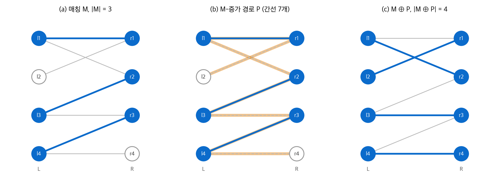
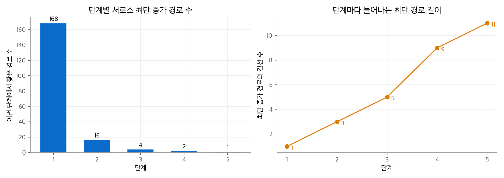
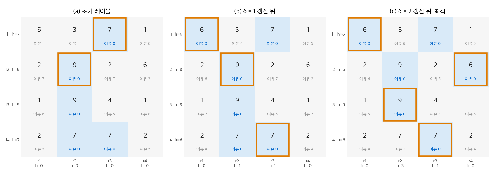

# 25. 이분 그래프 매칭

면접 일정 짜기, 전공의와 병원 배정, 작업자와 작업 배정은 모두 "두 집단을 짝짓는" 문제입니다.
이 장은 이분 그래프에서 짝을 찾는 세 알고리즘을 다룹니다.
Hopcroft-Karp 알고리즘은 짝의 **개수**를 최대로 만듭니다.
Gale-Shapley 알고리즘은 양쪽의 **선호**를 보고 누구도 이탈하지 않는 짝을 만듭니다.
헝가리안 알고리즘은 짝마다 붙은 **가중치의 합**을 최대로 만듭니다.

!!! info "원문과 자료"
    - 원문: CLRS 4판 25장 Matchings in Bipartite Graphs (25.1~25.3). 연습 문제와 장 끝 문제는 생략했습니다.
    - 전제: [24. 최대 흐름](24-max-flow.md)의 이분 매칭 환원, [20. 기본 그래프 알고리즘](20-graph-basics.md)의 BFS와 DFS
    - 본문의 예제 그래프, 선호 목록, 가중치 행렬은 새로 만든 것입니다. 모든 수치는 아래 Python 코드로 계산해 확인했습니다.

## 1. 매칭과 증가 경로

### 정의

무방향 그래프 $G = (V, E)$ 에서 **매칭(matching)** $M \subseteq E$ 은 모든 정점에 닿는 간선이 $M$ 안에 최대 하나인 간선 집합입니다.
$M$ 의 간선에 닿은 정점은 **매칭된** 정점이고, 나머지는 **매칭되지 않은** 정점입니다.
이 장의 그래프는 이분 그래프입니다. 정점 집합은 $V = L \cup R$ 로 나뉘고, 모든 간선은 $L$ 의 정점 하나와 $R$ 의 정점 하나를 잇습니다.

| 용어 | 뜻 |
| --- | --- |
| 극대 매칭(maximal) | 간선을 더 넣을 수 없는 매칭 |
| 최대 매칭(maximum) | 간선 수가 가장 많은 매칭 |
| 완전 매칭(perfect) | 모든 정점이 매칭된 매칭 |

최대 매칭은 항상 극대 매칭입니다. 극대 매칭은 최대 매칭이 아닐 수 있습니다.

### 증가 경로

**$M$-교대 경로**는 $M$ 의 간선과 $M$ 밖의 간선이 번갈아 나오는 단순 경로입니다.
**$M$-증가 경로(augmenting path)** 는 첫 간선과 마지막 간선이 모두 $M$ 밖에 있는 교대 경로입니다.
따라서 양 끝 정점은 매칭되지 않았고, 간선 수는 홀수입니다. $M$ 밖의 간선이 $M$ 안의 간선보다 하나 많습니다.

두 집합의 **대칭 차** $X \oplus Y = (X - Y) \cup (Y - X)$ 를 씁니다. 다음 보조정리가 이 장의 바탕입니다.

!!! note "보조정리 (증가 경로로 매칭 키우기)"
    $P$ 가 $M$-증가 경로이면 $M \oplus P$ 도 매칭이고 $|M \oplus P| = |M| + 1$ 입니다.
    $k$ 개의 서로소 $M$-증가 경로 $P_1, \ldots, P_k$ 가 있으면 $|M \oplus (P_1 \cup \cdots \cup P_k)| = |M| + k$ 입니다.

$P$ 위에서 "안"과 "밖"의 역할이 뒤바뀝니다. $P$ 바깥의 정점과 간선은 바뀌지 않습니다.

<figure markdown>

<figcaption markdown>
<span class="fig-title"><b>Figure 1.</b> 증가 경로로 매칭 키우기</span>

매칭되지 않은 l2와 r4를 잇는 증가 경로(주황)에서 간선의 안팎을 뒤집으면 매칭이 3개에서 4개가 됩니다.
</figcaption>
</figure>

그림의 경로는 $l_2 \to r_1 \to l_1 \to r_2 \to l_3 \to r_3 \to l_4 \to r_4$ 입니다.
간선 7개 가운데 $M$ 밖의 간선이 4개, $M$ 안의 간선이 3개입니다. 대칭 차를 취하면 밖의 4개가 매칭에 들어가고 안의 3개가 빠집니다.

### 증가 경로가 없으면 최대 매칭이다

$M^*$ 이 최대 매칭이면 $M \oplus M^*$ 을 봅니다. 이 간선 집합에서 각 정점의 차수는 2 이하입니다.
따라서 $M \oplus M^*$ 은 서로소인 경로와 짝수 길이 사이클로 나뉩니다.
사이클과 짝수 길이 경로는 두 매칭의 간선 수가 같습니다. 그러므로 $|M^*| - |M|$ 개 이상의 경로가 $M^*$ 간선을 하나 더 가지고, 이 경로가 $M$-증가 경로입니다.

!!! note "따름정리"
    매칭 $M$ 이 최대 매칭일 필요충분조건은 $G$ 에 $M$-증가 경로가 없는 것입니다.
    또한 $G$ 에는 서로소인 $M$-증가 경로가 $|M^*| - |M|$ 개 이상 있습니다.

이 사실로 단순한 알고리즘이 나옵니다. 빈 매칭에서 시작해 증가 경로를 하나씩 찾아 뒤집습니다.
증가 경로 하나는 BFS나 DFS로 $O(E)$ 에 찾습니다. 매칭 크기는 최대 $|V|/2$ 이므로 전체는 $O(VE)$ 입니다.
24장의 Ford-Fulkerson 환원과 같은 상한입니다.

## 2. Hopcroft-Karp 알고리즘

### 아이디어: 최단 증가 경로를 한꺼번에

Hopcroft-Karp는 한 번에 경로 하나가 아니라 **서로소인 최단 증가 경로의 극대 집합**을 찾아 동시에 뒤집습니다.
이 과정 한 번을 **단계(phase)** 라고 합니다. 단계 하나는 세 부분으로 이루어집니다.

1. 방향 그래프 $G_M$ 을 만듭니다. $M$ 밖의 간선은 $L \to R$, $M$ 안의 간선은 $R \to L$ 로 향하게 합니다. 그러면 $G_M$ 의 경로는 자동으로 교대 경로가 됩니다.
2. 매칭되지 않은 $L$ 정점 전체에서 동시에 BFS를 합니다. 매칭되지 않은 $R$ 정점을 처음 만나는 거리 $q$ 에서 멈춥니다. 거리가 1씩 늘어나는 간선만 남긴 층 그래프 $H$ 를 만듭니다.
3. $H$ 에서 DFS로 서로소 경로를 찾습니다. 경로를 하나 찾을 때마다 그 정점을 지웁니다. 더 찾을 수 없으면 찾은 경로를 모두 뒤집습니다.

세 부분은 모두 $O(E)$ 입니다. 따라서 한 단계는 $O(E)$ 입니다.

```python
from collections import deque

def hopcroft_karp(L, adj):
    """L: 왼쪽 정점 목록, adj[u]: u와 이웃한 오른쪽 정점 목록."""
    mL = {u: None for u in L}
    mR = {}
    while True:
        # 2. 매칭되지 않은 왼쪽 정점에서 동시에 BFS
        dist = {u: 0 for u in L if mL[u] is None}
        q = deque(dist)
        found = float("inf")
        while q:
            u = q.popleft()
            if dist[u] >= found:
                continue
            for v in adj[u]:
                w = mR.get(v)
                if w is None:
                    found = min(found, dist[u] + 1)   # 최단 증가 경로 발견
                elif w not in dist:
                    dist[w] = dist[u] + 1
                    q.append(w)
        if found == float("inf"):
            return mL                                 # 증가 경로 없음: 최대 매칭
        # 3. 층 그래프를 따라 DFS, 쓴 정점은 seen에 넣어 서로소로 만듦
        seen = set()
        def dfs(u):
            for v in adj[u]:
                if v in seen:
                    continue
                w = mR.get(v)
                if (w is None and dist[u] + 1 == found) or \
                   (w is not None and dist.get(w) == dist[u] + 1):
                    seen.add(v)
                    if w is None or dfs(w):
                        mL[u], mR[v] = v, u           # 경로를 따라 뒤집기
                        return True
            return False
        for u in L:
            if mL[u] is None:
                dfs(u)
```

### 단계 수가 $O(\sqrt{V})$ 인 이유

두 성질을 씁니다.

- **최단 경로 길이는 단계마다 늘어납니다.** 극대 집합을 뒤집은 뒤에는 같은 길이의 증가 경로가 남지 않습니다. 남은 경로는 이전 경로와 정점을 공유하므로 더 깁니다.
- **최단 경로가 길면 남은 개선량이 작습니다.** 최단 증가 경로의 간선이 $q$ 개이면 $|M^*| \le |M| + |V|/(q+1)$ 입니다. 서로소 증가 경로 $|M^*| - |M|$ 개가 각각 $q+1$ 개 이상의 정점을 쓰기 때문입니다.

$\sqrt{V}$ 단계가 지나면 $q \ge \sqrt{V}$ 입니다. 이때 남은 개선량은 $|V|/(\sqrt{V}+1) < \sqrt{V}$ 입니다.
단계마다 매칭이 하나 이상 늘어나므로 남은 단계도 $\sqrt{V}$ 개 미만입니다.

!!! note "정리 (Hopcroft-Karp)"
    Hopcroft-Karp 알고리즘은 이분 그래프에서 최대 매칭을 $O(\sqrt{V}\,E)$ 시간에 찾습니다.

### 실행 예

Figure 1의 그래프에 빈 매칭에서 시작하면 단계는 두 번입니다.
첫 단계는 길이 1인 경로 3개를 찾습니다. 둘째 단계는 길이 7인 경로 1개를 찾아 완전 매칭을 만듭니다.

더 큰 예로 왼쪽과 오른쪽에 정점이 200개씩 있고, 왼쪽 정점마다 무작위 이웃 3개를 둔 그래프를 씁니다.

| 단계 | 최단 증가 경로의 간선 수 | 찾은 경로 수 | 단계 뒤 매칭 크기 |
| --- | --- | --- | --- |
| 1 | 1 | 168 | 168 |
| 2 | 3 | 16 | 184 |
| 3 | 5 | 4 | 188 |
| 4 | 9 | 2 | 190 |
| 5 | 11 | 1 | 191 |

<figure markdown>

<figcaption markdown>
<span class="fig-title"><b>Figure 2.</b> Hopcroft-Karp의 단계별 진행</span>

대부분의 매칭은 첫 단계에서 정해지고, 뒤 단계로 갈수록 경로는 길어지고 개수는 줄어듭니다.
</figcaption>
</figure>

경로를 하나씩 뒤집는 방법은 191번 탐색합니다. Hopcroft-Karp는 같은 결과를 5단계로 얻습니다.
최단 경로 길이가 1, 3, 5, 9, 11로 엄격히 늘어나는 것도 첫 번째 성질과 맞습니다.

## 3. 안정 결혼 문제

### 문제 정의

양쪽 집단의 크기가 $n$ 으로 같고, 모든 구성원이 상대 집단 전체에 순위를 매깁니다.
원문은 여성과 남성으로 설명합니다. 이 노트는 제안하는 쪽을 $A$, 제안받는 쪽을 $B$ 라고 부릅니다.

완전 매칭 $M$ 에서 다음 두 조건을 모두 만족하는 쌍 $(a, b)$ 를 **불안정 쌍(blocking pair)** 이라고 합니다.

- $a$ 와 $b$ 는 서로 짝이 아닙니다.
- $a$ 는 자기 짝보다 $b$ 를 선호하고, $b$ 도 자기 짝보다 $a$ 를 선호합니다.

불안정 쌍이 없는 완전 매칭이 **안정 매칭(stable matching)** 입니다. 불안정 쌍은 현재 짝을 버리고 둘이 짝을 지을 동기가 있습니다.

### Gale-Shapley 알고리즘

1. 모든 구성원이 짝이 없는 상태에서 시작합니다.
2. 짝이 없는 $a$ 하나를 고릅니다. $a$ 는 아직 제안하지 않은 $b$ 가운데 가장 선호하는 $b$ 에게 제안합니다.
3. $b$ 가 짝이 없으면 제안을 받아들여 약혼합니다.
4. $b$ 가 약혼 중이면 현재 상대와 $a$ 를 비교합니다. $a$ 를 더 선호하면 현재 상대와 파혼하고 $a$ 와 약혼합니다. 아니면 $a$ 를 거절합니다.
5. 짝이 없는 $a$ 가 남지 않을 때까지 2~4를 반복합니다.

```python
from collections import deque

def gale_shapley(pref_a, pref_b):
    rank = {b: {a: i for i, a in enumerate(p)} for b, p in pref_b.items()}
    nxt = {a: 0 for a in pref_a}       # a가 다음에 제안할 순위
    engaged = {}                       # b -> a
    free = deque(pref_a)
    while free:
        a = free.popleft()
        b = pref_a[a][nxt[a]]
        nxt[a] += 1
        if b not in engaged:
            engaged[b] = a
        elif rank[b][a] < rank[b][engaged[b]]:
            free.append(engaged[b])    # 이전 상대는 다시 짝이 없음
            engaged[b] = a
        else:
            free.append(a)             # 거절
    return {a: b for b, a in engaged.items()}
```

$a$ 는 같은 $b$ 에게 두 번 제안하지 않습니다. 따라서 제안은 최대 $n^2$ 번이고, 위 구현은 $O(n^2)$ 입니다.

### 실행 예

| 구성원 | 선호 순서 (왼쪽이 1순위) |
| --- | --- |
| A1 | B2, B1, B3 |
| A2 | B2, B3, B1 |
| A3 | B2, B1, B3 |
| B1 | A1, A3, A2 |
| B2 | A3, A2, A1 |
| B3 | A2, A1, A3 |

| 순서 | 제안 | 결과 |
| --- | --- | --- |
| 1 | A1 → B2 | B2가 짝이 없어 수락 |
| 2 | A2 → B2 | B2가 A1보다 A2를 선호해 수락, A1 파혼 |
| 3 | A3 → B2 | B2가 A2보다 A3을 선호해 수락, A2 파혼 |
| 4 | A1 → B1 | 수락 |
| 5 | A2 → B3 | 수락 |

결과는 $\{(A1, B1), (A2, B3), (A3, B2)\}$ 입니다. 6쌍 모두를 확인하면 불안정 쌍이 없습니다.
예를 들어 A1은 B1보다 B2를 선호하지만, B2는 A1보다 현재 짝 A3을 선호합니다.

### 정확성

- **종료와 완전 매칭:** 짝이 없는 $a$ 가 있으면 짝이 없는 $b$ 도 있습니다. 한 번 약혼한 $b$ 는 계속 약혼 상태이므로, 그 $b$ 는 아직 제안을 받지 않았습니다. 따라서 $a$ 의 목록이 모두 소진되는 일은 없습니다.
- **안정성:** $a$ 가 현재 짝 $b'$ 보다 $b$ 를 선호한다고 합시다. 그러면 $a$ 는 $b'$ 보다 먼저 $b$ 에게 제안했습니다. $b$ 는 그때 거절했거나 나중에 파혼했습니다. 두 경우 모두 $b$ 는 $a$ 보다 선호하는 상대와 약혼했습니다. $b$ 의 상대는 갈수록 좋아지므로 $(a, b)$ 는 불안정 쌍이 아닙니다.

### 제안하는 쪽이 유리하다

!!! note "정리"
    제안 순서와 관계없이 Gale-Shapley는 항상 같은 안정 매칭을 돌려줍니다.
    이 매칭에서 모든 $a$ 는 "어떤 안정 매칭에서든 얻을 수 있는 가장 좋은 짝"을 얻습니다.
    반대로 모든 $b$ 는 안정 매칭 가운데 가장 나쁜 짝을 얻습니다.

선호가 다음과 같은 3명씩의 예에서는 안정 매칭이 3개 있습니다.

| 구성원 | 선호 순서 | 구성원 | 선호 순서 |
| --- | --- | --- | --- |
| A1 | B1, B2, B3 | B1 | A2, A3, A1 |
| A2 | B2, B3, B1 | B2 | A3, A1, A2 |
| A3 | B3, B1, B2 | B3 | A1, A2, A3 |

| 안정 매칭 | A 쪽 순위 | B 쪽 순위 |
| --- | --- | --- |
| (A1,B1), (A2,B2), (A3,B3) | 모두 1순위 | 모두 3순위 |
| (A1,B2), (A2,B3), (A3,B1) | 모두 2순위 | 모두 2순위 |
| (A1,B3), (A2,B1), (A3,B2) | 모두 3순위 | 모두 1순위 |

A 쪽이 제안하면 첫째 매칭이, B 쪽이 제안하면 셋째 매칭이 나옵니다. 둘째 매칭은 어느 쪽이 제안해도 나오지 않습니다.
미국 전공의 배정 프로그램(NRMP)이 1990년대에 학생이 제안하는 방식으로 바꾼 이유가 이 비대칭입니다.

## 4. 헝가리안 알고리즘과 할당 문제

### 할당 문제

$|L| = |R| = n$ 이고 모든 $l, r$ 사이에 가중치 $w(l, r)$ 가 있는 완전 이분 그래프를 봅니다.
**할당 문제(assignment problem)** 는 가중치 합이 최대인 완전 매칭을 찾는 문제입니다.
모든 순열을 보면 $n!$ 개입니다. 헝가리안 알고리즘은 이 문제를 다항 시간에 풉니다.

### 실현 가능한 정점 레이블과 동등 부분 그래프

정점마다 값 $h$ 를 붙입니다. 모든 간선에서 다음 부등식이 성립하면 $h$ 를 **실현 가능한 정점 레이블(feasible vertex labeling)** 이라고 합니다.

$$
l.h + r.h \ge w(l, r) \qquad \text{for all } l \in L,\ r \in R
$$

$l.h = \max_r w(l, r)$, $r.h = 0$ 인 기본 레이블은 항상 실현 가능합니다.
등호가 성립하는 간선만 모은 그래프 $G_h$ 를 **동등 부분 그래프(equality subgraph)** 라고 합니다.
이 노트는 $l.h + r.h - w(l, r)$ 를 그 간선의 **여유(slack)** 라고 부릅니다. $G_h$ 의 간선은 여유가 0인 간선입니다.

!!! note "정리"
    $G_h$ 에 완전 매칭 $M^*$ 이 있으면 $M^*$ 은 할당 문제의 최적해입니다.

증명은 두 줄입니다. 임의의 완전 매칭 $M$ 은 모든 정점을 한 번씩 쓰므로 다음이 성립합니다.

$$
w(M) = \sum_{(l,r) \in M} w(l, r) \le \sum_{(l,r) \in M} (l.h + r.h) = \sum_{v \in V} v.h
$$

$M^*$ 의 간선은 모두 등호를 만족하므로 $w(M^*) = \sum_v v.h$ 입니다. 따라서 $M^*$ 은 상한에 닿습니다.
레이블의 합은 쌍대 문제의 목적 함수입니다. 이 구조는 [29. 선형 계획법](29-linear-programming.md)의 쌍대성과 같습니다.

### 알고리즘

1. 기본 레이블과 $G_h$ 안의 임의 매칭(빈 매칭도 됩니다)에서 시작합니다.
2. Hopcroft-Karp처럼 $G_h$ 의 간선에 방향을 줍니다. 매칭되지 않은 $L$ 정점들에서 BFS를 시작합니다. BFS 숲의 정점 집합을 $F_L \subseteq L$, $F_R \subseteq R$ 이라고 합니다.
3. 매칭되지 않은 $R$ 정점에 닿으면 증가 경로를 뒤집고 2로 돌아갑니다.
4. 숲이 더 자라지 않으면 레이블을 고칩니다. $F_L$ 에서 $R - F_R$ 로 가는 간선의 최소 여유를 $\delta$ 라고 합니다.

    $$
    \delta = \min \{\, l.h + r.h - w(l, r) : l \in F_L,\ r \in R - F_R \,\}
    $$

    모든 $l \in F_L$ 에서 $l.h$ 를 $\delta$ 만큼 줄이고, 모든 $r \in F_R$ 에서 $r.h$ 를 $\delta$ 만큼 늘립니다. 그리고 BFS를 이어 갑니다.
5. 완전 매칭이 될 때까지 반복합니다.

$\delta$ 갱신의 효과는 다음과 같습니다.

| 간선 종류 | 여유의 변화 | 결과 |
| --- | --- | --- |
| $F_L \to F_R$ | $-\delta + \delta = 0$ | 숲의 간선과 매칭 간선이 그대로 남습니다. |
| $F_L \to R - F_R$ | $-\delta$ | 최소 여유인 간선이 0이 되어 $G_h$ 에 새로 들어옵니다. |
| $L - F_L \to F_R$ | $+\delta$ | $G_h$ 에서 빠질 수 있지만 숲과 매칭에는 영향이 없습니다. |
| $L - F_L \to R - F_R$ | 0 | 바뀌지 않습니다. |

여유는 음수가 되지 않으므로 레이블은 계속 실현 가능합니다. 레이블 합은 $|F_L| > |F_R|$ 이므로 $\delta(|F_L| - |F_R|)$ 만큼 줄어듭니다.

### 실행 예

가중치 행렬 $W$ 의 행은 $l_1, \ldots, l_4$, 열은 $r_1, \ldots, r_4$ 입니다.

$$
W = \begin{bmatrix} 6 & 3 & 7 & 1 \\ 2 & 9 & 2 & 6 \\ 1 & 9 & 4 & 1 \\ 2 & 7 & 7 & 2 \end{bmatrix}
$$

1. 기본 레이블은 행 최댓값 $l.h = (7, 9, 9, 7)$, $r.h = (0, 0, 0, 0)$ 입니다. 레이블 합은 32입니다.
2. $G_h$ 에서 $(l_1, r_3)$ 과 $(l_2, r_2)$ 를 매칭합니다.
3. $l_3$ 과 $l_4$ 에서 BFS를 하면 $F_L = \{l_1, l_2, l_3, l_4\}$, $F_R = \{r_2, r_3\}$ 에서 멈춥니다. $r_1, r_4$ 로 가는 최소 여유는 $\delta = 1$ 입니다.
4. 갱신 뒤 $l.h = (6, 8, 8, 6)$, $r.h = (0, 1, 1, 0)$ 입니다. $(l_1, r_1)$ 의 여유가 0이 됩니다. 증가 경로 $l_4 \to r_3 \to l_1 \to r_1$ 을 뒤집어 매칭이 3개가 됩니다.
5. $l_3$ 에서 BFS를 하면 $F_L = \{l_2, l_3\}$, $F_R = \{r_2\}$ 에서 멈춥니다. 최소 여유는 $(l_2, r_4)$ 의 2입니다. $\delta = 2$ 로 갱신합니다.
6. $l.h = (6, 6, 6, 6)$, $r.h = (0, 3, 1, 0)$ 입니다. 증가 경로 $l_3 \to r_2 \to l_2 \to r_4$ 를 뒤집으면 완전 매칭입니다.

<figure markdown>

<figcaption markdown>
<span class="fig-title"><b>Figure 3.</b> 헝가리안 알고리즘의 레이블 갱신</span>

파란 칸은 여유가 0인 동등 부분 그래프의 간선, 주황 테두리는 현재 매칭입니다. δ 갱신마다 새 간선이 들어옵니다.
</figcaption>
</figure>

최종 매칭은 $(l_1, r_1), (l_2, r_4), (l_3, r_2), (l_4, r_3)$ 이고 가중치 합은 $6 + 6 + 9 + 7 = 28$ 입니다.
레이블 합도 $6 \times 4 + 0 + 3 + 1 + 0 = 28$ 입니다. 상한과 같으므로 최적입니다. 24개 순열을 모두 확인해도 최댓값은 28입니다.

### 실행 시간

증가 경로를 한 번 찾는 동안 $\delta$ 갱신은 최대 $n$ 번입니다. 갱신마다 $F_R$ 에 정점이 하나 이상 들어가기 때문입니다.
$\delta$ 를 매번 모든 간선에서 다시 구하면 갱신 하나가 $O(n^2)$ 이고, 증가 경로 $n$ 개에 걸쳐 $O(n^4)$ 입니다.
$R - F_R$ 의 정점마다 "$F_L$ 에서 오는 최소 여유"를 저장하고 BFS 중에 고치면 갱신 하나가 $O(n)$ 이 됩니다. 이렇게 하면 전체가 $O(n^3)$ 입니다.

## 정리

| 문제 | 알고리즘 | 핵심 도구 | 실행 시간 |
| --- | --- | --- | --- |
| 최대 매칭 | Hopcroft-Karp | 서로소 최단 증가 경로를 한 단계에 모두 뒤집기 | $O(\sqrt{V}\,E)$ |
| 안정 매칭 | Gale-Shapley | 선호 순서대로 제안하고, 받는 쪽은 더 나은 상대만 수락 | $O(n^2)$ |
| 최대 가중치 완전 매칭 | 헝가리안 | 실현 가능한 레이블, 동등 부분 그래프, $\delta$ 갱신 | $O(n^3)$ |

세 알고리즘 모두 증가 경로나 제안처럼 **현재 해를 조금씩 고치는 연산**과, 그 연산이 끝나면 최적이라는 **증명서**를 함께 씁니다.
Hopcroft-Karp의 증명서는 "증가 경로가 없음", 헝가리안의 증명서는 "레이블 합이 매칭 가중치와 같음"입니다.
