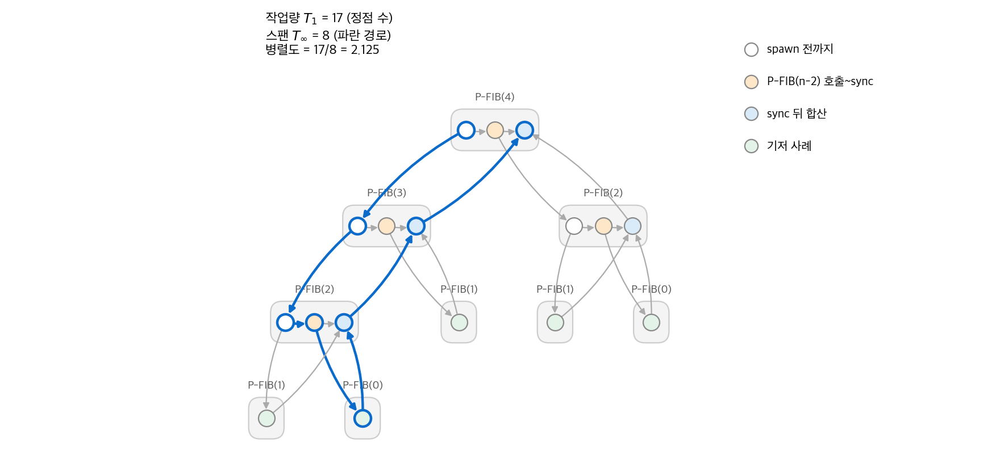
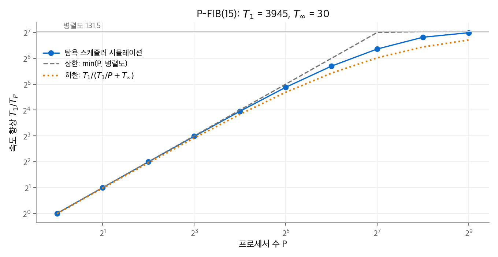
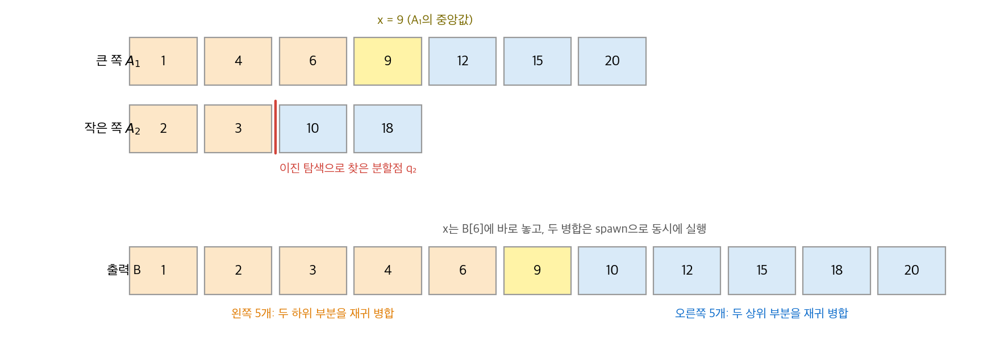

# 26. 병렬 알고리즘

지금의 노트북에도 코어가 여러 개 있습니다. 이 장은 여러 프로세서가 메모리를 공유하는 컴퓨터에서 쓰는 알고리즘을 다룹니다.
프로그래머는 "어떤 일을 동시에 해도 되는지"만 적고, 실제 배치는 스케줄러가 정합니다.
이 방식을 **포크-조인 병렬성(fork-join parallelism)** 이라고 합니다.
분석 도구는 두 숫자입니다. 전체 일의 양인 **작업량(work)** 과 가장 긴 의존 사슬인 **스팬(span)** 입니다.

!!! info "원문과 자료"
    - 원문: CLRS 4판 26장 Parallel Algorithms (26.1~26.3). 연습 문제와 장 끝 문제는 생략했습니다.
    - 전제: [2. 삽입 정렬과 병합 정렬](02-getting-started.md)의 병합 정렬, [4. 분할 정복](04-divide-and-conquer.md)의 행렬 곱셈과 마스터 정리
    - 본문의 trace 그림, 스케줄러 시뮬레이션, 병합 예시는 새로 만든 것입니다. 수치는 Python으로 계산해 확인했습니다.

## 1. 포크-조인 모델

### 세 키워드

직렬 의사 코드에 키워드 세 개를 더합니다.

| 키워드 | 뜻 |
| --- | --- |
| `spawn` | 호출한 함수가 끝나기를 기다리지 않고 다음 줄을 실행해도 됩니다. 자식과 부모가 동시에 실행될 **수 있습니다**. |
| `sync` | 이 함수가 spawn한 자식이 모두 끝날 때까지 기다립니다. |
| `parallel for` | 반복끼리 서로 독립이므로 모든 반복을 동시에 실행해도 됩니다. |

키워드는 **논리적 병렬성**만 나타냅니다. 실제로 동시에 실행할지는 런타임 스케줄러가 정합니다.
키워드를 모두 지우면 원래의 직렬 프로그램이 됩니다. 이 직렬 프로그램을 **직렬 투영(serial projection)** 이라고 합니다.
경쟁 조건이 없으면 병렬 프로그램의 결과는 직렬 투영의 결과와 같습니다.

예제는 피보나치 수를 계산하는 P-FIB입니다. 피보나치 수를 구하는 좋은 방법은 아니지만 개념을 보여 주기에 좋습니다.

```text
P-FIB(n)
1  if n ≤ 1
2      return n
3  else x = spawn P-FIB(n − 1)    // 자식을 기다리지 않음
4       y = P-FIB(n − 2)          // 자식과 동시에 실행될 수 있음
5       sync                      // x를 쓰기 전에 기다림
6       return x + y
```

5행의 `sync` 가 없으면 6행이 아직 계산되지 않은 `x` 를 읽을 수 있습니다.

### 실행 trace

병렬 실행은 방향 비순환 그래프(DAG)로 그립니다. 이 그래프를 **trace** 라고 합니다.
정점은 **가닥(strand)** 입니다. 가닥은 `spawn`, `sync`, 호출, 반환을 포함하지 않는 명령어의 연속입니다.
간선 $(u, v)$ 는 "$u$ 가 끝나야 $v$ 를 시작할 수 있다"를 뜻합니다.
P-FIB($n$) 한 번은 $n \ge 2$ 이면 가닥 3개로 나뉩니다. 3행의 spawn까지, 4~5행, 6행입니다.

<figure markdown>

<figcaption markdown>
<span class="fig-title"><b>Figure 1.</b> P-FIB(4)의 실행 trace</span>

회색 상자는 함수 호출 하나이고 원은 가닥입니다. 파란 경로가 가장 긴 경로(임계 경로)이며 가닥 8개로 이루어집니다.
</figcaption>
</figure>

## 2. 작업량, 스팬, 병렬도

### 정의

$T_P$ 를 프로세서 $P$ 개에서의 실행 시간이라고 합니다. 가닥마다 실행 시간이 붙어 있다고 봅니다.

- **작업량** $T_1$: 모든 가닥의 시간 합입니다. 프로세서 1개에서의 실행 시간과 같습니다.
- **스팬** $T_\infty$: trace에서 가장 긴 경로의 시간 합입니다. 프로세서가 무한히 많아도 이 시간보다 빠를 수 없습니다. 이 경로를 **임계 경로(critical path)** 라고 합니다.

Figure 1의 가닥이 모두 단위 시간이면 $T_1 = 17$, $T_\infty = 8$ 입니다.

### 두 법칙

프로세서 $P$ 개는 한 단계에 최대 $P$ 단위의 일을 합니다. 임계 경로의 가닥은 차례로만 실행할 수 있습니다.
이 두 사실이 다음 두 법칙입니다.

$$
\text{작업량 법칙: } T_P \ge \frac{T_1}{P}, \qquad \text{스팬 법칙: } T_P \ge T_\infty
$$

**속도 향상(speedup)** 은 $T_1 / T_P$ 입니다. 작업량 법칙에 따라 속도 향상은 $P$ 를 넘지 못합니다.
속도 향상이 $\Theta(P)$ 이면 **선형 속도 향상**, 정확히 $P$ 이면 **완전 선형 속도 향상**이라고 합니다.

**병렬도(parallelism)** 는 $T_1 / T_\infty$ 입니다. 세 가지로 읽을 수 있습니다.

- 임계 경로의 한 단계마다 평균적으로 동시에 할 수 있는 일의 양입니다.
- 프로세서가 아무리 많아도 얻을 수 있는 속도 향상의 상한입니다. 스팬 법칙에서 $T_1/T_P \le T_1/T_\infty$ 입니다.
- 완전 선형 속도 향상이 가능한 프로세서 수의 한계입니다. $P$ 가 병렬도보다 크면 완전 선형 속도 향상은 불가능합니다.

P-FIB(4)의 병렬도는 $17/8 = 2.125$ 입니다. 프로세서를 3개 이상 써도 속도는 2.125배를 넘지 못합니다.

**병렬 여유(parallel slackness)** 는 $(T_1/T_\infty)/P$ 입니다. 병렬도가 프로세서 수의 몇 배인지를 나타냅니다.
이 값이 1보다 작으면 완전 선형 속도 향상은 불가능합니다.

### 직렬 합성과 병렬 합성

두 부분 trace를 이어 붙이면 작업량은 항상 더합니다. 스팬은 연결 방식에 따라 다릅니다.

| 합성 | 작업량 | 스팬 |
| --- | --- | --- |
| 직렬 (A 다음 B) | $T_1(A) + T_1(B)$ | $T_\infty(A) + T_\infty(B)$ |
| 병렬 (A와 B 동시) | $T_1(A) + T_1(B)$ | $\max(T_\infty(A), T_\infty(B))$ |

P-FIB에 적용합니다. 작업량은 직렬 투영의 실행 시간이므로 $T_1(n) = \Theta(\phi^n)$ 입니다. $\phi = (1+\sqrt{5})/2$ 는 황금비입니다.
두 재귀 호출은 병렬이므로 스팬은 큰 쪽만 셉니다.

$$
T_\infty(n) = \max(T_\infty(n-1), T_\infty(n-2)) + \Theta(1) = T_\infty(n-1) + \Theta(1) = \Theta(n)
$$

병렬도는 $\Theta(\phi^n / n)$ 입니다. $n$ 이 조금만 커도 병렬도는 프로세서 수보다 훨씬 커집니다.

| $n$ | 작업량 $T_1$ (가닥 수) | 스팬 $T_\infty$ | 병렬도 |
| --- | --- | --- | --- |
| 4 | 17 | 8 | 2.1 |
| 10 | 353 | 20 | 17.7 |
| 15 | 3,945 | 30 | 131.5 |

## 3. 탐욕 스케줄러

### 스케줄러가 하는 일

스케줄러는 매 단계 실행할 가닥을 고릅니다. 앞선 가닥이 모두 끝난 가닥이 **준비된** 가닥입니다.
**탐욕 스케줄러(greedy scheduler)** 는 매 단계 가능한 한 많은 가닥을 프로세서에 배정합니다.

- **완전 단계:** 준비된 가닥이 $P$ 개 이상입니다. 아무거나 $P$ 개를 실행합니다.
- **불완전 단계:** 준비된 가닥이 $P$ 개 미만입니다. 모두 실행합니다.

!!! note "정리 (탐욕 스케줄러의 상한)"
    프로세서 $P$ 개에서 탐욕 스케줄러는 작업량 $T_1$, 스팬 $T_\infty$ 인 계산을 다음 시간 안에 끝냅니다.

    $$
    T_P \le \frac{T_1}{P} + T_\infty
    $$

완전 단계는 단계마다 $P$ 단위의 일을 하므로 $T_1/P$ 번을 넘지 않습니다.
불완전 단계는 준비된 가닥을 모두 실행합니다. 남은 trace의 가장 긴 경로는 항상 준비된 가닥에서 시작하므로, 불완전 단계마다 남은 스팬이 1 줄어듭니다. 따라서 불완전 단계는 $T_\infty$ 번을 넘지 않습니다.

두 법칙에서 최적 실행 시간 $T_P^*$ 는 $\max(T_1/P, T_\infty)$ 이상입니다. 탐욕 스케줄러의 시간은 그 합 이하입니다.

$$
T_P \le \frac{T_1}{P} + T_\infty \le 2 \max\!\left(\frac{T_1}{P}, T_\infty\right) \le 2\,T_P^*
$$

따라서 탐욕 스케줄러는 항상 최적의 2배 안에 듭니다.
또한 병렬 여유가 크면, 즉 $P \ll T_1/T_\infty$ 이면 $T_\infty$ 항이 작아져 $T_P \approx T_1/P$ 입니다. 완전 선형 속도 향상에 가깝습니다.
경험적으로 병렬 여유가 10 이상이면 좋은 속도 향상을 얻습니다.

### 시뮬레이션

P-FIB(15)의 trace에 탐욕 스케줄러를 직접 돌린 결과입니다. 가닥은 모두 단위 시간입니다.

| $P$ | $T_P$ (시뮬레이션) | 하한 $\max(T_1/P, T_\infty)$ | 상한 $T_1/P + T_\infty$ |
| --- | --- | --- | --- |
| 1 | 3,945 | 3,945 | 3,975 |
| 8 | 499 | 493.1 | 523.1 |
| 32 | 134 | 123.3 | 153.3 |
| 128 | 48 | 30.8 | 60.8 |

<figure markdown>

<figcaption markdown>
<span class="fig-title"><b>Figure 2.</b> 탐욕 스케줄러의 속도 향상</span>

프로세서가 병렬도(131.5)보다 훨씬 적으면 속도 향상은 거의 P이고, 병렬도에 가까워지면 상한에서 멀어집니다.
</figcaption>
</figure>

실제 런타임(Cilk, Java Fork/Join, Intel TBB 등)은 **작업 훔치기(work stealing)** 로 탐욕 스케줄러를 근사합니다.
일이 없는 프로세서가 다른 프로세서의 대기열에서 일을 가져옵니다.

## 4. 병렬 반복문과 경쟁 조건

### parallel for의 스팬

행렬-벡터 곱 $y = Ax$ 를 봅니다. $A$ 는 $n \times n$ 행렬입니다.

```text
P-MAT-VEC(A, x, y, n)
1  parallel for i = 1 to n        // 행마다 독립
2      for j = 1 to n             // 한 행 안은 직렬
3          y[i] = y[i] + a[i][j] · x[j]
```

컴파일러는 `parallel for` 를 분할 정복 재귀로 바꿉니다. 반복 범위를 반으로 나누어 한쪽을 spawn하고 다른 쪽을 직접 호출합니다.
이 재귀 트리의 깊이가 $\Theta(\lg n)$ 이므로 반복문 제어 자체의 스팬이 $\Theta(\lg n)$ 입니다.

$$
T_\infty = \Theta(\lg n) + \max_{1 \le i \le n} (\text{반복 } i \text{의 스팬})
$$

P-MAT-VEC의 반복 하나는 직렬 반복문이라 스팬이 $\Theta(n)$ 입니다. 전체 스팬은 $\Theta(\lg n) + \Theta(n) = \Theta(n)$ 입니다.
작업량은 $\Theta(n^2)$ 이므로 병렬도는 $\Theta(n)$ 입니다.

### 결정성 경쟁

**결정성 경쟁(determinacy race)** 은 논리적으로 병렬인 두 명령어가 같은 메모리 위치에 접근하고, 그 가운데 하나 이상이 쓰기일 때 생깁니다.

```text
RACE-EXAMPLE()
1  x = 0
2  parallel for i = 1 to 2
3      x = x + 1                  // 읽기, 더하기, 쓰기의 세 단계
4  print x
```

두 반복이 모두 `x = 0` 을 읽은 뒤 각자 1을 쓰면 결과는 2가 아니라 1입니다.
대부분의 실행 순서에서는 2가 나오므로 이런 버그는 재현하기 어렵습니다.
앞의 P-MAT-VEC은 반복 $i$ 가 `y[i]` 에만 쓰므로 경쟁이 없습니다. 안쪽 반복문까지 `parallel for` 로 바꾸면 같은 `y[i]` 에 여러 반복이 동시에 쓰게 되어 경쟁이 생깁니다.

## 5. 병렬 행렬 곱셈

### 반복문 병렬화

$C = C + AB$ 를 계산하는 세 겹 반복문에서 바깥 두 반복문만 `parallel for` 로 바꿉니다.
안쪽 반복문은 같은 $c_{ij}$ 에 누적하므로 직렬로 둡니다.
작업량은 $\Theta(n^3)$, 스팬은 $\Theta(\lg n) + \Theta(\lg n) + \Theta(n) = \Theta(n)$ 입니다. 병렬도는 $\Theta(n^2)$ 입니다.

### 분할 정복 병렬화

4장의 재귀 행렬 곱셈은 $n/2 \times n/2$ 블록 곱 8개로 나뉩니다.
P-MATRIX-MULTIPLY-RECURSIVE는 이 8개를 모두 spawn합니다. 같은 $C$ 블록에 두 곱이 동시에 쓰면 경쟁이 생깁니다. 그래서 4개는 $C$ 에, 나머지 4개는 임시 행렬 $D$ 에 씁니다.
`sync` 뒤에 두 겹 `parallel for` 로 $D$ 를 $C$ 에 더합니다.

$$
\begin{aligned}
M_1(n) &= 8\,M_1(n/2) + \Theta(n^2) = \Theta(n^3) \\
M_\infty(n) &= M_\infty(n/2) + \Theta(\lg n) = \Theta(\lg^2 n)
\end{aligned}
$$

스팬 재귀식의 $\Theta(\lg n)$ 은 $D$ 를 0으로 만들고 더하는 `parallel for` 의 제어 비용입니다.
병렬도는 $\Theta(n^3 / \lg^2 n)$ 으로 매우 큽니다. 1000 × 1000 행렬이면 상수를 무시해도 $10^7$ 정도입니다.
Strassen 방법도 같은 방식으로 병렬화하면 작업량 $\Theta(n^{\lg 7})$, 스팬 $\Theta(\lg^2 n)$ 입니다.

## 6. 병렬 병합 정렬

### 단순 병렬화의 한계

병합 정렬의 두 재귀 호출을 spawn하고 병합은 직렬 MERGE로 두면 스팬은 다음과 같습니다.

$$
T_\infty(n) = T_\infty(n/2) + \Theta(n) = \Theta(n)
$$

작업량은 $\Theta(n \lg n)$ 이므로 병렬도는 $\Theta(\lg n)$ 에 그칩니다. $n$ 이 10억이어도 병렬도가 30 정도라 프로세서 수십 개를 넘으면 효과가 없습니다.
병목은 $\Theta(n)$ 스팬을 가진 직렬 병합입니다.

### 병렬 병합 P-MERGE

두 정렬된 배열을 병합하는 일도 분할 정복으로 나눌 수 있습니다.

1. 두 배열 가운데 큰 쪽의 중앙값 $x$ 를 고릅니다. 큰 쪽 배열은 $x$ 를 기준으로 반으로 나뉩니다.
2. 작은 쪽 배열에서 이진 탐색으로 분할점을 찾습니다. 분할점 앞은 모두 $x$ 이하, 뒤는 모두 $x$ 이상입니다. 비용은 $\Theta(\lg n)$ 입니다.
3. $x$ 의 최종 위치는 "$x$ 이하인 원소 수"로 정해집니다. 출력 배열의 그 위치에 $x$ 를 놓습니다.
4. 두 하위 부분의 병합과 두 상위 부분의 병합을 spawn으로 동시에 실행합니다.

<figure markdown>

<figcaption markdown>
<span class="fig-title"><b>Figure 3.</b> P-MERGE의 분할</span>

큰 쪽의 중앙값 9로 두 배열을 나누면, 왼쪽 5개와 오른쪽 5개를 서로 독립인 두 병합으로 처리할 수 있습니다.
</figcaption>
</figure>

```python
from bisect import bisect_left

def p_merge(a, b, out, lo):
    """정렬된 a, b를 out[lo : lo+len(a)+len(b)]에 병합합니다."""
    if len(a) < len(b):
        a, b = b, a                       # a를 큰 쪽으로
    if not a:
        return
    q1 = len(a) // 2
    x = a[q1]                             # 큰 쪽의 중앙값
    q2 = bisect_left(b, x)                # 작은 쪽의 분할점, Θ(lg n)
    q3 = lo + q1 + q2                     # x의 최종 위치
    out[q3] = x
    # 두 병합은 서로 다른 out 구간에 쓰므로 경쟁이 없음 (spawn에 해당)
    p_merge(a[:q1], b[:q2], out, lo)
    p_merge(a[q1 + 1:], b[q2:], out, q3 + 1)
```

Python의 스레드는 실제 속도 향상을 거의 주지 않으므로, 위 코드는 재귀 구조만 보여 줍니다.
두 재귀 호출이 출력 배열의 겹치지 않는 구간에 쓰는 것이 경쟁이 없는 이유입니다.

### 분석

큰 쪽 배열의 크기를 $n_1$, 작은 쪽을 $n_2 \le n_1$, $n = n_1 + n_2$ 라고 합니다.
분할점이 최악이어도 각 재귀 병합은 큰 쪽 배열의 절반을 버립니다. 버린 원소 수는 $n_1/2 \ge n/4$ 이므로 각 재귀의 크기는 $3n/4$ 이하입니다.

$$
T_\infty(n) \le T_\infty(3n/4) + \Theta(\lg n) = \Theta(\lg^2 n)
$$

작업량은 $T_1(n) = T_1(\alpha n) + T_1((1-\alpha)n) + \Theta(\lg n)$ 꼴이고 $1/4 \le \alpha \le 3/4$ 입니다. 치환법으로 풀면 $\Theta(n)$ 입니다. 직렬 병합과 작업량이 같습니다.

P-MERGE-SORT는 두 재귀 정렬을 spawn하고 P-MERGE로 병합합니다.

$$
\begin{aligned}
T_1(n) &= 2\,T_1(n/2) + \Theta(n) = \Theta(n \lg n) \\
T_\infty(n) &= T_\infty(n/2) + \Theta(\lg^2 n) = \Theta(\lg^3 n)
\end{aligned}
$$

병렬도는 $\Theta(n \lg n)/\Theta(\lg^3 n) = \Theta(n / \lg^2 n)$ 입니다.

| 정렬 | 작업량 | 스팬 | 병렬도 |
| --- | --- | --- | --- |
| 직렬 병합을 쓰는 병렬 병합 정렬 | $\Theta(n \lg n)$ | $\Theta(n)$ | $\Theta(\lg n)$ |
| P-MERGE-SORT | $\Theta(n \lg n)$ | $\Theta(\lg^3 n)$ | $\Theta(n / \lg^2 n)$ |

작업량을 늘리지 않고 스팬만 줄인 것이 핵심입니다. 실제 구현은 작은 부분 문제에서 직렬 정렬로 바꾸어 spawn 비용을 줄입니다.

## 정리

- 포크-조인 프로그램은 `spawn`, `sync`, `parallel for` 로 논리적 병렬성만 적고, 배치는 스케줄러에 맡깁니다.
- 성능은 작업량 $T_1$ 과 스팬 $T_\infty$ 로 분석합니다. 병렬도 $T_1/T_\infty$ 가 속도 향상의 상한입니다.
- 탐욕 스케줄러는 $T_P \le T_1/P + T_\infty$ 를 보장합니다. 병렬 여유가 크면 완전 선형 속도 향상에 가깝습니다.
- 좋은 병렬 알고리즘은 직렬 알고리즘과 작업량이 같으면서 스팬이 작습니다. P-MERGE는 병합의 스팬을 $\Theta(n)$ 에서 $\Theta(\lg^2 n)$ 으로 줄였습니다.
