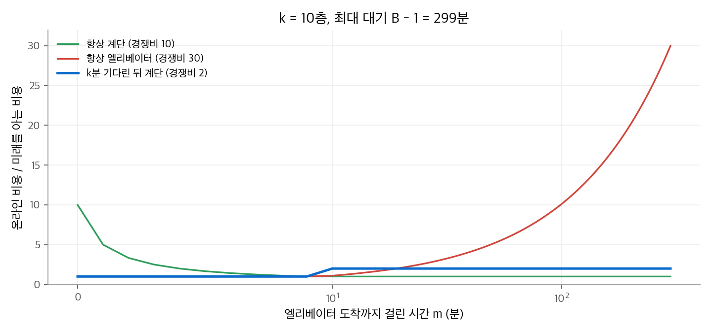
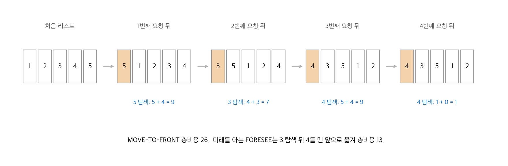
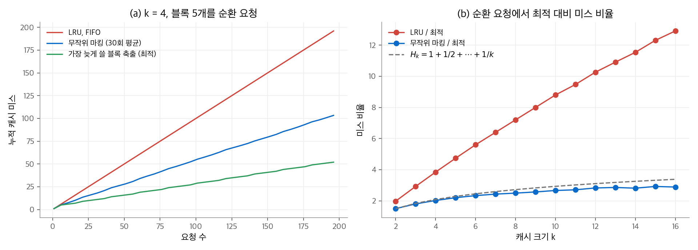

# 27. 온라인 알고리즘

지금까지의 알고리즘은 입력 전체를 처음부터 받았습니다. 이런 알고리즘을 **오프라인 알고리즘**이라고 합니다.
**온라인 알고리즘**은 입력을 조금씩 받으면서, 미래 입력을 모르는 채로 결정을 내립니다.
캐시에서 무엇을 내보낼지, 엘리베이터를 기다릴지, 스키를 빌릴지 살지가 모두 이런 결정입니다.
이 장은 미래 입력에 확률 모형을 가정하지 않습니다. 대신 **어떤 입력이 와도** 미래를 아는 최적해보다 몇 배 이상 나빠지지 않음을 보장합니다.

!!! info "원문과 자료"
    - 원문: CLRS 4판 27장 Online Algorithms (27.1~27.3). 연습 문제와 장 끝 문제는 생략했습니다.
    - 전제: [16. 분할 상환 분석](16-amortized.md)의 퍼텐셜 방법, [15. 탐욕 알고리즘](15-greedy.md)의 오프라인 캐싱
    - 본문의 캐싱 시뮬레이션과 그림은 새로 만든 것입니다. 수치는 Python으로 계산해 확인했습니다.

## 1. 경쟁비

### 정의

가능한 입력 전체의 집합을 $U$ 라고 합니다. 최소화 문제에서 온라인 알고리즘 $A$ 가 입력 $I$ 에서 낸 비용을 $A(I)$, 미래를 아는 최적 알고리즘 $F$ 의 비용을 $F(I)$ 라고 합니다.
$A$ 의 **경쟁비(competitive ratio)** 는 최악 입력에서의 비율입니다.

$$
\max_{I \in U} \frac{A(I)}{F(I)}
$$

경쟁비가 $c$ 이면 $A$ 를 **$c$-경쟁적($c$-competitive)** 이라고 합니다. 경쟁비는 항상 1 이상이고, 1에 가까울수록 좋습니다.
이 분석 방법을 **경쟁 분석(competitive analysis)** 이라고 합니다. 35장의 근사 알고리즘도 최적해와의 최악 비율을 보는 같은 사고방식입니다.

## 2. 엘리베이터와 계단

### 문제

$k$ 층 위의 사무실에 가야 합니다. 계단은 1분에 1층씩 오르므로 항상 $k$ 분이 걸립니다.
엘리베이터는 $k$ 층을 1분에 오르지만, 도착까지 $m$ 분($0 \le m \le B-1$, 정수)이 걸립니다. $m$ 은 미리 알 수 없습니다.
$B$ 는 $k$ 보다 훨씬 크다고 가정합니다.

미래를 아는 사람은 $m \le k-1$ 이면 엘리베이터를, 아니면 계단을 탑니다. 그 사람의 시간은 다음과 같습니다.

$$
t(m) = \begin{cases} m + 1 & m \le k - 1 \\ k & m \ge k \end{cases}
$$

### 세 전략

| 전략 | 시간 | 최악 입력 | 경쟁비 |
| --- | --- | --- | --- |
| 항상 계단 | $k$ | $m = 0$ (엘리베이터가 이미 와 있음) | $k / 1 = k$ |
| 항상 엘리베이터 | $m + 1$ | $m = B - 1$ | $B / k$ |
| $k$ 분 기다린 뒤 계단 | $m < k$ 이면 $m + 1$, 아니면 $2k$ | $m = k$ | $2k / k = 2$ |

$k = 10$, $B = 300$ 이면 항상 계단은 10, 항상 엘리베이터는 30입니다.
세 번째 전략은 **위험 분산(hedging)** 입니다. 엘리베이터가 빨리 오는 경우와 늦게 오는 경우를 모두 대비합니다. 경쟁비 2는 $k$ 와 $B$ 에 관계없습니다.

<figure markdown>

<figcaption markdown>
<span class="fig-title"><b>Figure 1.</b> 엘리베이터 문제의 세 전략</span>

가로축은 엘리베이터 도착 시간 m(로그 눈금)입니다. 기다렸다가 계단으로 가는 전략만 모든 m에서 비율이 2 이하입니다.
</figcaption>
</figure>

### 스키 대여 문제

같은 구조가 원문 연습 문제의 스키 대여 문제입니다. 스키 대여는 하루 $r$, 구매는 $b > r$ 입니다. 스키를 탈 날수는 미리 모릅니다.
"빌린 비용의 합이 $b$ 에 이를 때까지 빌리고, 그다음 날 산다"는 전략은 2-경쟁적입니다.

- $\lceil b/r \rceil$ 일 전에 그만두면 최적과 같은 비용입니다.
- 그 뒤까지 타면 대여비 약 $b$ 와 구매비 $b$ 를 냅니다. 최적은 처음부터 사는 비용 $b$ 이므로 비율은 약 2입니다.

두 문제의 공통점은 "되돌릴 수 없는 큰 결정"을 미루되, 미룬 비용이 그 결정의 비용과 같아지면 결정한다는 것입니다.

## 3. 탐색 리스트 유지

### 문제

원소 $n$ 개의 이중 연결 리스트에서 탐색 요청이 차례로 들어옵니다.
$i$ 번째 위치의 원소를 찾는 비용은 $i$ 입니다. 인접한 두 원소를 맞바꾸는 비용은 1입니다.
목표는 탐색 비용과 교환 비용의 합을 최소로 만드는 것입니다.
체이닝 해시 테이블([11장](11-hash-tables.md))의 슬롯 리스트가 이런 리스트입니다.

**MOVE-TO-FRONT(MTF)** 는 찾은 원소를 맨 앞으로 옮깁니다. 위치 $r$ 의 원소를 찾으면 탐색에 $r$, 교환에 $r - 1$ 이 들어 비용은 $2r - 1$ 입니다.

```python
def move_to_front(lst, requests):
    L = list(lst)
    total = 0
    for x in requests:
        r = L.index(x) + 1          # 1부터 센 위치
        total += 2 * r - 1          # 탐색 r + 교환 r-1
        L.insert(0, L.pop(r - 1))
    return total, L
```

### 실행 예

리스트 $\langle 1, 2, 3, 4, 5 \rangle$ 에서 5, 3, 4, 4를 차례로 찾습니다.

<figure markdown>

<figcaption markdown>
<span class="fig-title"><b>Figure 2.</b> MOVE-TO-FRONT의 실행 예</span>

MTF는 찾은 원소를 매번 맨 앞으로 옮겨 총비용 26을 냅니다. 미래를 아는 알고리즘은 4를 미리 옮겨 13을 냅니다.
</figcaption>
</figure>

미래를 아는 알고리즘을 원문은 FORESEE라고 부릅니다. 이 예에서 FORESEE는 5를 찾고(5), 3을 찾고(3), 다음에 4가 두 번 올 것을 알고 4를 맨 앞으로 옮깁니다(교환 3).
이후 4를 두 번 찾는 비용은 각각 1입니다. 총비용은 $5 + 3 + 3 + 1 + 1 = 13$ 입니다.

### MTF는 4-경쟁적이다

FORESEE가 무엇을 하는지 몰라도 MTF의 비용을 FORESEE와 비교할 수 있습니다. 도구는 **역전 수**와 퍼텐셜 함수입니다.

두 리스트 $L$, $L'$ 에서 순서가 다른 원소 쌍의 수를 **역전 수(inversion count)** $I(L, L')$ 라고 합니다.
예를 들어 $\langle 5,3,1,4,2 \rangle$ 와 $\langle 3,1,2,4,5 \rangle$ 의 역전 수는 5입니다. 순서가 다른 쌍은 (1,5), (2,4), (2,5), (3,5), (4,5)입니다.
인접한 두 원소를 맞바꾸면 그 쌍의 순서만 바뀌므로 역전 수는 정확히 1 늘거나 1 줄어듭니다.

$i$ 번째 요청 뒤 MTF의 리스트를 $L_i^M$, FORESEE의 리스트를 $L_i^F$ 라고 하고 퍼텐셜을 다음처럼 둡니다.

$$
\Phi_i = 2\,I(L_i^M, L_i^F)
$$

계수 2는 역전 하나가 MTF에게 탐색 1과 교환 1의 비용을 더 들게 한다는 직관입니다. 두 알고리즘이 같은 리스트에서 시작하면 $\Phi_0 = 0$ 이고 항상 $\Phi_i \ge 0$ 입니다.

$i$ 번째 요청이 $x$ 라고 합시다. 요청 직전 두 리스트에서 $x$ 앞에 있는 원소를 세 집합으로 나눕니다.

| 집합 | MTF 리스트에서 | FORESEE 리스트에서 |
| --- | --- | --- |
| $BB$ | $x$ 앞 | $x$ 앞 |
| $BA$ | $x$ 앞 | $x$ 뒤 |
| $AB$ | $x$ 뒤 | $x$ 앞 |

MTF가 $x$ 를 맨 앞으로 옮기면 $BB$ 의 원소와는 새 역전이 생기고, $BA$ 의 원소와는 역전이 사라집니다.
따라서 MTF의 이동은 퍼텐셜을 $2(|BB| - |BA|)$ 만큼 바꿉니다.
FORESEE가 교환 $t_i$ 번을 하면 퍼텐셜은 최대 $2t_i$ 만큼 늘어납니다.

MTF의 실제 비용은 $2(|BB| + |BA|) + 1$ 입니다. 분할 상환 비용은 실제 비용에 퍼텐셜 변화를 더한 값입니다.

$$
\hat{c}_i^M \le 2(|BB| + |BA|) + 1 + 2(|BB| - |BA|) + 2t_i = 4|BB| + 1 + 2t_i
$$

FORESEE의 비용은 $x$ 의 위치 이상입니다. 그 위치는 $|BB| + |AB| + 1 \ge |BB| + 1$ 이므로 $c_i^F \ge |BB| + 1 + t_i$ 입니다.
따라서 $\hat{c}_i^M \le 4 c_i^F$ 입니다. 퍼텐셜이 0에서 시작해 음수가 되지 않으므로 실제 비용의 합도 분할 상환 비용의 합 이하입니다.

!!! note "정리"
    MOVE-TO-FRONT는 4-경쟁적입니다. 즉 어떤 요청 열에서도 MTF의 총비용은 미래를 아는 어떤 알고리즘의 총비용의 4배 이하입니다.

이 증명은 FORESEE가 어떤 교환을 하는지 전혀 쓰지 않습니다. 퍼텐셜이 "두 리스트가 얼마나 다른지"를 재기 때문입니다.

## 4. 온라인 캐싱

### 문제

캐시는 블록 $k$ 개를 담습니다. 요청한 블록이 캐시에 있으면 **적중(hit)**, 없으면 **미스(miss)** 입니다.
미스가 나고 캐시가 가득 차 있으면 블록 하나를 내보내야 합니다. 목표는 미스 수를 최소로 만드는 것입니다.

미래 요청을 모두 알면 **가장 나중에 다시 쓸 블록을 내보내는(furthest-in-future)** 전략이 최적입니다. [15장](15-greedy.md)에서 이 사실을 증명했습니다. 이 장에서는 이 오프라인 최적해를 기준으로 씁니다.

### 결정적 알고리즘

| 알고리즘 | 내보낼 블록 | 경쟁비 |
| --- | --- | --- |
| LIFO | 가장 최근에 들어온 블록 | $\Theta(n/k)$ (요청 수 $n$ 에 따라 무한히 커짐) |
| FIFO | 가장 먼저 들어온 블록 | $\Theta(k)$ |
| LRU | 가장 오래 쓰지 않은 블록 | $\Theta(k)$ |

**LIFO의 최악 입력:** 블록 $1, \ldots, k$ 로 캐시를 채운 뒤 $k+1, k, k+1, k, \ldots$ 를 반복 요청합니다.
LIFO는 매번 방금 들어온 블록을 내보내므로 매 요청이 미스입니다. 최적해는 블록 1을 한 번 내보내고 그 뒤로 미스가 없습니다.
$k = 4$, 요청 100개로 시뮬레이션하면 LIFO는 미스 100번, LRU·FIFO·최적은 5번입니다.

**LRU의 상한 $O(k)$:** 요청 열을 **구간(epoch)** 으로 나눕니다. 한 구간은 서로 다른 블록 $k$ 개를 요청하는 가장 긴 연속 구간입니다.
한 구간에서 LRU는 블록마다 최대 한 번 미스가 나므로 미스가 $k$ 번 이하입니다.
최적해의 미스도 셉니다. 구간의 첫 블록을 $b$ 라고 합니다. 그 직후부터 다음 구간의 첫 요청까지 $b$ 가 아닌 서로 다른 블록 $k$ 개가 요청됩니다.
$b$ 를 막 쓴 최적해의 캐시에는 그 $k$ 개 가운데 $k - 1$ 개만 있을 수 있습니다. 따라서 최적해도 구간마다 미스가 1번 이상 납니다.

**결정적 알고리즘의 하한 $\Omega(k)$:** 블록을 $k+1$ 개만 씁니다. 적대자는 매번 "지금 캐시에 없는 유일한 블록"을 요청합니다. 결정적 알고리즘이면 적대자가 캐시 상태를 정확히 계산할 수 있습니다.
그러면 모든 요청이 미스입니다. 최적해는 미스 하나마다 가장 나중에 쓸 블록을 내보내므로 $k$ 번 요청에 미스가 1번 이하입니다.

!!! note "정리"
    어떤 결정적 온라인 캐싱 알고리즘도 경쟁비가 $\Omega(k)$ 입니다. LRU와 FIFO는 이 하한에 맞는 $\Theta(k)$ 입니다.

### 무작위 마킹 알고리즘

하한의 증명은 적대자가 캐시 상태를 안다는 점에 기댑니다. 내보낼 블록을 무작위로 고르면 이 약점을 피할 수 있습니다.
여기서 적대자는 **망각 적대자(oblivious adversary)** 입니다. 알고리즘을 알고 요청 열을 미리 정하지만, 알고리즘의 무작위 선택 결과는 모릅니다.

1. 블록마다 표시 비트를 둡니다. 요청된 블록은 표시합니다.
2. 미스가 나고 캐시가 가득 찼을 때, 캐시의 모든 블록이 표시되어 있으면 모든 표시를 지웁니다. 이 순간 새 구간이 시작됩니다.
3. 표시되지 않은 블록 가운데 하나를 **균등하게 무작위로** 골라 내보냅니다.
4. 요청된 블록을 넣고 표시합니다.

```python
import random

def randomized_marking(requests, k, rng=random.Random(0)):
    cache, marked, misses = set(), set(), 0
    for b in requests:
        if b not in cache:
            misses += 1
            if len(cache) == k:
                if cache <= marked:              # 모두 표시됨: 새 구간
                    marked.clear()
                victim = rng.choice(sorted(cache - marked))
                cache.remove(victim)
            cache.add(b)
        marked.add(b)
    return misses
```

!!! note "정리"
    망각 적대자에 대해 무작위 마킹 알고리즘의 기대 경쟁비는 $O(\lg k)$ 입니다.

증명의 핵심은 구간 안의 요청을 둘로 나누는 것입니다. 앞 구간에서도 요청된 블록은 **옛 요청**, 아니면 **새 요청**입니다.
새 요청은 무조건 미스입니다. 옛 요청은 그 블록이 이번 구간에서 이미 무작위로 쫓겨났을 때만 미스입니다.
$j$ 번째 옛 요청이 미스일 확률은 "그때까지 들어온 새 블록 수 / 아직 표시되지 않은 옛 블록 수" 이하입니다.
이 확률을 더하면 조화수 $H_k = 1 + 1/2 + \cdots + 1/k = \Theta(\lg k)$ 가 나옵니다. 최적해의 미스는 구간마다 새 요청 수의 절반 이상이므로 비율은 $O(H_k)$ 입니다.

### 시뮬레이션

결정적 하한에 쓰는 입력, 즉 블록 $k+1$ 개를 순환 요청하는 입력에 다섯 알고리즘을 돌립니다.

<figure markdown>

<figcaption markdown>
<span class="fig-title"><b>Figure 3.</b> 순환 요청에서의 캐시 미스</span>

LRU와 FIFO는 매 요청이 미스이고 최적 대비 비율이 k에 비례합니다. 무작위 마킹의 비율은 조화수 H_k 이하에 머뭅니다.
</figcaption>
</figure>

| 알고리즘 ($k = 4$, 요청 100개) | 미스 수 |
| --- | --- |
| LRU, FIFO | 100 |
| LIFO | 43 |
| 무작위 마킹 (50회 평균) | 약 54 |
| 가장 나중에 쓸 블록 내보내기 (최적) | 28 |

이 입력에서는 LIFO가 LRU보다 미스가 적습니다. 경쟁비는 최악 입력에서의 비율이므로, 특정 입력에서의 순위와 다를 수 있습니다.
최적해의 28번은 처음 4번의 필수 미스와, 이후 $k = 4$ 번 요청마다 1번의 미스($96/4 = 24$)를 더한 값입니다.

## 정리

| 문제 | 알고리즘 | 경쟁비 | 핵심 논증 |
| --- | --- | --- | --- |
| 엘리베이터 | $k$ 분 기다린 뒤 계단 | 2 | 두 극단의 최악 입력을 함께 막음 |
| 탐색 리스트 | MOVE-TO-FRONT | 4 | 역전 수를 퍼텐셜로 쓰는 분할 상환 분석 |
| 캐싱 (결정적) | LRU, FIFO | $\Theta(k)$ | 구간 분할, 적대자 하한 $\Omega(k)$ |
| 캐싱 (무작위) | 무작위 마킹 | $O(\lg k)$ 기대값 | 옛 요청과 새 요청, 조화수 |

경쟁 분석은 최악 입력만 봅니다. 그래서 실제로 잘 동작하는 LRU도 경쟁비는 $k$ 입니다.
무작위화는 적대자가 알고리즘의 상태를 예측하지 못하게 해서 이 하한을 지수적으로 낮춥니다.
