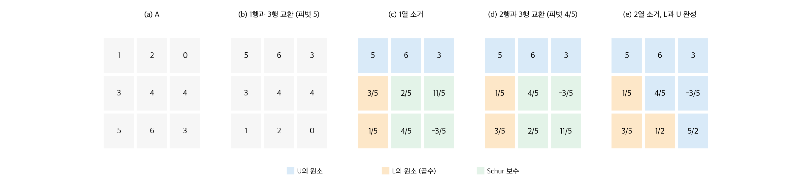
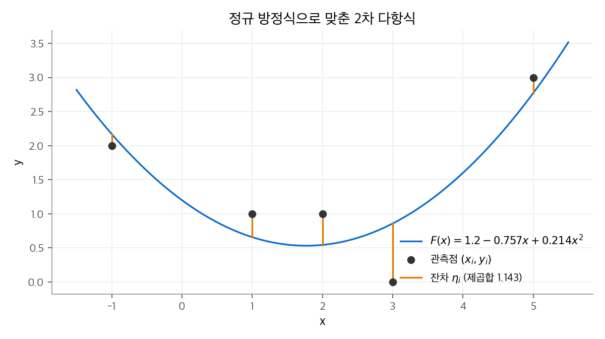

# 28. 행렬 연산

연립 일차 방정식 $Ax = b$ 를 푸는 일은 과학 계산의 기본 연산입니다.
이 장은 이 문제를 **알고리즘의 관점**에서 다룹니다. 무엇을 몇 번 계산하는지, 왜 행을 바꿔야 하는지, 역행렬과 곱셈 가운데 무엇이 더 어려운지를 봅니다.
행렬 분해의 수학적 의미(소거와 LU, 직교성, 양의 정부호)는 [선형대수](../../math/linear-algebra/index.md) 교재에 있습니다. 이 장은 그 내용을 반복하지 않고 연결합니다.

!!! info "원문과 자료"
    - 원문: CLRS 4판 28장 Matrix Operations (28.1~28.3). 연습 문제와 장 끝 문제는 생략했습니다.
    - 함께 읽기: [선형대수 1장 행렬과 가우스 소거법](../../math/linear-algebra/01-gaussian-elimination.md)(LU 분해의 유도), [3장 직교성](../../math/linear-algebra/03-orthogonality.md)(최소제곱의 기하), [6장 양의 정부호 행렬](../../math/linear-algebra/06-positive-definite.md)(판정법과 Cholesky), [7장 행렬 계산](../../math/linear-algebra/07-computations.md)(조건수와 수치 안정성)
    - 전제: [4. 분할 정복](04-divide-and-conquer.md)의 행렬 곱셈과 Strassen 방법
    - 본문의 행렬과 데이터는 새로 만든 것입니다. 수치는 Python의 `fractions` 로 정확히 계산해 확인했습니다.

## 1. LUP 분해로 연립 방정식 풀기

### 왜 역행렬을 쓰지 않는가

$A$ 가 정칙(nonsingular)이면 $x = A^{-1} b$ 입니다. 그러나 실제로는 $A^{-1}$ 을 구하지 않습니다.
역행렬을 거치면 반올림 오차가 커집니다. 또 아래의 LUP 분해가 같은 $\Theta(n^3)$ 시간에 더 적은 연산으로 끝납니다.

### LUP 분해

**LUP 분해**는 세 행렬 $L, U, P$ 를 찾는 일입니다.

$$
PA = LU
$$

| 행렬 | 모양 | 역할 |
| --- | --- | --- |
| $L$ | 단위 하삼각 (대각 원소가 1) | 소거에 쓴 곱수를 저장합니다. |
| $U$ | 상삼각 | 소거가 끝난 결과입니다. |
| $P$ | 치환 행렬 | 소거 중에 바꾼 행 순서를 기록합니다. 배열 $\pi$ 로 저장합니다. $\pi[i] = j$ 는 $PA$ 의 $i$ 행이 $A$ 의 $j$ 행이라는 뜻입니다. |

분해가 있으면 $Ax = b$ 의 양변에 $P$ 를 곱해 $LUx = Pb$ 를 얻습니다. $y = Ux$ 로 두고 두 번에 나누어 풉니다.

1. **전진 대입(forward substitution):** $Ly = Pb$ 를 위 행부터 풉니다. $y_i = b_{\pi[i]} - \sum_{j<i} l_{ij} y_j$ 입니다.
2. **후진 대입(back substitution):** $Ux = y$ 를 아래 행부터 풉니다. $x_i = \big(y_i - \sum_{j>i} u_{ij} x_j\big) / u_{ii}$ 입니다.

두 대입은 각각 $\Theta(n^2)$ 입니다. 분해를 한 번 해 두면 오른쪽 변 $b$ 가 바뀌어도 $\Theta(n^2)$ 에 다시 풀 수 있습니다.

### Schur 보수로 보는 LU 분해

$A$ 를 첫 행, 첫 열, 나머지로 나눕니다. $v$ 는 첫 열의 아래 부분, $w^T$ 는 첫 행의 오른쪽 부분입니다.

$$
A = \begin{bmatrix} a_{11} & w^T \\ v & A' \end{bmatrix}
  = \begin{bmatrix} 1 & 0 \\ v / a_{11} & I_{n-1} \end{bmatrix}
    \begin{bmatrix} a_{11} & w^T \\ 0 & A' - v w^T / a_{11} \end{bmatrix}
$$

오른쪽 아래의 $(n-1) \times (n-1)$ 행렬 $A' - vw^T/a_{11}$ 을 **Schur 보수(Schur complement)** 라고 합니다.
Schur 보수를 같은 방법으로 재귀 분해하면 $A$ 의 LU 분해가 나옵니다. 재귀 한 번에 $\Theta(n^2)$ 이 들므로 전체는 $\Theta(n^3)$ 입니다.
$A$ 가 정칙이면 Schur 보수도 정칙입니다.

### 피벗을 고르는 이유

위 분해는 $a_{11}$ 로 나눕니다. $a_{11} = 0$ 이면 실패합니다. $a_{11}$ 이 아주 작아도 곱수가 커져 반올림 오차가 커집니다.
LUP 분해는 매 단계 **현재 열에서 절댓값이 가장 큰 원소**를 피벗으로 고르고, 그 행을 맨 위로 바꿉니다. 이 방법을 **부분 피벗팅(partial pivoting)** 이라고 합니다.
곱수의 절댓값이 항상 1 이하가 되어 오차가 커지지 않습니다. 자세한 오차 분석은 [선형대수 7장](../../math/linear-algebra/07-computations.md)에 있습니다.

### 실행 예

다음 방정식을 풉니다.

$$
A = \begin{bmatrix} 1 & 2 & 0 \\ 3 & 4 & 4 \\ 5 & 6 & 3 \end{bmatrix}, \qquad
b = \begin{bmatrix} 3 \\ 7 \\ 8 \end{bmatrix}
$$

<figure markdown>

<figcaption markdown>
<span class="fig-title"><b>Figure 1.</b> LUP 분해의 단계</span>

매 단계 피벗 행을 바꾸고, 곱수를 L 자리에 저장하고, 나머지를 Schur 보수로 바꿉니다. 하나의 배열 안에서 L과 U가 함께 완성됩니다.
</figcaption>
</figure>

1. 1열의 최댓값은 5입니다. 1행과 3행을 바꿉니다.
2. 곱수 $3/5$, $1/5$ 를 1열에 저장하고 Schur 보수를 계산합니다. 예를 들어 $4 - (3/5)(6) = 2/5$ 입니다.
3. Schur 보수의 1열은 $(2/5, 4/5)$ 입니다. 최댓값 $4/5$ 의 행을 위로 바꿉니다.
4. 곱수 $(2/5)/(4/5) = 1/2$ 를 저장하고 마지막 원소를 $11/5 - (1/2)(-3/5) = 5/2$ 로 바꿉니다.

결과는 다음과 같습니다. $\pi = (3, 1, 2)$ 입니다.

$$
L = \begin{bmatrix} 1 & 0 & 0 \\ 1/5 & 1 & 0 \\ 3/5 & 1/2 & 1 \end{bmatrix}, \qquad
U = \begin{bmatrix} 5 & 6 & 3 \\ 0 & 4/5 & -3/5 \\ 0 & 0 & 5/2 \end{bmatrix}
$$

$Pb = (b_3, b_1, b_2) = (8, 3, 7)$ 입니다. 전진 대입은 $y = (8,\ 7/5,\ 3/2)$ 이고, 후진 대입은 $x = (-7/5,\ 11/5,\ 3/5)$ 입니다.
첫 식에 넣어 확인하면 $-7/5 + 2 \cdot 11/5 + 0 = 3$ 입니다.

### 코드

```python
from fractions import Fraction

def lup_decompose(A):
    """A를 제자리에서 L(대각 아래)과 U(대각 포함 위)로 덮어씁니다."""
    n = len(A)
    pi = list(range(n))
    for k in range(n):
        kp = max(range(k, n), key=lambda i: abs(A[i][k]))   # 부분 피벗팅
        if A[kp][k] == 0:
            raise ValueError("singular matrix")
        pi[k], pi[kp] = pi[kp], pi[k]
        A[k], A[kp] = A[kp], A[k]
        for i in range(k + 1, n):
            A[i][k] /= A[k][k]                               # 곱수를 L 자리에
            for j in range(k + 1, n):
                A[i][j] -= A[i][k] * A[k][j]                 # Schur 보수
    return pi

def lup_solve(LU, pi, b):
    n = len(LU)
    y = [0] * n
    for i in range(n):                                       # 전진 대입
        y[i] = b[pi[i]] - sum(LU[i][j] * y[j] for j in range(i))
    x = [0] * n
    for i in reversed(range(n)):                             # 후진 대입
        x[i] = (y[i] - sum(LU[i][j] * x[j] for j in range(i + 1, n))) / LU[i][i]
    return x

A = [[Fraction(v) for v in row] for row in [[1, 2, 0], [3, 4, 4], [5, 6, 3]]]
pi = lup_decompose(A)
print(lup_solve(A, pi, [3, 7, 8]))   # [-7/5, 11/5, 3/5]
```

세 겹 반복문이므로 분해는 $\Theta(n^3)$ 입니다. 정확히는 곱셈과 뺄셈이 약 $n^3/3$ 번씩입니다.

## 2. 역행렬

### LUP로 역행렬 구하기

$AX = I_n$ 은 오른쪽 변이 $I_n$ 의 열 $e_1, \ldots, e_n$ 인 방정식 $n$ 개입니다.
LUP 분해를 한 번 하고($\Theta(n^3)$), 열마다 두 대입을 합니다($n \times \Theta(n^2)$). 전체는 $\Theta(n^3)$ 입니다.

### 곱셈과 역행렬은 같은 난이도다

행렬 곱셈은 Strassen 방법처럼 $\Theta(n^3)$ 보다 빠를 수 있습니다. 그러면 역행렬도 빨라질까요? 답은 "그렇다"이고, 반대 방향도 성립합니다.

!!! note "정리 (곱셈은 역행렬보다 어렵지 않다)"
    $n \times n$ 역행렬을 $I(n)$ 시간에 구할 수 있으면 두 $n \times n$ 행렬을 $O(I(n))$ 시간에 곱할 수 있습니다. 단 $I(n) = \Omega(n^2)$ 이고 $I(3n) = O(I(n))$ 입니다.

증명은 블록 행렬 하나로 끝납니다. $3n \times 3n$ 행렬 $D$ 를 만들어 역행렬을 구하면 오른쪽 위 블록에 $AB$ 가 나옵니다.

$$
D = \begin{bmatrix} I_n & A & 0 \\ 0 & I_n & B \\ 0 & 0 & I_n \end{bmatrix}, \qquad
D^{-1} = \begin{bmatrix} I_n & -A & AB \\ 0 & I_n & -B \\ 0 & 0 & I_n \end{bmatrix}
$$

!!! note "정리 (역행렬은 곱셈보다 어렵지 않다)"
    두 $n \times n$ 행렬을 $M(n)$ 시간에 곱할 수 있으면 정칙 행렬의 역행렬을 $O(M(n))$ 시간에 구할 수 있습니다. 단 $M(n)$ 은 적절한 정칙성 조건을 만족합니다.

먼저 $A$ 가 대칭 양의 정부호라고 합니다. $A$ 를 $2 \times 2$ 블록으로 나누고 $S = D - CB^{-1}C^T$ 를 Schur 보수로 둡니다.

$$
A = \begin{bmatrix} B & C^T \\ C & D \end{bmatrix}, \qquad
A^{-1} = \begin{bmatrix} B^{-1} + B^{-1} C^T S^{-1} C B^{-1} & -B^{-1} C^T S^{-1} \\ -S^{-1} C B^{-1} & S^{-1} \end{bmatrix}
$$

크기 $n/2$ 의 역행렬 2개($B^{-1}$, $S^{-1}$)와 곱셈 몇 번이 필요합니다. 재귀식은 $I(n) \le 2I(n/2) + O(M(n)) = O(M(n))$ 입니다.
$B$ 와 $S$ 가 대칭 양의 정부호이므로 재귀 중에 역행렬이 항상 존재합니다. 이 성질은 3절의 보조정리에서 나옵니다.
일반 정칙 행렬 $A$ 는 $A^{-1} = (A^T A)^{-1} A^T$ 로 바꿉니다. $A^T A$ 는 대칭 양의 정부호이고, 곱셈 두 번이 더 듭니다.

결론은 Strassen 방법을 쓰면 역행렬도 $O(n^{\lg 7})$ 에 구할 수 있다는 것입니다.

## 3. 대칭 양의 정부호 행렬과 최소제곱

### 대칭 양의 정부호 행렬

$A = A^T$ 이고 모든 $x \ne 0$ 에서 $x^T A x > 0$ 이면 $A$ 를 **대칭 양의 정부호(SPD)** 행렬이라고 합니다. 다른 판정법은 [선형대수 6장](../../math/linear-algebra/06-positive-definite.md)에 있습니다.
CLRS는 다음 성질을 차례로 증명합니다.

| 성질 | 이유 |
| --- | --- |
| SPD 행렬은 정칙입니다. | $Ax = 0$ 이면 $x^T A x = 0$ 이므로 $x = 0$ 입니다. |
| 앞쪽 $k \times k$ 부분 행렬도 SPD입니다. | $x$ 의 뒤쪽 성분을 0으로 두고 정의에 넣습니다. |
| Schur 보수도 SPD입니다 (Schur 보수 보조정리). | 블록 소거 뒤에도 이차 형식이 양수로 남습니다. |
| **피벗팅 없이 LU 분해를 해도 0으로 나누지 않습니다.** | 위 세 성질에서 매 단계 피벗이 양수입니다. |

마지막 성질 덕분에 SPD 행렬은 행 교환 없이 분해할 수 있습니다. $L$ 과 $U$ 의 대칭을 이용하면 $A = LL^T$ 꼴의 **Cholesky 분해**가 되고, 연산이 LU의 절반입니다.

### 최소제곱 근사

점 $m$ 개 $(x_i, y_i)$ 에 함수 $F(x) = \sum_{j=1}^{n} c_j f_j(x)$ 를 맞춥니다. 보통 $m \gg n$ 이므로 모든 점을 정확히 지나는 해는 없습니다.
$a_{ij} = f_j(x_i)$ 로 $m \times n$ 행렬 $A$ 를 만들면 예측값은 $Ac$ 이고 잔차는 $\eta = Ac - y$ 입니다.
잔차의 제곱합 $\|\eta\|^2$ 을 최소로 만드는 $c$ 를 찾습니다.

$c$ 로 미분해 0으로 두면 **정규 방정식(normal equation)** 이 나옵니다.

$$
A^T A\, c = A^T y
$$

$A$ 의 열이 일차 독립이면 $A^T A$ 는 SPD입니다. 따라서 해가 하나 있고, 피벗팅 없는 LU나 Cholesky로 풀 수 있습니다.
$c = (A^T A)^{-1} A^T y$ 의 $(A^T A)^{-1} A^T$ 를 $A$ 의 **유사 역행렬(pseudoinverse)** $A^+$ 라고 합니다.
정규 방정식이 "잔차가 $A$ 의 열 공간과 직교한다"는 뜻이라는 기하적 해석은 [선형대수 3장](../../math/linear-algebra/03-orthogonality.md)에 있습니다.

### 실행 예

점 5개 $(-1, 2), (1, 1), (2, 1), (3, 0), (5, 3)$ 에 2차 다항식 $F(x) = c_1 + c_2 x + c_3 x^2$ 을 맞춥니다.

$$
A = \begin{bmatrix} 1 & -1 & 1 \\ 1 & 1 & 1 \\ 1 & 2 & 4 \\ 1 & 3 & 9 \\ 1 & 5 & 25 \end{bmatrix}, \qquad
A^T A = \begin{bmatrix} 5 & 10 & 40 \\ 10 & 40 & 160 \\ 40 & 160 & 724 \end{bmatrix}, \qquad
A^T y = \begin{bmatrix} 7 \\ 16 \\ 82 \end{bmatrix}
$$

$A^T A$ 의 원소는 $\sum x_i^{j+k}$ 꼴의 거듭제곱 합입니다. 예를 들어 오른쪽 아래 724는 $\sum x_i^4 = 1 + 1 + 16 + 81 + 625$ 입니다.
정규 방정식을 풀면 다음과 같습니다.

$$
c = \left(\tfrac{6}{5},\ -\tfrac{53}{70},\ \tfrac{3}{14}\right) \approx (1.200,\ -0.757,\ 0.214)
$$

<figure markdown>

<figcaption markdown>
<span class="fig-title"><b>Figure 2.</b> 최소제곱으로 맞춘 2차 다항식</span>

주황 선분이 잔차입니다. 정규 방정식의 해는 잔차 제곱합(1.143)을 최소로 만드는 계수입니다.
</figcaption>
</figure>

실제 수치 계산에서는 정규 방정식을 직접 풀지 않을 때가 많습니다. $A^T A$ 의 조건수는 $A$ 의 조건수의 제곱이라 오차가 커지기 때문입니다.
대신 QR 분해나 SVD를 씁니다. 이 차이는 [선형대수 7장](../../math/linear-algebra/07-computations.md)에서 다룹니다.

## 정리

| 연산 | 방법 | 시간 |
| --- | --- | --- |
| LUP 분해 | 부분 피벗팅을 쓰는 Schur 보수 재귀 | $\Theta(n^3)$ |
| $Ax = b$ 풀기 (분해 뒤) | 전진 대입과 후진 대입 | $\Theta(n^2)$ |
| 역행렬 | LUP 분해 뒤 열 $n$ 개를 풀기 | $\Theta(n^3)$ |
| 역행렬 (빠른 곱셈 사용) | SPD 블록 역행렬 재귀, $A^{-1} = (A^TA)^{-1}A^T$ | $O(M(n))$ |
| 최소제곱 | 정규 방정식 $A^TA\,c = A^Ty$ 를 SPD 분해로 풀기 | $\Theta(mn^2 + n^3)$ |

- 피벗팅은 0으로 나누는 일을 막고 곱수를 1 이하로 묶어 수치 오차를 줄입니다. SPD 행렬은 피벗팅이 필요 없습니다.
- 행렬 곱셈과 역행렬은 점근적으로 같은 난이도입니다. 곱셈을 빠르게 하는 방법은 역행렬도 빠르게 합니다.
