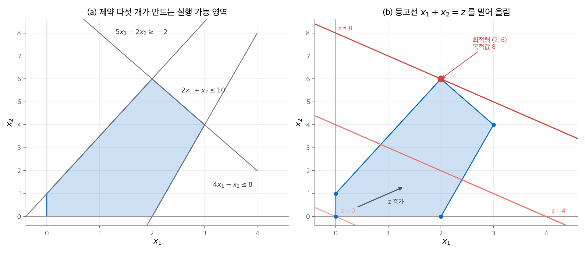
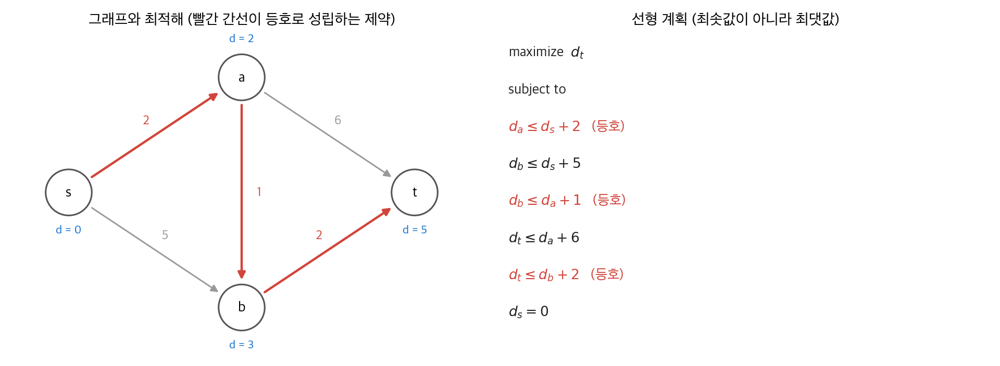
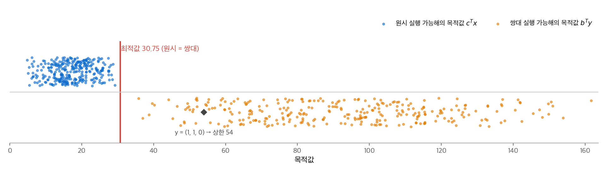

# 29. 선형 계획법

제한된 자원 아래에서 목표를 최대화하거나 최소화하는 문제가 많습니다. 목표와 제약을 모두 변수의 선형식으로 쓸 수 있으면 그 문제는 **선형 계획(linear program, LP)** 입니다. 이 장의 질문은 두 가지입니다. "어떤 문제를 선형 계획으로 바꿀 수 있는가?"와 "얻은 해가 최적임을 어떻게 증명하는가?"입니다. 4판은 심플렉스 알고리즘의 세부 절차를 싣지 않습니다. 대신 모델링(문제를 선형 계획으로 옮기는 과정)과 쌍대성에 집중합니다.

!!! info "원문과 자료"
    - 원문: CLRS 4판 29장 Linear Programming (29.1~29.3)
    - 이 교재의 관련 장: [22. 단일 출발점 최단 경로](22-single-source-sp.md)(차분 제약), [24. 최대 흐름](24-max-flow.md)(최대 흐름 최소 절단), [35. 근사 알고리즘](35-approximation.md)(선형 계획 완화)
    - 함께 읽기: [선형대수 8장 선형 계획과 게임 이론](../../math/linear-algebra/08-linear-programming.md)(심플렉스의 피벗 계산), [볼록 최적화 5장 쌍대성](../../math/convex-optimization/05-duality.md)(Lagrange 쌍대와 KKT), [볼록 최적화 11장 내부점법](../../math/convex-optimization/11-interior-point.md)
    - 이 장의 수치는 모두 SciPy `linprog` 와 꼭짓점 전수 계산으로 확인했습니다.

## 1. 선거 광고 예제로 보는 모델링

### 문제

한 후보가 도시, 교외, 농촌 세 지역에서 표를 얻으려 합니다. 목표는 도시 5만 표, 교외 10만 표, 농촌 2만 5천 표입니다. 쟁점은 네 가지이고, 쟁점마다 광고비 1천 달러를 쓰면 지역별 득표가 다음처럼 바뀝니다(단위: 천 표, 음수는 잃는 표).

| 쟁점 | 도시 | 교외 | 농촌 |
| --- | --- | --- | --- |
| 좀비 대비 | −2 | 5 | 3 |
| 레이저 상어 | 8 | 2 | −5 |
| 비행차 도로 | 0 | 0 | 10 |
| 돌고래 투표권 | 10 | 0 | −2 |

### 세 단계: 변수, 제약, 목적

모델링은 항상 같은 세 단계로 진행합니다.

1. **결정 변수**를 정합니다. $x_j$ 는 쟁점 $j$ 에 쓰는 광고비(천 달러)입니다.
2. **제약**을 씁니다. 지역마다 득표가 목표 이상이어야 하고, 광고비는 음수일 수 없습니다.
3. **목적 함수**를 씁니다. 총 광고비를 최소화합니다.

$$
\begin{aligned}
\text{minimize}\quad & x_1 + x_2 + x_3 + x_4 \\
\text{subject to}\quad & -2x_1 + 8x_2 + 0x_3 + 10x_4 \geq 50 \\
& 5x_1 + 2x_2 + 0x_3 + 0x_4 \geq 100 \\
& 3x_1 - 5x_2 + 10x_3 - 2x_4 \geq 25 \\
& x_1, x_2, x_3, x_4 \geq 0
\end{aligned}
$$

### 손으로 찾은 해와 최적해

시행착오로 $x = (20, 0, 4, 9)$ 를 골랐다고 합시다. 득표는 도시 $-40 + 90 = 50$, 교외 $100$, 농촌 $60 + 40 - 18 = 82$ 입니다. 세 목표를 모두 채우고 비용은 33천 달러입니다.

이 해가 최선일까요? 선형 계획을 풀면 최적해는 $x^* = (2050/111,\ 425/111,\ 0,\ 625/111) \approx (18.47, 3.83, 0, 5.63)$ 이고 비용은 $3100/111 \approx 27.93$ 천 달러입니다. 세 제약이 모두 등호로 성립합니다. 시행착오 해보다 약 5천 달러 쌉니다. 비행차 도로 광고는 쓰지 않습니다. 농촌 표는 좀비 대비 광고로 이미 충분히 얻기 때문입니다.

## 2. 표준형과 용어

### 표준형

최대화 문제의 **표준형(standard form)** 은 다음과 같습니다. $A \in \mathbb{R}^{m \times n}$, $b \in \mathbb{R}^m$, $c \in \mathbb{R}^n$ 입니다.

$$
\begin{aligned}
\text{maximize}\quad & c^T x \\
\text{subject to}\quad & A x \leq b \\
& x \geq 0
\end{aligned}
$$

$m$ 개의 부등식 제약과 $n$ 개의 **비음 제약**이 있습니다. 다른 형태의 문제는 다음 변환으로 표준형으로 바꿉니다.

| 원래 형태 | 표준형으로 바꾸는 방법 |
| --- | --- |
| 최소화 $c^T x$ | 최대화 $-c^T x$ |
| 등식 $a^T x = b$ | $a^T x \leq b$ 와 $-a^T x \leq -b$ 두 개 |
| $a^T x \geq b$ | $-a^T x \leq -b$ |
| 부호 제약이 없는 변수 $x_j$ | $x_j = x_j' - x_j''$, $x_j', x_j'' \geq 0$ |

선형 계획은 엄격한 부등식($<$)을 허용하지 않습니다.

### 해의 분류

- 모든 제약을 만족하는 $\bar{x}$ 를 **실행 가능해(feasible solution)** 라고 합니다. 그 집합이 **실행 가능 영역** 입니다.
- 실행 가능해 가운데 목적값이 가장 좋은 해가 **최적해** 입니다.
- 실행 가능해가 없으면 **실행 불가능(infeasible)**, 목적값이 한없이 좋아지면 **비유계(unbounded)** 입니다.

**선형 계획의 기본 정리**(정리 29.5)는 표준형 선형 계획이 다음 셋 중 정확히 하나라고 말합니다. 유한한 최적값을 가지거나, 실행 불가능하거나, 비유계입니다.

## 3. 두 변수 선형 계획의 기하

### 등고선을 밀어 올리기

다음 문제를 그림으로 풉니다.

$$
\begin{aligned}
\text{maximize}\quad & x_1 + x_2 \\
\text{subject to}\quad & 4x_1 - x_2 \leq 8 \\
& 2x_1 + x_2 \leq 10 \\
& 5x_1 - 2x_2 \geq -2 \\
& x_1, x_2 \geq 0
\end{aligned}
$$

각 제약은 반평면입니다. 다섯 반평면의 교집합이 실행 가능 영역이고, 이 영역은 볼록 다각형입니다. 꼭짓점은 $(0,0), (2,0), (3,4), (2,6), (0,1)$ 입니다.

목적값이 $z$ 인 점들은 직선 $x_1 + x_2 = z$ 위에 있습니다. $z$ 를 키우면 이 직선이 오른쪽 위로 평행 이동합니다. 직선이 영역과 만나는 마지막 순간의 $z$ 가 최적값입니다.

<figure markdown>

<figcaption markdown>
<b>Figure 1.</b> 두 변수 선형 계획의 기하

제약 다섯 개가 볼록 다각형을 만들고(a), 등고선을 밀어 올리면 꼭짓점 (2, 6)에서 최적값 8을 얻습니다(b).
</figcaption>
</figure>

꼭짓점마다 목적값을 계산하면 $0, 2, 7, 8, 1$ 입니다. 최댓값은 $(2, 6)$ 의 8입니다.

### 최적해는 꼭짓점에 있다

마지막으로 닿는 곳은 영역의 경계입니다. 등고선과 경계의 교집합은 꼭짓점 하나이거나 변 하나입니다. 변이면 그 양 끝점도 최적이고, 양 끝점은 꼭짓점입니다. 따라서 최적해가 있으면 꼭짓점 가운데에도 최적해가 있습니다. $n$ 차원에서도 같습니다. 제약은 반공간, 등고면은 초평면이 되고, 볼록성 때문에 같은 결론이 성립합니다.

### 알고리즘의 세 갈래

| 알고리즘 | 움직이는 곳 | 최악 시간 | 실제 성능 |
| --- | --- | --- | --- |
| 심플렉스 | 영역의 꼭짓점에서 이웃 꼭짓점으로 | 지수 시간인 입력이 있음 | 대부분 빠름, 가장 널리 씀 |
| 타원체법 | 해를 담는 타원체를 줄여 감 | 다항 시간(최초) | 느림 |
| 내부점법 | 영역의 내부를 지나 최적 꼭짓점으로 | 다항 시간 | 큰 문제에서 심플렉스만큼 또는 더 빠름 |

심플렉스는 목적값이 줄지 않는 이웃 꼭짓점으로 계속 옮겨 갑니다. 더 나은 이웃이 없으면 멈춥니다. 영역이 볼록하고 목적이 선형이므로 이 국소 최적이 곧 전역 최적입니다. 피벗 연산의 구체적인 계산은 [선형대수 8장](../../math/linear-algebra/08-linear-programming.md)에 있습니다.

변수가 정수여야 한다는 조건을 더하면 **정수 선형 계획** 이 됩니다. 정수 선형 계획은 실행 가능해를 찾는 일만으로도 NP-난해입니다. 반면 일반 선형 계획은 다항 시간에 풉니다.

## 4. 그래프 문제를 선형 계획으로 쓰기

선형 계획의 가장 중요한 기술은 "이 문제가 선형 계획이다"를 알아보는 일입니다. 다항 크기의 선형 계획으로 바꾸면 다항 시간에 풀 수 있습니다. 선형 계획에서는 정점 속성 $v.d$ 대신 첨자 변수 $d_v$ 를 씁니다.

### 최단 경로

출발점 $s$ 에서 도착점 $t$ 까지의 최단 경로 가중치 $d_t$ 를 구합니다. 삼각 부등식 $d_v \leq d_u + w(u, v)$ 를 간선마다 제약으로 둡니다.

$$
\begin{aligned}
\text{maximize}\quad & d_t \\
\text{subject to}\quad & d_v \leq d_u + w(u, v) \quad \text{for each edge } (u, v) \in E \\
& d_s = 0
\end{aligned}
$$

최단 경로인데 **최대화** 합니다. 최소화하면 모든 가중치가 음이 아닐 때 $d_v = 0$ 이 바로 최적해가 되어 아무것도 구하지 못합니다. 최단 경로 가중치는 $d_v = \min_u \{d_u + w(u, v)\}$, 즉 모든 상한을 만족하는 값 가운데 가장 큰 값입니다. 그래서 최대화가 맞습니다.

<figure markdown>

<figcaption markdown>
<b>Figure 2.</b> 최단 경로를 선형 계획으로 풀기

최적해에서 최단 경로 s → a → b → t 위의 제약만 등호로 성립하고, $d_t = 5$ 입니다.
</figcaption>
</figure>

변수는 $|V|$ 개, 제약은 $|E| + 1$ 개입니다.

### 최대 흐름

흐름 $f_{uv}$ 를 변수로 둡니다. 용량 제약과 흐름 보존이 모두 선형이고, 흐름의 값도 선형입니다.

$$
\begin{aligned}
\text{maximize}\quad & \sum_{v \in V} f_{sv} - \sum_{v \in V} f_{vs} \\
\text{subject to}\quad & f_{uv} \leq c(u, v) && \text{for each } u, v \in V \\
& \sum_{v \in V} f_{vu} = \sum_{v \in V} f_{uv} && \text{for each } u \in V - \{s, t\} \\
& f_{uv} \geq 0 && \text{for each } u, v \in V
\end{aligned}
$$

이 형태는 정점 쌍마다 변수를 두므로 변수 $|V|^2$ 개입니다. 실제 간선에만 변수를 두면 제약을 $O(V + E)$ 개로 줄일 수 있습니다.

### 최소 비용 흐름과 다중 품목 흐름

선형 계획이 진짜 힘을 내는 곳은 전용 알고리즘이 없거나 복잡한 문제입니다. 최단 경로는 Dijkstra 알고리즘이 선형 계획보다 빠릅니다.

- **최소 비용 흐름**: 간선마다 단위 비용 $a(u, v)$ 가 있습니다. 정확히 $d$ 단위를 $s$ 에서 $t$ 로 보내면서 $\sum a(u, v) f_{uv}$ 를 최소화합니다. 최대 흐름 제약에 "흐름 값 $= d$" 를 더하고 목적만 바꾸면 됩니다.
- **다중 품목 흐름**: 품목 $K_i = (s_i, t_i, d_i)$ 가 $k$ 개 있고 같은 네트워크를 나누어 씁니다. 품목별 흐름 $f^i_{uv}$ 는 각자 보존 법칙을 지키고, 합 $\sum_i f^i_{uv}$ 가 용량을 넘지 않아야 합니다. 목적 함수 없이 실행 가능해가 있는지만 묻습니다. 이 문제의 다항 시간 알고리즘으로 알려진 것은 선형 계획을 거치는 방법뿐입니다.

## 5. 쌍대성

### 제약을 더해서 상한 만들기

다음 원시 문제를 봅니다.

$$
\begin{aligned}
\text{maximize}\quad & 3x_1 + x_2 + 4x_3 \\
\text{subject to}\quad & x_1 + x_2 + 3x_3 \leq 30 \\
& 2x_1 + 2x_2 + 5x_3 \leq 24 \\
& 4x_1 + x_2 + 2x_3 \leq 36 \\
& x_1, x_2, x_3 \geq 0
\end{aligned}
$$

첫째와 둘째 제약을 더하면 $3x_1 + 3x_2 + 8x_3 \leq 54$ 입니다. 각 계수가 목적 함수의 계수 이상이고 $x \geq 0$ 이므로 다음이 성립합니다.

$$
3x_1 + x_2 + 4x_3 \leq 3x_1 + 3x_2 + 8x_3 \leq 54
$$

즉 목적값은 54를 넘지 못합니다. 일반적으로 제약에 음이 아닌 승수 $y_1, y_2, y_3$ 을 곱해 더하면 다음 부등식을 얻습니다.

$$
(y_1 + 2y_2 + 4y_3)x_1 + (y_1 + 2y_2 + y_3)x_2 + (3y_1 + 5y_2 + 2y_3)x_3 \leq 30y_1 + 24y_2 + 36y_3
$$

좌변의 계수가 각각 3, 1, 4 이상이면 우변이 목적값의 상한입니다. 가장 좋은(가장 작은) 상한을 찾는 문제가 바로 **쌍대 문제(dual)** 입니다.

### 쌍대 문제의 정의

표준형 원시 문제와 쌍대 문제는 다음과 같습니다.

$$
\text{원시:}\ \max\ c^T x \ \ \text{s.t.}\ Ax \leq b,\ x \geq 0
\qquad
\text{쌍대:}\ \min\ b^T y \ \ \text{s.t.}\ A^T y \geq c,\ y \geq 0
$$

기계적으로는 세 가지를 바꿉니다. 최대화를 최소화로 바꾸고, 우변 $b$ 와 목적 계수 $c$ 의 역할을 맞바꾸고, $\leq$ 를 $\geq$ 로 바꿉니다. 원시 제약 하나가 쌍대 변수 하나에, 원시 변수 하나가 쌍대 제약 하나에 대응합니다.

### 약쌍대성과 강쌍대성

**약쌍대성(보조정리 29.1)**: 원시 실행 가능해 $\bar{x}$ 와 쌍대 실행 가능해 $\bar{y}$ 에 대해 $c^T \bar{x} \leq b^T \bar{y}$ 입니다. 증명은 한 줄입니다.

$$
c^T \bar{x} \leq (A^T \bar{y})^T \bar{x} = \bar{y}^T A \bar{x} \leq \bar{y}^T b
$$

첫 부등식은 $A^T \bar{y} \geq c$ 와 $\bar{x} \geq 0$ 에서, 둘째 부등식은 $A\bar{x} \leq b$ 와 $\bar{y} \geq 0$ 에서 나옵니다. 따라서 두 실행 가능해의 목적값이 같으면 둘 다 최적입니다(따름정리 29.2). 이것이 "최적임을 증명하는" 방법입니다.

**강쌍대성(정리 29.4)**: 두 문제가 모두 실행 가능하고 유계이면 최적값이 같습니다. $c^T x^* = b^T y^*$ 입니다. 교재는 **Farkas 보조정리**로 증명합니다. Farkas 보조정리는 "$Mv \leq g$ 를 만족하는 $v$ 가 있다"와 "$w \geq 0$, $w^T M = 0$, $w^T g < 0$ 인 $w$ 가 있다" 가운데 정확히 하나가 참이라는 정리입니다. 원시 제약에 "목적값 $\geq$ 쌍대 최적값 $\mu$" 를 더한 문제가 실행 불가능하다고 가정합니다. 그러면 Farkas의 둘째 경우가 성립하고, 그 $w$ 로 $\mu$ 보다 작은 쌍대 실행 가능해를 만들 수 있어 모순입니다.

### 예제의 최적해

위 예제의 최적해는 다음과 같습니다.

| | 최적해 | 최적값 |
| --- | --- | --- |
| 원시 | $x^* = (8.25,\ 0,\ 1.5)$ | $3 \cdot 8.25 + 4 \cdot 1.5 = 30.75$ |
| 쌍대 | $y^* = (0,\ 5/8,\ 7/16)$ | $24 \cdot 5/8 + 36 \cdot 7/16 = 30.75$ |

두 값이 같으므로 약쌍대성만으로 둘 다 최적임을 확인할 수 있습니다. 첫째 원시 제약은 $8.25 + 4.5 = 12.75 < 30$ 으로 여유가 있습니다. 그래서 대응하는 쌍대 변수 $y_1^* = 0$ 입니다. 이 관계를 **상보 여유성(complementary slackness)** 이라고 합니다. 여유가 있는 제약의 승수는 0이고, 양수인 변수의 쌍대 제약은 등호입니다.

<figure markdown>

<figcaption markdown>
<b>Figure 3.</b> 약쌍대성과 강쌍대성

무작위 원시 실행 가능해의 값은 모두 30.75 아래, 쌍대 실행 가능해의 값은 모두 위에 있고, 두 최적값이 30.75에서 만납니다.
</figcaption>
</figure>

### 최대 흐름 최소 절단과의 관계

[24장](24-max-flow.md)의 **최대 흐름 최소 절단 정리**가 쌍대성의 한 예입니다. 흐름 $f$ 와 값이 같은 절단을 찾으면 $f$ 가 최대 흐름임이 증명됩니다. 최대 흐름 선형 계획의 쌍대를 쓰면 최소 절단 문제의 선형 완화가 나옵니다. 어떤 흐름의 값도 어떤 절단의 용량을 넘지 못한다는 사실은 약쌍대성에 해당합니다.

### 정수 계획에서는 강쌍대성이 깨진다

정수 조건을 붙이면 약쌍대성은 그대로 성립하지만 강쌍대성은 깨질 수 있습니다. 원시 정수 최적값을 $IP$, 쌍대 정수 최적값을 $ID$ 라고 하면 다음 관계가 성립합니다(문제 29-3).

$$
IP \leq P = D \leq ID
$$

$P - IP$ 를 정수성 간격이라고 합니다. [35장](35-approximation.md)의 근사 알고리즘은 이 간격을 이용해 선형 계획 완화로 근사해를 만듭니다.

## 6. 정리

| 개념 | 핵심 |
| --- | --- |
| 모델링 | 결정 변수, 선형 제약, 선형 목적 세 단계 |
| 표준형 | $\max c^T x$, $Ax \leq b$, $x \geq 0$. 모든 선형 계획은 표준형으로 바꿀 수 있음 |
| 기하 | 실행 가능 영역은 볼록, 최적해는 꼭짓점에 있음 |
| 알고리즘 | 심플렉스(실용적, 최악 지수), 타원체법·내부점법(다항 시간) |
| 그래프 문제 | 최단 경로는 최대화, 최대 흐름·최소 비용 흐름·다중 품목 흐름 |
| 쌍대성 | 약쌍대성으로 최적성을 증명, 강쌍대성으로 두 최적값이 같음 |

쌍대성은 선형 계획 밖에서도 쓰입니다. 일반 볼록 문제의 Lagrange 쌍대와 KKT 조건은 [볼록 최적화 5장](../../math/convex-optimization/05-duality.md)에 있습니다.
