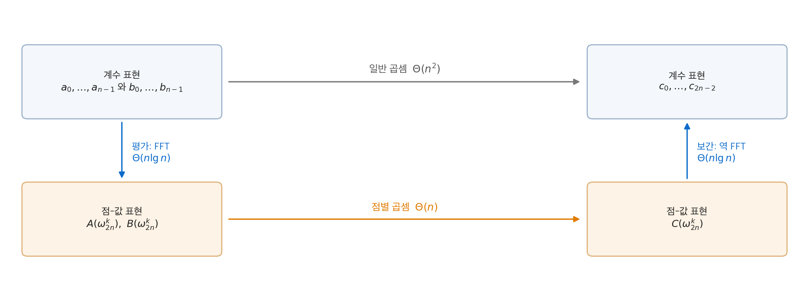
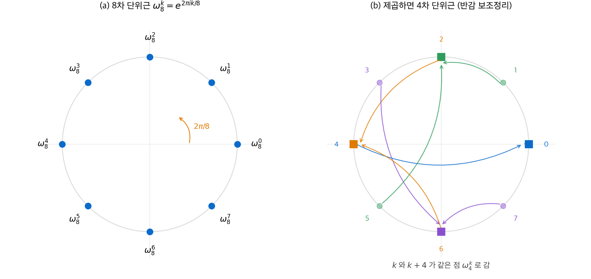
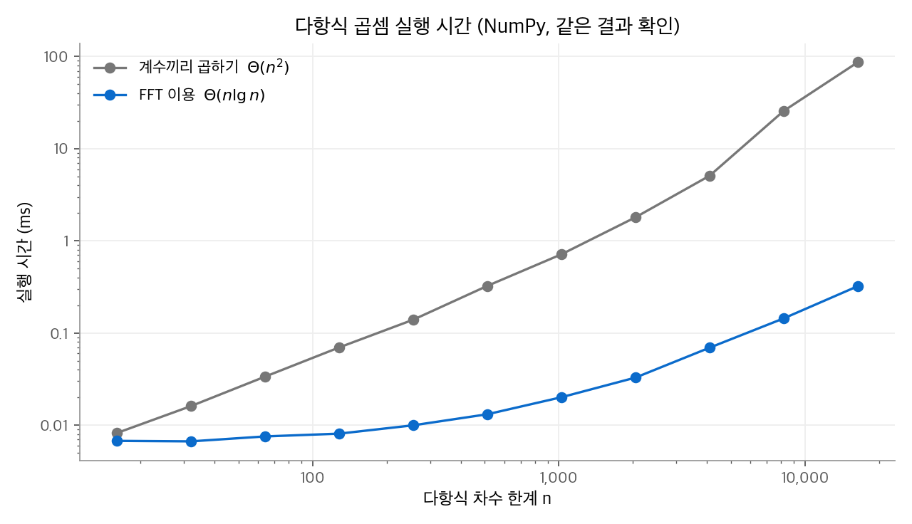
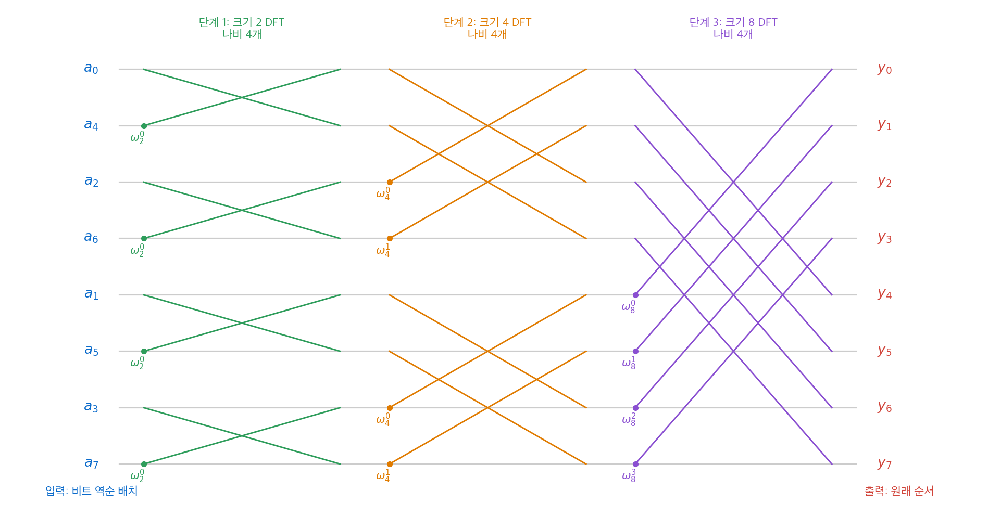

# 30. 다항식과 FFT

차수 한계가 $n$ 인 두 다항식을 더하는 데는 $\Theta(n)$ 시간이 걸립니다. 곱하는 데는 계수끼리 모두 곱해야 하므로 $\Theta(n^2)$ 시간이 걸립니다. 이 장은 **고속 푸리에 변환(FFT, fast Fourier transform)** 으로 곱셈을 $\Theta(n \lg n)$ 시간에 하는 방법을 다룹니다. 핵심 아이디어는 두 가지입니다. 다항식을 계수 대신 "점에서의 값"으로 표현하면 곱셈이 쉬워집니다. 그리고 점을 복소 단위근으로 고르면 값 계산을 분할 정복으로 빠르게 할 수 있습니다.

!!! info "원문과 자료"
    - 원문: CLRS 4판 30장 Polynomials and the FFT (30.1~30.3)
    - 이 교재의 관련 장: [4. 분할 정복](04-divide-and-conquer.md)(마스터 정리)
    - 함께 읽기: [선형대수 5장 고유값과 고유벡터](../../math/linear-algebra/05-eigenvalues.md)(복소수와 푸리에 행렬), [합성곱 신경망](../../ai/d2l/04-cnn.md)(합성곱 연산)
    - 이 장의 코드와 수치는 Python으로 실행해 NumPy 결과와 비교했습니다.

## 1. 다항식의 두 가지 표현

### 계수 표현

차수 한계 $n$ 인 다항식은 다음과 같습니다. **차수 한계(degree-bound)** 는 차수보다 큰 아무 정수입니다. 차수 한계가 $n$ 이면 차수는 0부터 $n-1$ 사이입니다.

$$
A(x) = \sum_{j=0}^{n-1} a_j x^j
$$

**계수 표현**은 벡터 $a = (a_0, a_1, \ldots, a_{n-1})$ 입니다. 이 표현에서 연산 비용은 다음과 같습니다.

- **평가**: 한 점 $x_0$ 에서의 값은 Horner 규칙 $A(x_0) = a_0 + x_0(a_1 + x_0(a_2 + \cdots + x_0 a_{n-1}))$ 으로 $\Theta(n)$ 시간에 계산합니다.
- **덧셈**: 계수끼리 더하므로 $\Theta(n)$ 시간입니다.
- **곱셈**: $C(x) = A(x)B(x)$ 의 계수는 다음과 같습니다.

$$
c_j = \sum_{k=0}^{j} a_k b_{j-k}
$$

이 벡터 $c$ 를 $a$ 와 $b$ 의 **합성곱(convolution)** $c = a \otimes b$ 라고 합니다. 계산에 $\Theta(n^2)$ 시간이 걸리고, $C$ 의 차수 한계는 $2n - 1$ 입니다.

### 점-값 표현

**점-값 표현**은 서로 다른 점 $n$ 개에서의 값입니다.

$$
\{(x_0, y_0), (x_1, y_1), \ldots, (x_{n-1}, y_{n-1})\}, \qquad y_k = A(x_k)
$$

서로 다른 점 $n$ 개에서의 값은 차수 한계 $n$ 인 다항식을 하나로 결정합니다(정리 30.1). 이유는 방정식 $V a = y$ 의 행렬 $V$ 가 **Vandermonde 행렬**이기 때문입니다.

$$
V = \begin{pmatrix}
1 & x_0 & x_0^2 & \cdots & x_0^{n-1} \\
1 & x_1 & x_1^2 & \cdots & x_1^{n-1} \\
\vdots & & & & \vdots \\
1 & x_{n-1} & x_{n-1}^2 & \cdots & x_{n-1}^{n-1}
\end{pmatrix},
\qquad
\det V = \prod_{j < k} (x_k - x_j) \neq 0
$$

점이 서로 다르면 $V$ 는 가역입니다. 점-값 표현에서 계수 표현으로 돌아가는 일을 **보간(interpolation)** 이라고 합니다. Lagrange 공식을 쓰면 보간에 $\Theta(n^2)$ 시간이 걸립니다.

점-값 표현에서는 곱셈이 쉽습니다. 같은 점에서 값끼리 곱하면 됩니다. 다만 $C$ 의 차수 한계가 $2n - 1$ 이므로 처음부터 점을 $2n$ 개 써야 합니다.

$$
C(x_k) = A(x_k)\, B(x_k), \qquad k = 0, 1, \ldots, 2n-1
$$

이 곱셈은 $\Theta(n)$ 시간입니다.

### 전체 전략

계수 표현으로 입력을 받아 계수 표현으로 답을 내야 합니다. 그래서 다음 세 단계로 곱합니다.

1. **평가**: $A$ 와 $B$ 를 $2n$ 개의 점에서 평가합니다.
2. **점별 곱셈**: 값을 점마다 곱해 $C$ 의 점-값 표현을 얻습니다.
3. **보간**: $C$ 의 계수를 구합니다.

<figure markdown>

<figcaption markdown>
<span class="fig-title"><b>Figure 1.</b> FFT로 다항식을 곱하는 경로</span>

위쪽 직접 곱셈($\Theta(n^2)$) 대신 아래쪽으로 돌아가면 평가와 보간을 FFT로 하여 전체가 $\Theta(n \lg n)$ 입니다.
</figcaption>
</figure>

점을 아무렇게나 고르면 1단계와 3단계가 각각 $\Theta(n^2)$ 입니다. 점을 복소 단위근으로 고르면 두 단계 모두 $\Theta(n \lg n)$ 이 됩니다.

## 2. 복소 단위근

### 정의

$\omega^n = 1$ 을 만족하는 복소수 $\omega$ 를 **$n$ 차 단위근** 이라고 합니다. $n$ 차 단위근은 정확히 $n$ 개이고, $k = 0, 1, \ldots, n-1$ 에 대해 $e^{2\pi i k / n}$ 입니다. 이 가운데 **주 $n$ 차 단위근**은 다음과 같습니다.

$$
\omega_n = e^{2\pi i / n} = \cos(2\pi/n) + i \sin(2\pi/n)
$$

나머지 단위근은 모두 $\omega_n$ 의 거듭제곱 $\omega_n^0, \omega_n^1, \ldots, \omega_n^{n-1}$ 입니다. 단위근은 복소평면의 단위원 위에 같은 간격으로 놓입니다. 곱셈은 각도를 더하는 연산이므로 지수는 $n$ 을 법으로 순환합니다.

### FFT를 가능하게 하는 세 보조정리

| 보조정리 | 식 | 의미 |
| --- | --- | --- |
| 소거 보조정리 | $\omega_{dn}^{dk} = \omega_n^k$ | 분수 $k/n$ 을 약분해도 같은 점 |
| 반감 보조정리 | $(\omega_n^{k})^2 = (\omega_n^{k + n/2})^2 = \omega_{n/2}^k$ | $n$ 개의 $n$ 차 단위근을 제곱하면 $n/2$ 차 단위근 $n/2$ 개가 두 번씩 나옴 |
| 합 보조정리 | $\sum_{j=0}^{n-1} (\omega_n^k)^j = 0$ ($n \nmid k$) | 역변환에서 대각 성분만 남게 함 |

반감 보조정리는 소거 보조정리에서 나옵니다. $\omega_n^{n/2} = \omega_2 = -1$ 이므로 $\omega_n^{k + n/2} = -\omega_n^k$ 이고, 두 수의 제곱은 같습니다.

<figure markdown>

<figcaption markdown>
<span class="fig-title"><b>Figure 2.</b> 8차 단위근과 반감 보조정리</span>

8차 단위근은 단위원을 8등분하고(a), 제곱하면 $k$ 와 $k+4$ 가 같은 4차 단위근으로 모입니다(b).
</figcaption>
</figure>

## 3. DFT와 FFT

### 이산 푸리에 변환

$A$ 를 $n$ 개의 $n$ 차 단위근에서 평가한 벡터 $y = (y_0, \ldots, y_{n-1})$ 를 계수 벡터 $a$ 의 **이산 푸리에 변환(DFT)** 이라고 합니다. $y = \text{DFT}_n(a)$ 로 씁니다. 여기서 $n$ 은 2의 거듭제곱이라고 가정합니다.

$$
y_k = A(\omega_n^k) = \sum_{j=0}^{n-1} a_j\, \omega_n^{kj}
$$

### 짝수 항과 홀수 항으로 나누기

$A$ 를 짝수 번째 계수와 홀수 번째 계수로 나눕니다.

$$
A^{\text{even}}(x) = a_0 + a_2 x + a_4 x^2 + \cdots + a_{n-2} x^{n/2-1}
$$

$$
A^{\text{odd}}(x) = a_1 + a_3 x + a_5 x^2 + \cdots + a_{n-1} x^{n/2-1}
$$

그러면 다음이 성립합니다.

$$
A(x) = A^{\text{even}}(x^2) + x\, A^{\text{odd}}(x^2)
$$

$A$ 를 $\omega_n^0, \ldots, \omega_n^{n-1}$ 에서 평가하는 문제는 두 문제로 바뀝니다. 차수 한계 $n/2$ 인 두 다항식을 $(\omega_n^0)^2, \ldots, (\omega_n^{n-1})^2$ 에서 평가하는 문제입니다. 반감 보조정리에 따라 이 제곱값은 $n/2$ 차 단위근 $n/2$ 개뿐입니다. 따라서 두 부분 문제는 원래 문제와 같은 꼴이고 크기가 절반입니다.

$k < n/2$ 이면 $\omega_n^{k+n/2} = -\omega_n^k$ 이므로 결과를 이렇게 합칩니다.

$$
y_k = y_k^{\text{even}} + \omega_n^k\, y_k^{\text{odd}}, \qquad
y_{k+n/2} = y_k^{\text{even}} - \omega_n^k\, y_k^{\text{odd}}
$$

곱하는 계수 $\omega_n^k$ 를 **회전 인자(twiddle factor)** 라고 합니다. 재귀 관계는 $T(n) = 2T(n/2) + \Theta(n)$ 이고, 마스터 정리로 $T(n) = \Theta(n \lg n)$ 입니다.

```python
import cmath

def fft(a):
    n = len(a)                      # n은 2의 거듭제곱
    if n == 1:
        return list(a)
    wn = cmath.exp(2j * cmath.pi / n)
    y0, y1 = fft(a[0::2]), fft(a[1::2])
    y, w = [0] * n, 1
    for k in range(n // 2):
        t = w * y1[k]               # 나비 연산
        y[k], y[k + n // 2] = y0[k] + t, y0[k] - t
        w *= wn
    return y
```

교재는 $\omega_n = e^{+2\pi i/n}$ 을 씁니다. NumPy의 `np.fft.fft` 는 $e^{-2\pi i/n}$ 을 쓰므로, 이 `fft(a)` 는 `n * np.fft.ifft(a)` 와 같습니다.

### 역 DFT: 보간도 FFT로

DFT는 Vandermonde 행렬 $V_n$ 의 곱 $y = V_n a$ 이고, $(V_n)_{kj} = \omega_n^{kj}$ 입니다. 합 보조정리로 역행렬을 바로 구합니다(정리 30.7).

$$
(V_n^{-1})_{jk} = \frac{\omega_n^{-kj}}{n},
\qquad
a_j = \frac{1}{n} \sum_{k=0}^{n-1} y_k\, \omega_n^{-kj}
$$

$V_n^{-1} V_n$ 의 $(j', j)$ 성분은 $\frac{1}{n}\sum_k \omega_n^{k(j - j')}$ 입니다. $j = j'$ 이면 1, 아니면 합 보조정리로 0입니다. 역 DFT는 $\omega_n$ 을 $\omega_n^{-1}$ 로 바꾸고 결과를 $n$ 으로 나눈 FFT입니다. 따라서 보간도 $\Theta(n \lg n)$ 입니다.

### 합성곱 정리

세 단계를 하나의 식으로 쓰면 **합성곱 정리**입니다. 길이 $n$ 인 $a$, $b$ 뒤에 0을 채워 길이 $2n$ 으로 만든 뒤 계산합니다.

$$
a \otimes b = \text{DFT}_{2n}^{-1}\big(\text{DFT}_{2n}(a) \cdot \text{DFT}_{2n}(b)\big)
$$

여기서 $\cdot$ 은 성분별 곱입니다.

### 손계산 예시

$A(x) = 1 + 2x$, $B(x) = 3 + 4x$ 를 곱합니다. 곱의 차수 한계가 3이므로 2의 거듭제곱인 $n = 4$ 를 씁니다. $\omega_4 = i$ 이고 점은 $1, i, -1, -i$ 입니다.

| 점 | $A$ | $B$ | $C = AB$ |
| --- | --- | --- | --- |
| $1$ | $3$ | $7$ | $21$ |
| $i$ | $1 + 2i$ | $3 + 4i$ | $-5 + 10i$ |
| $-1$ | $-1$ | $-1$ | $1$ |
| $-i$ | $1 - 2i$ | $3 - 4i$ | $-5 - 10i$ |

역 DFT로 계수를 구합니다.

- $c_0 = \frac{1}{4}(21 + (-5 + 10i) + 1 + (-5 - 10i)) = 3$
- $c_1 = \frac{1}{4}(21 + (-5 + 10i)(-i) + 1 \cdot (-1) + (-5 - 10i)(i)) = \frac{1}{4}(21 + 10 + 5i - 1 + 10 - 5i) = 10$
- $c_2 = 8$, $c_3 = 0$

결과 $C(x) = 3 + 10x + 8x^2$ 은 직접 전개한 $(1 + 2x)(3 + 4x)$ 와 같습니다.

### 실행 시간 비교

<figure markdown>

<figcaption markdown>
<span class="fig-title"><b>Figure 3.</b> 직접 곱셈과 FFT 곱셈의 실행 시간</span>

로그-로그 축에서 직접 곱셈은 기울기 약 2로, FFT 곱셈은 거의 기울기 1로 늘어나며 $n = 16{,}384$ 에서 약 265배 차이가 납니다.
</figcaption>
</figure>

직접 곱셈은 길이 $n$ 벡터 덧셈을 $n$ 번 하는 NumPy 코드입니다. 두 방법의 결과는 모든 $n$ 에서 같았습니다.

## 4. FFT 회로와 반복형 FFT

### 나비 연산

FFT 코드의 반복문에서 $\omega_n^k y_k^{\text{odd}}$ 를 한 번만 계산해 $t$ 에 저장합니다. 그 뒤 $y_k^{\text{even}} + t$ 와 $y_k^{\text{even}} - t$ 를 출력합니다. 이 연산을 **나비 연산(butterfly operation)** 이라고 합니다. 두 입력선과 두 출력선이 X자로 교차하는 모양 때문에 붙은 이름입니다.

### 입력을 비트 역순으로 놓기

재귀 호출 트리의 잎을 왼쪽부터 읽으면 입력 순서는 $a_0, a_4, a_2, a_6, a_1, a_5, a_3, a_7$ 입니다. 각 첨자를 3비트로 쓰고 비트 순서를 뒤집으면 0, 1, 2, …, 7이 됩니다. 예를 들어 $1 = 001_2$ 는 $100_2 = 4$ 번째 자리에 갑니다. 이 순서를 **비트 역순 순열(bit-reversal permutation)** 이라고 합니다.

입력을 처음에 비트 역순으로 놓으면 재귀 없이 아래에서 위로 계산할 수 있습니다. 크기 2인 DFT를 모두 만들고, 그 둘씩을 합쳐 크기 4인 DFT를 만드는 식입니다.

<figure markdown>

<figcaption markdown>
<span class="fig-title"><b>Figure 4.</b> $n = 8$ FFT 회로</span>

비트 역순으로 놓인 입력이 나비 연산 단계 $\lg 8 = 3$ 개를 지나면 원래 순서의 DFT가 나옵니다. 각 단계에는 나비 연산이 4개 있습니다.
</figcaption>
</figure>

### 회로의 깊이와 크기

- 단계는 $\lg n$ 개이고, 각 단계의 나비 연산 $n/2$ 개는 서로 독립이므로 동시에 실행할 수 있습니다.
- 나비 연산 하나의 깊이는 상수입니다. 따라서 회로 깊이는 $\Theta(\lg n)$ 입니다.
- 나비 연산은 모두 $\frac{n}{2}\lg n$ 개이므로 회로 크기는 $\Theta(n \lg n)$ 입니다.

신호 처리 하드웨어는 이 구조를 그대로 회로로 만듭니다. 소프트웨어 구현도 같은 순서로 반복문을 돕니다.

```python
def bit_reverse(a):
    n = len(a); b = n.bit_length() - 1
    return [a[int(format(k, f"0{b}b")[::-1], 2)] for k in range(n)]

def fft_iterative(a):
    n = len(a); A = bit_reverse(a); m = 2
    while m <= n:                          # 단계: 크기 m DFT 만들기
        wm = cmath.exp(2j * cmath.pi / m)
        for g in range(0, n, m):           # 크기 m 블록마다
            w = 1
            for j in range(m // 2):        # 블록 안의 나비 연산
                t = w * A[g + j + m // 2]
                A[g + j], A[g + j + m // 2] = A[g + j] + t, A[g + j] - t
                w *= wm
        m *= 2
    return A
```

무작위 길이 16 입력에서 `fft_iterative` 와 재귀형 `fft` 의 결과가 같았습니다.

## 5. 정리

| 단계 | 방법 | 시간 |
| --- | --- | --- |
| 계수 → 점-값 (평가) | $2n$ 차 단위근에서 FFT | $\Theta(n \lg n)$ |
| 점별 곱셈 | 값끼리 곱하기 | $\Theta(n)$ |
| 점-값 → 계수 (보간) | $\omega^{-1}$ 로 FFT 후 $n$ 으로 나누기 | $\Theta(n \lg n)$ |

FFT가 빠른 이유는 반감 보조정리 하나로 요약됩니다. 단위근을 제곱하면 개수가 절반이 되므로, 평가할 점 집합이 재귀마다 절반으로 줄어듭니다. 큰 정수 곱셈, 신호의 합성곱, 오디오·영상 압축이 모두 이 구조를 씁니다.
