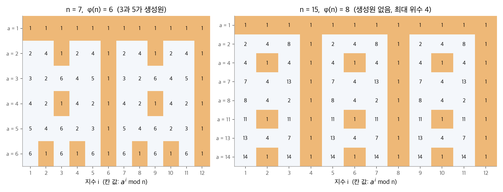
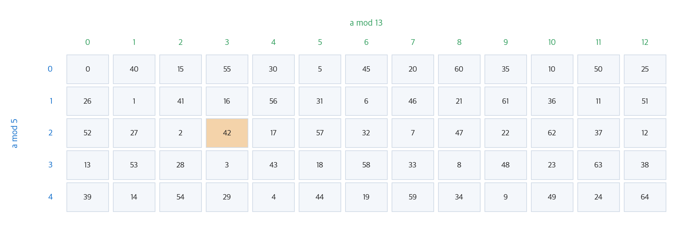
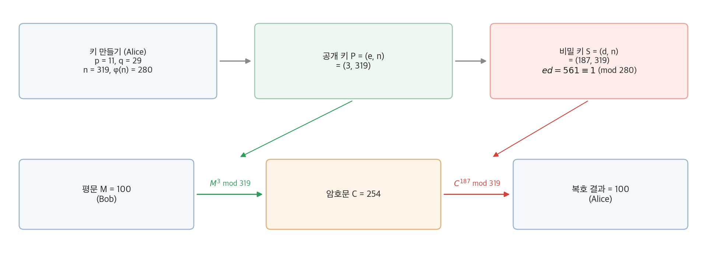
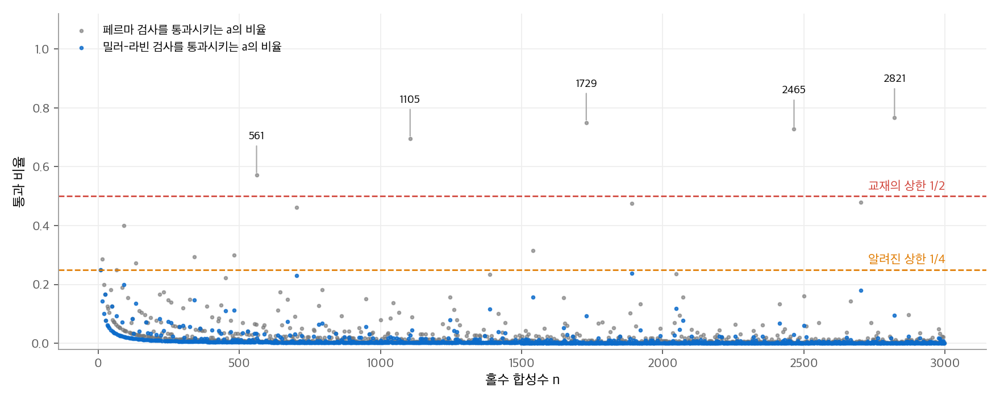

# 31. 정수론 알고리즘

정수론 알고리즘은 공개 키 암호의 바탕입니다. 이 장에서 "빠르다"의 기준이 다른 장과 다릅니다. 입력이 큰 정수 몇 개이므로 입력 크기는 수의 개수가 아니라 **비트 수** $\beta \approx \lg n$ 입니다. 따라서 $n$ 에 대한 다항 시간은 $\beta$ 에 대한 지수 시간입니다. 좋은 알고리즘은 $\beta$ 에 대한 다항 시간, 예를 들어 $O(\beta^3)$ 비트 연산에 끝나야 합니다. 이 장은 최대공약수, 모듈러 연산, 모듈러 거듭제곱을 거쳐 RSA 암호와 Miller-Rabin 소수 판정에 이릅니다.

!!! info "원문과 자료"
    - 원문: CLRS 4판 31장 Number-Theoretic Algorithms (31.1~31.8)
    - 이 교재의 관련 장: [5. 확률적 분석과 무작위 알고리즘](05-randomized.md)
    - 함께 읽기: [확률론 2장 확률 변수와 분포](../../math/probability/02-random-variables.md)(기하 분포, 소수를 찾을 때까지의 시행 횟수)
    - 이 장의 수치 예시는 모두 Python `pow` 와 직접 짠 코드로 확인했습니다.

## 1. 기본 개념

### 나눗셈 정리와 합동

정수 $a$ 와 양의 정수 $n$ 에 대해 $a = qn + r$, $0 \leq r < n$ 을 만족하는 $q = \lfloor a/n \rfloor$ 와 $r = a \bmod n$ 이 하나씩만 있습니다(나눗셈 정리). $a \bmod n = b \bmod n$ 이면 $a \equiv b \pmod{n}$ 으로 쓰고 **합동**이라고 합니다.

- $d \mid a$ 는 $d$ 가 $a$ 를 나눈다는 뜻입니다.
- 약수가 1과 자신뿐인 1보다 큰 정수가 **소수**이고, 나머지(1보다 큰 수)가 **합성수**입니다.
- $\gcd(a, b) = 1$ 이면 $a$ 와 $b$ 는 **서로소**입니다.

### 최대공약수의 선형 결합 성질

$a$ 와 $b$ 가 0이 아니면, $\gcd(a, b)$ 는 선형 결합 $\{ax + by : x, y \in \mathbb{Z}\}$ 의 가장 작은 양수입니다(정리 31.2). 이 정리에서 두 가지가 바로 나옵니다.

- $d \mid a$ 이고 $d \mid b$ 이면 $d \mid \gcd(a, b)$ 입니다.
- 소수 $p$ 가 $ab$ 를 나누면 $p \mid a$ 또는 $p \mid b$ 입니다. 이것으로 **소인수 분해의 유일성**을 증명합니다. 예를 들어 $6000 = 2^4 \cdot 3 \cdot 5^3$ 이고, 다른 분해는 없습니다.

## 2. 유클리드 알고리즘

### 재귀 정리

핵심 등식은 $\gcd(a, b) = \gcd(b, a \bmod b)$ 입니다(정리 31.9). $a$ 와 $b$ 의 공약수는 $a - \lfloor a/b \rfloor b = a \bmod b$ 도 나누기 때문입니다.

```python
def euclid(a, b):
    return a if b == 0 else euclid(b, a % b)
```

$\gcd(30, 21)$ 은 $\gcd(21, 9) \to \gcd(9, 3) \to \gcd(3, 0) = 3$ 으로 끝납니다.

### 실행 시간과 피보나치 수

호출이 한 번 일어날 때마다 수가 빠르게 줄어듭니다. **Lamé 정리**(정리 31.11)는 $a > b \geq 1$ 이고 $b < F_{k+1}$ 이면 재귀 호출이 $k$ 번보다 적다고 말합니다. $F_k$ 는 피보나치 수입니다. 최악의 입력은 연속한 피보나치 수입니다. $F_k \approx \phi^k / \sqrt{5}$ ($\phi \approx 1.618$) 이므로 호출 횟수는 $O(\lg b)$ 입니다. $\beta$ 비트 수에서 산술 연산은 $O(\beta)$ 번, 비트 연산은 $O(\beta^3)$ 번입니다.

### 확장 유클리드 알고리즘

$d = \gcd(a, b) = ax + by$ 를 만족하는 계수 $x$, $y$ 까지 구합니다. 재귀 호출이 $d = bx' + (a \bmod b)y'$ 를 돌려주면, $a \bmod b = a - \lfloor a/b \rfloor b$ 를 대입해 정리합니다.

$$
d = a y' + b\big(x' - \lfloor a/b \rfloor y'\big)
\quad\Rightarrow\quad
x = y', \quad y = x' - \lfloor a/b \rfloor y'
$$

```python
def extended_euclid(a, b):
    if b == 0:
        return a, 1, 0
    d, x, y = extended_euclid(b, a % b)
    return d, y, x - (a // b) * y
```

$\gcd(99, 78)$ 을 따라갑니다. 위에서 아래로 호출하고, 계수 $x$, $y$ 는 아래에서 위로 채웁니다.

| $a$ | $b$ | $\lfloor a/b \rfloor$ | $d$ | $x$ | $y$ |
| --- | --- | --- | --- | --- | --- |
| 99 | 78 | 1 | 3 | −11 | 14 |
| 78 | 21 | 3 | 3 | 3 | −11 |
| 21 | 15 | 1 | 3 | −2 | 3 |
| 15 | 6 | 2 | 3 | 1 | −2 |
| 6 | 3 | 2 | 3 | 0 | 1 |
| 3 | 0 | – | 3 | 1 | 0 |

검산: $99 \cdot (-11) + 78 \cdot 14 = -1089 + 1092 = 3$ 입니다.

## 3. 모듈러 연산과 군

### 두 유한군

**군(group)** 은 결합 법칙, 항등원, 역원을 갖춘 연산과 집합의 쌍입니다. 정수론 알고리즘은 두 유한군을 씁니다.

- **덧셈군** $(\mathbb{Z}_n, +_n)$: 원소는 $0, 1, \ldots, n-1$ 이고 크기는 $n$ 입니다.
- **곱셈군** $(\mathbb{Z}_n^*, \cdot_n)$: $n$ 과 서로소인 원소만 모읍니다. $\mathbb{Z}_{15}^* = \{1, 2, 4, 7, 8, 11, 13, 14\}$ 입니다. 크기는 **오일러 피 함수** $\varphi(n)$ 입니다.

$$
\varphi(n) = n \prod_{p \mid n} \left(1 - \frac{1}{p}\right)
$$

$\varphi(15) = 15 \cdot \frac{2}{3} \cdot \frac{4}{5} = 8$ 이고, 소수 $p$ 이면 $\varphi(p) = p - 1$ 입니다. $\mathbb{Z}_n^*$ 의 원소 $a$ 는 역원을 가집니다. 확장 유클리드가 $ax + ny = 1$ 의 $x$ 를 주므로 $a^{-1} \equiv x \pmod{n}$ 입니다.

### 부분군과 원소의 위수

**Lagrange 정리**: 유한군 $S$ 의 부분군 $S'$ 의 크기는 $|S|$ 를 나눕니다. 원소 $a$ 의 거듭제곱 $a, a^2, a^3, \ldots$ 이 만드는 부분군 $\langle a \rangle$ 의 크기를 $a$ 의 **위수** $\text{ord}(a)$ 라고 합니다. 위수는 $a^t = 1$ 인 가장 작은 $t$ 이기도 합니다. 따라서 $\text{ord}(a)$ 는 $|S|$ 를 나누고, 다음 두 정리가 나옵니다.

$$
\text{오일러 정리:}\ a^{\varphi(n)} \equiv 1 \pmod{n}\ \ (a \in \mathbb{Z}_n^*)
\qquad
\text{페르마 정리:}\ a^{p-1} \equiv 1 \pmod{p}\ \ (p \text{ 소수})
$$

$\text{ord}(a) = \varphi(n)$ 인 $a$ 를 **생성원**(원시근)이라고 합니다. 생성원이 있으면 $\mathbb{Z}_n^*$ 은 순환군입니다. 생성원이 있는 $n$ 은 $2, 4, p^e, 2p^e$ ($p$ 는 홀수 소수) 뿐입니다.

<figure markdown>

<figcaption markdown>
<span class="fig-title"><b>Figure 1.</b> 거듭제곱의 주기</span>

주황 칸은 $a^i \equiv 1$ 입니다. $\mathbb{Z}_7^*$ 에서 3과 5는 위수 6인 생성원이고, $\mathbb{Z}_{15}^*$ 에는 위수 8인 원소가 없습니다.
</figcaption>
</figure>

모든 위수가 $\varphi(n)$ 의 약수인 것을 표에서 확인할 수 있습니다. $n = 7$ 의 위수는 1, 2, 3, 6이고, $n = 15$ 의 위수는 1, 2, 4입니다.

## 4. 모듈러 선형 방정식과 중국인의 나머지 정리

### $ax \equiv b \pmod{n}$ 풀기

$d = \gcd(a, n)$ 이라고 합시다. 해가 있을 필요충분조건은 $d \mid b$ 이고, 해가 있으면 $n$ 을 법으로 정확히 $d$ 개입니다(따름정리 31.22~31.24). 확장 유클리드로 $d = ax' + ny'$ 를 구하면 해는 다음과 같습니다.

$$
x_0 = x' \frac{b}{d} \bmod n, \qquad x_i = x_0 + i \frac{n}{d} \quad (i = 0, 1, \ldots, d-1)
$$

예를 들어 $14x \equiv 30 \pmod{100}$ 에서 $d = 2$ 이고 $2 \mid 30$ 입니다. $2 = 14 \cdot (-7) + 100 \cdot 1$ 이므로 $x_0 = (-7)(15) \bmod 100 = 95$ 입니다. 두 해는 95와 45입니다. 검산: $14 \cdot 95 = 1330 \equiv 30$, $14 \cdot 45 = 630 \equiv 30$ 입니다.

### 중국인의 나머지 정리

$n = n_1 n_2 \cdots n_k$ 이고 $n_i$ 가 쌍마다 서로소이면 다음 대응은 일대일입니다(정리 31.27).

$$
a \bmod n \ \longleftrightarrow\ (a \bmod n_1,\ a \bmod n_2,\ \ldots,\ a \bmod n_k)
$$

덧셈과 곱셈도 성분마다 따로 할 수 있습니다. 큰 법 $n$ 의 계산을 작은 법 여러 개의 계산으로 쪼갤 수 있다는 뜻입니다. 거꾸로 가는 공식은 다음과 같습니다. $m_i = n / n_i$ 이고 $c_i = m_i (m_i^{-1} \bmod n_i)$ 입니다.

$$
a \equiv a_1 c_1 + a_2 c_2 + \cdots + a_k c_k \pmod{n}
$$

**예**: $a \equiv 2 \pmod{5}$, $a \equiv 3 \pmod{13}$ 을 풉니다. $n = 65$, $m_1 = 13$, $m_2 = 5$ 입니다. $13^{-1} \equiv 2 \pmod{5}$ 이므로 $c_1 = 26$, $5^{-1} \equiv 8 \pmod{13}$ 이므로 $c_2 = 40$ 입니다. $a \equiv 2 \cdot 26 + 3 \cdot 40 = 172 \equiv 42 \pmod{65}$ 입니다.

<figure markdown>

<figcaption markdown>
<span class="fig-title"><b>Figure 2.</b> 중국인의 나머지 정리, $n = 5 \cdot 13$</span>

0부터 64까지의 수가 (mod 5, mod 13) 칸 65개에 하나씩 들어갑니다. 주황 칸 (2, 3)이 42입니다.
</figcaption>
</figure>

## 5. 모듈러 거듭제곱

$a^b \bmod n$ 을 $b$ 번 곱하면 $b$ 에 비례하는 시간, 즉 비트 수에 지수인 시간이 걸립니다. **반복 제곱법(repeated squaring)** 은 $b$ 의 이진 표현을 왼쪽부터 읽습니다. 비트마다 지금 값을 제곱하고, 비트가 1이면 $a$ 를 한 번 더 곱합니다. 곱셈은 최대 $2\beta$ 번이고 비트 연산은 $O(\beta^3)$ 입니다.

```python
def modular_exponentiation(a, b, n):
    d = 1
    for bit in bin(b)[2:]:          # 최상위 비트부터
        d = d * d % n
        if bit == "1":
            d = d * a % n
    return d
```

$7^{560} \bmod 561$ 을 계산합니다. $560 = 1000110000_2$ 입니다.

| 비트 | 1 | 0 | 0 | 0 | 1 | 1 | 0 | 0 | 0 | 0 |
| --- | --- | --- | --- | --- | --- | --- | --- | --- | --- | --- |
| $d$ | 7 | 49 | 157 | 526 | 160 | 241 | 298 | 166 | 67 | 1 |

결과는 1입니다. 이 값은 7절에서 다시 씁니다.

## 6. RSA 공개 키 암호

### 공개 키 암호의 구조

참여자마다 **공개 키** $P$ 와 **비밀 키** $S$ 가 있습니다. 두 키는 서로 역함수인 변환을 정합니다. 모든 메시지 $M$ 에 대해 $S(P(M)) = M$ 이고 $P(S(M)) = M$ 입니다. 공개 키는 누구나 알고, 비밀 키에 해당하는 함수는 주인만 빠르게 계산할 수 있어야 합니다.

- **암호화**: Bob은 Alice의 공개 키로 $C = P_A(M)$ 을 보냅니다. Alice만 $M = S_A(C)$ 로 복호합니다.
- **디지털 서명**: Alice는 $\sigma = S_A(M')$ 을 메시지에 붙입니다. 누구나 $P_A(\sigma) = M'$ 인지 확인할 수 있습니다. 메시지가 한 비트라도 바뀌면 검증에 실패합니다.

### RSA 키 만들기

1. 큰 소수 $p$ 와 $q$ 를 무작위로 고릅니다(7절의 소수 판정을 씁니다).
2. $n = pq$ 와 $\varphi(n) = (p-1)(q-1)$ 을 계산합니다.
3. $\varphi(n)$ 과 서로소인 작은 홀수 $e$ 를 고릅니다.
4. 확장 유클리드로 $d = e^{-1} \bmod \varphi(n)$ 을 구합니다.
5. 공개 키는 $P = (e, n)$, 비밀 키는 $S = (d, n)$ 입니다.

변환은 $P(M) = M^e \bmod n$, $S(C) = C^d \bmod n$ 입니다. 둘 다 5절의 반복 제곱법으로 계산합니다.

### 작은 수로 따라가기

$p = 11$, $q = 29$ 로 키를 만듭니다. $n = 319$, $\varphi(n) = 280$ 입니다. $e = 3$ 은 280과 서로소입니다. $3d \equiv 1 \pmod{280}$ 의 해는 $d = 187$ 입니다($3 \cdot 187 = 561 = 2 \cdot 280 + 1$).

<figure markdown>

<figcaption markdown>
<span class="fig-title"><b>Figure 3.</b> RSA 예시, $n = 319$</span>

Bob은 공개 키 (3, 319)로 $M = 100$ 을 $C = 254$ 로 암호화하고, Alice는 비밀 키 (187, 319)로 100을 되찾습니다.
</figcaption>
</figure>

### 왜 복호가 맞는가

$ed = 1 + k(p-1)(q-1)$ 입니다. $M \not\equiv 0 \pmod{p}$ 이면 페르마 정리로 다음이 성립합니다.

$$
M^{ed} = M \cdot \big(M^{p-1}\big)^{k(q-1)} \equiv M \cdot 1 = M \pmod{p}
$$

$M \equiv 0 \pmod{p}$ 이면 양변이 모두 0이므로 역시 성립합니다. $q$ 에 대해서도 같습니다. 중국인의 나머지 정리로 두 합동을 합치면 $M^{ed} \equiv M \pmod{n}$ 입니다(정리 31.36).

### 안전성과 실행 시간

$n$ 을 인수분해할 수 있으면 $\varphi(n)$ 과 $d$ 를 계산할 수 있습니다. 따라서 RSA의 안전성은 큰 수의 인수분해가 어렵다는 가정에 기댑니다. 반대 방향, 즉 "인수분해가 어려우면 RSA를 깨기도 어렵다"는 증명되지 않았습니다. 교재는 2021년 기준으로 RSA 법 $n$ 이 보통 2048~4096비트라고 적습니다. 공개 키 연산은 $e$ 가 작으므로 곱셈 $O(1)$ 번, 비밀 키 연산은 $O(\beta)$ 번입니다. RSA는 대칭 키 암호보다 느립니다. 실제로는 RSA로 짧은 대칭 키만 암호화하는 혼합 방식을 쓰고, 서명할 때는 메시지 대신 메시지의 해시에 서명합니다.

## 7. 소수 판정

### 소수는 드물지 않다

$n$ 이하 소수의 개수 $\pi(n)$ 은 **소수 정리**에 따라 $n / \ln n$ 에 가깝습니다. $n = 10^9$ 에서 $\pi(n) = 50{,}847{,}534$ 이고 $n / \ln n \approx 48{,}254{,}942$ 로, 오차가 6% 미만입니다. $n$ 근처의 무작위 수가 소수일 확률은 약 $1 / \ln n$ 입니다. 기하 분포에 따라 소수 하나를 찾을 때까지 평균 $\ln n$ 개를 시험합니다. 1024비트 소수를 찾으려면 약 $\ln 2^{1024} \approx 710$ 개, 홀수만 고르면 그 절반을 시험합니다.

$\sqrt{n}$ 까지 나누어 보는 방법은 $\Theta(\sqrt{n}) = \Theta(2^{\beta/2})$ 시간으로, 비트 수에 지수입니다. 필요한 것은 비트 수에 다항인 판정법입니다.

### 페르마 검사와 그 구멍

페르마 정리의 대우를 씁니다. $a^{n-1} \not\equiv 1 \pmod{n}$ 이면 $n$ 은 확실히 합성수입니다. $a = 2$ 하나만 검사하는 `PSEUDOPRIME` 은 "합성수"라고 답하면 항상 맞습니다. "소수"라고 답하면 $n$ 이 소수이거나 **밑 2 의사소수**입니다. 10,000 미만에서 틀리는 $n$ 은 22개뿐이고 처음 넷은 341, 561, 645, 1105입니다.

밑을 바꾸어도 막을 수 없는 합성수가 있습니다. **Carmichael 수**는 서로소인 모든 $a$ 에 대해 $a^{n-1} \equiv 1$ 인 합성수입니다. 가장 작은 수는 $561 = 3 \cdot 11 \cdot 17$ 이고, 다음은 1105, 1729입니다.

### Miller-Rabin 검사

Miller-Rabin은 두 가지를 고칩니다. 밑 $a$ 를 무작위로 여러 개($s$ 개) 고르고, 페르마 검사 중간에 **1의 비자명한 제곱근**을 찾습니다. 근거는 다음 정리입니다(따름정리 31.35).

> $x^2 \equiv 1 \pmod{n}$ 인데 $x \not\equiv \pm 1 \pmod{n}$ 인 $x$ 가 있으면 $n$ 은 합성수입니다.

소수 $p$ 의 법에서는 $x^2 - 1 = (x - 1)(x + 1) \equiv 0$ 이 $x \equiv \pm 1$ 일 때만 성립하기 때문입니다.

`WITNESS(a, n)` 은 $n - 1 = 2^t u$ ($u$ 는 홀수)로 씁니다. $x_0 = a^u$ 를 계산하고 $t$ 번 제곱합니다. 마지막 값 $x_t = a^{n-1}$ 입니다.

1. 제곱하기 전 값이 $\pm 1$ 이 아닌데 제곱한 값이 1이면 비자명한 제곱근을 찾은 것입니다. 합성수입니다.
2. $x_t \neq 1$ 이면 페르마 검사에 실패한 것입니다. 합성수입니다.
3. 둘 다 아니면 이 $a$ 는 판정을 내리지 못합니다.

**예**: $n = 561$, $a = 7$ 입니다. $560 = 2^4 \cdot 35$ 이고, 수열은 다음과 같습니다.

$$
x_0 = 7^{35} \equiv 241,\quad x_1 \equiv 298,\quad x_2 \equiv 166,\quad x_3 \equiv 67,\quad x_4 \equiv 1 \pmod{561}
$$

$x_4 = 1$ 이므로 페르마 검사는 통과합니다(5절의 결과). 그러나 $67^2 \equiv 1$ 이고 $67 \not\equiv \pm 1$ 이므로 67은 1의 비자명한 제곱근입니다. Miller-Rabin은 561을 합성수로 판정합니다.

```python
def witness(a, n):
    t, u = 0, n - 1
    while u % 2 == 0:
        t, u = t + 1, u // 2
    x = pow(a, u, n)
    for _ in range(t):
        y = x * x % n
        if y == 1 and x not in (1, n - 1):
            return True             # 비자명한 제곱근
        x = y
    return x != 1                   # 페르마 검사 실패

def miller_rabin(n, s):
    import random
    return not any(witness(random.randint(2, n - 2), n) for _ in range(s))
```

### 오류 확률

$n$ 이 홀수 합성수이면 증인(witness)이 되는 $a$ 는 $(n-1)/2$ 개 이상입니다(정리 31.38). 따라서 $s$ 번 시도한 뒤 틀릴 확률은 $2^{-s}$ 이하입니다. 오류는 한쪽으로만 납니다. "합성수"라는 답은 항상 맞습니다. 실제 상한은 이보다 좋아서, 증인이 아닌 $a$ 는 많아야 $1/4$ 입니다.

<figure markdown>

<figcaption markdown>
<span class="fig-title"><b>Figure 4.</b> 합성수를 소수로 오판하게 하는 밑의 비율</span>

3,000 미만 홀수 합성수마다 1~n−1 가운데 검사를 통과시키는 밑의 비율입니다. Carmichael 수는 페르마 검사에서 50% 이상 통과하지만, 밀러-라빈에서는 모든 $n$ 이 1/4 이하입니다.
</figcaption>
</figure>

계산 비용은 $s$ 번의 모듈러 거듭제곱이므로 산술 연산 $O(s\beta)$ 번, 비트 연산 $O(s\beta^3)$ 번입니다.

## 8. 정리

| 알고리즘 | 하는 일 | 비용 ($\beta$ 비트) |
| --- | --- | --- |
| 유클리드 | $\gcd(a, b)$ | 호출 $O(\beta)$ 번 |
| 확장 유클리드 | $ax + by = \gcd(a, b)$ 의 $x, y$, 역원 | 호출 $O(\beta)$ 번 |
| 모듈러 선형 방정식 | $ax \equiv b$ 의 해 $d$ 개 | $O(\beta + \gcd(a, n))$ 산술 연산 |
| 반복 제곱법 | $a^b \bmod n$ | 곱셈 $O(\beta)$ 번, 비트 연산 $O(\beta^3)$ |
| RSA | 공개 키 암호화와 서명 | 비밀 키 연산 $O(\beta^3)$ 비트 연산 |
| Miller-Rabin | 확률적 소수 판정, 오류 $\leq 2^{-s}$ | $O(s \beta^3)$ 비트 연산 |

이 장의 비대칭은 한 문장으로 요약됩니다. 소수인지 확인하기는 쉽고 인수분해하기는 어렵습니다. RSA는 이 차이 위에 서 있습니다.
