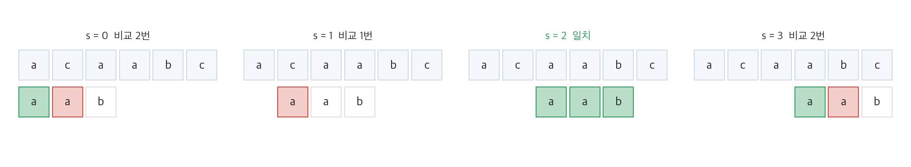
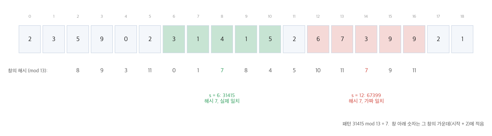
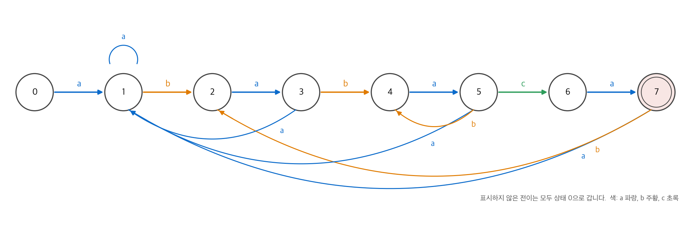
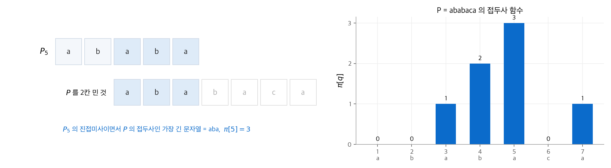
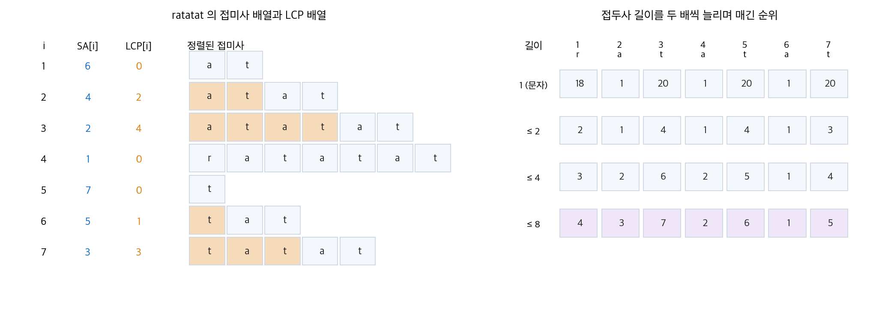

# 32. 문자열 매칭

텍스트 $T[1:n]$ 안에서 패턴 $P[1:m]$ 이 나타나는 위치를 모두 찾는 문제입니다. 편집기의 찾기 기능, DNA 서열 검색, 검색 엔진의 색인이 모두 이 문제를 풉니다. 이 장은 네 가지 방법을 비교합니다. 모든 위치를 확인하는 단순한 방법, 해시로 후보를 거르는 Rabin-Karp, 패턴으로 오토마톤을 만드는 방법, 오토마톤을 압축한 Knuth-Morris-Pratt(KMP)입니다. 마지막으로 4판에 새로 들어온 **접미사 배열**을 다룹니다. 접미사 배열은 텍스트를 한 번 정리해 두고 여러 질문에 답합니다.

!!! info "원문과 자료"
    - 원문: CLRS 4판 32장 String Matching (32.1~32.5)
    - 이 교재의 관련 장: [16. 분할 상환 분석](16-amortized.md)(KMP와 LCP의 퍼텐셜 논증)
    - 이 장의 코드는 모두 Python으로 실행했고, 무작위 텍스트 300개에서 단순한 방법과 결과가 같음을 확인했습니다.

## 1. 문제와 용어

- 문자는 유한 **알파벳** $\Sigma$ 에서 옵니다. 예: $\{0, 1\}$, $\{a, \ldots, z\}$
- $0 \leq s \leq n - m$ 이고 $T[s+1 : s+m] = P[1:m]$ 이면 $s$ 를 **유효 이동(valid shift)** 이라고 합니다. 유효하지 않은 이동은 무효 이동입니다.
- $P_k$ 는 $P$ 의 앞 $k$ 글자, 즉 **접두사** $P[1:k]$ 입니다. $P_0$ 은 빈 문자열 $\varepsilon$ 입니다.
- $w \sqsubset x$ 는 $w$ 가 $x$ 의 접두사, $w \sqsupset x$ 는 $w$ 가 $x$ 의 접미사라는 뜻입니다.

| 알고리즘 | 전처리 시간 | 매칭 시간 |
| --- | --- | --- |
| 단순한 방법 | 0 | $O((n - m + 1)m)$ |
| Rabin-Karp | $\Theta(m)$ | 최악 $O((n - m + 1)m)$, 기대 $O(n + m)$ |
| 유한 오토마톤 | $O(m\lvert\Sigma\rvert)$ | $\Theta(n)$ |
| KMP | $\Theta(m)$ | $\Theta(n)$ |
| 접미사 배열 | $O(n \lg n)$ | 검색 하나에 $O(m \lg n + km)$, $k$ 는 출현 횟수 |

## 2. 단순한 방법

가능한 이동 $n - m + 1$ 개를 모두 확인합니다. 이동마다 최대 $m$ 글자를 비교하므로 최악 시간은 $O((n - m + 1)m)$ 입니다. $m = n/2$ 이면 $\Theta(n^2)$ 입니다.

<figure markdown>

<figcaption markdown>
<span class="fig-title"><b>Figure 1.</b> 단순한 방법, $T$ = acaabc, $P$ = aab</span>

초록은 일치한 글자, 빨강은 처음 어긋난 글자입니다. 네 이동 가운데 $s = 2$ 만 유효합니다.
</figcaption>
</figure>

단순한 방법의 낭비는 정보를 버리는 데 있습니다. $s = 0$ 에서 "$T[1] =$ a" 를 확인했지만 $s = 1$ 에서는 그 사실을 쓰지 않습니다. 나머지 알고리즘은 모두 이 정보를 재활용합니다.

## 3. Rabin-Karp 알고리즘

### 문자열을 수로 보기

$\Sigma = \{0, 1, \ldots, 9\}$ 라고 합시다. 길이 $m$ 인 문자열은 10진수 $m$ 자리 수입니다. 패턴의 값 $p$ 와 각 창의 값 $t_s$ 를 비교하면 문자열 비교를 수 비교로 바꿀 수 있습니다. 창을 한 칸 밀 때 값은 상수 시간에 갱신됩니다. 맨 앞 자리를 빼고, 10을 곱하고, 새 자리를 더합니다.

$$
t_{s+1} = 10\big(t_s - 10^{m-1} T[s+1]\big) + T[s+m+1]
$$

수가 커지는 문제는 소수 $q$ 로 나눈 나머지로 해결합니다. $h = 10^{m-1} \bmod q$ 를 미리 구하고 모든 계산을 $q$ 를 법으로 합니다. 일반 알파벳이면 10 대신 $d = |\Sigma|$ 를 씁니다.

### 가짜 일치

$t_s \equiv p \pmod{q}$ 라고 해서 문자열이 같지는 않습니다. 해시가 같으면 **후보(hit)** 로만 보고 $m$ 글자를 직접 비교합니다. 해시는 같은데 문자열이 다르면 **가짜 일치(spurious hit)** 입니다.

<figure markdown>

<figcaption markdown>
<span class="fig-title"><b>Figure 2.</b> Rabin-Karp, $P$ = 31415, $q = 13$</span>

$31415 \bmod 13 = 7$ 입니다. 해시가 7인 창은 두 개이고, $s = 6$ 은 실제 일치, $s = 12$ 의 67399는 가짜 일치입니다.
</figcaption>
</figure>

```python
def rabin_karp(T, P, d=10, q=13):
    n, m = len(T), len(P)
    h = pow(d, m - 1, q)
    p = t = 0
    for i in range(m):                   # 전처리 Θ(m)
        p = (d * p + int(P[i])) % q
        t = (d * t + int(T[i])) % q
    hits = []
    for s in range(n - m + 1):
        if p == t and T[s:s + m] == P:   # 해시가 같을 때만 직접 비교
            hits.append(s)
        if s < n - m:                    # 창을 한 칸 밀기
            t = (d * (t - int(T[s]) * h) + int(T[s + m])) % q
    return hits
```

### 실행 시간

최악의 경우 모든 창이 후보입니다. 예를 들어 $P = a^m$, $T = a^n$ 이면 모든 이동이 유효하고, 시간은 단순한 방법과 같은 $O((n - m + 1)m)$ 입니다. 보통은 유효 이동이 적습니다. 나머지가 무작위로 흩어진다고 가정하면 가짜 일치는 약 $n/q$ 개입니다. 유효 이동이 $v$ 개일 때 기대 매칭 시간은 다음과 같습니다.

$$
O(n) + O\big(m(v + n/q)\big)
$$

$v = O(1)$ 이고 $q \geq m$ 이면 $O(n)$ 입니다. Rabin-Karp는 여러 패턴을 한 번에 찾거나 2차원 패턴을 찾는 문제로 쉽게 확장됩니다.

## 4. 유한 오토마톤으로 매칭하기

### 접미사 함수

**접미사 함수** $\sigma(x)$ 는 $x$ 의 접미사이면서 $P$ 의 접두사인 가장 긴 문자열의 길이입니다.

$$
\sigma(x) = \max\{k : P_k \sqsupset x\}
$$

$P$ = ab 이면 $\sigma(\text{ccaca}) = 1$, $\sigma(\text{ccab}) = 2$ 입니다. $\sigma(x) = m$ 이면 $x$ 가 $P$ 로 끝납니다.

### 매칭 오토마톤

상태 $q \in \{0, 1, \ldots, m\}$ 는 "지금까지 읽은 텍스트의 끝이 $P_q$ 와 일치한다"는 뜻입니다. 전이 함수는 다음과 같습니다.

$$
\delta(q, a) = \sigma(P_q a)
$$

$P_q$ 뒤에 문자 $a$ 가 오면, 그 문자열의 접미사 가운데 $P$ 의 접두사인 가장 긴 것으로 갑니다. 정리 32.4는 텍스트의 앞 $i$ 글자를 읽은 뒤 상태가 $\sigma(T[:i])$ 임을 보입니다. 따라서 상태가 $m$ 이 될 때마다 패턴이 하나 끝납니다. 텍스트의 각 글자를 한 번씩만 보므로 매칭은 $\Theta(n)$ 입니다.

$P$ = ababaca 의 오토마톤은 다음과 같습니다. 표의 굵은 값이 앞으로 한 칸 가는 전이입니다.

| 상태 $q$ | a | b | c | $P_q$ |
| --- | --- | --- | --- | --- |
| 0 | **1** | 0 | 0 | $\varepsilon$ |
| 1 | 1 | **2** | 0 | a |
| 2 | **3** | 0 | 0 | ab |
| 3 | 1 | **4** | 0 | aba |
| 4 | **5** | 0 | 0 | abab |
| 5 | 1 | 4 | **6** | ababa |
| 6 | **7** | 0 | 0 | ababac |
| 7 | 1 | 2 | 0 | ababaca |

<figure markdown>

<figcaption markdown>
<span class="fig-title"><b>Figure 3.</b> $P$ = ababaca 의 매칭 오토마톤</span>

가운데 직선은 앞으로 가는 전이, 아래쪽 곡선은 일부만 맞은 상태로 돌아가는 전이입니다. 상태 7에 도착하면 패턴이 하나 끝납니다.
</figcaption>
</figure>

상태 5(ababa)에서 b가 오면 0이 아니라 4로 갑니다. ababab의 접미사 abab가 $P$ 의 접두사이기 때문입니다. 텍스트 abababacaba 를 넣으면 상태는 1, 2, 3, 4, 5, 4, 5, 6, 7, 2, 3 순서로 바뀝니다. 9번째 글자에서 상태 7이 되므로 이동 2에서 패턴이 나타납니다.

### 전처리 비용

$\delta$ 를 정의대로 계산하면 상태 $m+1$ 개, 문자 $|\Sigma|$ 개마다 최대 $m$ 개 후보를 각각 $O(m)$ 시간에 확인합니다. 그래서 $O(m^3|\Sigma|)$ 입니다. 다음 절의 접두사 함수를 쓰면 $O(m|\Sigma|)$ 로 줄일 수 있습니다. 그래도 $|\Sigma|$ 에 비례하는 표를 저장해야 합니다. KMP는 이 표를 없앱니다.

## 5. Knuth-Morris-Pratt 알고리즘

### 접두사 함수

KMP는 전이 표 대신 길이 $m$ 배열 $\pi$ 하나만 씁니다. **접두사 함수** $\pi[q]$ 는 $P_q$ 의 **진접미사**(자신을 뺀 접미사)이면서 $P$ 의 접두사인 가장 긴 문자열의 길이입니다.

$$
\pi[q] = \max\{k : k < q \text{ 이고 } P_k \sqsupset P_q\}
$$

뜻은 이렇습니다. $q$ 글자가 맞은 뒤 다음 글자에서 어긋났다고 합시다. 다음으로 확인할 가치가 있는 이동은 패턴을 $q - \pi[q]$ 칸 민 위치입니다. 그 위치에서는 앞의 $\pi[q]$ 글자가 이미 맞는다고 보장됩니다. 그 사이의 이동은 모두 무효 이동이므로 건너뜁니다.

<figure markdown>

<figcaption markdown>
<span class="fig-title"><b>Figure 4.</b> $P$ = ababaca 의 접두사 함수</span>

$P_5$ = ababa 의 끝 aba가 $P$ 의 앞 aba와 겹치므로 $\pi[5] = 3$ 이고(왼쪽), 전체 값은 0, 0, 1, 2, 3, 0, 1입니다(오른쪽).
</figcaption>
</figure>

### 계산과 매칭

$\pi$ 의 계산은 패턴을 자기 자신에 매칭하는 일입니다. 매칭 코드와 전처리 코드의 모양이 거의 같습니다. 어긋나면 `k = pi[k - 1]` 로 다음 후보 길이로 물러납니다. 교재는 1부터 세는 배열을 쓰고, 아래 코드는 0부터 세므로 첨자가 하나씩 다릅니다.

```python
def prefix_function(P):
    m = len(P); pi = [0] * m; k = 0
    for q in range(1, m):
        while k > 0 and P[k] != P[q]:
            k = pi[k - 1]                # 다음 후보로 후퇴
        if P[k] == P[q]:
            k += 1
        pi[q] = k
    return pi

def kmp_matcher(T, P):
    pi = prefix_function(P); q = 0; hits = []
    for i, c in enumerate(T):
        while q > 0 and P[q] != c:
            q = pi[q - 1]
        if P[q] == c:
            q += 1
        if q == len(P):                  # 패턴 하나 발견
            hits.append(i - len(P) + 1)
            q = pi[q - 1]                # 겹치는 다음 출현 찾기
    return hits
```

### 왜 선형 시간인가

`while` 반복문이 한 번에 여러 번 돌 수 있으므로 바로 보이지는 않습니다. [16장](16-amortized.md)의 분할 상환 분석을 씁니다. 퍼텐셜을 현재 일치 길이 $k$ 로 둡니다.

- $k$ 는 바깥 반복마다 많아야 1 늘어납니다. 따라서 전체 증가량은 $m - 1$ 이하입니다.
- `while` 이 한 번 돌 때마다 $\pi[k-1] < k$ 이므로 $k$ 가 1 이상 줄어듭니다.
- $k$ 는 음수가 되지 않으므로 전체 감소량은 전체 증가량을 넘지 못합니다.

따라서 `while` 의 총 반복 횟수는 $O(m)$ 이고, 전처리는 $\Theta(m)$ 입니다. 같은 논증으로 매칭은 $\Theta(n)$ 입니다. 텍스트를 뒤로 되돌아가 읽지 않으므로 스트림 입력에도 쓸 수 있습니다.

### 오토마톤과의 관계

KMP는 4절의 오토마톤을 필요할 때마다 계산하는 방법입니다. 상태 $q$ 에서 $P[q+1] = a$ 이면 $\delta(q, a) = q + 1$ 입니다. 아니면 $\delta(q, a) = \delta(\pi[q], a)$ 입니다. 그림 3의 곡선 전이를 저장하지 않고 $\pi$ 를 따라가며 찾습니다.

## 6. 접미사 배열

### 정의

앞의 알고리즘은 패턴 하나를 찾는 데 최적입니다. 같은 텍스트에 질문을 많이 던지면 텍스트를 미리 정리해 두는 편이 낫습니다. $T[i:]$ 를 위치 $i$ 에서 시작하는 접미사라고 합시다.

- **접미사 배열** $SA[1:n]$: 접미사 $n$ 개를 사전 순으로 정렬했을 때 $i$ 번째 접미사의 시작 위치가 $SA[i]$ 입니다.
- **순위 배열** $rank$: $SA$ 의 역함수입니다. $rank[SA[i]] = i$ 입니다.
- **최장 공통 접두사 배열** $LCP[i]$: 정렬 순서에서 $i-1$ 번째와 $i$ 번째 접미사가 공유하는 접두사의 길이입니다. $LCP[1] = 0$ 입니다.

<figure markdown>

<figcaption markdown>
<span class="fig-title"><b>Figure 5.</b> $T$ = ratatat 의 접미사 배열</span>

왼쪽은 정렬된 접미사와 SA, LCP(주황은 앞 접미사와 공유하는 부분)입니다. 오른쪽은 비교 길이를 1, 2, 4, 8로 두 배씩 늘리며 매긴 위치별 순위로, 마지막 줄이 rank 배열입니다.
</figcaption>
</figure>

### 접미사 배열로 할 수 있는 일

- **패턴 검색**: 패턴이 나타나는 위치는 모두 어떤 접미사의 시작입니다. 정렬되어 있으므로 그 접미사들은 $SA$ 에서 연속으로 놓입니다. 이진 탐색에 $O(m \lg n)$, 출현 $k$ 개를 모두 나열하는 데 $O(km)$ 가 걸립니다. ratatat 에서 at 의 세 출현은 $SA[1..3] = 6, 4, 2$ 입니다.
- **가장 긴 반복 부분 문자열**: $LCP$ 의 최댓값 위치를 찾습니다. ratatat 에서 $LCP[3] = 4$ 가 최대이고 $SA[3] = 2$ 이므로 답은 $T[2:5]$ = atat 입니다.
- **두 텍스트의 가장 긴 공통 부분 문자열**: 두 텍스트를 구분 문자로 이어 붙여 같은 방법을 씁니다.

### 길이를 두 배씩 늘려 정렬하기

교재의 `COMPUTE-SUFFIX-ARRAY` 는 접두사 길이를 두 배씩 늘립니다. 핵심 관찰은 이것입니다. 길이 $2l$ 부분 문자열의 순서는 (앞 $l$ 글자의 순위, 뒤 $l$ 글자의 순위) 쌍의 사전 순과 같습니다. 순위가 같으면 같은 문자열입니다. 텍스트 끝을 넘는 부분의 순위는 0입니다.

1. 처음 순위는 문자 코드입니다.
2. 위치 $i$ 마다 쌍 $(rank[i], rank[i + l])$ 을 만들고 정렬합니다.
3. 정렬 결과를 앞에서부터 읽으며 새 순위를 매깁니다. 쌍이 직전과 다를 때만 순위를 1 올립니다.
4. $l$ 을 두 배로 늘리고 2단계로 돌아갑니다. $l \geq n$ 이면 멈춥니다.

반복은 $\lceil \lg n \rceil$ 번입니다. 순위가 $n$ 이하의 정수이므로 2단계 정렬을 기수 정렬로 $\Theta(n)$ 에 할 수 있습니다. 전체는 $O(n \lg n)$ 입니다. 아래 코드는 짧게 쓰려고 내장 정렬을 쓰므로 $O(n \lg^2 n)$ 입니다.

```python
def suffix_array(T):
    n = len(T); rank = [ord(c) for c in T]; l = 1
    while True:
        key = [(rank[i], rank[i + l] if i + l < n else 0) for i in range(n)]
        sa = sorted(range(n), key=lambda i: key[i])
        rank = [0] * n; r = 0
        for j, i in enumerate(sa):
            if j == 0 or key[i] != key[sa[j - 1]]:
                r += 1
            rank[i] = r
        if r == n or l >= n:             # 순위가 모두 다르면 끝
            return sa
        l *= 2
```

ratatat 에서 길이 2 단계의 순위는 위치 순서대로 2, 1, 4, 1, 4, 1, 3입니다. at 가 세 곳(위치 2, 4, 6)에서 순위 1을 공유합니다. 길이 8 단계에서 순위가 모두 달라지고 $SA = [6, 4, 2, 1, 7, 5, 3]$ 을 얻습니다. 선형 시간 알고리즘도 있지만 더 복잡합니다(문제 32-2).

### LCP 배열을 선형 시간에

`COMPUTE-LCP` 는 접미사를 텍스트 위치 순서 $T[1:], T[2:], \ldots$ 로 처리합니다. 보조정리 32.8이 핵심입니다. $T[i:]$ 가 정렬 순서에서 바로 앞 접미사와 $l$ 글자를 공유하면, 첫 글자를 뗀 $T[i+1:]$ 은 자기 바로 앞 접미사와 최소 $l - 1$ 글자를 공유합니다. 그래서 $l$ 을 0부터 다시 세지 않고 $l - 1$ 부터 이어서 셉니다.

```python
def lcp_array(T, sa):
    n = len(T); rank = [0] * n
    for i, s in enumerate(sa):
        rank[s] = i
    lcp = [0] * n; l = 0
    for i in range(n):                   # 텍스트 위치 순서
        if rank[i] > 0:
            j = sa[rank[i] - 1]          # 정렬 순서에서 바로 앞 접미사
            while i + l < n and j + l < n and T[i + l] == T[j + l]:
                l += 1
            lcp[rank[i]] = l
            if l > 0:
                l -= 1                   # 첫 글자를 떼면 최소 l-1 공유
        else:
            l = 0
    return lcp
```

$l$ 은 $n$ 보다 작고 많아야 $n - 1$ 번 줄어듭니다. 따라서 $l$ 을 늘리는 횟수는 $2n$ 보다 적고, 전체가 $\Theta(n)$ 입니다. KMP의 분석과 같은 퍼텐셜 논증입니다. ratatat 의 결과는 $[0, 2, 4, 0, 0, 1, 3]$ 으로 그림 5와 같습니다.

접미사 배열은 Burrows-Wheeler 변환(문제 32-3)의 바탕이기도 합니다. 이 변환은 bzip2 압축과 유전체 정렬 도구에 쓰입니다.

## 7. 정리

| 방법 | 재활용하는 정보 | 핵심 도구 |
| --- | --- | --- |
| 단순한 방법 | 없음 | 모든 이동 확인 |
| Rabin-Karp | 앞 창의 해시값 | 롤링 해시, 소수 법 |
| 유한 오토마톤 | 지금까지 맞은 접두사 길이 | 접미사 함수 $\sigma$, 전이 표 $\delta$ |
| KMP | 패턴 자신의 겹침 구조 | 접두사 함수 $\pi$, 분할 상환 분석 |
| 접미사 배열 | 텍스트 전체의 정렬 순서 | 길이 두 배 정렬, LCP 배열 |

앞의 네 방법은 패턴을 전처리하고, 접미사 배열은 텍스트를 전처리합니다. 패턴 하나를 한 번 찾으면 KMP가 좋습니다. 같은 텍스트에 질문을 여러 번 던지면 접미사 배열이 좋습니다.
