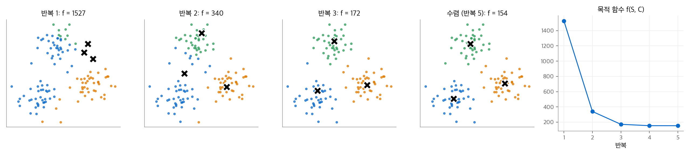
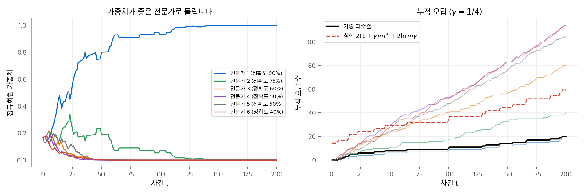
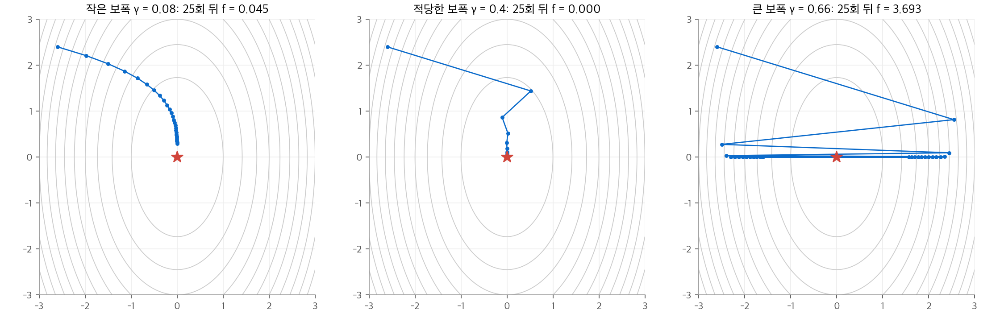

# 33. 머신러닝 알고리즘

이 장은 기계 학습에서 자주 쓰는 알고리즘 세 개를 알고리즘 분석의 눈으로 다룹니다.
k-평균 군집화는 레이블 없는 점을 k개 무리로 나눕니다.
곱셈 가중치 알고리즘은 여러 전문가의 예측을 섞어, 가장 좋은 전문가와 비슷한 수만큼만 틀립니다.
경사 하강법은 볼록 함수의 최솟값에 가까운 점을 찾고, 반복 횟수와 오차의 관계를 증명할 수 있습니다.
세 알고리즘 모두 "데이터로 가설을 만들고 개선한다"는 같은 틀에 들어갑니다.

!!! info "원문과 자료"
    - 원문: Cormen, Leiserson, Rivest, Stein, *Introduction to Algorithms*, 4th ed., MIT Press, 2022. 33장 Machine-Learning Algorithms (33.1~33.3).
    - [MIT Press 책 페이지](https://mitpress.mit.edu/9780262046305/introduction-to-algorithms/)
    - 함께 읽기: [신경망 기초 9. 최적화 알고리즘](../../ai/d2l/09-optimization.md)(SGD, 모멘텀, Adam), [볼록 최적화 9. 제약 없는 최소화](../../math/convex-optimization/09-unconstrained.md)(강볼록 함수에서 경사 하강법의 수렴률)
    - 이 노트의 본문, 예제, 그림은 원문을 참고해 새로 작성했습니다.

## 0. 학습 문제의 틀

원문은 기계 학습을 세 종류로 나눕니다.

| 종류 | 입력 | 출력(가설) | 이 장의 예 |
| --- | --- | --- | --- |
| 지도 학습 | 레이블이 붙은 예제 | 레이블을 예측하는 규칙 | 경사 하강법으로 푼 선형 회귀 |
| 비지도 학습 | 레이블 없는 예제 | 데이터의 구조(예: 무리의 중심) | k-평균 군집화 |
| 온라인 학습 | 예제가 하나씩 도착 | 매 시점의 예측 | 곱셈 가중치 |

강화 학습은 원문에서 다루지 않습니다. 이 사이트의 [강화 학습](../../ai/rl/index.md) 교재에 있습니다.

세 알고리즘은 같은 구조를 가집니다. 가설을 매개변수 $\theta$ 로 나타내고, 목적 함수 $f(E, \theta)$ 를 줄이는 방향으로 $\theta$ 를 반복해서 고칩니다($E$ 는 학습 예제 집합).
k-평균에서 $\theta$ 는 k개 중심점이고, 곱셈 가중치에서는 전문가 가중치이고, 경사 하강법에서는 모델 매개변수입니다.

## 1. k-평균 군집화

### 문제 정의

점 집합 $S = \{\mathbf{x}_1, \ldots, \mathbf{x}_n\} \subset \mathbb{R}^d$ 와 정수 $k$ 가 주어집니다.
점을 서로소인 무리 $S^{(1)}, \ldots, S^{(k)}$ 로 나누고 각 무리에 중심 $\mathbf{c}^{(\ell)}$ 를 둡니다.
목적 함수는 각 점에서 자기 무리 중심까지의 거리 제곱 합입니다.

$$
f(S, C) = \sum_{\ell=1}^{k} \sum_{\mathbf{x} \in S^{(\ell)}} \lVert \mathbf{x} - \mathbf{c}^{(\ell)} \rVert^2
$$

이 $f$ 를 최소로 만드는 $C$ 를 찾는 문제가 **k-평균 문제** 입니다.
이 문제는 NP-난해입니다([34장](34-np-completeness.md)). 차원 $d$ 가 입력의 일부이면 $k = 2$ 에서도 NP-난해입니다. 따라서 다항 시간 정확 알고리즘은 기대하기 어렵고, 지역 최적해를 찾는 반복법을 씁니다.

### 최적해가 만족하는 두 성질

최적해는 다음 두 성질을 모두 만족해야 합니다.

1. **중심은 무리의 평균입니다.** 무리를 고정하면 $\sum_{\mathbf{x} \in S^{(\ell)}} \lVert \mathbf{x} - \mathbf{c} \rVert^2$ 는 $\mathbf{c}$ 의 이차 함수입니다. 미분해서 0으로 두면 $\mathbf{c} = \frac{1}{|S^{(\ell)}|} \sum_{\mathbf{x} \in S^{(\ell)}} \mathbf{x}$ 를 얻습니다(원문 정리 33.1).
2. **각 점은 가장 가까운 중심의 무리에 속합니다.** 중심을 고정하면, 점을 더 가까운 중심으로 옮길 때마다 $f$ 가 줄어듭니다(원문 정리 33.2).

### Lloyd 절차

Lloyd 절차는 두 성질을 번갈아 강제합니다.

1. 중심 $k$ 개를 정합니다. 보통 입력 점에서 무작위로 고릅니다.
2. **배정:** 각 점을 가장 가까운 중심의 무리에 넣습니다.
3. **갱신:** 각 중심을 자기 무리의 평균으로 바꿉니다.
4. 배정이 바뀌지 않으면 멈춥니다. 바뀌었으면 2단계로 돌아갑니다.

두 단계 모두 $f$ 를 늘리지 않습니다. 또 서로 다른 분할은 많아야 $k^n$ 개입니다. 같은 분할이 두 번 나오기 전에 $f$ 가 엄격히 줄어들므로 절차는 반드시 멈춥니다.
한 반복의 비용은 거리 계산 $nk$ 번, 즉 $O(dkn)$ 입니다. 반복 횟수의 최악 상한은 지수적이지만, 실제로는 대개 수십 번 안에 끝납니다.
결과는 지역 최적해일 뿐이므로, 초기 중심을 바꿔 여러 번 실행하고 $f$ 가 가장 작은 결과를 고릅니다.

### 손으로 따라가는 예

1차원 점 $1, 2, 6, 7, 11$ 을 $k = 2$ 로 나눕니다. 초기 중심을 일부러 나쁘게 $c_1 = 1, c_2 = 2$ 로 둡니다.

| 단계 | 중심 $(c_1, c_2)$ | 무리 1 | 무리 2 | $f$ |
| --- | --- | --- | --- | --- |
| 배정 1 | $(1, 2)$ | $\{1\}$ | $\{2, 6, 7, 11\}$ | $0 + 0 + 16 + 25 + 81 = 122$ |
| 갱신 1 | $(1, 6.5)$ | $\{1\}$ | $\{2, 6, 7, 11\}$ | $0 + 20.25 + 0.25 + 0.25 + 20.25 = 41$ |
| 배정 2 | $(1, 6.5)$ | $\{1, 2\}$ | $\{6, 7, 11\}$ | $0 + 1 + 0.25 + 0.25 + 20.25 = 21.75$ |
| 갱신 2 | $(1.5, 8)$ | $\{1, 2\}$ | $\{6, 7, 11\}$ | $0.25 + 0.25 + 4 + 1 + 9 = 14.5$ |
| 배정 3 | $(1.5, 8)$ | $\{1, 2\}$ | $\{6, 7, 11\}$ | 변화 없음, 종료 |

$f$ 는 $122 \to 41 \to 21.75 \to 14.5$ 로 단조 감소합니다. 배정 단계와 갱신 단계가 번갈아 $f$ 를 줄입니다.

<figure markdown>

<figcaption markdown>
<span class="fig-title"><b>Figure 1.</b> Lloyd 절차의 반복</span>

세 중심(×)을 오른쪽 위에 몰아 시작해도, 배정과 갱신을 다섯 번 반복하면 세 무리의 중심으로 옮겨 갑니다.
</figcaption>
</figure>

```python
import numpy as np

def lloyd(X, C):
    while True:
        a = ((X[:, None] - C[None]) ** 2).sum(-1).argmin(1)   # 배정
        C_new = np.array([X[a == j].mean(0) for j in range(len(C))])  # 갱신
        if np.allclose(C_new, C):
            return C, a
        C = C_new
```

### 벡터 양자화

원문은 같은 절차를 이미지 압축에 씁니다. 각 화소의 RGB 값을 3차원 점으로 보고 $k$ 개 중심으로 군집화합니다.
그러면 화소마다 24비트 색 대신 $\lceil \lg k \rceil$ 비트의 중심 번호만 저장하면 됩니다. $k = 16$ 이면 화소당 4비트입니다.

## 2. 곱셈 가중치 알고리즘

### 전문가 문제

매일 주가가 오를지(1) 내릴지(0) 예측합니다. 전문가 $n$ 명이 매일 예측을 냅니다.
전문가에 대해 아무것도 가정하지 않습니다. 서로 짜고 속일 수도 있습니다.
$T$ 일 동안 알고리즘이 틀린 횟수를 $m$, 전문가 $E_i$ 가 틀린 횟수를 $m_i$, 가장 잘한 전문가의 오답 수를 $m^* = \min_i m_i$ 라고 합니다.
목표는 **후회(regret)** $m - m^*$ 를 작게 만드는 것입니다. 어느 전문가가 가장 좋은지는 끝나야 알지만, 그 전문가에 가깝게 따라가는 것이 목표입니다.

### 준비: 완벽한 전문가가 있을 때

한 전문가가 한 번도 틀리지 않는다고 가정합니다. 알고리즘은 "아직 안 틀린 전문가 집합 $S$" 의 다수결로 예측하고, 틀린 전문가를 $S$ 에서 뺍니다.
알고리즘이 틀리면 $S$ 의 절반 이상이 함께 틀렸으므로 $|S|$ 가 절반 이하로 줄어듭니다. 완벽한 전문가는 남아 있으므로, 알고리즘은 많아야 $\lceil \lg n \rceil$ 번 틀립니다(원문 보조정리 33.3).

### WEIGHTED-MAJORITY

완벽한 전문가가 없으면, 틀린 전문가를 버리는 대신 가중치를 줄입니다. 매개변수는 $0 < \gamma \le 1/2$ 입니다.

1. 모든 전문가의 가중치를 $w_i = 1$ 로 둡니다.
2. 사건 $t$ 마다 1을 예측한 전문가의 가중치 합(upweight)과 0을 예측한 전문가의 가중치 합(downweight)을 구합니다.
3. 큰 쪽을 알고리즘의 예측으로 냅니다. 같으면 1을 냅니다.
4. 결과가 공개되면, 틀린 전문가의 가중치에 $1 - \gamma$ 를 곱합니다.

가중치는 $w_i^{(t)} = (1 - \gamma)^{m_i^{(t)}}$ 입니다. 덜 틀린 전문가일수록 가중치가 큽니다.

### 오답 수의 상한

**정리(원문 정리 33.4, 따름정리 33.5).** 모든 전문가 $E_i$ 에 대해 다음이 성립합니다.

$$
m \le 2(1 + \gamma)\, m_i + \frac{2 \ln n}{\gamma}
\qquad\text{따라서}\qquad
m \le 2(1 + \gamma)\, m^* + \frac{2 \ln n}{\gamma}
$$

증명은 퍼텐셜 함수 $W^{(t)} = \sum_i w_i^{(t)}$ (가중치 총합)를 씁니다. [16장 분할 상환 분석](16-amortized.md)의 퍼텐셜 방법과 같은 방식입니다.

- 처음에는 $W = n$ 입니다.
- 알고리즘이 틀린 사건에서는, 틀린 쪽 가중치가 $W/2$ 이상입니다. 그 가중치에 $1-\gamma$ 가 곱해지므로 $W$ 는 $(1 - \gamma/2)$ 배 이하로 줄어듭니다.
- 알고리즘이 맞은 사건에서도 $W$ 는 늘지 않습니다.

따라서 $W^{(T)} \le n (1 - \gamma/2)^m$ 입니다. 한편 $W^{(T)} \ge w_i^{(T)} = (1-\gamma)^{m_i}$ 입니다. 두 식을 이으면 다음과 같습니다.

$$
(1 - \gamma)^{m_i} \le n \left(1 - \frac{\gamma}{2}\right)^{m}
\;\Longrightarrow\;
m_i \ln(1 - \gamma) \le \ln n + m \ln\!\left(1 - \frac{\gamma}{2}\right)
$$

$\ln(1 - x) \le -x$ 와 $\ln(1-x) \ge -x - x^2$ ($0 < x \le 1/2$)를 대입하면 $-m_i(\gamma + \gamma^2) \le \ln n - m\gamma/2$ 이고, 정리하면 위 상한이 나옵니다.

상한의 뜻은 다음과 같습니다. 가장 좋은 전문가보다 약 두 배 많이 틀리고, 전문가 수에는 $\ln n$ 으로만 의존합니다.
예를 들어 $n = 20$, $T = 1000$ 이고 최고 전문가가 50번 틀리면, $\gamma = 1/4$ 에서 상한은 $2 \cdot 1.25 \cdot 50 + 8 \ln 20 \approx 149$ 입니다.
예측을 가중치 비율로 무작위로 고르는 변형은 기대 오답 수를 $(1 + \epsilon) m^* + (\ln n)/\epsilon$ 으로 낮춥니다(원문 연습문제 33.2-4).

### 손으로 따라가는 예

전문가 3명, $\gamma = 1/2$, 사건 4개입니다. 칸의 숫자는 각 전문가의 예측이고, 굵은 숫자는 틀린 예측입니다.

| $t$ | 가중치 $(w_1, w_2, w_3)$ | $E_1$ | $E_2$ | $E_3$ | up / down | 예측 | 결과 |
| --- | --- | --- | --- | --- | --- | --- | --- |
| 1 | $(1, 1, 1)$ | 1 | **0** | 1 | 2 / 1 | 1 | 1 (맞음) |
| 2 | $(1, 0.5, 1)$ | 0 | 0 | **1** | 1 / 1.5 | 0 | 0 (맞음) |
| 3 | $(1, 0.5, 0.5)$ | **0** | 1 | **0** | 0.5 / 1.5 | 0 | 1 (틀림) |
| 4 | $(0.5, 0.5, 0.25)$ | 1 | 1 | **0** | 1 / 0.25 | 1 | 1 (맞음) |

알고리즘은 1번 틀렸고 최고 전문가($E_1$ 또는 $E_2$)도 1번 틀렸습니다. 상한은 $2 \cdot 1.5 \cdot 1 + 4 \ln 3 \approx 7.4$ 입니다. 3번째 사건처럼 가중치가 큰 쪽이 함께 틀리면 알고리즘도 틀립니다.

<figure markdown>

<figcaption markdown>
<span class="fig-title"><b>Figure 2.</b> 가중 다수결의 가중치와 누적 오답</span>

정확도가 다른 전문가 6명으로 200번 예측합니다. 가중치는 정확도 90% 전문가로 몰리고(왼쪽), 알고리즘의 오답 20개는 최고 전문가의 18개에 가깝습니다(오른쪽).
</figcaption>
</figure>

이 틀은 0과 1을 넘어 실수 손실로 넓힐 수 있습니다. 손실에 비례해 가중치를 지수적으로 줄이는 Hedge 알고리즘이 대표적이고, 비슷한 상한이 성립합니다.
같은 생각이 부스팅(AdaBoost)과 영합 게임의 근사 해법에도 쓰입니다.

## 3. 경사 하강법

### 절차

함수 $f : \mathbb{R}^n \to \mathbb{R}$ 의 기울기 $\nabla f$ 는 함수가 가장 빨리 커지는 방향입니다. 경사 하강법은 반대 방향으로 조금씩 움직입니다.

$$
\mathbf{x}^{(t+1)} = \mathbf{x}^{(t)} - \gamma\, \nabla f(\mathbf{x}^{(t)}), \qquad t = 0, 1, \ldots, T-1
$$

$\gamma > 0$ 는 보폭(step size)입니다. 원문의 GRADIENT-DESCENT 절차는 마지막 점이 아니라 **반복점의 평균** $\bar{\mathbf{x}} = \frac{1}{T}\sum_{t=0}^{T-1} \mathbf{x}^{(t)}$ 을 돌려줍니다. 평균을 쓰면 아래 분석이 간단해집니다.

<figure markdown>

<figcaption markdown>
<span class="fig-title"><b>Figure 3.</b> 보폭에 따른 경사 하강법의 궤적</span>

$f(x, y) = \tfrac{1}{2}(3x^2 + y^2)$ 에서 25회 반복합니다. 보폭이 작으면 느리게 다가가고, 너무 크면 가파른 $x$ 방향으로 진동합니다.
</figcaption>
</figure>

그림의 함수는 $\nabla f = (3x, y)$ 입니다. 갱신은 $x \leftarrow (1 - 3\gamma)x$, $y \leftarrow (1-\gamma)y$ 로 좌표마다 따로 일어납니다.
$\gamma = 0.66$ 이면 $1 - 3\gamma = -0.98$ 이므로 $x$ 는 부호를 바꾸며 거의 줄지 않습니다. $\gamma > 2/3$ 이면 발산합니다.

### 볼록 함수에서의 수렴

$f$ 가 볼록 함수라고 가정합니다. 볼록 함수는 모든 점에서 접평면 위에 놓입니다.

$$
f(\mathbf{y}) \ge f(\mathbf{x}) + \nabla f(\mathbf{x}) \cdot (\mathbf{y} - \mathbf{x})
$$

다음 두 값을 정의합니다. $\mathbf{x}^*$ 는 최소점입니다.

$$
R = \lVert \mathbf{x}^{(0)} - \mathbf{x}^* \rVert, \qquad L \ge \max_t \lVert \nabla f(\mathbf{x}^{(t)}) \rVert
$$

**정리(원문 정리 33.8).** $\gamma = R / (L\sqrt{T})$ 이면 다음이 성립합니다.

$$
f(\bar{\mathbf{x}}) - f(\mathbf{x}^*) \le \frac{RL}{\sqrt{T}}
$$

### 증명: 퍼텐셜로 본 진척

퍼텐셜을 최소점까지 거리의 제곱으로 둡니다.

$$
\Phi(t) = \frac{1}{2\gamma}\lVert \mathbf{x}^{(t)} - \mathbf{x}^* \rVert^2
$$

한 반복의 분할 상환 진척을 $p(t) = f(\mathbf{x}^{(t)}) - f(\mathbf{x}^*) + \Phi(t+1) - \Phi(t)$ 로 정의합니다.
$\lVert \mathbf{a} + \mathbf{b} \rVert^2 = \lVert \mathbf{a} \rVert^2 + 2\mathbf{a}\cdot\mathbf{b} + \lVert \mathbf{b} \rVert^2$ 에 $\mathbf{a} = \mathbf{x}^{(t)} - \mathbf{x}^*$, $\mathbf{b} = -\gamma \nabla f(\mathbf{x}^{(t)})$ 를 넣습니다.

$$
\Phi(t+1) - \Phi(t) = -\nabla f(\mathbf{x}^{(t)}) \cdot (\mathbf{x}^{(t)} - \mathbf{x}^*) + \frac{\gamma}{2}\lVert \nabla f(\mathbf{x}^{(t)}) \rVert^2
$$

볼록성에서 $f(\mathbf{x}^{(t)}) - f(\mathbf{x}^*) \le \nabla f(\mathbf{x}^{(t)}) \cdot (\mathbf{x}^{(t)} - \mathbf{x}^*)$ 입니다. 두 식을 더하면 첫 항이 상쇄됩니다.

$$
p(t) \le \frac{\gamma}{2}\lVert \nabla f(\mathbf{x}^{(t)}) \rVert^2 \le \frac{\gamma L^2}{2}
$$

$t = 0, \ldots, T-1$ 에 대해 더하면 퍼텐셜 항이 망원급수가 되어 $\Phi(T) - \Phi(0)$ 만 남습니다. $\Phi(T) \ge 0$ 을 버리고 $T$ 로 나눈 뒤, 볼록성(옌센 부등식)으로 평균점의 값을 평균값 아래로 누릅니다.

$$
f(\bar{\mathbf{x}}) - f(\mathbf{x}^*) \le \frac{1}{T}\sum_{t=0}^{T-1}\big(f(\mathbf{x}^{(t)}) - f(\mathbf{x}^*)\big) \le \frac{\gamma L^2}{2} + \frac{R^2}{2\gamma T}
$$

첫 항은 $\gamma$ 에 비례하고 둘째 항은 반비례합니다. 두 항을 같게 만드는 $\gamma = R/(L\sqrt{T})$ 를 넣으면 $RL/\sqrt{T}$ 가 됩니다.

### 수치로 읽는 상한

목표 오차 $\epsilon$ 을 정하면 필요한 반복 수는 $T = R^2 L^2 / \epsilon^2$ 입니다.
$R = 1$, $L = 2$ 에서 $\epsilon = 0.02$ 를 원하면 $T = 10{,}000$ 번이 필요합니다. 오차를 반으로 줄이려면 반복을 네 배로 늘려야 합니다.
이 $1/\sqrt{T}$ 속도는 매끄러움이나 강볼록성을 가정하지 않은 최악 상한입니다. 강볼록 함수에서는 선형 수렴(오차가 반복마다 일정 비율로 줄어듦)을 얻습니다. 이 내용은 [볼록 최적화 9장](../../math/convex-optimization/09-unconstrained.md)에 있습니다.

실제로는 $R$ 과 $L$ 을 모를 때가 많습니다. 그때는 선 탐색으로 보폭을 정합니다. 작은 보폭에서 시작해 $f$ 가 더 이상 줄지 않을 때까지 두 배로 늘리고, 그 구간에서 이진 탐색합니다.

### 제약이 있는 경사 하강법

$\mathbf{x}$ 가 볼록 집합 $K$ 안에 있어야 하면, 매 단계 뒤에 **사영(projection)** 으로 $K$ 안의 가장 가까운 점으로 되돌립니다.

$$
\mathbf{x}^{(t+1)} = \Pi_K\big(\mathbf{x}^{(t)} - \gamma \nabla f(\mathbf{x}^{(t)})\big), \qquad \Pi_K(\mathbf{y}) = \arg\min_{\mathbf{x} \in K} \lVert \mathbf{x} - \mathbf{y} \rVert
$$

$\mathbf{x}^* \in K$ 이면 사영은 최소점까지 거리를 늘리지 않습니다(원문 보조정리 33.10). 따라서 퍼텐셜 증명이 그대로 통하고, 같은 상한 $RL/\sqrt{T}$ 가 성립합니다(원문 정리 33.11).

### 응용: 선형 회귀

예제 $(\mathbf{x}_i, y_i)$, $i = 1, \ldots, m$ 에 직선 가설 $h(\mathbf{x}) = \mathbf{w} \cdot \mathbf{x}$ 를 맞춥니다. 목적 함수는 제곱 오차 합이고, 볼록 함수입니다.

$$
f(\mathbf{w}) = \sum_{i=1}^{m} (\mathbf{w}\cdot\mathbf{x}_i - y_i)^2, \qquad
\nabla f(\mathbf{w}) = 2\sum_{i=1}^{m} (\mathbf{w}\cdot\mathbf{x}_i - y_i)\,\mathbf{x}_i
$$

기울기 한 번의 비용은 $O(md)$ 입니다($d$ 는 차원). 원문은 $\lVert \mathbf{w} \rVert \le B$ 라는 제약을 둡니다. 이 공(ball) 위의 사영은 벡터 길이가 $B$ 를 넘을 때 $B$ 로 줄이는 연산입니다.

```python
import numpy as np

def gd_regression(X, y, B, T):
    m, d = X.shape
    L = 2 * np.linalg.norm(X, axis=1).sum() * (B * np.linalg.norm(X, axis=1).max() + np.abs(y).max())
    gamma = B / (L * np.sqrt(T))              # w(0) = 0 이므로 R <= B
    w, avg = np.zeros(d), np.zeros(d)
    for _ in range(T):
        avg += w / T
        w = w - gamma * 2 * X.T @ (X @ w - y)  # 기울기 단계
        n = np.linalg.norm(w)
        if n > B:
            w *= B / n                         # 공 위로 사영
    return avg
```

신경망 학습은 이 절차를 비볼록 손실에 씁니다. 이때 위 상한은 성립하지 않지만, 미니배치 기울기(SGD), 모멘텀, 좌표별 보폭(Adam)으로 실용적인 수렴을 얻습니다. 자세한 내용은 [신경망 기초 9장](../../ai/d2l/09-optimization.md)에 있습니다.

## 정리

| 알고리즘 | 반복 단위 | 보장 | 분석 도구 |
| --- | --- | --- | --- |
| Lloyd (k-평균) | 배정과 갱신 | $f$ 단조 감소, 유한 시간에 종료(지역 최적) | 최적해의 두 성질 |
| WEIGHTED-MAJORITY | 사건 하나 | $m \le 2(1+\gamma)m^* + 2\ln n/\gamma$ | 가중치 총합 퍼텐셜 |
| 경사 하강법 (볼록) | 기울기 한 번 | $f(\bar{\mathbf{x}}) - f^* \le RL/\sqrt{T}$ | 거리 제곱 퍼텐셜 |

세 알고리즘 중 두 개는 퍼텐셜 함수로 분석합니다. 한 반복의 진척을 직접 재기 어려울 때, 줄어드는 양 하나를 정해 전체 진척을 누적하는 방식은 16장의 분할 상환 분석과 같습니다.
