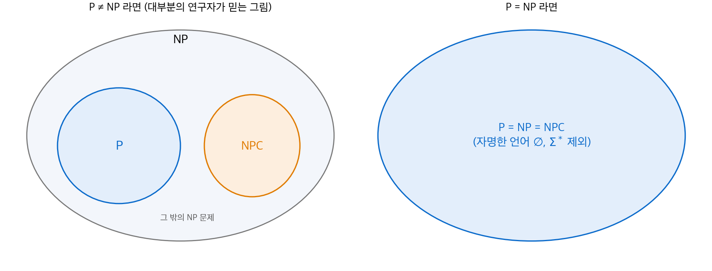
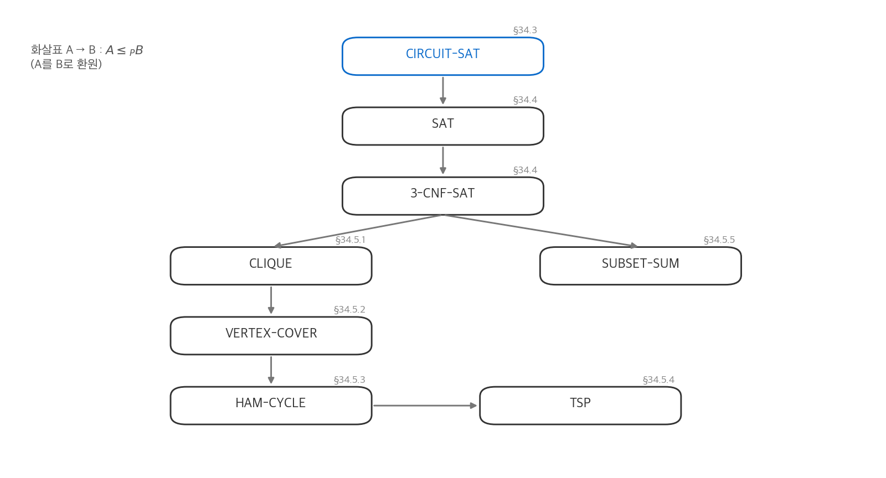
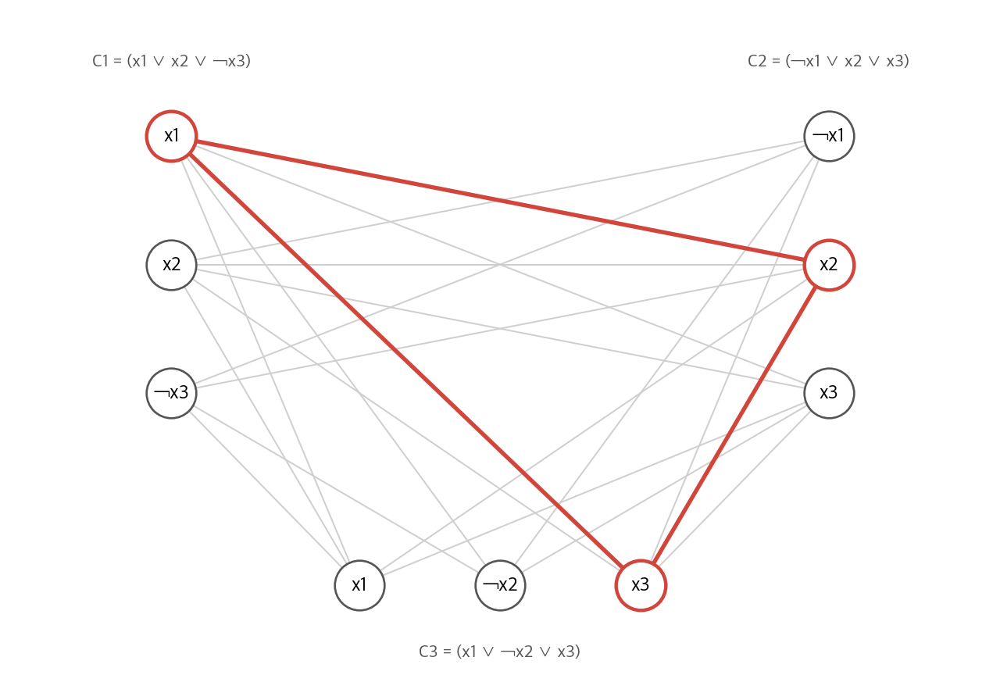

# 34. NP-완전성

앞 장들의 알고리즘은 모두 입력 크기 $n$ 의 다항식 시간에 끝났습니다. 이 장은 그렇게 풀 수 있는지 아무도 모르는 문제를 다룹니다.
최단 경로는 다항 시간에 풀리지만 가장 긴 단순 경로는 알려진 다항 알고리즘이 없습니다. 오일러 회로는 쉽지만 해밀턴 회로는 어렵습니다.
이 장은 "어렵다"를 정확히 정의합니다. 핵심 도구는 **환원(reduction)** 입니다. 한 문제의 어려움을 다른 문제로 옮겨, 수천 개 문제가 모두 같은 정도로 어렵다는 것을 보입니다.

!!! info "원문과 자료"
    - 원문: Cormen, Leiserson, Rivest, Stein, *Introduction to Algorithms*, 4th ed., MIT Press, 2022. 34장 NP-Completeness (34.1~34.5).
    - [MIT Press 책 페이지](https://mitpress.mit.edu/9780262046305/introduction-to-algorithms/)
    - 함께 읽기: [35. 근사 알고리즘](35-approximation.md)(NP-완전 문제를 다항 시간에 근사로 풀기)
    - 이 노트의 본문, 예제, 그림은 원문을 참고해 새로 작성했습니다.

## 0. 세 개의 클래스

| 클래스 | 뜻 | 예 |
| --- | --- | --- |
| P | 다항 시간에 **풀 수 있는** 문제 | 정렬, 최단 경로, 최소 신장 트리 |
| NP | 답이 "예"이면, 그 증거를 다항 시간에 **검증할 수 있는** 문제 | 해밀턴 회로, SAT, 부분집합 합 |
| NPC | NP에 속하고, NP의 모든 문제가 자기로 환원되는 문제 | SAT, CLIQUE, 정점 덮개, TSP |

P에 속하는 문제는 NP에도 속합니다. 풀 수 있으면 증거 없이도 검증할 수 있기 때문입니다. 따라서 $\text{P} \subseteq \text{NP}$ 입니다.
$\text{P} = \text{NP}$ 인지는 풀리지 않은 문제입니다. 대부분의 연구자는 $\text{P} \ne \text{NP}$ 라고 믿습니다.

<figure markdown>

<figcaption markdown>
<span class="fig-title"><b>Figure 1.</b> P, NP, NPC의 관계</span>

NPC 문제 하나라도 다항 시간에 풀리면 NP 전체가 P가 됩니다. 그래서 NPC는 P와 겹치거나(오른쪽) 완전히 떨어집니다(왼쪽).
</figcaption>
</figure>

어떤 문제가 NP-완전이라는 것을 알면 실무에서 쓸모가 있습니다. 빠른 정확 알고리즘을 찾는 대신 근사 알고리즘(35장), 특수한 경우, 휴리스틱으로 방향을 바꿀 수 있습니다.

## 1. 다항 시간

### 추상 문제와 결정 문제

**추상 문제** $Q$ 는 문제 사례(instance) 집합 $I$ 와 해 집합 $S$ 사이의 이항 관계입니다.
**결정 문제** 는 해가 "예(1)" 또는 "아니요(0)" 인 문제입니다. NP-완전성 이론은 결정 문제만 다룹니다.

최적화 문제는 결정 문제로 바꿉니다. "가장 짧은 경로의 길이는?" 대신 "길이가 $k$ 이하인 경로가 있는가?" 를 묻습니다.
결정 문제는 최적화 문제보다 어렵지 않습니다. 최적값을 구하면 $k$ 와 비교만 하면 되기 때문입니다. 따라서 결정 문제가 어렵다는 증거는 최적화 문제가 어렵다는 증거가 됩니다.

### 부호화

컴퓨터는 사례를 이진 문자열로 받습니다. 사례를 문자열로 바꾸는 규칙을 **부호화(encoding)** 라고 합니다.
알고리즘이 길이 $n$ 인 부호화를 $O(n^k)$ 시간에 풀면 그 문제는 **다항 시간에 풀 수 있다** 고 말합니다.

부호화에 따라 결론이 바뀔 수 있습니다. 정수 $k$ 를 입력으로 받아 $\Theta(k)$ 시간에 도는 알고리즘을 생각합니다.

- $k$ 를 단항(1을 $k$ 개)으로 쓰면 입력 길이가 $k$ 이므로 선형 시간입니다.
- $k$ 를 이진수로 쓰면 입력 길이가 $\lfloor \lg k \rfloor + 1$ 이므로 지수 시간입니다.

단항 부호화처럼 비합리적인 부호화를 빼면, 합리적인 부호화들은 서로 다항 시간에 변환됩니다(다항 관계). 그래서 원문은 "합리적인 간결한 부호화" 를 가정하고, 부호화 차이를 무시합니다.
부분집합 합 문제의 동적 계획법이 $O(nt)$ 인데도 다항 시간이 아닌 이유가 이것입니다. $t$ 는 입력에서 $\lg t$ 비트만 차지합니다.

### 형식 언어로 다시 쓰기

결정 문제는 "답이 1인 사례의 집합" 으로 볼 수 있습니다. 이 집합은 알파벳 $\Sigma = \{0, 1\}$ 위의 **언어** $L \subseteq \Sigma^*$ 입니다.

$$
\text{P} = \{ L \subseteq \{0,1\}^* : \text{$L$ 을 다항 시간에 결정하는 알고리즘이 있다} \}
$$

알고리즘 $A$ 가 $L$ 을 **결정한다** 는 것은 $x \in L$ 이면 1을, $x \notin L$ 이면 0을 출력한다는 뜻입니다.
$L$ 을 **수락한다** 는 것은 $x \in L$ 이면 1을 출력하고, 나머지에서는 0을 내거나 멈추지 않을 수 있다는 뜻입니다. 다항 시간에서는 두 개념이 같은 클래스를 만듭니다(원문 정리 34.2). 시간 상한을 넘으면 0을 출력하게 고치면 되기 때문입니다.

## 2. 다항 시간 검증

### 증거와 검증 알고리즘

해밀턴 회로 문제 HAM-CYCLE은 "그래프 $G$ 에 모든 정점을 한 번씩 지나는 회로가 있는가?" 입니다.
회로를 찾는 다항 알고리즘은 알려져 있지 않습니다. 그러나 누군가 정점 순서 $\langle v_1, \ldots, v_n \rangle$ 을 내밀면, 순열인지와 인접한 쌍이 모두 변인지를 $O(n^2)$ 에 확인할 수 있습니다.
이 정점 순서가 **증거(certificate)** 이고, 확인하는 알고리즘이 **검증 알고리즘** 입니다.

$$
L \in \text{NP} \iff \exists\, \text{다항 시간 } A,\ \exists\, c:\quad x \in L \iff \exists y,\ |y| = O(|x|^c),\ A(x, y) = 1
$$

NP는 "nondeterministic polynomial" 의 약자입니다. 비결정적 기계가 증거를 추측하고 다항 시간에 검증한다는 원래 정의에서 왔습니다.

### co-NP

$L \in \text{co-NP}$ 는 여집합 $\bar{L}$ 이 NP에 속한다는 뜻입니다. "아니요" 의 증거를 다항 시간에 검증할 수 있는 문제입니다.
$\text{P}$ 는 여집합에 닫혀 있으므로 $\text{P} \subseteq \text{NP} \cap \text{co-NP}$ 입니다. $\text{NP} = \text{co-NP}$ 인지도 풀리지 않은 문제입니다.

## 3. 환원과 NP-완전

### 다항 시간 환원

언어 $L_1$ 이 $L_2$ 로 **다항 시간 환원된다**($L_1 \le_P L_2$)는 것은, 다항 시간에 계산되는 함수 $f$ 가 있어 모든 $x$ 에 대해 다음이 성립한다는 뜻입니다.

$$
x \in L_1 \iff f(x) \in L_2
$$

$f$ 를 **환원 함수** 라고 합니다. $L_1$ 의 사례를 $L_2$ 의 사례로 바꾸되, 답을 보존합니다.
$L_2$ 를 다항 시간에 풀 수 있으면, $f$ 를 먼저 적용해서 $L_1$ 도 다항 시간에 풀 수 있습니다(원문 보조정리 34.3). 다항식의 합성은 다항식이기 때문입니다.
즉 $L_1 \le_P L_2$ 는 "$L_1$ 은 $L_2$ 보다 어렵지 않다" 는 뜻입니다.

### NP-완전의 정의

언어 $L$ 이 다음 두 조건을 만족하면 **NP-완전(NPC)** 입니다.

1. $L \in \text{NP}$
2. 모든 $L' \in \text{NP}$ 에 대해 $L' \le_P L$

2번만 만족하면 **NP-난해(NP-hard)** 라고 합니다.

**정리(원문 정리 34.4).** NP-완전 문제 하나가 다항 시간에 풀리면 $\text{P} = \text{NP}$ 입니다. 대우로, NP의 어떤 문제가 다항 시간에 풀리지 않으면 모든 NP-완전 문제가 다항 시간에 풀리지 않습니다.

### 첫 NP-완전 문제: 회로 만족성

정의의 2번 조건은 "NP의 **모든** 문제" 를 요구하므로, 첫 문제는 환원으로 증명할 수 없습니다.
첫 문제는 회로 만족성 CIRCUIT-SAT입니다. AND, OR, NOT 게이트로 만든 불 조합 회로에, 출력을 1로 만드는 입력이 있는지 묻습니다.

증명의 생각은 다음과 같습니다(원문 보조정리 34.5, 34.6, 정리 34.7).

1. CIRCUIT-SAT은 NP에 속합니다. 증거는 각 선의 값이고, 게이트마다 값이 맞는지 확인하면 됩니다.
2. NP의 문제 $L$ 은 검증 알고리즘 $A$ 를 가집니다. $A$ 는 다항 시간 동안 컴퓨터의 메모리 상태(구성)를 바꿔 갑니다.
3. 한 구성을 다음 구성으로 바꾸는 하드웨어 $M$ 은 다항 크기의 조합 회로입니다. $M$ 을 실행 단계 수만큼 이어 붙입니다.
4. 사례 $x$ 를 회로에 고정하고 증거 $y$ 만 입력으로 남깁니다. 이 회로가 만족 가능한 것과 $x \in L$ 은 동치입니다.

같은 결과를 불 식에 대해 처음 증명한 사람의 이름을 따서 이 결과를 **Cook-Levin 정리** 라고 부릅니다. "SAT은 NP-완전이다" 라는 형태입니다.

## 4. NP-완전성 증명의 방법

첫 문제가 생기면 나머지는 환원으로 증명합니다.

**보조정리(원문 보조정리 34.8).** NP-완전 언어 $L'$ 이 있고 $L' \le_P L$ 이면 $L$ 은 NP-난해입니다. $L \in \text{NP}$ 이기도 하면 NP-완전입니다.

$\le_P$ 는 추이적이므로, NP의 모든 문제가 $L'$ 을 거쳐 $L$ 로 환원됩니다. 새 문제 $L$ 을 증명하는 절차는 다음과 같습니다.

1. $L \in \text{NP}$ 를 보입니다. 증거와 검증 알고리즘을 제시합니다.
2. 이미 아는 NP-완전 언어 $L'$ 을 고릅니다.
3. $L'$ 의 사례 $x$ 를 $L$ 의 사례 $f(x)$ 로 바꾸는 함수 $f$ 를 만듭니다.
4. $x \in L' \iff f(x) \in L$ 을 양방향으로 증명합니다.
5. $f$ 가 다항 시간에 계산된다는 것을 보입니다.

환원의 방향에 주의합니다. **아는 어려운 문제를 새 문제로** 환원합니다. 반대 방향은 아무것도 증명하지 않습니다.

### SAT과 3-CNF-SAT

**SAT** 은 불 식 $\phi$ 를 참으로 만드는 변수 할당이 있는지 묻습니다. CIRCUIT-SAT에서 환원합니다.
회로를 그대로 식으로 펼치면 게이트 출력이 여러 번 쓰일 때 식이 지수적으로 커집니다. 그래서 회로의 **선마다 변수** 를 하나씩 두고, 게이트마다 "출력 변수 ↔ 입력의 함수" 라는 작은 식을 만들어 AND로 묶습니다. 식의 크기는 회로 크기에 비례합니다.

**3-CNF-SAT** 은 절(clause)마다 리터럴이 정확히 세 개인 곱의 합 꼴(CNF) 식의 만족성입니다. SAT에서 환원합니다.

1. 식의 구문 트리를 만들고, 내부 노드마다 새 변수를 둡니다. 노드마다 "변수 ↔ 두 자식의 연산" 이라는 절을 만듭니다. 절마다 변수가 많아야 세 개입니다.
2. 각 절의 진리표에서 거짓이 되는 행을 모아 부정하면(드모르간 법칙) CNF가 됩니다.
3. 리터럴이 세 개보다 적은 절은 보조 변수 $p, q$ 를 써서 $(a \lor b) = (a \lor b \lor p) \land (a \lor b \lor \lnot p)$ 처럼 늘립니다.

3-CNF-SAT은 구조가 단순해서 이후 환원의 출발점으로 자주 씁니다. 반면 절마다 리터럴이 두 개인 2-CNF-SAT은 다항 시간에 풀립니다.

## 5. NP-완전 문제들

<figure markdown>

<figcaption markdown>
<span class="fig-title"><b>Figure 2.</b> NP-완전성 증명의 환원 구조</span>

원문이 증명하는 순서입니다. CIRCUIT-SAT에서 출발해 화살표를 따라 각 문제를 NP-완전으로 만듭니다.
</figcaption>
</figure>

### 클릭 문제: 3-CNF-SAT에서 환원

**클릭(clique)** 은 모든 정점 쌍이 변으로 이어진 부분 그래프입니다. CLIQUE는 "그래프 $G$ 에 크기 $k$ 인 클릭이 있는가?" 입니다.
CLIQUE가 NP에 속하는 것은 쉽습니다. 정점 $k$ 개를 증거로 받아 $O(k^2)$ 쌍을 확인합니다.

절이 $k$ 개인 3-CNF 식 $\phi = C_1 \land \cdots \land C_k$ 에서 그래프 $G$ 를 만듭니다.

1. 각 절 $C_r$ 의 리터럴 세 개마다 정점을 하나씩 둡니다. 정점은 모두 $3k$ 개입니다.
2. 두 정점이 **서로 다른 절** 에 있고 **서로 부정이 아니면** 변으로 잇습니다.

$\phi$ 가 만족 가능하면 각 절에서 참인 리터럴을 하나씩 고릅니다. 고른 정점은 서로 다른 절에 있고, 모두 참이므로 서로 부정일 수 없습니다. 따라서 크기 $k$ 인 클릭입니다.
반대로 크기 $k$ 인 클릭은 같은 절의 정점끼리 변이 없으므로 절마다 정점을 하나씩 가집니다. 그 리터럴을 모두 참으로 놓으면 모순이 없고(부정 쌍에는 변이 없음), 모든 절이 참이 됩니다.

### 손으로 따라가는 환원

다음 식에 위 환원을 적용합니다. 절이 세 개이므로 $k = 3$ 입니다.

$$
\phi = \underbrace{(x_1 \lor x_2 \lor \lnot x_3)}_{C_1} \land \underbrace{(\lnot x_1 \lor x_2 \lor x_3)}_{C_2} \land \underbrace{(x_1 \lor \lnot x_2 \lor x_3)}_{C_3}
$$

서로 다른 절의 정점 쌍은 $3 \cdot 9 = 27$ 개입니다. 그중 부정 관계인 쌍은 다음 6개입니다.

| 쌍 | 부정 관계 |
| --- | --- |
| $C_1{:}x_1$ — $C_2{:}\lnot x_1$, $C_2{:}\lnot x_1$ — $C_3{:}x_1$ | $x_1$ |
| $C_1{:}x_2$ — $C_3{:}\lnot x_2$, $C_2{:}x_2$ — $C_3{:}\lnot x_2$ | $x_2$ |
| $C_1{:}\lnot x_3$ — $C_2{:}x_3$, $C_1{:}\lnot x_3$ — $C_3{:}x_3$ | $x_3$ |

따라서 $G$ 의 변은 $27 - 6 = 21$ 개입니다. 할당 $x_1 = x_2 = x_3 = 1$ 은 $\phi$ 를 참으로 만들고, $C_1{:}x_1$, $C_2{:}x_2$, $C_3{:}x_3$ 이 크기 3인 클릭이 됩니다.

<figure markdown>

<figcaption markdown>
<span class="fig-title"><b>Figure 3.</b> 3-CNF 식에서 만든 클릭 그래프</span>

같은 절의 정점과 부정 관계인 정점은 잇지 않습니다. 빨간 삼각형이 만족 할당 $x_1 = x_2 = x_3 = 1$ 에 대응하는 클릭입니다.
</figcaption>
</figure>

```python
from itertools import combinations

def cnf_to_clique(clauses):
    V = [(r, lit) for r, C in enumerate(clauses) for lit in C]   # lit = (변수, 부호)
    E = [(u, v) for u, v in combinations(V, 2)
         if u[0] != v[0] and not (u[1][0] == v[1][0] and u[1][1] != v[1][1])]
    return V, E, len(clauses)
```

### 정점 덮개: CLIQUE에서 환원

**정점 덮개** 는 모든 변의 한 끝점 이상을 포함하는 정점 집합입니다. VERTEX-COVER는 "크기 $k$ 인 정점 덮개가 있는가?" 입니다.
환원은 여그래프 $\bar{G}$ (변이 있는 쌍과 없는 쌍을 뒤집은 그래프)를 씁니다.

$$
G \text{ 에 크기 } k \text{ 인 클릭이 있다} \iff \bar{G} \text{ 에 크기 } |V| - k \text{ 인 정점 덮개가 있다}
$$

$V'$ 가 $G$ 의 클릭이면, $\bar{G}$ 의 변 $(u, v)$ 는 $G$ 에 없으므로 $u, v$ 중 하나는 $V'$ 밖에 있습니다. 따라서 $V - V'$ 가 $\bar{G}$ 의 모든 변을 덮습니다. 역방향도 같은 논리입니다.
위 예에서 $\bar{G}$ 는 정점 9개 변 15개이고, 클릭 밖의 정점 6개가 크기 6인 정점 덮개입니다.

### 해밀턴 회로: VERTEX-COVER에서 환원

원문은 변마다 정점 12개짜리 **장치(gadget)** 를 둡니다. 해밀턴 회로가 장치를 지나는 방법은 세 가지뿐이고, 각각 "변의 왼쪽 끝이 덮개에 있음", "오른쪽 끝이 있음", "둘 다 있음" 에 대응합니다.
선택자 정점 $k$ 개가 덮개 정점 $k$ 개를 고르고, 회로는 고른 정점에 붙은 장치를 차례로 지납니다. 그래프 크기는 $O(|E|)$ 이므로 다항 시간 환원입니다.

### 외판원 문제: HAM-CYCLE에서 환원

TSP는 "완전 그래프에서 비용 $k$ 이하인 해밀턴 회로가 있는가?" 입니다.
그래프 $G = (V, E)$ 에서 완전 그래프를 만들고, $E$ 의 변은 비용 0, 나머지 쌍은 비용 1로 둡니다. $k = 0$ 으로 둡니다.
비용 0인 회로는 $E$ 의 변만 쓰므로 $G$ 의 해밀턴 회로입니다. 이 환원은 35장에서 "일반 TSP는 근사도 어렵다" 를 증명할 때 다시 씁니다.

### 부분집합 합: 3-CNF-SAT에서 환원

SUBSET-SUM은 "양의 정수 집합 $S$ 에 합이 정확히 $t$ 인 부분집합이 있는가?" 입니다.
변수 $n$ 개, 절 $k$ 개인 식에서 $n + k$ 자리 십진수를 만듭니다. 앞 $n$ 자리는 변수, 뒤 $k$ 자리는 절에 대응합니다.

- 변수 $x_i$ 마다 두 수 $v_i$ (참), $v_i'$ (거짓)를 둡니다. 둘 다 $x_i$ 자리가 1입니다. 절 자리는 그 리터럴($x_i$ 또는 $\lnot x_i$)을 포함하는 절에 1을 씁니다.
- 절 $C_j$ 마다 여유 수 $s_j$ (그 자리가 1)와 $s_j'$ (그 자리가 2)를 둡니다.
- 목표 $t$ 는 변수 자리가 모두 1, 절 자리가 모두 4입니다.

변수 자리가 1이므로 $v_i$ 와 $v_i'$ 중 정확히 하나를 골라야 합니다. 이것이 할당입니다.
절 자리는 참인 리터럴 수(0~3)에 여유 수(0~3)를 더해 4를 맞춥니다. 참인 리터럴이 0개이면 여유 수로 4를 만들 수 없습니다. 어느 자리 합도 6을 넘지 않으므로 자리올림이 없습니다.

예로 $C_1 = (x_1 \lor x_2 \lor \lnot x_3)$, $C_2 = (\lnot x_1 \lor x_2 \lor x_3)$ 에서 수를 만듭니다.

| 수 | $x_1$ | $x_2$ | $x_3$ | $C_1$ | $C_2$ |
| --- | --- | --- | --- | --- | --- |
| $v_1$ | 1 | 0 | 0 | 1 | 0 |
| $v_1'$ | 1 | 0 | 0 | 0 | 1 |
| $v_2$ | 0 | 1 | 0 | 1 | 1 |
| $v_2'$ | 0 | 1 | 0 | 0 | 0 |
| $v_3$ | 0 | 0 | 1 | 0 | 1 |
| $v_3'$ | 0 | 0 | 1 | 1 | 0 |
| $s_1, s_1'$ | 0 | 0 | 0 | 1, 2 | 0 |
| $s_2, s_2'$ | 0 | 0 | 0 | 0 | 1, 2 |
| $t$ | 1 | 1 | 1 | 4 | 4 |

할당 $x_1 = 1, x_2 = 0, x_3 = 1$ 은 $v_1, v_2', v_3$ 을 고릅니다. 합은 $10010 + 01000 + 00101 = 11111$ 입니다. 절 자리마다 3이 모자라므로 $s_1 + s_1'$ 과 $s_2 + s_2'$ 를 더해 $11144 = t$ 를 얻습니다.

## 정리

| 문제 | 환원 원천 | 환원의 핵심 |
| --- | --- | --- |
| CIRCUIT-SAT | NP의 모든 문제 | 검증 알고리즘의 실행을 다항 크기 회로로 펼침 |
| SAT | CIRCUIT-SAT | 선마다 변수, 게이트마다 작은 식 |
| 3-CNF-SAT | SAT | 구문 트리, 진리표, 보조 변수로 절 길이 맞춤 |
| CLIQUE | 3-CNF-SAT | 리터럴 정점, 다른 절이고 부정이 아니면 변 |
| VERTEX-COVER | CLIQUE | 여그래프, 크기 $\lvert V \rvert - k$ |
| HAM-CYCLE | VERTEX-COVER | 변마다 12정점 장치 |
| TSP | HAM-CYCLE | 변 비용 0, 비변 비용 1, $k = 0$ |
| SUBSET-SUM | 3-CNF-SAT | 변수·절 자리의 십진수, 여유 수 |

NP-완전성은 "빠른 알고리즘이 없다" 의 증명이 아니라 "빠른 알고리즘을 찾으면 P = NP 를 증명한 것이다" 라는 증거입니다. 35장은 이런 문제에서 최적에 가까운 답을 다항 시간에 보장하는 방법을 다룹니다.
