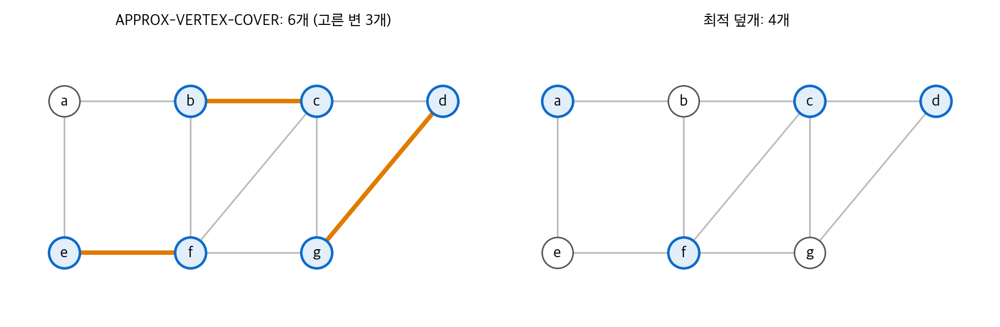
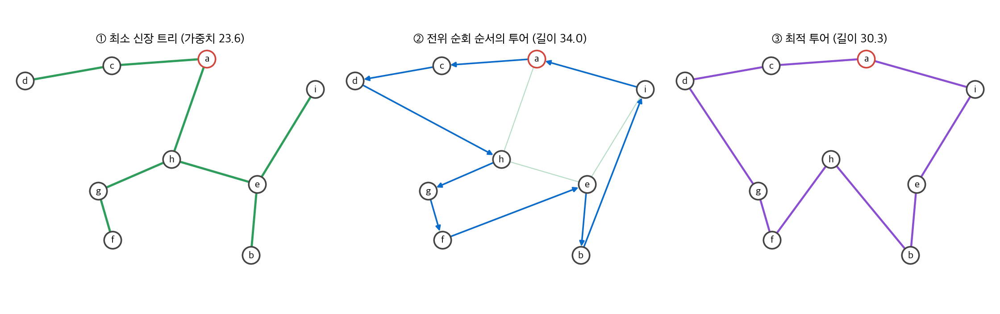
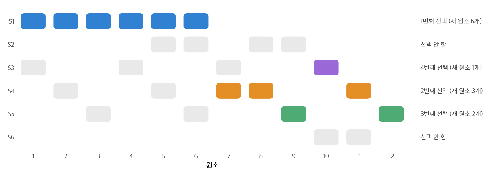
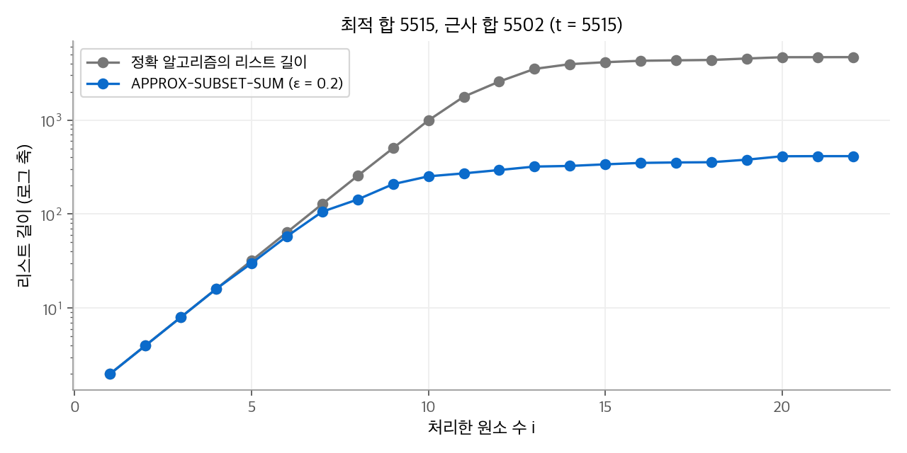

# 35. 근사 알고리즘

34장의 NP-완전 문제 중 다수는 실제로 풀어야 하는 최적화 문제입니다. 다항 시간 정확 알고리즘은 기대하기 어렵지만, 할 수 있는 일은 남아 있습니다.
입력이 작으면 지수 시간 알고리즘으로 충분합니다. 특수한 경우는 다항 시간에 풀립니다. 그리고 최적해에 **보장된 비율 안으로** 가까운 해를 다항 시간에 찾을 수 있습니다.
이 장은 셋째 방법, 근사 알고리즘을 다룹니다. 다섯 문제에서 서로 다른 설계 기법(극대 매칭, 최소 신장 트리, 탐욕, 무작위화와 선형 계획, 목록 다듬기)을 보입니다.

!!! info "원문과 자료"
    - 원문: Cormen, Leiserson, Rivest, Stein, *Introduction to Algorithms*, 4th ed., MIT Press, 2022. 35장 Approximation Algorithms (35.1~35.5).
    - [MIT Press 책 페이지](https://mitpress.mit.edu/9780262046305/introduction-to-algorithms/)
    - 함께 읽기: [34. NP-완전성](34-np-completeness.md)(이 장의 문제들이 어려운 이유), [선형대수 8. 선형 계획과 게임 이론](../../math/linear-algebra/08-linear-programming.md)(4절의 선형 계획 완화)
    - 이 노트의 본문, 예제, 그림은 원문을 참고해 새로 작성했습니다.

## 0. 근사 비율

크기 $n$ 인 입력에서 알고리즘의 해 비용을 $C$, 최적해 비용을 $C^*$ 라고 합니다. 모든 입력에서 다음이 성립하면 **근사 비율** $\rho(n)$ 을 가진다고 말합니다.

$$
\max\left(\frac{C}{C^*}, \frac{C^*}{C}\right) \le \rho(n)
$$

최소화 문제에서는 $C / C^*$ 가, 최대화 문제에서는 $C^* / C$ 가 의미 있는 쪽입니다. 어느 쪽이든 $\rho(n) \ge 1$ 이고, 1에 가까울수록 좋습니다. 이런 알고리즘을 **$\rho(n)$-근사 알고리즘** 이라고 합니다.

비율을 원하는 만큼 1에 가깝게 만드는 알고리즘군도 있습니다.

| 이름 | 입력 | 실행 시간 조건 | 예 |
| --- | --- | --- | --- |
| 근사 방식(approximation scheme) | 사례와 $\epsilon > 0$ | $(1 + \epsilon)$-근사 | |
| 다항 시간 근사 방식(PTAS) | 위와 같음 | $\epsilon$ 을 고정하면 $n$ 의 다항식. 예: $O(n^{2/\epsilon})$ | |
| 완전 다항 시간 근사 방식(FPTAS) | 위와 같음 | $n$ 과 $1/\epsilon$ 모두의 다항식. 예: $O((1/\epsilon)^2 n^3)$ | 5절의 부분집합 합 |

## 1. 정점 덮개

### APPROX-VERTEX-COVER

정점 덮개는 모든 변의 끝점을 하나 이상 포함하는 정점 집합이고, 목표는 가장 작은 덮개입니다(34장에서 NP-완전).
근사 알고리즘은 매우 단순합니다.

1. 덮개 $C$ 를 빈 집합으로 둡니다. 남은 변 집합 $E'$ 을 $E$ 로 둡니다.
2. $E'$ 에서 아무 변 $(u, v)$ 를 고릅니다.
3. $u$ 와 $v$ 를 **둘 다** $C$ 에 넣습니다.
4. $u$ 또는 $v$ 에 붙은 변을 모두 $E'$ 에서 지웁니다.
5. $E'$ 이 비면 $C$ 를 돌려줍니다. 아니면 2단계로 돌아갑니다.

인접 리스트로 구현하면 $O(V + E)$ 시간입니다.

### 비율 2의 증명

2단계에서 고른 변의 집합을 $A$ 라고 합니다. $A$ 의 변들은 끝점을 공유하지 않습니다. 한 변을 고르면 그 끝점에 붙은 변이 모두 지워지기 때문입니다. 즉 $A$ 는 **매칭** 입니다.

- 최적 덮개 $C^*$ 는 $A$ 의 각 변을 덮어야 하고, $A$ 의 변들은 끝점을 공유하지 않습니다. 따라서 $|C^*| \ge |A|$ 입니다.
- 알고리즘은 고른 변마다 정점 두 개를 넣으므로 $|C| = 2|A|$ 입니다.

두 식을 합치면 $|C| = 2|A| \le 2|C^*|$ 입니다. 최적값 $|C^*|$ 를 모르면서도, 그 하한 $|A|$ 와 비교해서 비율을 증명합니다. 이 장의 모든 증명이 이 방식을 씁니다.

### 예

정점 7개, 변 10개인 그래프에서 변을 $(b, c), (e, f), (d, g)$ 순서로 골랐다고 합니다.

| 고른 변 | 지워지는 변 | 덮개 |
| --- | --- | --- |
| $(b, c)$ | $ab, bc, cd, bf, cg, cf$ | $\{b, c\}$ |
| $(e, f)$ | $ae, ef, fg$ | $\{b, c, e, f\}$ |
| $(d, g)$ | $dg$ | $\{b, c, d, e, f, g\}$ |

알고리즘의 덮개는 6개이고, 최적 덮개 $\{a, c, d, f\}$ 는 4개입니다. 비율은 $1.5 \le 2$ 이고, 하한 $|A| = 3 \le 4$ 도 맞습니다.

<figure markdown>

<figcaption markdown>
<span class="fig-title"><b>Figure 1.</b> 근사 정점 덮개와 최적 덮개</span>

주황색 변이 고른 매칭 $A$ 입니다. 끝점을 모두 넣어 6개가 되고(왼쪽), 최적 덮개는 4개입니다(오른쪽).
</figcaption>
</figure>

## 2. 외판원 문제

### 삼각 부등식이 있는 경우

완전 그래프의 변 비용 $c(u, v) \ge 0$ 가 **삼각 부등식** $c(u, w) \le c(u, v) + c(v, w)$ 을 만족한다고 가정합니다. 평면 위 점의 유클리드 거리가 대표적인 예입니다. 이 경우에도 TSP는 NP-완전입니다.

APPROX-TSP-TOUR는 최소 신장 트리(MST)를 이용합니다.

1. 루트 $r$ 을 고르고 Prim 알고리즘([21장](21-mst.md))으로 MST $T$ 를 만듭니다.
2. $T$ 를 $r$ 에서 전위 순회(preorder)한 정점 순서를 $H$ 로 둡니다.
3. $H$ 의 끝에 $r$ 을 붙여 투어로 돌려줍니다.

### 비율 2의 증명

1. **MST는 최적 투어보다 싸다.** 최적 투어 $H^*$ 에서 변 하나를 지우면 신장 트리가 됩니다. 비용이 음수가 아니므로 $c(T) \le c(H^*)$ 입니다.
2. **전체 순회는 MST의 두 배다.** 트리를 깊이 우선으로 돌며 정점을 지날 때마다 적는 전체 순회 $W$ 는 각 변을 정확히 두 번 지납니다. 따라서 $c(W) = 2c(T) \le 2c(H^*)$ 입니다.
3. **지름길은 비용을 늘리지 않는다.** $W$ 에서 이미 방문한 정점을 건너뛰면 전위 순서 $H$ 가 됩니다. 삼각 부등식에서 $u \to v \to w$ 를 $u \to w$ 로 바꾸어도 비용이 늘지 않습니다. 따라서 $c(H) \le c(W)$ 입니다.

세 식을 이으면 $c(H) \le 2c(H^*)$ 입니다.

### 예

평면 위 점 9개에서 $a$ 를 루트로 실행합니다. MST의 가중치는 23.6이고, 전위 순서는 $a, c, d, h, g, f, e, b, i$ 입니다.

| 값 | 크기 | 확인 |
| --- | --- | --- |
| MST 가중치 $c(T)$ | 23.6 | 최적 투어 30.3 이하 |
| 전체 순회 $c(W) = 2c(T)$ | 47.2 | 근사 투어의 상한 |
| 근사 투어 $c(H)$ | 34.0 | 최적의 1.12배 |
| 최적 투어 $c(H^*)$ | 30.3 | 전수 탐색($8! = 40{,}320$ 개)으로 계산 |

실제 비율 1.12는 상한 2보다 훨씬 작습니다. 상한은 최악의 입력을 기준으로 한 보장입니다.

<figure markdown>

<figcaption markdown>
<span class="fig-title"><b>Figure 2.</b> MST로 만든 근사 투어</span>

MST를 전위 순회한 순서로 방문하면 근사 투어가 됩니다(가운데). 최적 투어보다 12% 깁니다(오른쪽).
</figcaption>
</figure>

Christofides 알고리즘은 MST의 홀수 차수 정점에 최소 완전 매칭을 더해 비율을 1.5로 낮춥니다.

### 일반 TSP는 근사도 어렵다

삼각 부등식이 없으면 상황이 완전히 달라집니다.

**정리(원문 정리 35.3).** $\text{P} \ne \text{NP}$ 이면, 어떤 상수 $\rho \ge 1$ 에 대해서도 일반 TSP의 다항 시간 $\rho$-근사 알고리즘은 없습니다.

증명은 34장의 HAM-CYCLE → TSP 환원을 바꿉니다. 그래프 $G = (V, E)$ 의 변에는 비용 1, 나머지 쌍에는 비용 $\rho|V| + 1$ 을 줍니다.

- $G$ 에 해밀턴 회로가 있으면 최적 투어의 비용은 $|V|$ 입니다.
- 없으면 모든 투어가 비싼 변을 하나 이상 쓰므로 비용이 $(\rho|V| + 1) + (|V| - 1) > \rho|V|$ 입니다.

$\rho$-근사 알고리즘이 있으면, 결과가 $\rho|V|$ 이하인지만 보고 HAM-CYCLE을 다항 시간에 풀 수 있습니다. 이것은 $\text{P} \ne \text{NP}$ 에 모순입니다.

## 3. 집합 덮개

### 문제와 탐욕 알고리즘

유한 집합 $X$ 와 부분집합 모음 $\mathcal{F}$ 가 주어집니다. $\mathcal{F}$ 의 합집합은 $X$ 입니다. $X$ 를 덮는 가장 작은 부분 모음 $\mathcal{C} \subseteq \mathcal{F}$ 를 찾는 것이 **집합 덮개** 문제입니다. 정점 덮개를 일반화한 문제이고 NP-난해입니다.

GREEDY-SET-COVER는 매번 **아직 안 덮인 원소를 가장 많이 덮는** 집합을 고릅니다.

1. 남은 원소 $U$ 를 $X$ 로 둡니다.
2. $|S \cap U|$ 가 가장 큰 $S \in \mathcal{F}$ 를 고르고 $\mathcal{C}$ 에 넣습니다.
3. $U$ 에서 $S$ 의 원소를 지웁니다.
4. $U$ 가 비면 멈춥니다. 아니면 2단계로 돌아갑니다.

### 비율 $H(\max |S|)$

$H(d) = \sum_{i=1}^{d} 1/i$ 는 $d$ 번째 조화수이고 $H(d) \le \ln d + 1$ 입니다.

**정리(원문 정리 35.4).** GREEDY-SET-COVER의 근사 비율은 $H(\max\{|S| : S \in \mathcal{F}\})$ 이하입니다. 따라서 $\ln |X| + 1$ 이하입니다.

증명은 비용을 원소에 나눠 줍니다. 집합 하나를 고를 때 비용 1을, 그 집합이 새로 덮은 원소들에 똑같이 나눕니다. 새 원소가 $k$ 개이면 각각 $1/k$ 를 받습니다.
알고리즘의 총비용 $|\mathcal{C}|$ 는 모든 원소가 받은 값의 합입니다. 최적해의 집합 $S$ 하나에 들어 있는 원소들이 받은 값의 합은 $H(|S|)$ 이하입니다.
$S$ 의 원소가 $u$ 개 남았을 때 탐욕 선택은 $u$ 개 이상을 새로 덮으므로, 그때 덮이는 원소는 $1/u$ 이하를 받기 때문입니다. 최적해의 집합마다 더하면 $|\mathcal{C}| \le H(\max|S|) \cdot |\mathcal{C}^*|$ 입니다.

### 예

$X = \{1, \ldots, 12\}$ 와 집합 6개에서 실행합니다.

| 집합 | 원소 |
| --- | --- |
| $S_1$ | 1, 2, 3, 4, 5, 6 |
| $S_2$ | 5, 6, 8, 9 |
| $S_3$ | 1, 4, 7, 10 |
| $S_4$ | 2, 5, 7, 8, 11 |
| $S_5$ | 3, 6, 9, 12 |
| $S_6$ | 10, 11 |

탐욕 알고리즘은 $S_1$ (새 원소 6개), $S_4$ (3개: 7, 8, 11), $S_5$ (2개: 9, 12), $S_3$ (1개: 10) 순서로 4개를 고릅니다.
최적해는 $S_3, S_4, S_5$ 의 3개입니다. 세 집합은 서로소이고 합집합이 $X$ 입니다.
비율은 $4/3$ 이고, 상한 $H(6) = 2.45$ 안에 있습니다. 첫 선택에서 가장 큰 집합 $S_1$ 을 고른 것이 최적해의 구조를 깨뜨렸습니다.

<figure markdown>

<figcaption markdown>
<span class="fig-title"><b>Figure 3.</b> 탐욕 집합 덮개의 선택 과정</span>

색칠한 칸은 각 집합이 새로 덮은 원소입니다. 탐욕은 4개를 고르지만, 서로소인 $S_3, S_4, S_5$ 3개로 충분합니다.
</figcaption>
</figure>

```python
def greedy_set_cover(X, F):
    U, C = set(X), []
    while U:
        S = max(F, key=lambda s: len(F[s] & U))   # 새 원소가 가장 많은 집합
        C.append(S)
        U -= F[S]
    return C
```

## 4. 무작위화와 선형 계획

### MAX-3-CNF: 무작위 할당

MAX-3-CNF 만족성은 3-CNF 식에서 참이 되는 절 수를 최대로 만드는 할당을 찾습니다. 절마다 서로 다른 변수의 리터럴이 정확히 세 개라고 가정합니다.
알고리즘은 각 변수를 독립적으로 확률 1/2로 참으로 둡니다. 그것뿐입니다.

절 하나가 거짓이 되려면 세 리터럴이 모두 거짓이어야 하고, 그 확률은 $(1/2)^3 = 1/8$ 입니다. 절이 $m$ 개이면 기댓값의 선형성으로 다음이 성립합니다.

$$
\mathbb{E}[\text{참인 절의 수}] = \sum_{j=1}^{m} \Pr[C_j \text{ 참}] = \frac{7}{8} m
$$

최적값은 $m$ 이하이므로 기대 근사 비율은 $m / (7m/8) = 8/7$ 입니다(원문 정리 35.5). 이런 알고리즘을 **무작위 $8/7$-근사 알고리즘** 이라고 합니다.
34장의 식 $\phi$ (절 3개)에서는 기대 참 절 수가 $3 \cdot 7/8 = 2.625$ 개입니다.

### 가중 정점 덮개: 선형 계획 완화

정점마다 가중치 $w(v) > 0$ 가 있고, 덮개의 가중치 합을 최소로 만드는 문제입니다. 1절의 알고리즘은 가중치를 무시하므로 쓸 수 없습니다.
정점마다 변수 $x(v) \in \{0, 1\}$ 을 두면 0-1 정수 계획이 됩니다. 정수 조건을 $0 \le x(v) \le 1$ 로 풀면 다항 시간에 풀리는 **선형 계획 완화** 가 됩니다([29장](29-linear-programming.md)).

$$
\min \sum_{v \in V} w(v)\, x(v) \quad \text{s.t.} \quad x(u) + x(v) \ge 1 \ \ \forall (u, v) \in E, \qquad 0 \le x(v) \le 1
$$

APPROX-MIN-WEIGHT-VC는 완화 문제의 해 $\bar{x}$ 를 구하고, $\bar{x}(v) \ge 1/2$ 인 정점을 모두 덮개에 넣습니다.

- **덮개가 된다.** 각 변에서 $\bar{x}(u) + \bar{x}(v) \ge 1$ 이므로 둘 중 하나는 $1/2$ 이상입니다.
- **가중치가 두 배 이하다.** 완화 문제의 최적값 $z^*$ 는 정수 최적값 $w(C^*)$ 이하입니다. 덮개에 넣은 정점은 $\bar{x}(v) \ge 1/2$ 이므로 $w(C) \le 2\sum_v w(v)\bar{x}(v) = 2z^* \le 2w(C^*)$ 입니다(원문 정리 35.6).

예로 가중치가 모두 1인 삼각형을 봅니다. 완화 해는 $\bar{x} = (1/2, 1/2, 1/2)$ 이고 $z^* = 1.5$ 입니다. 반올림하면 세 정점을 모두 넣어 가중치 3이 되고, 최적은 2입니다. 비율 $1.5$ 는 상한 2 안에 있습니다.

## 5. 부분집합 합

### 정확한 지수 시간 알고리즘

양의 정수 $S = \{x_1, \ldots, x_n\}$ 과 목표 $t$ 가 주어집니다. 최적화 형태는 **합이 $t$ 이하인 부분집합 중 합이 가장 큰 것** 을 찾습니다.

정확 알고리즘은 "처음 $i$ 개 원소로 만들 수 있는 $t$ 이하의 합" 을 정렬된 리스트 $L_i$ 로 관리합니다.

$$
L_i = \text{MERGE}(L_{i-1},\ L_{i-1} + x_i) \text{ 에서 } t \text{ 보다 큰 값을 지운 것}, \qquad L_0 = \langle 0 \rangle
$$

$L_{i-1} + x_i$ 는 각 원소에 $x_i$ 를 더한 리스트입니다. 답은 $L_n$ 의 최댓값입니다. 리스트 길이가 $2^i$ 까지 커질 수 있으므로 최악에는 지수 시간입니다.

### 다듬기(trimming)

근사 알고리즘은 리스트를 **다듬어** 길이를 줄입니다. 매개변수 $\delta$ ($0 < \delta < 1$)로 다듬는 규칙은 다음과 같습니다.

- 지운 값 $y$ 마다, 남은 값 $z$ 가 있어 $\dfrac{y}{1 + \delta} \le z \le y$ 를 만족해야 합니다.

즉 서로 $(1 + \delta)$ 배 안에 있는 값들은 작은 대표 하나만 남깁니다. 정렬된 리스트를 한 번 훑으면 됩니다.
APPROX-SUBSET-SUM은 매 단계 병합 뒤에 $\delta = \epsilon / (2n)$ 으로 다듬습니다.

**정리(원문 정리 35.7).** APPROX-SUBSET-SUM은 FPTAS입니다. 결과 $z^*$ 는 최적값 $y^*$ 에 대해 $y^* / z^* \le 1 + \epsilon$ 을 만족합니다. 실행 시간은 $n$ 과 $1/\epsilon$ 의 다항식입니다.

정확도의 근거는 다음과 같습니다. 단계마다 $(1 + \epsilon/2n)$ 배의 오차가 쌓이고, $n$ 단계 뒤의 누적 오차는 $(1 + \epsilon/2n)^n \le e^{\epsilon/2} \le 1 + \epsilon$ ($0 < \epsilon < 1$)입니다.
시간의 근거는 다음과 같습니다. 다듬은 리스트의 연속한 값은 $(1 + \delta)$ 배 이상 차이 나므로, $t$ 이하의 값은 $\log_{1+\delta} t + 2$ 개 이하입니다. 이 값은 $O(n \ln t / \epsilon)$ 이고, 입력 크기의 다항식입니다.

### 손으로 따라가는 예

$S = \langle 41, 39, 75, 60 \rangle$, $t = 140$, $\epsilon = 0.4$ 로 둡니다. $\delta = \epsilon / (2n) = 0.05$ 입니다.

| $i$ | $x_i$ | 병합한 리스트 | 다듬고 $t$ 초과를 지운 리스트 |
| --- | --- | --- | --- |
| 1 | 41 | 0, 41 | 0, 41 |
| 2 | 39 | 0, 39, 41, 80 | 0, 39, 41, 80 |
| 3 | 75 | 0, 39, 41, 75, 80, 114, 116, 155 | 0, 39, 41, 75, 80, 114 |
| 4 | 60 | 0, 39, 41, 60, 75, 80, 99, 101, 114, 135, 140, 174 | 0, 39, 41, 60, 75, 80, 99, 114, 135 |

3단계에서 116은 $114 \times 1.05 = 119.7$ 이하이므로 114로 대표되어 지워집니다. 4단계에서 101과 140도 같은 이유로 99와 135에 흡수됩니다.
결과는 135이고, 최적값은 $41 + 39 + 60 = 140$ 입니다. 비율 $140 / 135 = 1.037$ 은 $1 + \epsilon = 1.4$ 보다 훨씬 작습니다.

<figure markdown>

<figcaption markdown>
<span class="fig-title"><b>Figure 4.</b> 다듬기로 줄어드는 리스트 길이</span>

원소 22개에서 정확 알고리즘의 리스트는 4,666개까지 커지지만, 다듬은 리스트는 413개입니다. 근사 합 5502는 최적 5515의 0.2% 안입니다.
</figcaption>
</figure>

```python
def trim(L, delta):
    out, last = [L[0]], L[0]
    for y in L[1:]:
        if y > last * (1 + delta):     # 대표값과 (1 + delta)배 넘게 차이 나면 남김
            out.append(y)
            last = y
    return out

def approx_subset_sum(S, t, eps):
    L = [0]
    for x in S:
        L = sorted(set(L) | {y + x for y in L})
        L = [y for y in trim(L, eps / (2 * len(S))) if y <= t]
    return max(L)
```

## 정리

| 문제 | 알고리즘 | 비율 | 하한으로 쓴 값 |
| --- | --- | --- | --- |
| 정점 덮개 | 극대 매칭의 끝점 | 2 | 매칭 크기 $\lvert A \rvert$ |
| TSP (삼각 부등식) | MST 전위 순회 | 2 | MST 가중치 |
| 일반 TSP | 없음 ($\text{P} \ne \text{NP}$ 이면) | 어떤 상수도 불가 | |
| 집합 덮개 | 탐욕 | $H(\max\lvert S \rvert) \le \ln\lvert X \rvert + 1$ | 원소별 비용 분배 |
| MAX-3-CNF | 무작위 할당 | $8/7$ (기댓값) | 절 수 $m$ |
| 가중 정점 덮개 | LP 완화 후 반올림 | 2 | LP 최적값 $z^*$ |
| 부분집합 합 | 리스트 다듬기 | $1 + \epsilon$ (FPTAS) | 단계별 오차 누적 |

근사 알고리즘 분석의 공통 패턴은 "최적값을 직접 모르므로, 계산할 수 있는 하한과 비교한다" 입니다. 하한으로 무엇을 고르느냐가 알고리즘 설계를 정합니다.
