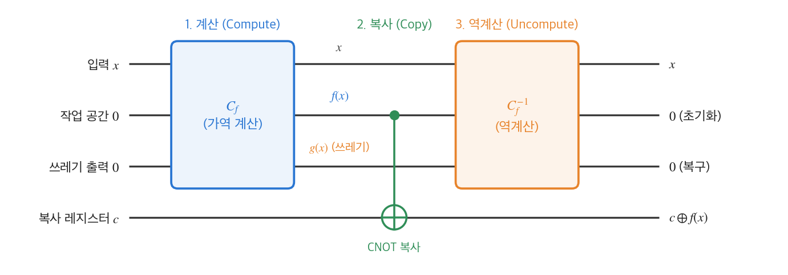
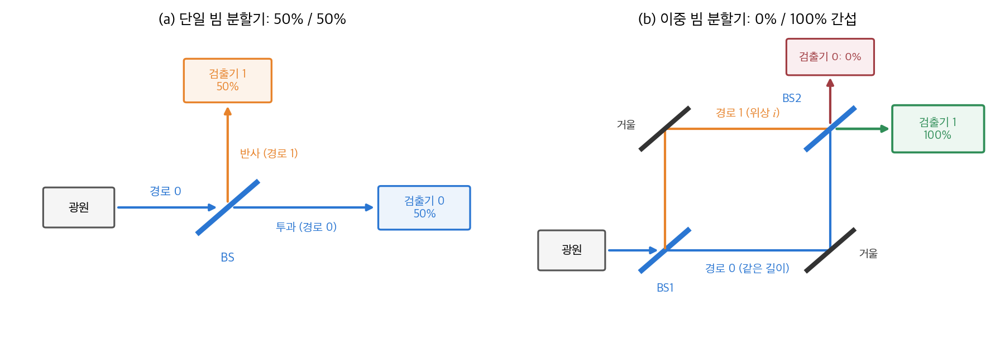
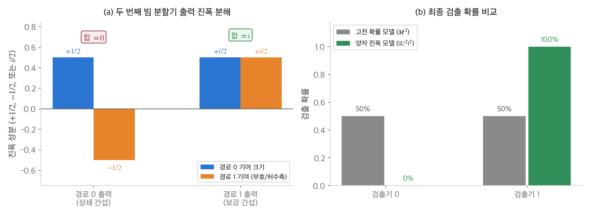

# 1. 서론과 배경

컴퓨터는 알고리즘을 실행해 정보를 처리하는 물리적 장치입니다. 고전 컴퓨터는 비트와 논리 게이트로 동작하며, 어떤 물리 장치도 확률적 튜링 머신으로 효율적으로 시뮬레이션한다는 **강한 처치-튜링 명제**(Strong Church–Turing Thesis)를 전제로 삼아 왔습니다.
그러나 양자역학을 따르는 계는 고전 컴퓨터로 시뮬레이션할 때 지수적인 자원이 듭니다. 반대로 양자 현상을 직접 계산 장치로 활용하면 고전 컴퓨터보다 훨씬 적은 자원으로 풀리는 문제가 있습니다.
이 장은 계산 복잡도의 기준과 회로 모델, 선형대수 표현, 가역 계산(reversible computation), 그리고 양자 간섭을 미리 살펴보며 양자 컴퓨팅의 출발점을 세웁니다.

!!! info "원문과 자료"
    - 원문: Kaye, Laflamme, Mosca, *An Introduction to Quantum Computing* (2007), 1장 Introduction and Background (1.1~1.7절)
    - 이 교재의 관련 장: [2. 선형대수와 디랙 표기](02-linear-algebra-dirac.md), [4. 양자 계산 모델과 회로](04-quantum-circuits.md)
    - 함께 읽기: [알고리즘 3장 실행 시간의 점근 표기](../algorithms/03-running-times.md), [선형대수 1장 행렬과 가우스 소거법](../../math/linear-algebra/01-gaussian-elimination.md), [양자역학 1장 파동 함수](../../physics/quantum-mechanics/01-wave-function.md)
    - 이 장의 수식과 수치는 NumPy로 다시 계산해서 검증했습니다.

## 1. 계산 모델과 강한 처치-튜링 명제 (1.1~1.2절)

### 효율성의 기준: 다항 시간과 초다항 시간

알고리즘이 문제를 푸는 데 쓰는 시간과 공간(메모리)은 입력 크기 $n$ 의 함수로 잽니다. 기계 세부 구조에 따른 상수배 차이를 걷어 내기 위해 점근 표기 $O(\cdot)$ 와 $\Omega(\cdot)$ 를 씁니다.

- **효율적인 알고리즘**: 어떤 상수 $k$ 에 대해 실행 자원이 $O(n^k)$ 인 **다항 시간**(polynomial time) 알고리즘을 효율적이라고 부릅니다. $O(\log n)$ 과 $O(n)$ 도 다항 시간 안에 들어갑니다.
- **비효율적인 알고리즘**: 자원이 $\Omega(c^n)$ ($c > 1$) 처럼 커지는 **지수 시간**(exponential time) 알고리즘이나 어떤 다항식으로도 위에서 묶이지 않는 **초다항 시간**(superpolynomial time) 알고리즘은 입력이 커지면 다룰 수 없습니다.

점근 표기의 자세한 성질은 [실행 시간의 점근 표기](../algorithms/03-running-times.md)에서 다룹니다.

### 처치-튜링 명제에서 양자 명제로

한 계산 모델 $A$ 가 다른 모델 $B$ 를 시뮬레이션할 때 드는 자원 증가가 $B$ 가 쓴 자원의 다항식이면 이 시뮬레이션을 **효율적**이라고 부릅니다.
컴퓨터 과학은 이 기준을 바탕으로 두 가지 명제를 다룹니다.

| 명제 | 주장 | 핵심 차이 |
| --- | --- | --- |
| **처치-튜링 명제** | 현실의 컴퓨터가 푸는 문제는 모두 튜링 머신이 풉니다. | 계산 가능성만 따집니다. |
| **고전 강한 처치-튜링 명제** | 확률적 튜링 머신이 현실의 모든 계산 모델을 효율적으로 시뮬레이션합니다. | 무작위 비트를 허용해 효율성까지 따집니다. |
| **양자 강한 처치-튜링 명제** | 양자 튜링 머신이 현실의 모든 계산 모델을 효율적으로 시뮬레이션합니다. | 양자 물리 계의 시뮬레이션을 포함합니다. |

고전 물리 계는 확률적 튜링 머신으로 효율적으로 시뮬레이션됩니다.
그러나 파인만(Feynman)이 지적했듯이, 일반 양자 물리 계의 시간 진화를 고전 컴퓨터로 시뮬레이션하려면 상태 공간 차원이 큐비트 수에 따라 지수적으로 커집니다.
따라서 양자 법칙을 직접 쓰는 **양자 컴퓨터**는 고전 강한 처치-튜링 명제에 반례를 제시할 후보입니다.

## 2. 회로 모델의 계산 (1.3절)

### 비순환 회로와 균일성

튜링 머신과 동등한 계산 능력을 가지면서 양자 컴퓨터로 옮기기 쉬운 모델이 **회로 모델**(circuit model)입니다.
회로 $C_n$ 은 비트 값을 나르는 $n$ 개의 **선**(wire)과 비트에 기본 연산을 가하는 **게이트**(gate)로 이루어진 비순환(acyclic) 네트워크입니다. 비트는 왼쪽에서 오른쪽으로 한 번만 흐르며 되먹임이 없습니다.

입력 크기 $n$ 마다 회로 $C_n$ 을 하나씩 모아 **회로군** $\{C_n \mid n \in \mathbb{Z}^+\}$ 을 만듭니다. 회로가 입력 크기마다 숨은 능력을 몰래 끼워 넣지 못하도록, 회로 $C_n$ 자체를 튜링 머신이 게이트 수 $|C_n|$ 과 $n$ 의 다항 시간 안에 생성할 수 있어야 합니다. 이 조건을 **균일성**(uniformity)이라고 합니다.

회로의 복잡도는 세 가지 수치로 잽니다.

1. **크기**(size): 회로에 들어간 총 게이트 수 $|C_n|$ 입니다.
2. **깊이**(depth): 게이트를 동시에 실행할 수 있는 이산 시간 단계(time-slice) 수입니다. 서로 다른 선에 걸리는 게이트는 한 단계에서 병렬로 실행됩니다.
3. **공간 또는 폭**(space / width): 회로가 쓰는 전체 선의 개수입니다.

### 보편 게이트 집합

유한한 종류의 게이트만 써서 모든 불 함수 $f: \{0,1\}^n \to \{0,1\}^m$ 를 구현할 수 있으면 그 게이트 집합을 고전 계산에 대해 **보편**(universal)이라고 부릅니다.

- 비가역 고전 회로에서는 `{"NAND", "FANOUT"}` 두 게이트만 있으면 모든 함수를 만듭니다.
- **가역 게이트**만으로 제한하면 1비트·2비트 게이트만으로는 보편성을 얻지 못합니다. 3비트 가역 게이트인 **토폴리 게이트**(Toffoli gate)는 첫 두 비트가 모두 $1$ 일 때만 셋째 비트를 뒤집습니다. 보조 비트(0 또는 1로 초기화)를 쓸 수 있으면 토폴리 게이트 하나만으로 고전 계산의 보편 집합이 됩니다.

## 3. 회로 모델의 선형대수 표현 (1.4절)

고전 회로를 벡터와 행렬로 적으면 양자 회로와 표기가 자연스럽게 이어집니다.

### 비트 상태 벡터와 게이트 행렬

단일 비트가 상태 $0$ 일 확률이 $p_0$, 상태 $1$ 일 확률이 $p_1$ ($p_0 + p_1 = 1$)이면 상태를 2차원 확률 벡터로 씁니다.

$$
\begin{pmatrix} p_0 \\ p_1 \end{pmatrix}, \qquad
\text{결정론적 } 0 = \begin{pmatrix} 1 \\ 0 \end{pmatrix}, \qquad
\text{결정론적 } 1 = \begin{pmatrix} 0 \\ 1 \end{pmatrix}
$$

고전 `NOT` 게이트는 $0 \mapsto 1$, $1 \mapsto 0$ 으로 보내므로 다음 $2 \times 2$ 치환 행렬입니다.

$$
\mathrm{NOT} = \begin{pmatrix} 0 & 1 \\ 1 & 0 \end{pmatrix}
$$

확률 벡터 $\begin{pmatrix} p_0 \\ p_1 \end{pmatrix}$ 에 행렬을 왼쪽에서 곱해 검증합니다.

$$
\begin{pmatrix} 0 & 1 \\ 1 & 0 \end{pmatrix}
\begin{pmatrix} p_0 \\ p_1 \end{pmatrix}
= \begin{pmatrix} 0\cdot p_0 + 1\cdot p_1 \\ 1\cdot p_0 + 0\cdot p_1 \end{pmatrix}
= \begin{pmatrix} p_1 \\ p_0 \end{pmatrix}
$$

### 다중 비트와 제어-NOT (CNOT)

첫째 비트의 확률 분포가 $(p_0, p_1)$, 둘째 비트의 확률 분포가 $(q_0, q_1)$ 이고 두 비트가 독립이면 네 가지 결합 상태 $\{00, 01, 10, 11\}$ 의 확률은 각 확률의 곱입니다. 이는 두 벡터의 **텐서 곱**(tensor product)으로 씁니다.

$$
\begin{pmatrix} p_0 \\ p_1 \end{pmatrix} \otimes \begin{pmatrix} q_0 \\ q_1 \end{pmatrix}
= \begin{pmatrix} p_0 q_0 \\ p_0 q_1 \\ p_1 q_0 \\ p_1 q_1 \end{pmatrix}
$$

2비트 가역 게이트인 **CNOT**(controlled-NOT)은 제어 비트 $c$ 가 $1$ 일 때만 표적 비트 $t$ 를 뒤집어 $(c, t) \mapsto (c, t \oplus c)$ 로 보냅니다. 기저 $\{00, 01, 10, 11\}$ 에서의 행렬은 다음과 같습니다.

$$
\mathrm{CNOT} = \begin{pmatrix}
1 & 0 & 0 & 0 \\
0 & 1 & 0 & 0 \\
0 & 0 & 0 & 1 \\
0 & 0 & 1 & 0
\end{pmatrix}
$$

첫째 비트가 동전 던지기 상태 $\begin{pmatrix} 1/2 \\ 1/2 \end{pmatrix}$ 이고 둘째 비트가 $\begin{pmatrix} 1 \\ 0 \end{pmatrix}$ 일 때 CNOT을 걸면 어떻게 되는지 계산합니다.
먼저 입력 결합 벡터를 텐서 곱으로 구합니다.

$$
\begin{pmatrix} 1/2 \\ 1/2 \end{pmatrix} \otimes \begin{pmatrix} 1 \\ 0 \end{pmatrix}
= \begin{pmatrix} 1/2 \\ 0 \\ 1/2 \\ 0 \end{pmatrix}
$$

이제 $\mathrm{CNOT}$ 행렬을 왼쪽에서 곱합니다. 셋째 성분($10$)과 넷째 성분($11$)의 자리가 바뀝니다.

$$
\begin{pmatrix}
1 & 0 & 0 & 0 \\
0 & 1 & 0 & 0 \\
0 & 0 & 0 & 1 \\
0 & 0 & 1 & 0
\end{pmatrix}
\begin{pmatrix} 1/2 \\ 0 \\ 1/2 \\ 0 \end{pmatrix}
= \begin{pmatrix} 1/2 \\ 0 \\ 0 \\ 1/2 \end{pmatrix}
$$

결과 벡터 $(1/2, 0, 0, 1/2)^T$ 는 두 독립 비트의 텐서 곱 $(p_0 q_0, p_0 q_1, p_1 q_0, p_1 q_1)^T$ 로 인수분해되지 않습니다. 만약 $p_0 q_0 = 1/2$ 이고 $p_1 q_1 = 1/2$ 이면 $p_0, q_0, p_1, q_1$ 이 모두 0이 아니므로 $p_0 q_1 \neq 0$ 이 되어 모순입니다. 두 고전 비트가 확률적으로 **상관**(correlated)되어 있습니다.

## 4. 가역 계산과 역계산 (1.5절)

### 왜 가역 계산이 필요한가

출력만 보고 입력을 유일하게 되돌릴 수 있으면 그 계산은 **가역**(reversible)입니다.
`NOT`은 출력이 0이면 입력이 1이므로 가역입니다. 반면 `AND`는 출력이 0일 때 입력이 $(0,0), (0,1), (1,0)$ 중 무엇이었는지 알 수 없어 비가역입니다.

고전 컴퓨터는 비가역 게이트로 잃어버린 정보의 엔트로피를 열로 방출합니다. 그러나 양자 계산의 닫힌 계 진화는 모두 가역인 유니터리 연산이므로, 함수 계산을 가역 회로로 바꾸는 방법을 알아야 합니다.

### 비가역 게이트의 가역화

`AND` 게이트에 보조 비트 1개를 더해 3비트 토폴리 게이트 $(x_1, x_2, c) \mapsto (x_1, x_2, c \oplus (x_1 \land x_2))$ 로 만들면 입력과 출력이 일대일 대응을 이룹니다. 보조 비트를 $c = 0$ 으로 고정하면 셋째 선에 $x_1 \land x_2$ 가 나오고, 첫 두 선에는 입력 복사본이 남습니다.

### 베넷의 역계산 트릭 (Uncomputation)

회로의 모든 비가역 게이트를 가역 게이트로 바꾸면 출력 $f(x)$ 와 함께 중간 과정에서 생긴 **쓰레기 비트**(junk bit) $g(x)$ 가 남습니다.
고전 계산에서는 쓰레기 비트를 버려도 결과가 안 바뀝니다. 그러나 양자 계산에서는 쓰레기 비트가 출력과 얽혀 간섭을 깨뜨리므로 반드시 지워야 합니다. 베넷(Bennett)의 **역계산**(uncomputation)은 이를 세 단계로 해결합니다.

1. **계산($C_f$)**: 입력 $x$ 와 초기화된 작업 공간 $0$ 에서 $(x, f(x), g(x))$ 를 계산합니다.
2. **복사(Copy)**: CNOT 게이트들로 결과 $f(x)$ 를 별도의 복사 레지스터 $c$ 에 XOR하여 $(x, f(x), g(x), c \oplus f(x))$ 를 얻습니다.
3. **역계산($C_f^{-1}$)**: $C_f$ 의 모든 게이트를 역순으로 거꾸로 실행합니다. 복사 레지스터는 건드리지 않으므로 $f(x)$ 와 쓰레기 비트 $g(x)$ 가 모두 원래의 $0$ 으로 돌아갑니다.

<figure markdown>

<figcaption markdown>
<span class="fig-title"><b>Figure 1.</b> 가역 계산에서 역계산($C_f^{-1}$)으로 쓰레기 비트를 지우는 절차</span>

계산 블록 $C_f$ 로 $f(x)$ 와 쓰레기 $g(x)$ 를 만든 뒤 CNOT으로 출력만 복사합니다. 이어서 $C_f^{-1}$ 을 실행하면 작업 공간과 쓰레기 비트가 $0$ 으로 복구되어 최종 출력 $(x, c \oplus f(x))$ 만 남습니다.
</figcaption>
</figure>

초기화된 작업 공간을 생략하면 이 회로는 임의의 함수 $f$ 에 대해 다음 가역 사상을 구현합니다.

$$
(x, c) \longmapsto (x, c \oplus f(x))
$$

이 변환은 6~8장의 양자 오라클이 쓰는 표준 형태입니다. 원래 비가역 회로의 깊이가 $T$, 공간이 $S$ 이면 이 가역 회로는 $O(S + ST)$ 공간과 깊이 $O(T)$ 로 구현됩니다.

## 5. 양자 물리 미리보기: 빔 분할기 간섭 실험 (1.6~1.7절)

고전 확률 모델로 설명할 수 없는 양자 현상을 단일 광자(photon)와 **빔 분할기**(beam splitter) 실험으로 확인합니다.

### 실험 1: 단일 빔 분할기

광원에서 광자를 하나씩 쏘아 50:50 빔 분할기로 보냅니다.
직진(투과)하면 경로 $0$ 의 검출기에, 반사되면 경로 $1$ 의 검출기에 닿습니다. 실험하면 두 검출기 모두 절반(50%)씩 광자를 관측합니다.
고전 확률 모델은 빔 분할기를 동전 던지기로 봅니다. 전이 확률 행렬 $M$ 은 다음과 같습니다.

$$
M = \begin{pmatrix} 1/2 & 1/2 \\ 1/2 & 1/2 \end{pmatrix}
$$

### 실험 2: 이중 빔 분할기 (간섭계)

이제 거울 두 개를 두어 경로 $0$ 과 경로 $1$ 을 같은 길이로 만든 뒤, 두 번째 빔 분할기에서 다시 합칩니다.
고전 확률 모델대로 두 빔 분할기가 독립적으로 동전을 던진다면 출력 확률 분포는 다음과 같아야 합니다.

$$
M^2 \begin{pmatrix} 1 \\ 0 \end{pmatrix}
= \begin{pmatrix} 1/2 & 1/2 \\ 1/2 & 1/2 \end{pmatrix}
\begin{pmatrix} 1/2 \\ 1/2 \end{pmatrix}
= \begin{pmatrix} 1/2 \\ 1/2 \end{pmatrix}
$$

고전 예측에 따르면 두 검출기 모두 여전히 **50%씩** 광자를 받습니다.
그러나 실제 실험에서는 검출기 $0$ 이 **0%**, 검출기 $1$ 이 **100%** 로 관측됩니다.

<figure markdown>

<figcaption markdown>
<span class="fig-title"><b>Figure 2.</b> 단일 빔 분할기(a)와 이중 빔 분할기 간섭계(b)의 검출 확률</span>

단일 빔 분할기(a)에서는 두 검출기에 50%씩 도달합니다. 경로 길이가 같은 이중 빔 분할기(b)에서는 양자 간섭으로 인해 경로 0이 상쇄되고 광자 100%가 검출기 1에 도달합니다.
</figcaption>
</figure>

### 양자 진폭과 행렬 계산

양자역학은 확률 $p_0, p_1$ 대신 복소수 **진폭**(amplitude) $\alpha_0, \alpha_1$ ($\lvert\alpha_0\rvert^2 + \lvert\alpha_1\rvert^2 = 1$) 으로 상태를 적습니다.

$$
\text{경로 } 0 = \begin{pmatrix} 1 \\ 0 \end{pmatrix}, \qquad
\text{경로 } 1 = \begin{pmatrix} 0 \\ 1 \end{pmatrix}, \qquad
\text{중첩 상태} = \begin{pmatrix} \alpha_0 \\ \alpha_1 \end{pmatrix}
$$

어느 경로에 있는지 측정하면 경로 $0$ 이 $\lvert\alpha_0\rvert^2$, 경로 $1$ 이 $\lvert\alpha_1\rvert^2$ 의 확률로 관측됩니다.
빔 분할기 하나는 상태 벡터에 다음 유니터리 행렬 $U_{\mathrm{BS}}$ 를 곱합니다(반사 시 위상 $i$ 가 붙습니다).

$$
U_{\mathrm{BS}} = \frac{1}{\sqrt{2}} \begin{pmatrix} 1 & i \\ i & 1 \end{pmatrix}
$$

경로 $0$ 에서 출발한 광자가 첫 번째 빔 분할기를 지나면 상태가 다음과 같이 바뀝니다.

$$
U_{\mathrm{BS}} \begin{pmatrix} 1 \\ 0 \end{pmatrix}
= \frac{1}{\sqrt{2}} \begin{pmatrix} 1 & i \\ i & 1 \end{pmatrix} \begin{pmatrix} 1 \\ 0 \end{pmatrix}
= \frac{1}{\sqrt{2}} \begin{pmatrix} 1 \\ i \end{pmatrix}
= \frac{1}{\sqrt{2}}\begin{pmatrix} 1 \\ 0 \end{pmatrix} + \frac{i}{\sqrt{2}}\begin{pmatrix} 0 \\ 1 \end{pmatrix}
$$

여기서 측정하면 경로 $0$ 확률은 $\lvert 1/\sqrt{2} \rvert^2 = 1/2$, 경로 $1$ 확률은 $\lvert i/\sqrt{2} \rvert^2 = 1/2$ 이므로 단일 빔 분할기 실험과 일치합니다.

중간에 측정하지 않고 두 번째 빔 분할기를 통과시킵니다. $U_{\mathrm{BS}}$ 를 한 번 더 곱해 항마다 전개합니다.

$$
U_{\mathrm{BS}} \left(\frac{1}{\sqrt{2}} \begin{pmatrix} 1 \\ i \end{pmatrix}\right)
= \frac{1}{2} \begin{pmatrix} 1 & i \\ i & 1 \end{pmatrix} \begin{pmatrix} 1 \\ i \end{pmatrix}
= \frac{1}{2} \begin{pmatrix} 1\cdot 1 + i \cdot i \\ i\cdot 1 + 1 \cdot i \end{pmatrix}
= \frac{1}{2} \begin{pmatrix} 1 - 1 \\ 2i \end{pmatrix}
= \begin{pmatrix} 0 \\ i \end{pmatrix}
$$

위쪽 성분(경로 $0$)에서는 경로 $0$ 을 거친 진폭 $+1/2$ 과 경로 $1$ 을 거쳐 두 번 반사된 진폭 $i^2/2 = -1/2$ 이 더해져 $0$ 으로 상쇄됩니다.
아래쪽 성분(경로 $1$)에서는 두 경로의 진폭 $+i/2$ 와 $+i/2$ 가 보강 간섭을 일으켜 $i$ 가 됩니다.
최종 검출 확률은 경로 $0$ 이 $\lvert 0 \rvert^2 = 0$, 경로 $1$ 이 $\lvert i \rvert^2 = 1$ (100%)입니다.

<figure markdown>

<figcaption markdown>
<span class="fig-title"><b>Figure 3.</b> 경로 진폭의 상쇄·보강 간섭(a)과 고전·양자 모델의 확률 비교(b)</span>

경로 0 출력은 두 경로 기여 $+1/2$ 과 $-1/2$ 이 상쇄되어 0이 됩니다. 경로 1 출력은 $+i/2$ 두 개가 보강되어 크기 1($|i|^2 = 100\%$)을 얻습니다.
</figcaption>
</figure>

```python
import numpy as np

U_bs = np.array([[1, 1j], [1j, 1]]) / np.sqrt(2)
state_0 = np.array([1, 0], dtype=complex)

after_1 = U_bs @ state_0
after_2 = U_bs @ after_1
print("1차 후 확률:", np.abs(after_1) ** 2)   # [0.5 0.5]
print("2차 후 진폭:", after_2)                 # [0.+0.j 0.+1.j]
print("2차 후 확률:", np.abs(after_2) ** 2)   # [0. 1.]
```

고전 확률은 음수나 복소수가 될 수 없어 두 경로의 확률이 만나면 항상 커지기만 합니다. 양자 진폭은 복소수이므로 서로 지워지는 **상쇄 간섭**(destructive interference)을 일으킬 수 있습니다. 양자 알고리즘은 오답 경로의 진폭을 상쇄하고 정답 경로의 진폭을 보강하도록 설계합니다.

## 6. 이 장의 요약

| 개념 | 핵심 식 또는 사실 | 의미 |
| --- | --- | --- |
| 효율적 계산 | 실행 자원 $O(n^k)$ | 다항 시간 알고리즘 |
| 양자 강한 처치-튜링 명제 | 양자 모델이 현실 물리 계를 효율적으로 시뮬레이션 | 고전 모델과 효율성 경계가 다를 가능성 |
| 가역 보편 게이트 | 토폴리 게이트 (+ 보조 비트) | 모든 고전 함수를 가역 회로로 구현 |
| 역계산 (Uncomputation) | $(x, c) \mapsto (x, c \oplus f(x))$ | $C_f$, 복사, $C_f^{-1}$ 로 쓰레기 비트 제거 |
| 양자 간섭 | $\lvert \alpha_0 + \alpha_1 \rvert^2 \neq \lvert \alpha_0 \rvert^2 + \lvert \alpha_1 \rvert^2$ | 복소 진폭의 상쇄와 보강 |

다음 장은 이런 상태 벡터와 유니터리 변환을 임의의 $n$ 큐비트 공간에서 간결하게 다루기 위한 언어인 **디랙 표기**와 **선형대수 도구**를 정리합니다.
