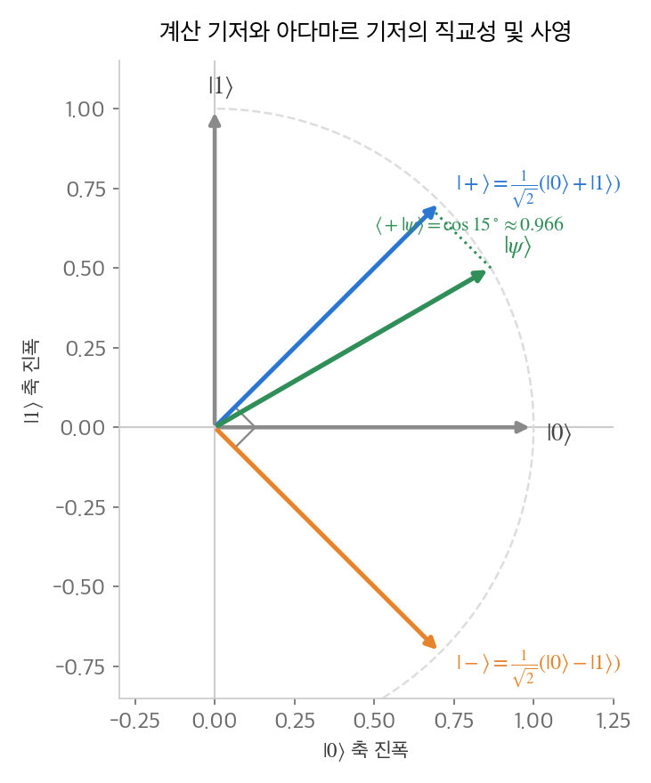
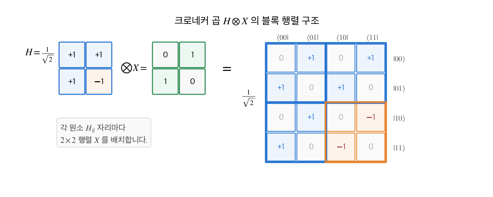
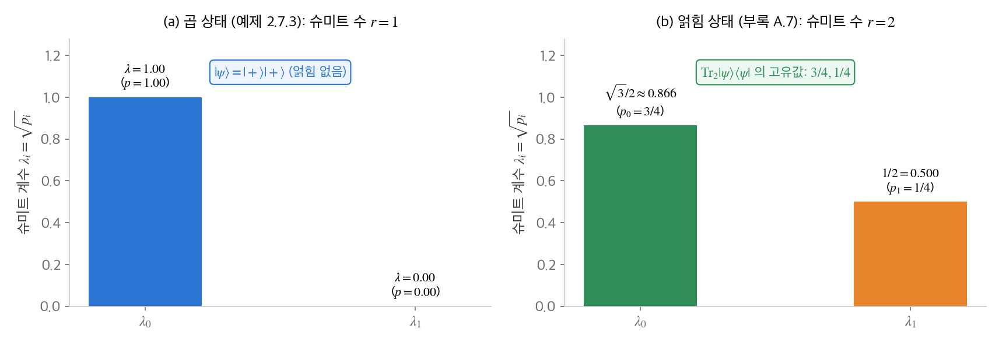

# 2. 선형대수와 디랙 표기

$n$ 개의 큐비트가 이루는 상태 공간의 차원은 $2^n$ 입니다. $n = 8$ 만 되어도 열 벡터에 성분이 $256$ 개 들어가므로 행렬만으로 식을 쓰면 금세 길어집니다.
**디랙 표기**(Dirac notation)는 고차원 복소 벡터와 선형 연산자를 기저 라벨만으로 간결하게 적는 표준 언어입니다.
이 장은 힐베르트 공간과 브라-켓(bra-ket) 내적, 외적과 연산자 성질, 스펙트럼 정리, 텐서 곱, 그리고 얽힘 판별의 핵심 도구인 **슈미트 분해**(Schmidt decomposition)까지 단계별로 정리합니다.

!!! info "원문과 자료"
    - 원문: Kaye, Laflamme, Mosca, *An Introduction to Quantum Computing* (2007), 2장 Linear Algebra and the Dirac Notation (2.1~2.8절) 및 부록 A.7 Computing Schmidt Decompositions
    - 이 교재의 관련 장: [1. 서론과 배경](01-introduction.md), [3. 큐비트와 양자역학의 틀](03-qubits-framework.md)
    - 함께 읽기: [선형대수 3장 직교성](../../math/linear-algebra/03-orthogonality.md), [선형대수 5장 고유값과 고유벡터](../../math/linear-algebra/05-eigenvalues.md), [선형대수 부록. 공간의 연산과 행렬 분해](../../math/linear-algebra/09-appendix.md), [양자역학 3장 형식 체계](../../physics/quantum-mechanics/03-formalism.md)
    - 이 장의 수식과 수치는 NumPy로 다시 계산해서 검증했습니다.

## 1. 힐베르트 공간과 디랙 표기 (2.1~2.2절)

### 켓(ket)과 계산 기저

양자 컴퓨팅에서 다루는 상태 공간은 복소수 체 $\mathbb{C}$ 위의 유한 차원 내적 공간이며, 이를 **힐베르트 공간**(Hilbert space) $\mathcal{H}$ 라고 부릅니다. $n$ 큐비트 공간의 차원은 $2^n$ 입니다.

벡터는 **켓**(ket) 기호 $\lvert a \rangle$ 로 적습니다. 가장 자주 쓰는 직교 정규 기저는 길이 $n$ 인 이진 문자열로 이름 붙인 **계산 기저**(computational basis)입니다.

$$
\lvert 00\dots 0 \rangle, \quad \lvert 00\dots 1 \rangle, \quad \dots, \quad \lvert 11\dots 1 \rangle
$$

$n=2$ (4차원)에서 계산 기저 벡터와 열 벡터의 대응은 다음과 같습니다.

$$
\lvert 00 \rangle = \begin{pmatrix} 1 \\ 0 \\ 0 \\ 0 \end{pmatrix}, \quad
\lvert 01 \rangle = \begin{pmatrix} 0 \\ 1 \\ 0 \\ 0 \end{pmatrix}, \quad
\lvert 10 \rangle = \begin{pmatrix} 0 \\ 0 \\ 1 \\ 0 \end{pmatrix}, \quad
\lvert 11 \rangle = \begin{pmatrix} 0 \\ 0 \\ 0 \\ 1 \end{pmatrix}
$$

예를 들어 벡터 $\lvert \psi \rangle = \frac{2}{3}\lvert 01 \rangle + \frac{i}{\sqrt{3}}\lvert 11 \rangle$ 는 열 벡터로 $(0, 2/3, 0, i/\sqrt{3})^T$ 입니다. 0인 성분이 많을수록 디랙 표기가 훨씬 짧습니다.

### 쌍대 벡터(bra)와 내적

복소 벡터 공간의 내적은 다음 세 공리를 만족합니다.

1. 둘째 인수에 대해 선형입니다: $\langle v, \sum_i \lambda_i w_i \rangle = \sum_i \lambda_i \langle v, w_i \rangle$.
2. 켤레 교환 법칙이 성립합니다: $\langle v, w \rangle = \langle w, v \rangle^*$.
3. 자기 내적은 음이 아닙니다: $\langle v, v \rangle \ge 0$ (등호는 $v = 0$ 일 때만 성립).

힐베르트 공간 $\mathcal{H}$ 에서 $\mathbb{C}$ 로 가는 선형 사상들의 공간을 **쌍대 공간**(dual space) $\mathcal{H}^*$ 라 하고, 그 원소를 **브라**(bra) $\langle \chi \rvert$ 로 적습니다.

$$
\langle \chi \rvert : \lvert \psi \rangle \longmapsto \langle \chi \mid \psi \rangle \in \mathbb{C}
$$

열 벡터 표기에서 브라 $\langle \chi \rvert$ 는 켓 $\lvert \chi \rangle$ 의 전치 켤레(conjugate transpose), 즉 행 벡터에 복소 켤레를 취한 형태입니다. 따라서 $\langle \chi \mid \psi \rangle = \sum_i \chi_i^* \psi_i$ 입니다.

벡터 $\lvert \psi \rangle$ 의 유클리드 노름(길이)은 $\lVert \lvert \psi \rangle \rVert = \sqrt{\langle \psi \mid \psi \rangle}$ 이고, 노름이 $1$ 인 벡터를 **단위 벡터**라고 부릅니다.

### 손계산 예: 디랙 표기와 행렬 표기의 내적

$\lvert \psi \rangle = \frac{2}{3}\lvert 01 \rangle + \frac{i}{\sqrt{3}}\lvert 11 \rangle$ 와 $\lvert \phi \rangle = \frac{1}{\sqrt{2}}\lvert 10 \rangle + \frac{1}{\sqrt{2}}\lvert 11 \rangle$ 의 내적 $\langle \psi \mid \phi \rangle$ 를 두 방식으로 계산합니다.

먼저 행렬 표기입니다. $\langle \psi \rvert$ 를 구할 때 $\frac{i}{\sqrt{3}}$ 의 켤레가 $-\frac{i}{\sqrt{3}}$ 이 됩니다.

$$
\langle \psi \mid \phi \rangle
= \begin{pmatrix} 0 & \frac{2}{3} & 0 & -\frac{i}{\sqrt{3}} \end{pmatrix}
\begin{pmatrix} 0 \\ 0 \\ \frac{1}{\sqrt{2}} \\ \frac{1}{\sqrt{2}} \end{pmatrix}
= 0 + 0 + 0 + \left(-\frac{i}{\sqrt{3}}\right)\frac{1}{\sqrt{2}}
= -\frac{i}{\sqrt{6}}
$$

이번에는 디랙 표기에서 직교 정규 조건 $\langle i \mid j \rangle = \delta_{i,j}$ 를 바로 씁니다.

$$
\begin{aligned}
\langle \psi \mid \phi \rangle
&= \left(\frac{2}{3}\langle 01 \rvert - \frac{i}{\sqrt{3}}\langle 11 \rvert\right)
\left(\frac{1}{\sqrt{2}}\lvert 10 \rangle + \frac{1}{\sqrt{2}}\lvert 11 \rangle\right) \\
&= \frac{2}{3\sqrt{2}}\underbrace{\langle 01 \mid 10 \rangle}_{0}
+ \frac{2}{3\sqrt{2}}\underbrace{\langle 01 \mid 11 \rangle}_{0}
- \frac{i}{\sqrt{6}}\underbrace{\langle 11 \mid 10 \rangle}_{0}
- \frac{i}{\sqrt{6}}\underbrace{\langle 11 \mid 11 \rangle}_{1}
= -\frac{i}{\sqrt{6}}
\end{aligned}
$$

### 아다마르 기저 (Hadamard Basis)

2차원 힐베르트 공간 $\mathcal{H}$ 의 직교 정규 기저는 계산 기저 $\{\lvert 0 \rangle, \lvert 1 \rangle\}$ 뿐이 아닙니다. 가장 자주 쓰이는 또 다른 기저가 **아다마르 기저** $\{\lvert + \rangle, \lvert - \rangle\}$ 입니다.

$$
\lvert + \rangle = \frac{1}{\sqrt{2}}\left(\lvert 0 \rangle + \lvert 1 \rangle\right), \qquad
\lvert - \rangle = \frac{1}{\sqrt{2}}\left(\lvert 0 \rangle - \lvert 1 \rangle\right)
$$

내적으로 직교성과 정규성을 확인합니다.

$$
\langle + \mid - \rangle = \frac{1}{2}\left(\langle 0 \rvert + \langle 1 \rvert\right)\left(\lvert 0 \rangle - \lvert 1 \rangle\right) = \frac{1}{2}(1 - 1) = 0, \qquad
\langle + \mid + \rangle = \frac{1}{2}(1 + 1) = 1
$$

임의의 상태 $\lvert \psi \rangle$ 를 어떤 직교 정규 기저 $\{\lvert b_n \rangle\}$ 로 전개할 때 계수 $\psi_n$ 은 브라를 내적해 바로 얻습니다.

$$
\lvert \psi \rangle = \sum_n \psi_n \lvert b_n \rangle \implies \langle b_m \mid \psi \rangle = \sum_n \psi_n \langle b_m \mid b_n \rangle = \psi_m
$$

<figure markdown>

<figcaption markdown>
<span class="fig-title"><b>Figure 1.</b> 계산 기저와 아다마르 기저의 직교성 및 사영</span>

아다마르 기저 $\{\lvert +\rangle, \lvert -\rangle\}$ 는 계산 기저 $\{\lvert 0\rangle, \lvert 1\rangle\}$ 를 $45^\circ$ 회전한 직교 정규 기저입니다. 상태 $\lvert \psi \rangle$ 를 $\lvert + \rangle$ 에 수선으로 내린 길이 $\langle + \mid \psi \rangle$ 가 $\lvert + \rangle$ 성분의 진폭입니다.
</figcaption>
</figure>

## 2. 선형 연산자, 외적, 성질 (2.3절)

### 외적과 항등 연산자 분해

선형 연산자 $T : \mathcal{H} \to \mathcal{H}$ 를 표현할 때 **외적**(outer product) $\lvert \psi \rangle\langle \phi \rvert$ 를 씁니다. 임의의 켓 $\lvert \gamma \rangle$ 에 외적을 걸면 스칼라 내적 $\langle \phi \mid \gamma \rangle$ 이 나오고 방향은 $\lvert \psi \rangle$ 가 됩니다.

$$
\left(\lvert \psi \rangle\langle \phi \rvert\right)\lvert \gamma \rangle = \lvert \psi \rangle\langle \phi \mid \gamma \rangle = \langle \phi \mid \gamma \rangle \lvert \psi \rangle
$$

직교 정규 기저 $B = \{\lvert b_n \rangle\}$ 에서 외적들의 합으로 **항등 연산자의 분해**(resolution of the identity)를 얻습니다.

$$
I = \sum_{n} \lvert b_n \rangle\langle b_n \rvert
$$

임의의 벡터 $\lvert \psi \rangle$ 의 양쪽에 $I$ 를 걸면 전개식 $\lvert \psi \rangle = \sum_n \lvert b_n \rangle \langle b_n \mid \psi \rangle$ 이 자동 성립합니다.
같은 방식으로 모든 선형 연산자 $T$ 는 외적 기저 $\{\lvert b_n \rangle\langle b_m \rvert\}$ 로 전개되며, 행렬 원소는 $T_{nm} = \langle b_n \rvert T \lvert b_m \rangle$ 입니다.

$$
T = I T I = \sum_{n,m} \lvert b_n \rangle \langle b_n \rvert T \lvert b_m \rangle \langle b_m \rvert = \sum_{n,m} T_{nm} \lvert b_n \rangle\langle b_m \rvert
$$

예를 들어 파울리 $Z$ 연산자($Z\lvert 0 \rangle = \lvert 0 \rangle$, $Z\lvert 1 \rangle = -\lvert 1 \rangle$)는 $Z = \lvert 0 \rangle\langle 0 \rvert - \lvert 1 \rangle\langle 1 \rvert$ 입니다.

### 수반, 유니터리, 에르미트, 사영 연산자

연산자 $T$ 의 **수반**(adjoint, 또는 에르미트 켤레) $T^\dagger$ 는 모든 $\lvert \psi \rangle, \lvert \phi \rangle \in \mathcal{H}$ 에 대해 다음을 만족하는 연산자입니다.

$$
\langle \psi \rvert T^\dagger \lvert \phi \rangle^* = \langle \phi \rvert T \lvert \psi \rangle
$$

행렬 표기에서 $T^\dagger$ 는 $T$ 의 전치 켤레 $(T^T)^*$ 입니다. 자주 쓰는 네 가지 연산자 종류를 표로 정리합니다.

| 연산자 | 정의 식 | 기하·물리적 성질 |
| --- | --- | --- |
| **유니터리** (unitary) | $U^\dagger = U^{-1}$ ($U^\dagger U = I$) | 내적과 노름을 보존합니다. 닫힌 양자 계의 시간 진화입니다. |
| **에르미트** (Hermitian) | $T^\dagger = T$ | 모든 고유값이 실수입니다. 물리 관측량을 나타냅니다. |
| **직교 사영 연산자** (orthogonal projector) | $P^2 = P$, $P^\dagger = P$ | 부분 공간으로 수직 정사영합니다. 측정 연산자입니다. |
| **정규 연산자** (normal) | $A A^\dagger = A^\dagger A$ | 유니터리와 에르미트를 모두 포함하며, 항상 대각화됩니다. |

에르미트 연산자 $T = T^\dagger$ 의 고유값 $\lambda$ ($T\lvert \psi \rangle = \lambda\lvert \psi \rangle$, $\lvert \psi \rangle \neq 0$)가 실수인 이유는 두 줄로 증명됩니다.
양변 왼쪽에 $\langle \psi \rvert$ 를 내적합니다.

$$
\langle \psi \rvert T \lvert \psi \rangle = \lambda \langle \psi \mid \psi \rangle
$$

한편 수반 정의와 $T^\dagger = T$ 를 씁니다.

$$
\lambda^* \langle \psi \mid \psi \rangle = \left(\langle \psi \rvert T \lvert \psi \rangle\right)^* = \langle \psi \rvert T^\dagger \lvert \psi \rangle = \langle \psi \rvert T \lvert \psi \rangle = \lambda \langle \psi \mid \psi \rangle
$$

$\langle \psi \mid \psi \rangle > 0$ 이므로 $\lambda^* = \lambda$, 즉 $\lambda \in \mathbb{R}$ 입니다.

### 대각합 (Trace)

연산자 $A$ 의 **대각합**(trace)은 임의의 직교 정규 기저 $\{\lvert b_n \rangle\}$ 에 대해 대각 원소를 더한 값입니다.

$$
\mathrm{Tr}(A) = \sum_n \langle b_n \rvert A \lvert b_n \rangle
$$

대각합은 기저 선택에 무관하며, 행렬 곱의 순서가 순환할 때 값이 변하지 않는 **순환 성질**(cyclic property)을 가집니다.

$$
\mathrm{Tr}(ABC) = \mathrm{Tr}(BCA) = \mathrm{Tr}(CAB)
$$

또한 외적 $\lvert \psi \rangle\langle \phi \rvert$ 의 대각합은 내적과 같습니다. 기저 $\{\lvert b_n \rangle\}$ 로 전개해 확인합니다.

$$
\mathrm{Tr}(\lvert \psi \rangle\langle \phi \rvert)
= \sum_n \langle b_n \mid \psi \rangle\langle \phi \mid b_n \rangle
= \sum_n \langle \phi \mid b_n \rangle\langle b_n \mid \psi \rangle
= \langle \phi \rvert \left(\sum_n \lvert b_n \rangle\langle b_n \rvert\right) \lvert \psi \rangle
= \langle \phi \mid \psi \rangle
$$

이 항등식은 3장에서 밀도 연산자와 측정 확률을 계산할 때 계속 쓰입니다.

## 3. 스펙트럼 정리와 연산자 함수 (2.4~2.5절)

### 스펙트럼 정리 (Spectral Theorem)

유한 차원 힐베르트 공간 $\mathcal{H}$ 위의 **정규 연산자**($T T^\dagger = T^\dagger T$)는 항상 자신의 직교 정규 고유벡터 기저 $\{\lvert T_i \rangle\}$ 로 대각화됩니다.

$$
T = \sum_i \lambda_i \lvert T_i \rangle\langle T_i \rvert, \qquad \text{행렬 형태: } T = P \Lambda P^\dagger
$$

여기서 $\Lambda$ 는 고유값 $\lambda_i$ 를 대각선에 둔 행렬이고, $P$ 는 각 열이 고유벡터 $\lvert T_i \rangle$ 인 유니터리 행렬입니다.

### 손계산 예: 파울리 $X$ 연산자의 대각화

$X = \lvert 0 \rangle\langle 1 \rvert + \lvert 1 \rangle\langle 0 \rvert = \begin{pmatrix} 0 & 1 \\ 1 & 0 \end{pmatrix}$ 을 대각화합니다.
특성 다항식 $\det(X - \lambda I) = \lambda^2 - 1 = 0$ 에서 고유값은 $\lambda = +1, -1$ 입니다.
$X\lvert + \rangle = \frac{1}{\sqrt{2}}(\lvert 1 \rangle + \lvert 0 \rangle) = +\lvert + \rangle$ 이고 $X\lvert - \rangle = \frac{1}{\sqrt{2}}(\lvert 1 \rangle - \lvert 0 \rangle) = -\lvert - \rangle$ 이므로 고유벡터는 $\lvert + \rangle, \lvert - \rangle$ 입니다.
따라서 스펙트럼 분해는 다음과 같습니다.

$$
X = (+1)\lvert + \rangle\langle + \rvert + (-1)\lvert - \rangle\langle - \rvert
$$

행렬 $P = \frac{1}{\sqrt{2}}\begin{pmatrix} 1 & 1 \\ 1 & -1 \end{pmatrix}$ 와 $\Lambda = \begin{pmatrix} 1 & 0 \\ 0 & -1 \end{pmatrix}$ 로 곱을 직접 계산해 확인합니다.

$$
P \Lambda P^\dagger
= \frac{1}{2}\begin{pmatrix} 1 & 1 \\ 1 & -1 \end{pmatrix}\begin{pmatrix} 1 & 0 \\ 0 & -1 \end{pmatrix}\begin{pmatrix} 1 & 1 \\ 1 & -1 \end{pmatrix}
= \frac{1}{2}\begin{pmatrix} 1 & -1 \\ 1 & 1 \end{pmatrix}\begin{pmatrix} 1 & 1 \\ 1 & -1 \end{pmatrix}
= \frac{1}{2}\begin{pmatrix} 0 & 2 \\ 2 & 0 \end{pmatrix}
= \begin{pmatrix} 0 & 1 \\ 1 & 0 \end{pmatrix}
$$

### 스펙트럼 분해로 연산자 함수 계산하기

테일러 급수 $f(x) = \sum_{m=0}^\infty a_m x^m$ 으로 정의되는 함수 $f(T)$ 는 스펙트럼 분해를 대입하면 간단해집니다.
사영 연산자 $P_i = \lvert T_i \rangle\langle T_i \rvert$ 가 $P_i P_j = \delta_{i,j} P_i$ 를 만족하므로 교차항이 모두 사라지고 거듭제곱이 고유값 위로만 들어갑니다.

$$
T^m = \left(\sum_i \lambda_i \lvert T_i \rangle\langle T_i \rvert\right)^m = \sum_i \lambda_i^m \lvert T_i \rangle\langle T_i \rvert
$$

이를 테일러 급수에 넣고 합의 순서를 바꿉니다.

$$
f(T) = \sum_{m=0}^\infty a_m \sum_i \lambda_i^m \lvert T_i \rangle\langle T_i \rvert
= \sum_i \left(\sum_{m=0}^\infty a_m \lambda_i^m\right) \lvert T_i \rangle\langle T_i \rvert
= \sum_i f(\lambda_i) \lvert T_i \rangle\langle T_i \rvert
$$

즉, 정규 연산자의 함수는 **고유값에만 함수를 적용**해 구합니다. 예를 들어 회전 게이트 $e^{i\theta X}$ 를 구해 봅니다.
$X$ 의 고유값은 $+1, -1$ 이므로 다음과 같이 전개됩니다.

$$
\begin{aligned}
e^{i\theta X}
&= e^{i\theta}\lvert + \rangle\langle + \rvert + e^{-i\theta}\lvert - \rangle\langle - \rvert \\
&= (\cos\theta + i\sin\theta)\lvert + \rangle\langle + \rvert + (\cos\theta - i\sin\theta)\lvert - \rangle\langle - \rvert \\
&= \cos\theta\underbrace{\left(\lvert + \rangle\langle + \rvert + \lvert - \rangle\langle - \rvert\right)}_{I}
+ i\sin\theta\underbrace{\left(\lvert + \rangle\langle + \rvert - \lvert - \rangle\langle - \rvert\right)}_{X} \\
&= \cos\theta\, I + i\sin\theta\, X
\end{aligned}
$$

## 4. 텐서 곱과 크로네커 곱 (2.6절)

### 공간과 벡터의 텐서 곱

차원 $n$ 인 공간 $\mathcal{H}_1$ 과 차원 $m$ 인 공간 $\mathcal{H}_2$ 를 합친 **텐서 곱 공간** $\mathcal{H}_1 \otimes \mathcal{H}_2$ 는 차원이 $nm$ 입니다. 기저 $\{\lvert b_i \rangle\}$ 와 $\{\lvert c_j \rangle\}$ 를 결합하면 $\{\lvert b_i \rangle \otimes \lvert c_j \rangle\}$ 이 새 직교 정규 기저가 됩니다. 표기를 줄여 $\lvert b_i \rangle\lvert c_j \rangle$ 또는 $\lvert b_i c_j \rangle$ 로 씁니다.

텐서 곱은 다음 세 가지 선형 규칙을 따릅니다.

1. $c(\lvert \psi_1 \rangle \otimes \lvert \psi_2 \rangle) = (c\lvert \psi_1 \rangle) \otimes \lvert \psi_2 \rangle = \lvert \psi_1 \rangle \otimes (c\lvert \psi_2 \rangle)$
2. $(\lvert \psi_1 \rangle + \lvert \phi_1 \rangle) \otimes \lvert \psi_2 \rangle = \lvert \psi_1 \rangle \otimes \lvert \psi_2 \rangle + \lvert \phi_1 \rangle \otimes \lvert \psi_2 \rangle$
3. $\lvert \psi_1 \rangle \otimes (\lvert \psi_2 \rangle + \lvert \phi_2 \rangle) = \lvert \psi_1 \rangle \otimes \lvert \psi_2 \rangle + \lvert \psi_1 \rangle \otimes \lvert \phi_2 \rangle$

### 연산자와 크로네커 곱

선형 연산자 $A$ 와 $B$ 의 텐서 곱 $A \otimes B$ 는 $(A \otimes B)(\lvert \psi_1 \rangle \otimes \lvert \psi_2 \rangle) = (A\lvert \psi_1 \rangle) \otimes (B\lvert \psi_2 \rangle)$ 로 작용합니다.
따라서 두 텐서 곱 연산자의 곱은 각 공간에서 따로 곱한 **혼합 곱 법칙**(mixed-product property)을 만족합니다.

$$
(A \otimes B)(C \otimes D) = (AC) \otimes (BD)
$$

행렬 표기에서 $A \otimes B$ 는 $A$ 의 각 원소 $A_{ij}$ 자리에 블록 $A_{ij} B$ 를 채운 **왼쪽 크로네커 곱**(left Kronecker product)입니다.

<figure markdown>

<figcaption markdown>
<span class="fig-title"><b>Figure 2.</b> 크로네커 곱 $H \otimes X$ 의 블록 행렬 전개</span>

$2\times 2$ 행렬 $H$ 의 각 성분 $H_{ij}$ 자리에 $H_{ij}X$ 블록을 넣으면 $4\times 4$ 행렬이 됩니다. $(1,1)$ 위치의 $-1$ 때문에 오른쪽 아래 $2\times 2$ 블록의 부호만 반전됩니다.
</figcaption>
</figure>

외적의 텐서 곱 항등식도 자주 쓰입니다. 켓과 브라의 순서를 맞추면 다음과 같이 갈라집니다.

$$
\lvert ij \rangle\langle kl \rvert = (\lvert i \rangle \otimes \lvert j \rangle)(\langle k \rvert \otimes \langle l \rvert) = \lvert i \rangle\langle k \rvert \otimes \lvert j \rangle\langle l \rvert
$$

## 5. 슈미트 분해와 계산 방법 (2.7절, 부록 A.7)

두 부분 계로 이루어진 공간 $\mathcal{H}_A \otimes \mathcal{H}_B$ ($\dim \mathcal{H}_A = m$, $\dim \mathcal{H}_B = n$)의 일반 상태는 $\sum_{i,j} \alpha_{ij}\lvert a_i \rangle\lvert b_j \rangle$ 처럼 $mn$ 개의 교차항을 가집니다.
**슈미트 분해 정리**(Theorem 2.7.1)는 기저를 잘 고르면 교차항이 모두 사라짐을 보장합니다.

### 슈미트 분해 정리

임의의 순수 상태 $\lvert \psi \rangle \in \mathcal{H}_A \otimes \mathcal{H}_B$ 에 대해, $\mathcal{H}_A$ 의 직교 정규 기저 $\{\lvert \phi_i^A \rangle\}$, $\mathcal{H}_B$ 의 직교 정규 기저 $\{\lvert \phi_i^B \rangle\}$, 그리고 음이 아닌 실수 $\{p_i\}$ 가 존재하여 다음이 성립합니다.

$$
\lvert \psi \rangle = \sum_{i=1}^{k} \sqrt{p_i}\,\lvert \phi_i^A \rangle \lvert \phi_i^B \rangle, \qquad k \le \min(m, n)
$$

양수인 슈미트 계수 $\sqrt{p_i} > 0$ 의 개수를 **슈미트 수**(Schmidt number 또는 rank) $r$ 이라고 부릅니다.

- $r = 1$ 이면 $\lvert \psi \rangle = \lvert \phi_1^A \rangle \lvert \phi_1^B \rangle$ 이므로 두 계가 분리된 **곱 상태**(product state)입니다.
- $r \ge 2$ 이면 두 계를 하나로 묶을 수밖에 없는 **얽힘 상태**(entangled state)입니다.

### 특이값 분해(SVD)로 슈미트 분해 구하기

상태 $\lvert \psi \rangle = \sum_{i,j} M_{ij}\lvert i \rangle\lvert j \rangle$ 의 계수 행렬 $M$ 에 **특이값 분해**(SVD, singular value decomposition)를 적용합니다([선형대수 부록](../../math/linear-algebra/09-appendix.md)).

$$
M = U \Sigma V^\dagger = \sum_k \sigma_k u_k v_k^\dagger
$$

여기서 $\sigma_k \ge 0$ 은 특이값, $u_k$ 는 $U$ 의 열벡터, $v_k^*$ 는 $V^\dagger$ 의 행벡터($v_k$ 의 복소 켤레)입니다.
이를 상태 벡터에 대입하면 슈미트 분해가 바로 나옵니다.

$$
\lvert \psi \rangle = \sum_{i,j} \left(\sum_k \sigma_k U_{ik} V^\dagger_{kj}\right) \lvert i \rangle\lvert j \rangle
= \sum_k \sigma_k \left(\sum_i U_{ik}\lvert i \rangle\right) \otimes \left(\sum_j V_{jk}^* \lvert j \rangle\right)
= \sum_k \sigma_k \lvert \phi_k^A \rangle \lvert \phi_k^B \rangle
$$

따라서 슈미트 계수 $\sqrt{p_k}$ 는 계수 행렬 $M$ 의 특이값 $\sigma_k$ 이며, $p_k$ 는 축소 밀도 행렬 $M M^\dagger$ 의 고유값입니다(부록 A.7).

### 손계산 예: 축소 행렬 대각화로 슈미트 분해 구하기 (부록 A.7)

부록 A.7의 2큐비트 상태를 풉니다.

$$
\lvert \psi \rangle = \frac{\sqrt{3}-\sqrt{2}}{2\sqrt{6}}\lvert 00 \rangle + \frac{\sqrt{6}+1}{2\sqrt{6}}\lvert 01 \rangle + \frac{\sqrt{3}+\sqrt{2}}{2\sqrt{6}}\lvert 10 \rangle + \frac{\sqrt{6}-1}{2\sqrt{6}}\lvert 11 \rangle
$$

1단계로 계수 행렬 $M$ 을 쓰고 $M M^\dagger$ 를 계산합니다.

$$
M = \frac{1}{2\sqrt{6}} \begin{pmatrix} \sqrt{3}-\sqrt{2} & \sqrt{6}+1 \\ \sqrt{3}+\sqrt{2} & \sqrt{6}-1 \end{pmatrix}
$$

각 성분의 제곱합을 구합니다. 첫 행 제곱합은 $\frac{(5 - 2\sqrt{6}) + (7 + 2\sqrt{6})}{24} = \frac{12}{24} = \frac{1}{2}$ 입니다. 둘째 행 제곱합도 $\frac{(5 + 2\sqrt{6}) + (7 - 2\sqrt{6})}{24} = \frac{1}{2}$ 입니다.
비대각 성분은 $\frac{(3-2) + (6-1)}{24} = \frac{6}{24} = \frac{1}{4}$ 입니다. 따라서 축소 행렬은 다음과 같습니다.

$$
\rho_A = M M^\dagger = \begin{pmatrix} 1/2 & 1/4 \\ 1/4 & 1/2 \end{pmatrix}
$$

2단계로 $\rho_A$ 를 대각화합니다. 특성 방정식은 $(1/2 - \lambda)^2 - 1/16 = 0$ 이므로 고유값은 $p_0 = 3/4$, $p_1 = 1/4$ 입니다.
각 고유벡터를 구하면 $\lvert \phi_0^A \rangle = \lvert + \rangle = \frac{1}{\sqrt{2}}(\lvert 0 \rangle + \lvert 1 \rangle)$, $\lvert \phi_1^A \rangle = \lvert - \rangle = \frac{1}{\sqrt{2}}(\lvert 0 \rangle - \lvert 1 \rangle)$ 입니다.

3단계로 $\lvert \psi \rangle$ 를 계 $A$ 의 기저 $\{\lvert + \rangle, \lvert - \rangle\}$ 로 묶어 계 $B$ 의 기저를 읽습니다.
$\lvert 0 \rangle = \frac{\lvert + \rangle + \lvert - \rangle}{\sqrt{2}}$, $\lvert 1 \rangle = \frac{\lvert + \rangle - \lvert - \rangle}{\sqrt{2}}$ 를 대입해 정리합니다.
$\lvert + \rangle\lvert 0 \rangle$ 의 계수는 $\frac{(\sqrt{3}-\sqrt{2}) + (\sqrt{3}+\sqrt{2})}{2\sqrt{12}} = \frac{2\sqrt{3}}{4\sqrt{3}} = \frac{1}{2}$ 이고, 같은 방식으로 네 항을 모으면 다음과 같습니다.

$$
\lvert \psi \rangle = \frac{\sqrt{3}}{2}\lvert + \rangle\left(\frac{1}{\sqrt{3}}\lvert 0 \rangle + \frac{\sqrt{2}}{\sqrt{3}}\lvert 1 \rangle\right)
+ \frac{1}{2}\lvert - \rangle\left(-\frac{\sqrt{2}}{\sqrt{3}}\lvert 0 \rangle + \frac{1}{\sqrt{3}}\lvert 1 \rangle\right)
$$

슈미트 계수는 $\sqrt{3}/2$ 와 $1/2$ 이고, 슈미트 수는 $2$ 이므로 이 상태는 얽혀 있습니다.

<figure markdown>

<figcaption markdown>
<span class="fig-title"><b>Figure 3.</b> 슈미트 계수로 판별하는 곱 상태(a)와 얽힘 상태(b)</span>

곱 상태 $\lvert +\rangle\lvert +\rangle$ 는 영이 아닌 슈미트 계수가 $\lambda_0 = 1$ 하나뿐입니다(슈미트 수 $r=1$). 부록 A.7의 상태는 계수가 $\sqrt{3}/2$ 와 $1/2$ 두 개이므로(슈미트 수 $r=2$) 얽힘 상태입니다.
</figcaption>
</figure>

```python
import numpy as np

M = np.array([
    [np.sqrt(3) - np.sqrt(2), np.sqrt(6) + 1],
    [np.sqrt(3) + np.sqrt(2), np.sqrt(6) - 1],
]) / (2 * np.sqrt(6))

U, s, Vh = np.linalg.svd(M)
print("슈미트 계수:", np.round(s, 6))       # [0.866025 0.5] = [sqrt(3)/2, 1/2]
print("제곱값 p_i:", np.round(s ** 2, 6))   # [0.75 0.25]
```

## 6. 디랙 표기 주의사항 (2.8절)

다중 큐비트 상태에서 브라-켓을 다룰 때 두 가지 관례를 혼동하지 않아야 합니다.

- **부분 계 인덱스**: $\lvert i \rangle_1 \otimes \lvert j \rangle_2$ 에 수반 $\dagger$ 을 취할 때 $\langle i \rvert_1 \otimes \langle j \rvert_2$ 로 순서를 유지하는 표기와 $\langle j \rvert_2 \langle i \rvert_1$ 로 뒤집어 쓰는 물리학 표기가 공존합니다. 원문은 순서를 유지하고 아래첨자나 텐서 위치로 어느 계인지 구분합니다.
- **내부 스칼라**: $\lvert c\psi \rangle = c\lvert \psi \rangle$ 이지만, 브라로 바꿀 때는 켤레가 붙어 $\langle c\psi \rvert = c^*\langle \psi \rvert$ 입니다. 혼동을 피하려면 스칼라를 항상 켓이나 브라 바깥에 씁니다.

## 7. 이 장의 요약

| 개념 | 핵심 식 | 의미 |
| --- | --- | --- |
| 디랙 내적과 외적 | $\langle \phi \mid \psi \rangle$, $\lvert \psi \rangle\langle \phi \rvert$ | 내적은 스칼라, 외적은 선형 연산자 |
| 항등 연산자 분해 | $I = \sum_n \lvert b_n \rangle\langle b_n \rvert$ | 임의 상태·연산자를 직교 정규 기저로 전개 |
| 스펙트럼 정리 | $T = \sum_i \lambda_i \lvert T_i \rangle\langle T_i \rvert$ | 정규 연산자의 대각화와 함수 $f(T)$ 계산 |
| 크로네커 곱 | $(A\otimes B)(C\otimes D) = AC \otimes BD$ | 부분 계 연산자들의 결합 규칙 |
| 슈미트 분해 | $\lvert \psi \rangle = \sum_i \sqrt{p_i}\lvert \phi_i^A \rangle\lvert \phi_i^B \rangle$ | 슈미트 수 $r \ge 2$ 이면 얽힘 상태 |

다음 장은 이 선형대수 언어를 바탕으로 양자역학의 공리(상태, 시간 진화, 합성 계, 측정)와 혼합 상태·밀도 연산자를 세웁니다.
