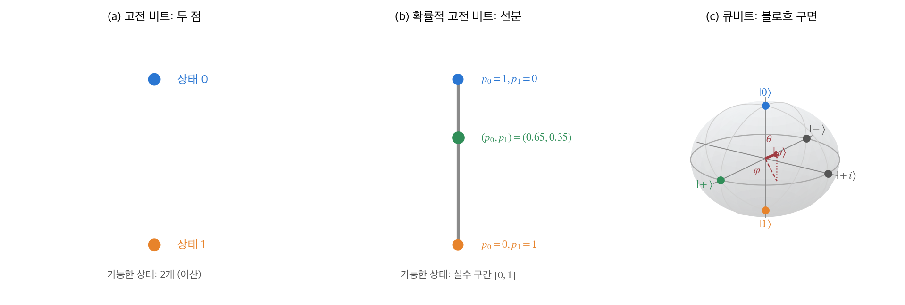
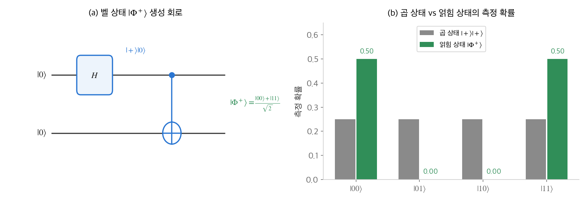
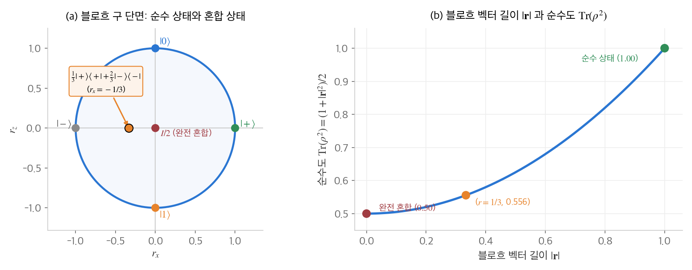
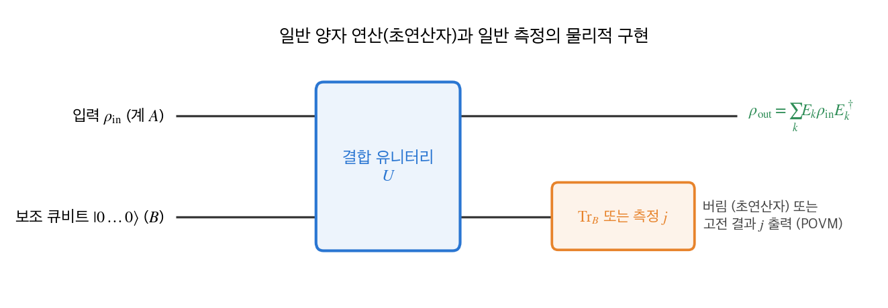

# 3. 큐비트와 양자역학의 틀

2장은 유한 차원 힐베르트 공간과 연산자의 문법을 정리했습니다. 이제 그 수학 위에 물리 규칙을 올려놓습니다.
양자역학의 틀은 네 가지 공리로 요약됩니다. 상태는 단위 벡터이고, 닫힌 계의 시간 진화는 유니터리 연산자이며, 합성 계는 텐서 곱이고, 측정은 확률적으로 상태를 붕괴시킵니다.
여기에 외부 환경과 상호작용하거나 부분 계만 떼어 볼 때 쓰는 **밀도 연산자**, **부분 대각합**, **일반 양자 연산**, **POVM** 을 더하면 양자 계산에 필요한 물리 틀이 완성됩니다.

!!! info "원문과 자료"
    - 원문: Kaye, Laflamme, Mosca, *An Introduction to Quantum Computing* (2007), 3장 Qubits and the Framework of Quantum Mechanics (3.1~3.5절) 및 부록 A.8 General Measurements
    - 이 교재의 관련 장: [2. 선형대수와 디랙 표기](02-linear-algebra-dirac.md), [4. 양자 계산 모델과 회로](04-quantum-circuits.md)
    - 함께 읽기: [양자역학 3장 형식 체계](../../physics/quantum-mechanics/03-formalism.md), [양자역학 4장 3차원 양자역학](../../physics/quantum-mechanics/04-three-dimensions.md), [양자역학 12장 맺음말](../../physics/quantum-mechanics/12-afterword.md)
    - 이 장의 수식과 수치는 NumPy로 다시 계산해서 검증했습니다.

## 1. 양자 계의 상태와 블로흐 구 (3.1절)

### 상태 공간 공리와 큐비트

> **상태 공간 공리**: 닫힌 양자 계의 상태는 힐베르트 공간 $\mathcal{H}$ 의 단위 벡터로 기술됩니다.

가장 단순한 양자 정보 단위가 2차원 공간 $\mathbb{C}^2$ 의 상태인 **큐비트**(qubit)입니다. 광자의 두 경로, 광자의 유무, 스핀-$1/2$ 입자의 스핀 업·다운 등이 물리적 큐비트입니다.
계산 기저 $\{\lvert 0 \rangle, \lvert 1 \rangle\}$ 를 잡으면 임의의 큐비트 상태는 복소 **진폭** $\alpha_0, \alpha_1$ 의 중첩입니다.

$$
\lvert \psi \rangle = \alpha_0 \lvert 0 \rangle + \alpha_1 \lvert 1 \rangle, \qquad \lvert \alpha_0 \rvert^2 + \lvert \alpha_1 \rvert^2 = 1
$$

### 전역 위상과 상대 위상

복소수 $\alpha$ 는 크기 $\lvert \alpha \rvert$ 와 위상 인자 $e^{i\theta}$ 의 곱 $e^{i\theta}\lvert \alpha \rvert$ 로 유일하게 분해됩니다.

- **전역 위상**(global phase): 상태 전체에 곱해진 $e^{i\theta}\lvert \psi \rangle$ 는 어떤 측정에서도 $\lvert \psi \rangle$ 와 확률 분포가 같습니다. 물리적으로 구별되지 않습니다.
- **상대 위상**(relative phase): 두 기저 성분 사이의 위상 차이입니다. $\frac{1}{\sqrt{2}}(\lvert 0 \rangle + \lvert 1 \rangle)$ 과 $\frac{1}{\sqrt{2}}(\lvert 0 \rangle + e^{i\theta}\lvert 1 \rangle)$ 은 서로 다른 물리 상태입니다.

### 블로흐 구 (Bloch Sphere) 매개화

전역 위상을 무시하고 규격화 조건 $\lvert\alpha_0\rvert^2 + \lvert\alpha_1\rvert^2 = 1$ 을 적용합니다.
$\alpha_0 = r_0 e^{i\gamma_0}$, $\alpha_1 = r_1 e^{i\gamma_1}$ 로 쓰고 전체에 $e^{-i\gamma_0}$ 을 곱하면 첫째 계수를 음이 아닌 실수 $r_0$ 으로 만들 수 있습니다.
$r_0^2 + r_1^2 = 1$ 이므로 $r_0 = \cos(\theta/2)$, $r_1 = \sin(\theta/2)$ ($0 \le \theta \le \pi$) 로 둘 수 있습니다. 상대 위상 $\varphi = \gamma_1 - \gamma_0$ ($0 \le \varphi < 2\pi$)을 쓰면 모든 순수 큐비트 상태는 두 실수 각도 $(\theta, \varphi)$ 로 나타납니다.

$$
\lvert \psi \rangle = \cos\frac{\theta}{2}\lvert 0 \rangle + e^{i\varphi}\sin\frac{\theta}{2}\lvert 1 \rangle
$$

왜 $\theta$ 대신 $\theta/2$ 를 쓸까요? 그래야 $\theta = 0$ 인 북극이 $\lvert 0 \rangle$, $\theta = \pi$ 인 남극이 $\lvert 1 \rangle$ 에 놓여 직교하는 두 상태가 $180^\circ$ 반대편에 자리 잡습니다.
이 상태를 3차원 단위 구면 위의 직교 좌표로 옮긴 것이 **블로흐 구**(Bloch sphere)입니다.

$$
(x, y, z) = (\sin\theta \cos\varphi,\; \sin\theta \sin\varphi,\; \cos\theta)
$$

| 상태 | $(\theta, \varphi)$ | 블로흐 좌표 $(x, y, z)$ | 위치 |
| --- | --- | --- | --- |
| $\lvert 0 \rangle$ | $(0, \text{임의})$ | $(0, 0, 1)$ | 북극 ($+z$) |
| $\lvert 1 \rangle$ | $(\pi, \text{임의})$ | $(0, 0, -1)$ | 남극 ($-z$) |
| $\lvert + \rangle = \frac{\lvert 0 \rangle + \lvert 1 \rangle}{\sqrt{2}}$ | $(\pi/2, 0)$ | $(1, 0, 0)$ | $+x$ 축 |
| $\lvert - \rangle = \frac{\lvert 0 \rangle - \lvert 1 \rangle}{\sqrt{2}}$ | $(\pi/2, \pi)$ | $(-1, 0, 0)$ | $-x$ 축 |
| $\lvert +i \rangle = \frac{\lvert 0 \rangle + i\lvert 1 \rangle}{\sqrt{2}}$ | $(\pi/2, \pi/2)$ | $(0, 1, 0)$ | $+y$ 축 |

<figure markdown>

<figcaption markdown>
<span class="fig-title"><b>Figure 1.</b> 고전 비트(a), 확률적 고전 비트(b), 큐비트(c)의 상태 표현</span>

고전 비트는 두 이산 점, 확률 비트는 확률 $p_0, p_1$ 을 잇는 1차원 선분입니다. 큐비트는 복소 진폭과 상대 위상 덕분에 3차원 블로흐 구의 표면 전체를 상태로 갖습니다.
</figcaption>
</figure>

## 2. 닫힌 계의 시간 진화 (3.2절)

> **시간 진화 공리**: 닫힌 양자 계의 시간 진화는 유니터리 연산자 $U$ 로 기술됩니다. 초기 상태 $\lvert \psi_1 \rangle$ 은 진화 후 $\lvert \psi_2 \rangle = U\lvert \psi_1 \rangle$ 이 됩니다.

확률의 총합 $\sum \lvert \alpha_i \rvert^2 = 1$ 이 시간에 따라 보존되어야 하므로, 벡터의 노름을 보존하는 선형 연산자인 **유니터리 연산자**($U^\dagger U = I$)만 허용됩니다. 또한 $U^{-1} = U^\dagger$ 가 항상 존재하므로 닫힌 계의 양자 진화는 반드시 가역입니다.

연속 시간에서 닫힌 계는 에르미트 해밀토니안 $H$ 에 대한 슈뢰딩거 방정식 $i\hbar \frac{d}{dt}\lvert \psi(t) \rangle = H\lvert \psi(t) \rangle$ 을 따릅니다. 시간에 무관한 $H$ 에 대해 시간 간격 $\Delta t$ 동안의 진화는 $U = e^{-iH\Delta t / \hbar}$ 입니다. $H^\dagger = H$ 이므로 $U^\dagger U = e^{iH\Delta t/\hbar}e^{-iH\Delta t/\hbar} = I$ 가 성립합니다.

### 기본 파울리 게이트 (Pauli Gates)

1큐비트 유니터리 게이트 중 가장 기본이 되는 네 행렬을 **파울리 행렬**이라고 부릅니다.

$$
I = \begin{pmatrix} 1 & 0 \\ 0 & 1 \end{pmatrix}, \quad
X = \begin{pmatrix} 0 & 1 \\ 1 & 0 \end{pmatrix}, \quad
Y = \begin{pmatrix} 0 & -i \\ i & 0 \end{pmatrix}, \quad
Z = \begin{pmatrix} 1 & 0 \\ 0 & -1 \end{pmatrix}
$$

- $X$ 는 양자 `NOT` 게이트입니다($\lvert 0 \rangle \leftrightarrow \lvert 1 \rangle$).
- $Z$ 는 위상 반전 게이트입니다($\lvert 0 \rangle \mapsto \lvert 0 \rangle$, $\lvert 1 \rangle \mapsto -\lvert 1 \rangle$).
- $Y = iXZ$ 는 비트 반전과 위상 반전을 함께 일으킵니다.
- 네 행렬 $\{I, X, Y, Z\}$ 는 모든 $2\times 2$ 복소 행렬 공간의 직교 기저를 이룹니다.

## 3. 합성 계와 얽힘 (3.3절)

> **합성 계 공리**: 두 물리 계 $\mathcal{H}_1, \mathcal{H}_2$ 를 하나로 묶은 합성 계의 상태 공간은 텐서 곱 $\mathcal{H}_1 \otimes \mathcal{H}_2$ 입니다. 각 계가 $\lvert \psi_1 \rangle, \lvert \psi_2 \rangle$ 에 있으면 합성 상태는 $\lvert \psi_1 \rangle \otimes \lvert \psi_2 \rangle$ 입니다.

$n$ 큐비트 계의 상태 공간은 $(\mathbb{C}^2)^{\otimes n}$ 이며 차원은 $2^n$ 입니다.

### 곱 상태 vs 얽힘 상태: EPR 쌍 (벨 상태)

2큐비트 상태 $\lvert \Phi^+ \rangle = \frac{1}{\sqrt{2}}(\lvert 00 \rangle + \lvert 11 \rangle)$ 가 두 1큐비트 상태의 곱 $(\alpha_0\lvert 0 \rangle + \alpha_1\lvert 1 \rangle) \otimes (\beta_0\lvert 0 \rangle + \beta_1\lvert 1 \rangle)$ 으로 쓰일 수 있는지 확인합니다.
곱을 전개하면 다음과 같습니다.

$$
\alpha_0\beta_0\lvert 00 \rangle + \alpha_0\beta_1\lvert 01 \rangle + \alpha_1\beta_0\lvert 10 \rangle + \alpha_1\beta_1\lvert 11 \rangle
$$

$\lvert \Phi^+ \rangle$ 와 같으려면 $\alpha_0\beta_0 = 1/\sqrt{2}$ 이고 $\alpha_1\beta_1 = 1/\sqrt{2}$ 이므로 $\alpha_0, \alpha_1, \beta_0, \beta_1$ 이 모두 $0$ 이 아니어야 합니다.
그러면 $\lvert 01 \rangle$ 의 계수 $\alpha_0\beta_1$ 도 $0$ 이 될 수 없어 $\lvert \Phi^+ \rangle$ 의 계수 $0$ 과 모순됩니다.
따라서 $\lvert \Phi^+ \rangle$ 는 분리할 수 없는 **얽힘 상태**(entangled state)입니다.

초기 상태 $\lvert 00 \rangle$ 의 첫째 큐비트에 아다마르 게이트 $H = \frac{1}{\sqrt{2}}\begin{pmatrix} 1 & 1 \\ 1 & -1 \end{pmatrix}$ 를 걸고, 이어서 CNOT을 걸면 $\lvert \Phi^+ \rangle$ 가 만들어집니다.

$$
\lvert 00 \rangle
\xrightarrow{H \otimes I} \frac{1}{\sqrt{2}}\left(\lvert 0 \rangle + \lvert 1 \rangle\right)\lvert 0 \rangle
= \frac{1}{\sqrt{2}}\left(\lvert 00 \rangle + \lvert 10 \rangle\right)
\xrightarrow{\mathrm{CNOT}} \frac{1}{\sqrt{2}}\left(\lvert 00 \rangle + \lvert 11 \rangle\right)
= \lvert \Phi^+ \rangle
$$

<figure markdown>

<figcaption markdown>
<span class="fig-title"><b>Figure 2.</b> 벨 상태 $\lvert \Phi^+ \rangle$ 생성 회로(a)와 측정 확률 비교(b)</span>

아다마르 게이트와 CNOT을 차례로 적용해 얽힘 상태 $\lvert \Phi^+ \rangle$ 를 만듭니다. 곱 상태 $\lvert +\rangle\lvert +\rangle$ 는 네 결과 확률이 각 $0.25$ 이지만, $\lvert \Phi^+ \rangle$ 는 $00$ 과 $11$ 만 각 $0.50$ 의 확률로 나옵니다.
</figcaption>
</figure>

2큐비트 계산 기저 네 개에 같은 회로를 적용해 얻는 네 가지 정규 직교 얽힘 기저를 **벨 기저**(Bell basis)라고 부릅니다.

$$
\lvert \Phi^\pm \rangle = \frac{\lvert 00 \rangle \pm \lvert 11 \rangle}{\sqrt{2}}, \qquad
\lvert \Psi^\pm \rangle = \frac{\lvert 01 \rangle \pm \lvert 10 \rangle}{\sqrt{2}}
$$

## 4. 측정 (3.4절)

### 폰 노이만 측정 공리

> **측정 공리**: 직교 정규 기저 $B = \{\lvert \phi_i \rangle\}$ 에 대한 **폰 노이만 측정**(완전 측정)을 상태 $\lvert \psi \rangle = \sum_i \alpha_i \lvert \phi_i \rangle$ 에 가하면, 확률 $p(i) = \lvert \alpha_i \rvert^2 = \langle \psi \mid \phi_i \rangle\langle \phi_i \mid \psi \rangle$ 로 결과 $i$ 를 출력하고 상태는 $\lvert \phi_i \rangle$ 로 바뀝니다.

이분 계 $\mathcal{H}_A \otimes \mathcal{H}_B$ 의 상태 $\lvert \psi \rangle = \sum_i \alpha_i \lvert \phi_i \rangle\lvert \gamma_i \rangle$ ($\lvert \gamma_i \rangle$ 는 단위 벡터)에서 $A$ 계만 기저 $\{\lvert \phi_i \rangle\}$ 로 측정하면 결과 $i$ 가 확률 $\lvert \alpha_i \rvert^2$ 로 나오고, 전체 상태는 $\lvert \phi_i \rangle\lvert \gamma_i \rangle$ 가 됩니다.

### 손계산 예: 2큐비트 중 첫째 큐비트만 측정하기

상태 $\lvert \psi \rangle = \frac{1}{\sqrt{11}}\lvert 00 \rangle + \sqrt{\frac{5}{11}}\lvert 01 \rangle + \sqrt{\frac{2}{11}}\lvert 10 \rangle + \sqrt{\frac{3}{11}}\lvert 11 \rangle$ 을 첫째 큐비트로 묶습니다.

$$
\lvert \psi \rangle
= \sqrt{\frac{6}{11}}\,\lvert 0 \rangle\left(\frac{1}{\sqrt{6}}\lvert 0 \rangle + \sqrt{\frac{5}{6}}\lvert 1 \rangle\right)
+ \sqrt{\frac{5}{11}}\,\lvert 1 \rangle\left(\sqrt{\frac{2}{5}}\lvert 0 \rangle + \sqrt{\frac{3}{5}}\lvert 1 \rangle\right)
$$

첫째 큐비트를 계산 기저로 측정하면 $0$ 이 나올 확률은 $\frac{1}{11} + \frac{5}{11} = \frac{6}{11}$ 이고, 그때 둘째 큐비트는 $\frac{1}{\sqrt{6}}\lvert 0 \rangle + \sqrt{\frac{5}{6}}\lvert 1 \rangle$ 로 붕괴합니다.

### 사영 측정과 관측량

완전 측정을 일반화하면 **사영 측정**(projective measurement)이 됩니다. 항등 연산자를 서로 직교하는 사영 연산자들의 합 $I = \sum_i P_i$ ($P_i^\dagger = P_i$, $P_i^2 = P_i$, $P_i P_j = \delta_{i,j}P_i$)으로 분해합니다.
상태 $\lvert \psi \rangle$ 를 측정하면 결과 $i$ 가 나올 확률과 측정 후 상태는 다음과 같습니다.

$$
p(i) = \langle \psi \rvert P_i \lvert \psi \rangle, \qquad
\lvert \psi' \rangle = \frac{P_i\lvert \psi \rangle}{\sqrt{p(i)}}
$$

물리 관측량은 에르미트 연산자 $M$ 으로 나타납니다. 스펙트럼 분해 $M = \sum_i m_i P_i$ 에서 실수 고유값 $m_i$ 가 측정값이고, $P_i$ 가 그 고유 공간으로의 사영 연산자입니다. 측정 기댓값은 다음과 같습니다.

$$
\mathbb{E}[m] = \sum_i m_i \langle \psi \rvert P_i \lvert \psi \rangle = \langle \psi \rvert \left(\sum_i m_i P_i\right) \lvert \psi \rangle = \langle \psi \rvert M \lvert \psi \rangle = \mathrm{Tr}(M\lvert \psi \rangle\langle \psi \rvert)
$$

예를 들어 파울리 $Z = \lvert 0 \rangle\langle 0 \rvert - \lvert 1 \rangle\langle 1 \rvert$ 관측량을 측정하면 $\lvert 0 \rangle$ 은 $+1$, $\lvert 1 \rangle$ 은 $-1$ 로 대응하는 계산 기저 측정이 됩니다.

## 5. 혼합 상태, 부분 대각합, 일반 연산 (3.5절, 부록 A.8)

### 밀도 연산자 (Density Operator)

계가 순수 상태 $\lvert \psi_i \rangle$ 에 확률 $p_i$ 로 놓인 통계적 앙상블 $\{(\lvert \psi_i \rangle, p_i)\}$ 를 **혼합 상태**(mixed state)라고 부릅니다. 이를 하나의 연산자로 요약한 것이 **밀도 연산자**(density operator)입니다.

$$
\rho = \sum_{i=1}^k p_i \lvert \psi_i \rangle\langle \psi_i \rvert
$$

순수 상태 $\lvert \psi \rangle$ 는 항이 하나뿐인 $\rho = \lvert \psi \rangle\langle \psi \rvert$ 입니다.
밀도 연산자 $\rho$ 는 다음 세 성질을 만족합니다.

1. **에르미트**: $\rho^\dagger = \rho$.
2. **양의 준정부호**: 모든 $\lvert v \rangle$ 에 대해 $\langle v \rvert \rho \lvert v \rangle \ge 0$ (고유값이 모두 $\ge 0$).
3. **대각합 1**: $\mathrm{Tr}(\rho) = \sum_i p_i \mathrm{Tr}(\lvert \psi_i \rangle\langle \psi_i \rvert) = \sum_i p_i = 1$.

유니터리 연산과 사영 측정은 밀도 연산자 언어로 간결히 쓰입니다.

- **시간 진화**: $\rho \longmapsto U\rho U^\dagger$
- **측정 확률**: $p(m) = \sum_i p_i \langle \psi_i \rvert P_m \lvert \psi_i \rangle = \mathrm{Tr}(P_m \rho)$
- **순수도(purity) 판별**: 순수 상태면 $\rho^2 = \rho$ 이므로 $\mathrm{Tr}(\rho^2) = 1$ 입니다. 혼합 상태는 $1/d \le \mathrm{Tr}(\rho^2) < 1$ 입니다($d$ 는 공간 차원).

서로 다른 앙상블이라도 밀도 행렬 $\rho$ 가 같으면 모든 측정 통계가 같습니다. 예를 들어 $\{(\lvert 0 \rangle, 1/2), (\lvert 1 \rangle, 1/2)\}$ 과 $\{(\lvert + \rangle, 1/2), (\lvert - \rangle, 1/2)\}$ 는 둘 다 $\rho = \frac{1}{2}I$ 로 구별할 수 없는 **완전 혼합 상태**입니다.

### 혼합 상태와 블로흐 벡터

모든 1큐비트 밀도 연산자는 파울리 기저 $\{I, X, Y, Z\}$ 로 전개할 수 있습니다. $X, Y, Z$ 의 대각합이 $0$ 이고 $\mathrm{Tr}(\rho) = 1$ 이므로 $I$ 의 계수는 항상 $1/2$ 입니다.
3차원 **블로흐 벡터** $\mathbf{r} = (r_x, r_y, r_z)$ 를 써서 다음과 같이 씁니다.

$$
\rho = \frac{1}{2}\left(I + r_x X + r_y Y + r_z Z\right) = \frac{1}{2}\begin{pmatrix} 1 + r_z & r_x - i r_y \\ r_x + i r_y & 1 - r_z \end{pmatrix}
$$

고유값은 $\frac{1 \pm \lvert \mathbf{r} \rvert}{2}$ 이므로 양의 준정부호 조건은 $\lvert \mathbf{r} \rvert \le 1$ 입니다. 순수 상태는 구면($\lvert \mathbf{r} \rvert = 1$), 혼합 상태는 **블로흐 구 내부**($\lvert \mathbf{r} \rvert < 1$)에 놓이며 순수도는 $\mathrm{Tr}(\rho^2) = \frac{1 + \lvert \mathbf{r} \rvert^2}{2}$ 입니다.

<figure markdown>

<figcaption markdown>
<span class="fig-title"><b>Figure 3.</b> 블로흐 구 단면의 혼합 상태 위치(a)와 순수도 $\mathrm{Tr}(\rho^2)$(b)</span>

블로흐 구 중심($\mathbf{r} = 0$)은 완전 혼합 상태 $I/2$ 이며 순수도는 최솟값 $0.5$ 입니다. 앙상블 $\frac{1}{3}\lvert +\rangle\langle + \rvert + \frac{2}{3}\lvert -\rangle\langle - \rvert$ 는 $r_x = -1/3$ 내부 점에 놓이고 $\mathrm{Tr}(\rho^2) = 5/9 \approx 0.556$ 입니다.
</figcaption>
</figure>

### 부분 대각합 (Partial Trace)

합성 계 $\mathcal{H}_A \otimes \mathcal{H}_B$ 가 전체 상태 $\rho_{AB}$ 에 있을 때, 계 $B$ 를 무시하고 계 $A$ 만 관측해 얻는 **축소 밀도 연산자**(reduced density operator) $\rho_A$ 는 **부분 대각합**으로 정의합니다.

$$
\rho_A = \mathrm{Tr}_B(\rho_{AB}), \qquad
\mathrm{Tr}_B\left(\lvert a_1 \rangle\langle a_2 \rvert \otimes \lvert b_1 \rangle\langle b_2 \rvert\right)
= \lvert a_1 \rangle\langle a_2 \rvert \, \mathrm{Tr}(\lvert b_1 \rangle\langle b_2 \rvert)
= \lvert a_1 \rangle\langle a_2 \rvert \, \langle b_2 \mid b_1 \rangle
$$

벨 상태 $\lvert \Phi^+ \rangle = \frac{1}{\sqrt{2}}(\lvert 00 \rangle + \lvert 11 \rangle)$ 에서 계 $B$ 를 대각합으로 지워 봅니다.
먼저 전체 밀도 연산자를 외적 합으로 전개합니다.

$$
\rho_{AB} = \lvert \Phi^+ \rangle\langle \Phi^+ \rvert
= \frac{1}{2}\left(\lvert 00 \rangle\langle 00 \rvert + \lvert 00 \rangle\langle 11 \rvert + \lvert 11 \rangle\langle 00 \rvert + \lvert 11 \rangle\langle 11 \rvert\right)
$$

$\lvert ij \rangle\langle kl \rvert = \lvert i \rangle\langle k \rvert \otimes \lvert j \rangle\langle l \rvert$ 를 써서 각 항을 $A$ 와 $B$ 로 가릅니다.

$$
\rho_{AB} = \frac{1}{2}\left(\lvert 0 \rangle\langle 0 \rvert \otimes \lvert 0 \rangle\langle 0 \rvert + \lvert 0 \rangle\langle 1 \rvert \otimes \lvert 0 \rangle\langle 1 \rvert + \lvert 1 \rangle\langle 0 \rvert \otimes \lvert 1 \rangle\langle 0 \rvert + \lvert 1 \rangle\langle 1 \rvert \otimes \lvert 1 \rangle\langle 1 \rvert\right)
$$

이제 $\mathrm{Tr}_B$ 를 각 항에 적용합니다.

$$
\begin{aligned}
\rho_A = \mathrm{Tr}_B(\rho_{AB})
&= \frac{1}{2}\left(\lvert 0 \rangle\langle 0 \rvert \underbrace{\langle 0 \mid 0 \rangle}_{1} + \lvert 0 \rangle\langle 1 \rvert \underbrace{\langle 1 \mid 0 \rangle}_{0} + \lvert 1 \rangle\langle 0 \rvert \underbrace{\langle 0 \mid 1 \rangle}_{0} + \lvert 1 \rangle\langle 1 \rvert \underbrace{\langle 1 \mid 1 \rangle}_{1}\right) \\
&= \frac{1}{2}\left(\lvert 0 \rangle\langle 0 \rvert + \lvert 1 \rangle\langle 1 \rvert\right) = \frac{1}{2}I
\end{aligned}
$$

전체 상태는 순수 상태($\mathrm{Tr}(\rho_{AB}^2) = 1$)인데 부분 계 $A$ 만 보면 완전 혼합 상태($\mathrm{Tr}(\rho_A^2) = 1/2$)입니다.
일반적으로 슈미트 분해 $\lvert \psi \rangle = \sum_i \sqrt{p_i}\lvert \phi_i^A \rangle\lvert \phi_i^B \rangle$ 에 부분 대각합을 걸면 교차항이 $\langle \phi_j^B \mid \phi_i^B \rangle = \delta_{i,j}$ 로 지워져 $\rho_A = \sum_i p_i \lvert \phi_i^A \rangle\langle \phi_i^A \rvert$ 가 됩니다.

또한 계 $B$ 에 $\mathrm{Tr}_B$ 를 취하는 것은 **누군가 계 $B$ 를 아무 직교 정규 기저로 측정한 뒤 결과를 알려 주지 않는 것**과 수학적으로 완전히 같습니다(Exercise 3.5.4).

### 일반 양자 연산(초연산자)과 일반 측정(POVM)

열린 계나 잡음 채널처럼 유니터리하지 않은 일반 진화는 보조 큐비트(환경) $B$ 를 붙여 결합 유니터리 $U$ 를 건 뒤 $B$ 를 버리는 **초연산자**(superoperator)로 표현합니다.

$$
\rho_{\mathrm{out}} = \mathcal{E}(\rho_{\mathrm{in}}) = \mathrm{Tr}_B\left(U(\rho_{\mathrm{in}} \otimes \lvert 0\dots 0 \rangle\langle 0\dots 0 \rvert)U^\dagger\right)
= \sum_k E_k \rho_{\mathrm{in}} E_k^\dagger, \qquad \sum_k E_k^\dagger E_k = I
$$

여기서 $E_k$ 를 **크라우스 연산자**(Kraus operator)라고 부르며, 이 사상은 대각합을 보존하고 완전 양수성(completely positive, CPTP)을 만족합니다.

보조 큐비트 $B$ 를 그냥 버리지 않고 계산 기저로 측정해 고전 결과 $j$ 를 읽으면 **일반 순수 측정**(부록 A.8)을 얻습니다.
$U$ 를 $N \times N$ 블록 $M_{j,0}$ 으로 나누어 $U(\lvert 0 \rangle_B \lvert \psi \rangle_A) = \sum_j \lvert j \rangle_B (M_{j,0}\lvert \psi \rangle_A)$ 를 얻습니다. 측정 확률과 사후 상태는 다음과 같습니다.

$$
p(j) = \langle \psi \rvert M_j^\dagger M_j \lvert \psi \rangle, \qquad
\lvert \psi_j \rangle = \frac{M_j\lvert \psi \rangle}{\sqrt{p(j)}}, \qquad
\sum_j M_j^\dagger M_j = I
$$

측정 뒤 남은 양자 상태를 버리고 확률 분포만 쓸 때는 양의 연산자 $F_j = M_j^\dagger M_j$ ($\sum_j F_j = I$) 만 중요합니다. 이를 **POVM**(Positive Operator-Valued Measure)이라고 부릅니다. 직교 사영 연산자 조건 $P_j^2 = P_j$ 가 풀리므로, 비직교 두 상태 $\lvert 0 \rangle$ 과 $\lvert + \rangle$ 를 오인 없이 가끔이라도 확실히 구별하는 측정도 POVM 으로 설계할 수 있습니다.

<figure markdown>

<figcaption markdown>
<span class="fig-title"><b>Figure 4.</b> 보조 큐비트를 이용한 일반 양자 연산과 일반 측정의 구현</span>

입력 계 $\rho_{\mathrm{in}}$ 에 초기화된 보조 계 $B$ 를 붙여 유니터리 $U$ 를 실행합니다. $B$ 를 부분 대각합으로 버리면 크라우스 연산자 $\mathcal{E}(\rho_{\mathrm{in}})$ 가 되고, $B$ 를 측정하면 일반 측정(POVM)이 됩니다.
</figcaption>
</figure>

```python
import numpy as np

# 벨 상태 |Phi+>의 부분 대각합 계산 검증
bell = np.array([1, 0, 0, 1], dtype=complex) / np.sqrt(2)
rho_AB = np.outer(bell, bell.conj())
rho_A = np.trace(rho_AB.reshape(2, 2, 2, 2), axis1=1, axis2=3)
print("rho_A:\n", rho_A)
print("순수도 Tr(rho_A^2):", np.trace(rho_A @ rho_A).real)   # 0.5
```

## 6. 이 장의 요약

| 개념 | 핵심 식 | 의미 |
| --- | --- | --- |
| 큐비트와 블로흐 구 | $\lvert \psi \rangle = \cos\frac{\theta}{2}\lvert 0 \rangle + e^{i\varphi}\sin\frac{\theta}{2}\lvert 1 \rangle$ | 전역 위상은 무관, 상대 위상이 구면 좌표 결정 |
| 시간 진화 | $\lvert \psi' \rangle = U\lvert \psi \rangle$, $U^\dagger U = I$ | 닫힌 계는 가역 유니터리 변환만 가능 |
| 합성 계와 얽힘 | $\lvert \Phi^+ \rangle = \frac{1}{\sqrt{2}}(\lvert 00 \rangle + \lvert 11 \rangle)$ | 곱 상태로 분해되지 않는 양자 상관 |
| 밀도 연산자 | $\rho = \sum_i p_i \lvert \psi_i \rangle\langle \psi_i \rvert$, $\mathrm{Tr}(\rho)=1$ | 순수 상태($\mathrm{Tr}(\rho^2)=1$)와 혼합 상태 통합 표현 |
| 부분 대각합 | $\rho_A = \mathrm{Tr}_B(\rho_{AB})$ | 합성 계에서 부분 계 $A$ 만 보는 상태 |
| 크라우스 연산자 / POVM | $\sum_k E_k^\dagger E_k = I$, $F_j = M_j^\dagger M_j$ | 열린 계의 일반 연산과 사영을 넘는 일반 측정 |

다음 장은 이 공리들을 바탕으로 양자 게이트의 분해, 보편 게이트 집합, 그리고 회로로 측정을 구현하는 양자 회로 모델을 다룹니다.
