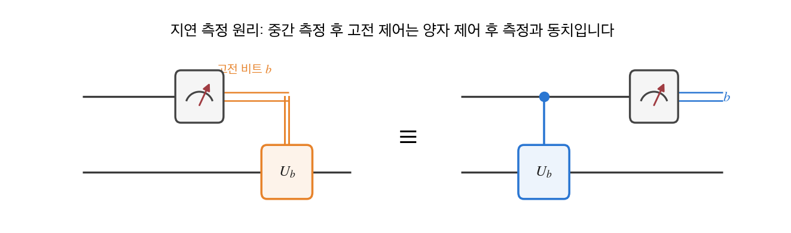
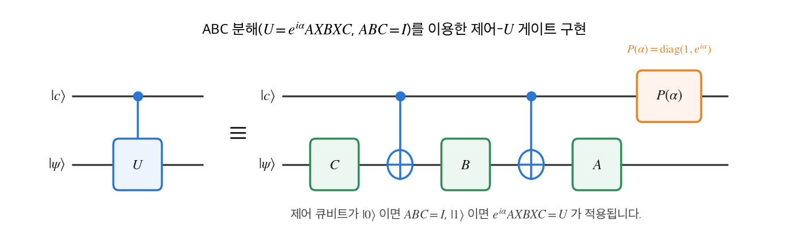
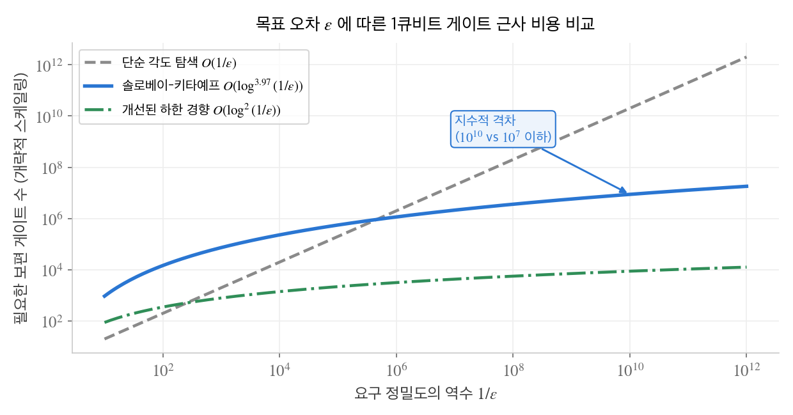
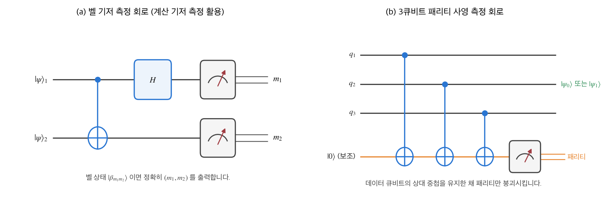

# 4. 양자 계산 모델과 회로

1장은 고전 회로 모델을, 3장은 큐비트와 유니터리 진화를 다루었습니다. 이제 둘을 합쳐 **양자 회로 모델**(quantum circuit model)을 정의합니다.
임의의 $n$ 큐비트 계산은 1큐비트 게이트와 2큐비트 게이트라는 소수의 기본 블록으로 쪼개어 구현할 수 있어야 합니다.
이 장은 1큐비트 회전 게이트의 $Z\text{-}Y\text{-}Z$ 분해와 제어-$U$ 회로 구성, 유한 보편 게이트 집합 $\{\mathrm{CNOT}, H, T\}$, 솔로베이-키타예프 근사 효율성, 그리고 계산 기저 측정만으로 임의의 기저 측정과 패리티 사영 측정을 구현하는 방법을 다룹니다.

!!! info "원문과 자료"
    - 원문: Kaye, Laflamme, Mosca, *An Introduction to Quantum Computing* (2007), 4장 A Quantum Model of Computation (4.1~4.5절)
    - 이 교재의 관련 장: [1. 서론과 배경](01-introduction.md), [3. 큐비트와 양자역학의 틀](03-qubits-framework.md), [5. 초고밀도 코딩과 양자 텔레포테이션](05-superdense-teleportation.md)
    - 함께 읽기: [선형대수 3장 직교성](../../math/linear-algebra/03-orthogonality.md), [양자역학 3장 형식 체계](../../physics/quantum-mechanics/03-formalism.md)
    - 이 장의 수식과 수치는 NumPy로 다시 계산해서 검증했습니다.

## 1. 양자 회로 모델 (4.1절)

### 회로도와 연산 순서

양자 회로에서 가로선은 큐비트를 나르는 **선**(wire)이며, 시간은 **왼쪽에서 오른쪽**으로 흐릅니다.
회로에 게이트 $U_1, U_2, U_3$ 을 왼쪽에서 오른쪽 순서로 배치하면, 상태 $\lvert \psi_0 \rangle$ 에 적용되는 행렬 곱은 오른쪽에서 왼쪽으로 $U_3 U_2 U_1 \lvert \psi_0 \rangle$ 가 됩니다.

비가역 양자 연산(초연산자)은 3장에서 보았듯이 보조 큐비트를 $\lvert 0\dots 0 \rangle$ 으로 추가해 결합 유니터리 연산을 건 뒤 일부 출력을 버려 구현합니다. 따라서 회로 안의 게이트는 모두 유니터리 연산자로 제한해도 일반성을 잃지 않습니다.

### 측정 기호와 지연 측정 원리

회로의 끝에 놓인 계기판 기호는 계산 기저 $\{\lvert 0 \rangle, \lvert 1 \rangle\}$ 에서의 폰 노이만 측정을 뜻합니다. 측정은 확률적 고전 비트 $b \in \{0, 1\}$ 와 양자 상태 $\lvert b \rangle$ 를 출력합니다.

회로 중간에 큐비트 하나를 측정하고 그 고전 결과 $b$ 에 따라 다음 게이트 $U_b$ 를 고르는 경우가 자주 나옵니다. 만약 그 큐비트를 이후에 다시 쓰지 않고 버린다면, **중간 측정 대신 양자 제어 게이트를 먼저 걸고 측정을 맨 뒤로 미뤄도 결과가 완전히 같습니다**. 이를 **지연 측정 원리**(principle of deferred measurement, Exercise 4.2.8)라고 부릅니다.

<figure markdown>

<figcaption markdown>
<span class="fig-title"><b>Figure 1.</b> 중간 측정 후 고전 제어와 양자 제어 후 지연 측정의 동치성</span>

위쪽 큐비트를 측정해 고전 비트 $b$ 로 $U_b$ 를 제어하는 회로(왼쪽)는, 먼저 양자 제어 게이트 $c\text{-}U_b$ 를 적용한 뒤 위쪽 큐비트를 측정하는 회로(오른쪽)와 같은 출력 분포와 상태를 만듭니다.
</figcaption>
</figure>

실제로 상태 $\lvert \psi \rangle = (\alpha_0\lvert 0 \rangle + \alpha_1\lvert 1 \rangle)\lvert \phi \rangle$ 에 대해 왼쪽 회로는 확률 $\lvert \alpha_b \rvert^2$ 로 $\lvert b \rangle \otimes U_b\lvert \phi \rangle$ 를 냅니다.
오른쪽 회로도 제어 게이트 뒤 상태가 $\alpha_0\lvert 0 \rangle U_0\lvert \phi \rangle + \alpha_1\lvert 1 \rangle U_1\lvert \phi \rangle$ 이므로 첫째 큐비트를 측정하면 똑같이 확률 $\lvert \alpha_b \rvert^2$ 로 $\lvert b \rangle \otimes U_b\lvert \phi \rangle$ 를 얻습니다.

## 2. 양자 게이트와 분해 정리 (4.2절)

### 1큐비트 회전 게이트 (4.2.1절)

블로흐 구에서 $x, y, z$ 축 둘레로 각도 $\theta$ 만큼 회전시키는 **회전 게이트**는 파울리 행렬의 지수로 정의합니다.

$$
R_x(\theta) = e^{-i\frac{\theta}{2}X}, \qquad
R_y(\theta) = e^{-i\frac{\theta}{2}Y}, \qquad
R_z(\theta) = e^{-i\frac{\theta}{2}Z}
$$

$X^2 = Y^2 = Z^2 = I$ 이므로 2장에서 유도한 행렬 지수 공식 $e^{-i\frac{\theta}{2}A} = \cos\frac{\theta}{2}\,I - i\sin\frac{\theta}{2}\,A$ 를 그대로 적용합니다.

$$
R_x(\theta) = \begin{pmatrix} \cos\frac{\theta}{2} & -i\sin\frac{\theta}{2} \\ -i\sin\frac{\theta}{2} & \cos\frac{\theta}{2} \end{pmatrix}, \quad
R_y(\theta) = \begin{pmatrix} \cos\frac{\theta}{2} & -\sin\frac{\theta}{2} \\ \sin\frac{\theta}{2} & \cos\frac{\theta}{2} \end{pmatrix}, \quad
R_z(\theta) = \begin{pmatrix} e^{-i\theta/2} & 0 \\ 0 & e^{i\theta/2} \end{pmatrix}
$$

$R_z(\theta)$ 가 $z$ 축 회전임을 직접 확인합니다. 임의의 블로흐 상태 $\cos\frac{\sigma}{2}\lvert 0 \rangle + e^{i\tau}\sin\frac{\sigma}{2}\lvert 1 \rangle$ 에 $R_z(\theta)$ 를 곱합니다.

$$
\begin{pmatrix} e^{-i\theta/2} & 0 \\ 0 & e^{i\theta/2} \end{pmatrix}
\begin{pmatrix} \cos\frac{\sigma}{2} \\ e^{i\tau}\sin\frac{\sigma}{2} \end{pmatrix}
= \begin{pmatrix} e^{-i\theta/2}\cos\frac{\sigma}{2} \\ e^{i\theta/2} e^{i\tau}\sin\frac{\sigma}{2} \end{pmatrix}
= e^{-i\theta/2}\begin{pmatrix} \cos\frac{\sigma}{2} \\ e^{i(\tau + \theta)}\sin\frac{\sigma}{2} \end{pmatrix}
$$

전역 위상 $e^{-i\theta/2}$ 를 무시하면 방위각 $\tau$ 가 $\tau + \theta$ 로 바뀌어 $z$ 축 둘레를 $\theta$ 만큼 회전했습니다.

### $Z\text{-}Y\text{-}Z$ 분해와 $ABC$ 분해

오일러 각 분해와 같은 원리로, 임의의 1큐비트 유니터리 게이트 $U$ 는 항상 $z$ 축 회전 두 번과 $y$ 축 회전 한 번으로 분해됩니다(**Theorem 4.2.1**).

$$
U = e^{i\alpha} R_z(\beta) R_y(\gamma) R_z(\delta)
$$

이 식에서 $\alpha, \beta, \gamma, \delta$ 는 실수입니다. 일반적으로 블로흐 구의 평행하지 않은 임의의 두 축 $l, m$ 에 대해서도 $U = e^{i\alpha} R_l(\beta) R_m(\gamma) R_l(\delta)$ 가 성립합니다(**Theorem 4.2.2**).

제어 게이트를 만들기 위해 $Z\text{-}Y\text{-}Z$ 분해를 변형한 **Corollary 4.2.1** 을 유도합니다.
먼저 $X R_y(\theta) X = R_y(-\theta)$ 와 $X R_z(\theta) X = R_z(-\theta)$ 를 확인합니다. $X^2 = I$, $XYX = -Y$, $XZX = -Z$ 이므로 다음이 성립합니다.

$$
X R_y(\theta) X = X\left(\cos\frac{\theta}{2}I - i\sin\frac{\theta}{2}Y\right)X = \cos\frac{\theta}{2}I + i\sin\frac{\theta}{2}Y = R_y(-\theta)
$$

같은 방식으로 $X R_z(\theta) X = R_z(-\theta)$ 가 성립합니다.
이제 다음 세 유니터리 행렬을 정의합니다.

$$
A = R_z(\beta) R_y\left(\frac{\gamma}{2}\right), \qquad
B = R_y\left(-\frac{\gamma}{2}\right) R_z\left(-\frac{\delta+\beta}{2}\right), \qquad
C = R_z\left(\frac{\delta-\beta}{2}\right)
$$

첫째로 $ABC$ 를 곱합니다. $R_y(\gamma/2)R_y(-\gamma/2) = I$ 이고, $R_z$ 끼리는 지수가 더해집니다.

$$
ABC = R_z(\beta) \underbrace{R_y\left(\frac{\gamma}{2}\right) R_y\left(-\frac{\gamma}{2}\right)}_{I} R_z\left(-\frac{\delta+\beta}{2} + \frac{\delta-\beta}{2}\right) = R_z(\beta) R_z(-\beta) = I
$$

둘째로 $A X B X C$ 를 전개합니다. $X B X = R_y(\gamma/2) R_z((\delta+\beta)/2)$ 를 대입합니다.

$$
\begin{aligned}
A X B X C
&= R_z(\beta) R_y\left(\frac{\gamma}{2}\right) \cdot R_y\left(\frac{\gamma}{2}\right) R_z\left(\frac{\delta+\beta}{2}\right) \cdot R_z\left(\frac{\delta-\beta}{2}\right) \\
&= R_z(\beta) R_y(\gamma) R_z(\delta)
\end{aligned}
$$

따라서 모든 1큐비트 게이트 $U$ 는 $ABC = I$ 를 만족하는 $A, B, C$ 에 대해 다음 꼴로 분해됩니다.

$$
U = e^{i\alpha} A X B X C
$$

### 손계산 예: 아다마르 게이트 $H$ 의 $Z\text{-}Y\text{-}Z$ 및 $ABC$ 분해

$H = \frac{1}{\sqrt{2}}\begin{pmatrix} 1 & 1 \\ 1 & -1 \end{pmatrix}$ 에 $\alpha = \frac{\pi}{2}, \beta = 0, \gamma = \frac{\pi}{2}, \delta = \pi$ 를 대입해 검증합니다.
$R_z(0) = I$, $R_y(\pi/2) = \frac{1}{\sqrt{2}}\begin{pmatrix} 1 & -1 \\ 1 & 1 \end{pmatrix}$, $R_z(\pi) = \begin{pmatrix} -i & 0 \\ 0 & i \end{pmatrix}$ 이므로 곱하면 다음과 같습니다.

$$
e^{i\pi/2} R_z(0) R_y\left(\frac{\pi}{2}\right) R_z(\pi)
= i \cdot \frac{1}{\sqrt{2}}\begin{pmatrix} 1 & -1 \\ 1 & 1 \end{pmatrix}\begin{pmatrix} -i & 0 \\ 0 & i \end{pmatrix}
= \frac{1}{\sqrt{2}}\begin{pmatrix} 1 & -1 \\ 1 & 1 \end{pmatrix}\begin{pmatrix} 1 & 0 \\ 0 & -1 \end{pmatrix}
= \frac{1}{\sqrt{2}}\begin{pmatrix} 1 & 1 \\ 1 & -1 \end{pmatrix} = H
$$

따라서 $A = R_y(\pi/4)$, $B = R_y(-\pi/4) R_z(-\pi/2)$, $C = R_z(\pi/2)$ 로 두면 $ABC = I$ 이고 $iAXBXC = H$ 가 됩니다.

### 제어-$U$ 게이트 구현 (4.2.2절)

임의의 1큐비트 게이트 $U$ 에 대한 **제어-$U$ 게이트**($c\text{-}U$)는 첫째 큐비트가 $\lvert 1 \rangle$ 일 때만 둘째 큐비트에 $U$ 를 거는 연산자입니다.

$$
c\text{-}U = \lvert 0 \rangle\langle 0 \rvert \otimes I + \lvert 1 \rangle\langle 1 \rvert \otimes U
$$

전역 위상 $e^{i\alpha}U$ 는 1큐비트에서는 물리적으로 무관하지만, 제어 게이트 안으로 들어가면 $\lvert 0 \rangle\langle 0 \rvert \otimes I + \lvert 1 \rangle\langle 1 \rvert \otimes e^{i\alpha}U$ 가 되어 제어 큐비트의 $\lvert 1 \rangle$ 성분에 상대 위상 $e^{i\alpha}$ 를 붙입니다(Exercise 4.2.6).
이 성질을 이용해 제어 위상 게이트 $P(\alpha) = \begin{pmatrix} 1 & 0 \\ 0 & e^{i\alpha} \end{pmatrix}$ 를 제어 큐비트에 걸면, 앞서 유도한 $ABC$ 분해로 임의의 $c\text{-}U$ 회로를 CNOT 두 개와 1큐비트 게이트 네 개로 구현합니다.

<figure markdown>

<figcaption markdown>
<span class="fig-title"><b>Figure 2.</b> $ABC$ 분해를 이용한 제어-$U$ 게이트의 회로 구현</span>

제어 큐비트가 $\lvert 0 \rangle$ 이면 두 CNOT 이 실행되지 않아 표적에 $ABC = I$ 만 걸리고 제어 위상 $P(\alpha)$ 도 $1$ 입니다. 제어 큐비트가 $\lvert 1 \rangle$ 이면 $P(\alpha)$ 가 위상 $e^{i\alpha}$ 를 주고 표적에는 $AXBXC$ 가 걸려 전체 연산이 $U$ 가 됩니다.
</figcaption>
</figure>

임의의 다중 큐비트 회로 $C_U$ 전체를 제어하려면 $C_U$ 안의 모든 1큐비트 게이트를 $c\text{-}G$ 로, 모든 CNOT 을 제어-CNOT(토폴리 게이트)으로 바꿉니다. 토폴리 게이트 역시 CNOT 과 1큐비트 게이트들의 유한한 조합으로 분해됩니다.

## 3. 보편 게이트 집합 (4.3절)

### 근사 오차와 보편성

회로에서 유한한 기본 게이트만 써서 임의의 유니터리 연산 $U$ 를 **근사**할 때, 두 유니터리 연산자 $U, V$ 사이의 오차는 연산자 노름으로 정의합니다.

$$
E(U, V) = \max_{\lVert \lvert \psi \rangle \rVert = 1} \lVert (U - V)\lvert \psi \rangle \rVert
$$

삼각 부등식을 쓰면 회로 단계별 오차가 단순히 더해집니다: $E(U_m \cdots U_1, V_m \cdots V_1) \le \sum_{k=1}^m E(U_k, V_k)$.
따라서 전체 회로 오차를 $\varepsilon$ 이하로 맞추려면 $m$ 개 게이트 각각을 오차 $\varepsilon / m$ 이하로 근사하면 충분합니다.

- **보편 게이트 집합**(Definition 4.3.1): 임의의 $n \ge 1$ 과 $n$ 큐비트 유니터리 $U$, 그리고 임의의 오차 $\varepsilon > 0$ 에 대해 $E(U, V) < \varepsilon$ 인 회로 $V$ 를 만들 수 있는 게이트 집합입니다.
- **2큐비트 얽힘 게이트**: 어떤 곱 상태 $\lvert \psi \rangle\lvert \phi \rangle$ 를 얽힘 상태로 만드는 2큐비트 게이트(예: CNOT)입니다.

**Theorem 4.3.3** 에 따르면 **임의의 2큐비트 얽힘 게이트 하나와 모든 1큐비트 게이트의 집합**은 보편적입니다(근사 없이 정확 구현).

### 유한 보편 집합: $\{\mathrm{CNOT}, H, T\}$

실제 장치에는 무한한 종류의 1큐비트 회전 각도를 모두 넣을 수 없으므로 유한 집합이 필요합니다.
**Theorem 4.3.5** 는 블로흐 구에서 평행하지 않은 두 축 $l, m$ 에 대해 회전각 $\beta/\pi, \gamma/\pi$ 가 **무리수**이면 두 게이트 $\{R_l(\beta), R_m(\gamma)\}$ 만으로 모든 1큐비트 게이트를 임의 정밀도로 근사할 수 있음을 보입니다. 각도가 $\pi$ 의 무리수 배이면 $R_l(\beta)^k$ 가 단위원 위에 조밀하게(dense) 퍼지기 때문입니다(비둘기집 원리로 증명이 됩니다).

대표적인 유한 집합이 아다마르 게이트 $H$ 와 $\pi/8$ 위상 게이트 $T$ 입니다.

$$
H = \frac{1}{\sqrt{2}}\begin{pmatrix} 1 & 1 \\ 1 & -1 \end{pmatrix}, \qquad
T = \begin{pmatrix} 1 & 0 \\ 0 & e^{i\pi/4} \end{pmatrix} = e^{i\pi/8} R_z\left(\frac{\pi}{4}\right)
$$

$T$ 의 회전각은 유리수 배($\pi/4$)이지만, $H$ 와 $T$ 를 번갈아 곱해 만든 두 게이트 $HTHT$ 와 $THTH$ 는 서로 다른 축 둘레를 회전하며 회전각 $\theta$ 가 $\cos(\theta/2) = \cos^2(\pi/8) \approx 0.8536$ ($\theta \approx 1.0961\,\mathrm{rad}$) 을 만족해 $\theta/\pi$ 가 무리수입니다(**Lemma 4.3.6**).
따라서 $\{H, T\}$ 는 1큐비트 게이트에 대해 보편적이며, 여기에 CNOT 을 더한 **$\{\mathrm{CNOT}, H, T\}$ 는 양자 계산의 유한 보편 게이트 집합**입니다(**Theorem 4.3.7**).

## 4. 솔로베이-키타예프 정리 (4.4절)

유한 집합 $G$ 로 임의의 1큐비트 게이트를 오차 $\varepsilon$ 이내로 근사할 때 게이트가 몇 개나 필요할까요?
비둘기집 원리로 무작정 회전각을 촘촘히 쪼개는 단순 탐색은 $O(1/\varepsilon)$ 개 게이트가 필요합니다. 회로에 게이트 $m$ 개가 있다면 각 게이트를 오차 $\varepsilon/m$ 으로 근사해야 하므로 다항 시간은 되지만 상수 인자가 너무 큽니다.

**솔로베이-키타예프 정리**(Solovay–Kitaev theorem, **Theorem 4.4.1**)는 유한 1큐비트 보편 집합 $G$ 가 각 원소의 역원까지 유한 길이로 만들 수 있으면($\{H, T\}$ 는 $H^{-1}=H$, $T^{-1}=T^7$ 이므로 만족), 임의의 1큐비트 게이트를 오차 $\varepsilon$ 이하로 근사하는 데 **다음 개수의 게이트만으로 충분함**을 보장합니다.

$$
O\left(\log^c \frac{1}{\varepsilon}\right) \qquad (\text{상수 } c > 0)
$$

따라서 $m$ 개의 1큐비트 게이트로 이루어진 회로를 전체 오차 $\varepsilon$ 이내로 근사하는 데 드는 보편 게이트 수는 $O(m \log^c(m/\varepsilon))$ 개뿐이며, 분해 자체도 $O(\log^c(1/\varepsilon))$ 시간에 찾습니다.

<figure markdown>

<figcaption markdown>
<span class="fig-title"><b>Figure 3.</b> 정밀도 $1/\varepsilon$ 증가에 따른 1큐비트 근사 게이트 수 비교</span>

단순 탐색은 $1/\varepsilon$ 에 선형 비례해 게이트 수가 치솟습니다. 반면 솔로베이-키타예프 정리는 $\log^c(1/\varepsilon)$ 로만 증가하므로 $10^{-12}$ 수준의 높은 정밀도도 현실적인 게이트 수로 얻습니다.
</figcaption>
</figure>

반면, 임의의 $n$ 큐비트 유니터리 연산자는 매개변수 자유도가 $4^n$ 개이므로 대부분은 다항 크기의 회로로 근사할 수 없습니다(계수 논증). 양자 알고리즘의 과제는 문제 구조를 이용해 다항 크기 회로로 구현되는 유익한 유니터리만 골라내는 일입니다.

## 5. 양자 회로로 측정 구현하기 (4.5절)

하드웨어가 **계산 기저 측정**만 지원하더라도, 유니터리 기저 변환 회로를 앞뒤에 붙이면 임의의 폰 노이만 측정과 불완전 사영 측정을 구현할 수 있습니다.

### 임의 직교 정규 기저의 폰 노이만 측정

기저 $\{\lvert \phi_j \rangle\}$ 를 계산 기저 $\{\lvert j \rangle\}$ 로 옮기는 유니터리 연산자 $U\lvert \phi_j \rangle = \lvert j \rangle$ 를 구성합니다.

1. 상태 $\lvert \psi \rangle = \sum_j \alpha_j \lvert \phi_j \rangle$ 에 $U$ 를 걸어 $\sum_j \alpha_j \lvert j \rangle$ 로 바꿉니다.
2. 계산 기저로 측정해 확률 $\lvert \alpha_j \rvert^2$ 로 결과 $j$ 와 상태 $\lvert j \rangle$ 를 얻습니다.
3. 측정 후 양자 상태도 $\lvert \phi_j \rangle$ 로 돌려놓아야 하면 $U^{-1}$ 을 뒤에 겁니다. 결과 고전 비트 $j$ 만 필요하면 $U^{-1}$ 은 생략합니다.

### 벨 측정과 3큐비트 패리티 사영 측정

4.5절의 두 대표 예시는 이후 장에서 핵심 부품으로 쓰입니다.

- **벨 기저 측정**: 벨 상태 생성 회로($\lvert j_1 j_2 \rangle \xrightarrow{H\otimes I} \xrightarrow{\mathrm{CNOT}} \lvert \beta_{j_1 j_2} \rangle$)를 거꾸로 돌립니다. 즉, $\mathrm{CNOT}$ 다음에 첫째 큐비트에 $H$ 를 걸고 두 큐비트를 계산 기저로 측정합니다.
- **3큐비트 패리티(parity) 측정**: 3큐비트 상태 $\lvert \psi \rangle = \sum_x \beta_x \lvert x \rangle$ 를 짝수 패리티 부분 공간 $\lvert \psi_0 \rangle$ 과 홀수 패리티 부분 공간 $\lvert \psi_1 \rangle$ 으로만 사영합니다. 보조 큐비트 $\lvert 0 \rangle$ 에 세 큐비트의 CNOT 을 차례로 걸어 $\sum_x \beta_x \lvert x \rangle\lvert \mathrm{parity}(x) \rangle = \alpha_0\lvert \psi_0 \rangle\lvert 0 \rangle + \alpha_1\lvert \psi_1 \rangle\lvert 1 \rangle$ 을 만든 뒤 보조 큐비트만 측정합니다.

<figure markdown>

<figcaption markdown>
<span class="fig-title"><b>Figure 4.</b> 벨 기저 측정(a)과 3큐비트 패리티 사영 측정(b) 회로</span>

(a)는 $\mathrm{CNOT}$ 과 $H$ 로 벨 기저를 계산 기저로 옮긴 뒤 측정합니다. (b)는 보조 큐비트에 세 데이터 큐비트의 XOR 패리티만 복사해 측정하므로, 같은 패리티를 가진 기저 상태들 사이의 중첩을 깨뜨리지 않습니다.
</figcaption>
</figure>

데이터 큐비트를 직접 계산 기저로 측정한 뒤 고전적으로 패리티를 계산하면 중첩이 단일 문자열 $\lvert x \rangle$ 로 완전히 깨집니다. 반면 위 회로는 짝수/홀수 부분 공간 내부의 상대 위상과 중첩을 보존합니다. 이 기법은 10장의 양자 오류 정정 신드롬 측정에서 그대로 쓰입니다.

```python
import numpy as np

I = np.eye(2, dtype=complex)
X = np.array([[0, 1], [1, 0]], dtype=complex)
H = np.array([[1, 1], [1, -1]], dtype=complex) / np.sqrt(2)
T = np.array([[1, 0], [0, np.exp(1j * np.pi / 4)]], dtype=complex)

# HTHT 회전각 검증
U = H @ T @ H @ T * np.exp(-1j * np.pi / 4)   # det=1 정규화
theta = 2 * np.arccos(np.real(np.trace(U)) / 2)
print("HTHT 회전각(rad):", round(theta, 6), "theta/pi:", round(theta / np.pi, 6))
```

## 6. 이 장의 요약

| 개념 | 핵심 식 또는 결과 | 의미 |
| --- | --- | --- |
| 지연 측정 원리 | 중간 측정+고전 제어 $\equiv$ 양자 제어+끝 측정 | 재사용하지 않는 제어 큐비트의 측정은 미룰 수 있음 |
| $Z\text{-}Y\text{-}Z$ 및 $ABC$ 분해 | $U = e^{i\alpha} R_z(\beta)R_y(\gamma)R_z(\delta) = e^{i\alpha}AXBXC$ | $ABC=I$ 를 이용해 임의 $c\text{-}U$ 를 CNOT 2개로 구현 |
| 유한 보편 집합 | $\{\mathrm{CNOT}, H, T\}$ | 임의의 $n$ 큐비트 유니터리를 임의 정밀도로 근사 |
| 솔로베이-키타예프 정리 | $O(\log^c(1/\varepsilon))$ 게이트 | 유한 집합으로 1큐비트 게이트를 다항 로그 개수로 근사 |
| 회로 기반 측정 | $U$ 후 계산 측정 / 보조 큐비트 CNOT | 임의 기저 측정과 중첩을 보존하는 사영 측정 구현 |

다음 장은 얽힘 쌍과 벨 측정을 결합해 고전 통신과 양자 통신의 한계를 뛰어넘는 두 프로토콜, **초고밀도 코딩**과 **양자 텔레포테이션**을 다룹니다.
