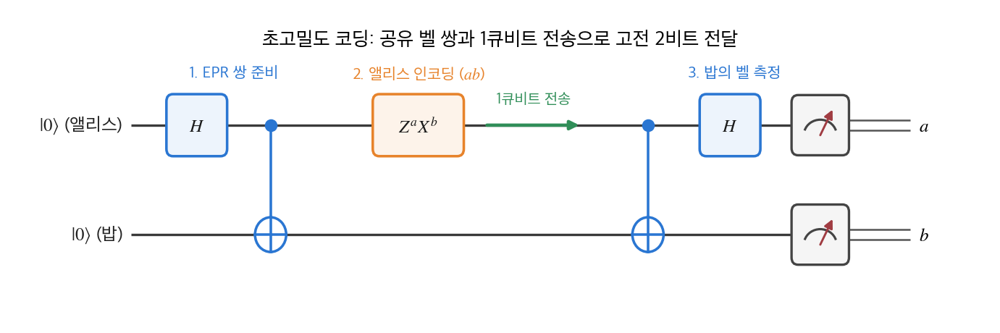
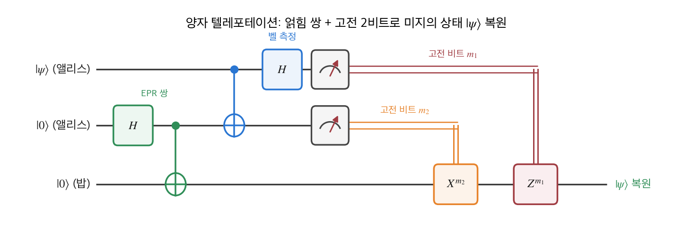
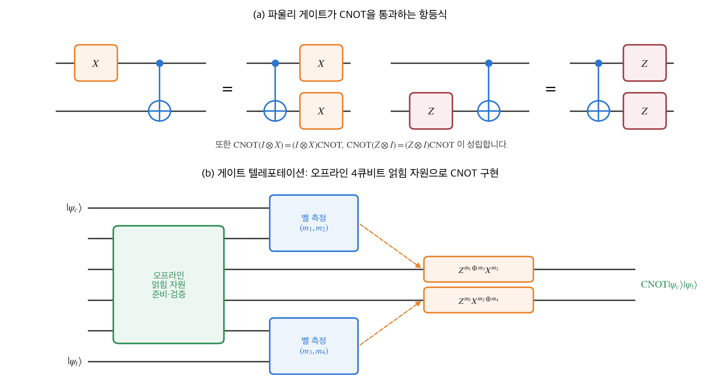

# 5. 초고밀도 코딩과 양자 텔레포테이션

미리 나누어 가진 얽힘 상태(벨 상태)는 통신과 회로 계산의 핵심 자원이 됩니다.
**초고밀도 코딩**(superdense coding)은 1개의 물리 큐비트만 보내 고전 정보 2비트를 전달합니다. 반대로 **양자 텔레포테이션**(quantum teleportation)은 고전 정보 2비트만 보내 미지의 큐비트 상태 하나를 원격지에 정확히 복원합니다.
이 장은 두 프로토콜의 대수 전개를 한 줄도 생략하지 않고 따라간 뒤, 양자 텔레포테이션으로 실패 위험이 있는 CNOT 게이트를 오프라인 자원으로 바꾸는 **게이트 텔레포테이션**까지 정리합니다.

!!! info "원문과 자료"
    - 원문: Kaye, Laflamme, Mosca, *An Introduction to Quantum Computing* (2007), 5장 Superdense Coding and Quantum Teleportation (5.1~5.3절)
    - 이 교재의 관련 장: [3. 큐비트와 양자역학의 틀](03-qubits-framework.md), [4. 양자 계산 모델과 회로](04-quantum-circuits.md), [10. 양자 오류 정정](10-error-correction.md)
    - 함께 읽기: [양자역학 12장 맺음말: 양자역학의 해석](../../physics/quantum-mechanics/12-afterword.md)
    - 이 장의 수식과 수치는 NumPy로 다시 계산해서 검증했습니다.

## 1. 초고밀도 코딩 (5.1절)

앨리스(Alice)와 밥(Bob)은 미리 벨 상태 $\lvert \beta_{00} \rangle = \frac{1}{\sqrt{2}}(\lvert 00 \rangle + \lvert 11 \rangle)$ 을 하나씩 나누어 가졌습니다. 첫째 큐비트는 앨리스가, 둘째 큐비트는 밥이 들고 있습니다.

앨리스가 밥에게 고전 2비트 $ab \in \{00, 01, 10, 11\}$ 를 보내려 합니다. 앨리스는 자신의 큐비트에만 1큐비트 게이트 $U_{ab} = Z^a X^b$ 를 적용한 뒤, 그 큐비트 하나를 양자 채널로 밥에게 보냅니다.
네 가지 경우에 대해 전체 2큐비트 상태 $(U_{ab} \otimes I)\lvert \beta_{00} \rangle$ 를 직접 계산합니다.

| 보낼 2비트 $ab$ | 앨리스의 연산 $U_{ab}$ | 결과 2큐비트 상태 | 대응하는 벨 상태 |
| --- | --- | --- | --- |
| `00` | $I$ | $\frac{1}{\sqrt{2}}(\lvert 00 \rangle + \lvert 11 \rangle)$ | $\lvert \beta_{00} \rangle$ |
| `01` | $X$ | $\frac{1}{\sqrt{2}}(\lvert 10 \rangle + \lvert 01 \rangle)$ | $\lvert \beta_{01} \rangle$ |
| `10` | $Z$ | $\frac{1}{\sqrt{2}}(\lvert 00 \rangle - \lvert 11 \rangle)$ | $\lvert \beta_{10} \rangle$ |
| `11` | $ZX$ ($X$ 다음 $Z$) | $\frac{1}{\sqrt{2}}(-\lvert 10 \rangle + \lvert 01 \rangle)$ | $\lvert \beta_{11} \rangle$ |

`11` 경우의 계산을 확인합니다. $X$ 가 첫째 큐비트를 뒤집어 $\lvert 10 \rangle + \lvert 01 \rangle$ 을 만들고, 이어서 $Z$ 가 $\lvert 1 \rangle$ 에 $-1$ 을 붙여 $-\lvert 10 \rangle + \lvert 01 \rangle$ 이 됩니다. 이는 4장의 벨 기저 정의 $\lvert \beta_{11} \rangle = \frac{1}{\sqrt{2}}(\lvert 01 \rangle - \lvert 10 \rangle)$ 과 정확히 일치합니다.

밥은 앨리스의 큐비트를 받으면 두 큐비트를 함께 **벨 기저 측정**(CNOT → $H \otimes I$ → 계산 기저 측정)합니다. 네 벨 상태는 서로 직교하므로 밥은 확률 $1$ 로 $ab$ 를 확정해 읽습니다.

<figure markdown>

<figcaption markdown>
<span class="fig-title"><b>Figure 1.</b> 초고밀도 코딩 프로토콜</span>

공유 EPR 쌍 $\lvert \beta_{00} \rangle$ 의 첫째 큐비트에 앨리스가 $Z^a X^b$ 를 걸어 보내면 전체 상태가 네 직교 벨 상태 중 하나 $\lvert \beta_{ab} \rangle$ 로 바뀝니다. 밥은 벨 측정으로 1큐비트 전송만으로 2비트를 복원합니다.
</figcaption>
</figure>

## 2. 양자 텔레포테이션 (5.2절)

이번에는 앨리스와 밥 사이에 고전 채널만 있고 양자 채널이 없습니다. 앨리스에게 미지의 1큐비트 상태 $\lvert \psi \rangle = \alpha_0 \lvert 0 \rangle + \alpha_1 \lvert 1 \rangle$ 가 있습니다.
복소수 $\alpha_0, \alpha_1$ 은 연속량이므로 고전적으로 그대로 말하려면 무한 비트가 필요하지만, 공유 벨 쌍 $\lvert \beta_{00} \rangle$ 이 있으면 **고전 2비트**만 보내 상태를 정확히 옮길 수 있습니다.

### 3큐비트 상태의 벨 기저 재정리 (Exercise 5.2.1)

전체 3큐비트 초기 상태 $\lvert \psi \rangle \lvert \beta_{00} \rangle$ (앞 두 큐비트는 앨리스, 셋째 큐비트는 밥)를 전개합니다.

$$
\lvert \psi \rangle \lvert \beta_{00} \rangle
= \left(\alpha_0 \lvert 0 \rangle + \alpha_1 \lvert 1 \rangle\right) \otimes \frac{1}{\sqrt{2}}\left(\lvert 00 \rangle + \lvert 11 \rangle\right)
= \frac{1}{\sqrt{2}}\left(\alpha_0 \lvert 000 \rangle + \alpha_0 \lvert 011 \rangle + \alpha_1 \lvert 100 \rangle + \alpha_1 \lvert 111 \rangle\right)
$$

이제 앞의 두 큐비트(앨리스의 큐비트)를 벨 기저로 바꾸기 위해 다음 네 항등식을 대입합니다.

$$
\lvert 00 \rangle = \frac{\lvert \beta_{00} \rangle + \lvert \beta_{10} \rangle}{\sqrt{2}}, \quad
\lvert 11 \rangle = \frac{\lvert \beta_{00} \rangle - \lvert \beta_{10} \rangle}{\sqrt{2}}, \quad
\lvert 01 \rangle = \frac{\lvert \beta_{01} \rangle + \lvert \beta_{11} \rangle}{\sqrt{2}}, \quad
\lvert 10 \rangle = \frac{\lvert \beta_{01} \rangle - \lvert \beta_{11} \rangle}{\sqrt{2}}
$$

네 항에 차례로 대입하면 분모 $\sqrt{2} \cdot \sqrt{2} = 2$ 가 됩니다.

$$
\begin{aligned}
\lvert \psi \rangle \lvert \beta_{00} \rangle
&= \frac{1}{2}\Big[
\alpha_0\left(\lvert \beta_{00} \rangle + \lvert \beta_{10} \rangle\right)\lvert 0 \rangle
+ \alpha_0\left(\lvert \beta_{01} \rangle + \lvert \beta_{11} \rangle\right)\lvert 1 \rangle \\
&\qquad + \alpha_1\left(\lvert \beta_{01} \rangle - \lvert \beta_{11} \rangle\right)\lvert 0 \rangle
+ \alpha_1\left(\lvert \beta_{00} \rangle - \lvert \beta_{10} \rangle\right)\lvert 1 \rangle
\Big]
\end{aligned}
$$

앞 두 큐비트의 벨 상태 $\lvert \beta_{00} \rangle, \lvert \beta_{01} \rangle, \lvert \beta_{10} \rangle, \lvert \beta_{11} \rangle$ 별로 셋째 큐비트를 묶어 정리합니다.

$$
\begin{aligned}
\lvert \psi \rangle \lvert \beta_{00} \rangle
&= \frac{1}{2}\lvert \beta_{00} \rangle\left(\alpha_0\lvert 0 \rangle + \alpha_1\lvert 1 \rangle\right)
+ \frac{1}{2}\lvert \beta_{01} \rangle\left(\alpha_1\lvert 0 \rangle + \alpha_0\lvert 1 \rangle\right) \\
&\quad + \frac{1}{2}\lvert \beta_{10} \rangle\left(\alpha_0\lvert 0 \rangle - \alpha_1\lvert 1 \rangle\right)
+ \frac{1}{2}\lvert \beta_{11} \rangle\left(\alpha_1\lvert 0 \rangle - \alpha_0\lvert 1 \rangle\right) \\
&= \frac{1}{2}\lvert \beta_{00} \rangle\lvert \psi \rangle
+ \frac{1}{2}\lvert \beta_{01} \rangle(X\lvert \psi \rangle)
+ \frac{1}{2}\lvert \beta_{10} \rangle(Z\lvert \psi \rangle)
+ \frac{1}{2}\lvert \beta_{11} \rangle(XZ\lvert \psi \rangle)
\end{aligned}
$$

마지막 항을 확인하면 $XZ(\alpha_0\lvert 0 \rangle + \alpha_1\lvert 1 \rangle) = X(\alpha_0\lvert 0 \rangle - \alpha_1\lvert 1 \rangle) = \alpha_0\lvert 1 \rangle - \alpha_1\lvert 0 \rangle$ 인데, 위 식에서는 $\alpha_1\lvert 0 \rangle - \alpha_0\lvert 1 \rangle = -(XZ\lvert \psi \rangle)$ 로 전역 부호 $-1$ 만 다릅니다. 물리 상태는 전역 위상을 무시하므로 둘은 같은 상태입니다.

### 앨리스의 벨 측정과 밥의 복원

앨리스가 자신의 두 큐비트를 벨 기저로 측정하면 네 결과 $(m_1, m_2) \in \{00, 01, 10, 11\}$ 가 각각 확률 $(1/2)^2 = 1/4$ 로 나옵니다. 앨리스는 두 고전 비트 $m_1, m_2$ 를 밥에게 보내고, 밥은 비트에 맞춰 보정 게이트 $Z^{m_1} X^{m_2}$ 를 적용합니다.

| 앨리스 측정 $(m_1, m_2)$ | 측정 직후 밥의 상태 | 밥의 복원 연산 | 복원 후 밥의 상태 |
| --- | --- | --- | --- |
| `0, 0` | $\alpha_0\lvert 0 \rangle + \alpha_1\lvert 1 \rangle = \lvert \psi \rangle$ | $I$ | $\lvert \psi \rangle$ |
| `0, 1` | $\alpha_1\lvert 0 \rangle + \alpha_0\lvert 1 \rangle = X\lvert \psi \rangle$ | $X$ | $X^2\lvert \psi \rangle = \lvert \psi \rangle$ |
| `1, 0` | $\alpha_0\lvert 0 \rangle - \alpha_1\lvert 1 \rangle = Z\lvert \psi \rangle$ | $Z$ | $Z^2\lvert \psi \rangle = \lvert \psi \rangle$ |
| `1, 1` | $\alpha_1\lvert 0 \rangle - \alpha_0\lvert 1 \rangle = -XZ\lvert \psi \rangle$ | $ZX$ ($X$ 다음 $Z$) | $-Z(X^2)Z\lvert \psi \rangle = -\lvert \psi \rangle \equiv \lvert \psi \rangle$ |

<figure markdown>

<figcaption markdown>
<span class="fig-title"><b>Figure 2.</b> 양자 텔레포테이션 회로</span>

앨리스는 미지의 상태 $\lvert \psi \rangle$ 와 EPR 쌍의 절반을 함께 벨 측정해 2비트 $(m_1, m_2)$ 를 얻습니다. 밥은 고전 채널로 $(m_1, m_2)$ 를 받아 $X^{m_2}$ 와 $Z^{m_1}$ 을 차례로 적용함으로써 $\lvert \psi \rangle$ 를 복원합니다.
</figcaption>
</figure>

### 빛보다 빠른 통신도 복제도 되지 않는 이유

1. **인과율 보존**: 앨리스의 측정 직후 밥이 고전 비트 $(m_1, m_2)$ 를 아직 받지 못했을 때, 밥의 큐비트는 네 상태 $\lvert \psi \rangle, X\lvert \psi \rangle, Z\lvert \psi \rangle, XZ\lvert \psi \rangle$ 가 각각 $1/4$ 확률로 섞인 혼합 상태입니다. 부분 대각합을 구하면 $\rho_B = \frac{1}{4}\sum_{P\in\{I,X,Z,XZ\}} P\lvert \psi \rangle\langle \psi \rvert P^\dagger = \frac{1}{2}I$ 로 $\lvert \psi \rangle$ 와 무관한 완전 혼합 상태가 됩니다. 따라서 고전 2비트가 도착하기 전까지 밥은 어떤 정보도 얻지 못합니다.
2. **복제 불가 정리와 일관성**: 앨리스가 벨 측정을 하는 순간 원래의 $\lvert \psi \rangle$ 는 파괴되므로, 상태가 이동할 뿐 복제되지 않습니다.

## 3. 게이트 텔레포테이션: 오프라인 CNOT 구현 (5.3절)

양자 컴퓨터 하드웨어에서는 1큐비트 게이트나 벨 상태 준비에 비해, 두 큐비트를 직접 상호작용시키는 CNOT 게이트의 실패 확률이 훨씬 높습니다.
계산 도중 두 논리 큐비트 $\lvert \psi_c \rangle, \lvert \psi_t \rangle$ 에 CNOT 을 직접 걸었다가 게이트가 실패하면, 소중한 논리 상태가 망가지고 복제해 둘 수도 없어 전체 계산이 무너집니다.

**게이트 텔레포테이션**(gate teleportation)은 텔레포테이션과 파울리 게이트 교환 항등식을 이용해 **실패할 수 있는 CNOT 연산을 미리 오프라인 얽힘 자원 준비 단계로 밀어냅니다**.

### 단계 1: 텔레포테이션 뒤에 CNOT 걸기

논리 큐비트 $\lvert \psi_c \rangle$ 와 $\lvert \psi_t \rangle$ 를 각각 텔레포테이션 회로로 옮긴 다음, 출력된 두 큐비트에 CNOT 을 걸어도 전체 효과는 $\mathrm{CNOT}(\lvert \psi_c \rangle \otimes \lvert \psi_t \rangle)$ 와 같습니다.

### 단계 2: 파울리 보정을 CNOT 뒤로 밀어내기 (Exercise 5.3.1)

텔레포테이션 과정에서 밥의 큐비트에는 고전 제어 파울리 보정 $Z^{m_1} X^{m_2}$ (제어 쪽)와 $Z^{m_3} X^{m_4}$ (표적 쪽)가 걸립니다.
이 파울리 보정 연산들을 CNOT 게이트 오른쪽(뒤쪽)으로 넘겼을 때 어떻게 변하는지 네 기본 관계식을 행렬로 유도합니다.

- $\mathrm{CNOT}(X \otimes I)$ 를 계산 기저 $\lvert a, b \rangle$ 에 작용합니다: $\lvert a, b \rangle \xrightarrow{X\otimes I} \lvert a\oplus 1, b \rangle \xrightarrow{\mathrm{CNOT}} \lvert a\oplus 1, b \oplus a \oplus 1 \rangle$. 반면 먼저 $\mathrm{CNOT}$ 을 걸고 $X \otimes X$ 를 걸면 $\lvert a, b \rangle \to \lvert a, b\oplus a \rangle \to \lvert a\oplus 1, b\oplus a\oplus 1 \rangle$ 로 같습니다.
- $\mathrm{CNOT}(I \otimes X)$ 는 두 연산 모두 표적 비트만 $1$ 을 XOR하므로 교환합니다.
- $\mathrm{CNOT}(Z \otimes I)$ 는 제어 비트가 변하지 않으므로 그대로 교환합니다.
- $\mathrm{CNOT}(I \otimes Z)$ 는 위상 $(-1)^b$ 를 붙인 뒤 $b \mapsto b \oplus a$ 로 바꾸므로, $\mathrm{CNOT}$ 뒤에서 위상 $(-1)^b = (-1)^{a + (b\oplus a)}$ 를 붙이는 $Z \otimes Z$ 와 같습니다.

네 가지 파울리 전파 규칙을 묶으면 임의의 비트 $m_1, m_2, m_3, m_4 \in \{0, 1\}$ 에 대해 다음 항등식이 성립합니다(전역 위상 $(-1)^{m_2 m_3}$ 제외).

$$
\mathrm{CNOT}\left(Z^{m_1} X^{m_2} \otimes Z^{m_3} X^{m_4}\right)
= \left(Z^{m_1 \oplus m_3} X^{m_2} \otimes Z^{m_3} X^{m_2 \oplus m_4}\right)\mathrm{CNOT}
$$

따라서 보정 게이트 앞의 CNOT 을 보정 뒤쪽으로 옮기면(원문 Fig. 5.5~5.6), 보정 게이트 앞에는 CNOT 2개가 만나 항등 연산자 $I$ 가 되는 부분과 오프라인 자원 생성 부분만 남습니다.

### 단계 3: 오프라인 4큐비트 얽힘 자원

두 벨 상태 $\lvert \beta_{00} \rangle \otimes \lvert \beta_{00} \rangle$ 의 2번(제어 EPR 의 밥 큐비트)과 3번(표적 EPR 의 밥 큐비트)에 미리 $\mathrm{CNOT}_{2\to 3}$ 을 적용한 4큐비트 얽힘 상태를 계산합니다.

$$
\begin{aligned}
\lvert \chi \rangle
&= (I \otimes \mathrm{CNOT}_{2\to 3} \otimes I)\left[\frac{1}{2}\left(\lvert 00 \rangle + \lvert 11 \rangle\right)\left(\lvert 00 \rangle + \lvert 11 \rangle\right)\right] \\
&= (I \otimes \mathrm{CNOT}_{2\to 3} \otimes I)\left[\frac{1}{2}\left(\lvert 0000 \rangle + \lvert 0011 \rangle + \lvert 1100 \rangle + \lvert 1111 \rangle\right)\right] \\
&= \frac{1}{2}\left(\lvert 0000 \rangle + \lvert 0011 \rangle + \lvert 1110 \rangle + \lvert 1101 \rangle\right)
\end{aligned}
$$

이 4큐비트 상태 $\lvert \chi \rangle$ 는 논리 큐비트 $\lvert \psi_c \rangle, \lvert \psi_t \rangle$ 와 전혀 닿지 않은 채 백그라운드에서 만들고 검증할 수 있습니다. 준비 도중 CNOT 이 실패하면 4개 보조 큐비트만 버리고 다시 만들면 됩니다. 검증된 $\lvert \chi \rangle$ 가 준비되면 벨 측정과 신뢰도 높은 1큐비트 파울리 보정만으로 논리 큐비트 사이의 CNOT 이 완성됩니다.

<figure markdown>

<figcaption markdown>
<span class="fig-title"><b>Figure 3.</b> 파울리 게이트의 CNOT 통과 항등식(a)과 오프라인 CNOT 회로(b)</span>

(a)처럼 $X$ 와 $Z$ 보정 게이트를 CNOT 뒤로 넘길 때의 비트 XOR 규칙을 적용하면, (b)와 같이 4큐비트 자원 상태 $\lvert \chi \rangle$ 를 미리 준비해 두고 벨 측정과 1큐비트 보정만으로 CNOT 을 비파괴적으로 실행할 수 있습니다.
</figcaption>
</figure>

```python
import numpy as np

I = np.eye(2, dtype=complex)
X = np.array([[0, 1], [1, 0]], dtype=complex)
Z = np.array([[1, 0], [0, -1]], dtype=complex)
CNOT = np.array([[1, 0, 0, 0], [0, 1, 0, 0], [0, 0, 0, 1], [0, 0, 1, 0]], dtype=complex)

# 파울리 보정 전파 항등식 전수 검증 (16가지 경우)
for m1 in (0, 1):
    for m2 in (0, 1):
        for m3 in (0, 1):
            for m4 in (0, 1):
                lhs = CNOT @ np.kron(np.linalg.matrix_power(Z, m1) @ np.linalg.matrix_power(X, m2),
                                     np.linalg.matrix_power(Z, m3) @ np.linalg.matrix_power(X, m4))
                rhs = np.kron(np.linalg.matrix_power(Z, m1 ^ m3) @ np.linalg.matrix_power(X, m2),
                              np.linalg.matrix_power(Z, m3) @ np.linalg.matrix_power(X, m2 ^ m4)) @ CNOT
                phase = (-1) ** (m2 * m3)
                assert np.allclose(lhs, phase * rhs)
print("16가지 게이트 텔레포테이션 항등식 검증 완료")
```

## 4. 이 장의 요약

| 개념 | 자원 소비 | 결과 |
| --- | --- | --- |
| 초고밀도 코딩 | 공유 벨 쌍 1개 + 큐비트 전송 1회 | 고전 2비트 전달 |
| 양자 텔레포테이션 | 공유 벨 쌍 1개 + 고전 2비트 전송 | 미지의 1큐비트 상태 $\lvert \psi \rangle$ 정확 복원 |
| 게이트 텔레포테이션 | 4큐비트 얽힘 자원 $\lvert \chi \rangle$ + 벨 측정 2회 | 취약한 2큐비트 CNOT 을 오프라인으로 분리 |

여기까지로 양자 계산 모델과 기본 통신 프로토콜을 모두 갖추었습니다. 다음 장부터는 양자 간섭과 얽힘을 이용해 고전 컴퓨터보다 적은 쿼리로 문제를 푸는 **양자 알고리즘**을 다룹니다.
