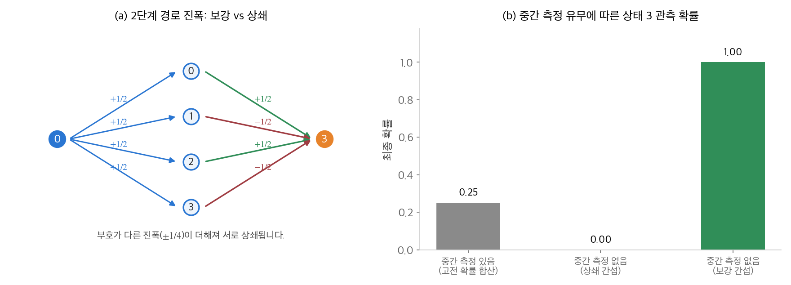
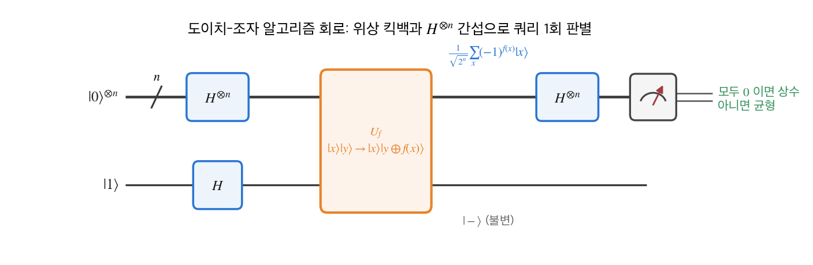
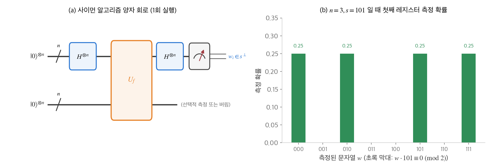
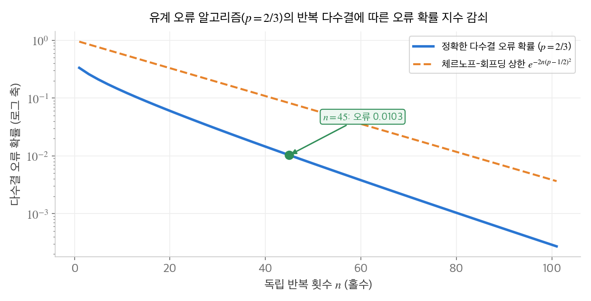

# 6. 기초 양자 알고리즘

고전 확률적 알고리즘은 동전을 던져 여러 경로로 갈라진 뒤 각 경로의 **확률**을 더합니다. 양자 알고리즘은 각 경로의 복소 **진폭**을 더한 뒤 제곱하므로, 오답 경로들이 서로를 지우는 상쇄 간섭을 만들 수 있습니다.
이 장은 함수의 대역적 성질(상수 대 균형, 숨은 주기 문자열)을 고전 알고리즘보다 적은 쿼리로 찾아내는 초기 양자 알고리즘들을 다룹니다.
핵심 기법인 **위상 킥백**(phase kick-back)에서 출발해 도이치(Deutsch), 도이치-조자(Deutsch–Jozsa), 그리고 확률적 고전 알고리즘과도 **지수적 쿼리 격차**를 벌리는 사이먼(Simon) 알고리즘, 여기에 확률 증폭과 표본 개수를 뒷받침하는 마르코프·체르노프 부등식까지 정리합니다.

!!! info "원문과 자료"
    - 원문: Kaye, Laflamme, Mosca, *An Introduction to Quantum Computing* (2007), 6장 Introductory Quantum Algorithms (6.1~6.5절), 부록 A.1 및 A.3
    - 이 교재의 관련 장: [1. 서론과 배경](01-introduction.md), [4. 양자 계산 모델과 회로](04-quantum-circuits.md), [7. 초다항 가속 알고리즘](07-superpolynomial-algorithms.md)
    - 함께 읽기: [알고리즘 5장 확률적 분석과 무작위 알고리즘](../algorithms/05-randomized.md), [확률론 4장 표본 분포와 극한](../../math/probability/04-sampling-limits.md)
    - 이 장의 수식과 수치는 NumPy로 다시 계산해서 검증했습니다.

## 1. 확률적 알고리즘과 양자 알고리즘 (6.1절)

상태가 $0, 1, 2, 3$ 네 개인 레지스터에서 2단계 계산을 실행해 최종적으로 상태 $3$ 이 나올 확률을 비교합니다. 초기 상태는 $0$ 이며, 첫째 단계는 $0 \to j$ ($j \in \{0,1,2,3\}$), 둘째 단계는 $j \to 3$ 으로 전이합니다.

- **고전 확률 계산(또는 중간 측정이 있는 양자 계산)**: 첫째 단계 전이 확률이 $p_{0,j} = \lvert \alpha_{0,j} \rvert^2$, 둘째 단계가 $q_{j,3} = \lvert \beta_{j,3} \rvert^2$ 이면, 상태 $3$ 으로 끝나는 확률은 경로별 확률의 합입니다.

$$
\Pr[\text{출력}=3]_{\text{고전}} = \sum_{j=0}^3 p_{0,j}\, q_{j,3} = \sum_{j=0}^3 \lvert \alpha_{0,j}\beta_{j,3} \rvert^2
$$

- **양자 계산(중간 측정 없음)**: 어느 중간 경로 $j$ 를 지났는지 측정하지 않으므로 경로 진폭 $\alpha_{0,j}\beta_{j,3}$ 을 먼저 모두 더한 뒤에 절댓값 제곱을 취합니다.

$$
\Pr[\text{출력}=3]_{\text{양자}} = \left\lvert \sum_{j=0}^3 \alpha_{0,j}\beta_{j,3} \right\rvert^2
$$

수치 예로 $\alpha_{0,j} = 1/2$ ($j=0,1,2,3$)이고 $\beta_{j,3} = (1/2, -1/2, 1/2, -1/2)$ 인 경우를 계산합니다.
중간에 측정을 넣은 고전 확률 합산은 $\sum_{j=0}^3 (1/4)(1/4) = 4/16 = 0.25$ 입니다.
반면 중간 측정이 없는 양자 계산은 $\lvert \frac{1}{4} - \frac{1}{4} + \frac{1}{4} - \frac{1}{4} \rvert^2 = 0$ 으로 상쇄 간섭을 일으킵니다. 만약 $\beta_{j,3}$ 이 모두 $+1/2$ 이면 $\lvert 1/4 + 1/4 + 1/4 + 1/4 \rvert^2 = 1.0$ 으로 보강 간섭을 일으킵니다.

<figure markdown>

<figcaption markdown>
<span class="fig-title"><b>Figure 1.</b> 2단계 경로 진폭의 간섭(a)과 중간 측정 유무에 따른 출력 확률 비교(b)</span>

중간에 측정을 하면 어느 경로를 거쳤는지 드러나므로 진폭 제곱을 먼저 한 뒤 더해야 합니다($0.25$). 측정 없이 진행하면 부호가 다른 진폭이 상쇄($0$)되거나 같은 부호 진폭이 보강($1$)됩니다.
</figcaption>
</figure>

1큐비트 회로에서도 같습니다. $\lvert 0 \rangle$ 에 $H$ 를 한 번 걸어 $\frac{\lvert 0 \rangle + \lvert 1 \rangle}{\sqrt{2}}$ 를 만든 뒤, 곧바로 계산 기저로 측정하고 두 번째 $H$ 를 걸면 $\lvert 0 \rangle$ 과 $\lvert 1 \rangle$ 이 각 $1/2$ 확률로 나옵니다. 측정 없이 $H$ 를 연달아 두 번 걸면 $\lvert 1 \rangle$ 진폭 $+1/2$ 과 $-1/2$ 이 상쇄되어 $H^2\lvert 0 \rangle = \lvert 0 \rangle$ 이 확률 $1$ 로 나옵니다.

## 2. 위상 킥백 (6.2절)

1장에서 함수 $f: \{0,1\}^n \to \{0,1\}$ 를 가역 양자 오라클로 구현할 때 $U_f \lvert x \rangle\lvert y \rangle = \lvert x \rangle\lvert y \oplus f(x) \rangle$ 형태로 만든다고 보았습니다.
계산 기저만 보면 제어 레지스터 $\lvert x \rangle$ 는 변하지 않는 것처럼 보입니다. 그러나 표적 큐비트 $\lvert y \rangle$ 를 파울리 $X$ 의 고유상태 $\lvert - \rangle = \frac{\lvert 0 \rangle - \lvert 1 \rangle}{\sqrt{2}}$ 로 두면 $f(x)$ 값이 위상 부호로 바뀌어 **제어 레지스터 앞으로 튀어 나옵니다**.

직접 대입해 전개합니다. 먼저 선형성으로 항을 나눕니다.

$$
U_f \left(\lvert x \rangle \frac{\lvert 0 \rangle - \lvert 1 \rangle}{\sqrt{2}}\right)
= \frac{U_f\lvert x \rangle\lvert 0 \rangle - U_f\lvert x \rangle\lvert 1 \rangle}{\sqrt{2}}
= \lvert x \rangle \frac{\lvert 0 \oplus f(x) \rangle - \lvert 1 \oplus f(x) \rangle}{\sqrt{2}}
$$

이제 $f(x) = 0$ 인 경우와 $f(x) = 1$ 인 경우를 각각 계산합니다.

- $f(x) = 0$ 일 때: $\frac{\lvert 0 \rangle - \lvert 1 \rangle}{\sqrt{2}} = (+1)\lvert - \rangle$.
- $f(x) = 1$ 일 때: $\frac{\lvert 1 \rangle - \lvert 0 \rangle}{\sqrt{2}} = -\frac{\lvert 0 \rangle - \lvert 1 \rangle}{\sqrt{2}} = (-1)\lvert - \rangle$.

두 경우를 하나로 묶으면 $\frac{\lvert 0 \oplus f(x) \rangle - \lvert 1 \oplus f(x) \rangle}{\sqrt{2}} = (-1)^{f(x)}\lvert - \rangle$ 입니다. 스칼라 인자 $(-1)^{f(x)}$ 를 제어 레지스터 쪽으로 옮깁니다.

$$
U_f\left(\lvert x \rangle\lvert - \rangle\right) = (-1)^{f(x)}\lvert x \rangle\lvert - \rangle
$$

이 현상을 **위상 킥백**(phase kick-back)이라고 부릅니다. 중첩 입력 $\sum_x \alpha_x \lvert x \rangle \lvert - \rangle$ 에 $U_f$ 를 걸면 표적 큐비트는 $\lvert - \rangle$ 그대로 남고, 제어 레지스터가 $\sum_x \alpha_x (-1)^{f(x)}\lvert x \rangle$ 로 바뀝니다.

## 3. 도이치 알고리즘 (6.3절)

미지의 1비트 함수 $f: \{0,1\} \to \{0,1\}$ 를 계산하는 오라클 $U_f$ 가 주어졌을 때, $f(0) \oplus f(1)$ 의 값을 구하는 문제입니다.
$f(0) \oplus f(1) = 0$ 이면 $f(0)=f(1)$ 인 **상수**(constant) 함수이고, $f(0) \oplus f(1) = 1$ 이면 $f(0) \neq f(1)$ 인 **균형**(balanced) 함수입니다.

고전 컴퓨터는 $f(0)$ 과 $f(1)$ 을 모두 읽어야 하므로 쿼리 **2회**가 반드시 필요합니다. **도이치 알고리즘**은 쿼리 **1회**로 답을 냅니다.

1. 초기 상태: $\lvert \psi_0 \rangle = \lvert 0 \rangle\lvert - \rangle$ (여기서 $\lvert - \rangle = H\lvert 1 \rangle$).
2. 첫째 큐비트에 아다마르 $H$ 적용:
   $$
   \lvert \psi_1 \rangle = \frac{\lvert 0 \rangle + \lvert 1 \rangle}{\sqrt{2}}\lvert - \rangle
   $$
3. 오라클 $U_f$ 적용 (위상 킥백):
   $$
   \lvert \psi_2 \rangle = \frac{(-1)^{f(0)}\lvert 0 \rangle + (-1)^{f(1)}\lvert 1 \rangle}{\sqrt{2}}\lvert - \rangle
   = (-1)^{f(0)}\,\frac{\lvert 0 \rangle + (-1)^{f(0)\oplus f(1)}\lvert 1 \rangle}{\sqrt{2}}\lvert - \rangle
   $$
   여기서 $(-1)^{f(1)} = (-1)^{f(0)} (-1)^{f(0)\oplus f(1)}$ 을 이용했습니다.
4. 첫째 큐비트에 $H$ 적용 후 측정:
   - **상수 함수**($f(0)\oplus f(1) = 0$)이면 첫째 큐비트가 $(-1)^{f(0)}\lvert + \rangle$ 이므로 $H$ 를 거치면 $(-1)^{f(0)}\lvert 0 \rangle$ 이 되어 측정값이 항상 `0` 입니다.
   - **균형 함수**($f(0)\oplus f(1) = 1$)이면 첫째 큐비트가 $(-1)^{f(0)}\lvert - \rangle$ 이므로 $H$ 를 거치면 $(-1)^{f(0)}\lvert 1 \rangle$ 이 되어 측정값이 항상 `1` 입니다.

네 가지 가능한 1비트 함수($f \equiv 0$, $f \equiv 1$, 항등 $f(x)=x$, 부정 $f(x)=1-x$) 모두에서 첫째 큐비트 측정값이 정확히 $f(0) \oplus f(1)$ 입니다.

## 4. 도이치-조자 알고리즘 (6.4절)

도이치 문제를 $n$ 비트 입력 $f: \{0,1\}^n \to \{0,1\}$ 로 확장한 문제입니다. $f$ 는 모든 입력에 같은 값을 내는 **상수 함수**이거나, 정확히 절반($2^{n-1}$ 개) 입력에서 $0$ 이고 나머지 절반에서 $1$ 인 **균형 함수**라는 약속(promise)이 주어집니다.

- **결정론적 고전 알고리즘**: 최악의 경우 서로 다른 입력 $2^{n-1}$ 개를 조회해도 모두 같은 값이 나올 수 있으므로, 확정 판별에 $2^{n-1} + 1$ 회 쿼리가 필요합니다.
- **도이치-조자 알고리즘**: 단 **1회** 쿼리로 100% 정확히 판별합니다.

### $n$ 큐비트 아다마르 변환 유도

먼저 $H^{\otimes n}$ 이 계산 기저 상태 $\lvert x \rangle = \lvert x_1 \dots x_n \rangle$ 에 어떻게 작용하는지 전개합니다.
단일 큐비트에서 $H\lvert x_k \rangle = \frac{1}{\sqrt{2}}\sum_{z_k \in \{0,1\}} (-1)^{x_k z_k}\lvert z_k \rangle$ 이므로 $n$ 개를 텐서 곱으로 묶습니다.

$$
\begin{aligned}
H^{\otimes n}\lvert x \rangle
&= \bigotimes_{k=1}^n \left(\frac{1}{\sqrt{2}}\sum_{z_k \in \{0,1\}} (-1)^{x_k z_k}\lvert z_k \rangle\right) \\
&= \frac{1}{\sqrt{2^n}} \sum_{z_1,\dots,z_n \in \{0,1\}} (-1)^{x_1 z_1 + \dots + x_n z_n}\lvert z_1 \dots z_n \rangle \\
&= \frac{1}{\sqrt{2^n}} \sum_{z \in \{0,1\}^n} (-1)^{x \cdot z}\lvert z \rangle
\end{aligned}
$$

여기서 $x \cdot z = x_1 z_1 \oplus \dots \oplus x_n z_n$ 은 비트 내적의 법 2 합입니다. 특히 $x = 0\dots 0$ 이면 $H^{\otimes n}\lvert 0 \rangle^{\otimes n} = \frac{1}{\sqrt{2^n}}\sum_{x \in \{0,1\}^n}\lvert x \rangle$ 로 균등 중첩을 만듭니다.

### 회로 상태 추적

<figure markdown>

<figcaption markdown>
<span class="fig-title"><b>Figure 2.</b> 도이치-조자 알고리즘 회로</span>

$n$ 큐비트 제어 레지스터를 $H^{\otimes n}$ 으로 균등 중첩에 둔 뒤 $U_f$ 를 한 번 호출해 위상 $(-1)^{f(x)}$ 를 킥백합니다. 두 번째 $H^{\otimes n}$ 은 상수 함수일 때만 $\lvert 0\dots 0 \rangle$ 에 보강 간섭을 집중시킵니다.
</figcaption>
</figure>

1. $H^{\otimes n}$ 과 $H$ 후: $\lvert \psi_1 \rangle = \frac{1}{\sqrt{2^n}}\sum_{x \in \{0,1\}^n}\lvert x \rangle\lvert - \rangle$.
2. 오라클 $U_f$ 후 (위상 킥백): $\lvert \psi_2 \rangle = \frac{1}{\sqrt{2^n}}\sum_{x \in \{0,1\}^n} (-1)^{f(x)}\lvert x \rangle\lvert - \rangle$.
3. 제어 레지스터에 다시 $H^{\otimes n}$ 적용: 위에서 유도한 $H^{\otimes n}\lvert x \rangle$ 공식을 대입해 합의 순서를 바꿉니다.

$$
\lvert \psi_3 \rangle
= \left[\frac{1}{2^n}\sum_{z \in \{0,1\}^n} \left(\sum_{x \in \{0,1\}^n} (-1)^{f(x) \oplus (x\cdot z)}\right)\lvert z \rangle\right]\lvert - \rangle
$$

첫째 레지스터를 측정할 때 $\lvert 0 \rangle^{\otimes n}$ ($z = 0\dots 0$)이 나올 진폭은 $\frac{1}{2^n}\sum_{x \in \{0,1\}^n} (-1)^{f(x)}$ 입니다.

- $f$ 가 상수이면 모든 항이 $+1$ 또는 모두 $-1$ 이므로 $\lvert 0 \rangle^{\otimes n}$ 확률이 $\lvert \pm 1 \rvert^2 = 1$ 입니다.
- $f$ 가 균형이면 $+1$ 과 $-1$ 이 정확히 $2^{n-1}$ 개씩 있어 합이 $0$ 이므로 $\lvert 0 \rangle^{\otimes n}$ 확률이 $0$ 입니다.

따라서 측정 결과가 모두 `0` 이면 상수, 하나라도 `1` 이면 균형으로 판정합니다. 다만 확률적 고전 알고리즘도 무작위 표본 $2$ 개만 뽑아 다르면 균형, 같으면 상수로 추측할 때 오류가 $1/3$ 이하로 떨어지므로(Exercise 6.4.2), 확률적 고전 알고리즘 대비 지수적 우위를 얻으려면 다음 절의 사이먼 알고리즘이 필요합니다.

## 5. 사이먼 알고리즘 (6.5절, 부록 A.1 · A.3)

### 문제와 고전 하한

함수 $f: \{0,1\}^n \to X$ 에 대해, 어떤 미지의 **숨은 문자열** $s \in \{0,1\}^n$ 이 존재하여 다음을 만족한다고 약속합니다.

$$
f(x) = f(y) \iff x = y \quad \text{또는} \quad x = y \oplus s
$$

알고리즘은 $s$ 를 찾습니다($s = 0\dots 0$ 이면 일대일, $s \neq 0\dots 0$ 이면 이대일 함수).
고전 확률 알고리즘이 $s$ 를 찾으려면 $f(x) = f(y)$ 인 충돌 쌍 $(x, y)$ 를 하나라도 찾아야 합니다. 생일 역설([확률적 분석 5장](../algorithms/05-randomized.md))과 같은 원리로, 충돌을 찾으려면 적어도 $\Omega(2^{n/2})$ (원문 Theorem 6.5.1은 $\Omega(2^{n/3})$ 으로 증명)의 쿼리가 필요합니다. 반면 **사이먼의 양자 알고리즘**은 $O(n)$ 회 쿼리만으로 $s$ 를 찾습니다.

### 양자 회로와 직교 부분 공간 표본 추출

<figure markdown>

<figcaption markdown>
<span class="fig-title"><b>Figure 3.</b> 사이먼 알고리즘 회로(a)와 $n=3, s=101$ 일 때 측정 확률 분포(b)</span>

한 번 실행할 때마다 첫째 레지스터에서 $w \cdot s \equiv 0 \pmod 2$ 를 만족하는 부분 공간 $s^\perp$ 의 원소 $w$ 가 균등 확률로 나옵니다. $n=3, s=101$ 이면 네 문자열 `000`, `010`, `101`, `111` 만 각 $0.25$ 의 확률로 관측됩니다.
</figcaption>
</figure>

초기 상태 $\lvert 0 \rangle^{\otimes n}\lvert 0 \rangle^{\otimes n}$ 에서 회로의 각 단계를 따라갑니다.

1. 첫째 레지스터에 $H^{\otimes n}$, 이어서 $U_f$ 적용:
   $$
   \lvert \psi_2 \rangle = \frac{1}{\sqrt{2^n}}\sum_{x \in \{0,1\}^n} \lvert x \rangle\lvert f(x) \rangle
   $$
   $s \neq 0$ 이면 $\{0,1\}^n$ 은 $2^{n-1}$ 개의 쌍 $\{x, x \oplus s\}$ 로 분할됩니다. 각 쌍의 대표자 집합을 $I$ 라 하면 위 상태는 다음과 같이 묶입니다.
   $$
   \lvert \psi_2 \rangle = \frac{1}{\sqrt{2^{n-1}}}\sum_{x \in I} \left(\frac{\lvert x \rangle + \lvert x \oplus s \rangle}{\sqrt{2}}\right)\lvert f(x) \rangle
   $$
2. 둘째 레지스터를 측정해 어떤 값 $f(x_0)$ 을 얻으면(실제 실행에서는 생략 가능하며 부분 대각합과 같습니다), 첫째 레지스터는 $\frac{1}{\sqrt{2}}(\lvert x_0 \rangle + \lvert x_0 \oplus s \rangle)$ 로 붕괴합니다.
3. 첫째 레지스터에 $H^{\otimes n}$ 적용 (Exercise 6.5.1):
   $$
   \begin{aligned}
   H^{\otimes n}\left(\frac{\lvert x_0 \rangle + \lvert x_0 \oplus s \rangle}{\sqrt{2}}\right)
   &= \frac{1}{\sqrt{2^{n+1}}}\sum_{w \in \{0,1\}^n} \left((-1)^{x_0 \cdot w} + (-1)^{(x_0 \oplus s)\cdot w}\right)\lvert w \rangle \\
   &= \frac{1}{\sqrt{2^{n+1}}}\sum_{w \in \{0,1\}^n} (-1)^{x_0 \cdot w}\left(1 + (-1)^{s \cdot w}\right)\lvert w \rangle
   \end{aligned}
   $$
   - $s \cdot w \equiv 1 \pmod 2$ 이면 $1 + (-1)^1 = 0$ 이므로 상쇄되어 사라집니다.
   - $s \cdot w \equiv 0 \pmod 2$ 이면 $1 + (-1)^0 = 2$ 가 남아 진폭이 $\frac{2}{\sqrt{2^{n+1}}} = \frac{1}{\sqrt{2^{n-1}}}$ 이 됩니다.

   따라서 $s^\perp = \{w \in \{0,1\}^n \mid s \cdot w \equiv 0 \pmod 2\}$ 라 두면, 상태는 $\frac{1}{\sqrt{2^{n-1}}}\sum_{w \in s^\perp}(-1)^{x_0\cdot w}\lvert w \rangle$ 이고, 측정하면 $s^\perp$ 위의 원소 $w_i$ 하나가 **균등 확률** $1/2^{n-1}$ 로 관측됩니다.

### 손계산 예: $n=3$, $s = 101$ 복원하기

양자 회로를 반복해 선형 독립인 표본 $w_1 = 010$, $w_2 = 111$ 을 얻었다고 가정합니다($n-1 = 2$ 개).
모듈로 2 연립 방정식 $W s^T = 0^T$ 을 세우고 가우스 소거법을 풉니다.

$$
\begin{pmatrix} 0 & 1 & 0 \\ 1 & 1 & 1 \end{pmatrix}
\begin{pmatrix} s_1 \\ s_2 \\ s_3 \end{pmatrix}
= \begin{pmatrix} 0 \\ 0 \end{pmatrix} \pmod 2
$$

첫째 행에서 $s_2 = 0$ 입니다. 이를 둘째 행 $s_1 \oplus s_2 \oplus s_3 = 0$ 에 넣으면 $s_1 \oplus s_3 = 0$, 즉 $s_1 = s_3$ 입니다. 영이 아닌 유일한 해는 $s = 101$ 입니다. 이 고전 후처리 시간은 $O(n^3)$ 입니다.

### 반복 횟수와 확률 보장 (부록 A.1 · A.3)

표본 $w_1, w_2, \dots$ 가 일차 독립인 $n-1$ 개의 기저를 이룰 때까지 뽑을 때, 기댓값은 $n$ 미만입니다(Exercise 6.5.3). 이를 정해진 횟수 $n+3$ 회만 뽑고 멈추는 알고리즘으로 바꿀 때 두 확률 부등식을 씁니다.

- **마르코프 부등식(Markov's inequality, Theorem A.1.1)**: 음이 아닌 확률 변수 $X$ 에 대해 $\Pr[X \ge c\,\mathbb{E}[X]] \le 1/c$. 기대 시간이 $T$ 인 알고리즘을 $3T$ 단계에서 중단하면 성공 확률이 $2/3$ 이상입니다.
- **부분 공간 생성 표본 수(Theorem A.3.1)**: 차원이 $m$ 인 부분 공간 $H \le \mathbb{Z}_2^n$ 에서 무작위로 $m+4$ 개 표본을 뽑으면 $H$ 전체를 생성할 확률이 $\frac{7}{8} \cdot \frac{63}{64} \cdot \frac{15}{16} \cdot \frac{7}{8} > \frac{2}{3}$ 입니다($s^\perp$ 처럼 $m = n-1$ 이면 $n+3$ 개로 $2/3$ 이상).
- **체르노프 부등식(Chernoff bound, Theorem A.1.3~A.1.4)**: 단일 실행의 성공 확률이 $p = \frac{1}{2} + \beta$ ($\beta > 0$)인 유계 오류 알고리즘을 $N$ 번 독립 실행해 다수결을 취하면, 오답을 낼 확률이 $\gamma^N$ ($\gamma = e^{-\beta^2 / (4(1+\beta))} < 1$)처럼 지수적으로 줄어듭니다. 오류 확률을 $\varepsilon$ 이하로 낮추는 데 $O(\log(1/\varepsilon))$ 회 반복으로 충분합니다.

<figure markdown>

<figcaption markdown>
<span class="fig-title"><b>Figure 4.</b> 단일 성공 확률 $p = 2/3$ 일 때 반복 다수결의 오류 확률 감쇠</span>

독립 실행 횟수 $n$ 이 늘어나면 다수결 오류 확률이 지수적으로 떨어집니다. $n = 45$ 회 반복하면 오류 확률이 약 $0.011$ (약 1%)로 내려갑니다.
</figcaption>
</figure>

```python
import numpy as np

# n=3, s=101 일 때 s^perp 확인 및 F_2 연립방정식 해 검증
s = np.array([1, 0, 1])
s_perp = [np.array([(w >> 2) & 1, (w >> 1) & 1, w & 1]) for w in range(8)
          if ((w >> 2) & 1) * s[0] ^ ((w >> 1) & 1) * s[1] ^ (w & 1) * s[2] == 0]
print("s^perp 원소:", ["".join(map(str, v)) for v in s_perp])  # ['000', '010', '101', '111']

W = np.array([[0, 1, 0], [1, 1, 1]])
print("W @ s mod 2:", (W @ s) % 2)   # [0 0]
```

## 6. 이 장의 요약

| 알고리즘 / 기법 | 풀려는 문제 | 고전 쿼리 | 양자 쿼리 | 핵심 메커니즘 |
| --- | --- | --- | --- | --- |
| 위상 킥백 | $U_f\lvert x \rangle\lvert - \rangle$ 변환 | — | 1 | 표적 고유상태 $\lvert - \rangle$ 의 고유값 $(-1)^{f(x)}$ 를 제어로 이동 |
| 도이치 | $f(0)\oplus f(1)$ 판별 | $2$ (결정론) | $1$ | 아다마르 간섭 |
| 도이치-조자 | 상수 vs 균형 ($n$ 비트) | $2^{n-1}+1$ (결정론) | $1$ | $H^{\otimes n}$ 으로 $\lvert 0 \rangle^{\otimes n}$ 진폭 상쇄·보강 |
| 사이먼 | $f(x)=f(x\oplus s)$ 인 $s$ 찾기 | $\Omega(2^{n/3})$ (확률) | $O(n)$ | $\lvert x \rangle+\lvert x\oplus s \rangle$ 에 $H^{\otimes n}$ 적용해 $s^\perp$ 표본 추출 |
| 체르노프 증폭 | 성공 확률 $1/2+\beta \to 1-\varepsilon$ | $O(\log(1/\varepsilon))$ 반복 | $O(\log(1/\varepsilon))$ 반복 | 독립 실행 다수결로 오류 지수 감쇠 |

다음 장은 위상 킥백의 이진 위상 $(-1)^{f(x)}$ 를 일반 복소 위상 $e^{2\pi i \omega}$ 로 확장한 **양자 푸리에 변환**(QFT)과 **위상 추정**(QPE), 그리고 이를 이용해 소인수 분해와 이산 로그를 다항 시간에 푸는 **쇼어 알고리즘**을 다룹니다.
