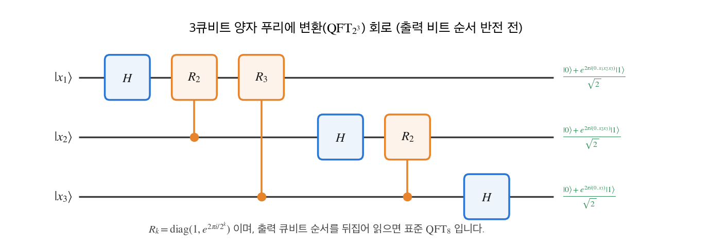
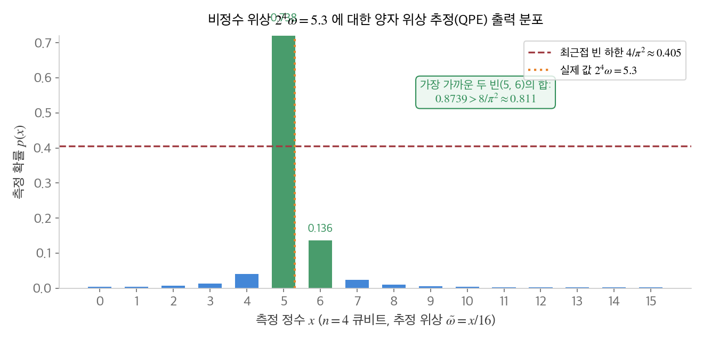
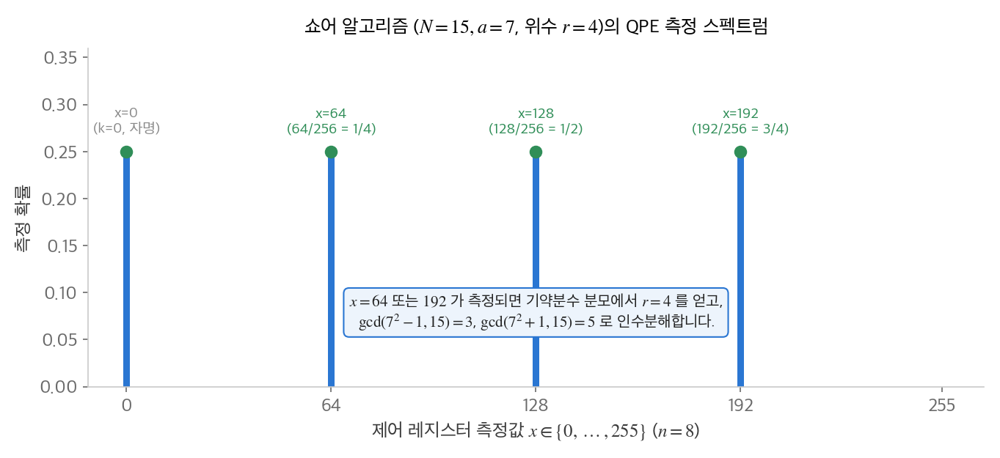
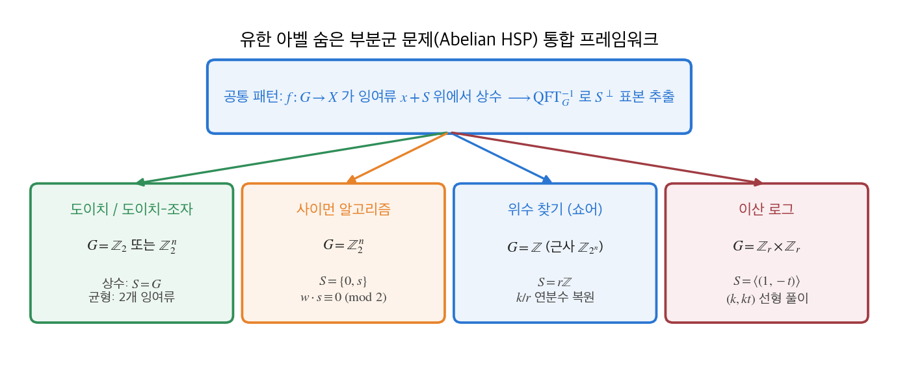

# 7. 초다항 가속 알고리즘

6장의 아다마르 변환 $H^{\otimes n}$ 은 위상 $(-1)^{x\cdot y}$ 에 담긴 정보를 꺼냈습니다. 이제 이 아이디어를 임의의 각도 위상 $e^{2\pi i \omega y}$ 로 일반화합니다.
그 도구가 **양자 푸리에 변환**(QFT, quantum Fourier transform)과 **양자 위상 추정**(QPE, quantum phase estimation)입니다.
이 장은 QFT 의 곱 분해와 오차 한계($\ge 4/\pi^2$)를 유도한 뒤, QPE 를 모듈러 곱셈 연산자 $U_a$ 에 적용해 **위수 찾기**(쇼어 소인수 분해 알고리즘)와 **이산 로그** 문제를 다항 시간에 푸는 과정을 전개합니다. 마지막으로 도이치, 사이먼, 쇼어를 모두 아우르는 **유한 아벨 숨은 부분군 문제**(Abelian HSP)를 정리합니다.

!!! info "원문과 자료"
    - 원문: Kaye, Laflamme, Mosca, *An Introduction to Quantum Computing* (2007), 7장 Algorithms with Superpolynomial Speed-up (7.1~7.6절), 부록 A.2 및 A.4
    - 이 교재의 관련 장: [6. 기초 양자 알고리즘](06-intro-algorithms.md), [8. 진폭 증폭 알고리즘](08-amplitude-amplification.md)
    - 함께 읽기: [알고리즘 30장 다항식과 FFT](../algorithms/30-fft.md), [알고리즘 31장 정수론 알고리즘](../algorithms/31-number-theory.md)
    - 이 장의 수식과 수치는 NumPy로 다시 계산해서 검증했습니다.

## 1. 양자 푸리에 변환과 위상 추정 (7.1절)

### 위상 추정 문제와 곱 상태 항등식

$\omega \in [0, 1)$ 이진 소수 전개를 $\omega = 0.x_1 x_2 x_3 \dots = x_1 2^{-1} + x_2 2^{-2} + \dots$ 로 씁니다. 그러면 $2^k \omega$ 의 정수 부분은 $e^{2\pi i (\text{정수})} = 1$ 로 사라지므로 다음이 성립합니다.

$$
e^{2\pi i (2^k \omega)} = e^{2\pi i (0.x_{k+1} x_{k+2}\dots)}
$$

이제 $n$ 큐비트 상태 $\lvert \psi_\omega \rangle = \frac{1}{\sqrt{2^n}}\sum_{y=0}^{2^n-1} e^{2\pi i \omega y}\lvert y \rangle$ 에서 $\omega$ 를 추정하는 문제를 생각합니다.
정수 $y \in \{0, \dots, 2^n - 1\}$ 을 이진법 $y = y_1 2^{n-1} + y_2 2^{n-2} + \dots + y_n 2^0$ ($y_k \in \{0,1\}$)로 쓰면, $\lvert \psi_\omega \rangle$ 가 $n$ 개 1큐비트 상태의 **곱 상태**(얽힘 없는 텐서 곱)로 완전히 인수분해됩니다(Exercise 7.1.2).

$$
\begin{aligned}
\frac{1}{\sqrt{2^n}}\sum_{y=0}^{2^n-1} e^{2\pi i \omega y}\lvert y \rangle
&= \frac{1}{\sqrt{2^n}} \sum_{y_1,\dots,y_n \in \{0,1\}} \prod_{k=1}^n e^{2\pi i \omega 2^{n-k} y_k} \lvert y_1 \dots y_n \rangle \\
&= \bigotimes_{k=1}^n \frac{\lvert 0 \rangle + e^{2\pi i (2^{n-k}\omega)}\lvert 1 \rangle}{\sqrt{2}} \\
&= \frac{\lvert 0 \rangle + e^{2\pi i (0.x_n x_{n+1}\dots)}\lvert 1 \rangle}{\sqrt{2}}
\otimes \frac{\lvert 0 \rangle + e^{2\pi i (0.x_{n-1} x_n \dots)}\lvert 1 \rangle}{\sqrt{2}}
\otimes \cdots \otimes \frac{\lvert 0 \rangle + e^{2\pi i (0.x_1 x_2 \dots)}\lvert 1 \rangle}{\sqrt{2}}
\end{aligned}
$$

이 곱 분해가 QFT 와 QPE 회로의 출발점입니다.

### QFT 정의와 $O(n^2)$ 게이트 회로

$\omega = x / 2^n = 0.x_1 x_2 \dots x_n$ 일 때 위 곱 상태는 정확히 정수 $x$ 의 **양자 푸리에 변환**(QFT)입니다.

$$
\mathrm{QFT}_{2^n}\lvert x \rangle = \frac{1}{\sqrt{2^n}}\sum_{y=0}^{2^n-1} e^{2\pi i \frac{x}{2^n}y}\lvert y \rangle
= \frac{\lvert 0 \rangle + e^{2\pi i (0.x_n)}\lvert 1 \rangle}{\sqrt{2}} \otimes \cdots \otimes \frac{\lvert 0 \rangle + e^{2\pi i (0.x_1\dots x_n)}\lvert 1 \rangle}{\sqrt{2}}
$$

이를 회로로 구현하기 위해 1큐비트 위상 회전 게이트 $R_k = \begin{pmatrix} 1 & 0 \\ 0 & e^{2\pi i / 2^k} \end{pmatrix}$ 를 씁니다.
$\lvert x_1 x_2 x_3 \rangle$ 에 대해 첫째 선에는 $H$ (위상 $0.x_1$ 생성), 이어서 $x_2$ 제어 $R_2$ ($+0.0x_2$), $x_3$ 제어 $R_3$ ($+0.00x_3$)을 걸면 $\frac{\lvert 0 \rangle + e^{2\pi i (0.x_1 x_2 x_3)}\lvert 1 \rangle}{\sqrt{2}}$ 가 만들어집니다. 둘째·셋째 선에도 같은 방식으로 걸고 출력 순서를 뒤집으면 $\mathrm{QFT}_{2^n}$ 이 완성됩니다. 총 게이트 수는 $n + \frac{n(n-1)}{2} = O(n^2)$ 개입니다.

<figure markdown>

<figcaption markdown>
<span class="fig-title"><b>Figure 1.</b> 3큐비트 $\mathrm{QFT}_{2^3}$ 양자 회로</span>

아다마르 게이트 $H$ 와 제어 위상 게이트 $R_k$ 를 계단식으로 배치해 각 큐비트의 위상에 이진 소수 $0.x_j \dots x_n$ 을 쌓습니다. $n$ 큐비트 전체에 총 $O(n^2)$ 개 게이트가 듭니다.
</figcaption>
</figure>

이 회로를 거꾸로 돌린 **역 양자 푸리에 변환** $\mathrm{QFT}_{2^n}^{-1}$ ($e^{-2\pi i x y / 2^n}$)을 $\lvert \psi_\omega \rangle$ 에 걸면, $\omega = x/2^n$ 일 때 정확히 $\lvert x \rangle$ 가 복원됩니다.

> **참고**: 고전 고속 푸리에 변환(FFT, [알고리즘 30장](../algorithms/30-fft.md))은 크기 $N=2^n$ 벡터를 $O(N \log N) = O(n 2^n)$ 연산에 변환합니다. 양자 QFT 는 $O(n^2)$ 게이트만 씁니다. 다만 출력이 진폭으로 들어가 있으므로 한 번의 측정으로 모든 푸리에 계수를 다 읽을 수는 없고, 주기나 위상처럼 특정 성질을 추출할 때만 사용합니다.

### 임의의 위상 $\omega$ 에 대한 오차 분석 (7.1.1절)

$\omega$ 가 $x/2^n$ 꼴이 아닌 임의의 실수일 때 $\mathrm{QFT}_{2^n}^{-1}\lvert \psi_\omega \rangle$ 를 측정해 정수 $y$ 를 얻을 확률을 유도합니다.
$\mathrm{QFT}_{2^n}^{-1}$ 후 $\lvert y \rangle$ 의 진폭은 등비수열의 합입니다.

$$
\alpha_y(\omega) = \frac{1}{2^n}\sum_{k=0}^{2^n-1} e^{2\pi i k (\omega - y/2^n)}
= \frac{1}{2^n} \cdot \frac{1 - e^{2\pi i (2^n\omega - y)}}{1 - e^{2\pi i (\omega - y/2^n)}}
$$

$\lvert 1 - e^{2i\theta} \rvert = \lvert e^{-i\theta} - e^{i\theta} \rvert = 2\lvert \sin\theta \rvert$ 를 분자·분모에 모두 적용해 절댓값 제곱을 구합니다(**Lemma 7.1.2**).

$$
p(y) = \lvert \alpha_y(\omega) \rvert^2 = \frac{1}{2^{2n}} \cdot \frac{\sin^2(\pi(2^n\omega - y))}{\sin^2(\pi(\omega - y/2^n))}
$$

$\omega$ 에 가장 가까운 격자점 $\hat{x}/2^n$ 을 잡으면 원주상 거리 $\lvert \omega - \hat{x}/2^n \rvert \le \frac{1}{2^{n+1}}$ 이므로 $\theta = \pi(\omega - \hat{x}/2^n)$ 는 $\lvert \theta \rvert \le \frac{\pi}{2^{n+1}}$ 를 만족합니다.
$\lvert \phi \rvert \le \pi/2$ 일 때 오목성으로 $\lvert \sin\phi \rvert \ge \frac{2}{\pi}\lvert \phi \rvert$ 이고, 모든 실수에서 $\lvert \sin\theta \rvert \le \lvert \theta \rvert$ 이므로 **Lemma 7.1.3** 이 성립합니다 ($M = 2^n$).

$$
p(\hat{x}) = \frac{1}{M^2}\frac{\sin^2(M\theta)}{\sin^2(\theta)}
\ge \frac{1}{M^2}\frac{\left(\frac{2}{\pi}M\lvert\theta\rvert\right)^2}{\lvert\theta\rvert^2}
= \frac{4}{\pi^2} \approx 0.4053
$$

즉, 가장 가까운 격자점 $\hat{x}$ 하나만 나올 확률이 최소 $4/\pi^2$ ($\approx 40.5\%$)이고, $\omega$ 양옆의 두 점 합계 확률은 최소 $8/\pi^2$ ($\approx 81.1\%$)입니다(**Theorem 7.1.5**).
정밀도 $r$ 비트 ($\lvert \tilde{\omega} - \omega \rvert \le 2^{-r}$)와 실패 확률 $2^{-m}$ 이하를 동시에 보장하려면 여분 큐비트를 붙여 총 $n = r + m + 1$ 큐비트를 쓰면 됩니다.

<figure markdown>

<figcaption markdown>
<span class="fig-title"><b>Figure 2.</b> $n=4$ 큐비트 QPE에서 $2^4\omega = 5.3$ 일 때의 측정 확률 분포</span>

가장 가까운 정수 $x=5$ 가 나올 확률은 $0.7377 > 4/\pi^2 \approx 0.405$ 이고, 양옆 두 빈($x=5, 6$)에 모이는 확률 합은 $0.8739 > 8/\pi^2 \approx 0.811$ 입니다.
</figcaption>
</figure>

### 주기 상태와 연분수 · 확장 유클리드 알고리즘 (7.1.2~7.1.3절, 부록 A.4)

주기 $r$, 시작 위치 $b \in \{0, \dots, r-1\}$ 인 **주기 상태** $\lvert \phi_{r,b} \rangle = \frac{1}{\sqrt{m_b}}\sum_{z: 0 \le zr+b < 2^n}\lvert zr + b \rangle$ 에 $\mathrm{QFT}_{2^n}^{-1}$ 을 적용하고 측정하면, 확률 $\ge \frac{4}{\pi^2}$ 로 $\lvert \frac{x}{2^n} - \frac{k}{r} \rvert \le \frac{1}{2^{n+1}}$ 인 $x$ ($k \in \{0,\dots,r-1\}$ 무작위)가 나옵니다(**Theorem 7.1.6**).
$2^n \ge 2r^2$ 이 되게 $n$ 을 고르면 오차가 $\frac{1}{2r^2}$ 이하가 됩니다. 이때 고전 알고리즘인 **연분수 전개**(continued fractions, **Theorem 7.1.7**)를 $x/2^n$ 에 적용하면 $O(n)$ 단계 안에 수렴분수(convergent) 목록에 정확한 기약분수 $c/r'$ ($= k/r$) 이 유일하게 나타납니다.

한 번 뽑은 $k$ 가 $r$ 과 공약수를 가지면 기약분수 분모 $r_1$ 은 $r$ 의 약수가 됩니다. 두 번 독립 실행해 얻은 두 분모 $r_1, r_2$ 의 최소공배수 $\mathrm{LCM}(r_1, r_2) = \frac{r_1 r_2}{\mathrm{GCD}(r_1, r_2)}$ 를 **확장 유클리드 알고리즘**(EEA, **Corollary 7.1.11**)으로 구하면, $\gcd(r/r_1, r/r_2) = 1$ 이 되어 정확한 $r$ 을 얻을 확률이 $\prod_{p \mid r}(1 - 1/p^2) > \frac{1}{\zeta(2)} = \frac{6}{\pi^2} \approx 0.608$ 입니다(**Theorem 7.1.12**, 부록 A.4).

## 2. 고유값 추정 (7.2절)

단일 고유상태 $\lvert \psi \rangle$ 와 고유값 $e^{2\pi i \omega}$ 를 갖는 유니터리 연산자 $U$ ($U\lvert \psi \rangle = e^{2\pi i \omega}\lvert \psi \rangle$)가 주어졌을 때, **고유값 추정** 알고리즘은 1절의 위상 상태 $\lvert \psi_\omega \rangle$ 를 회로로 직접 만들어 냅니다.

제어 큐비트를 $\lvert + \rangle$ 에 두고 $c\text{-}U^{2^j}$ 를 걸면 위상 킥백이 일어납니다.

$$
c\text{-}U^{2^j} \left(\frac{\lvert 0 \rangle + \lvert 1 \rangle}{\sqrt{2}} \lvert \psi \rangle\right)
= \frac{\lvert 0 \rangle + e^{2\pi i (2^j \omega)}\lvert 1 \rangle}{\sqrt{2}} \lvert \psi \rangle
$$

따라서 $j = n-1, \dots, 0$ 에 대해 제어-$U^{2^j}$ 를 순서대로 걸면 첫째 레지스터가 정확히 $\lvert \psi_\omega \rangle = \frac{1}{\sqrt{2^n}}\sum_{x=0}^{2^n-1} e^{2\pi i \omega x}\lvert x \rangle$ 가 됩니다(전체 작용은 $c\text{-}U^x \lvert x \rangle\lvert \psi \rangle = \lvert x \rangle U^x\lvert \psi \rangle$). 여기에 $\mathrm{QFT}_{2^n}^{-1}$ 을 걸어 측정하면 $\omega$ 의 추정치 $x/2^n$ 을 얻습니다.

만약 둘째 레지스터가 $U$ 의 고유상태들의 중첩 $\lvert \psi \rangle = \sum_j \alpha_j \lvert \psi_j \rangle$ 이라면, 선형성에 의해 출력 상태는 $\sum_j \alpha_j \lvert \tilde{\omega}_j \rangle \lvert \psi_j \rangle$ 가 됩니다. 첫째 레지스터를 측정하면 확률 $\lvert \alpha_j \rvert^2$ 로 $\omega_j$ 의 추정치를 얻고 둘째 레지스터는 해당 고유상태 $\lvert \psi_j \rangle$ 로 붕괴합니다.

## 3. 위수 찾기와 쇼어 소인수 분해 알고리즘 (7.3절)

### 소인수 분해에서 위수 찾기로의 고전 환원

RSA 암호의 기반인 정수 소인수 분해 문제($N$ 분해)는 다항 시간 고전 환원으로 **위수 찾기**(order-finding) 문제로 바뀝니다.
$\gcd(a, N) = 1$ 인 정수 $a, N$ 에 대해 $a^r \equiv 1 \pmod N$ 을 만족하는 가장 작은 양의 정수 $r$ 을 법 $N$ 에 대한 $a$ 의 **위수**(order)라고 부릅니다.
무작위로 뽑은 $a \in \{2, \dots, N-2\}$ 에서 $\gcd(a, N) > 1$ 이면 즉시 약수를 찾은 것입니다. 서로소이면 위수 $r$ 을 구합니다. $r$ 이 짝수이고 $a^{r/2} \not\equiv -1 \pmod N$ 이면 $(a^{r/2}-1)(a^{r/2}+1) = a^r - 1 \equiv 0 \pmod N$ 이므로 $\gcd(a^{r/2} \pm 1, N)$ 이 $N$ 의 비자명한 약수가 됩니다(성공 확률 $\ge 1/2$).

### 모듈러 곱셈 연산자 $U_a$ 와 고유상태 마법 (7.3.3절)

모듈러 곱셈 유니터리 연산자 $U_a\lvert s \rangle = \lvert sa \bmod N \rangle$ ($0 \le s < N$)을 정의합니다.
$a^r \equiv 1 \pmod N$ 이므로 $U_a^r = I$ 이며, 따라서 고유값은 $r$ 차 단위근 $e^{2\pi i k/r}$ ($k=0,\dots,r-1$)입니다.

고유상태 $\lvert u_k \rangle = \frac{1}{\sqrt{r}}\sum_{s=0}^{r-1} e^{-2\pi i \frac{k}{r}s}\lvert a^s \bmod N \rangle$ 에 $U_a$ 를 직접 걸어 고유값을 확인합니다.

$$
U_a \lvert u_k \rangle
= \frac{1}{\sqrt{r}}\sum_{s=0}^{r-1} e^{-2\pi i \frac{k}{r}s} \lvert a^{s+1} \bmod N \rangle
= e^{2\pi i \frac{k}{r}} \left(\frac{1}{\sqrt{r}}\sum_{s=0}^{r-1} e^{-2\pi i \frac{k}{r}(s+1)}\lvert a^{s+1} \bmod N \rangle\right)
= e^{2\pi i \frac{k}{r}} \lvert u_k \rangle
$$

$r$ 을 모르므로 $\lvert u_k \rangle$ 를 직접 만들 수는 없습니다. 그런데 $\lvert u_0 \rangle, \dots, \lvert u_{r-1} \rangle$ 을 모두 같은 가중치로 더하면 **$\lvert 1 \rangle$ 상태가 됩니다**!

$$
\frac{1}{\sqrt{r}}\sum_{k=0}^{r-1} \lvert u_k \rangle
= \frac{1}{r}\sum_{s=0}^{r-1}\left(\sum_{k=0}^{r-1} e^{-2\pi i \frac{k}{r}s}\right)\lvert a^s \bmod N \rangle
= \lvert a^0 \bmod N \rangle = \lvert 1 \rangle
$$

$s=0$ 일 때만 괄호 안 합이 $r$ 이고, $1 \le s < r$ 에서는 단위근의 합이 $0$ 이 되어 지워지기 때문입니다.
따라서 둘째 레지스터에 단순한 $\lvert 1 \rangle = \lvert 0\dots 01 \rangle$ 만 넣고 $c\text{-}U_a^x$ ($a^{2^j} \bmod N$ 을 반복 제곱으로 고전 사전 계산해 $O((\log N)^2 \log\log N \log\log\log N)$ 게이트로 구현)와 $\mathrm{QFT}_{2^n}^{-1}$ 을 적용하면, 확률 $1/r$ 로 임의의 $k \in \{0,\dots,r-1\}$ 에 해당하는 $k/r$ 추정치를 얻습니다(**Theorem 7.3.2**: 전체 위수 찾기 성공 확률 $\ge 384/\pi^6 > 0.399$).

쇼어(Shor)의 1994년 원논문은 둘째 레지스터를 $\lvert a^x \bmod N \rangle$ 계산 기저에서 보아, 측정으로 주기 상태 $\lvert \phi_{r,b} \rangle$ 를 만든 뒤 $\mathrm{QFT}_{2^n}^{-1}$ 을 거는 방식으로 서술했습니다(7.3.4절). 두 설명은 같은 회로를 서로 다른 기저(고유벡터 기저 대 계산 기저)에서 본 것뿐이며 수학적으로 완전히 동치입니다.

### 손계산 예: $N = 15, a = 7$ 인수분해

$N = 15$, $a = 7$ 을 고릅니다($\gcd(7, 15) = 1$). 실제 위수는 $7^1 \equiv 7$, $7^2 \equiv 4$, $7^3 \equiv 13$, $7^4 \equiv 1 \pmod{15}$ 이므로 $r = 4$ 입니다.
$2^n \ge 2 \cdot 15^2 = 450$ 조건에 맞추어 $n = 8$ ($2^8 = 256$ 으로 $r=4$ 에 대해 $256 \ge 2 \cdot 4^2 = 32$ 충족)을 씁니다.
QPE 후 제어 레지스터를 측정하면 $x \in \{0, 64, 128, 192\}$ 네 값만 각각 확률 $0.25$ 로 나옵니다.

- $x = 192$ 가 나왔다고 가정합니다. 분수 $\frac{192}{256}$ 에 연분수 전개를 적용합니다: $\frac{192}{256} = \frac{3}{4}$. 분모 $r_1 = 4$ 를 얻습니다.
- 두 번째 실행에서 $x = 64$ 가 나오면 $\frac{64}{256} = \frac{1}{4}$ 이므로 $r_2 = 4$, $\mathrm{LCM}(4, 4) = 4$ 입니다. ($7^4 \bmod 15 = 1$ 확인.)
- $r = 4$ 는 짝수이므로 약수를 구합니다: $\gcd(7^2 - 1, 15) = \gcd(48, 15) = 3$, $\gcd(7^2 + 1, 15) = \gcd(50, 15) = 5$. 따라서 $15 = 3 \times 5$ 로 인수분해가 끝납니다.

<figure markdown>

<figcaption markdown>
<span class="fig-title"><b>Figure 3.</b> $N=15, a=7, n=8$ 쇼어 알고리즘의 제어 레지스터 측정 스펙트럼</span>

$7^k \bmod 15$ 의 주기 $r=4$ 때문에 QPE 출력이 $x = 0, 64, 128, 192$ 네 빈에 각 $0.25$ 확률로 날카롭게 집중됩니다. $x=64$ 나 $192$ 가 측정되면 분모에서 $r=4$ 를 바로 읽습니다.
</figcaption>
</figure>

## 4. 이산 로그 문제 (7.4절, 부록 A.2)

소수 $p$ 의 곱셈군 $\mathbb{Z}_p^*$ 에서 위수가 $r$ 인 생성원 $a$ 와 원소 $b = a^t \bmod p$ 가 주어졌을 때, 지수 $t \in \{0, \dots, r-1\}$ 를 구하는 문제가 **이산 로그**(discrete logarithm) 문제입니다($r$ 이 합성수일 때는 소인수 분해 후 부록 A.2의 환원으로 소수 위수 경우로 줄입니다).

$U_a$ 와 $U_b = U_a^t$ 는 같은 고유상태 $\lvert u_k \rangle$ 를 공유하며 고유값은 각각 $e^{2\pi i k/r}$ 과 $e^{2\pi i (kt \bmod r)/r}$ 입니다.
$n$ 큐비트 제어 레지스터 **두 개**와 표적 레지스터 $\lvert 1 \rangle$ 하나를 준비해, 첫째 레지스터로 $c\text{-}U_a^{x}$, 둘째 레지스터로 $c\text{-}U_b^{y}$ 를 걸고 두 제어 레지스터에 모두 $\mathrm{QFT}_{2^n}^{-1}$ 을 적용합니다. 그러면 상태는 다음과 같습니다.

$$
\frac{1}{\sqrt{r}}\sum_{k=0}^{r-1} \left\lvert \widetilde{\frac{k}{r}} \right\rangle \left\lvert \widetilde{\frac{kt \bmod r}{r}} \right\rangle \lvert u_k \rangle
$$

여기서는 위수 $r$ 을 이미 알기 때문에 $2^n \ge 2r$ 만 되어도 반올림으로 분자 $k$ 와 $u \equiv kt \pmod r$ 을 구합니다($k \neq 0$ 이면 $t \equiv k^{-1} u \pmod r$).
예를 들어 $p=7, a=3$ ($r=6$), $b = 5$ ($3^5 \equiv 5 \pmod 7$)일 때 두 레지스터가 $k=5$ 와 $u = 5\cdot 5 \bmod 6 = 1$ 을 주면 $t \equiv 5^{-1}\cdot 1 \equiv 5 \pmod 6$ 을 얻어 $3^5 \equiv 5 \pmod 7$ 임을 찾습니다. 이산 로그의 양자 게이트 복잡도도 $O((\log p)^2 \log\log p \log\log\log p)$ 입니다.

## 5. 유한 아벨 숨은 부분군 문제 (7.5~7.6절)

지금까지 다룬 알고리즘들은 모두 하나의 군론적 문제, **숨은 부분군 문제**(HSP, Hidden Subgroup Problem)의 특수한 경우입니다.

> **숨은 부분군 문제**: 군 $G$ 에서 유한 집합 $X$ 로 가는 함수 $f: G \to X$ 에 대해, 숨은 부분군 $S \le G$ 가 존재하여 $f(x) = f(y) \iff x + S = y + S$ (즉, $f$ 가 $S$ 의 잉여류 위에서 상수이고 서로 다른 잉여류에서 다름)일 때 $S$ 의 생성원들을 찾습니다.

유한 아벨 군 $G = \mathbb{Z}_{N_1} \times \cdots \times \mathbb{Z}_{N_k}$ 위에서 $\mathrm{QFT}_G = \mathrm{QFT}_{N_1} \otimes \cdots \otimes \mathrm{QFT}_{N_k}$ 를 정의하고, $f$ 로 임의의 잉여류 상태 $\lvert b + S \rangle$ 를 만든 뒤 $\mathrm{QFT}_G^{-1}$ 을 적용하면 직교 부분군 $S^\perp$ 위의 균등 중첩을 얻습니다(Equation 7.5.11).

$$
\mathrm{QFT}_G^{-1}\lvert b + S \rangle = \frac{1}{\sqrt{\lvert S^\perp \rvert}} \sum_{t \in S^\perp} \chi_t(b)\lvert t \rangle
$$

따라서 $O(\log \lvert G \rvert)$ 번 측정해 표본 $t_1, \dots, t_{n+4} \in S^\perp$ 을 모으고 선형 합동식 $T x^T \equiv 0 \pmod 1$ 을 풀면 $S$ 를 복원합니다(**Corollary 7.5.3**: 쿼리 $O(\log N)$, 게이트 $O(\log^3 N)$).

<figure markdown>

<figcaption markdown>
<span class="fig-title"><b>Figure 4.</b> 유한 아벨 HSP 가 포괄하는 네 가지 양자 알고리즘</span>

도이치($\mathbb{Z}_2$), 사이먼($\mathbb{Z}_2^n$), 쇼어 위수 찾기($\mathbb{Z}$), 이산 로그($\mathbb{Z}_r \times \mathbb{Z}_r$)는 모두 아벨 군 $G$ 의 잉여류 상태에 역 QFT 를 걸어 $S^\perp$ 를 추출한다는 같은 구조를 공유합니다.
</figcaption>
</figure>

반면 그래프 동형 문제처럼 대칭군 $S_n$ 을 쓰는 **비아벨 숨은 부분군 문제**(non-Abelian HSP)는 아직 효율적인 일반 양자 알고리즘이 알려지지 않았습니다(7.6절).

```python
import numpy as np
from fractions import Fraction

# N=15, a=7, n=8 쇼어 알고리즘 스펙트럼 및 연분수 검증
n, N_reg = 8, 256
probs = np.zeros(N_reg)
for k in range(4):
    psi = np.exp(2j * np.pi * (k / 4) * np.arange(N_reg)) / np.sqrt(N_reg)
    amps = np.fft.fft(psi) / np.sqrt(N_reg)
    probs += 0.25 * np.abs(amps) ** 2

peaks = np.where(probs > 0.01)[0]
print("QPE 봉우리 위치:", peaks, "확률:", np.round(probs[peaks], 4))
for x in peaks:
    frac = Fraction(int(x), N_reg).limit_denominator(15)
    print(f"x={x} -> 분수 {frac}, 분모={frac.denominator}")
```

## 6. 이 장의 요약

| 개념 | 핵심 식 또는 복잡도 | 의미 |
| --- | --- | --- |
| $\mathrm{QFT}_{2^n}$ | $\lvert x \rangle \mapsto \frac{1}{\sqrt{2^n}}\sum_y e^{2\pi i xy/2^n}\lvert y \rangle$, $O(n^2)$ 게이트 | 위상 정보를 진폭으로, 진폭 위상을 기저 상태로 변환 |
| QPE 오차 한계 | 최근접 $\hat{x}$ 확률 $\ge 4/\pi^2$, 두 빈 $\ge 8/\pi^2$ | 여분 큐비트 $m+1$ 개로 오류 $\le 2^{-m}$ 달성 |
| 위수 찾기 (쇼어) | $U_a\lvert s \rangle = \lvert sa\bmod N \rangle$, $\lvert 1 \rangle = \frac{1}{\sqrt{r}}\sum \lvert u_k \rangle$ | 소인수 분해를 $O((\log N)^2 \log\log N \log\log\log N)$ 에 해결 |
| 이산 로그 | $U_a, U_b$ 동시 QPE $\to (k/r, kt/r)$ | $t \equiv k^{-1}(kt) \pmod r$ 로 다항 시간 풀이 |
| 유한 아벨 HSP | $\mathrm{QFT}_G^{-1}\lvert b+S \rangle \to S^\perp$ 표본 $O(\log N)$ 개 | 도이치·사이먼·쇼어·이산 로그의 통합 틀 |

다음 장은 숨은 군 구조가 전혀 없는 **비정렬 탐색 문제**에서 이차 가속($\sqrt{N}$)을 얻는 **그로버 탐색**과 **진폭 증폭** 알고리즘을 다룹니다.
