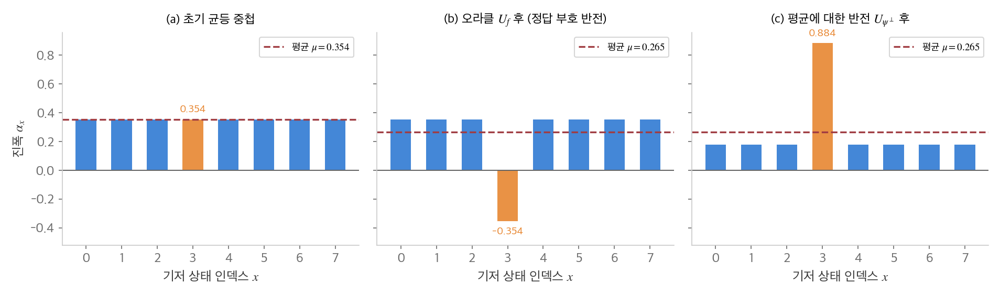
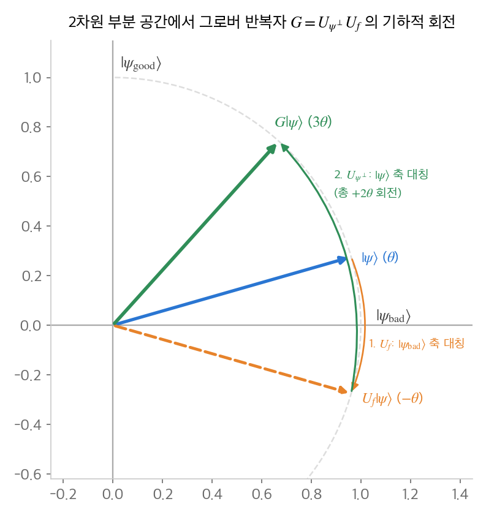
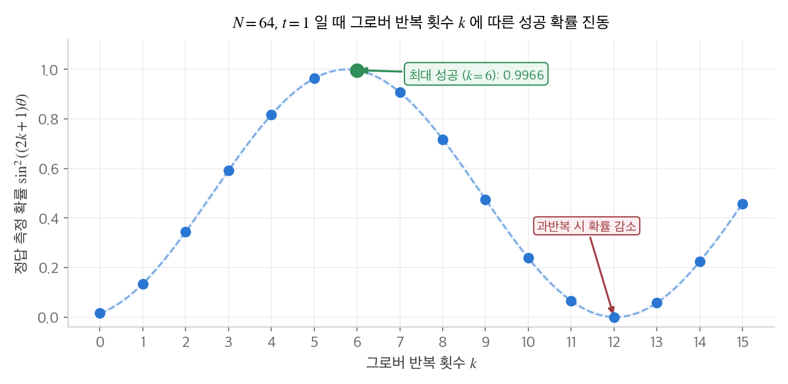
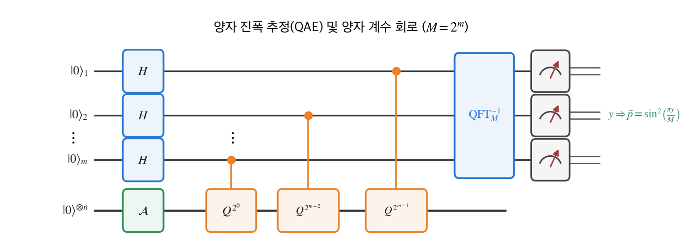

# 8. 진폭 증폭 알고리즘

7장의 쇼어 알고리즘은 숨은 아벨 군 구조가 있을 때 지수적 가속을 얻었습니다.
반면 아무런 대수적 구조가 없는 $N$ 개 후보에서 정답을 하나 찾는 **비정렬 탐색**(unstructured search) 문제는 어떨까요?
고전 컴퓨터는 최악의 경우 $N$ 번에 가까운 쿼리를 써야 합니다. **그로버(Grover) 양자 탐색 알고리즘**은 2차원 부분 공간에서 두 반사 연산을 번갈아 걸어 정답 상태로의 회전 각도를 $2\theta$ 씩 키웁니다. 그 결과 $O(\sqrt{N})$ 회 쿼리로 정답을 찾아 **이차 가속**(quadratic speed-up)을 달성합니다.
이 장은 그로버 탐색의 기하·대수 유도를 끝까지 따라간 뒤, 임의의 알고리즘을 가속하는 **진폭 증폭**(amplitude amplification), 해의 개수를 세는 **양자 진폭 추정과 양자 계수**, 그리고 해의 개수를 모를 때의 탐색까지 정리합니다.

!!! info "원문과 자료"
    - 원문: Kaye, Laflamme, Mosca, *An Introduction to Quantum Computing* (2007), 8장 Algorithms Based on Amplitude Amplification (8.1~8.5절)
    - 이 교재의 관련 장: [6. 기초 양자 알고리즘](06-intro-algorithms.md), [7. 초다항 가속 알고리즘](07-superpolynomial-algorithms.md), [9. 양자 계산 복잡도와 하한](09-complexity-lower-bounds.md)
    - 이 장의 수식과 수치는 NumPy로 다시 계산해서 검증했습니다.

## 1. 그로버 양자 탐색 알고리즘 (8.1절)

크기가 $N = 2^n$ 인 탐색 공간 $\{0, 1\}^n$ 에서 정답에 대해서만 $f(x) = 1$, 나머지는 $f(x) = 0$ 을 내는 오라클 $U_f$ 가 주어집니다.
먼저 표적 큐비트를 $\lvert - \rangle$ 로 두어 위상 킥백 형태로 쓰는 $n$ 큐비트 위상 오라클 $U_f\lvert x \rangle = (-1)^{f(x)}\lvert x \rangle$ 를 정의합니다.

해가 $t = 1$ 개($x = w$)일 때, 정답 상태 $\lvert \psi_{\text{good}} \rangle = \lvert w \rangle$ 와 나머지 $N-1$ 개 오답의 균등 중첩 $\lvert \psi_{\text{bad}} \rangle = \frac{1}{\sqrt{N-1}}\sum_{x \neq w}\lvert x \rangle$ 을 둡니다.
초기 균등 중첩 $\lvert \psi \rangle = H^{\otimes n}\lvert 0 \rangle^{\otimes n} = \frac{1}{\sqrt{N}}\sum_{x=0}^{N-1}\lvert x \rangle$ 은 다음과 같이 나뉩니다.

$$
\lvert \psi \rangle = \frac{1}{\sqrt{N}}\lvert w \rangle + \sqrt{\frac{N-1}{N}}\lvert \psi_{\text{bad}} \rangle
= \sin\theta\,\lvert w \rangle + \cos\theta\,\lvert \psi_{\text{bad}} \rangle
$$

여기서 $\sin\theta = \frac{1}{\sqrt{N}}$ ($0 < \theta \le \pi/2$)입니다. 만약 해가 $t$ 개면 $\sin\theta = \sqrt{t/N}$ 으로 바뀔 뿐 구조는 완전히 같습니다.

### 그로버 반복자 $G = U_{\psi^\perp} U_f$

그로버 반복자(Grover iterate) $G$ 는 두 반사 연산자의 곱입니다.

1. **오라클 반사 $U_f$**: 정답 상태 $\lvert w \rangle$ 의 부호만 뒤집고 $\lvert \psi_{\text{bad}} \rangle$ 은 그대로 둡니다.
   $$
   U_f = I - 2\lvert w \rangle\langle w \rvert
   $$
2. **평균에 대한 반전 $U_{\psi^\perp}$**: 초기 상태 $\lvert \psi \rangle$ 는 그대로 두고 $\lvert \psi \rangle$ 와 직교하는 성분 $V_\psi^\perp$ 의 부호를 뒤집습니다. $U_{0^\perp}\lvert 0 \rangle = \lvert 0 \rangle$, $U_{0^\perp}\lvert x \rangle = -\lvert x \rangle$ ($x \neq 0$)일 때 $U_{\psi^\perp} = H^{\otimes n} U_{0^\perp} H^{\otimes n} = 2\lvert \psi \rangle\langle \psi \rvert - I$ 입니다.

$U_{\psi^\perp}$ 가 실제로 **진폭들의 평균에 대한 반전**임을 확인합니다(Exercise 8.1.4). 임의의 상태 $\lvert \varphi \rangle = \sum_x \alpha_x \lvert x \rangle$ 의 진폭 평균을 $\mu = \frac{1}{N}\sum_x \alpha_x$ 라 둡니다.
내적 $\langle \psi \mid \varphi \rangle = \frac{1}{\sqrt{N}}\sum_x \alpha_x = \sqrt{N}\mu$ 를 $(2\lvert \psi \rangle\langle \psi \rvert - I)\lvert \varphi \rangle$ 에 대입합니다.

$$
U_{\psi^\perp}\lvert \varphi \rangle
= 2\langle \psi \mid \varphi \rangle \lvert \psi \rangle - \lvert \varphi \rangle
= 2\left(\sqrt{N}\mu\right)\left(\frac{1}{\sqrt{N}}\sum_x \lvert x \rangle\right) - \sum_x \alpha_x \lvert x \rangle
= \sum_x \left(2\mu - \alpha_x\right)\lvert x \rangle
$$

각 진폭 $\alpha_x$ 가 평균 $\mu$ 를 기준으로 대칭 이동한 $\mu + (\mu - \alpha_x) = 2\mu - \alpha_x$ 로 바뀝니다. $U_f$ 가 정답 진폭을 음수로 만들어 평균 $\mu$ 를 살짝 끌어내린 뒤 $U_{\psi^\perp}$ 가 평균에 대칭 반전시키므로, 정답 진폭이 매 단계 약 $2/\sqrt{N}$ 씩 커집니다.

<figure markdown>

<figcaption markdown>
<span class="fig-title"><b>Figure 1.</b> $N=8$ 탐색에서 첫 그로버 반복이 정답 진폭을 증폭하는 과정</span>

(a) 초기 균등 상태의 모든 진폭과 평균은 $1/\sqrt{8} \approx 0.354$ 입니다. (b) $U_f$ 가 정답($x=3$) 진폭만 $-0.354$ 로 뒤집어 평균이 $0.265$ 로 내려갑니다. (c) 평균에 대한 반전 후 정답 진폭은 $2(0.265) - (-0.354) = 0.884$ (확률 $78.1\%$)로 커집니다.
</figcaption>
</figure>

### 2차원 회전 유도

출발 상태 $\lvert \psi \rangle$ 에 $U_f$ 와 $U_{\psi^\perp}$ 를 아무리 반복해도 상태는 2차원 부분 공간 $\mathrm{span}\{\lvert w \rangle, \lvert \psi_{\text{bad}} \rangle\}$ 밖으로 나가지 않습니다. 이 평면에서 $\lvert \psi \rangle$ 와 직교하는 단위 벡터 $\lvert \bar{\psi} \rangle = \cos\theta\,\lvert w \rangle - \sin\theta\,\lvert \psi_{\text{bad}} \rangle$ 를 도입하면 두 기저의 변환이 다음과 같습니다.

$$
\lvert \psi \rangle = \sin\theta\,\lvert w \rangle + \cos\theta\,\lvert \psi_{\text{bad}} \rangle, \qquad
\lvert \bar{\psi} \rangle = \cos\theta\,\lvert w \rangle - \sin\theta\,\lvert \psi_{\text{bad}} \rangle
$$

$G$ 를 한 번 적용할 때마다 각도가 $2\theta$ 씩 돌아가는 과정을 삼각함수로 한 줄씩 증명합니다.
먼저 $k$ 번 후의 상태를 $\lvert \psi_k \rangle = \sin((2k+1)\theta)\lvert w \rangle + \cos((2k+1)\theta)\lvert \psi_{\text{bad}} \rangle$ 라 둡니다($k=0$ 에서 성립).
$U_f$ 를 적용하면 $\lvert w \rangle$ 의 부호가 반전됩니다.

$$
U_f\lvert \psi_k \rangle = -\sin((2k+1)\theta)\lvert w \rangle + \cos((2k+1)\theta)\lvert \psi_{\text{bad}} \rangle
$$

$\lvert w \rangle = \sin\theta\,\lvert \psi \rangle + \cos\theta\,\lvert \bar{\psi} \rangle$ 와 $\lvert \psi_{\text{bad}} \rangle = \cos\theta\,\lvert \psi \rangle - \sin\theta\,\lvert \bar{\psi} \rangle$ 를 대입하고 덧셈정리를 씁니다.

$$
\begin{aligned}
U_f\lvert \psi_k \rangle
&= \left[\cos((2k+1)\theta)\cos\theta - \sin((2k+1)\theta)\sin\theta\right]\lvert \psi \rangle \\
&\quad - \left[\sin((2k+1)\theta)\cos\theta + \cos((2k+1)\theta)\sin\theta\right]\lvert \bar{\psi} \rangle \\
&= \cos((2k+2)\theta)\lvert \psi \rangle - \sin((2k+2)\theta)\lvert \bar{\psi} \rangle
\end{aligned}
$$

여기에 $U_{\psi^\perp}$ 를 걸면 $\lvert \bar{\psi} \rangle$ 성분만 부호가 반전됩니다.

$$
G\lvert \psi_k \rangle = U_{\psi^\perp} U_f \lvert \psi_k \rangle
= \cos((2k+2)\theta)\lvert \psi \rangle + \sin((2k+2)\theta)\lvert \bar{\psi} \rangle
$$

다시 $\lvert \psi \rangle, \lvert \bar{\psi} \rangle$ 를 $\lvert w \rangle, \lvert \psi_{\text{bad}} \rangle$ 로 풀고 덧셈정리로 묶으면 $k \to k+1$ 이 성립합니다.

$$
G^k\lvert \psi \rangle = \sin((2k+1)\theta)\lvert w \rangle + \cos((2k+1)\theta)\lvert \psi_{\text{bad}} \rangle
$$

<figure markdown>

<figcaption markdown>
<span class="fig-title"><b>Figure 2.</b> 두 반사 $U_f$ 와 $U_{\psi^\perp}$ 의 합성이 만드는 각도 $2\theta$ 회전</span>

$U_f$ 는 $\lvert \psi_{\mathrm{bad}} \rangle$ 축에 대한 반사이고($\theta \to -\theta$), $U_{\psi^\perp}$ 는 $\lvert \psi \rangle$ 축에 대한 반사입니다($-\theta \to 3\theta$). 한 번의 그로버 반복 $G$ 는 상태 벡터를 정답 축 $\lvert \psi_{\mathrm{good}} \rangle$ 쪽으로 항상 $2\theta$ 만큼 회전시킵니다.
</figcaption>
</figure>

### 반복 횟수 선택과 과반복 주의

성공 확률 $\sin^2((2k+1)\theta)$ 를 $1$ 에 가깝게 하려면 $(2k+1)\theta \approx \pi/2$, 즉 $\tilde{k} = \frac{\pi}{4\theta} - \frac{1}{2}$ 근처의 정수 $k = \lfloor \tilde{k} \rfloor$ 또는 $[\tilde{k}]$ 를 고릅니다. $\theta \approx \sin\theta = \sqrt{t/N}$ 이므로 필요한 반복 횟수는 $k \approx \frac{\pi}{4}\sqrt{\frac{N}{t}} = O(\sqrt{N/t})$ 입니다(**Theorem 8.1.1**: 성공 확률 $1 - O(1/N)$).

- **$N = 4, t = 1$**: $\sin\theta = 1/2$ 이므로 $\theta = \pi/6$ ($30^\circ$)입니다. $k = 1$ 번만 반복해도 $(2\cdot 1 + 1)\frac{\pi}{6} = \frac{\pi}{2}$ 가 되어 **100% 확률**로 정답을 찾습니다.
- **$N = 16, t = 1$**: $\sin\theta = 1/4$ ($\theta \approx 0.2527\,\mathrm{rad}$), $\tilde{k} \approx 2.608$ 입니다. $k = 2$ 일 때 $90.84\%$, $k = 3$ 일 때 $96.13\%$ 로 최대가 됩니다.
- **$N = 64, t = 1$**: $\sin\theta = 1/8$ ($\theta \approx 0.1253\,\mathrm{rad}$), $\tilde{k} \approx 5.766$ 입니다. $k = 6$ 일 때 성공 확률은 $\sin^2(13\theta) \approx 99.66\%$ 입니다. $k=6$ 을 넘겨 계속 반복하면 벡터가 정답 축을 지나쳐 성공 확률이 다시 떨어집니다.

<figure markdown>

<figcaption markdown>
<span class="fig-title"><b>Figure 3.</b> $N=64, t=1$ 일 때 그로버 반복 횟수 $k$ 에 따른 성공 확률</span>

성공 확률은 $\sin^2((2k+1)\theta)$ 를 따라 주기적으로 진동합니다. $k = 6$ 에서 $0.9966$ 으로 정점에 도달한 뒤, 과반복하면 오히려 확률이 감소하므로 제때 측정을 멈춰야 합니다.
</figcaption>
</figure>

## 2. 일반 진폭 증폭 (8.2절)

그로버 탐색에서는 초기 분포로 균등 중첩 $H^{\otimes n}\lvert 0 \rangle$ 을 썼습니다.
**진폭 증폭**(amplitude amplification)은 이를 임의의 양자(또는 가역 확률) 알고리즘 $\mathcal{A}$ 로 확장합니다. $\mathcal{A}$ 가 $\lvert 0 \dots 0 \rangle$ 에 작용해 성공 확률 $p_{\text{good}} = \sum_{x \in X_{\text{good}}}\lvert \alpha_x \rvert^2 = \sin^2\theta$ 로 해를 맞힌다고 가정합니다.

$$
\lvert \psi \rangle = \mathcal{A}\lvert 0 \dots 0 \rangle = \sin\theta\,\lvert \psi_{\text{good}} \rangle + \cos\theta\,\lvert \psi_{\text{bad}} \rangle
$$

고전적으로는 성공 확률 $p_{\text{good}}$ 을 $\Omega(1)$ 로 끌어올리려면 $\mathcal{A}$ 를 평균 $\Theta(1/p_{\text{good}})$ 번 실행해야 합니다.
양자 진폭 증폭은 일반 반복자 $Q = \mathcal{A}\, U_{0^\perp} \mathcal{A}^{-1} U_f = U_{\psi^\perp} U_f$ 를 정의합니다.
8.1절과 정확히 같은 2차원 회전 유도에 의해 $Q^k\lvert \psi \rangle = \sin((2k+1)\theta)\lvert \psi_{\text{good}} \rangle + \cos((2k+1)\theta)\lvert \psi_{\text{bad}} \rangle$ 가 됩니다.
따라서 $\mathcal{A}$ 와 $\mathcal{A}^{-1}$ 및 $U_f$ 를 $O(1/\theta) = O(1/\sqrt{p_{\text{good}}})$ 번만 호출하면 성공 확률이 $1 - O(p_{\text{good}})$ 로 증폭됩니다.

## 3. 양자 진폭 추정과 양자 계수 (8.3절)

해가 몇 개 있는지($t$), 또는 알고리즘 $\mathcal{A}$ 의 성공 확률 $p = \sin^2\theta$ 이 얼마인지 구하는 문제가 **진폭 추정**(QAE)과 **양자 계수**(quantum counting)입니다.

### 반복자 $Q$ 의 고유값과 QPE 결합

기저 $\{\lvert \psi_{\text{bad}} \rangle, \lvert \psi_{\text{good}} \rangle\}$ 에서 반복자 $Q = U_{\psi^\perp} U_f$ 는 각도 $2\theta$ 회전 행렬입니다.

$$
Q = \begin{pmatrix} \cos(2\theta) & -\sin(2\theta) \\ \sin(2\theta) & \cos(2\theta) \end{pmatrix}
$$

고유벡터 $\lvert \psi_\pm \rangle = \frac{1}{\sqrt{2}}\left(\lvert \psi_{\text{bad}} \rangle \mp i \lvert \psi_{\text{good}} \rangle\right)$ 에 $Q$ 를 곱해 고유값을 직접 계산합니다.

$$
Q\lvert \psi_+ \rangle
= \frac{1}{\sqrt{2}}\begin{pmatrix} \cos 2\theta & -\sin 2\theta \\ \sin 2\theta & \cos 2\theta \end{pmatrix}\begin{pmatrix} 1 \\ -i \end{pmatrix}
= \frac{1}{\sqrt{2}}\begin{pmatrix} \cos 2\theta + i\sin 2\theta \\ \sin 2\theta - i\cos 2\theta \end{pmatrix}
= e^{i2\theta}\frac{1}{\sqrt{2}}\begin{pmatrix} 1 \\ -i \end{pmatrix}
= e^{i2\theta}\lvert \psi_+ \rangle
$$

마찬가지로 $Q\lvert \psi_- \rangle = e^{-i2\theta}\lvert \psi_- \rangle$ 입니다.
또한 초기 상태 $\lvert \psi \rangle = \cos\theta\,\lvert \psi_{\text{bad}} \rangle + \sin\theta\,\lvert \psi_{\text{good}} \rangle$ 는 이 두 고유상태의 균등 중첩입니다.

$$
\lvert \psi \rangle = \frac{e^{i\theta}}{\sqrt{2}}\lvert \psi_+ \rangle + \frac{e^{-i\theta}}{\sqrt{2}}\lvert \psi_- \rangle
$$

따라서 7장의 **고유값 추정(QPE)** 회로에서 유니터리 $U$ 자리에 $Q$ 를 넣고, 둘째 레지스터를 $\lvert \psi \rangle = \mathcal{A}\lvert 0 \dots 0 \rangle$ 로 두며, 첫째 제어 레지스터 크기를 $M = 2^m$ 으로 잡으면, 측정 정수 $y \in \{0, \dots, M-1\}$ 가 $\frac{2\theta}{2\pi} = \frac{\theta}{\pi}$ 또는 $1 - \frac{\theta}{\pi}$ 를 근사합니다. 두 경우 모두 $\sin^2(\pi y / M)$ 값이 같으므로 추정치 $\tilde{p} = \sin^2(\pi y / M)$ 을 출력합니다.

<figure markdown>

<figcaption markdown>
<span class="fig-title"><b>Figure 4.</b> 양자 진폭 추정(QAE) 회로</span>

$m$ 큐비트 제어 레지스터와 $\mathcal{A}\lvert 0 \rangle^{\otimes n}$ 사이에 $c\text{-}Q^{2^j}$ 를 걸고 $\mathrm{QFT}_M^{-1}$ 로 측정한 정수 $y$ 에서 $\tilde{p} = \sin^2(\pi y / M)$ 을 구합니다. $\mathcal{A} = H^{\otimes n}$ 이면 $\tilde{t} = [\tilde{p}N]$ 으로 해의 개수를 추정합니다.
</figcaption>
</figure>

**Theorem 8.3.1** 에 따르면 제어 레지스터에서 $M = 2^m$ 번의 $Q$ 호출로 확률 $\ge 8/\pi^2$ (또는 $k$ 배 범위에서 $1 - \frac{1}{2(k-1)}$) 로 다음 오차 한계를 얻습니다.

$$
\lvert \tilde{p} - p \rvert \le \frac{2\pi k \sqrt{p(1-p)}}{M} + \frac{k^2 \pi^2}{M^2}
$$

- **양자 계수** ($\mathcal{A} = H^{\otimes n}$, $p = t/N$): $M = \lceil \sqrt{N} \rceil$ 번만 쿼리하면 오차 $O(\sqrt{t})$ 이내로 해의 개수 $t$ 를 추정합니다(**Corollary 8.3.2**). 정확한 $t$ 를 확률 $\ge 2/3$ 로 구하려면 $O(\sqrt{(t+1)(N-t+1)})$ 번의 쿼리가 듭니다(**Theorem 8.3.4**).
- **함수 평균 계산** (Example 8.3.5): $g: \{0,1\}^n \to [0, 1)$ 의 평균 $\frac{1}{2^n}\sum_x g(x)$ 는 보조 큐비트 회전 $\lvert x \rangle(\sqrt{1-g(x)}\lvert 0 \rangle + \sqrt{g(x)}\lvert 1 \rangle)$ 에 QAE 를 걸어 고전 몬테카를로($O(1/\varepsilon^2)$ 표본) 대비 이차 가속된 $O(1/\varepsilon)$ 쿼리로 추정합니다.

## 4. 해의 개수를 모를 때의 탐색 (8.4절)

실제 문제에서는 해의 개수 $t$ 를 미리 모르므로 최적 반복 횟수 $\frac{\pi}{4}\sqrt{N/t}$ 도 모릅니다. 과반복하면 성공 확률이 다시 떨어지므로 맹목적으로 많이 돌릴 수도 없습니다.

BBHT(Boyer–Brassard–Høyer–Tapp) 전략은 QAE 회로에서 **첫째 레지스터를 측정하지 않고 둘째 레지스터만 바로 측정**하는 것과 동치인 무작위 반복 방법을 씁니다.

1. $m = 1$ 로 시작합니다.
2. $\{0, 1, \dots, 2^m - 1\}$ 에서 정수 $y$ 를 균등 무작위로 뽑아 $Q^y \mathcal{A}\lvert 0 \dots 0 \rangle$ 을 실행한 뒤 측정해 $f(x)=1$ 인지 검사합니다(2회 시도).
3. 해를 찾지 못하면 $m$ 을 $1$ 늘립니다($2^m < N$ 동안 반복, 초과 시 전수 탐색).

$2^m \gg 1/\theta$ 가 되면 QAE 의 두 고유값 상태 $\lvert 2\theta \rangle$ 와 $\lvert 2\pi - 2\theta \rangle$ 가 사실상 직교하므로, 둘째 레지스터의 축소 상태는 $\frac{1}{2}\lvert \psi_+ \rangle\langle \psi_+ \rvert + \frac{1}{2}\lvert \psi_- \rangle\langle \psi_- \rvert = \frac{1}{2}\lvert \psi_{\text{good}} \rangle\langle \psi_{\text{good}} \rvert + \frac{1}{2}\lvert \psi_{\text{bad}} \rangle\langle \psi_{\text{bad}} \rvert$ 가 됩니다. 따라서 한 번 실행할 때마다 약 $1/2$ 확률로 정답이 나옵니다. $m$ 이 지수적으로 커지므로 기댓값 기준 $O(1/\theta) = O(\sqrt{N/t})$ 회 쿼리만으로 해를 찾습니다(**Theorem 8.4.1**). 해가 없을 때($\theta=0$)는 $\Theta(N)$ 만에 "해 없음"을 확정합니다.

```python
import numpy as np

# N=16, N=64 그로버 성공 확률 검증
for N in (4, 16, 64):
    th = np.arcsin(1 / np.sqrt(N))
    k_opt = int(round(np.pi / (4 * th) - 0.5))
    prob = np.sin((2 * k_opt + 1) * th) ** 2
    print(f"N={N:2d}: theta={th:.4f}, k={k_opt}, 성공확률={prob:.4f}")
```

## 5. 이 장의 요약

| 알고리즘 | 입력 / 조건 | 고전 쿼리 | 양자 쿼리 | 핵심 아이디어 |
| --- | --- | --- | --- | --- |
| 그로버 탐색 | $N$ 개 중 $t$ 개 해 ($t$ 앎) | $\Theta(N/t)$ | $O(\sqrt{N/t})$ | $U_f$ 와 $U_{\psi^\perp}$ 두 반사로 $2\theta$ 씩 회전 |
| 진폭 증폭 | 성공 확률 $p$ 인 $\mathcal{A}$ | $\Theta(1/p)$ | $O(1/\sqrt{p})$ | $Q = \mathcal{A}U_{0^\perp}\mathcal{A}^{-1}U_f$ 반복 |
| 양자 진폭 추정 / 계수 | 미지의 $p = \sin^2\theta$ 또는 $t$ | $\Theta(1/\varepsilon^2)$ | $O(1/\varepsilon)$ / $O(\sqrt{N})$ | $Q$ 의 고유값 $e^{\pm 2i\theta}$ 를 QPE 로 추정 |
| BBHT 탐색 | 해 개수 $t$ 모름 ($t>0$) | $\Theta(N/t)$ | 기댓값 $O(\sqrt{N/t})$ | 지수 증가 구간 $2^m$ 내 무작위 반복 횟수 $y$ |

그로버 탐색이 $O(\sqrt{N})$ 으로 풀 수 있다면, 더 교묘한 양자 알고리즘으로 $O(\log N)$ 에 비정렬 탐색을 풀 수 있을까요? 다음 장은 블랙박스 하한 증명 기법들을 써서 **그로버의 $\Omega(\sqrt{N})$ 가 양자 컴퓨터에서도 넘을 수 없는 한계**임을 증명합니다.
