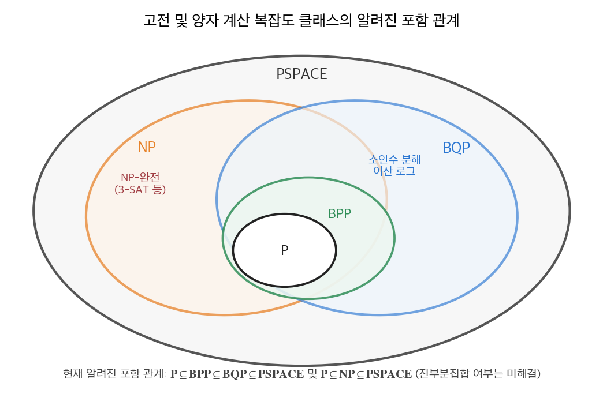
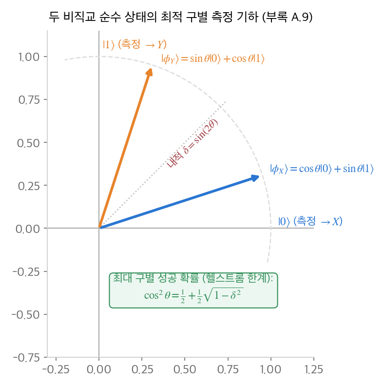
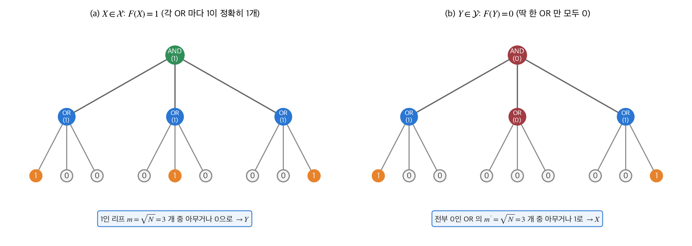

# 9. 양자 계산 복잡도와 하한

알고리즘 하나를 설계하면 문제의 난이도에 대한 **상한**(upper bound)을 얻습니다. 반대로 "아무리 영리한 양자 알고리즘을 짜도 이보다 적은 자원으로는 절대 풀 수 없다"고 증명하려면 **하한**(lower bound) 도구가 필요합니다.
이 장은 먼저 $\mathbf{P}, \mathbf{BPP}, \mathbf{NP}, \mathbf{BQP}, \mathbf{PSPACE}$ 같은 계산 복잡도 클래스의 관계를 정리합니다. 이어서 오라클(블랙박스) 모델에서 양자 쿼리 복잡도의 하한을 증명하는 네 가지 핵심 기법 — **하이브리드 방법**, **다항식 방법**, **블록 민감도**, **적대자 방법** — 과 두 순수 상태의 구별 한계(헬스트롬 한계)를 다룹니다.

!!! info "원문과 자료"
    - 원문: Kaye, Laflamme, Mosca, *An Introduction to Quantum Computing* (2007), 9장 Quantum Computational Complexity Theory and Lower Bounds (9.1~9.7절), 부록 A.5 및 A.9
    - 이 교재의 관련 장: [1. 서론과 배경](01-introduction.md), [6. 기초 양자 알고리즘](06-intro-algorithms.md), [8. 진폭 증폭 알고리즘](08-amplitude-amplification.md)
    - 함께 읽기: [알고리즘 34장 NP-완전성](../algorithms/34-np-completeness.md)
    - 이 장의 수식과 부등식은 심볼릭 및 수치 검증을 거쳤습니다.

## 1. 계산 복잡도 클래스 (9.1절)

결정 문제(yes/no)를 이진 문자열 $x \in \{0, 1\}^*$ 로 부호화한 **언어** $L \subseteq \{0, 1\}^*$ 를 판별하는 난이도에 따라 복잡도 클래스를 나눕니다([알고리즘 34장](../algorithms/34-np-completeness.md)).

| 클래스 | 계산 모델과 허용 조건 | 대표 문제 |
| --- | --- | --- |
| **P** | 결정론적 고전 알고리즘이 최악 다항 시간에 $x \in L$ 을 정확히 판정합니다. | 최단 경로, 소수 판정(`PRIME`) |
| **BPP** | 확률적 고전 알고리즘이 다항 시간에 실행되며, 모든 입력 $x$ 에 대해 정답 확률 $\ge 2/3$ 입니다. | 다항식 항등식 검사 |
| **BQP** | 균일 양자 회로군이 다항 크기로 실행되며, 모든 입력 $x$ 에 대해 정답 확률 $\ge 2/3$ 입니다. | 소인수 분해 결정판, 이산 로그 |
| **NP** | $x \in L$ 이면 다항 크기 증거(witness) $y$ 가 존재해 다항 시간 검증기가 수락합니다. | `3-SAT`, `3-COLOURABLE` (NP-완전) |
| **PSPACE** | 다항 공간(메모리)을 쓰는 결정론적 고전 알고리즘으로 판정합니다. | TQBF (전칭·존재 불 식) |

여기서 상수 $2/3$ 은 $1/2 + \delta$ ($\delta > 0$) 아무 값이나 잡아도 체르노프 다수결 반복(6장)으로 $1 - 2^{-p(n)}$ 까지 끌어올릴 수 있어 클래스 정의가 바뀌지 않습니다.

고전 확률 컴퓨터는 양자 컴퓨터가 보조 큐비트로 시뮬레이션하므로 $\mathbf{BPP} \subseteq \mathbf{BQP}$ 입니다. 또한 양자 회로의 $2^n$ 차원 진폭 합산을 다항 공간에서 재귀적으로 계산할 수 있으므로 $\mathbf{BQP} \subseteq \mathbf{PSPACE}$ 가 성립합니다. 반면 $\mathbf{NP}$ 와 $\mathbf{BQP}$ 사이의 포함 관계는 미해결입니다.

<figure markdown>

<figcaption markdown>
<b>Figure 1.</b> 복잡도 클래스 $\mathbf{P}, \mathbf{BPP}, \mathbf{NP}, \mathbf{BQP}, \mathbf{PSPACE}$ 의 관계

$\mathbf{P} \subseteq \mathbf{BPP} \subseteq \mathbf{BQP} \subseteq \mathbf{PSPACE}$ 와 $\mathbf{P} \subseteq \mathbf{NP} \subseteq \mathbf{PSPACE}$ 가 알려져 있습니다. 소인수 분해는 $\mathbf{NP} \cap \mathbf{BQP}$ 에 들어가지만 NP-완전 문제가 $\mathbf{BQP}$ 에 속하지 않는다고 널리 추측됩니다.
</figcaption>
</figure>

## 2. 블랙박스 모델과 상태 구별 한계 (9.2절, 부록 A.9)

일반 회로 모델에서 비자명한 시간 하한을 증명하기는 대단히 어렵습니다. 대신 입력 비트열 $X = X_1 \dots X_N \in \{0, 1\}^N$ 을 오라클 $O_X \lvert j \rangle\lvert b \rangle = \lvert j \rangle\lvert b \oplus X_j \rangle$ 로만 읽는 **블랙박스(쿼리) 모델**에서는 엄밀한 쿼리 수 하한을 증명할 수 있습니다.
또한 3-SAT 같은 화이트박스 문제를 오라클 평가만으로 푸는 알고리즘 역시 블랙박스 하한의 제약을 받습니다.

### 헬스트롬 한계: 두 순수 상태의 최적 구별 (Theorem 9.2.1, 부록 A.9)

알고리즘이 $T$ 번 쿼리한 뒤 입력 $X$ 에 대해 출력 상태 $\lvert \psi_X \rangle$, 입력 $Y$ 에 대해 $\lvert \psi_Y \rangle$ 를 만들었다고 가정합니다. $F(X) \neq F(Y)$ 를 정확히 판별하려면 두 상태가 충분히 멀어야(직교에 가까워야) 합니다.
두 상태의 내적 크기가 $\delta = \lvert \langle \psi_X \mid \psi_Y \rangle \rvert$ 일 때, 두 상태를 구별할 최대 성공 확률은 다음과 같습니다.

먼저 전역 위상을 맞추고 평면 회전 기저로 두 상태를 대칭 형태로 씁니다($0 \le \theta \le \pi/4$, $\sin(2\theta) = \delta$).

$$
\lvert \phi_X \rangle = \cos\theta\,\lvert 0 \rangle + \sin\theta\,\lvert 1 \rangle, \qquad
\lvert \phi_Y \rangle = \sin\theta\,\lvert 0 \rangle + \cos\theta\,\lvert 1 \rangle
$$

내적을 확인하면 $\langle \phi_X \mid \phi_Y \rangle = 2\sin\theta\cos\theta = \sin(2\theta) = \delta$ 입니다.
계산 기저 $\{\lvert 0 \rangle, \lvert 1 \rangle\}$ 로 측정해 $0$ 이면 $X$, $1$ 이면 $Y$ 로 답하면 두 입력 모두에서 성공 확률은 $\cos^2\theta$ 입니다.
$\sin(2\theta) = \delta$ 이므로 $\cos(2\theta) = \sqrt{1 - \delta^2}$ 를 반각 공식에 대입합니다.

$$
\cos^2\theta = \frac{1 + \cos(2\theta)}{2} = \frac{1}{2} + \frac{1}{2}\sqrt{1 - \delta^2}
$$

이보다 더 좋은 측정(보조 큐비트와 임의 유니터리 $U$ 사용)이 불가능함은 부록 A.9.2에서 증명됩니다. 임의의 측정이 각 상태에서 오류 $\varepsilon_X, \varepsilon_Y$ 로 답한다고 두고 $U\lvert \psi_X \rangle\lvert 0 \rangle = \sqrt{1-\varepsilon_X}\lvert 0 \rangle\lvert j_{X,0} \rangle + \sqrt{\varepsilon_X}\lvert 1 \rangle\lvert j_{X,1} \rangle$ 처럼 쓰면, 유니터리 내적 보존과 코시-슈바르츠 부등식에 의해 다음이 성립합니다.

$$
\delta = \lvert \langle \psi_X \mid \psi_Y \rangle \rvert \le \sqrt{(1-\varepsilon_X)\varepsilon_Y} + \sqrt{(1-\varepsilon_Y)\varepsilon_X} \le 2\sqrt{\varepsilon(1-\varepsilon)}
$$

여기서 $\varepsilon = \max(\varepsilon_X, \varepsilon_Y)$ 입니다. 이 식을 $\varepsilon$ 에 대해 풀면 $\varepsilon \ge \frac{1}{2} - \frac{1}{2}\sqrt{1 - \delta^2}$ 이므로, 최대 성공 확률은 정확히 $1 - \varepsilon \le \frac{1}{2} + \frac{1}{2}\sqrt{1 - \delta^2}$ 입니다.

<figure markdown>

<figcaption markdown>
<b>Figure 2.</b> 두 비직교 순수 상태의 구별 가능성과 헬스트롬 한계

내적이 $\delta = \sin(2\theta)$ 인 두 상태 $\lvert \phi_X \rangle, \lvert \phi_Y \rangle$ 를 대칭축 $\lvert + \rangle$ 양쪽에 배치하고 계산 기저 $\{\lvert 0 \rangle, \lvert 1 \rangle\}$ 로 측정할 때 최대 성공 확률 $\cos^2\theta = \frac{1}{2} + \frac{1}{2}\sqrt{1-\delta^2}$ 를 얻습니다.
</figcaption>
</figure>

## 3. 하이브리드 방법: 탐색의 $\Omega(\sqrt{N})$ 하한 (9.3절)

8장의 그로버 탐색($O(\sqrt{N})$ 쿼리)이 점근적으로 최선임을 **하이브리드 방법**(hybrid method, BBBV)으로 증명합니다.
모든 비트가 0인 문자열 $\mathbf{0} = 0\dots 0$ 과, $x$ 번째 비트만 1인 문자열 $X^{(x)}$ 를 구별해 $\mathrm{OR}(X)$ 를 판정하는 $T$ 쿼리 양자 회로를 생각합니다. 일반성을 잃지 않고 회로는 $\lvert 0\dots 0 \rangle \to U_0 \to O_X \to U_1 \to \dots \to O_X \to U_T$ 형태로 적힙니다.

### 단계별 상태 차이 전개 (Lemma 9.3.6)

오라클 $\mathbf{0}$ 에 대한 $(j+1)$ 번째 쿼리 직전 상태를 $\lvert \Psi_j \rangle = \sum_{y=1}^N \alpha_{y,j}\lvert y \rangle\lvert \phi_y \rangle$ 라 둡니다(정규화 $\sum_{y=1}^N \lvert \alpha_{y,j} \rvert^2 = 1$).
입력 $\mathbf{0}$ 과 입력 $X^{(x)}$ 에 대해 오라클이 다르게 행동하는 항은 오직 쿼리 인덱스 $y = x$ 성분뿐입니다.
따라서 한 번의 쿼리 차이에서 오는 상태 변화 노름은 최대 $2\lvert \alpha_{x,j} \rvert$ 입니다(Exercise 9.3.4: $O_{X^{(x)}}$ 가 $y=x$ 성분의 보조 비트를 뒤집으므로 차 벡터의 노름이 최대 $2\lvert \alpha_{x,j} \rvert$).

삼각 부등식으로 $T$ 번 쿼리 전체의 누적 차이를 묶습니다.

$$
\lVert \lvert \psi_T^{\mathbf{0}} \rangle - \lvert \psi_T^{x} \rangle \rVert \le 2\sum_{k=0}^{T-1} \lvert \alpha_{x,k} \rvert
$$

한편 성공 확률이 $2/3$ 이상($\varepsilon \le 1/3$)이려면 헬스트롬 한계에서 $\lvert \langle \psi_T^{\mathbf{0}} \mid \psi_T^{x} \rangle \rvert \le 2\sqrt{\frac{1}{3}\cdot\frac{2}{3}} = \frac{2\sqrt{2}}{3} \approx 0.9428$ 이고, 따라서 $\lVert \lvert \psi_T^{\mathbf{0}} \rangle - \lvert \psi_T^{x} \rangle \rVert \ge \sqrt{2(1 - 2\sqrt{2}/3)} \approx 0.338 > 1/3$ 입니다.
즉, 성공적으로 구별되는 모든 $x \in \{1, \dots, N\}$ 에 대해 다음이 성립합니다.

$$
\sum_{k=0}^{T-1} \lvert \alpha_{x,k} \rvert \ge \frac{1}{6}
$$

이제 $x = 1, \dots, N$ 에 대해 모두 더합니다.

$$
\frac{N}{6} \le \sum_{x=1}^N \sum_{k=0}^{T-1} \lvert \alpha_{x,k} \rvert = \sum_{k=0}^{T-1} \left(\sum_{x=1}^N \lvert \alpha_{x,k} \rvert\right)
$$

오른쪽 괄호에 코시-슈바르츠 부등식을 적용합니다($\sum_{x=1}^N 1 \cdot \lvert \alpha_{x,k} \rvert \le \sqrt{N \cdot \sum_{x=1}^N \lvert \alpha_{x,k} \rvert^2} = \sqrt{N}$).

$$
\frac{N}{6} \le T\sqrt{N} \implies T \ge \frac{\sqrt{N}}{6} = \Omega(\sqrt{N})
$$

따라서 어떤 양자 탐색 알고리즘도 $\Omega(\sqrt{N})$ 미만의 쿼리로는 해를 찾을 수 없습니다(**Theorem 9.3.2**). 또한 3-SAT 에도 $S \cup \{\mathbf{0}\}$ 이 포함되므로 블랙박스 3-SAT 은 $\Omega(\sqrt{2^n}) = \Omega(2^{n/2})$ 쿼리가 필요합니다(**Corollary 9.3.5**).

## 4. 일반 블랙박스 하한: 전체 함수 vs 약속 문제 (9.4절)

$F: \{0,1\}^N \to \{0,1\}$ 의 세 가지 쿼리 복잡도를 정의합니다.

- $D(F)$: 결정론적 고전 쿼리 복잡도.
- $Q_E(F)$: 확률 $1$ 로 정확히 답하는 정확 양자 쿼리 복잡도.
- $Q_2(F)$: 양측 오류 $\le 1/3$ (성공 확률 $\ge 2/3$)을 허용하는 양자 쿼리 복잡도.

모든 $X \in \{0, 1\}^N$ 에 정의된 **전체 함수**(total function)에서는 양자 컴퓨터도 고전 결정론적 알고리즘에 비해 기껏 다항식 배만 빠릅니다(**Theorem 9.4.4**).

$$
D(F) \le 212\, Q_2(F)^6, \qquad \text{대칭 함수이면 } D(F) \in O(Q_2(F)^2)
$$

사이먼 알고리즘이나 쇼어 주기 찾기처럼 **지수적 양자 가속**이 일어나는 경우는 모두 입력이 특정 조건(이대일, 주기성 등)을 만족하도록 제한된 **부분 함수(약속 문제, promise problem)** 입니다.

## 5. 다항식 방법 (9.5절)

**다항식 방법**(polynomial method)은 양자 회로의 출력 확률을 입력 변수 $X_1, \dots, X_N$ 의 **다항식 차수**로 바꾸어 하한을 냅니다.

### 쿼리 횟수와 다항식 차수 (Lemma 9.5.1, Corollary 9.5.2)

오라클 호출 $1$ 회는 $\lvert j, b \rangle \mapsto \lvert j, b \oplus X_j \rangle$ 이므로 각 기저 상태 진폭에 다음과 같이 작용합니다(Equation 9.5.1).

$$
\alpha_{j,0}\lvert j, 0 \rangle + \alpha_{j,1}\lvert j, 1 \rangle
\xrightarrow{O_X} \left[(1 - X_j)\alpha_{j,0} + X_j\alpha_{j,1}\right]\lvert j, 0 \rangle + \left[(1 - X_j)\alpha_{j,1} + X_j\alpha_{j,0}\right]\lvert j, 1 \rangle
$$

즉, 오라클 $1$ 번은 진폭 다항식의 차수를 최대 $1$ 올리고, 중간 유니터리 $U_k$ 는 진폭들의 선형 결합이므로 차수를 늘리지 않습니다.
$X_j \in \{0,1\}$ 이므로 $X_j^2 = X_j$ 로 차수를 줄일 수 있습니다. 따라서 $T$ 번 쿼리 후 진폭은 차수 $\le T$ 인 다중선형(multilinear) 다항식이고, 수용 확률 $P(X) = \sum_{y \in B}\lvert p_y(X) \rvert^2$ 은 **차수 $\le 2T$ 인 실수 다중선형 다항식**입니다.

- 정확 표현 차수 $\deg(F)$: 모든 $X \in \{0,1\}^N$ 에서 $p(X) = F(X)$ 인 유일한 다중선형 다항식의 차수 $\implies Q_E(F) \ge \frac{\deg(F)}{2}$ (**Theorem 9.5.8**).
- 근사 차수 $\widetilde{\deg}(F)$: 모든 $X \in \{0,1\}^N$ 에서 $\lvert p(X) - F(X) \rvert \le 1/3$ 인 최소 차수 $\implies Q_2(F) \ge \frac{\widetilde{\deg}(F)}{2}$ (**Theorem 9.5.9**).

### 적용 예: $\mathrm{OR}_N$ 과 $\mathrm{PARITY}_N$

1. **$\mathrm{OR}_N(X)$**: 정확한 표현 다항식은 $1 - \prod_{j=1}^N (1 - X_j)$ 이며 최고차항 $X_1 \cdots X_N$ 의 계수가 $\pm 1$ 이므로 $\deg(\mathrm{OR}_N) = N$ 입니다. 따라서 오류 없는 양자 알고리즘은 $Q_E(\mathrm{OR}_N) \ge N/2$ 쿼리가 듭니다. 반면 $1/3$ 근사를 허용하면 $\widetilde{\deg}(\mathrm{OR}_N) = \Theta(\sqrt{N})$ 로 줄어들어 그로버 알고리즘이 $O(\sqrt{N})$ 에 동작합니다.
2. **$\mathrm{PARITY}_N(X) = X_1 \oplus \dots \oplus X_N$**: $Y_j = 1 - 2X_j \in \{\pm 1\}$ 로 치환하면 $\mathrm{PARITY}_N = \frac{1}{2}\left(1 - \prod_{j=1}^N (1 - 2X_j)\right)$ 이므로 $\deg = N$ 이고 근사 차수 역시 $\widetilde{\deg}(\mathrm{PARITY}_N) = N$ 입니다. 따라서 $Q_2(\mathrm{PARITY}_N) \ge N/2$ 입니다(실제로 위상 킥백으로 2비트씩 묶어 $N/2$ 번에 정확히 풀리므로 이 하한은 정확히 일치합니다).

## 6. 블록 민감도와 적대자 방법 (9.6~9.7절, 부록 A.5)

### 블록 민감도 (9.6절)

입력 $X \in \{0,1\}^N$ 에서 인덱스 부분집합(블록) $B \subseteq \{1,\dots,N\}$ 의 비트들을 모두 뒤집은 문자열을 $X^B$ 라 할 때, $F(X) \neq F(X^B)$ 이면 $F$ 가 $X$ 에서 블록 $B$ 에 **민감**(sensitive)하다고 말합니다.
$X$ 에서 서로소인 민감 블록들을 최대 몇 개까지 뽑을 수 있는지가 $\mathrm{bs}_X(F)$ 이고, 모든 $X$ 에 대한 최댓값이 **블록 민감도** $\mathrm{bs}(F)$ 입니다.
**Theorem 9.6.2** 는 $Q_E(F) \ge \sqrt{\mathrm{bs}(F)/8}$, $Q_2(F) \ge \sqrt{\mathrm{bs}(F)/16}$ 을 보장합니다. 예를 들어 $\mathrm{OR}_N$ 은 $\mathbf{0}$ 에서 각 비트 $N$ 개가 독립된 민감 블록이므로 $\mathrm{bs}(\mathrm{OR}_N) = N$ 이 되어 $Q_2(\mathrm{OR}_N) \ge \sqrt{N}/4$ 가 바로 나옵니다. 다만 $\mathrm{bs}(F) \le N$ 이므로 이 방법으로는 최대 $\Omega(\sqrt{N})$ 까지만 증명할 수 있습니다.

### 적대자 방법 (9.7절, 부록 A.5)

**적대자 방법**(adversary method)은 $0$-입력 집합 $\mathcal{X} = \{X \mid F(X)=0\}$ 과 $1$-입력 집합 $\mathcal{Y} = \{Y \mid F(Y)=1\}$ 사이에 구별하기 어려운 쌍들의 관계 $R \subseteq \mathcal{X} \times \mathcal{Y}$ 를 고릅니다.

$j$ 번 쿼리 후 진행 함수(progress function)를 다음과 같이 둡니다.

$$
W_j = \frac{1}{\sqrt{\lvert \mathcal{X} \rvert \lvert \mathcal{Y} \rvert}} \sum_{(X, Y) \in R} \lvert \langle \psi_j^X \mid \psi_j^Y \rangle \rvert
$$

시작 시점($j=0$)에는 상태가 같으므로 $W_0 = \frac{\lvert R \rvert}{\sqrt{\lvert \mathcal{X} \rvert \lvert \mathcal{Y} \rvert}}$ 이고, 종료 시점($j=t$)에는 오류 $\varepsilon < 1/2$ 조건에 의해 $W_t \le 2\sqrt{\varepsilon(1-\varepsilon)} W_0$ 로 줄어듭니다.
한 번의 쿼리당 변화량 $\lvert W_{k+1} - W_k \rvert$ 를 상계하기 위해(부록 A.5, **Lemma 9.7.1**) 다음 네 개수를 잡습니다.

- 모든 $X \in \mathcal{X}$ 에 대해 $(X, Y) \in R$ 인 $Y$ 가 최소 $m$ 개, 각 $i$ 에 대해 $X_i \neq Y_i$ 인 $Y$ 가 최대 $b$ 개.
- 모든 $Y \in \mathcal{Y}$ 에 대해 $(X, Y) \in R$ 인 $X$ 가 최소 $m'$ 개, 각 $i$ 에 대해 $X_i \neq Y_i$ 인 $X$ 가 최대 $b'$ 개.

부록 A.5 의 부등식 $2xy \le \sqrt{\frac{b'}{b}} x^2 + \sqrt{\frac{b}{b'}} y^2$ 를 적용하면 1쿼리당 감소량이 $\lvert W_{k+1} - W_k \rvert \le \sqrt{bb'}$ 로 묶이며, $\lvert R \rvert \ge \sqrt{\lvert \mathcal{X} \rvert \lvert \mathcal{Y} \rvert m m'}$ (산술-기하 평균, **Lemma 9.7.3**)를 결합하면 다음 정리를 얻습니다(**Theorem 9.7.4**).

$$
Q_2(F) = \Omega\left(\sqrt{\frac{m m'}{b b'}}\right)
$$

### 손계산 예: 2단 $\mathrm{AND\text{-}OR}$ 트리의 $\Omega(\sqrt{N})$ 하한

크기 $M = \sqrt{N}$ 인 OR 게이트 $M$ 개의 출력을 AND 로 묶은 2단 트리 $F(X)$ 를 봅니다. 다항식 방법과 블록 민감도는 $O(N^{1/4})$ 하한밖에 못 주지만, 적대자 방법은 정확한 $\Omega(\sqrt{N})$ 하한을 증명합니다(**Theorem 9.7.5**).

- $\mathcal{X}$ ($F=1$): 각 OR 마다 1이 정확히 1개씩만 들어간 입력들.
- $\mathcal{Y}$ ($F=0$): 한 OR 만 전부 0이고 나머지 OR 은 1이 1개씩인 입력들.
- 관계 $R$: $(X, Y)$ 가 **정확히 1비트만 다를 때** 연결합니다.

그러면 $X$ 에서 1인 비트 $\sqrt{N}$ 개 중 하나를 0으로 바꾸면 $Y$ 가 되므로 $m = \sqrt{N}$ 입니다. 반대로 $Y$ 에서 전부 0인 OR 의 $\sqrt{N}$ 개 비트 중 하나를 1로 바꾸면 $X$ 가 되므로 $m' = \sqrt{N}$ 입니다. 특정 위치 $i$ 만 뒤집어 짝지을 수 있는 상대 문자열은 유일하므로 $b = b' = 1$ 입니다.
공식에 넣으면 $Q_2(F) = \Omega\left(\sqrt{\frac{\sqrt{N} \cdot \sqrt{N}}{1 \cdot 1}}\right) = \Omega(\sqrt{N})$ 입니다.

<figure markdown>

<figcaption markdown>
<b>Figure 3.</b> $N=9$ ($M=3$) 2단 $\mathrm{AND\text{-}OR}$ 트리의 적대자 입력 $\mathcal{X}$(a)와 $\mathcal{Y}$(b)

$F(X)=1$ 인 입력(a)에서 1인 리프 $m=3$ 개 중 하나를 0으로 바꾸면(b)가 되고, 반대로 (b)의 전부 0인 OR 블록 리프 $m'=3$ 개 중 하나를 1로 바꾸면 (a)가 됩니다. 적대자 정리는 이 관계에서 $\Omega(\sqrt{N})$ 쿼리 하한을 도출합니다.
</figcaption>
</figure>

## 7. 이 장의 요약

| 기법 | 핵심 도구 / 부등식 | 대표 하한 결과 | 특징 및 한계 |
| --- | --- | --- | --- |
| 헬스트롬 한계 | $\cos^2\theta = \frac{1}{2} + \frac{1}{2}\sqrt{1-\delta^2}$ | 상태 구별 오류 하한 | 모든 하한 증명의 출발점 |
| 하이브리드 방법 | $\sum_{x,k} \lvert \alpha_{x,k} \rvert \le T\sqrt{N}$ | $Q_2(\mathrm{OR}_N) = \Omega(\sqrt{N})$ | 그로버 및 블랙박스 3-SAT 최적성 증명 |
| 다항식 방법 | $T$ 쿼리 확률 차수 $\le 2T$ | $Q_2(\mathrm{PARITY}_N) \ge N/2$, $D \le 212 Q_2^6$ | 전체 함수의 다항 가속 한계 증명 |
| 블록 민감도 | $Q_2(F) \ge \sqrt{\mathrm{bs}(F)/16}$ | $Q_2(\mathrm{OR}_N) \ge \sqrt{N}/4$ | 최대 $\Omega(\sqrt{N})$ 까지만 증명 |
| 적대자 방법 | $Q_2(F) = \Omega(\sqrt{mm'/(bb')})$ | 2단 $\mathrm{AND\text{-}OR}$ 트리 $\Omega(\sqrt{N})$ | 다항식·블록 민감도를 넘는 정밀 하한 |

지금까지는 모든 게이트가 오류 없이 동작한다고 가정했습니다. 그러나 현실의 양자 하드웨어에는 잡음과 제어 오차가 끊임없이 들어옵니다. 마지막 10장은 양자 정보의 복제 불가와 연속 오류라는 난관을 넘어 결함 허용 계산을 가능하게 하는 **양자 오류 정정**을 다룹니다.
