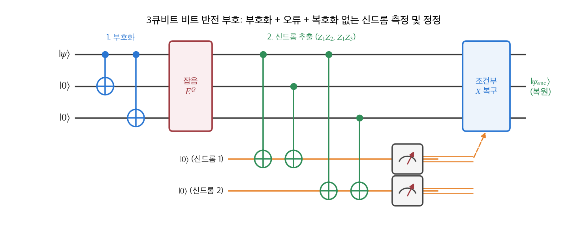
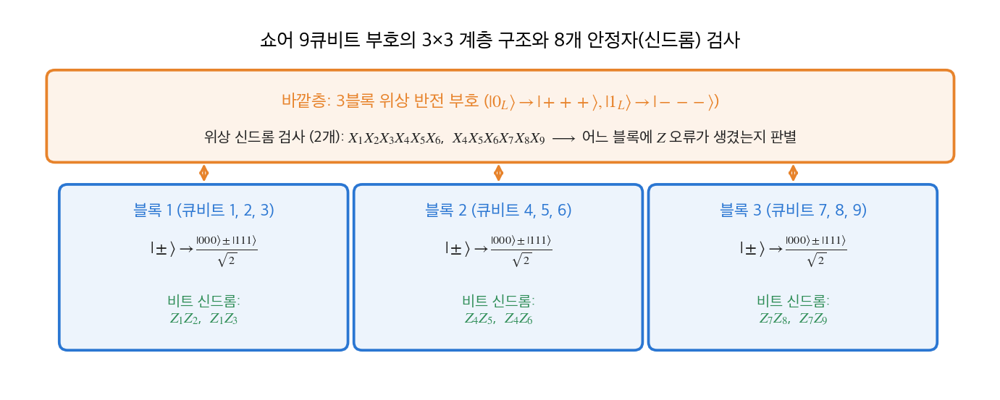
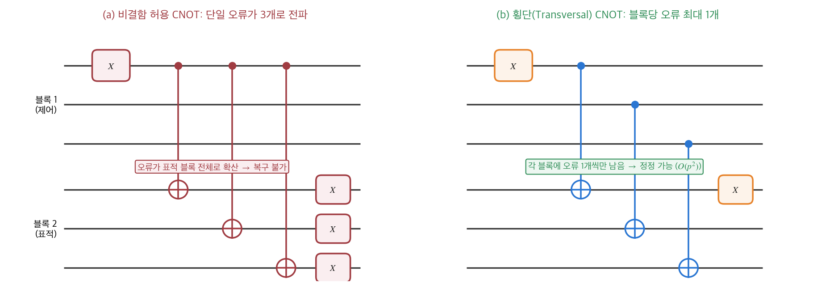
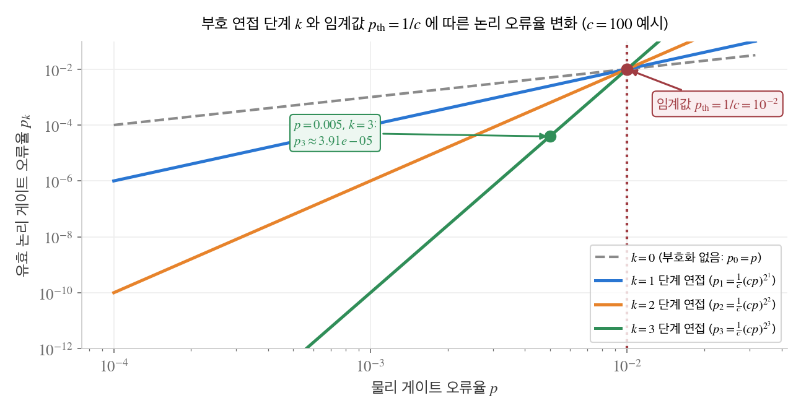

# 10. 양자 오류 정정

실제 물리 장치는 완벽하지 않습니다. 각 게이트마다 작은 오류 확률 $p$ 가 있으면 $S$ 개 게이트를 거친 뒤 오류가 없을 확률은 $(1-p)^S$ 로 지수적으로 줄어듭니다.
양자 컴퓨터에 오류 정정을 적용하려면 세 가지 근본 난관을 넘어야 합니다. 첫째, **복제 불가 정리** 때문에 임의의 큐비트를 그대로 세 번 복사할 수 없습니다. 둘째, 큐비트 상태와 오류는 **연속적**입니다. 셋째, 오류를 찾으려고 큐비트를 **직접 측정하면 중첩이 붕괴**합니다.
이 장은 이 세 난관이 얽힘 부호화, 파울리 오류 이산화, 보조 큐비트 신드롬 측정으로 어떻게 해결되는지 단계별로 보이고, **쇼어 9큐비트 부호**와 **임계값 정리**(Threshold Theorem)까지 정리합니다.

!!! info "원문과 자료"
    - 원문: Kaye, Laflamme, Mosca, *An Introduction to Quantum Computing* (2007), 10장 Quantum Error Correction (10.1~10.6절)
    - 이 교재의 관련 장: [3. 큐비트와 양자역학의 틀](03-qubits-framework.md), [4. 양자 계산 모델과 회로](04-quantum-circuits.md), [5. 초고밀도 코딩과 양자 텔레포테이션](05-superdense-teleportation.md)
    - 이 장의 수식과 수치는 NumPy로 다시 계산해서 검증했습니다.

## 1. 고전 오류 정정과 결함 허용의 필요성 (10.1~10.3절)

각 비트가 독립적으로 확률 $p$ 로 뒤집히는 **고전 비트 반전 채널**에서, 1비트를 3비트로 반복 부호화($0 \to 000$, $1 \to 111$)합니다.
코드워드 중 2개 이상이 뒤집히지 않으면(오류 0개 또는 1개) 복구되므로, 복구 불가능한 오류 확률 $p_{\text{enc}}$ 는 이항 분포 합입니다.

$$
p_{\text{enc}} = 3p^2(1-p) + p^3 = 3p^2 - 2p^3
$$

$3p^2 - 2p^3 < p$ 를 풀면 $p < 1/2$ 일 때 부호화로 오류가 줄어듭니다(예: $p = 0.01 \implies p_{\text{enc}} \approx 0.000298$).

오류를 고칠 때 세 비트를 다 읽어 다수결을 내거나 원래 비트로 복호화(decoding)할 필요는 없습니다.
첫째 비트와 둘째 비트의 패리티($b_1 \oplus b_2$), 첫째 비트와 셋째 비트의 패리티($b_1 \oplus b_3$)만 보조 비트(신드롬)에 기록하면 비트 값 자체를 모르고도 어느 비트가 뒤집혔는지 찾아 고칠 수 있습니다. 계산 내내 부호화된 상태로 연산하고 복구하는 설계를 **결함 허용**(fault-tolerant)이라고 부릅니다.

## 2. 양자 오류 정정의 세 원리 (10.4절)

### 1) 양자 오류 모델과 연속 오류의 이산화 (10.4.1절, Example 10.4.2~10.4.3)

큐비트 $\lvert \psi \rangle = \alpha_0\lvert 0 \rangle + \alpha_1\lvert 1 \rangle$ 이 환경 $\lvert E \rangle$ 와 상호작용하면 가장 일반적인 결합 진화는 다음과 같습니다.

$$
\lvert 0 \rangle\lvert E \rangle \to \beta_1\lvert 0 \rangle\lvert E_1 \rangle + \beta_2\lvert 1 \rangle\lvert E_2 \rangle, \qquad
\lvert 1 \rangle\lvert E \rangle \to \beta_3\lvert 1 \rangle\lvert E_3 \rangle + \beta_4\lvert 0 \rangle\lvert E_4 \rangle
$$

선형성으로 $\lvert \psi \rangle\lvert E \rangle$ 의 전개를 모으고 $\lvert 0 \rangle\langle 0 \rvert, \lvert 1 \rangle\langle 1 \rvert$ 대신 파울리 기저 $\{I, X, Z, XZ\}$ 로 재정리합니다(Equation 10.4.8).

$$
\begin{aligned}
\lvert \psi \rangle\lvert E \rangle
&\longrightarrow \frac{1}{2}\lvert \psi \rangle\left(\beta_1\lvert E_1 \rangle + \beta_3\lvert E_3 \rangle\right)
+ \frac{1}{2}Z\lvert \psi \rangle\left(\beta_1\lvert E_1 \rangle - \beta_3\lvert E_3 \rangle\right) \\
&\quad + \frac{1}{2}X\lvert \psi \rangle\left(\beta_2\lvert E_2 \rangle + \beta_4\lvert E_4 \rangle\right)
+ \frac{1}{2}XZ\lvert \psi \rangle\left(\beta_2\lvert E_2 \rangle - \beta_4\lvert E_4 \rangle\right)
\end{aligned}
$$

놀라운 결론이 여기서 나옵니다. 연속적인 미소 회전 오류(예: $R_x(\theta) = \cos\frac{\theta}{2}I - i\sin\frac{\theta}{2}X$)를 포함한 **모든** 1큐비트 오류는 이산적인 네 파울리 연산자 $\{I, X, Z, XZ(=-iY)\}$ 의 선형 결합입니다!
양자 오류 정정 조건(Knill–Laflamme 조건, Equation 10.4.29)은 부호어 $\lvert 0_{\text{enc}} \rangle, \lvert 1_{\text{enc}} \rangle$ 와 정정 가능한 오류 집합 $\{\hat{E}_j^Q\}$ 에 대해 다음과 같습니다.

$$
\langle l_{\text{enc}} \rvert \hat{E}_i^{Q\dagger} \hat{E}_j^Q \lvert m_{\text{enc}} \rangle = c_{ij}\delta_{lm} \qquad (l, m \in \{0, 1\})
$$

이 조건은 서로 다른 부호어가 오류 후에도 직교성을 유지하며($l \neq m$ 이면 0), 모든 오류 항이 두 부호어를 같은 비율 $c_{ij}$ 로 스케일링해 중첩 상대 진폭이 망가지지 않음을 뜻합니다. 또한 선형성에 의해 $\{I, X, Z, XZ\}$ 를 고치는 코드는 **그 선형 결합인 임의의 연속 오류도 자동으로 똑같이 정정**합니다(Example 10.4.3: 신드롬 측정이 연속 중첩을 이산 오류 중 하나로 붕괴시켜 버립니다).

### 2) 복제 불가 정리와 얽힘 부호화 (10.4.2절)

**복제 불가 정리**(Theorem 10.4.1): 임의의 미지 순수 상태 $\lvert \psi \rangle$ 를 복제하는 유니터리 연산($U\lvert \psi \rangle\lvert 0 \rangle = \lvert \psi \rangle\lvert \psi \rangle$)이나 초연산자는 존재하지 않습니다.
내적 보존으로 한 줄 증명됩니다(Exercise 10.4.4). 비직교 두 상태 $\lvert \psi_3 \rangle, \lvert \psi_4 \rangle$ ($0 < \lvert \langle \psi_3 \mid \psi_4 \rangle \rvert < 1$)가 모두 복제된다면 다음이 성립해야 합니다.

$$
\langle \psi_3 \mid \psi_4 \rangle = \left(\langle \psi_3 \rvert\langle 0 \rvert\right)\left(\lvert \psi_4 \rangle\lvert 0 \rangle\right)
= \left(\langle \psi_3 \rvert\langle \psi_3 \rvert\right)\left(\lvert \psi_4 \rangle\lvert \psi_4 \rangle\right)
= \langle \psi_3 \mid \psi_4 \rangle^2
$$

$z = z^2$ 의 해는 $z = 0$ (직교) 또는 $z = 1$ (동일)뿐이므로 비직교 상태는 복제할 수 없습니다.

따라서 양자 부호화는 $\lvert \psi \rangle^{\otimes 3}$ 로 복사하는 대신, 보조 큐비트 $\lvert 00 \rangle$ 에 CNOT 을 걸어 **얽힘 부분 공간**으로 확장합니다.

$$
\alpha_0\lvert 0 \rangle + \alpha_1\lvert 1 \rangle \longmapsto \alpha_0\lvert 000 \rangle + \alpha_1\lvert 111 \rangle \neq \left(\alpha_0\lvert 0 \rangle + \alpha_1\lvert 1 \rangle\right)^{\otimes 3}
$$

## 3. 3큐비트 및 9큐비트 쇼어 부호 (10.5절)

### 3큐비트 비트 반전 부호와 신드롬 측정 (10.5.1, 10.5.3절)

단일 비트 반전($X$) 오류를 최대 1개까지 고치는 3큐비트 부호는 $\lvert 0_L \rangle = \lvert 000 \rangle, \lvert 1_L \rangle = \lvert 111 \rangle$ 로 부호화합니다.
데이터를 붕괴시키지 않고 오류 위치만 찾으려면 4장(4.5절)에서 본 패리티 사영 측정을 씁니다. 안정자(stabilizer) 생성원 $Z_1 Z_2 = Z \otimes Z \otimes I$ 와 $Z_1 Z_3 = Z \otimes I \otimes Z$ 의 고유값 $\pm 1$ 을 보조 큐비트 2개에 추출해 측정합니다.

| 오류 연산자 | 오류 후 상태 | $Z \otimes Z \otimes I$ | $Z \otimes I \otimes Z$ | 복구 연산 |
| --- | --- | --- | --- | --- |
| $I \otimes I \otimes I$ | $\alpha\lvert 000 \rangle + \beta\lvert 111 \rangle$ | $+1$ (`0`) | $+1$ (`0`) | $I$ |
| $X \otimes I \otimes I$ | $\alpha\lvert 100 \rangle + \beta\lvert 011 \rangle$ | $-1$ (`1`) | $-1$ (`1`) | $X_1$ |
| $I \otimes X \otimes I$ | $\alpha\lvert 010 \rangle + \beta\lvert 101 \rangle$ | $-1$ (`1`) | $+1$ (`0`) | $X_2$ |
| $I \otimes I \otimes X$ | $\alpha\lvert 001 \rangle + \beta\lvert 110 \rangle$ | $+1$ (`0`) | $-1$ (`1`) | $X_3$ |

오류 $E$ 가 안정자 생성원 $S$ 와 교환($ES = SE$)하면 신드롬은 $+1$, 반교환($ES = -SE$)하면 $-1$ 이 됩니다. 예를 들어 $X_2$ 는 $Z_1 Z_2$ 와 반교환하므로 첫째 신드롬이 $-1$ 이고, $Z_1 Z_3$ 와는 교환하므로 둘째 신드롬이 $+1$ 입니다. 이 과정에서 논리 계수 $\alpha, \beta$ 의 정보는 전혀 새어 나가지 않습니다.

<figure markdown>

<figcaption markdown>
<span class="fig-title"><b>Figure 1.</b> 3큐비트 비트 반전 부호의 부호화, 신드롬 추출 및 정정 회로</span>

두 CNOT 으로 3큐비트 얽힘 부호어를 만든 뒤, 두 보조 큐비트에 패리티($Z_1Z_2$, $Z_1Z_3$)만 복사해 측정합니다. 측정 결과(신드롬)에 따라 해당 데이터 큐비트에 $X$ 를 걸어 $\lvert \psi_{\mathrm{enc}} \rangle$ 를 복호화 없이 복구합니다.
</figcaption>
</figure>

### 3큐비트 위상 반전 부호 (10.5.2절)

위상 반전($Z$) 오류는 아다마르 기저 $\lvert + \rangle \leftrightarrow \lvert - \rangle$ 를 뒤집습니다. 즉, $H X H = Z$ 이므로 아다마르 기저에서는 $Z$ 오류가 비트 반전처럼 동작합니다.
따라서 CNOT 두 개 뒤에 세 큐비트 각각에 $H$ 를 걸어 $\lvert 0_L \rangle = \lvert +++ \rangle, \lvert 1_L \rangle = \lvert --- \rangle$ 로 부호화하고, 안정자 생성원 $X \otimes X \otimes I$ 와 $X \otimes I \otimes X$ 를 측정하면 임의의 단일 $Z$ 오류를 정정할 수 있습니다.

### 9큐비트 쇼어 부호 (10.5.4절)

비트 반전 부호와 위상 반전 부호를 2단으로 합치면 **임의의 단일 큐비트 오류**($I, X, Z, Y$ 및 그 선형 결합)를 모두 고치는 **쇼어 9큐비트 부호**가 됩니다.
먼저 위상 반전 부호 $\lvert 0 \rangle \to \lvert +++ \rangle$, $\lvert 1 \rangle \to \lvert --- \rangle$ 로 인코딩한 뒤, 각 큐비트를 다시 3큐비트 비트 반전 부호 $\lvert \pm \rangle \to \frac{\lvert 000 \rangle \pm \lvert 111 \rangle}{\sqrt{2}}$ 로 부호화합니다.

$$
\lvert 0_L \rangle = \frac{(\lvert 000 \rangle + \lvert 111 \rangle)^{\otimes 3}}{2\sqrt{2}}, \qquad
\lvert 1_L \rangle = \frac{(\lvert 000 \rangle - \lvert 111 \rangle)^{\otimes 3}}{2\sqrt{2}}
$$

<figure markdown>

<figcaption markdown>
<span class="fig-title"><b>Figure 2.</b> 쇼어 9큐비트 부호의 2단 계층 구조와 8개 신드롬 생성원</span>

안쪽 세 블록은 각각 2개씩 총 6개의 $Z_i Z_j$ 안정자로 블록 내 비트 반전($X$)을 잡습니다. 바깥층은 두 개의 6큐비트 $X^{\otimes 6}$ 안정자로 어느 블록에 위상 반전($Z$)이 생겼는지 판별합니다.
</figcaption>
</figure>

### 손계산 예: 1번 큐비트에 $Y$ 오류가 발생한 경우 (Example 10.5.1)

논리 상태 $\alpha\lvert 0_L \rangle + \beta\lvert 1_L \rangle$ 의 1번 큐비트에 $Y = iXZ$ 오류가 걸립니다. 전역 위상 $i$ 를 빼면 1번 블록의 $\lvert 000 \rangle \pm \lvert 111 \rangle$ 이 $XZ\lvert 000 \rangle \pm XZ\lvert 111 \rangle = \lvert 100 \rangle \mp \lvert 011 \rangle$ 로 바뀝니다.

$$
\lvert \psi_{\text{err}} \rangle = \alpha\,\frac{\lvert 100 \rangle - \lvert 011 \rangle}{\sqrt{2}}\,\frac{(\lvert 000 \rangle + \lvert 111 \rangle)^{\otimes 2}}{2}
+ \beta\,\frac{\lvert 100 \rangle + \lvert 011 \rangle}{\sqrt{2}}\,\frac{(\lvert 000 \rangle - \lvert 111 \rangle)^{\otimes 2}}{2}
$$

1. **6개 비트 반전 신드롬**: 1번 블록의 $Z_1 Z_2$ 와 $Z_1 Z_3$ 은 모두 $X_1$ 과 반교환하므로 `(-1, -1)` 이 나옵니다. 나머지 2·3번 블록은 `(+1, +1)` 입니다. 따라서 **1번 큐비트에 $X$ 오류**가 생겼음을 압니다.
2. **2개 위상 반전 신드롬**: $X_1 X_2 X_3 X_4 X_5 X_6$ 은 1번 블록의 $Z_1$ 과 반교환하므로 `-1` 이고, $X_4 X_5 X_6 X_7 X_8 X_9$ 는 `+1` 입니다. 따라서 **1번 블록(1, 2, 3번 중 하나)에 $Z$ 오류**가 생겼음을 압니다.
3. **복구**: $Z_1, Z_2, Z_3$ 모두 같은 블록의 부호만 뒤집으므로(**축퇴성**, degeneracy), 1번 큐비트에 $X_1$ 을 걸고 1·2·3번 중 아무 큐비트에 $Z$ 를 걸면 원래 상태 $\alpha\lvert 0_L \rangle + \beta\lvert 1_L \rangle$ 로 완벽히 돌아옵니다.

참고로 1큐비트 임의 오류를 고치는 더 작은 안정자 부호로 **스틴(Steane) 7큐비트 부호**와 최소 크기인 **5큐비트 부호**가 있습니다(Equations 10.5.17~10.5.18).

## 4. 결함 허용 계산과 임계값 정리 (10.6절)

오류 정정 부호를 쓰더라도 부호화 상태 위에서 게이트를 걸 때 오류가 이웃 큐비트로 번지면 안 됩니다.

### 횡단(Transversal) 구현과 결함 허용 조건

두 부호어 블록 사이에 논리 CNOT 을 걸 때, 한 큐비트가 다른 블록의 세 큐비트 모두를 제어하도록 짜면(원문 Fig. 10.19) 제어 큐비트 1개의 오류(확률 $p$)가 표적 블록의 3개 큐비트로 퍼져 정정 불가능한 오류가 됩니다.
반면 각 블록의 $i$ 번째 큐비트끼리만 일대일로 CNOT 을 거는 **횡단(transversal) CNOT** 은 한 물리 게이트가 고장 나도 각 블록당 최대 1개의 오류만 남기므로 오류 정정으로 복구됩니다.

<figure markdown>

<figcaption markdown>
<span class="fig-title"><b>Figure 3.</b> 비결함 허용 CNOT(a)과 횡단 CNOT(b)의 오류 전파 비교</span>

(a)에서는 블록 1의 단일 $X$ 오류가 세 CNOT 을 타고 블록 2 전체로 번져 정정에 실패합니다. (b)의 횡단 구조에서는 짝을 이룬 큐비트끼리만 상호작용하므로 각 블록 오류가 1개 이하로 격리됩니다.
</figcaption>
</figure>

물리 게이트 오류율이 $p$ 일 때, 부호화된 게이트와 신드롬 측정을 모두 결함 허용 방식으로 구현해 논리 게이트당 복구 불가능한 오류 확률이 상수 $c$ 에 대해 $c p^2$ 이하로 떨어지면 **결함 허용**(Definition 10.6.1)이라고 합니다.
$c p^2 < p$ 가 되려면 물리 오류율이 **임계값**(threshold) $p_{\text{th}} = 1/c$ 보다 작아야 합니다.

### 부호 연접(Concatenation)과 임계값 정리 (10.6.1절)

한 번 부호화해 얻은 논리 큐비트를 다시 같은 부호로 감싸기를 $k$ 번 반복하는 것을 **부호 연접**이라고 합니다.
1단계 연접의 논리 오류율이 $p_1 = c p^2$ 이면, 2단계 연접의 오류율은 $p_2 = c (cp^2)^2 = c^3 p^4$ 이 됩니다. $k$ 단계 후 유효 오류율은 이중 지수적으로 줄어듭니다.

$$
p_k = \frac{1}{c}(cp)^{2^k}
$$

크기가 $S$ 인 회로를 전체 오류 $\varepsilon$ 이하로 실행하려면 각 게이트 오류율을 $p_k \le \varepsilon / S$ 로 만들면 됩니다.
$p < 1/c$ 이면 $2^k \ge \frac{\log(cS/\varepsilon)}{\log(1/(cp))}$ 만 만족하면 되며, $k$ 단계 연접으로 게이트 수가 $d^k$ 배(상수 $d$) 늘어납니다.

$$
d^k = \left(2^k\right)^{\log_2 d} = O\left(\log^m \frac{S}{\varepsilon}\right) \qquad (m = \log_2 d)
$$

따라서 **임계값 정리**(Threshold Theorem, **Theorem 10.6.2**)가 성립합니다. 물리 게이트 오류율 $p$ 가 일정 임계값 $p_{\text{th}}$ 아래에 있기만 하면, $S$ 게이트 양자 회로를 오류 $\varepsilon$ 이하로 시뮬레이션하는 데 드는 총 게이트 수는 $O\left(S \log^m \frac{S}{\varepsilon}\right)$ 으로 **다항 로그 오버헤드**만 듭니다.

<figure markdown>

<figcaption markdown>
<span class="fig-title"><b>Figure 4.</b> $c=100$ ($p_{\mathrm{th}}=0.01$) 예시에서 연접 단계 $k$ 에 따른 논리 오류율 변화</span>

물리 오류율 $p$ 가 임계값 $0.01$ 보다 크면 연접할수록 오류가 오히려 커집니다. 반면 $p = 0.005 < p_{\mathrm{th}}$ 이면 3단계 연접만으로 논리 오류율이 $p_3 \approx 3.9 \times 10^{-5}$ 까지 떨어집니다.
</figcaption>
</figure>

```python
import numpy as np

# 쇼어 9큐비트 부호에서 1번 큐비트 Y 오류 신드롬 및 복구 검증
ket0, ket1 = np.array([1, 0], complex), np.array([0, 1], complex)
k000 = np.kron(np.kron(ket0, ket0), ket0)
k111 = np.kron(np.kron(ket1, ket1), ket1)
kp, km = (k000 + k111) / np.sqrt(2), (k000 - k111) / np.sqrt(2)
zero_L = np.kron(np.kron(kp, kp), kp)
one_L = np.kron(np.kron(km, km), km)

I2 = np.eye(2, dtype=complex)
X2 = np.array([[0, 1], [1, 0]], dtype=complex)
Y2 = np.array([[0, -1j], [1j, 0]], dtype=complex)
Z2 = np.array([[1, 0], [0, -1]], dtype=complex)

def kron_all(ops):
    out = np.array([[1.0]], dtype=complex)
    for o in ops:
        out = np.kron(out, o)
    return out

def single(op, idx):
    return kron_all([op if j == idx else I2 for j in range(9)])

psi = np.sqrt(0.3) * zero_L + 1j * np.sqrt(0.7) * one_L
err_state = single(Y2, 0) @ psi

# 안정자 Z1Z2, Z1Z3, X1..X6 기댓값으로 신드롬 확인
z1z2 = kron_all([Z2, Z2] + [I2]*7)
z1z3 = kron_all([Z2, I2, Z2] + [I2]*6)
x1_6 = kron_all([X2]*6 + [I2]*3)
print("신드롬 (Z1Z2, Z1Z3, X1..6):",
      [round(np.vdot(err_state, g @ err_state).real) for g in (z1z2, z1z3, x1_6)])  # [-1, -1, -1]

# 1번 큐비트 X 와 3번 큐비트 Z 로 복구 (축퇴성 확인)
recovered = single(Z2, 2) @ single(X2, 0) @ err_state
print("복구 충실도:", round(abs(np.vdot(psi, recovered)) ** 2, 12))  # 1.0
```

## 5. 이 장의 요약

| 개념 | 핵심 내용 또는 식 | 의미 |
| --- | --- | --- |
| 오류 이산화 | 임의 1큐비트 오류 $= c_I I + c_X X + c_Z Z + c_Y Y$ | 파울리 오류만 고치면 모든 연속 오류도 함께 정정 |
| 복제 불가와 부호화 | $\alpha\lvert 0 \rangle + \beta\lvert 1 \rangle \to \alpha\lvert 0_L \rangle + \beta\lvert 1_L \rangle$ | 복사 대신 얽힘 부분 공간으로 보호 |
| 3큐비트·쇼어 9큐비트 부호 | $Z_i Z_j$ (비트), $X^{\otimes 6}$ (위상) 신드롬 | 복호화 없이 단일 $X, Y, Z$ 오류 검출·복구 |
| 결함 허용과 횡단 게이트 | 블록 간 일대일 게이트로 오류 $\le c p^2$ | 단일 물리 오류가 다중 오류로 번지는 현상 차단 |
| 임계값 정리 | $p < p_{\text{th}} = 1/c \implies O(S \log^m(S/\varepsilon))$ | 임계값 아래에서는 다항 로그 비용으로 임의 긴 양자 계산 가능 |

이로써 양자 정보의 물리적 기초와 회로 모델부터, 위상 추정·쇼어·그로버 알고리즘, 블랙박스 복잡도 하한, 그리고 결함 허용 양자 오류 정정까지 교재의 전 과정을 모두 정리했습니다.
