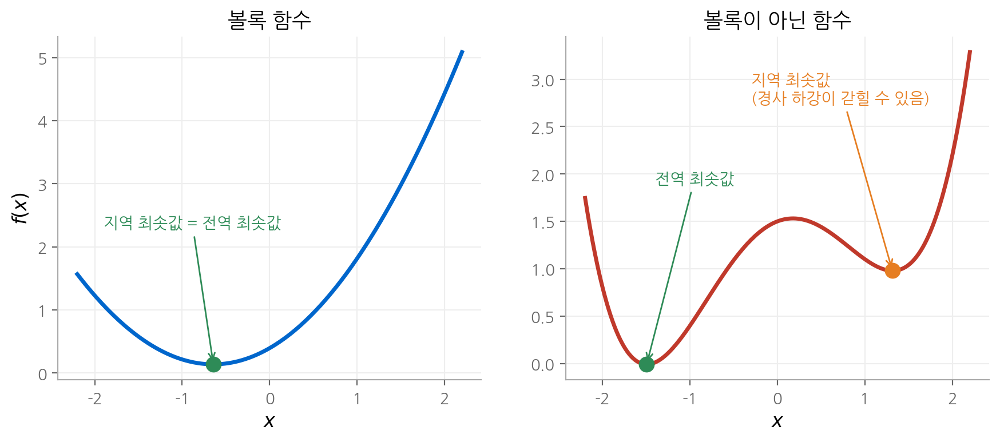

# 1. 서론

최적화 문제는 어디에나 있습니다. 신경망 학습도, 포트폴리오 구성도, 회로 설계도 결국 "제약을 지키면서
어떤 값을 가장 작게 만드는 변수"를 찾는 문제입니다. 그런데 어떤 최적화 문제는 변수가 수천 개여도
몇 초 만에 확실한 답을 얻고, 어떤 문제는 변수가 수십 개만 되어도 정답을 확인할 방법이 없습니다.
이 장은 그 경계가 어디에 있는지를 다룹니다. 답은 **볼록성(convexity)** 입니다.
최소제곱과 선형 계획법이라는 두 가지 "풀린 문제"에서 출발해, 이 둘을 포함하는 볼록 최적화가
왜 같은 수준으로 풀리는지, 그리고 볼록이 아닌 문제와 무엇이 다른지를 정리합니다.

!!! info "원문과 자료"
    - 교재: Boyd & Vandenberghe, *Convex Optimization*, 1장 Introduction (p. 1–19)
    - 슬라이드: [Introduction, p. 2–19](https://web.stanford.edu/~boyd/cvxbook/bv_cvxslides.pdf#page=2)

## 1. 수학적 최적화 문제

교재 전체에서 쓰는 표준형은 다음과 같습니다.

$$
\begin{aligned}
\text{minimize} \quad & f_0(x) \\
\text{subject to} \quad & f_i(x) \le b_i, \quad i = 1, \dots, m
\end{aligned}
$$

각 기호의 이름은 다음과 같습니다.

| 기호 | 이름 | 의미 |
| --- | --- | --- |
| $x = (x_1, \dots, x_n)$ | 최적화 변수(optimization variable) | 고르는 값입니다. |
| $f_0 : \mathbf{R}^n \to \mathbf{R}$ | 목적 함수(objective function) | 비용이나 손실입니다. |
| $f_i : \mathbf{R}^n \to \mathbf{R}$ | 제약 함수(constraint function) | 지켜야 할 한계입니다. |
| $b_i$ | 한계값 | 제약의 상한입니다. |

모든 제약을 만족하는 $x$ 를 **실현 가능(feasible)** 하다고 합니다. 실현 가능한 $x$ 가운데 목적 함수가
가장 작은 점 $x^\star$ 를 **최적해(optimal solution)** 라고 합니다. 즉 $f_1(z) \le b_1, \dots, f_m(z) \le b_m$ 을
만족하는 모든 $z$ 에서 $f_0(z) \ge f_0(x^\star)$ 입니다.

### 응용 예

같은 틀에 서로 다른 분야가 들어갑니다.

| 분야 | 변수 | 제약 | 목적 |
| --- | --- | --- | --- |
| 포트폴리오 | 자산별 투자액 | 예산, 최소 수익률 | 위험(수익의 분산) |
| 회로 설계 | 소자의 폭과 길이 | 제조 한계, 타이밍 | 전력 소모 |
| 데이터 적합 | 모델 파라미터 | 사전 정보, 파라미터 한계 | 예측 오차 |

세 번째 줄이 머신러닝입니다. 신경망 학습은 제약이 거의 없는 데이터 적합 문제이고, 목적 함수가
볼록이 아니라는 점에서 이 책의 중심 문제와 다릅니다. 그 차이가 무엇을 바꾸는지가 이 장의 주제입니다.

### 문제를 "풀 수 있다"는 뜻

일반적인 최적화 문제는 매우 어렵습니다. 그러나 몇몇 문제 군은 **효율적이고 믿을 만한** 알고리즘이
있습니다. 변수와 제약이 수백, 수천 개여도 풀리고, 초깃값이나 하이퍼파라미터를 조정할 필요가 거의 없습니다.
교재는 이런 문제 군으로 최소제곱과 선형 계획법을 먼저 들고, 이 둘을 포함하는 볼록 최적화로 넓힙니다.

## 2. 최소제곱

### 정의와 해

최소제곱(least-squares) 문제는 제약이 없고, 목적 함수가 선형식의 제곱합입니다.
$A \in \mathbf{R}^{k \times n}$ 이고 $k \ge n$ 이며, $a_i^\top$ 는 $A$ 의 $i$ 번째 행입니다.

$$
\text{minimize} \quad f_0(x) = \lVert Ax - b \rVert_2^2 = \sum_{i=1}^{k} (a_i^\top x - b_i)^2
$$

그래디언트를 0으로 두면 정규 방정식(normal equation)을 얻습니다.

$$
\nabla f_0(x) = 2A^\top (Ax - b) = 0 \quad \Longrightarrow \quad (A^\top A)\, x = A^\top b
$$

$A$ 의 열이 선형 독립이면 $A^\top A$ 가 가역이고, 해는 $x^\star = (A^\top A)^{-1} A^\top b$ 입니다.
닫힌 해가 있다는 점이 최소제곱의 특징입니다.

### 작은 예

$A$ 와 $b$ 를 다음과 같이 두겠습니다.

$$
A = \begin{bmatrix} 1 & 0 \\ 0 & 1 \\ 1 & 1 \end{bmatrix}, \qquad b = \begin{bmatrix} 1 \\ 2 \\ 2 \end{bmatrix}
$$

$A^\top A = \begin{bmatrix} 2 & 1 \\ 1 & 2 \end{bmatrix}$, $A^\top b = (3, 4)$ 이므로 해는 다음과 같습니다.

$$
x^\star = \frac{1}{3}\begin{bmatrix} 2 & -1 \\ -1 & 2 \end{bmatrix} \begin{bmatrix} 3 \\ 4 \end{bmatrix} = \begin{bmatrix} 2/3 \\ 5/3 \end{bmatrix}
$$

잔차는 $r = Ax^\star - b = (-1/3, -1/3, 1/3)$ 이고 $\lVert r \rVert_2^2 = 1/3$ 입니다.
$A^\top r = (0, 0)$ 이므로 잔차가 $A$ 의 열공간과 직교합니다. 정규 방정식의 기하학적 의미가 이 직교성입니다.

### 계산 비용과 변형

최소제곱은 대략 $n^2 k$ 에 비례하는 시간에 풉니다. $A$ 가 희소하면 훨씬 빠릅니다.
교재는 이 문제를 **성숙한 기술(mature technology)** 이라고 부릅니다. 알고리즘의 동작 원리를 몰라도
안정적으로 쓸 수 있다는 뜻입니다.

같은 틀에서 두 가지 변형을 자주 씁니다.

- **가중 최소제곱:** $\sum_i w_i (a_i^\top x - b_i)^2$ 처럼 잔차마다 가중치 $w_i > 0$ 을 줍니다.
- **정규화(regularization):** $\sum_i (a_i^\top x - b_i)^2 + \rho \lVert x \rVert_2^2$ 처럼 큰 $x$ 에 벌점을 줍니다.
  머신러닝의 ridge 회귀이자 가중치 감쇠(weight decay)와 같은 식입니다.

통계학에서는 최소제곱을 Gaussian 잡음 아래의 최대 우도 추정으로 해석합니다.
이 연결은 [7. 통계적 추정](07-statistical-estimation.md)에서 다시 다룹니다.

## 3. 선형 계획법

### 정의

선형 계획법(linear programming, LP)은 목적 함수와 제약 함수가 모두 선형입니다.

$$
\begin{aligned}
\text{minimize} \quad & c^\top x \\
\text{subject to} \quad & a_i^\top x \le b_i, \quad i = 1, \dots, m
\end{aligned}
$$

최소제곱과 달리 닫힌 해가 없습니다. 그러나 simplex method와 내부점법(interior-point method)이
매우 안정적으로 동작합니다. $m \ge n$ 일 때 실제 계산량은 대략 $n^2 m$ 에 비례합니다.

### 변형으로 LP를 알아보기

LP의 어려움은 푸는 데 있지 않고 **알아보는 데** 있습니다. 대표 예가 Chebyshev 근사입니다.

$$
\text{minimize} \quad \max_{i=1,\dots,k} |a_i^\top x - b_i|
$$

목적 함수가 미분 불가능하므로 겉보기에는 LP가 아닙니다. 그러나 보조 변수 $t$ 를 도입하면
"최대 잔차가 $t$ 이하"라는 조건을 선형 부등식 $2k$ 개로 쓸 수 있습니다.

$$
\begin{aligned}
\text{minimize} \quad & t \\
\text{subject to} \quad & a_i^\top x - t \le b_i, \quad -a_i^\top x - t \le -b_i, \quad i = 1, \dots, k
\end{aligned}
$$

변수는 $(x, t)$ 이고 모든 식이 선형입니다. 이처럼 문제를 **표준형으로 바꾸는 기법**이 실제 응용에서
가장 중요한 기술입니다. 4장에서 이 기법을 체계적으로 다룹니다.

## 4. 볼록 최적화

### 정의

볼록 최적화(convex optimization) 문제는 표준형에서 목적 함수와 제약 함수가 모두 **볼록**인 문제입니다.

$$
f_i(\alpha x + \beta y) \le \alpha f_i(x) + \beta f_i(y), \qquad \alpha + \beta = 1,\ \alpha \ge 0,\ \beta \ge 0
$$

모든 $x, y \in \mathbf{R}^n$ 과 $i = 0, \dots, m$ 에서 성립해야 합니다. 선형 함수는 등호로 이 조건을
만족하므로 LP는 볼록 최적화입니다. $\lVert Ax - b \rVert_2^2$ 도 볼록이므로 최소제곱도 볼록 최적화입니다.
볼록 최적화는 **두 성숙한 기술을 포함하는 더 넓은 문제 군**입니다.

| 문제 | 목적 함수 | 제약 | 풀이 |
| --- | --- | --- | --- |
| 최소제곱 | 볼록 이차 | 없음 | 닫힌 해 |
| LP | 선형 | 선형 부등식 | simplex method, 내부점법 |
| 볼록 최적화 | 볼록 | 볼록 부등식 | 내부점법 |

### 왜 잘 풀리는가

일반적인 볼록 최적화에는 닫힌 해가 없습니다. 그래도 내부점법은 대부분의 문제를 **10~100번의 반복**
안에 풉니다. 문제 구조를 무시하면 반복 한 번의 계산량은 다음과 같습니다.

$$
\max\{n^3,\ n^2 m,\ F\}
$$

$F$ 는 $f_0, \dots, f_m$ 의 1차와 2차 도함수를 계산하는 비용입니다. 반복 횟수가 문제 크기에 거의
무관하다는 점이 중요합니다. 이 성질의 이론적 근거는 [11. 내부점법](11-interior-point.md)에서 유도합니다.

### 지역 최적이 전역 최적입니다

볼록 최적화가 다루기 쉬운 근본 이유는 **지역 최적해(local optimum)가 곧 전역 최적해(global optimum)** 라는
사실입니다. 증명은 짧습니다.

$x$ 가 지역 최적해라고 하겠습니다. 즉 어떤 $R > 0$ 이 있어서 $\lVert z - x \rVert_2 \le R$ 인 실현 가능한 $z$ 에서
$f_0(z) \ge f_0(x)$ 입니다. 실현 가능한 $y$ 가 $f_0(y) < f_0(x)$ 를 만족한다고 가정하겠습니다.
$y$ 는 $x$ 에서 $R$ 보다 멀리 있어야 합니다. 이제 둘을 잇는 선분 위의 점을 잡습니다.

$$
z = (1 - \theta)\, x + \theta\, y, \qquad \theta = \frac{R}{2\lVert y - x \rVert_2} \in (0, 1/2)
$$

$\lVert z - x \rVert_2 = R/2$ 이므로 $z$ 는 $x$ 의 근방에 있습니다. 실현 가능 집합이 볼록이므로 $z$ 도 실현 가능합니다.
$f_0$ 가 볼록이므로 다음이 성립합니다.

$$
f_0(z) \le (1 - \theta) f_0(x) + \theta f_0(y) < f_0(x)
$$

근방 안에 $x$ 보다 나은 점이 생겼으므로 지역 최적이라는 가정과 모순입니다. 따라서 그런 $y$ 는 없습니다.

<figure markdown>

<figcaption>
볼록 함수(왼쪽)는 내려가는 방향을 따라가면 반드시 전역 최솟값에 도착합니다.
볼록이 아닌 함수(오른쪽)는 출발점에 따라 지역 최솟값에 멈출 수 있습니다.
</figcaption>
</figure>

### 볼록 최적화를 쓰는 방법

문제가 볼록 최적화로 정식화되면 사실상 풀린 것입니다. 남은 어려움은 **문제가 볼록인지 알아보고
볼록 형태로 바꾸는 일**입니다. 교재의 1부(이론)가 이 능력을 기르는 데 목적을 둡니다.
볼록인 문제는 생각보다 많고, 처음에는 볼록으로 보이지 않는 문제도 변환으로 볼록이 되는 경우가 많습니다.

## 5. 비선형 최적화

목적 함수나 제약이 선형이 아니고 볼록인지도 모르는 문제를 교재는 **비선형 최적화(nonlinear optimization)**
라고 부릅니다. 이 문제 군에는 효율적인 일반 해법이 알려져 있지 않습니다. 접근법은 두 갈래입니다.

| 접근 | 방법 | 대가 |
| --- | --- | --- |
| 지역 최적화(local optimization) | 근처에서 더 나은 점으로 계속 이동합니다. | 초깃값에 의존하고, 찾은 점이 전역 최적인지 모릅니다. |
| 전역 최적화(global optimization) | 전역 최적해를 보장하며 찾습니다. | 최악의 경우 계산량이 변수 개수에 지수적으로 늘어납니다. |

신경망 학습은 지역 최적화의 전형입니다. 경사 하강법과 그 변형은 초깃값, 학습률, 스케줄 같은
하이퍼파라미터에 민감합니다. 이런 민감성의 수학적 원인은
[신경망 기초 9장](../../ai/d2l/09-optimization.md)에서 다뤘습니다.
볼록 최적화에서는 이런 조정이 거의 필요 없습니다.

### 볼록이 아닌 문제에서 볼록 최적화의 역할

볼록 최적화는 볼록이 아닌 문제에도 쓸모가 있습니다.

1. **초깃값:** 원래 문제를 볼록 문제로 근사해 풀고, 그 해를 지역 최적화의 출발점으로 씁니다.
2. **볼록 완화(convex relaxation):** 볼록이 아닌 제약을 느슨한 볼록 제약으로 바꿉니다. 완화한 문제의 최적값은
   원래 문제의 하한입니다.
3. **하한(lower bound):** Lagrange 쌍대 문제는 원래 문제가 볼록이 아니어도 항상 볼록이고, 원래 최적값의 하한을
   줍니다. 전역 최적화의 분기 한정법(branch and bound)이 이 하한을 씁니다. 자세한 내용은
   [5. 쌍대성](05-duality.md)에서 다룹니다.

## 6. 책의 구성

교재는 세 부분과 부록으로 나뉩니다. 이 정리도 같은 순서를 따릅니다.

| 부 | 장 | 다루는 내용 |
| --- | --- | --- |
| 1부 이론 | [2. 볼록 집합](02-convex-sets.md) | 볼록 집합의 정의, 예, 보존 연산, 분리 초평면 |
| | [3. 볼록 함수](03-convex-functions.md) | 볼록 함수의 판정법, 보존 연산, 켤레 함수 |
| | [4. 볼록 최적화 문제](04-convex-problems.md) | LP, QP, SOCP, SDP, GP와 문제 변환 |
| | [5. 쌍대성](05-duality.md) | Lagrange 쌍대, KKT 조건, 민감도 분석 |
| 2부 응용 | [6. 근사와 적합](06-approximation.md) | 노름 근사, 정규화, 강건 근사 |
| | [7. 통계적 추정](07-statistical-estimation.md) | 최대 우도, 가설 검정, 실험 설계 |
| | [8. 기하 문제](08-geometric-problems.md) | 타원체, 분류, 배치 |
| 3부 알고리즘 | [9. 제약 없는 최소화](09-unconstrained.md) | 경사 하강법, 뉴턴 방법, self-concordant 함수 |
| | [10. 등식 제약 최소화](10-equality-constrained.md) | 등식 제약 뉴턴 방법 |
| | [11. 내부점법](11-interior-point.md) | log barrier, central path, 복잡도 분석 |

부록 A는 수학 배경, 부록 B는 이차 함수 두 개를 다루는 문제, 부록 C는 수치 선형대수를 다룹니다.

## 핵심 정리

- 최적화 문제는 $f_0$ 를 최소화하면서 $f_i(x) \le b_i$ 를 지키는 $x$ 를 찾는 문제입니다.
- 최소제곱은 닫힌 해 $(A^\top A)^{-1} A^\top b$ 가 있고, LP는 닫힌 해가 없지만 안정적인 알고리즘이 있습니다.
- 볼록 최적화는 둘을 포함합니다. 내부점법은 문제 크기와 거의 무관하게 10~100번의 반복으로 풉니다.
- 볼록 문제에서는 지역 최적해가 전역 최적해입니다. 증명은 선분 위의 한 점과 볼록 부등식 하나로 끝납니다.
- 실제 어려움은 문제를 볼록으로 알아보고 정식화하는 데 있습니다.
- 볼록이 아닌 문제에서도 볼록 최적화는 초깃값, 완화, 하한으로 쓰입니다.

## 다음 장

볼록 최적화의 정의는 볼록 집합 위에서 볼록 함수를 최소화하는 것입니다.
[다음 장](02-convex-sets.md)에서는 그 첫 번째 재료인 볼록 집합을 다룹니다.
