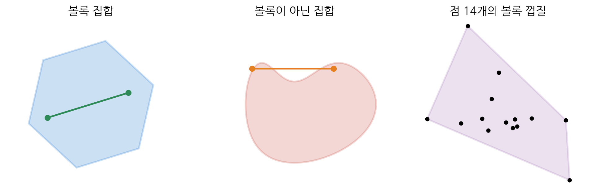
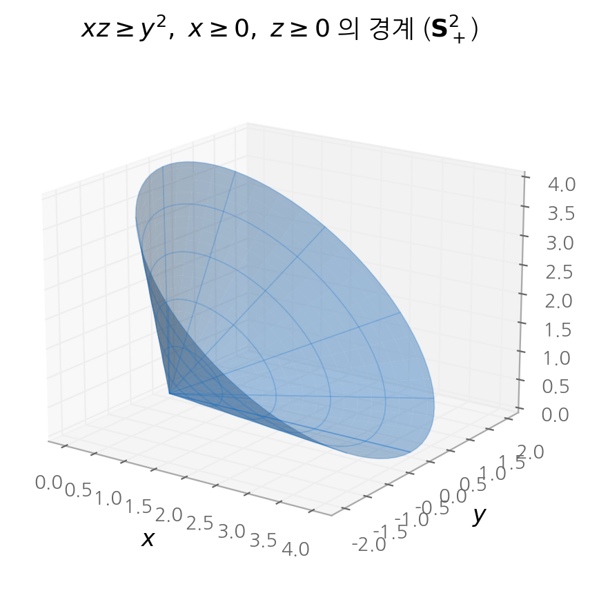
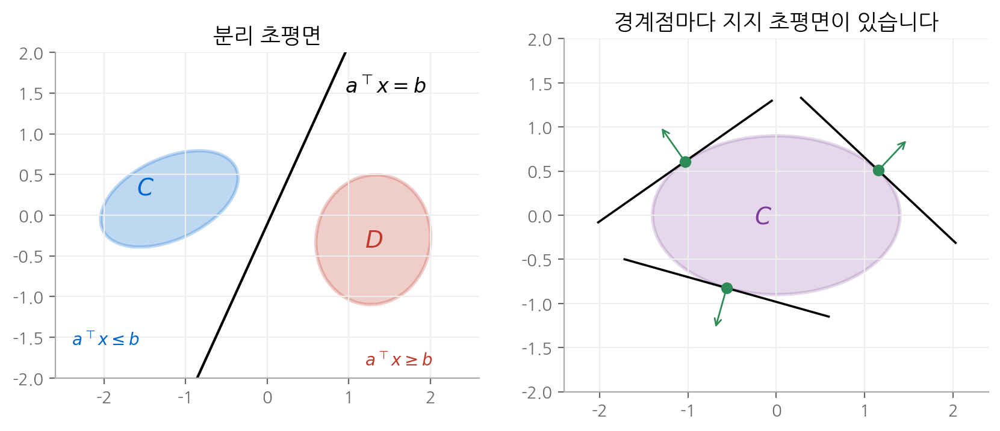

# 2. 볼록 집합

볼록 최적화 문제의 실현 가능 집합은 볼록 집합입니다. 이 장은 "어떤 집합이 볼록인가"를 판단하는 도구를
정리합니다. 정의를 직접 확인하는 방법은 단순하지만 실제로는 거의 쓰지 않습니다. 대신 **볼록이 확실한
기본 집합**을 알아 두고, **볼록성을 보존하는 연산**으로 복잡한 집합을 조립합니다. 장의 후반부는
분리 초평면 정리와 쌍대 원뿔을 다룹니다. 둘 다 5장의 쌍대성 이론을 떠받치는 기하학적 사실입니다.

!!! info "원문과 자료"
    - 교재: Boyd & Vandenberghe, *Convex Optimization*, 2장 Convex sets (p. 21–59)
    - 슬라이드: [Convex sets, p. 20–43](https://web.stanford.edu/~boyd/cvxbook/bv_cvxslides.pdf#page=20)

## 1. 아핀 집합, 볼록 집합, 원뿔

세 개념은 모두 "두 점의 조합이 다시 집합 안에 있다"는 형태입니다. 차이는 조합 계수에 거는 조건입니다.

| 집합 | 조합 $\theta_1 x_1 + \cdots + \theta_k x_k$ 의 조건 | 두 점일 때의 모양 |
| --- | --- | --- |
| 아핀 집합(affine set) | $\sum_i \theta_i = 1$ | 두 점을 지나는 직선 전체 |
| 볼록 집합(convex set) | $\sum_i \theta_i = 1$, $\theta_i \ge 0$ | 두 점을 잇는 선분 |
| 볼록 원뿔(convex cone) | $\theta_i \ge 0$ | 원점에서 뻗는 두 반직선 사이의 부채꼴 |

### 아핀 집합

집합 $C$ 가 아핀이라는 것은 $x_1, x_2 \in C$ 와 모든 $\theta \in \mathbf{R}$ 에서 $\theta x_1 + (1 - \theta) x_2 \in C$ 라는 뜻입니다.
연립 일차 방정식의 해집합 $\{x \mid Ax = b\}$ 가 대표 예입니다. 역으로 모든 아핀 집합은 어떤 연립 일차 방정식의
해집합으로 쓸 수 있습니다.

집합 $C$ 의 점들로 만들 수 있는 모든 아핀 조합의 집합을 **아핀 껍질(affine hull)** $\operatorname{aff} C$ 라고 합니다.
$C$ 를 포함하는 가장 작은 아핀 집합입니다. 집합이 공간 전체를 채우지 않을 때는 아핀 껍질 안에서 본 내부,
즉 **relative interior** $\operatorname{relint} C$ 를 씁니다. 5장의 Slater 조건에 이 개념이 나옵니다.

### 볼록 집합과 볼록 껍질

집합 $C$ 가 볼록이라는 것은 $x_1, x_2 \in C$ 와 $0 \le \theta \le 1$ 에서 $\theta x_1 + (1 - \theta) x_2 \in C$ 라는 뜻입니다.
집합 안의 두 점을 잇는 선분이 집합 밖으로 나가지 않습니다.

$C$ 의 점들로 만들 수 있는 모든 볼록 조합의 집합을 **볼록 껍질(convex hull)** $\operatorname{conv} C$ 라고 합니다.

$$
\operatorname{conv} C = \left\{ \theta_1 x_1 + \cdots + \theta_k x_k \;\middle|\; x_i \in C,\ \theta_i \ge 0,\ \textstyle\sum_i \theta_i = 1 \right\}
$$

볼록 껍질은 $C$ 를 포함하는 가장 작은 볼록 집합입니다. 계수 $(\theta_1, \dots, \theta_k)$ 는 확률 분포와 같은
조건을 만족합니다. 그래서 볼록 조합은 "점들의 가중 평균", 또는 "확률 변수의 기댓값"으로 읽을 수 있습니다.
3장의 Jensen 부등식이 이 해석을 씁니다.

<figure markdown>

<figcaption>
왼쪽의 육각형은 어떤 두 점을 이어도 선분이 안에 있습니다. 가운데 집합은 오목한 부분 때문에
선분이 밖으로 나갑니다. 오른쪽은 점 14개의 볼록 껍질이고, 꼭짓점은 그중 5개뿐입니다.
</figcaption>
</figure>

### 원뿔

집합 $C$ 가 원뿔(cone)이라는 것은 $x \in C$ 와 $\theta \ge 0$ 에서 $\theta x \in C$ 라는 뜻입니다.
볼록이면서 원뿔인 집합이 볼록 원뿔입니다. 동치 조건은 $x_1, x_2 \in C$, $\theta_1, \theta_2 \ge 0$ 에서
$\theta_1 x_1 + \theta_2 x_2 \in C$ 입니다.

## 2. 기본 볼록 집합

### 초평면과 반공간

$a \ne 0$ 일 때 다음 두 집합을 정의합니다.

$$
\text{초평면(hyperplane)} \ \{x \mid a^\top x = b\}, \qquad \text{반공간(halfspace)} \ \{x \mid a^\top x \le b\}
$$

$a$ 는 법선 벡터입니다. 초평면은 아핀이고 볼록입니다. 반공간은 볼록이지만 아핀이 아닙니다.
신경망 한 뉴런의 결정 경계 $w^\top x + b = 0$ 이 초평면이고, ReLU가 0이 아닌 영역이 반공간입니다.

### 공, 타원체, 노름 공

중심이 $x_c$ 이고 반지름이 $r$ 인 유클리드 공은 다음과 같습니다.

$$
B(x_c, r) = \{x \mid \lVert x - x_c \rVert_2 \le r\} = \{x_c + r u \mid \lVert u \rVert_2 \le 1\}
$$

볼록성은 삼각 부등식으로 확인합니다. $\lVert x_1 - x_c \rVert_2 \le r$, $\lVert x_2 - x_c \rVert_2 \le r$ 이고 $0 \le \theta \le 1$ 이면 다음과 같습니다.

$$
\lVert \theta x_1 + (1 - \theta) x_2 - x_c \rVert_2 \le \theta \lVert x_1 - x_c \rVert_2 + (1 - \theta) \lVert x_2 - x_c \rVert_2 \le r
$$

이 증명은 유클리드 노름의 성질 중 삼각 부등식과 동차성만 썼습니다. 따라서 **임의의 노름**의 공
$\{x \mid \lVert x - x_c \rVert \le r\}$ 도 볼록입니다.

타원체(ellipsoid)는 공을 선형 변환으로 늘인 집합입니다. $P$ 는 양의 정부호 대칭 행렬입니다.

$$
\mathcal{E} = \{x \mid (x - x_c)^\top P^{-1} (x - x_c) \le 1\}
$$

반축의 길이는 $P$ 의 고윳값의 제곱근입니다. 예를 들어 $P = \operatorname{diag}(4, 1)$ 이면 $x_1$ 축 방향 반축이 2,
$x_2$ 축 방향 반축이 1입니다.

### 노름 원뿔과 2차 원뿔

노름 원뿔(norm cone)은 $\mathbf{R}^{n+1}$ 의 집합 $\{(x, t) \mid \lVert x \rVert \le t\}$ 입니다. 유클리드 노름일 때를
**2차 원뿔(second-order cone)** 또는 아이스크림 원뿔이라고 부릅니다. 4장의 2차 원뿔 계획법(SOCP)이
이 집합을 제약으로 씁니다.

### 다면체

다면체(polyhedron)는 유한 개의 선형 부등식과 등식의 해집합입니다.

$$
\mathcal{P} = \{x \mid Ax \preceq b,\ Cx = d\}
$$

$\preceq$ 는 성분별 부등식입니다. 다면체는 반공간과 초평면의 교집합이므로 볼록입니다. LP의 실현 가능 집합이 다면체입니다.

특별한 다면체로 **probability simplex** $\{x \mid x \succeq 0,\ \mathbf{1}^\top x = 1\}$ 가 있습니다.
softmax의 출력은 항상 이 집합의 relative interior에 있습니다.

### 양의 준정부호 원뿔

$n \times n$ 대칭 행렬의 집합을 $\mathbf{S}^n$ 으로 씁니다. 그 가운데 양의 준정부호(positive semidefinite, PSD)
행렬의 집합이 PSD 원뿔입니다.

$$
\mathbf{S}^n_+ = \{X \in \mathbf{S}^n \mid X \succeq 0\} = \{X \in \mathbf{S}^n \mid z^\top X z \ge 0 \ \text{for all}\ z\}
$$

볼록 원뿔임을 바로 확인할 수 있습니다. $A, B \in \mathbf{S}^n_+$ 이고 $\theta_1, \theta_2 \ge 0$ 이면
$z^\top (\theta_1 A + \theta_2 B) z = \theta_1 z^\top A z + \theta_2 z^\top B z \ge 0$ 입니다.

$n = 2$ 이면 눈으로 볼 수 있습니다. $X = \begin{bmatrix} x & y \\ y & z \end{bmatrix} \succeq 0$ 의 조건은
$x \ge 0$, $z \ge 0$, $xz \ge y^2$ 입니다.

<figure markdown>

<figcaption>
2×2 대칭 행렬을 (x, y, z) 로 놓았을 때 PSD 원뿔의 경계 xz = y² 입니다. 원점을 꼭짓점으로 하는 원뿔이고,
안쪽(x + z 축 방향)이 PSD 행렬의 영역입니다.
</figcaption>
</figure>

## 3. 볼록성을 보존하는 연산

기본 집합에서 출발해 아래 연산을 거치면 볼록성이 유지됩니다. 실제로 볼록성을 증명할 때는 이 방법을 씁니다.

### 교집합

볼록 집합의 교집합은 볼록입니다. 교집합의 개수가 무한이어도 성립합니다.

PSD 원뿔은 이 연산으로 다시 볼 수 있습니다. 각 $z$ 마다 $\{X \in \mathbf{S}^n \mid z^\top X z \ge 0\}$ 는 $X$ 에 대한
선형 부등식이므로 반공간입니다. $\mathbf{S}^n_+$ 는 무한히 많은 반공간의 교집합입니다.

역으로 모든 닫힌 볼록 집합은 자신을 포함하는 반공간 전체의 교집합입니다. 이 사실은 4절의 분리 정리에서 나옵니다.

### 아핀 함수의 상과 역상

$f(x) = Ax + b$ 가 아핀 함수이면 다음이 성립합니다.

- $S$ 가 볼록이면 상(image) $f(S) = \{f(x) \mid x \in S\}$ 가 볼록입니다.
- $S$ 가 볼록이면 역상(inverse image) $f^{-1}(S) = \{x \mid f(x) \in S\}$ 가 볼록입니다.

평행 이동, 확대, 사영, 두 집합의 합 $S_1 + S_2 = \{x + y \mid x \in S_1,\ y \in S_2\}$ 가 모두 이 경우입니다.

역상의 대표 예가 **선형 행렬 부등식(linear matrix inequality, LMI)** 의 해집합입니다.

$$
\{x \mid x_1 A_1 + \cdots + x_n A_n \preceq B\}, \qquad A_i, B \in \mathbf{S}^m
$$

$f(x) = B - \sum_i x_i A_i$ 는 아핀이고, 해집합은 PSD 원뿔의 역상 $f^{-1}(\mathbf{S}^m_+)$ 입니다. 따라서 볼록입니다.

### perspective 함수와 linear-fractional 함수

perspective 함수(function) $P : \mathbf{R}^{n+1} \to \mathbf{R}^n$ 은 마지막 성분으로 나누는 함수입니다.

$$
P(z, t) = z / t, \qquad \operatorname{dom} P = \{(z, t) \mid t > 0\}
$$

핀홀 카메라가 3차원 점을 화면에 투영하는 방식과 같습니다. perspective 함수는 선분을 선분으로 보냅니다.
따라서 볼록 집합의 상과 역상이 모두 볼록입니다.

아핀 함수 다음에 perspective 함수를 적용하면 **linear-fractional 함수** 가 됩니다.

$$
f(x) = \frac{Ax + b}{c^\top x + d}, \qquad \operatorname{dom} f = \{x \mid c^\top x + d > 0\}
$$

linear-fractional 함수도 볼록성을 보존합니다. 교재의 예는 조건부 확률입니다. 결합 확률 $p_{ij} = \mathbf{prob}(u = i, v = j)$ 에서
조건부 확률은 다음과 같습니다.

$$
f_{ij} = \mathbf{prob}(u = i \mid v = j) = \frac{p_{ij}}{\sum_{k=1}^n p_{kj}}
$$

분자와 분모가 모두 $p$ 의 선형식이므로 linear-fractional 함수입니다. 따라서 결합 확률의 집합이 볼록이면
대응하는 조건부 확률의 집합도 볼록입니다.

## 4. 일반화 부등식

### proper cone과 부분 순서

볼록 원뿔 $K$ 가 닫혀 있고, 내부가 비어 있지 않고, 직선을 포함하지 않으면 **proper cone** 이라고 합니다.
proper cone은 부분 순서(partial order)를 정의합니다.

$$
x \preceq_K y \iff y - x \in K, \qquad x \prec_K y \iff y - x \in \operatorname{int} K
$$

| $K$ | $\preceq_K$ 의 의미 |
| --- | --- |
| $\mathbf{R}^n_+$ | 성분별 부등식 $x_i \le y_i$ |
| $\mathbf{S}^n_+$ | 행렬 부등식 $Y - X \succeq 0$ |

실수의 $\le$ 와 달리 일반화 부등식은 **전순서가 아닙니다.** $x = (1, 0)$ 과 $y = (0, 1)$ 은 $x \preceq y$ 도
$y \preceq x$ 도 아닙니다. 비교할 수 없는 쌍이 있다는 점이 다음 개념을 낳습니다.

### 최소 원소와 극소 원소

집합 $S$ 의 원소 $x$ 에 대해 다음 두 개념을 구분합니다.

- **최소 원소(minimum element):** 모든 $y \in S$ 에서 $x \preceq_K y$ 입니다. 모든 원소와 비교되고 그보다 작습니다.
- **극소 원소(minimal element):** $y \in S$, $y \preceq_K x$ 이면 $y = x$ 입니다. $x$ 보다 작은 원소가 없을 뿐입니다.

최소 원소는 있으면 하나뿐입니다. 극소 원소는 여러 개일 수 있습니다. 극소 원소는 4장의 다목적 최적화에서
**Pareto 최적** 이라는 이름으로 다시 나옵니다.

## 5. 분리 초평면과 지지 초평면

### 분리 초평면 정리

$C$ 와 $D$ 가 비어 있지 않고 서로소인 볼록 집합이면, 다음을 만족하는 $a \ne 0$ 와 $b$ 가 있습니다.

$$
a^\top x \le b \ \ \text{for all}\ x \in C, \qquad a^\top x \ge b \ \ \text{for all}\ x \in D
$$

초평면 $\{x \mid a^\top x = b\}$ 가 두 집합을 분리합니다.

**증명 개요.** 두 집합 사이의 거리 $\operatorname{dist}(C, D)$ 가 양수이고, 그 거리를 실현하는 점 $c \in C$, $d \in D$ 가
있는 경우를 보겠습니다. 다음과 같이 둡니다.

$$
a = d - c, \qquad b = \frac{\lVert d \rVert_2^2 - \lVert c \rVert_2^2}{2}
$$

초평면은 선분 $[c, d]$ 의 수직 이등분면입니다. $D$ 의 어떤 점 $u$ 가 $a^\top u < b$ 를 만족한다고 가정하겠습니다.
그러면 $d$ 에서 $u$ 쪽으로 조금 이동한 점 $d + t(u - d)$ 는 $D$ 의 볼록성 때문에 $D$ 안에 있습니다.
$\frac{d}{dt} \lVert d + t(u - d) - c \rVert_2^2 \big|_{t=0} = 2(d - c)^\top (u - d) < 0$ 이므로, 그 점은 $c$ 에 더 가깝습니다.
$d$ 가 가장 가까운 점이라는 가정과 모순입니다. $C$ 쪽도 같은 논리입니다.

**엄격 분리(strict separation)**, 즉 $a^\top x < b$ 와 $a^\top x > b$ 는 추가 조건이 있어야 성립합니다.
예를 들어 한 집합이 닫혀 있고 다른 집합이 컴팩트하면 엄격 분리가 가능합니다.

<figure markdown>

<figcaption>
왼쪽: 서로소인 두 볼록 집합 C, D 사이를 초평면이 가릅니다. 오른쪽: 볼록 집합의 경계점마다
집합 전체를 한쪽에 두는 지지 초평면이 있습니다. 화살표는 법선 벡터 a 입니다.
</figcaption>
</figure>

### 지지 초평면 정리

$C$ 의 경계점 $x_0$ 에서 $a \ne 0$ 이고 모든 $x \in C$ 에서 $a^\top x \le a^\top x_0$ 이면,
$\{x \mid a^\top x = a^\top x_0\}$ 를 $x_0$ 에서의 **지지 초평면(supporting hyperplane)** 이라고 합니다.
정리는 다음과 같습니다. **비어 있지 않은 볼록 집합은 모든 경계점에서 지지 초평면을 가집니다.**

$C$ 의 내부가 비어 있지 않으면, 분리 정리를 $\{x_0\}$ 와 $\operatorname{int} C$ 에 적용해 증명합니다.
내부가 비어 있으면 $C$ 가 어떤 아핀 집합 안에 놓이므로, 그 아핀 집합을 담는 초평면이 지지 초평면이 됩니다. 매끄러운 볼록 집합에서는 접평면이 지지 초평면입니다.
모서리에서는 지지 초평면이 여러 개입니다.

### 왜 중요한가

분리 정리는 "점이 볼록 집합 밖에 있다"는 사실을 **선형 부등식 하나로 증명할 수 있다**고 말합니다.
이 사실이 다음 결과들의 출발점입니다.

- 5장의 강쌍대성 증명과 대안 정리(theorem of alternatives)는 분리 정리로 끝납니다.
- 8장의 선형 분류는 두 점 집합의 볼록 껍질을 분리하는 초평면을 찾는 문제입니다.
  support vector machine(SVM)이 이 문제의 한 형태입니다.

## 6. 쌍대 원뿔

### 정의

원뿔 $K$ 의 쌍대 원뿔(dual cone)은 $K$ 의 모든 원소와 내적이 음이 아닌 벡터의 집합입니다.

$$
K^* = \{y \mid x^\top y \ge 0 \ \ \text{for all}\ x \in K\}
$$

$K$ 가 볼록이 아니어도 $K^*$ 는 항상 볼록 원뿔입니다. 반공간들의 교집합이기 때문입니다.
기하학적으로 $y \in K^*$ 는 $-y$ 를 법선으로 하는 반공간 $\{x \mid y^\top x \ge 0\}$ 이 $K$ 를 포함한다는 뜻입니다.

| $K$ | $K^*$ | 비고 |
| --- | --- | --- |
| $\mathbf{R}^n_+$ | $\mathbf{R}^n_+$ | 자기 쌍대 |
| $\mathbf{S}^n_+$ | $\mathbf{S}^n_+$ | 내적 $\operatorname{tr}(XY)$ 기준, 자기 쌍대 |
| $\{(x, t) \mid \lVert x \rVert \le t\}$ | $\{(u, v) \mid \lVert u \rVert_* \le v\}$ | 쌍대 노름의 원뿔 |
| 부분 공간 $V$ | 직교 여공간 $V^\perp$ | |

$\lVert u \rVert_* = \sup\{u^\top x \mid \lVert x \rVert \le 1\}$ 는 쌍대 노름(dual norm)입니다. $\ell_2$ 의 쌍대는 $\ell_2$,
$\ell_1$ 의 쌍대는 $\ell_\infty$ 입니다.

$\mathbf{S}^n_+$ 의 자기 쌍대성은 짧게 확인할 수 있습니다. $Y \succeq 0$ 이고 $X \succeq 0$ 이면
$X = \sum_i \lambda_i q_i q_i^\top$ ($\lambda_i \ge 0$) 으로 분해되므로 $\operatorname{tr}(XY) = \sum_i \lambda_i q_i^\top Y q_i \ge 0$ 입니다.
역으로 $Y \notin \mathbf{S}^n_+$ 이면 $q^\top Y q < 0$ 인 $q$ 가 있고, $X = qq^\top$ 에서 $\operatorname{tr}(XY) < 0$ 입니다.

### 쌍대 일반화 부등식

$K$ 가 proper cone이면 $K^*$ 도 proper cone이고 $K^{**} = K$ 입니다. 그래서 일반화 부등식을 쌍대 쪽에서 다시 쓸 수 있습니다.

$$
x \preceq_K y \iff \lambda^\top x \le \lambda^\top y \ \ \text{for all}\ \lambda \succeq_{K^*} 0
$$

벡터 부등식 하나를 **스칼라 부등식의 묶음**으로 바꾼 것입니다. 5장에서 일반화 부등식 제약의 Lagrange 승수가
$K^*$ 에 속하는 이유가 이 식입니다.

### 쌍대 부등식으로 본 최소 원소와 극소 원소

$\lambda \succ_{K^*} 0$ 을 하나 고르고 $S$ 위에서 $\lambda^\top z$ 를 최소화하면 극소 원소를 얻습니다.

- 어떤 $\lambda \succ_{K^*} 0$ 에서 $x$ 가 $\lambda^\top z$ 의 최소점이면 $x$ 는 극소 원소입니다.
- $S$ 가 볼록이면 역도 거의 성립합니다. 모든 극소 원소는 어떤 0이 아닌 $\lambda \succeq_{K^*} 0$ 에서 $\lambda^\top z$ 의 최소점입니다.

여러 목적을 가중합으로 묶어 하나의 목적으로 최소화하는 **스칼라화(scalarization)** 의 근거가 이 결과입니다.
4장의 다목적 최적화에서 다시 씁니다.

## 핵심 정리

| 개념 | 핵심 |
| --- | --- |
| 볼록 집합 | 두 점을 잇는 선분이 집합 안에 있습니다. |
| 볼록 껍질 | 점들의 모든 가중 평균의 집합이고, 가장 작은 볼록 상위 집합입니다. |
| 기본 집합 | 초평면, 반공간, 노름 공, 타원체, 노름 원뿔, 다면체, PSD 원뿔 |
| 보존 연산 | 교집합, 아핀 상과 역상, perspective 함수, linear-fractional 함수 |
| 일반화 부등식 | proper cone $K$ 로 정의한 부분 순서입니다. 최소 원소와 극소 원소가 다릅니다. |
| 분리 정리 | 서로소인 두 볼록 집합 사이에는 초평면이 있습니다. |
| 지지 정리 | 볼록 집합의 모든 경계점에 지지 초평면이 있습니다. |
| 쌍대 원뿔 | $K^* = \{y \mid x^\top y \ge 0,\ \forall x \in K\}$, 벡터 부등식을 스칼라 부등식의 묶음으로 바꿉니다. |

## 다음 장

집합의 볼록성을 판정하는 도구를 갖췄습니다. [다음 장](03-convex-functions.md)에서는 같은 방식으로
함수의 볼록성을 판정하는 도구를 정리합니다.
