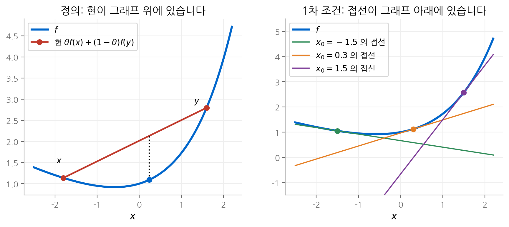
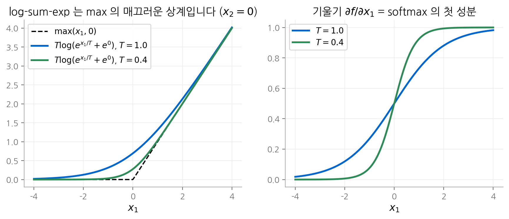
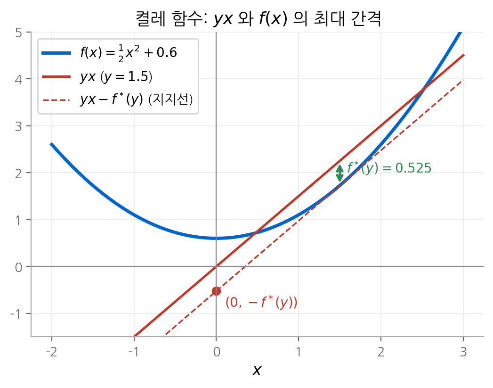

# 3. 볼록 함수

볼록 최적화 문제는 목적 함수와 부등식 제약 함수가 모두 볼록이어야 합니다. 이 장은 함수의 볼록성을
판정하는 방법을 정리합니다. 구조는 2장과 같습니다. 정의와 미분 조건으로 **기본 함수**의 볼록성을 확인하고,
**볼록성을 보존하는 연산**으로 복잡한 함수를 조립합니다. 후반부의 켤레 함수는 5장 쌍대성의 핵심 도구이고,
준볼록과 로그 볼록은 볼록을 조금 넓힌 개념입니다. 머신러닝에서 익숙한 log-sum-exp, softmax,
KL 발산이 모두 이 장의 예로 나옵니다.

!!! info "원문과 자료"
    - 교재: Boyd & Vandenberghe, *Convex Optimization*, 3장 Convex functions (p. 67–125)
    - 슬라이드: [Convex functions, p. 44–86](https://web.stanford.edu/~boyd/cvxbook/bv_cvxslides.pdf#page=44)

## 1. 정의

함수 $f : \mathbf{R}^n \to \mathbf{R}$ 의 정의역 $\operatorname{dom} f$ 가 볼록이고, 모든 $x, y \in \operatorname{dom} f$ 와 $0 \le \theta \le 1$ 에서
다음이 성립하면 $f$ 를 **볼록 함수(convex function)** 라고 합니다.

$$
f(\theta x + (1 - \theta) y) \le \theta f(x) + (1 - \theta) f(y)
$$

기하학적으로는 그래프 위의 두 점을 잇는 현(chord)이 그래프보다 위에 있다는 뜻입니다.

- $x \ne y$, $0 < \theta < 1$ 에서 부등호가 엄격하면 **엄격 볼록(strictly convex)** 입니다.
- $-f$ 가 볼록이면 $f$ 는 **오목(concave)** 입니다.
- 아핀 함수는 등호가 성립하므로 볼록이면서 오목입니다.

### 직선으로 제한하기

$f$ 가 볼록인 것은 **모든 직선 위로 제한한 함수가 볼록인 것**과 같습니다.

$$
f \text{ 가 볼록} \iff g(t) = f(x + tv) \text{ 가 모든 } x \in \operatorname{dom} f,\ v \text{ 에서 } t \text{ 의 볼록 함수}
$$

다변수 함수의 볼록성을 1변수 함수의 볼록성으로 바꾸는 방법입니다. 아래 $\log\det$ 의 증명에서 씁니다.

### extended-value extension

정의역 밖에서 $f(x) = \infty$ 로 두면 정의역을 따로 적지 않아도 됩니다. 이를 **extended-value extension**
$\tilde{f}$ 라고 합니다. 볼록 집합 $C$ 의 지시 함수(indicator function)는 $C$ 위에서 0, 밖에서 $\infty$ 입니다.
제약을 목적 함수에 흡수할 때 이 표기를 씁니다.

## 2. 미분 조건

### 1차 조건

$f$ 가 미분 가능하면 다음이 성립합니다.

$$
f \text{ 가 볼록} \iff f(y) \ge f(x) + \nabla f(x)^\top (y - x) \quad \text{for all}\ x, y \in \operatorname{dom} f
$$

우변은 $x$ 에서의 1차 테일러 근사입니다. **볼록 함수에서 1차 근사는 전역 하한(global underestimator)입니다.**
국소 정보인 그래디언트 하나로 함수 전체에 대한 정보를 얻는다는 점이 중요합니다.

바로 나오는 결과가 있습니다. $\nabla f(x) = 0$ 이면 모든 $y$ 에서 $f(y) \ge f(x)$ 입니다.
**정류점(stationary point)이 곧 전역 최솟점입니다.** 볼록이 아닌 함수에서는 정류점이 안장점이나 지역 최솟점일 수 있습니다.

<figure markdown>

<figcaption markdown>
<b>Figure 1.</b> 볼록 함수의 정의와 1차 조건

볼록 함수는 현이 그래프 위에 있고(정의), 접선이 그래프 아래에 있습니다(1차 조건).
</figcaption>
</figure>

### 2차 조건

$f$ 가 두 번 미분 가능하면 다음이 성립합니다.

$$
f \text{ 가 볼록} \iff \nabla^2 f(x) \succeq 0 \quad \text{for all}\ x \in \operatorname{dom} f
$$

1변수에서는 $f''(x) \ge 0$, 즉 기울기가 감소하지 않는다는 뜻입니다. $\nabla^2 f(x) \succ 0$ 이면 엄격 볼록이지만 역은 성립하지 않습니다.
$f(x) = x^4$ 는 엄격 볼록이지만 $f''(0) = 0$ 입니다.

### 예: 이차 함수와 최소제곱

$f(x) = \frac{1}{2} x^\top P x + q^\top x + r$ ($P \in \mathbf{S}^n$) 의 헤시안은 $P$ 입니다. 따라서 $P \succeq 0$ 이면 볼록입니다.
최소제곱 목적 함수 $\lVert Ax - b \rVert_2^2$ 의 헤시안은 $2A^\top A$ 이고 항상 PSD이므로 모든 $A$, $b$ 에서 볼록입니다.

### 예: 이차 분수 함수

$f(x, y) = x^2 / y$ ($y > 0$) 의 헤시안은 다음과 같습니다.

$$
\nabla^2 f(x, y) = \frac{2}{y^3} \begin{bmatrix} y^2 & -xy \\ -xy & x^2 \end{bmatrix} = \frac{2}{y^3} \begin{bmatrix} y \\ -x \end{bmatrix} \begin{bmatrix} y \\ -x \end{bmatrix}^\top \succeq 0
$$

랭크 1 행렬에 양수를 곱한 형태이므로 PSD입니다. $x$ 와 $y$ 에 대해 **함께** 볼록이라는 점이 중요합니다.
한 변수씩 볼록인 것보다 강한 성질입니다.

## 3. 주요 예

### 1변수 함수

| 함수 | 정의역 | 성질 |
| --- | --- | --- |
| $e^{ax}$ | $\mathbf{R}$ | 모든 $a$ 에서 볼록 |
| $x^a$ | $\mathbf{R}_{++}$ | $a \ge 1$ 또는 $a \le 0$ 이면 볼록, $0 \le a \le 1$ 이면 오목 |
| $\lvert x \rvert^p$ | $\mathbf{R}$ | $p \ge 1$ 이면 볼록 |
| $\log x$ | $\mathbf{R}_{++}$ | 오목 |
| $x \log x$ | $\mathbf{R}_{++}$ | 볼록 (음의 엔트로피) |

### 노름과 최댓값

모든 노름 $\lVert x \rVert$ 는 볼록입니다. 삼각 부등식과 동차성에서 바로 나옵니다.
$f(x) = \max\{x_1, \dots, x_n\}$ 도 볼록입니다. 둘 다 미분 불가능한 점이 있으므로 정의로 확인합니다.

### log-sum-exp

$$
f(x) = \log(e^{x_1} + \cdots + e^{x_n})
$$

이 함수는 max의 매끄러운 근사입니다. $e^{\max_i x_i} \le \sum_i e^{x_i} \le n\, e^{\max_i x_i}$ 에 로그를 취하면 다음을 얻습니다.

$$
\max_i x_i \;\le\; f(x) \;\le\; \max_i x_i + \log n
$$

그래디언트는 **softmax** 입니다. $z_i = e^{x_i}$ 로 두면 $\nabla f(x) = z / (\mathbf{1}^\top z) = p$ 입니다.
헤시안은 다음과 같습니다.

$$
\nabla^2 f(x) = \frac{1}{(\mathbf{1}^\top z)^2}\left( (\mathbf{1}^\top z) \operatorname{diag}(z) - z z^\top \right) = \operatorname{diag}(p) - p p^\top
$$

PSD임을 보이려면 임의의 $v$ 에서 이차 형식을 계산합니다.

$$
v^\top \nabla^2 f(x)\, v = \frac{\left(\sum_k z_k\right)\left(\sum_k v_k^2 z_k\right) - \left(\sum_k v_k z_k\right)^2}{\left(\sum_k z_k\right)^2} \ge 0
$$

$a_k = v_k \sqrt{z_k}$, $b_k = \sqrt{z_k}$ 로 두면 분자는 Cauchy-Schwarz 부등식 $(a^\top a)(b^\top b) \ge (a^\top b)^2$ 입니다.

$\operatorname{diag}(p) - pp^\top$ 는 확률 $p$ 를 가진 범주형 분포의 공분산 행렬입니다. 공분산은 항상 PSD이므로
결과가 자연스럽습니다. softmax의 야코비안과 같은 행렬입니다([신경망 기초 2장](../../ai/d2l/02-linear-classification.md) 참고).
교차 엔트로피 손실 $-x_y + \log\sum_j e^{x_j}$ 가 로짓 $x$ 에 대해 볼록인 이유도 여기에 있습니다.

<figure markdown>

<figcaption markdown>
<b>Figure 2.</b> log-sum-exp 와 softmax

log-sum-exp 는 T 가 작을수록 max 에 가까워지고, 그 기울기인 softmax 는 계단 함수에 가까워집니다.
</figcaption>
</figure>

### 기하 평균과 log det

기하 평균 $f(x) = (\prod_{i=1}^n x_i)^{1/n}$ 은 $\mathbf{R}^n_{++}$ 에서 오목입니다.

$f(X) = \log\det X$ 는 $\mathbf{S}^n_{++}$ 에서 오목입니다. 직선으로 제한해 증명합니다. $Z \succ 0$ 이고 $V \in \mathbf{S}^n$ 일 때
$\lambda_i$ 를 $Z^{-1/2} V Z^{-1/2}$ 의 고윳값이라고 하면 다음과 같습니다.

$$
g(t) = \log\det(Z + tV) = \log\det Z + \log\det(I + t Z^{-1/2} V Z^{-1/2}) = \log\det Z + \sum_{i=1}^n \log(1 + t\lambda_i)
$$

각 항 $\log(1 + t\lambda_i)$ 가 $t$ 의 오목 함수이므로 $g$ 도 오목입니다. 8장의 최소 부피 타원체 문제가 이 함수를 씁니다.

## 4. sublevel set, epigraph, Jensen 부등식

### sublevel set

$\alpha$ sublevel set은 $C_\alpha = \{x \in \operatorname{dom} f \mid f(x) \le \alpha\}$ 입니다.
볼록 함수의 sublevel set은 모든 $\alpha$ 에서 볼록입니다. 역은 성립하지 않습니다. $-e^x$ 는 오목이지만
sublevel set이 모두 볼록입니다. 이 차이가 6절의 준볼록 함수를 낳습니다.

### epigraph

epigraph는 그래프와 그 위쪽 영역입니다.

$$
\operatorname{epi} f = \{(x, t) \mid x \in \operatorname{dom} f,\ f(x) \le t\}
$$

**$f$ 가 볼록인 것과 $\operatorname{epi} f$ 가 볼록 집합인 것은 같습니다.** 함수의 볼록성과 집합의 볼록성을 잇는 다리입니다.
1차 조건은 $(\nabla f(x), -1)$ 이 epigraph의 점 $(x, f(x))$ 에서 지지 초평면의 법선이라는 뜻입니다.
4장에서 목적 함수를 제약으로 옮기는 epigraph 변환이 이 사실을 씁니다.

### Jensen 부등식

정의의 부등식을 점 $k$ 개의 볼록 조합으로 넓히면 다음을 얻습니다.

$$
f(\theta_1 x_1 + \cdots + \theta_k x_k) \le \theta_1 f(x_1) + \cdots + \theta_k f(x_k), \qquad \theta_i \ge 0,\ \textstyle\sum_i \theta_i = 1
$$

계수를 확률로 읽으면 Jensen 부등식이 됩니다.

$$
f(\mathbf{E}\, x) \le \mathbf{E}\, f(x)
$$

많은 부등식이 여기서 나옵니다.

- **산술-기하 평균 부등식:** $-\log$ 가 볼록이므로 $-\log(\theta a + (1 - \theta) b) \le -\theta \log a - (1 - \theta) \log b$ 입니다.
  정리하면 $a^\theta b^{1-\theta} \le \theta a + (1 - \theta) b$ 입니다. 예를 들어 $a = 1$, $b = 9$, $\theta = 1/2$ 이면 $3 \le 5$ 입니다.
- **KL 발산의 비음성:** 확률 분포 $p$, $q$ 에서 $-\log$ 의 볼록성을 쓰면 다음과 같습니다.

$$
D_{\mathrm{KL}}(p \,\|\, q) = \sum_i p_i \left(-\log \frac{q_i}{p_i}\right) \ge -\log \sum_i p_i \frac{q_i}{p_i} = -\log 1 = 0
$$

## 5. 볼록성을 보존하는 연산

### 음이 아닌 가중합과 아핀 합성

- $w_i \ge 0$ 이고 $f_i$ 가 볼록이면 $\sum_i w_i f_i$ 는 볼록입니다.
- $f$ 가 볼록이면 $g(x) = f(Ax + b)$ 는 볼록입니다.

예를 들어 로지스틱 회귀의 손실 $\sum_i \log(1 + e^{-y_i a_i^\top x})$ 는 볼록입니다.
$\log(1 + e^u)$ 가 볼록이고, $u = -y_i a_i^\top x$ 가 $x$ 의 아핀 함수이며, 볼록 함수의 합이기 때문입니다.

### 점별 최댓값과 상한

$f_1, f_2$ 가 볼록이면 $\max\{f_1, f_2\}$ 는 볼록입니다. epigraph가 두 epigraph의 교집합이기 때문입니다.
무한 개여도 성립합니다. 각 $y \in \mathcal{A}$ 에서 $f(x, y)$ 가 $x$ 의 볼록 함수이면 다음도 볼록입니다.

$$
g(x) = \sup_{y \in \mathcal{A}} f(x, y)
$$

| 예 | 표현 | 이유 |
| --- | --- | --- |
| 구간별 선형 함수 | $\max_i (a_i^\top x + b_i)$ | 아핀 함수들의 최댓값 |
| 상위 $r$ 개 성분의 합 | $\max\{x_{i_1} + \cdots + x_{i_r}\}$ | 선형 함수들의 최댓값 |
| 최대 고윳값 | $\lambda_{\max}(X) = \sup_{\lVert y \rVert_2 = 1} y^\top X y$ | $X$ 의 선형 함수들의 상한 |
| 지지 함수 | $S_C(x) = \sup_{y \in C} y^\top x$ | 선형 함수들의 상한 |

교재는 역도 성립한다고 지적합니다. 닫힌 볼록 함수는 자신의 모든 아핀 하한의 점별 상한입니다.

### 합성

$f(x) = h(g(x))$ 의 볼록성은 $h$ 의 볼록성과 단조성, $g$ 의 볼록성으로 정해집니다. 1변수에서 2차 도함수를 쓰면 이유가 보입니다.

$$
f''(x) = h''(g(x))\, g'(x)^2 + h'(g(x))\, g''(x)
$$

두 항이 모두 0 이상이 되는 조건이 규칙입니다. 아래에서 $\tilde{h}$ 는 $h$ 의 extended-value extension입니다.

| $h$ | $\tilde{h}$ | $g$ | $f = h \circ g$ |
| --- | --- | --- | --- |
| 볼록 | 비감소 | 볼록 | 볼록 |
| 볼록 | 비증가 | 오목 | 볼록 |
| 오목 | 비감소 | 오목 | 오목 |
| 오목 | 비증가 | 볼록 | 오목 |

예를 들어 $g$ 가 볼록이면 $e^{g(x)}$ 가 볼록이고, $g$ 가 오목이고 양수이면 $1/g(x)$ 가 볼록입니다.
이 규칙을 체계화한 것이 4장에서 다루는 **규율 볼록 프로그래밍(disciplined convex programming)** 이고,
CVXPY 같은 모델링 도구가 이 규칙으로 볼록성을 자동 검증합니다.

### 최소화

$f(x, y)$ 가 $(x, y)$ 에 대해 함께 볼록이고 $C$ 가 볼록 집합이면 다음은 볼록입니다.

$$
g(x) = \inf_{y \in C} f(x, y)
$$

최댓값과 달리 **함께 볼록**이라는 조건이 필요합니다. 대표 예는 다음과 같습니다.

- **볼록 집합까지의 거리:** $\operatorname{dist}(x, S) = \inf_{y \in S} \lVert x - y \rVert$ 는 $S$ 가 볼록이면 볼록입니다.
- **Schur complement:** $f(x, y) = x^\top A x + 2 x^\top B y + y^\top C y$ 이고 $C \succ 0$ 이면,
  $y$ 에 대해 최소화한 결과는 $g(x) = x^\top (A - B C^{-1} B^\top) x$ 입니다. $f$ 가 볼록이면 $g$ 도 볼록이므로
  $A - BC^{-1}B^\top \succeq 0$ 입니다. 블록 행렬의 PSD 조건을 Schur complement로 판정하는 근거입니다.

### perspective 함수

$f$ 의 perspective 함수는 $g(x, t) = t\, f(x / t)$ ($t > 0$) 입니다. $f$ 가 볼록이면 $g$ 도 볼록입니다.

- $f(x) = x^\top x$ 이면 $g(x, t) = x^\top x / t$ 입니다. 앞의 이차 분수 함수의 일반형입니다.
- $f(x) = -\log x$ 이면 $g(x, t) = t \log t - t \log x$ 입니다. 이것이 **상대 엔트로피(relative entropy)** 이고,
  $(x, t)$ 에 대해 함께 볼록입니다. 이로부터 KL 발산 $\sum_i u_i \log(u_i / v_i)$ 가 $(u, v)$ 에 대해 함께 볼록임을 얻습니다.

## 6. 켤레 함수

### 정의

$f : \mathbf{R}^n \to \mathbf{R}$ 의 켤레 함수(conjugate function)는 다음과 같습니다. Fenchel 켤레라고도 합니다.

$$
f^*(y) = \sup_{x \in \operatorname{dom} f} \left( y^\top x - f(x) \right)
$$

$f^*(y)$ 는 선형 함수 $y^\top x$ 가 $f(x)$ 보다 위로 가장 많이 벌어지는 간격입니다. 다르게 보면 기울기가 $y$ 인 직선을
아래에서 올려 $f$ 에 닿게 했을 때, 그 직선의 절편이 $-f^*(y)$ 입니다.

$f$ 가 볼록이 아니어도 **$f^*$ 는 항상 볼록**입니다. $y$ 의 아핀 함수들의 점별 상한이기 때문입니다.

<figure markdown>

<figcaption markdown>
<b>Figure 3.</b> 켤레 함수의 기하학적 의미

직선 yx 와 f(x) 의 간격이 가장 큰 값이 켤레 값입니다. 이 예에서 f*(1.5) = 0.525 입니다.
</figcaption>
</figure>

### 계산 예

| $f(x)$ | $f^*(y)$ | 정의역 |
| --- | --- | --- |
| $ax + b$ | $-b$ | $y = a$ |
| $-\log x$ | $-\log(-y) - 1$ | $y < 0$ |
| $e^x$ | $y \log y - y$ | $y \ge 0$ |
| $x \log x$ | $e^{y - 1}$ | $\mathbf{R}$ |
| $\frac{1}{2} x^\top Q x$, $Q \succ 0$ | $\frac{1}{2} y^\top Q^{-1} y$ | $\mathbf{R}^n$ |
| $\lVert x \rVert$ | $0$ | $\lVert y \rVert_* \le 1$ |
| $\log \sum_i e^{x_i}$ | $\sum_i y_i \log y_i$ | $y \succeq 0$, $\mathbf{1}^\top y = 1$ |

$-\log x$ 의 경우를 직접 계산해 보겠습니다. $y < 0$ 이면 $xy + \log x$ 를 $x$ 로 미분해 0으로 두어 $x = -1/y$ 를 얻습니다.
대입하면 $f^*(y) = -1 + \log(-1/y) = -\log(-y) - 1$ 입니다. $y \ge 0$ 이면 상한이 $\infty$ 입니다.

마지막 줄이 특히 흥미롭습니다. **log-sum-exp의 켤레는 probability simplex 위의 음의 엔트로피**입니다.
softmax가 "엔트로피 정규화를 건 argmax"로 해석되는 이유가 이 쌍대 관계입니다. 즉 다음이 성립합니다.

$$
\log \sum_i e^{x_i} = \max_{p \in \Delta} \left( x^\top p - \sum_i p_i \log p_i \right)
$$

최댓값을 주는 $p$ 가 softmax$(x)$ 입니다.

### Fenchel 부등식과 이중 켤레

정의에서 바로 Fenchel 부등식이 나옵니다.

$$
f(x) + f^*(y) \ge x^\top y \quad \text{for all}\ x, y
$$

$f = \frac{1}{2}x^\top Q x$ 이면 $x^\top y \le \frac{1}{2} x^\top Q x + \frac{1}{2} y^\top Q^{-1} y$ 가 됩니다.

$f$ 가 볼록이고 닫혀 있으면(epigraph가 닫힌 집합이면) **$f^{**} = f$** 입니다. 켤레를 두 번 취하면 원래 함수로 돌아옵니다.
볼록 함수를 "점들의 집합"으로도, "지지선들의 집합"으로도 똑같이 기술할 수 있다는 뜻입니다.
5장에서 쌍대 함수를 켤레 함수로 표현하는 데 이 관계를 씁니다.

## 7. 준볼록 함수

### 정의

정의역과 모든 sublevel set $S_\alpha = \{x \mid f(x) \le \alpha\}$ 가 볼록이면 $f$ 를 **준볼록(quasiconvex)** 이라고 합니다.
동치 조건은 다음과 같습니다.

$$
f(\theta x + (1 - \theta) y) \le \max\{f(x), f(y)\}, \qquad 0 \le \theta \le 1
$$

볼록 함수는 모두 준볼록이지만 역은 성립하지 않습니다.

| 예 | 성질 |
| --- | --- |
| $\lceil x \rceil$ | 준선형(준볼록이면서 준오목) |
| $\log x$ ($\mathbf{R}_{++}$) | 준선형 |
| $x_1 x_2$ ($\mathbf{R}^2_{++}$) | 준오목 |
| $\dfrac{a^\top x + b}{c^\top x + d}$ ($c^\top x + d > 0$) | 준선형 |
| $\dfrac{\lVert x - a \rVert_2}{\lVert x - b \rVert_2}$ ($\lVert x - a \rVert_2 \le \lVert x - b \rVert_2$) | 준볼록 |

### 1차 조건과 주의점

미분 가능한 $f$ 가 준볼록인 것은 다음과 같습니다.

$$
f(y) \le f(x) \implies \nabla f(x)^\top (y - x) \le 0
$$

볼록 함수와 달리 **$\nabla f(x) = 0$ 이 전역 최적을 보장하지 않습니다.** 준볼록 함수는 평평한 구간이나 변곡점에서
그래디언트가 0일 수 있습니다. 그래서 준볼록 최적화는 다른 방법으로 풉니다. 4장에서 다루는 이분법(bisection)은
"$f(x) \le t$ 가 가능한가"라는 볼록 실현 가능성 문제를 반복해서 풉니다.

## 8. 로그 오목 함수와 로그 볼록 함수

$f(x) > 0$ 이고 $\log f$ 가 오목이면 **로그 오목(log-concave)**, $\log f$ 가 볼록이면 **로그 볼록(log-convex)** 이라고 합니다.
로그 오목 조건은 다음과 같이 쓸 수도 있습니다.

$$
f(\theta x + (1 - \theta) y) \ge f(x)^\theta f(y)^{1 - \theta}
$$

### 확률 분포의 예

| 함수 | 성질 |
| --- | --- |
| Gaussian 밀도 $\frac{1}{\sqrt{(2\pi)^n \det \Sigma}} e^{-\frac{1}{2}(x - \bar{x})^\top \Sigma^{-1} (x - \bar{x})}$ | 로그 오목 |
| Gaussian 누적 분포 함수 $\Phi(x)$ | 로그 오목 |
| 볼록 집합 위의 균등 분포 밀도 | 로그 오목 |
| 지수 분포, Laplace 분포 밀도 | 로그 오목 |
| 감마 함수 $\Gamma(x)$ ($x > 0$) | 로그 볼록 (교재 본문은 $x \ge 1$ 로 적지만 $x > 0$ 전체에서 성립합니다) |

### 연산 규칙

- 로그 오목 함수의 **곱**은 로그 오목입니다. 로그를 취하면 오목 함수의 합이 되기 때문입니다.
- 로그 오목 함수의 **합**은 일반적으로 로그 오목이 아닙니다. 로그 볼록 함수의 합은 로그 볼록입니다.
- $f(x, y)$ 가 로그 오목이면 **적분** $g(x) = \int f(x, y)\, dy$ 도 로그 오목입니다. 따라서 로그 오목 분포의 주변 분포와
  두 로그 오목 함수의 합성곱이 로그 오목입니다.

머신러닝에서는 이 성질이 최대 우도 추정을 볼록 문제로 만듭니다. 잡음 밀도가 로그 오목이면 음의 로그 우도가
파라미터에 대해 볼록입니다. [7. 통계적 추정](07-statistical-estimation.md)에서 이 결과를 씁니다.

## 9. 일반화 부등식에 대한 볼록성

2장의 일반화 부등식으로 볼록성을 넓힐 수 있습니다. proper cone $K$ 에 대해 다음이 성립하면 $f : \mathbf{R}^n \to \mathbf{R}^m$ 을
**$K$-볼록($K$-convex)** 이라고 합니다.

$$
f(\theta x + (1 - \theta) y) \preceq_K \theta f(x) + (1 - \theta) f(y)
$$

예를 들어 $f(X) = X^2$ 은 $\mathbf{S}^n$ 에서 $\mathbf{S}^n_+$-볼록, 즉 **행렬 볼록(matrix convex)** 입니다.
$f$ 가 $K$-볼록인 것과 모든 $w \succeq_{K^*} 0$ 에서 $w^\top f$ 가 볼록인 것은 같습니다. 2장의 쌍대 부등식과 같은 구조입니다.

## 핵심 정리

| 도구 | 판정 기준 또는 결과 |
| --- | --- |
| 정의 | 현이 그래프 위에 있습니다. 직선으로 제한해 1변수 문제로 바꿀 수 있습니다. |
| 1차 조건 | $f(y) \ge f(x) + \nabla f(x)^\top (y - x)$, 정류점이 전역 최솟점입니다. |
| 2차 조건 | $\nabla^2 f(x) \succeq 0$ |
| epigraph | 함수가 볼록인 것과 epigraph가 볼록 집합인 것은 같습니다. |
| Jensen 부등식 | $f(\mathbf{E}x) \le \mathbf{E}f(x)$, AM-GM과 KL 발산의 비음성이 나옵니다. |
| 보존 연산 | 가중합, 아핀 합성, 점별 최댓값, 합성 규칙, 함께 볼록인 함수의 최소화, perspective 함수 |
| 켤레 함수 | $f^*(y) = \sup_x (y^\top x - f(x))$, 항상 볼록이고 닫힌 볼록 함수에서 $f^{**} = f$ 입니다. |
| 준볼록 | sublevel set이 볼록입니다. 정류점이 최적을 보장하지 않습니다. |
| 로그 오목 | $\log f$ 가 오목입니다. 곱과 적분에서 보존됩니다. |

머신러닝과의 연결을 따로 모으면 다음과 같습니다.

- log-sum-exp의 그래디언트가 softmax이고, 헤시안이 범주형 분포의 공분산입니다.
- 로지스틱 회귀와 softmax 교차 엔트로피는 파라미터(선형 모델의 경우)에 대해 볼록입니다.
- log-sum-exp의 켤레가 음의 엔트로피이므로 softmax는 엔트로피 정규화를 건 argmax입니다.
- KL 발산은 Jensen 부등식으로 0 이상이고, perspective 함수 규칙으로 두 인자에 대해 함께 볼록입니다.

## 다음 장

볼록 집합과 볼록 함수를 판정하는 도구가 모두 갖춰졌습니다. [다음 장](04-convex-problems.md)에서는
이 둘을 조합해 볼록 최적화 문제를 정식화하고, LP부터 SDP까지 표준 문제 군을 정리합니다.
