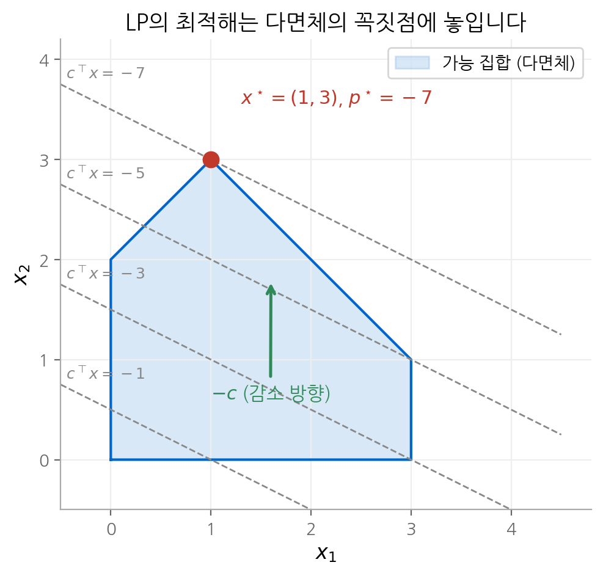
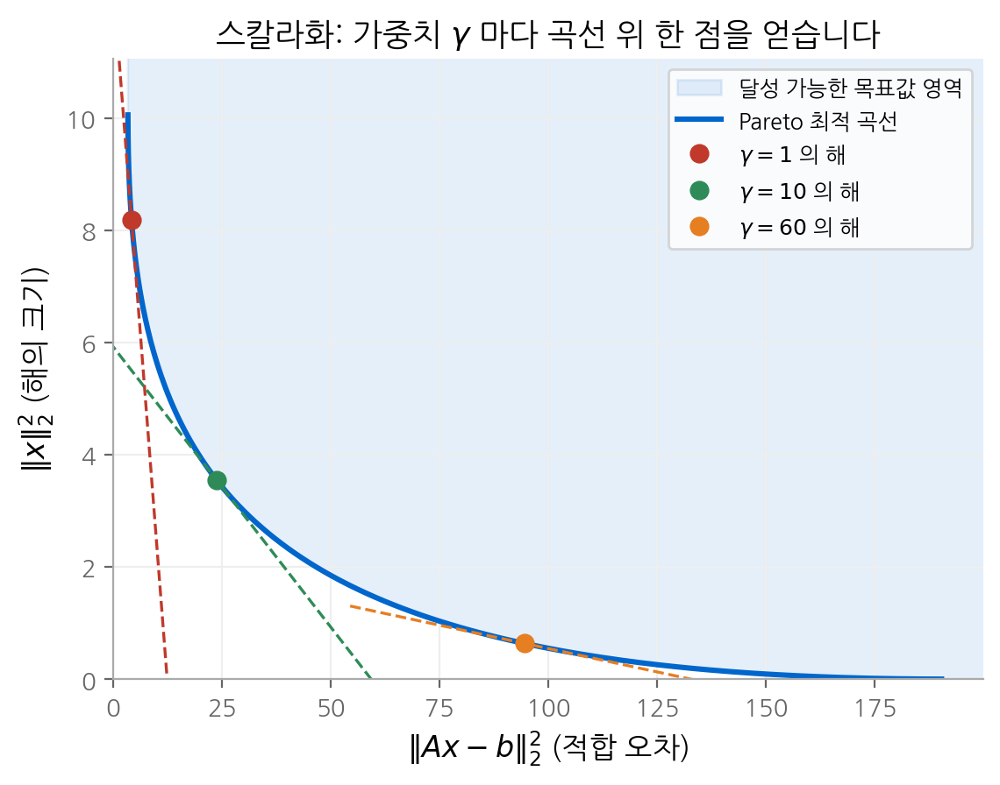

# 4. 볼록 최적화 문제

2장과 3장에서 볼록 집합과 볼록 함수를 정의했습니다. 이 장은 두 개념을 합쳐 **볼록 최적화 문제**를 정의하고,
그 정의가 왜 유용한지를 보입니다. 핵심 결과는 두 가지입니다. 첫째, 볼록 문제에서는 지역 최적해가 곧
전역 최적해입니다. 둘째, 실제로 마주치는 많은 문제가 LP, QP, SOCP, SDP 같은 몇 가지 표준형으로 바뀝니다.
표준형으로 바꾸기만 하면 검증된 솔버로 풀 수 있으므로, 이 장의 실질적인 기술은 **문제를 동치인 볼록 문제로
변환하는 방법**입니다.

!!! info "원문과 자료"
    - 교재: Boyd & Vandenberghe, *Convex Optimization*, 4장 (pp. 127–214)
    - 슬라이드: [4. Convex optimization problems](https://web.stanford.edu/~boyd/cvxbook/bv_cvxslides.pdf#page=87) (pp. 87–153)
        - [표준 볼록 문제](https://web.stanford.edu/~boyd/cvxbook/bv_cvxslides.pdf#page=100) ·
          [문제 변환](https://web.stanford.edu/~boyd/cvxbook/bv_cvxslides.pdf#page=117) ·
          [DCP](https://web.stanford.edu/~boyd/cvxbook/bv_cvxslides.pdf#page=129) ·
          [기하 계획법](https://web.stanford.edu/~boyd/cvxbook/bv_cvxslides.pdf#page=133) ·
          [준볼록 최적화](https://web.stanford.edu/~boyd/cvxbook/bv_cvxslides.pdf#page=137) ·
          [다목적 최적화](https://web.stanford.edu/~boyd/cvxbook/bv_cvxslides.pdf#page=143)

## 1. 최적화 문제의 표준형

교재는 모든 최적화 문제를 다음 **표준형**(standard form)으로 씁니다.

$$
\begin{aligned}
\text{minimize} \quad & f_0(x) \\
\text{subject to} \quad & f_i(x) \le 0, \quad i = 1, \dots, m \\
& h_i(x) = 0, \quad i = 1, \dots, p
\end{aligned}
$$

$x \in \mathbb{R}^n$ 은 최적화 변수, $f_0$ 는 목적 함수, $f_i$ 는 부등식 제약 함수, $h_i$ 는 등식 제약 함수입니다.
모든 함수가 정의되는 점의 집합 $\mathcal{D} = \bigcap_i \operatorname{dom} f_i \cap \bigcap_i \operatorname{dom} h_i$ 를
문제의 **정의역**이라고 합니다.

| 용어 | 정의 |
| --- | --- |
| 가능해(feasible point) | $x \in \mathcal{D}$ 이고 모든 제약을 만족하는 점 |
| 최적값(optimal value) | $p^\star = \inf\{ f_0(x) \mid x \text{ 는 가능해} \}$ |
| 최적해(optimal point) | 가능해이면서 $f_0(x^\star) = p^\star$ 인 점 |
| $\epsilon$-준최적해 | 가능해이면서 $f_0(x) \le p^\star + \epsilon$ 인 점 |
| 활성 제약(active constraint) | 점 $x$ 에서 $f_i(x) = 0$ 인 부등식 제약 |

최적값은 극단값을 가질 수 있습니다. 가능해가 하나도 없으면 $\inf \emptyset = +\infty$ 이므로 $p^\star = +\infty$ 이고,
문제가 **불가능**(infeasible)하다고 합니다. 목적 함수가 끝없이 작아지는 가능해의 수열이 있으면 $p^\star = -\infty$ 이고,
문제가 **아래로 유계가 아니다**(unbounded below)라고 합니다.

최적값이 유한해도 최적해가 없을 수 있습니다. $\operatorname{dom} f_0 = \mathbb{R}_{++}$ 에서 $f_0(x) = 1/x$ 를 최소화하면
$p^\star = 0$ 이지만, 어떤 $x$ 도 이 값을 달성하지 않습니다.

**지역 최적해**(locally optimal point)는 주변의 가능해 중에서만 최선인 점입니다. 어떤 $R > 0$ 에 대해 다음이 성립하면
$x$ 는 지역 최적해입니다.

$$
f_0(x) = \inf\{ f_0(z) \mid z \text{ 는 가능해}, \ \lVert z - x \rVert_2 \le R \}
$$

## 2. 동치 문제와 변환

두 문제 중 하나의 해에서 다른 문제의 해를 쉽게 얻을 수 있으면 두 문제를 **동치**(equivalent)라고 합니다.
이 정의는 의도적으로 느슨합니다. 볼록 최적화를 실제로 쓰는 일의 대부분은 주어진 문제를 동치인 표준형으로
바꾸는 일입니다. 자주 쓰는 변환은 다음과 같습니다.

| 변환 | 원래 형태 | 바꾼 형태 |
| --- | --- | --- |
| 변수 변환 | $x$ 에 대한 문제 | $x = \phi(z)$ 를 대입해 $z$ 에 대한 문제 ($\phi$ 는 일대일) |
| slack 변수(variable) | $f_i(x) \le 0$ | $f_i(x) + s_i = 0, \ s_i \ge 0$ |
| 등식 제거 | $Ax = b$ | $x = Fz + x_0$ ($F$ 의 열이 $A$ 의 영공간을 생성) |
| epigraph 형식 | minimize $f_0(x)$ | minimize $t$, subject to $f_0(x) - t \le 0$ |
| 제약의 목적 함수 흡수 | $x \in C$ | 목적 함수에 지시 함수 $I_C(x)$ 를 더함 |

### epigraph 형식

epigraph 형식은 새 변수 $t$ 를 도입해 목적 함수를 제약으로 옮깁니다.

$$
\begin{aligned}
\text{minimize} \quad & t \\
\text{subject to} \quad & f_0(x) - t \le 0, \quad f_i(x) \le 0, \quad h_i(x) = 0
\end{aligned}
$$

$(x, t)$ 가 최적이면 $x$ 가 원래 문제의 최적해이고 $t = f_0(x)$ 입니다. 이 형식은 **목적 함수를 선형으로 가정해도
일반성을 잃지 않는다**는 사실을 보여 줍니다. 11장의 내점법이 선형 목적 함수만 다루는 근거가 이것입니다.

### 예: $\ell_\infty$ 노름 근사를 LP로

$\lVert Ax - b \rVert_\infty = \max_i |a_i^\top x - b_i|$ 를 최소화하는 문제는 목적 함수가 미분 불가능합니다.
epigraph 형식을 적용하면 $|a_i^\top x - b_i| \le t$ 가 두 개의 선형 부등식으로 나뉩니다.

$$
\begin{aligned}
\text{minimize} \quad & t \\
\text{subject to} \quad & -t\mathbf{1} \preceq Ax - b \preceq t\mathbf{1}
\end{aligned}
$$

변수 $(x, t)$ 에 대한 선형 계획 문제가 됩니다. 미분 불가능한 목적 함수가 변수 하나를 늘리는 대가로 사라졌습니다.

## 3. 볼록 최적화 문제

### 정의

표준형에서 다음 세 조건을 만족하면 **볼록 최적화 문제**입니다.

1. 목적 함수 $f_0$ 가 볼록입니다.
2. 부등식 제약 함수 $f_1, \dots, f_m$ 이 볼록입니다.
3. 등식 제약 함수가 아핀입니다. 즉 등식 제약을 $Ax = b$ 로 쓸 수 있습니다.

가능 집합은 볼록 집합 $\operatorname{dom} f_0$, sublevel set $\{x \mid f_i(x) \le 0\}$, 초평면의 교집합이므로 볼록입니다.
등식 제약이 아핀이어야 하는 이유도 여기에 있습니다. $h(x) = 0$ 은 $h(x) \le 0$ 과 $-h(x) \le 0$ 을 함께 뜻하므로,
$h$ 와 $-h$ 가 모두 볼록이어야 합니다. 그런 함수는 아핀 함수뿐입니다.

이 정의는 가능 집합의 성질이 아니라 **문제를 쓴 형식**의 성질입니다. 교재의 예를 보겠습니다.

$$
\text{minimize } x_1^2 + x_2^2 \quad \text{subject to } \frac{x_1}{1 + x_2^2} \le 0, \quad (x_1 + x_2)^2 = 0
$$

$f_1$ 은 볼록이 아니고 $h_1$ 은 아핀이 아니므로 형식상 볼록 문제가 아닙니다. 그러나 가능 집합은
$\{x \mid x_1 \le 0, \ x_1 = -x_2\}$ 로 볼록입니다. 제약을 $x_1 \le 0$ 과 $x_1 + x_2 = 0$ 으로 다시 쓰면 동치인 볼록 문제가 됩니다.

### 지역 최적해는 전역 최적해입니다

볼록 문제의 가장 중요한 성질입니다. 증명은 짧습니다.

$x$ 가 반경 $R$ 안에서 지역 최적해라고 가정합니다. 그리고 $f_0(y) < f_0(x)$ 인 가능해 $y$ 가 있다고 가정합니다.
$y$ 는 반경 밖에 있어야 하므로 $\lVert y - x \rVert_2 > R$ 입니다. 두 점 사이의 점을 하나 잡습니다.

$$
z = (1 - \theta) x + \theta y, \qquad \theta = \frac{R}{2 \lVert y - x \rVert_2} \in (0, \tfrac{1}{2})
$$

가능 집합이 볼록이므로 $z$ 는 가능해이고, $\lVert z - x \rVert_2 = \theta \lVert y - x \rVert_2 = R/2 < R$ 입니다.
$f_0$ 가 볼록이므로 다음이 성립합니다.

$$
f_0(z) \le (1 - \theta) f_0(x) + \theta f_0(y) < f_0(x)
$$

반경 $R$ 안에 $x$ 보다 나은 가능해 $z$ 가 생겼으므로 가정에 모순입니다. 따라서 그런 $y$ 는 없습니다.

신경망 학습이 볼록 문제가 아니라는 사실의 의미도 여기서 분명해집니다. 손실이 볼록이 아니면 경사 하강법이
멈춘 점이 전역 최적이라는 보장이 없습니다. 반대로 로지스틱 회귀나 SVM처럼 손실이 볼록인 모델에서는
어떤 알고리즘이든 지역 최적해에 도달하기만 하면 그 해가 전역 최적입니다.

### 미분 가능한 목적 함수의 최적성 조건

$f_0$ 가 미분 가능하면, 3장의 1차 조건 $f_0(y) \ge f_0(x) + \nabla f_0(x)^\top (y - x)$ 에서 바로 최적성 조건을 얻습니다.
가능 집합을 $X$ 라고 하면 다음이 성립합니다.

$$
x \text{ 가 최적해} \iff x \in X, \quad \nabla f_0(x)^\top (y - x) \ge 0 \quad \text{for all } y \in X
$$

기하적으로는 $\nabla f_0(x) \ne 0$ 일 때 $-\nabla f_0(x)$ 가 $x$ 에서 가능 집합의 **지지 초평면**을 정의한다는 뜻입니다.
가능 집합 안의 어느 방향으로 움직여도 목적 함수가 줄지 않습니다. 이 조건은 제약 형태에 따라 구체적인 식으로 바뀝니다.

| 제약 | 최적성 조건 | 유도 |
| --- | --- | --- |
| 없음 | $\nabla f_0(x) = 0$ | $y = x - t\nabla f_0(x)$ 를 대입하면 $-t\lVert \nabla f_0(x) \rVert^2 \ge 0$ |
| $Ax = b$ | $\nabla f_0(x) + A^\top \nu = 0$ | $y - x$ 가 영공간 $\mathcal{N}(A)$ 전체를 움직이므로 $\nabla f_0(x) \perp \mathcal{N}(A)$ |
| $x \succeq 0$ | $\nabla f_0(x) \succeq 0, \ x_i (\nabla f_0(x))_i = 0$ | 아래 설명 |

음이 아닌 제약의 경우를 풀어 보겠습니다. 조건은 모든 $y \succeq 0$ 에 대해 $\nabla f_0(x)^\top y \ge \nabla f_0(x)^\top x$ 입니다.
좌변이 $y$ 에 대해 선형이므로, 아래로 유계이려면 $\nabla f_0(x) \succeq 0$ 이어야 합니다. 그러면 좌변의 최솟값은 $y = 0$ 에서
0이므로 $\nabla f_0(x)^\top x \le 0$ 입니다. 두 벡터가 모두 음이 아니므로 합이 0 이하이려면 각 항이 0이어야 합니다.
$x_i > 0$ 인 좌표에서는 그 방향의 기울기가 0이고, 기울기가 양수인 좌표에서는 $x_i = 0$ 입니다.
5장의 **complementary slackness 조건**이 이 결과를 일반화합니다.

## 4. 표준 볼록 문제의 계층

솔버가 직접 받는 문제 형식은 몇 가지뿐입니다. 아래 형식은 뒤로 갈수록 앞의 형식을 포함합니다.

$$
\text{LP} \subset \text{QP} \subset \text{QCQP} \subset \text{SOCP} \subset \text{SDP}
$$

### 선형 계획(LP)

$$
\text{minimize } c^\top x + d \quad \text{subject to } Gx \preceq h, \quad Ax = b
$$

가능 집합은 다면체이고 목적 함수의 수준 집합은 초평면입니다. 최적해는 $-c$ 방향으로 가장 멀리 간
다면체의 점이므로, 유한한 최적해가 있으면 꼭짓점 중 하나가 최적해입니다.

<figure markdown>

<figcaption markdown>
<span class="fig-title"><b>Figure 1.</b> LP의 가능 집합과 최적 꼭짓점</span>

수준 집합을 −c 방향으로 밀면 마지막으로 닿는 꼭짓점 (1, 3) 이 최적해이고, 최적값은 −7 입니다.
</figcaption>
</figure>

### 이차 계획(QP)과 QCQP

$$
\text{minimize } \tfrac{1}{2} x^\top P x + q^\top x + r \quad \text{subject to } Gx \preceq h, \quad Ax = b, \qquad P \in \mathbf{S}^n_+
$$

목적 함수가 볼록 이차 함수인 경우입니다. 최소제곱 $\lVert Ax - b \rVert_2^2$, ridge 회귀, 포트폴리오의 분산 최소화가
여기에 속합니다. 머신러닝에서 가장 익숙한 예는 **선형 SVM**입니다.

$$
\text{minimize } \tfrac{1}{2}\lVert w \rVert_2^2 + C \sum_i \xi_i \quad \text{subject to } y_i (w^\top x_i + b) \ge 1 - \xi_i, \quad \xi_i \ge 0
$$

부등식 제약 함수도 볼록 이차 함수 $\tfrac{1}{2}x^\top P_i x + q_i^\top x + r_i \le 0$ ($P_i \succeq 0$) 이면
**이차 제약 이차 계획**(QCQP)이라고 합니다. 가능 집합은 타원체들의 교집합입니다.

### 이차 원뿔 계획(SOCP)

$$
\text{minimize } f^\top x \quad \text{subject to } \lVert A_i x + b_i \rVert_2 \le c_i^\top x + d_i, \quad Fx = g
$$

각 제약은 $(A_i x + b_i, \ c_i^\top x + d_i)$ 가 이차 원뿔(second-order cone)에 속한다는 뜻입니다.
$A_i = 0$ 이면 선형 부등식이 되고, $c_i = 0$ 이면 QCQP의 제약이 됩니다.

대표적인 응용은 **강건 LP**(robust LP)입니다. LP의 제약 $a_i^\top x \le b_i$ 에서 $a_i$ 가 정확히 알려지지 않고
타원체 $\mathcal{E}_i = \{\bar{a}_i + P_i u \mid \lVert u \rVert_2 \le 1\}$ 안의 어떤 값이라고 하겠습니다.
모든 경우에 제약을 지키려면 최악의 경우를 계산해야 합니다.

$$
\sup_{\lVert u \rVert_2 \le 1} (\bar{a}_i + P_i u)^\top x = \bar{a}_i^\top x + \lVert P_i^\top x \rVert_2 \le b_i
$$

불확실성이 노름 항 하나로 바뀌어 SOCP 제약이 됩니다. 노름 항은 해가 불확실한 방향으로 너무 멀리 가지 않도록
막는 정규화 역할을 합니다.

### 준정부호 계획(SDP)

$$
\text{minimize } c^\top x \quad \text{subject to } x_1 F_1 + \cdots + x_n F_n + G \preceq 0, \quad Ax = b
$$

$F_i, G \in \mathbf{S}^k$ 이고, 부등식은 행렬이 음의 준정부호라는 뜻입니다. 이 제약을 **선형 행렬 부등식**(LMI)이라고 합니다.
대각 행렬만 쓰면 LP가 되고, 블록을 적절히 쓰면 SOCP 제약도 LMI로 표현됩니다.

$$
\lVert Ax + b \rVert_2 \le c^\top x + d \iff
\begin{bmatrix} (c^\top x + d) I & Ax + b \\ (Ax + b)^\top & c^\top x + d \end{bmatrix} \succeq 0
$$

예를 들어 $A(x) = A_0 + x_1 A_1 + \cdots + x_n A_n$ 의 최대 고윳값을 최소화하는 문제는
"$\lambda_{\max}(A(x)) \le t \iff A(x) \preceq tI$" 를 이용해 SDP가 됩니다.

$$
\text{minimize } t \quad \text{subject to } A(x) - tI \preceq 0
$$

| 형식 | 목적 함수 | 제약 | 대표 예 |
| --- | --- | --- | --- |
| LP | 선형 | 선형 | 자원 배분, $\ell_1$, $\ell_\infty$ 근사 |
| QP | 볼록 이차 | 선형 | 최소제곱, SVM, 포트폴리오 |
| QCQP | 볼록 이차 | 볼록 이차 | 타원체 제약 문제 |
| SOCP | 선형 | 이차 원뿔 | 강건 LP, 노름 제약 |
| SDP | 선형 | 선형 행렬 부등식 | 고윳값 최적화, 조합 문제의 완화 |

## 5. 기하 계획법(GP)

기하 계획법(geometric programming)은 원래 형식으로는 볼록이 아니지만 **변수 변환으로 볼록이 되는** 문제의 대표 예입니다.

$c > 0$, $a_i \in \mathbb{R}$ 일 때 $f(x) = c\, x_1^{a_1} x_2^{a_2} \cdots x_n^{a_n}$ ($x \succ 0$) 를 **단항식**(monomial)이라고 하고,
단항식의 합을 **다항식**(posynomial)이라고 합니다. 지수가 실수이고 계수가 양수라는 점이 일반 다항식과 다릅니다.
GP는 다음 형식입니다.

$$
\text{minimize } f_0(x) \quad \text{subject to } f_i(x) \le 1, \quad h_i(x) = 1
$$

$f_0, f_i$ 는 다항식이고 $h_i$ 는 단항식입니다. $y_i = \log x_i$ 로 변수를 바꾸면 단항식은
$c\, e^{a^\top y} = e^{a^\top y + \log c}$ 가 됩니다. 다항식 $\sum_k c_k x^{a_k}$ 의 로그를 취하면 다음과 같습니다.

$$
\log f(e^y) = \log \sum_k \exp(a_k^\top y + b_k), \qquad b_k = \log c_k
$$

이것은 3장의 **log-sum-exp** 함수에 아핀 함수를 합성한 것이므로 볼록입니다. 단항식 등식 제약은 $a^\top y + b = 0$ 으로
아핀이 됩니다. 따라서 다음 문제는 볼록입니다.

$$
\text{minimize } \log \sum_k e^{a_{0k}^\top y + b_{0k}} \quad \text{subject to } \log \sum_k e^{a_{ik}^\top y + b_{ik}} \le 0, \quad g_i^\top y + h_i = 0
$$

교재의 상자 설계 예가 전형적입니다. 높이 $h$, 너비 $w$, 깊이 $d$ 인 상자의 부피 $hwd$ 를 최대화하되, 벽 면적
$2(hw + hd) \le A_{\text{wall}}$, 바닥 면적 $wd \le A_{\text{flr}}$, 비율 $\alpha \le h/w \le \beta$ 를 지켜야 합니다.
부피 최대화는 단항식 $h^{-1} w^{-1} d^{-1}$ 의 최소화와 같고, 각 제약은 $(2/A_{\text{wall}}) hw + (2/A_{\text{wall}}) hd \le 1$,
$\alpha h^{-1} w \le 1$ 처럼 "다항식 $\le 1$" 꼴로 바뀝니다. 회로 소자 크기 결정, 무선 통신의 전력 제어 문제가
같은 구조를 갖습니다.

## 6. 준볼록 최적화와 이분법

목적 함수 $f_0$ 가 볼록이 아니라 **준볼록**(quasiconvex)이고 제약은 볼록인 문제를 생각합니다.
준볼록 함수는 sublevel set이 볼록인 함수입니다. 이 경우 지역 최적해가 전역 최적해라는 성질이 깨집니다.
함수가 평평한 구간에서 멈춘 점은 지역 최적해이지만 전역 최적해가 아닐 수 있습니다.

그래도 이 문제는 효율적으로 풀 수 있습니다. 핵심은 sublevel set을 볼록 함수로 표현하는 것입니다.
각 $t$ 에 대해 다음을 만족하는 볼록 함수 $\phi_t$ 를 찾습니다.

$$
f_0(x) \le t \iff \phi_t(x) \le 0
$$

그러면 "$p^\star \le t$ 인가?" 라는 질문은 볼록 **가능성 문제**(feasibility problem) 하나로 답할 수 있습니다.

$$
\text{find } x \quad \text{subject to } \phi_t(x) \le 0, \quad f_i(x) \le 0, \quad Ax = b
$$

가능하면 $p^\star \le t$ 이고, 불가능하면 $p^\star > t$ 입니다. 이 판정을 이용해 구간을 반씩 줄이는 **이분법**(bisection)을 씁니다.

1. $p^\star$ 를 포함하는 구간 $[l, u]$ 와 허용 오차 $\epsilon > 0$ 을 정합니다.
2. $t = (l + u)/2$ 로 놓고 위의 가능성 문제를 풉니다.
3. 가능하면 $u = t$ 로, 불가능하면 $l = t$ 로 바꿉니다.
4. $u - l \le \epsilon$ 이 될 때까지 2단계부터 반복합니다.

반복마다 구간이 절반이 되므로 $\lceil \log_2((u - l)/\epsilon) \rceil$ 번이면 끝납니다. 초기 구간 길이가 1이고
$\epsilon = 10^{-6}$ 이면 볼록 문제를 20번 풀면 됩니다.

가장 흔한 예는 **linear-fractional 계획**입니다. $c^\top x + d > 0$ 인 영역에서 다음 동치가 성립합니다.

$$
\frac{a^\top x + b}{c^\top x + d} \le t \iff a^\top x + b - t(c^\top x + d) \le 0
$$

$t$ 를 고정하면 우변은 선형 부등식이므로, 각 단계가 LP 가능성 문제입니다. linear-fractional 계획은 변수 변환
$y = x/(c^\top x + d)$, $z = 1/(c^\top x + d)$ 로 LP 하나로도 바꿀 수 있습니다.

## 7. 다목적 최적화와 Pareto 최적

목적이 여러 개인 경우를 생각합니다. 목적 함수가 벡터 $F(x) = (F_1(x), \dots, F_q(x))$ 이면 두 해를 항상 비교할 수는 없습니다.
한 해가 $F_1$ 에서 낫고 다른 해가 $F_2$ 에서 나을 수 있기 때문입니다.

가능해 $x$ 보다 모든 목적에서 같거나 낫고 적어도 하나에서 엄격히 나은 가능해가 없으면, $x$ 를 **Pareto 최적**이라고
합니다. Pareto 최적해의 목적값을 모은 곡면을 **Pareto 최적 곡선**(trade-off curve)이라고 합니다. 이 곡선 위에서는
한 목적을 개선하려면 반드시 다른 목적을 희생해야 합니다.

Pareto 최적해를 찾는 표준 방법은 **스칼라화**(scalarization)입니다. 가중치 $\lambda \succ 0$ 을 정하고 다음을 풉니다.

$$
\text{minimize } \lambda^\top F(x) = \lambda_1 F_1(x) + \cdots + \lambda_q F_q(x)
$$

이 문제의 최적해는 Pareto 최적입니다. 더 나은 해가 있다면 가중합도 더 작아지기 때문입니다. 볼록 문제에서는
역도 거의 성립합니다. 모든 Pareto 최적해는 0이 아닌 어떤 $\lambda \succeq 0$ 에 대한 스칼라화로 얻을 수 있습니다.
기하적으로는 달성 가능한 목적값 집합에 법선이 $\lambda$ 인 지지 초평면을 대는 것입니다. 이 집합이 볼록이 아니면
움푹 들어간 부분의 Pareto 최적해는 어떤 가중치로도 얻을 수 없습니다.

<figure markdown>

<figcaption markdown>
<span class="fig-title"><b>Figure 2.</b> 정규화 최소제곱의 Pareto 최적 곡선</span>

적합 오차와 해의 크기 사이의 Pareto 최적 곡선입니다. γ 가 커질수록 해가 작은 쪽으로 이동합니다.
</figcaption>
</figure>

머신러닝의 **정규화 계수**가 바로 이 가중치입니다. ridge 회귀 $\lVert Ax - b \rVert_2^2 + \gamma \lVert x \rVert_2^2$ 의 해는
닫힌 형태 $x = (A^\top A + \gamma I)^{-1} A^\top b$ 로 구할 수 있습니다. $\gamma$ 를 바꾸면 위 그림의 곡선을 따라 이동합니다.
교차 검증으로 $\gamma$ 를 고르는 일은 곡선 위의 한 점을 고르는 일입니다. 다중 작업 학습에서 여러 손실에
가중치를 주어 더하는 것도 같은 스칼라화입니다.

## 8. 규칙 기반 볼록 프로그래밍(DCP)

함수가 볼록인지 직접 증명하는 일은 어렵습니다. **규칙 기반 볼록 프로그래밍**(disciplined convex programming, DCP)은
이 문제를 설계로 피합니다. 곡률과 단조성이 알려진 **원자 함수**(atom)에서 시작하고, 3장의 합성 규칙만으로 식을 조립합니다.
규칙을 지켜 만든 식은 자동으로 볼록성이 증명됩니다.

| 규칙 | 결과 |
| --- | --- |
| 볼록 함수의 음이 아닌 가중합 | 볼록 |
| 볼록 함수에 아핀 함수 합성 | 볼록 |
| 볼록이고 증가하는 함수에 볼록 함수 합성 | 볼록 |
| 볼록이고 감소하는 함수에 오목 함수 합성 | 볼록 |
| 볼록 함수들의 점별 최댓값 | 볼록 |

CVXPY는 이 규칙을 구현한 파이썬 라이브러리입니다. 아래 코드는 음이 아닌 해를 갖는 lasso 문제를 풉니다.
라이브러리가 식을 분석해 원뿔 형식으로 바꾸고 솔버에 넘깁니다.

```python
import cvxpy as cp

x = cp.Variable(n)
objective = cp.Minimize(cp.sum_squares(A @ x - b) + gamma * cp.norm1(x))
problem = cp.Problem(objective, [x >= 0])
problem.solve()
```

DCP는 볼록성의 **충분 조건**만 검사합니다. 따라서 볼록인 식도 거부될 수 있습니다. $\sqrt{1 + x^2}$ 은 볼록이지만,
`cp.sqrt(1 + cp.square(x))` 로 쓰면 "오목 증가 함수에 볼록 함수를 합성"한 꼴이라 규칙으로 판정할 수 없습니다.
같은 함수를 2-노름 `cp.norm(cp.hstack([1, x]))` 로 쓰면 통과합니다. 같은 함수라도 **어떻게 쓰느냐**에 따라 결과가 달라지므로,
DCP를 쓰는 일은 2절의 동치 변환을 연습하는 일이기도 합니다.

## 핵심 정리

| 개념 | 핵심 내용 |
| --- | --- |
| 표준형 | minimize $f_0$, subject to $f_i \le 0$, $h_i = 0$. 불가능하면 $p^\star = +\infty$ |
| 볼록 문제 | $f_0, f_i$ 볼록, 등식은 아핀. 형식의 성질이므로 동치 변환이 중요 |
| 지역 = 전역 | 볼록 조합 $z$ 하나로 모순을 이끌어 증명 |
| 최적성 조건 | $\nabla f_0(x)^\top (y - x) \ge 0$ for all 가능해 $y$ |
| epigraph 형식 | 목적 함수를 선형으로 가정해도 일반성을 잃지 않음 |
| 문제 계층 | LP ⊂ QP ⊂ QCQP ⊂ SOCP ⊂ SDP |
| 기하 계획법 | $y = \log x$ 로 바꾸면 log-sum-exp 형태의 볼록 문제 |
| 준볼록 문제 | 볼록 가능성 문제를 반복해 푸는 이분법 |
| 다목적 최적화 | 가중합 스칼라화로 Pareto 최적해를 얻음. 정규화 계수와 같은 구조 |
| DCP | 원자 함수와 합성 규칙으로 볼록성을 자동 검증 |

## 다음 장

볼록 문제의 최적해를 찾았다면, 그 해가 최적이라는 사실은 어떻게 확인할까요? [다음 장](05-duality.md)에서는
모든 최적화 문제에 하한을 주는 쌍대 문제를 만들고, 그 하한이 정확해지는 조건과 KKT 조건을 유도합니다.
