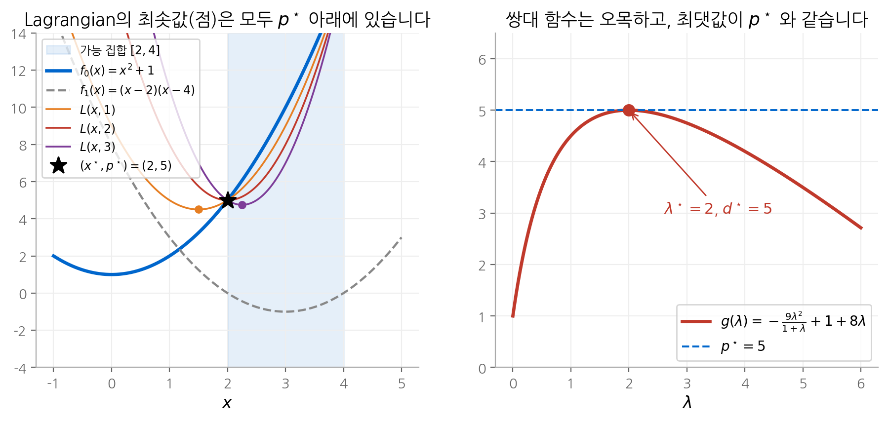
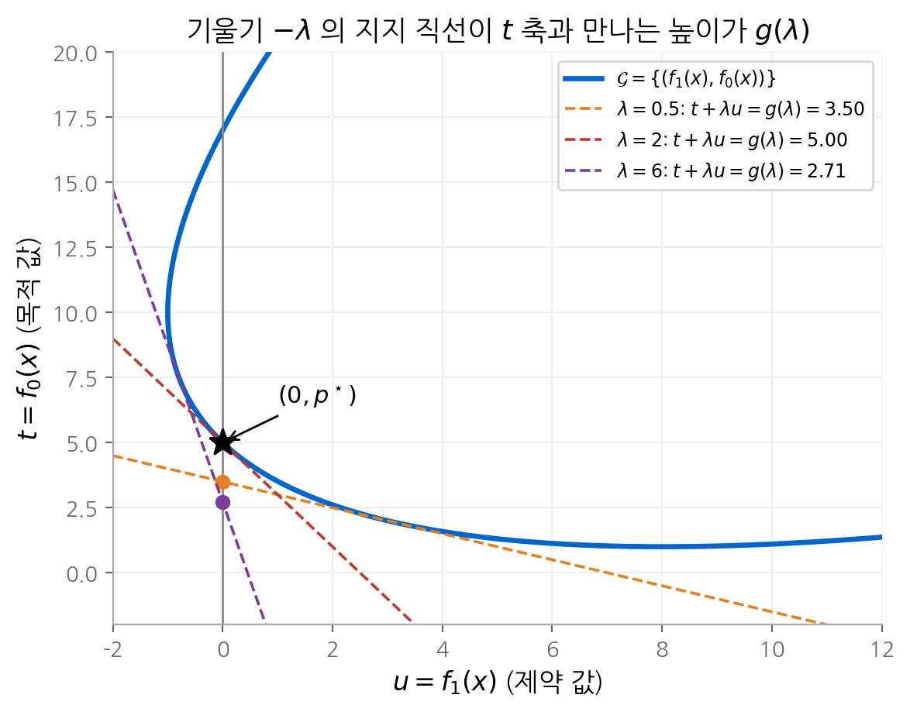
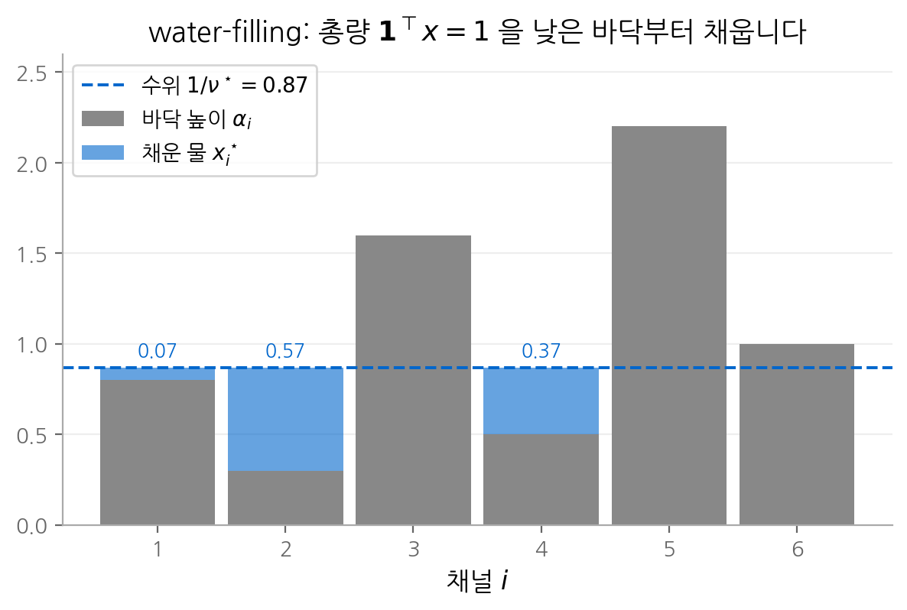

# 5. 쌍대성

최적화 문제를 풀었다고 주장하려면 두 가지가 필요합니다. 하나는 좋은 해이고, 다른 하나는 **그보다 나은 해가 없다는
증거**입니다. Lagrange 쌍대성은 두 번째를 체계적으로 만드는 도구입니다. 어떤 최적화 문제든
제약에 가중치를 붙여 목적 함수에 더하면 최적값의 하한을 얻습니다. 가장 좋은 하한을 찾는 문제가 쌍대 문제이고,
이 문제는 원래 문제가 볼록이 아니어도 항상 볼록입니다. 이 장은 하한이 정확해지는 조건, 그 조건에서 나오는
KKT 조건, 그리고 쌍대 변수가 제약의 "가격"이라는 해석을 유도합니다. SVM의 support vector, 11장의 내점법,
제약이 있는 학습 목표의 페널티 계수가 모두 이 장의 결과에 기대고 있습니다.

!!! info "원문과 자료"
    - 교재: Boyd & Vandenberghe, *Convex Optimization*, 5장 (pp. 215–290)
    - 슬라이드: [5. Duality](https://web.stanford.edu/~boyd/cvxbook/bv_cvxslides.pdf#page=154) (pp. 154–192)
        - [Lagrangian과 쌍대 함수](https://web.stanford.edu/~boyd/cvxbook/bv_cvxslides.pdf#page=155) ·
          [쌍대 문제](https://web.stanford.edu/~boyd/cvxbook/bv_cvxslides.pdf#page=163) ·
          [KKT 조건](https://web.stanford.edu/~boyd/cvxbook/bv_cvxslides.pdf#page=172) ·
          [민감도 분석](https://web.stanford.edu/~boyd/cvxbook/bv_cvxslides.pdf#page=176) ·
          [문제 재구성](https://web.stanford.edu/~boyd/cvxbook/bv_cvxslides.pdf#page=180) ·
          [대안 정리](https://web.stanford.edu/~boyd/cvxbook/bv_cvxslides.pdf#page=184)

## 1. Lagrangian과 쌍대 함수

[4장](04-convex-problems.md)의 표준형 문제에서 시작합니다. 이 절의 결과는 문제가 볼록이 아니어도 성립합니다.

$$
\text{minimize } f_0(x) \quad \text{subject to } f_i(x) \le 0 \ (i = 1, \dots, m), \quad h_i(x) = 0 \ (i = 1, \dots, p)
$$

정의역을 $\mathcal{D}$, 최적값을 $p^\star$ 라고 하겠습니다. **Lagrangian**은 제약 함수에 가중치를 붙여 목적 함수에 더한 함수입니다.

$$
L(x, \lambda, \nu) = f_0(x) + \sum_{i=1}^m \lambda_i f_i(x) + \sum_{i=1}^p \nu_i h_i(x)
$$

$\lambda_i$ 와 $\nu_i$ 를 **Lagrange 승수** 또는 쌍대 변수라고 합니다. **쌍대 함수**(dual function)는
$x$ 에 대한 Lagrangian의 하한입니다.

$$
g(\lambda, \nu) = \inf_{x \in \mathcal{D}} L(x, \lambda, \nu)
$$

### 쌍대 함수는 항상 오목합니다

$x$ 를 하나 고정하면 $L(x, \lambda, \nu)$ 는 $(\lambda, \nu)$ 에 대한 아핀 함수입니다. $g$ 는 이 아핀 함수들의 점별 하한이므로
오목입니다. $f_i$ 가 볼록인지와 관계없습니다. 이 사실 하나가 쌍대 문제를 항상 볼록 문제로 만듭니다.

### 하한 성질

$\lambda \succeq 0$ 이면 $g(\lambda, \nu) \le p^\star$ 입니다. 증명은 한 줄입니다. 가능해 $\tilde{x}$ 에서는 $f_i(\tilde{x}) \le 0$,
$h_i(\tilde{x}) = 0$ 이므로 제약 항의 합이 0 이하입니다.

$$
f_0(\tilde{x}) \ge f_0(\tilde{x}) + \sum_i \lambda_i f_i(\tilde{x}) + \sum_i \nu_i h_i(\tilde{x}) = L(\tilde{x}, \lambda, \nu) \ge \inf_x L(x, \lambda, \nu) = g(\lambda, \nu)
$$

모든 가능해 $\tilde{x}$ 에 대해 최소를 취하면 $p^\star \ge g(\lambda, \nu)$ 입니다.

Lagrangian은 제약을 **부드러운 벌점**으로 바꾼 것으로 볼 수 있습니다. 원래 문제의 제약은 위반하면 비용이 무한대인
딱딱한 벌점이고, Lagrangian은 이를 선형 벌점 $\lambda_i f_i(x)$ 로 근사합니다. 선형 벌점은 제약을 만족하는 쪽에서
오히려 보상을 주므로 딱딱한 벌점보다 항상 작고, 그래서 하한이 됩니다.

### 예: 1차원 문제

교재의 예를 끝까지 계산합니다. 이 장의 그림은 모두 이 문제를 씁니다.

$$
\text{minimize } x^2 + 1 \quad \text{subject to } (x - 2)(x - 4) \le 0
$$

가능 집합은 $[2, 4]$ 이고 $x^\star = 2$, $p^\star = 5$ 입니다. Lagrangian을 $x$ 에 대해 정리합니다.

$$
L(x, \lambda) = x^2 + 1 + \lambda(x - 2)(x - 4) = (1 + \lambda) x^2 - 6\lambda x + (1 + 8\lambda)
$$

$\lambda > -1$ 이면 이차 함수이므로 $x = 3\lambda / (1 + \lambda)$ 에서 최소이고, 대입하면 쌍대 함수를 얻습니다.

$$
g(\lambda) = -\frac{9\lambda^2}{1 + \lambda} + 1 + 8\lambda
$$

$g'(\lambda) = 0$ 을 풀면 $\lambda^\star = 2$ 이고 $g(2) = -12 + 1 + 16 = 5$ 입니다. **가장 좋은 하한이 정확히 $p^\star$ 와 같습니다.**

<figure markdown>

<figcaption>
왼쪽: λ = 1, 2, 3 에 대한 Lagrangian입니다. 각 곡선의 최솟값(점)이 g(λ) 이고, 모두 p* = 5 이하입니다.
λ = 2 의 최솟값은 정확히 (2, 5) 에 놓여 별과 겹칩니다. 오른쪽: 쌍대 함수 g(λ) 는 오목하고 λ = 2 에서 최댓값 5 를 가집니다.
</figcaption>
</figure>

### 예: 최소 노름 해

$Ax = b$ 를 만족하는 해 중 노름이 가장 작은 해를 찾는 문제입니다.

$$
\text{minimize } x^\top x \quad \text{subject to } Ax = b
$$

$L(x, \nu) = x^\top x + \nu^\top (Ax - b)$ 의 그래디언트를 0으로 놓으면 $2x + A^\top \nu = 0$ 이므로 $x = -\tfrac{1}{2} A^\top \nu$ 입니다.
대입하면 다음과 같습니다.

$$
g(\nu) = -\tfrac{1}{4} \nu^\top A A^\top \nu - b^\top \nu
$$

어떤 $\nu$ 를 넣어도 $p^\star$ 의 하한입니다. $g$ 를 최대화하면 $\nu^\star = -2(AA^\top)^{-1} b$ 이고, $x^\star = A^\top (AA^\top)^{-1} b$ 로
익숙한 의사역행렬 해가 나옵니다.

### 켤레 함수와의 관계

제약이 선형이면 쌍대 함수는 3장의 **켤레 함수**(conjugate function) $f^*(y) = \sup_x (y^\top x - f(x))$ 로 바로 쓸 수 있습니다.
$Ax \preceq b$, $Cx = d$ 제약에 대해 다음이 성립합니다.

$$
g(\lambda, \nu) = -f_0^*(-A^\top \lambda - C^\top \nu) - b^\top \lambda - d^\top \nu
$$

켤레 함수를 아는 목적 함수라면 쌍대 함수를 계산 없이 적을 수 있습니다.

## 2. 쌍대 문제

모든 $\lambda \succeq 0$ 이 하한을 주므로, 가장 좋은 하한을 찾는 문제를 세울 수 있습니다. 이것이 **Lagrange 쌍대 문제**입니다.

$$
\text{maximize } g(\lambda, \nu) \quad \text{subject to } \lambda \succeq 0
$$

오목 함수를 볼록 집합 위에서 최대화하므로 **원래 문제와 무관하게 항상 볼록 문제**입니다. 최적값을 $d^\star$ 로 씁니다.
원래 문제는 쌍대 문제와 구분해 **원 문제**(primal problem)라고 부릅니다.

$g = -\infty$ 인 $(\lambda, \nu)$ 는 쓸모가 없으므로, 보통 $\operatorname{dom} g$ 라는 암묵적 제약을 명시적 제약으로 바꿔 씁니다.

### 예: 부등식 형식 LP

$$
\text{minimize } c^\top x \quad \text{subject to } Ax \preceq b
$$

Lagrangian $L = c^\top x + \lambda^\top (Ax - b) = (c + A^\top \lambda)^\top x - b^\top \lambda$ 는 $x$ 에 대해 선형입니다.
선형 함수의 하한은 기울기가 0일 때만 유한하므로 다음과 같습니다.

$$
g(\lambda) = \begin{cases} -b^\top \lambda & A^\top \lambda + c = 0 \\ -\infty & \text{otherwise} \end{cases}
$$

암묵적 제약을 꺼내면 쌍대 문제도 LP입니다.

$$
\text{maximize } -b^\top \lambda \quad \text{subject to } A^\top \lambda + c = 0, \quad \lambda \succeq 0
$$

[4장 그림](04-convex-problems.md)의 LP에 적용해 보겠습니다. 최적해 $x^\star = (1, 3)$ 에서 활성 제약은 $x_1 + x_2 \le 4$ 와
$-x_1 + x_2 \le 2$ 입니다. 나머지 제약의 승수를 0으로 두면 $A^\top \lambda + c = 0$ 은 다음 연립방정식이 됩니다.

$$
\lambda_1 - \lambda_2 = 1, \quad \lambda_1 + \lambda_2 = 2 \quad \Longrightarrow \quad \lambda_1 = 1.5, \ \lambda_2 = 0.5
$$

쌍대 목적값은 $-(4 \times 1.5 + 2 \times 0.5) = -7$ 로 $p^\star$ 와 같습니다. 이 $\lambda$ 는 "$-7$ 보다 나은 해가 없다"는
**최적성 증명서**(certificate)입니다. 솔버가 원 문제와 쌍대 문제를 함께 푸는 이유가 이것입니다.

### 예: 볼록이 아닌 문제의 하한

$W \in \mathbf{S}^n$ 일 때 $x^\top W x$ 를 $x_i^2 = 1$ 제약 아래 최소화하는 **two-way partitioning 문제**는 가능해가 $2^n$ 개인
조합 문제입니다. 쌍대 함수를 계산하면 다음과 같습니다.

$$
g(\nu) = \inf_x \left( x^\top (W + \operatorname{diag}(\nu)) x \right) - \mathbf{1}^\top \nu = \begin{cases} -\mathbf{1}^\top \nu & W + \operatorname{diag}(\nu) \succeq 0 \\ -\infty & \text{otherwise} \end{cases}
$$

쌍대 문제 "maximize $-\mathbf{1}^\top \nu$ subject to $W + \operatorname{diag}(\nu) \succeq 0$" 은 [4장](04-convex-problems.md)의 SDP이고 다항 시간에 풀립니다.
풀기 어려운 문제에 대해 계산 가능한 하한을 얻은 것입니다.

## 3. 약쌍대성과 강쌍대성

하한 성질에서 바로 **약쌍대성**(weak duality)을 얻습니다.

$$
d^\star \le p^\star
$$

이 부등식은 모든 문제에서 성립합니다. 차이 $p^\star - d^\star \ge 0$ 을 **쌍대 간격**(duality gap)이라고 합니다.
간격이 0인 경우, 즉 $d^\star = p^\star$ 를 **강쌍대성**(strong duality)이라고 합니다.

강쌍대성은 일반적으로 성립하지 않습니다. 그러나 볼록 문제에서는 대개 성립하고, 성립을 보장하는 조건을
**제약 자격**(constraint qualification)이라고 합니다. 가장 널리 쓰는 것은 **Slater 조건**입니다.

!!! note "Slater 조건"
    볼록 문제에서 다음을 만족하는 점 $x \in \operatorname{relint} \mathcal{D}$ 가 있으면 강쌍대성이 성립합니다.

    $$
    f_i(x) < 0 \quad (i = 1, \dots, m), \qquad Ax = b
    $$

    즉 **엄격하게 가능한** 점이 하나 있으면 됩니다. 아핀 부등식 제약은 등호로 만족해도 됩니다.
    $p^\star > -\infty$ 이면 쌍대 최적해가 실제로 존재한다는 것도 보장됩니다.

1절의 1차원 예는 $f_0$ 와 $f_1$ 이 모두 볼록인 볼록 문제이고, $x = 3$ 에서 $f_1(3) = -1 < 0$ 이므로 Slater 조건을 만족합니다.
그래서 $d^\star = p^\star = 5$ 였습니다. 아핀 부등식만 있는 LP는 원 문제가 가능하기만 하면 강쌍대성이 성립합니다.

### 강쌍대성이 깨지는 예

교재의 반례입니다. 정의역 $\mathcal{D} = \{(x, y) \mid y > 0\}$ 에서 다음 문제를 생각합니다.

$$
\text{minimize } e^{-x} \quad \text{subject to } x^2 / y \le 0
$$

$x^2/y$ 는 $y > 0$ 에서 볼록이므로 볼록 문제입니다. 제약은 $x = 0$ 일 때만 만족하므로 $p^\star = e^0 = 1$ 입니다.
쌍대 함수는 다음과 같습니다.

$$
g(\lambda) = \inf_{y > 0} \left( e^{-x} + \lambda x^2 / y \right) = 0 \quad (\lambda \ge 0)
$$

$x$ 를 크게 하면서 $y$ 를 훨씬 더 크게 하면 두 항을 모두 0에 가깝게 만들 수 있기 때문입니다. 따라서 $d^\star = 0$ 이고
쌍대 간격은 1입니다. Slater 조건은 $x^2/y < 0$ 인 점이 없으므로 성립하지 않습니다.

## 4. 기하적 해석

부등식 제약이 하나인 경우를 그림으로 보겠습니다. 모든 $x$ 에 대해 (제약 값, 목적 값) 쌍을 모은 집합을 정의합니다.

$$
\mathcal{G} = \{ (f_1(x), f_0(x)) \mid x \in \mathcal{D} \} \subseteq \mathbb{R}^2
$$

최적값은 $\mathcal{G}$ 중 $u \le 0$ 인 부분에서 가장 낮은 $t$ 이므로 $p^\star = \inf\{ t \mid (u, t) \in \mathcal{G}, u \le 0 \}$ 입니다.
쌍대 함수는 다음과 같이 쓸 수 있습니다.

$$
g(\lambda) = \inf_{(u, t) \in \mathcal{G}} (t + \lambda u)
$$

$t + \lambda u = g(\lambda)$ 는 기울기 $-\lambda$ 인 직선이고, $\mathcal{G}$ 전체가 그 위쪽에 놓이는 가장 높은 직선입니다.
즉 $\mathcal{G}$ 의 **지지 직선**입니다. 이 직선이 $t$ 축($u = 0$)과 만나는 높이가 $g(\lambda)$ 입니다.

<figure markdown>

<figcaption>
1절 예제의 집합 𝒢 입니다. λ 마다 기울기 −λ 인 지지 직선을 대면 t 축과의 교점이 g(λ) 입니다.
λ = 0.5 와 λ = 6 의 직선은 (0, p*) 아래에서 t 축과 만나 느슨한 하한을 줍니다. λ = 2 의 직선은 (0, p*) 를 지나므로
하한이 정확합니다.
</figcaption>
</figure>

약쌍대성도 그림에서 읽을 수 있습니다. $\lambda \ge 0$ 이고 $u \le 0$ 이면 $t + \lambda u \le t$ 입니다. 따라서 직선이 $t$ 축과 만나는 높이는
가능한 점들의 $t$ 보다 높을 수 없습니다.

강쌍대성은 $(0, p^\star)$ 에서 **수직이 아닌** 지지 직선이 존재한다는 뜻입니다. 이를 엄밀히 다루려면 $\mathcal{G}$ 대신
$\mathcal{A} = \{(u, t) \mid \exists x \in \mathcal{D}, \ f_1(x) \le u, \ f_0(x) \le t\}$ 를 씁니다. 볼록 문제에서는 $\mathcal{A}$ 가 볼록이므로
2장의 지지 초평면 정리에 따라 $(0, p^\star)$ 에서 지지 직선이 존재합니다. Slater 조건은 $u < 0$ 인 점이 $\mathcal{A}$ 에 있다는 뜻이고,
이 점이 있으면 지지 직선이 수직일 수 없습니다. 위 그림의 $\mathcal{G}$ 는 볼록이 아니지만 $\mathcal{A}$ 는 볼록입니다.

## 5. 안장점 해석

Lagrangian을 $\lambda$ 에 대해 최대화하면 원 문제가 다시 나타납니다.

$$
\sup_{\lambda \succeq 0} L(x, \lambda) = \sup_{\lambda \succeq 0} \left( f_0(x) + \sum_i \lambda_i f_i(x) \right) = \begin{cases} f_0(x) & f_i(x) \le 0 \ \text{for all } i \\ +\infty & \text{otherwise} \end{cases}
$$

어떤 제약이라도 위반하면 그 승수를 무한히 키울 수 있기 때문입니다. 따라서 원 문제와 쌍대 문제는
**최소화와 최대화의 순서만 다른** 같은 식입니다.

$$
p^\star = \inf_x \sup_{\lambda \succeq 0} L(x, \lambda), \qquad d^\star = \sup_{\lambda \succeq 0} \inf_x L(x, \lambda)
$$

약쌍대성은 모든 함수에서 성립하는 **최대최소 부등식** $\sup_\lambda \inf_x \le \inf_x \sup_\lambda$ 의 한 경우입니다.
강쌍대성은 두 순서를 바꿔도 값이 같다는 뜻입니다. 이때 $(x^\star, \lambda^\star)$ 는 Lagrangian의 **안장점**(saddle point)입니다.

$$
L(x^\star, \lambda) \le L(x^\star, \lambda^\star) \le L(x, \lambda^\star) \quad \text{for all } x, \ \lambda \succeq 0
$$

게임으로 읽으면 $x$ 를 고르는 사람은 $L$ 을 줄이려 하고, $\lambda$ 를 고르는 사람은 $L$ 을 키우려 합니다.
강쌍대성은 누가 먼저 수를 두어도 결과가 같다는 뜻입니다.

이 관점은 머신러닝의 제약 있는 학습 목표를 읽는 데 유용합니다. "KL 발산을 $\delta$ 이하로 유지하면서 보상을 최대화한다"는
제약 문제의 Lagrangian은 "보상 $- \beta \cdot$ KL" 꼴입니다. RLHF(사람 피드백 강화학습)의 KL 페널티 계수 $\beta$ 를
이런 제약의 Lagrange 승수로 해석할 수 있습니다. 승수를 고정하지 않고 쌍대 변수로 함께 갱신하는 방법이
제약 강화학습의 Lagrange 완화 기법입니다.

## 6. KKT 조건

### complementary slackness 조건

강쌍대성이 성립하고 $x^\star$ 와 $(\lambda^\star, \nu^\star)$ 가 각각 원 문제와 쌍대 문제의 최적해라고 하겠습니다. 다음 부등식 사슬을 봅니다.

$$
f_0(x^\star) = g(\lambda^\star, \nu^\star) = \inf_x L(x, \lambda^\star, \nu^\star) \le L(x^\star, \lambda^\star, \nu^\star) = f_0(x^\star) + \sum_i \lambda_i^\star f_i(x^\star) + \sum_i \nu_i^\star h_i(x^\star) \le f_0(x^\star)
$$

양 끝이 같으므로 두 부등식은 모두 등호입니다. 여기서 두 가지 결론이 나옵니다.

1. $x^\star$ 는 $L(x, \lambda^\star, \nu^\star)$ 를 최소화합니다.
2. $\sum_i \lambda_i^\star f_i(x^\star) = 0$ 입니다. 각 항이 0 이하이므로 각 항이 0이어야 합니다.

두 번째 결론을 **complementary slackness 조건**이라고 합니다.

$$
\lambda_i^\star f_i(x^\star) = 0 \quad \Longleftrightarrow \quad \lambda_i^\star > 0 \Rightarrow f_i(x^\star) = 0, \qquad f_i(x^\star) < 0 \Rightarrow \lambda_i^\star = 0
$$

최적점에서 느슨한 제약의 승수는 0이고, 승수가 양수인 제약은 반드시 활성입니다. 2절 LP 예에서 비활성 제약 $x_1 \le 3$ 의 승수가 0이었던 이유입니다.

### 네 가지 조건

$f_i$, $h_i$ 가 미분 가능하면, 위 결론을 모아 **KKT 조건**(Karush-Kuhn-Tucker conditions)을 얻습니다.

| 조건 | 식 |
| --- | --- |
| 원 문제 가능성 | $f_i(x) \le 0, \quad h_i(x) = 0$ |
| 쌍대 문제 가능성 | $\lambda \succeq 0$ |
| complementary slackness | $\lambda_i f_i(x) = 0$ |
| 정상성(stationarity) | $\nabla f_0(x) + \sum_i \lambda_i \nabla f_i(x) + \sum_i \nu_i \nabla h_i(x) = 0$ |

정상성은 "$x^\star$ 가 Lagrangian을 최소화한다"를 미분으로 쓴 것입니다.

**필요 조건.** 어떤 문제든 강쌍대성이 성립하면, 원 문제와 쌍대 문제의 최적해는 KKT 조건을 만족합니다.

**충분 조건.** 볼록 문제에서 $(\tilde{x}, \tilde{\lambda}, \tilde{\nu})$ 가 KKT 조건을 만족하면 각각 최적해이고 강쌍대성이 성립합니다.
$\tilde{\lambda} \succeq 0$ 이므로 $L(x, \tilde{\lambda}, \tilde{\nu})$ 는 $x$ 에 대해 볼록입니다. 정상성에 의해 $\tilde{x}$ 가 그 최소점입니다. 따라서 다음이 성립합니다.

$$
g(\tilde{\lambda}, \tilde{\nu}) = L(\tilde{x}, \tilde{\lambda}, \tilde{\nu}) = f_0(\tilde{x}) + \underbrace{\textstyle\sum_i \tilde{\lambda}_i f_i(\tilde{x})}_{=0} + \underbrace{\textstyle\sum_i \tilde{\nu}_i h_i(\tilde{x})}_{=0} = f_0(\tilde{x})
$$

쌍대 간격이 0이므로 두 점 모두 최적입니다. 정리하면, **Slater 조건을 만족하는 미분 가능한 볼록 문제에서
KKT 조건은 최적성의 필요충분조건**입니다. 많은 알고리즘이 KKT 조건을 직접 푸는 방식으로 설계됩니다.
10장의 등식 제약 뉴턴 방법과 11장의 원-쌍대 내점법이 대표적입니다.

### 예: water-filling

$n$ 개의 통신 채널에 총 전력 1을 나누는 문제입니다. 채널 $i$ 의 잡음 수준을 $\alpha_i > 0$ 이라고 하면, 전송률의 합을 최대화하는 문제는 다음과 같습니다.

$$
\text{minimize } -\sum_{i=1}^n \log(\alpha_i + x_i) \quad \text{subject to } x \succeq 0, \quad \mathbf{1}^\top x = 1
$$

부등식 $-x_i \le 0$ 의 승수를 $\lambda_i$, 등식의 승수를 $\nu$ 라고 하면 KKT 조건은 다음과 같습니다.

$$
x \succeq 0, \quad \mathbf{1}^\top x = 1, \quad \lambda \succeq 0, \quad \lambda_i x_i = 0, \quad -\frac{1}{\alpha_i + x_i} - \lambda_i + \nu = 0
$$

마지막 식에서 $\lambda_i = \nu - 1/(\alpha_i + x_i) \ge 0$ 이므로 $\lambda$ 를 소거할 수 있습니다. complementary slackness 조건과 합치면 경우가 둘로 나뉩니다.

- $\nu < 1/\alpha_i$ 이면 $x_i = 0$ 일 수 없습니다. $x_i = 0$ 이면 $\lambda_i = \nu - 1/\alpha_i < 0$ 이 되기 때문입니다. 따라서 $x_i > 0$, $\lambda_i = 0$ 이고 $x_i = 1/\nu - \alpha_i$ 입니다.
- $\nu \ge 1/\alpha_i$ 이면 $x_i > 0$ 일 수 없습니다. $x_i > 0$ 이면 $\lambda_i = 0$ 이어야 하고 $\nu = 1/(\alpha_i + x_i) < 1/\alpha_i$ 가 되어 모순이기 때문입니다. 따라서 $x_i = 0$ 입니다.

두 경우를 합치면 해는 다음과 같습니다.

$$
x_i^\star = \max\{0, \ 1/\nu^\star - \alpha_i\}, \qquad \sum_{i=1}^n \max\{0, \ 1/\nu^\star - \alpha_i\} = 1
$$

왼쪽 합은 $1/\nu$ 에 대해 증가하는 구간별 선형 함수이므로 $\nu^\star$ 는 하나로 정해집니다.

<figure markdown>

<figcaption>
바닥 높이가 α = (0.8, 0.3, 1.6, 0.5, 2.2, 1.0) 인 여섯 채널에 물 1을 붓습니다. 수위는 1/ν* = 0.867 에서 멈추고,
바닥이 수위보다 높은 채널 3, 5, 6 에는 전력을 주지 않습니다. 각 채널의 물 높이가 x*ᵢ 입니다.
</figcaption>
</figure>

$\alpha_i$ 를 바닥 높이로 보고 물을 부으면, 물은 낮은 바닥부터 채워지고 수위 $1/\nu^\star$ 에서 멈춥니다. 그래서 이 해법을
**water-filling**이라고 부릅니다. 잡음이 큰 채널은 아예 쓰지 않는 편이 낫다는 결론이 complementary slackness 조건에서 나왔습니다.

### 예: SVM의 support vector

[4장](04-convex-problems.md)의 SVM에서 마진 제약 $y_i(w^\top x_i + b) \ge 1 - \xi_i$ 의 승수를 $\alpha_i$ 라고 하겠습니다.
정상성 조건은 $w = \sum_i \alpha_i y_i x_i$ 를 줍니다. complementary slackness 조건에 따라 마진 제약이 느슨한 점, 즉 $y_i(w^\top x_i + b) > 1$ 인 점은
$\alpha_i = 0$ 입니다. 따라서 $w$ 는 마진 위나 안쪽에 있는 소수의 점만으로 결정됩니다. 이 점들이 **support vector**입니다.
쌍대 문제에서는 데이터가 내적 $x_i^\top x_j$ 로만 나타나므로, 내적을 커널로 바꾸는 커널 SVM이 가능해집니다.

## 7. 민감도 분석

제약을 조금 바꾸면 최적값이 얼마나 변할까요? 제약을 섭동한 문제를 정의합니다.

$$
\text{minimize } f_0(x) \quad \text{subject to } f_i(x) \le u_i, \quad h_i(x) = v_i
$$

이 문제의 최적값을 $p^\star(u, v)$ 라고 하면 $p^\star(0, 0) = p^\star$ 입니다. $u_i > 0$ 은 제약 $i$ 를 느슨하게 하고, $u_i < 0$ 은 조입니다.

### 전역 부등식

강쌍대성이 성립하고 $(\lambda^\star, \nu^\star)$ 가 섭동하지 않은 문제의 쌍대 최적해라고 하겠습니다. 그러면 모든 $(u, v)$ 에 대해 다음이 성립합니다.

$$
p^\star(u, v) \ge p^\star(0, 0) - \lambda^{\star\top} u - \nu^{\star\top} v
$$

섭동한 문제의 가능해 $x$ 를 하나 잡으면 증명이 끝납니다.

$$
p^\star(0, 0) = g(\lambda^\star, \nu^\star) \le f_0(x) + \sum_i \lambda_i^\star f_i(x) + \sum_i \nu_i^\star h_i(x) \le f_0(x) + \lambda^{\star\top} u + \nu^{\star\top} v
$$

마지막 부등식은 $\lambda^\star \succeq 0$, $f_i(x) \le u_i$, $h_i(x) = v_i$ 에서 나옵니다. $x$ 에 대해 최소를 취하면 결론을 얻습니다.

이 부등식은 정성적 결론을 줍니다. $\lambda_i^\star$ 가 크면 제약 $i$ 를 조일 때($u_i < 0$) 최적값이 크게 늘어납니다.
$\lambda_i^\star$ 가 작으면 제약 $i$ 를 느슨하게 해도($u_i > 0$) 최적값이 크게 줄지 않습니다.

### 국소 민감도

$p^\star(u, v)$ 가 원점에서 미분 가능하면 승수가 정확한 기울기가 됩니다.

$$
\lambda_i^\star = -\frac{\partial p^\star(0, 0)}{\partial u_i}, \qquad \nu_i^\star = -\frac{\partial p^\star(0, 0)}{\partial v_i}
$$

Lagrange 승수는 **제약의 가격**입니다. 제약 $i$ 를 한 단위 느슨하게 할 때 얻는 목적 함수의 개선량이 $\lambda_i^\star$ 입니다.

2절 LP 예로 확인합니다. 제약 $x_1 + x_2 \le 4$ 를 $4 + u$ 로 바꾸면 활성 제약 두 개의 교점이 $x^\star = (1 + u/2, \ 3 + u/2)$ 로 이동합니다.
최적값은 다음과 같습니다.

$$
p^\star(u) = -(1 + u/2) - 2(3 + u/2) = -7 - 1.5u
$$

기울기 $-1.5$ 가 정확히 $-\lambda_1^\star$ 입니다. 비활성 제약 $x_1 \le 3$ 은 승수가 0이므로 조금 바꿔도 최적값이 변하지 않습니다.

## 8. 재구성이 쌍대를 바꿉니다

동치인 원 문제라도 쓰는 방식에 따라 쌍대 문제가 달라집니다. 쌍대 문제가 쓸모 있도록 원 문제를 **일부러 바꿔 쓰는** 기법이 있습니다.

제약 없는 문제 "minimize $f_0(Ax + b)$" 의 쌍대 함수는 상수 $p^\star$ 이므로 아무 정보도 주지 않습니다.
새 변수 $y = Ax + b$ 를 도입해 등식 제약을 만듭니다.

$$
\text{minimize } f_0(y) \quad \text{subject to } Ax + b - y = 0
$$

Lagrangian을 $x$ 와 $y$ 에 대해 따로 최소화하면 켤레 함수가 나타납니다.

$$
g(\nu) = \inf_{x, y} \left( f_0(y) - \nu^\top y + \nu^\top A x + \nu^\top b \right) = \begin{cases} b^\top \nu - f_0^*(\nu) & A^\top \nu = 0 \\ -\infty & \text{otherwise} \end{cases}
$$

예를 들어 노름 근사 "minimize $\lVert Ax - b \rVert$" 에 같은 기법을 쓰면 쌍대 문제는 다음과 같습니다.
$\lVert \cdot \rVert_*$ 는 쌍대 노름 $\lVert v \rVert_* = \sup_{\lVert u \rVert \le 1} u^\top v$ 입니다.

$$
\text{maximize } b^\top \nu \quad \text{subject to } \lVert \nu \rVert_* \le 1, \quad A^\top \nu = 0
$$

변수를 하나 늘리는 사소한 변환이 의미 있는 쌍대 문제를 만들었습니다. 같은 발상으로 목적 함수나 제약 함수를
단조 증가 함수로 변환하거나, 암묵적 제약을 명시적 제약으로 바꾸어 쌍대를 조정할 수 있습니다.

## 9. 대안 정리

쌍대성은 "이 연립 부등식에 해가 있는가?" 라는 질문에도 답합니다. 목적 함수가 0인 가능성 문제를 생각하면
$p^\star$ 는 0(가능) 또는 $+\infty$ (불가능)입니다. 쌍대 함수 $g(\lambda, \nu)$ 는 이 경우 양의 동차이므로, $g(\lambda, \nu) > 0$ 인
$\lambda \succeq 0$ 이 하나라도 있으면 $g$ 를 무한히 키울 수 있습니다. 그러면 $d^\star = +\infty$ 이고, 약쌍대성에 의해 원래 시스템은 불가능합니다.
이처럼 **둘 중 많아야 하나만 가능한** 두 시스템을 약한 대안(weak alternatives)이라고 합니다.

볼록 문제에서 제약 자격이 성립하면 **정확히 하나만 가능한** 강한 대안이 됩니다. 가장 유명한 예가 **Farkas 보조정리**입니다.

!!! note "Farkas 보조정리"
    다음 두 시스템 중 정확히 하나만 해를 가집니다.

    $$
    \text{(1)} \quad Ax \preceq 0, \quad c^\top x < 0 \qquad\qquad \text{(2)} \quad A^\top y + c = 0, \quad y \succeq 0
    $$

LP 쌍대성으로 증명합니다. "minimize $c^\top x$ subject to $Ax \preceq 0$" 은 $x = 0$ 이 가능해이므로 $p^\star$ 는 0 또는 $-\infty$ 입니다.
2절의 부등식 형식 LP 쌍대에 $b = 0$ 을 넣으면 쌍대 문제는 "maximize 0 subject to $A^\top y + c = 0$, $y \succeq 0$" 이므로
$d^\star$ 도 0 또는 $-\infty$ 입니다. 원 문제가 가능하므로 LP의 강쌍대성 $p^\star = d^\star$ 가 성립합니다.
시스템 (1)이 가능하다는 것은 $p^\star = -\infty$ 와 같고, 이는 $d^\star = -\infty$, 즉 시스템 (2)가 불가능하다는 것과 같습니다.

실용적인 의미는 **불가능성 증명서**입니다. 솔버가 문제를 불가능하다고 보고할 때, 대안 시스템의 해를 함께 돌려주면
그 판정을 누구나 검증할 수 있습니다.

## 핵심 정리

| 개념 | 핵심 내용 |
| --- | --- |
| Lagrangian | $L = f_0 + \sum \lambda_i f_i + \sum \nu_i h_i$. 딱딱한 제약을 선형 벌점으로 바꿈 |
| 쌍대 함수 | $g = \inf_x L$. 원 문제와 무관하게 항상 오목 |
| 하한 성질 | $\lambda \succeq 0 \Rightarrow g(\lambda, \nu) \le p^\star$ |
| 쌍대 문제 | maximize $g$ s.t. $\lambda \succeq 0$. 항상 볼록 문제 |
| 약쌍대성 | $d^\star \le p^\star$. 모든 문제에서 성립 |
| 강쌍대성 | $d^\star = p^\star$. 볼록 문제에서 Slater 조건이면 성립 |
| 기하적 해석 | $g(\lambda)$ 는 기울기 $-\lambda$ 인 지지 직선의 $t$ 절편 |
| 안장점 | $p^\star = \inf \sup L$, $d^\star = \sup \inf L$. 강쌍대성은 순서 교환 |
| KKT 조건 | 가능성, $\lambda \succeq 0$, complementary slackness, 정상성. 볼록 문제에서는 필요충분 |
| 민감도 | $\lambda_i^\star = -\partial p^\star / \partial u_i$. 승수는 제약의 가격 |
| 재구성 | 변수를 도입하면 쌍대 문제가 의미를 가짐 |
| 대안 정리 | 쌍대 해가 불가능성 증명서. Farkas 보조정리 |

## 다음 장

1부(이론)가 끝났습니다. [다음 장](06-approximation.md)부터는 지금까지의 도구를 응용 문제에 적용합니다. 첫 주제는
데이터에 모델을 맞추는 근사와 적합 문제이고, 노름과 벌점 함수의 선택이 해를 어떻게 바꾸는지 봅니다.
