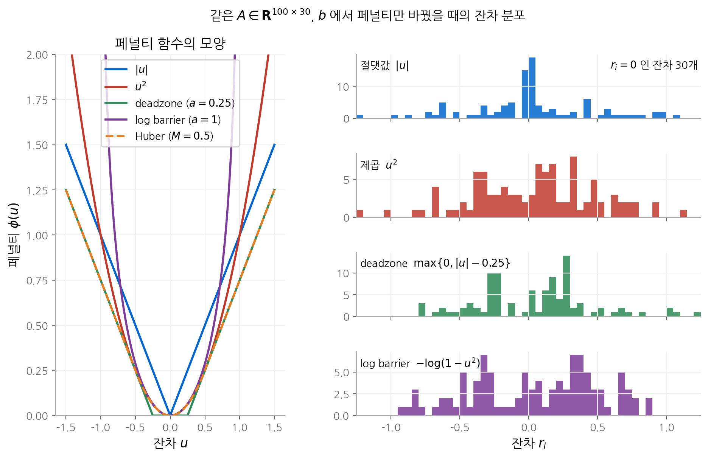
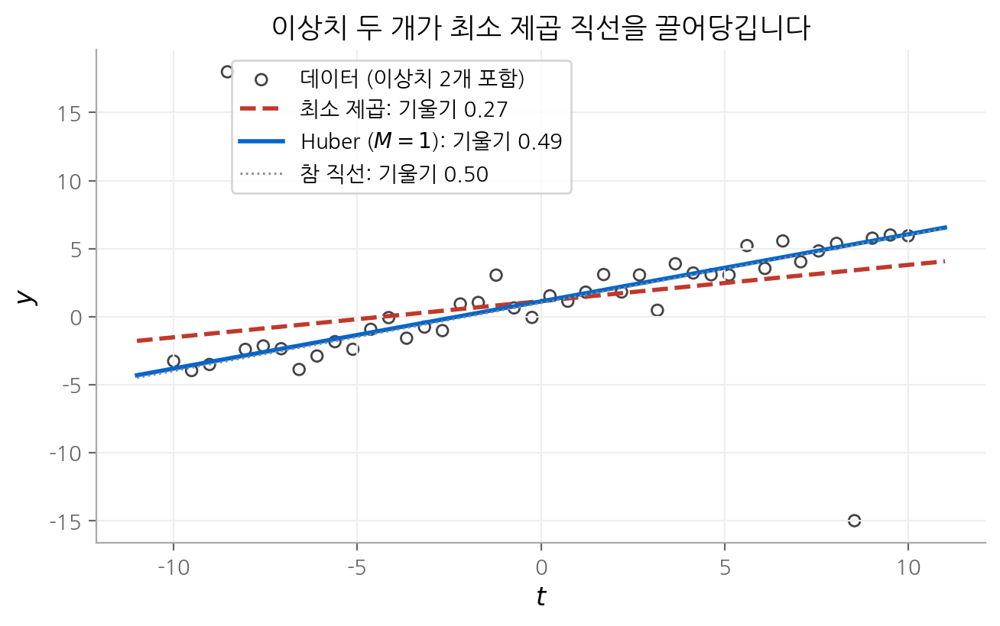
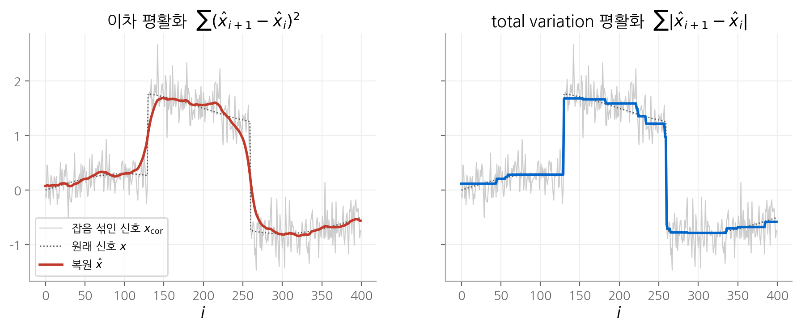

# 6. 근사와 피팅

1~5장은 볼록 최적화의 이론을 다뤘습니다. 6장부터는 그 이론을 실제 문제에 적용합니다.
첫 번째 응용은 **근사(approximation)와 피팅(fitting)** 입니다. 질문은 단순합니다.
$Ax \approx b$ 를 만족하는 $x$ 를 고를 때, "가깝다"를 어떻게 재야 할까요?
이 장의 결론은 **거리의 정의가 해의 모양을 결정한다**는 것입니다. 제곱 오차를 쓰면 잔차가 고르게 퍼지고,
절댓값을 쓰면 많은 잔차가 정확히 0이 됩니다. 머신러닝의 MSE, MAE, Huber 손실, ridge와 lasso
정규화가 모두 이 장의 특수한 경우입니다.

!!! info "원문과 자료"
    - 교재: 6장 Approximation and fitting, p.291~
    - 슬라이드: [p.193–217](https://web.stanford.edu/~boyd/cvxbook/bv_cvxslides.pdf#page=193)
    - 함께 읽기: [신경망 기초 1. 선형 회귀](../../ai/d2l/01-linear-regression.md)

## 1. 노름 근사

### 문제의 정의

$A \in \mathbf{R}^{m \times n}$ ($m \ge n$), $b \in \mathbf{R}^m$ 이 주어졌을 때 다음 문제를 **노름 근사(norm approximation)** 라고 합니다.

$$
\text{minimize} \quad \|Ax - b\|
$$

$r = Ax - b$ 를 **잔차(residual)** 라고 부릅니다. 노름은 볼록 함수이고 $Ax - b$ 는 아핀 함수이므로,
어떤 노름을 고르든 이 문제는 볼록 문제입니다([3장](03-convex-functions.md)).

같은 식을 세 가지로 읽을 수 있습니다.

| 해석 | $Ax^\star$ 의 의미 |
| --- | --- |
| 기하 | $A$ 의 열공간 $\mathcal{R}(A)$ 에서 $b$ 와 가장 가까운 점 |
| 추정 | 측정 모델 $y = Ax + v$ 에서 잡음 $v$ 가 가장 그럴듯한 $x$ |
| 설계 | 입력 $x$ 로 만들 수 있는 출력 중 목표 $b$ 에 가장 가까운 출력 |

### 세 가지 대표 노름

**$\ell_2$ 노름** 을 쓰면 최소 제곱 문제가 됩니다. 해는 정규 방정식 $A^\top A x = A^\top b$ 에서 나옵니다.

$$
x^\star = (A^\top A)^{-1} A^\top b = A^\dagger b
$$

**$\ell_\infty$ 노름** 을 쓰면 가장 큰 잔차를 최소화합니다. 이 문제를 **Chebyshev 근사**
또는 미니맥스 근사라고 합니다. 보조 변수 $t$ 를 두면 선형 계획(LP)이 됩니다.

$$
\text{minimize} \quad t \qquad \text{subject to} \quad -t\mathbf{1} \preceq Ax - b \preceq t\mathbf{1}
$$

**$\ell_1$ 노름** 을 쓰면 잔차 절댓값의 합을 최소화합니다. 이것도 LP입니다.

$$
\text{minimize} \quad \mathbf{1}^\top y \qquad \text{subject to} \quad -y \preceq Ax - b \preceq y
$$

### 작은 예: 상수 하나로 데이터 맞추기

$A = \mathbf{1} \in \mathbf{R}^4$, $b = (0, 1, 2, 10)$ 이라고 합시다. 상수 $x$ 하나로 네 값을 근사하는 문제입니다.

- $\ell_2$: $\sum (x - b_i)^2$ 를 미분하면 $x^\star = \bar{b} = 3.25$ 입니다. **평균**입니다.
- $\ell_1$: $\sum |x - b_i|$ 는 $x$ 의 양쪽에 같은 수의 점이 있을 때 최소입니다. $[1, 2]$ 의 모든 점이 해입니다. **중앙값**입니다.
- $\ell_\infty$: $\max |x - b_i|$ 는 양 끝점의 가운데에서 최소입니다. $x^\star = (0 + 10)/2 = 5$ 입니다. **범위의 중점**입니다.

이상치 10에 대한 민감도가 노름마다 다릅니다. $\ell_\infty$ 가 가장 크게 끌려가고, $\ell_1$ 은 전혀 끌려가지 않습니다.
이 차이는 다음 절에서 페널티 함수의 모양으로 설명합니다.

## 2. 페널티 함수 근사

### 정의

노름을 일반화해 잔차마다 **페널티 함수(penalty function)** $\phi: \mathbf{R} \to \mathbf{R}$ 를 적용하고 합합니다.

$$
\text{minimize} \quad \phi(r_1) + \cdots + \phi(r_m) \qquad \text{subject to} \quad r = Ax - b
$$

$\phi$ 가 볼록이면 이 문제도 볼록입니다. $\phi(u) = u^2$ 이면 $\ell_2$, $\phi(u) = |u|$ 이면 $\ell_1$ 근사입니다.
자주 쓰는 다른 페널티는 다음과 같습니다.

| 이름 | $\phi(u)$ | 특징 |
| --- | --- | --- |
| deadzone 선형 | $\max\{0, \lvert u \rvert - a\}$ | 폭 $a$ 안의 잔차는 공짜입니다. |
| log barrier | $-a^2 \log(1 - (u/a)^2)$, $\lvert u \rvert < a$ | $\lvert u \rvert \ge a$ 인 잔차를 허용하지 않습니다. |
| Huber | 아래 정의 | 작은 잔차는 제곱, 큰 잔차는 선형으로 셉니다. |

### 페널티 모양이 잔차 분포를 정합니다

페널티 함수 근사에서 핵심은 **$\phi$ 의 모양이 최적 잔차의 분포를 결정한다**는 사실입니다.
판단 기준은 두 영역에서 $\phi$ 가 얼마나 빠르게 커지는지입니다.

- **0 근처**: $|u|$ 는 0 근처에서도 기울기가 1입니다. 작은 잔차를 0으로 만드는 이득이 계속 남습니다.
  반면 $u^2$ 는 0 근처에서 기울기가 0에 가깝습니다. 이미 작은 잔차를 더 줄일 이유가 거의 없습니다.
- **큰 값 쪽**: $u^2$ 는 큰 잔차에 매우 큰 값을 매깁니다. 그래서 큰 잔차를 없애려고 다른 잔차를 희생합니다.
  $|u|$ 는 큰 잔차를 선형으로만 세므로 몇 개의 큰 잔차를 허용합니다.

<figure markdown>

<figcaption markdown>
<b>Figure 1.</b> 페널티 함수와 잔차 분포

같은 문제를 네 페널티로 푼 잔차 분포입니다. 절댓값 페널티는 잔차 30개(변수 개수 n)를 정확히 0으로 만듭니다.
</figcaption>
</figure>

### Huber 페널티

**Huber 페널티** 는 경계 $M$ 안에서는 제곱, 밖에서는 선형입니다.

$$
\phi_{\text{hub}}(u) =
\begin{cases}
u^2 & |u| \le M \\
M(2|u| - M) & |u| > M
\end{cases}
$$

$|u| = M$ 에서 값($M^2$)과 기울기($2M$)가 모두 이어지므로 미분 가능한 볼록 함수입니다.
큰 잔차를 선형으로 세므로 이상치 하나가 해 전체를 끌어당기지 못합니다. 이런 페널티를
**강건 페널티(robust penalty)** 라고 합니다. 딥러닝에서 쓰는 smooth L1 손실은 Huber 손실의 척도를 바꾼 것입니다.

<figure markdown>

<figcaption markdown>
<b>Figure 2.</b> Huber 피팅과 최소 제곱 피팅

이상치 두 개 때문에 최소 제곱 기울기는 0.27 로 줄지만, Huber 기울기는 0.49 로 참값 0.50 에 가깝습니다.
</figcaption>
</figure>

## 3. 최소 노름 문제

방정식의 개수가 변수보다 적으면($m \le n$) $Ax = b$ 의 해가 무수히 많습니다.
그중 가장 작은 해를 고르는 문제를 **최소 노름 문제(least-norm problem)** 라고 합니다.

$$
\text{minimize} \quad \|x\| \qquad \text{subject to} \quad Ax = b
$$

$\ell_2$ 노름이면 해가 닫힌 형태로 나옵니다. Lagrangian $x^\top x + \nu^\top (Ax - b)$ 를 $x$ 로 미분하면
$x = -A^\top \nu / 2$ 이고, 이를 $Ax = b$ 에 대입하면 다음을 얻습니다($A$ 의 행이 일차독립일 때).

$$
x^\star = A^\top (A A^\top)^{-1} b
$$

$\ell_1$ 노름이면 LP가 되고, 해는 대부분의 성분이 0인 **희소(sparse)** 벡터가 되는 경향이 있습니다.
이유는 1절의 꼭짓점 논리와 같습니다. $\ell_1$ 공은 좌표축 위에 꼭짓점이 있는 다면체이고,
해 집합 $\{x \mid Ax = b\}$ 는 대개 이 꼭짓점이나 낮은 차원의 면에서 공과 처음 만납니다.
compressed sensing과 basis pursuit가 이 성질을 이용합니다.

## 4. 정규화

### 이중 목적 문제

근사 오차와 해의 크기를 동시에 작게 만들고 싶을 때가 많습니다. 이는 두 목적을 가진 벡터 최적화 문제입니다([4장](04-convex-problems.md)).

$$
\text{minimize (w.r.t. } \mathbf{R}^2_+) \quad \big(\|Ax - b\|,\ \|x\|\big)
$$

$\|x\|$ 를 작게 두는 이유는 여러 가지입니다. 추정에서는 "$x$ 가 작다"는 사전 지식을 반영합니다.
설계에서는 작은 입력이 비용이 적습니다. 모델 $y = Ax$ 가 작은 $x$ 에서만 정확한 경우도 있습니다.

### 스칼라화와 trade-off 곡선

가중치 $\gamma > 0$ 로 두 목적을 더하면 일반 최적화 문제가 됩니다.

$$
\text{minimize} \quad \|Ax - b\| + \gamma \|x\|
$$

$\gamma$ 를 0부터 무한대까지 바꾸면 해가 Pareto 최적 해의 곡선, 즉 **trade-off 곡선** 을 따라 움직입니다.
$\gamma$ 가 작으면 근사가 좋고 $x$ 가 크며, $\gamma$ 가 크면 그 반대입니다.

### Tikhonov 정규화 (ridge 회귀)

두 노름을 제곱한 $\ell_2$ 형태가 가장 흔합니다.

$$
\text{minimize} \quad \|Ax - b\|_2^2 + \delta \|x\|_2^2
$$

이것을 **Tikhonov 정규화** 또는 **ridge 회귀** 라고 합니다.
두 항을 행렬 하나로 쌓으면 최소 제곱 문제가 됩니다.

$$
\left\| \begin{bmatrix} A \\ \sqrt{\delta} I \end{bmatrix} x - \begin{bmatrix} b \\ 0 \end{bmatrix} \right\|_2^2
\quad \Longrightarrow \quad x^\star = (A^\top A + \delta I)^{-1} A^\top b
$$

$\delta > 0$ 이면 $A^\top A + \delta I$ 는 항상 양의 정부호입니다. 따라서 $A$ 의 열이 일차종속이어도 해가 유일합니다.
딥러닝의 가중치 감쇠(weight decay)가 같은 항을 손실에 더합니다.

### $\ell_1$ 정규화와 희소성

$\ell_2$ 대신 $\ell_1$ 을 쓰면 **lasso** 가 됩니다. 두 정규화의 차이는 스칼라 문제 하나로 확인할 수 있습니다.

$$
\text{minimize} \quad \tfrac{1}{2}(x - b)^2 + \lambda\, \psi(x)
$$

| 정규화 | $\psi(x)$ | 최적 해 | $b$ 가 작을 때 |
| --- | --- | --- | --- |
| ridge | $\tfrac{1}{2} x^2$ | $x^\star = \dfrac{b}{1 + \lambda}$ | 비율로 줄어들 뿐 0이 되지 않습니다. |
| lasso | $\lvert x \rvert$ | $x^\star = \operatorname{sign}(b)\max\{\lvert b \rvert - \lambda, 0\}$ | $\lvert b \rvert \le \lambda$ 이면 정확히 0입니다. |

lasso의 해는 0에서 미분 불가능한 $|x|$ 의 최적성 조건 $0 \in x - b + \lambda\, \partial|x|$ 에서 나옵니다.
$x = 0$ 에서 $\partial |x| = [-1, 1]$ 이므로 $|b| \le \lambda$ 인 모든 $b$ 에서 $x = 0$ 이 조건을 만족합니다.
이 연산을 **soft thresholding** 이라고 합니다. 2절에서 본 "0 근처의 기울기"가 같은 현상을 만듭니다.

### 신호 복원과 total variation

잡음 섞인 신호 $x_{\text{cor}} = x + v$ 에서 원래 신호를 복원하는 문제도 정규화 문제입니다.

$$
\text{minimize} \quad \|\hat{x} - x_{\text{cor}}\|_2^2 + \lambda\, \phi(\hat{x})
$$

**이차 평활화** $\phi_{\text{quad}}(\hat{x}) = \sum_i (\hat{x}_{i+1} - \hat{x}_i)^2$ 는 이웃한 값의 차이를 제곱으로 셉니다.
큰 점프에 큰 비용을 매기므로 잡음과 함께 급격한 변화도 뭉갭니다.
**total variation(TV) 평활화** $\phi_{\text{tv}}(\hat{x}) = \sum_i |\hat{x}_{i+1} - \hat{x}_i|$ 는 차이를 $\ell_1$ 으로 셉니다.
그래서 차이 벡터가 희소해집니다. 대부분의 구간에서 $\hat{x}$ 가 일정하고, 소수의 지점에서만 점프합니다.

<figure markdown>

<figcaption markdown>
<b>Figure 3.</b> 이차 평활화와 total variation 평활화

이차 평활화는 계단을 경사로 뭉갭니다. total variation 평활화는 계단을 보존하지만 완만한 구간을 작은 계단으로 근사합니다.
</figcaption>
</figure>

## 5. 강건 근사

### 불확실한 행렬

지금까지는 $A$ 를 정확히 안다고 가정했습니다. 실제로는 $A$ 에도 오차가 있습니다.
불확실성을 다루는 방법은 두 가지입니다.

- **확률적 강건 근사**: $A$ 를 확률 변수로 보고 $\mathbf{E}\|Ax - b\|$ 를 최소화합니다.
- **최악 경우 강건 근사**: $A$ 가 집합 $\mathcal{A}$ 안에 있다고 보고 $\sup_{A \in \mathcal{A}} \|Ax - b\|$ 를 최소화합니다.

두 문제 모두 볼록이지만, 계산이 쉬운 경우는 일부 노름, 분포, 집합에 한정됩니다.

### 확률적 강건 최소 제곱은 Tikhonov 정규화입니다

$A = \bar{A} + U$ 이고 $\mathbf{E}\,U = 0$, $\mathbf{E}\,U^\top U = P$ 라고 합시다. 목적 함수를 전개합니다.

$$
\begin{aligned}
\mathbf{E}\|(\bar{A} + U)x - b\|_2^2
&= \|\bar{A}x - b\|_2^2 + 2(\bar{A}x - b)^\top \mathbf{E}[U]\, x + \mathbf{E}[x^\top U^\top U x] \\
&= \|\bar{A}x - b\|_2^2 + x^\top P x
\end{aligned}
$$

가운데 항은 $\mathbf{E}\,U = 0$ 이라 사라집니다. $P = \delta I$ 이면 정확히 Tikhonov 정규화입니다.
**$A$ 의 불확실성이 클수록 $x$ 를 작게 유지해야 한다**는 뜻입니다. 큰 $x$ 는 $A$ 의 오차를 크게 증폭하기 때문입니다.

### 최악 경우: 노름 정규화

불확실성 집합이 $\mathcal{A} = \{\bar{A} + U \mid \|U\|_2 \le \rho\}$ ($\|U\|_2$ 는 최대 특잇값)이면 최악 잔차를 직접 계산할 수 있습니다.

$$
\sup_{\|U\|_2 \le \rho} \|(\bar{A} + U)x - b\|_2 = \|\bar{A}x - b\|_2 + \rho \|x\|_2
$$

삼각 부등식으로 좌변이 우변보다 크지 않습니다. 반대 방향은 $Ux$ 가 $\bar{A}x - b$ 와 같은 방향을 향하는
랭크 1 행렬 $U = \rho\, \dfrac{(\bar{A}x - b)}{\|\bar{A}x - b\|_2} \dfrac{x^\top}{\|x\|_2}$ 로 확인합니다.
결과는 **제곱하지 않은 노름의 정규화 문제**입니다. 이 문제는 이차 원뿔 계획(SOCP)으로 풉니다.
불확실성 집합이 타원체이면 최악 경우 강건 최소 제곱은 반정부호 계획(SDP)이 됩니다(교재 6.4.2절).

## 6. 함수 피팅과 보간

### 기저 함수로 함수 공간을 매개화합니다

데이터 $(u_i, y_i)$ 에 함수를 맞추는 문제도 근사 문제입니다. 기저 함수 $f_1, \dots, f_n$ 의 선형 결합을 씁니다.

$$
f(u) = x_1 f_1(u) + \cdots + x_n f_n(u)
$$

$f(u_i)$ 는 $x$ 에 대해 선형입니다. 따라서 $\sum_i \phi(f(u_i) - y_i)$ 를 최소화하는 문제는 1~2절의 근사 문제와 같습니다.
기저로는 다항식, 스플라인, 삼각 함수를 씁니다. $f$ 에 대한 다음 조건도 $x$ 에 대해 볼록입니다.

- 특정 점에서의 값이나 미분 값의 범위: $x$ 에 대한 선형 부등식입니다.
- 구간 위 최댓값의 상한: 선형 부등식 무한 개의 교집합이므로 볼록입니다.
- 계수의 희소성: $\|x\|_1$ 정규화로 적은 기저만 쓰는 **희소 표현(sparse description)** 을 얻습니다.

### 볼록 함수로 보간하기

데이터 $(u_i, y_i)$ 를 지나는 볼록 함수가 존재할까요? 교재 6.5.5절의 답은 다음 조건입니다.

$$
\exists\, g_1, \dots, g_m \quad \text{such that} \quad y_j \ge y_i + g_i^\top (u_j - u_i) \quad \text{for all } i, j
$$

필요성은 볼록 함수의 1차 조건([3장](03-convex-functions.md))에서 나옵니다. $g_i$ 를 $u_i$ 에서의 기울기로 두면 됩니다.
충분성은 $f(z) = \max_i \big(y_i + g_i^\top (z - u_i)\big)$ 를 만들면 확인됩니다. 이 함수는 아핀 함수의 최댓값이라 볼록이고,
조건 덕분에 $f(u_i) = y_i$ 입니다. 조건이 $(g_i)$ 에 대한 선형 부등식이므로 존재 여부를 LP로 판정합니다.
같은 아이디어로 "볼록 함수로 맞추는 최소 제곱 피팅"도 QP로 풀립니다.

## 핵심 정리

| 개념 | 핵심 식 | 기억할 점 |
| --- | --- | --- |
| 노름 근사 | $\min \lVert Ax - b \rVert$ | $\ell_2$ 는 평균, $\ell_1$ 은 중앙값, $\ell_\infty$ 는 범위의 중점처럼 동작합니다. |
| 페널티 근사 | $\min \sum \phi(r_i)$ | 0 근처와 큰 값 쪽의 증가 속도가 잔차 분포를 정합니다. |
| Huber | 제곱 + 선형 | 이상치에 강건하고 미분 가능합니다. |
| 최소 노름 | $\min \lVert x \rVert$ s.t. $Ax = b$ | $\ell_2$ 해는 $A^\top(AA^\top)^{-1}b$, $\ell_1$ 해는 희소합니다. |
| ridge | $(A^\top A + \delta I)^{-1} A^\top b$ | 확률적 강건 최소 제곱과 같습니다. |
| lasso | soft thresholding | $\lvert b \rvert \le \lambda$ 이면 정확히 0입니다. |
| total variation | $\sum \lvert \hat{x}_{i+1} - \hat{x}_i \rvert$ | 급격한 변화를 보존합니다. |
| 최악 경우 강건 | $\lVert \bar{A}x - b \rVert_2 + \rho \lVert x \rVert_2$ | 제곱하지 않은 정규화이며 SOCP입니다. |

## 다음 장

6장에서는 페널티 함수를 "가깝다"의 정의로 골랐습니다. [다음 장](07-statistical-estimation.md)에서는 같은 페널티가
**잡음의 확률 분포**에서 자연스럽게 나온다는 것을 최대우도 추정으로 보입니다.
