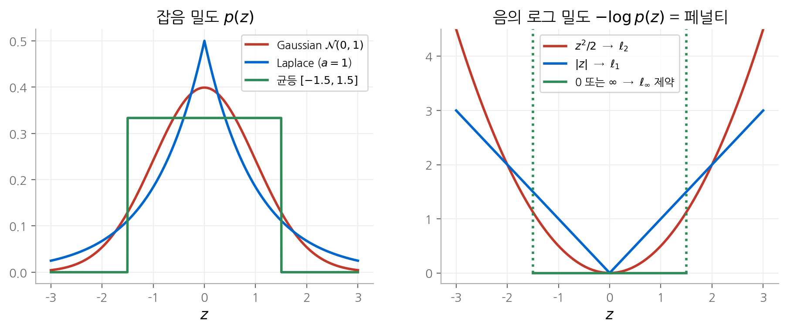
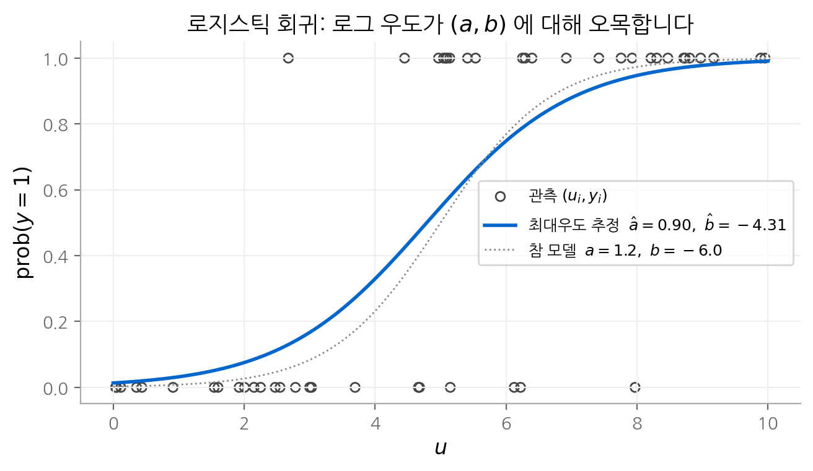
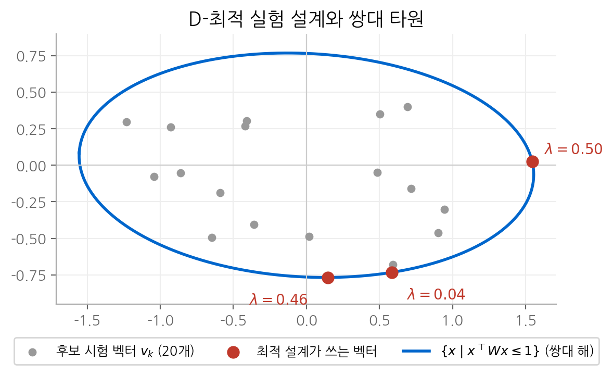

# 7. 통계적 추정

[6장](06-approximation.md)에서는 페널티 함수를 "가깝다"의 정의로 직접 골랐습니다. 이 장에서는 같은 문제를
확률의 관점에서 다시 봅니다. 관측값이 어떤 분포에서 나왔는지 가정하면, 가장 그럴듯한 파라미터를 고르는 문제가
최적화 문제가 됩니다. 이 장이 답하는 질문은 **언제 그 최적화 문제가 볼록인가**입니다.
답은 대부분 "로그 우도가 파라미터에 대해 오목하면"입니다. 이 조건 하나로 최소 제곱, 로지스틱 회귀,
공분산 추정, 검출기 설계, 실험 설계가 모두 효율적으로 풀리는 문제가 됩니다.

!!! info "원문과 자료"
    - 교재: 7장 Statistical estimation, p.351~
    - 슬라이드: [p.218–242](https://web.stanford.edu/~boyd/cvxbook/bv_cvxslides.pdf#page=218)
    - 함께 읽기: [신경망 기초 1. 선형 회귀](../../ai/d2l/01-linear-regression.md)

## 1. 최대우도 추정

### 정의

파라미터 $x$ 로 색인된 확률 밀도족 $p_x(y)$ 가 있다고 합시다. 관측값 $y$ 를 고정하고 $p_x(y)$ 를 $x$ 의 함수로 보면
**우도 함수(likelihood function)** 가 됩니다. 그 로그를 **로그 우도(log-likelihood)** 라고 합니다.

$$
l(x) = \log p_x(y)
$$

**최대우도 추정(maximum likelihood estimation, MLE)** 은 $l(x)$ 를 최대화하는 $x$ 를 고릅니다.
파라미터에 대한 사전 지식 $x \in C$ 가 있으면 제약으로 넣습니다. 허용되지 않는 $x$ 에서는 $p_x(y) = 0$,
즉 $l(x) = -\infty$ 로 두면 제약을 따로 쓰지 않아도 됩니다.

### 볼록 문제가 되는 조건

$y$ 를 고정했을 때 **$l(x)$ 가 $x$ 에 대해 오목**이고 $C$ 가 볼록이면, MLE는 볼록 최적화 문제입니다.
여기서 주의할 점이 있습니다. 이 조건은 "$p_x(y)$ 가 $y$ 에 대해 로그 오목한 밀도"라는 조건과 다릅니다.
전자는 파라미터에 대한 성질이고, 후자는 확률 변수에 대한 성질입니다.

### 선형 측정과 IID 잡음

가장 중요한 경우는 선형 측정 모델입니다.

$$
y_i = a_i^\top x + v_i, \qquad i = 1, \dots, m
$$

잡음 $v_i$ 가 밀도 $p(z)$ 를 갖는 IID(independent and identically distributed) 확률 변수라면 로그 우도는 다음과 같습니다.

$$
l(x) = \sum_{i=1}^m \log p(y_i - a_i^\top x)
$$

$p$ 가 **로그 오목(log-concave)** 이면, 즉 $\log p$ 가 오목이면 $l$ 은 $x$ 의 아핀 함수에 오목 함수를 합성한 것이므로 오목입니다.
Gaussian, Laplace, 균등, 로지스틱 분포가 모두 로그 오목입니다.

## 2. 잡음 모델이 페널티를 정합니다

MLE는 $-l(x) = \sum_i -\log p(y_i - a_i^\top x)$ 를 최소화합니다. 이는 [6장](06-approximation.md)의 페널티 함수 근사에서
$\phi(z) = -\log p(z)$ 로 둔 것과 같습니다. **페널티 함수는 잡음 밀도의 음의 로그입니다.**

| 잡음 분포 | $p(z)$ | $-l(x)$ (상수 제외) | MLE |
| --- | --- | --- | --- |
| Gaussian $\mathcal{N}(0, \sigma^2)$ | $\dfrac{1}{\sqrt{2\pi\sigma^2}} e^{-z^2/2\sigma^2}$ | $\dfrac{1}{2\sigma^2}\lVert Ax - y \rVert_2^2$ | 최소 제곱 |
| Laplace | $\dfrac{1}{2a} e^{-\lvert z \rvert / a}$ | $\dfrac{1}{a}\lVert Ax - y \rVert_1$ | $\ell_1$ 근사 |
| 균등 $[-a, a]$ | $\dfrac{1}{2a}$ ($\lvert z \rvert \le a$) | $\lVert Ax - y \rVert_\infty \le a$ 이면 상수, 아니면 $\infty$ | 실현 가능성 문제 |

균등 잡음에서는 $|a_i^\top x - y_i| \le a$ 를 모두 만족하는 $x$ 가 전부 최대우도 추정입니다. 우도가 그 집합 안에서 일정하기 때문입니다.

<figure markdown>

<figcaption>
왼쪽: 세 가지 잡음 밀도입니다. 오른쪽: 각 밀도의 음의 로그를 z = 0 에서 0이 되게 옮긴 것입니다.
꼬리가 두꺼운 Laplace 분포는 선형 페널티를, 꼬리가 얇은 Gaussian 분포는 이차 페널티를 줍니다.
균등 분포는 허용 범위 밖을 무한대로 막는 제약이 됩니다.
</figcaption>
</figure>

꼬리의 두께가 강건성을 정합니다. Laplace 분포는 큰 잡음을 Gaussian보다 훨씬 자주 허용합니다.
그래서 큰 잔차를 덜 벌하고, 그 결과 이상치에 덜 민감합니다. 신경망에서 MSE와 MAE를 고르는 일은
잡음 분포를 가정하는 일과 같습니다.

## 3. 로지스틱 회귀

### 모델

$y \in \{0, 1\}$ 이 설명 변수 $u \in \mathbf{R}^n$ 에 따라 다음 확률로 1이 된다고 가정합니다.

$$
\mathrm{prob}(y = 1) = \frac{\exp(a^\top u + b)}{1 + \exp(a^\top u + b)}
$$

### 로그 우도가 오목한 이유

관측 $(u_i, y_i)$ 를 $y_i = 1$ 인 것($i = 1, \dots, k$)과 $y_i = 0$ 인 것($i = k+1, \dots, m$)으로 나누면 로그 우도는 다음과 같습니다.

$$
l(a, b) = \sum_{i=1}^{k} (a^\top u_i + b) - \sum_{i=1}^{m} \log\big(1 + \exp(a^\top u_i + b)\big)
$$

첫 항은 $(a, b)$ 에 대해 선형입니다. $\log(1 + e^t)$ 는 볼록 함수이고 $t = a^\top u_i + b$ 는 아핀이므로 둘째 항의 합은 볼록입니다.
선형에서 볼록을 빼면 오목입니다. 따라서 로지스틱 회귀의 MLE는 볼록 문제입니다.
$-l(a, b)$ 는 딥러닝에서 쓰는 **이진 교차 엔트로피(binary cross-entropy)** 와 같습니다.

<figure markdown>

<figcaption>
n = 1, m = 50 인 예입니다. 원은 관측값이고, 파란 곡선은 최대우도 추정으로 얻은 확률 모델입니다.
점선은 데이터를 만든 참 모델입니다. 관측이 50개뿐이라 추정이 참값과 조금 다르지만, 최적화 문제 자체는
전역 최적 해가 보장됩니다.
</figcaption>
</figure>

## 4. 공분산 추정과 변수 변환

데이터 $y_1, \dots, y_N$ 에 $\mathcal{N}(0, \Sigma)$ 를 맞추는 문제를 봅시다. 표본 공분산을 $Y = \frac{1}{N}\sum_k y_k y_k^\top$ 라 하면 로그 우도는 다음과 같습니다.

$$
l(\Sigma) = \frac{N}{2}\big(-n \log 2\pi - \log\det\Sigma - \mathbf{tr}(\Sigma^{-1} Y)\big)
$$

$-\log\det\Sigma$ 는 $\Sigma$ 에 대해 볼록이므로 $l$ 은 **오목이 아닙니다.** 그러나 변수를 $S = \Sigma^{-1}$ 로 바꾸면 달라집니다.

$$
l(S) = \frac{N}{2}\big(-n \log 2\pi + \log\det S - \mathbf{tr}(S Y)\big)
$$

$\log\det S$ 는 오목이고 $\mathbf{tr}(SY)$ 는 선형이므로 $l(S)$ 는 오목입니다. **같은 문제도 매개화를 바꾸면 볼록이 됩니다.**
$S$ 는 정밀도 행렬(precision matrix)이고, Gaussian을 지수족으로 쓸 때의 자연 파라미터입니다.

$S_{ij} = 0$ 은 나머지 변수가 주어졌을 때 $y_i$ 와 $y_j$ 가 조건부 독립이라는 뜻입니다. 희소한 $S$ 를 얻으려면
$\ell_1$ 정규화를 더합니다. 이 방법을 **graphical lasso** 라고 합니다.

$$
\text{minimize} \quad -\log\det S + \mathbf{tr}(SY) + \lambda \sum_{i \ne j} |S_{ij}|
$$

## 5. 최대 사후 확률 추정

$x$ 자체가 사전 밀도 $p_x(x)$ 를 갖는 확률 변수라고 보면, 관측 $y$ 가 주어졌을 때 사후 밀도를 최대화할 수 있습니다.
이를 **최대 사후 확률(maximum a posteriori, MAP) 추정** 이라고 합니다. 베이즈 정리에서 $p(y)$ 는 $x$ 와 무관하므로 다음 문제가 됩니다.

$$
\text{maximize} \quad \log p_{y|x}(y \mid x) + \log p_x(x)
$$

MLE와의 차이는 $\log p_x(x)$ 항 하나입니다. 이 항은 정규화 항의 역할을 합니다. 선형 Gaussian 측정 모델에서는 다음이 성립합니다.

- 사전 분포가 $\mathcal{N}(0, \tau^2 I)$ 이면 $-\log p_x(x) = \|x\|_2^2 / 2\tau^2$ 이므로 **ridge 회귀**입니다.
- 사전 분포가 Laplace이면 $-\log p_x(x) \propto \|x\|_1$ 이므로 **lasso**입니다.

두 로그 밀도가 모두 $x$ 에 대해 오목이면 MAP도 볼록 문제입니다.

## 6. 비모수 분포 추정

유한 집합 $\{\alpha_1, \dots, \alpha_n\}$ 위의 분포 $p \in \mathbf{R}^n$ 를 직접 변수로 둘 수도 있습니다(교재 7.2절).
$p \succeq 0$, $\mathbf{1}^\top p = 1$ 은 선형 제약입니다. 기댓값 $\mathbf{E} f(X) = \sum_i p_i f(\alpha_i)$ 도 $p$ 에 대해 선형입니다.
따라서 "평균은 이 범위, 분산은 이 범위"라는 사전 지식은 볼록 제약이 됩니다.
이 제약을 만족하는 분포 중 하나를 고르는 기준으로 엔트로피 $-\sum_i p_i \log p_i$ 를 최대화하는 방법이 대표적입니다.
엔트로피는 오목이므로 **최대 엔트로피 분포** 문제도 볼록입니다.

## 7. 가설 검정과 검출기 설계

### 무작위 검출기

관측 $X \in \{1, \dots, n\}$ 이 분포 $p$ 에서 나왔는지(가설 1), $q$ 에서 나왔는지(가설 2)를 판정합니다.
**무작위 검출기(randomized detector)** 는 행렬 $T \in \mathbf{R}^{2 \times n}$ 입니다. $X = k$ 를 관측하면 확률 $t_{1k}$ 로 가설 1,
확률 $t_{2k}$ 로 가설 2를 고릅니다. 따라서 $t_{1k} + t_{2k} = 1$, $t_{ik} \ge 0$ 입니다.
모든 원소가 0 또는 1이면 **결정적 검출기(deterministic detector)** 입니다.

두 가지 오류 확률은 $T$ 에 대해 선형입니다.

$$
P_{\text{fp}} = (Tp)_2, \qquad P_{\text{fn}} = (Tq)_1
$$

$P_{\text{fp}}$ 는 실제로 $p$ 인데 가설 2를 고를 확률(거짓 양성), $P_{\text{fn}}$ 은 실제로 $q$ 인데 가설 1을 고를 확률(거짓 음성)입니다.

### 스칼라화하면 우도비 검정이 나옵니다

가중치 $\lambda > 0$ 로 $P_{\text{fp}} + \lambda P_{\text{fn}}$ 을 최소화하는 문제는 LP입니다. 목적 함수가 $k$ 마다 분리됩니다.

$$
\sum_{k=1}^n \big(t_{2k}\, p_k + \lambda\, t_{1k}\, q_k\big)
$$

각 $k$ 에서 $p_k$ 와 $\lambda q_k$ 중 작은 쪽에 확률을 몰아주면 최적입니다. 따라서 해는 다음과 같습니다.

$$
(t_{1k}, t_{2k}) =
\begin{cases}
(1, 0) & p_k \ge \lambda q_k \\
(0, 1) & p_k < \lambda q_k
\end{cases}
$$

이것이 **우도비 검정(likelihood ratio test)** 입니다. $p_k / q_k$ 가 임계값 $\lambda$ 이상이면 가설 1을 고릅니다.
Neyman-Pearson 보조정리의 결론을 LP의 최적성으로 다시 얻은 것입니다.

### 작은 예: 미니맥스 검출기는 무작위입니다

슬라이드의 예 $p = (0.70, 0.20, 0.05, 0.05)$, $q = (0.10, 0.10, 0.70, 0.10)$ 을 봅시다.
우도비 $p_k / q_k$ 는 $(7, 2, 0.071, 0.5)$ 입니다. 우도비가 큰 순서로 가설 1에 배정하면 결정적 검출기가 나옵니다.

| 가설 1에 배정한 관측 | $P_{\text{fp}}$ | $P_{\text{fn}}$ |
| --- | --- | --- |
| $\{1\}$ | $0.30$ | $0.10$ |
| $\{1, 2\}$ | $0.10$ | $0.20$ |
| $\{1, 2, 4\}$ | $0.05$ | $0.30$ |

이제 $\max\{P_{\text{fp}}, P_{\text{fn}}\}$ 을 최소화하는 **미니맥스 검출기** 를 찾습니다. 이것도 LP입니다.
관측 1은 항상 가설 1에, 관측 2는 확률 $\theta$ 로 가설 1에 배정하면 다음과 같습니다.

$$
P_{\text{fp}} = 0.30 - 0.20\,\theta, \qquad P_{\text{fn}} = 0.10 + 0.10\,\theta
$$

두 값이 같아지는 $\theta = 2/3$ 에서 $P_{\text{fp}} = P_{\text{fn}} = 1/6 \approx 0.167$ 입니다. 어떤 결정적 검출기의 최대 오류도
$0.20$ 보다 작지 않으므로, **무작위 검출기가 결정적 검출기보다 엄격히 좋습니다.**

## 8. Chebyshev 한계와 Chernoff 한계

### Chebyshev 한계를 LP로 구합니다

확률 변수 $X$ 에 대해 몇 가지 기댓값 $\mathbf{E} f_i(X) = a_i$ 만 알 때, $\mathrm{prob}(X \in C)$ 의 상한을 구하고 싶습니다.
핵심 아이디어는 다음과 같습니다. 함수 $f = \sum_i x_i f_i$ ($f_0 = 1$, $a_0 = 1$)가 지시 함수 $\mathbf{1}_C$ 이상이면 다음이 성립합니다.

$$
\mathrm{prob}(X \in C) = \mathbf{E}\,\mathbf{1}_C(X) \le \mathbf{E} f(X) = a^\top x
$$

가장 좋은 상한은 $f(z) \ge 1$ ($z \in C$), $f(z) \ge 0$ ($z \in S \setminus C$) 제약 아래 $a^\top x$ 를 최소화해서 얻습니다.
제약이 무한 개인 선형 계획이지만 볼록 문제입니다. 가장 간단한 예로 $S = \mathbf{R}_+$, $C = [1, \infty)$, $\mathbf{E}X = \mu \le 1$ 이면
LP의 해가 $x_0 = 0$, $x_1 = 1$ 이고 Markov 부등식 $\mathrm{prob}(X \ge 1) \le \mu$ 가 나옵니다.

### Chernoff 한계

$f(z) = e^{\lambda(z - u)}$ ($\lambda \ge 0$)는 $\mathbf{1}_{[u, \infty)}$ 이상입니다. 같은 논리로 다음을 얻습니다.

$$
\log \mathrm{prob}(X \ge u) \le \inf_{\lambda \ge 0} \big\{ -\lambda u + \log \mathbf{E}\, e^{\lambda X} \big\}
$$

$\log \mathbf{E}\, e^{\lambda X}$ 는 **누적 생성 함수(cumulant generating function)** 이고 항상 볼록입니다([3장](03-convex-functions.md)).
표준 정규 분포에서는 $\log \mathbf{E}\, e^{\lambda X} = \lambda^2 / 2$ 이므로 $\lambda = u$ 에서 최소이고, $\mathrm{prob}(X \ge u) \le e^{-u^2/2}$ 입니다.
$u = 3$ 이면 상한은 $e^{-4.5} \approx 0.011$ 입니다. 분산만 쓰는 Chebyshev 부등식 $\mathrm{prob}(|X| \ge 3) \le 1/9 \approx 0.111$ 보다
10배 좁습니다. 분포에 대한 정보를 더 쓸수록 한계가 좁아집니다.

## 9. 실험 설계

### 문제

$y_i = a_i^\top x + w_i$ ($w_i \sim \mathcal{N}(0, 1)$ IID)로 $x \in \mathbf{R}^n$ 을 추정합니다. 최소 제곱 추정의 오차 공분산은 다음과 같습니다.

$$
E = \Big(\sum_{i=1}^m a_i a_i^\top\Big)^{-1}
$$

**실험 설계(experiment design)** 는 후보 시험 벡터 $v_1, \dots, v_p$ 중에서 $a_i$ 를 골라 $E$ 를 "작게" 만드는 문제입니다.
$v_k$ 를 고른 횟수 $m_k$ 는 정수라 원래 문제는 어렵습니다. $\lambda_k = m_k / m$ 을 연속 변수로 완화하면 볼록 문제가 됩니다.

$$
\text{minimize (w.r.t. } \mathbf{S}^n_+) \quad E = \frac{1}{m}\Big(\sum_{k=1}^p \lambda_k v_k v_k^\top\Big)^{-1}
\qquad \text{subject to} \quad \lambda \succeq 0,\ \mathbf{1}^\top \lambda = 1
$$

완화 문제의 최적값은 정수 문제의 하한이고, $m\lambda_k$ 를 반올림하면 근사 해를 얻습니다.

### 세 가지 스칼라화

행렬을 "작게" 만드는 기준에 따라 이름이 다릅니다. 신뢰 타원체 $\{z \mid (z - \hat{x})^\top E^{-1} (z - \hat{x}) \le \beta\}$ 로 해석합니다.

| 설계 | 목적 | 신뢰 타원체에서의 의미 | 문제 유형 |
| --- | --- | --- | --- |
| D-최적 | $\log\det E$ | 부피 | 로그 행렬식 최대화 |
| E-최적 | $\lambda_{\max}(E)$ | 가장 긴 축의 길이 | SDP |
| A-최적 | $\mathbf{tr}\, E$ | 축 길이 제곱의 합 | SDP |

### D-최적 설계의 쌍대와 최소 부피 타원체

D-최적 설계 $\min \log\det\big(\sum_k \lambda_k v_k v_k^\top\big)^{-1}$ 의 쌍대 문제는 다음과 같습니다([5장](05-duality.md)).

$$
\text{maximize} \quad \log\det W + n \log n \qquad \text{subject to} \quad v_k^\top W v_k \le 1,\ k = 1, \dots, p
$$

$\{x \mid x^\top W x \le 1\}$ 은 원점을 중심으로 모든 시험 벡터를 포함하는 타원체이고, 쌍대 문제는 그 부피를 최소화합니다.
상보적 여유 조건 $\lambda_k (1 - v_k^\top W v_k) = 0$ 에 따라 **최적 설계는 타원체 경계 위의 벡터만 씁니다.**
최적에서 $W = \frac{1}{n}\big(\sum_k \lambda_k v_k v_k^\top\big)^{-1}$ 이 성립합니다.

<figure markdown>

<figcaption>
R² 에서 후보 시험 벡터 20개로 D-최적 설계를 풀었습니다. 최적 설계는 세 벡터만 씁니다(λ = 0.50, 0.46, 0.04).
세 벡터는 모두 쌍대 해가 정의하는 최소 부피 타원 위에 있습니다. 경계 안쪽의 벡터는 λ = 0 입니다.
</figcaption>
</figure>

## 핵심 정리

| 개념 | 핵심 식 | 기억할 점 |
| --- | --- | --- |
| MLE의 볼록성 | $l(x) = \log p_x(y)$ 가 $x$ 에 대해 오목 | $y$ 에 대한 로그 오목성과 다른 조건입니다. |
| 잡음 ↔ 페널티 | $\phi(z) = -\log p(z)$ | Gaussian은 $\ell_2$, Laplace는 $\ell_1$, 균등은 $\ell_\infty$ 제약입니다. |
| 로지스틱 회귀 | $\sum_{y_i=1}(a^\top u_i + b) - \sum \log(1 + e^{a^\top u_i + b})$ | 이진 교차 엔트로피와 같고 오목입니다. |
| 공분산 추정 | $\log\det S - \mathbf{tr}(SY)$ | $S = \Sigma^{-1}$ 로 바꾸면 오목입니다. |
| MAP | $\log p(y \mid x) + \log p_x(x)$ | Gaussian 사전은 ridge, Laplace 사전은 lasso입니다. |
| 검출기 설계 | $P_{\text{fp}} + \lambda P_{\text{fn}}$ 최소화 | LP이고 해는 우도비 검정입니다. 미니맥스 해는 무작위입니다. |
| Chernoff 한계 | $\inf_{\lambda \ge 0}\{-\lambda u + \log \mathbf{E} e^{\lambda X}\}$ | 누적 생성 함수가 볼록이라 1차원 볼록 문제입니다. |
| 실험 설계 | $\log\det$, $\lambda_{\max}$, $\mathbf{tr}$ 의 최소화 | D-최적 설계의 쌍대는 최소 부피 타원체입니다. |

## 다음 장

D-최적 설계의 쌍대에서 최소 부피 타원체가 나왔습니다. [다음 장](08-geometric-problems.md)에서는 타원체, 중심, 분리 초평면 같은
**기하 문제**를 볼록 최적화로 푸는 방법을 정리합니다.
