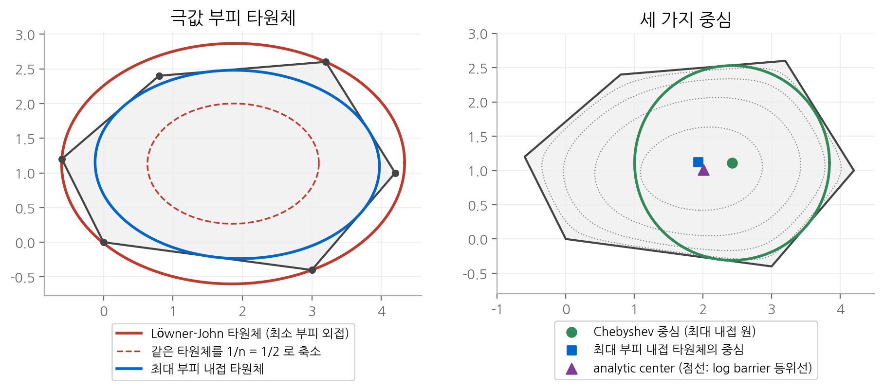
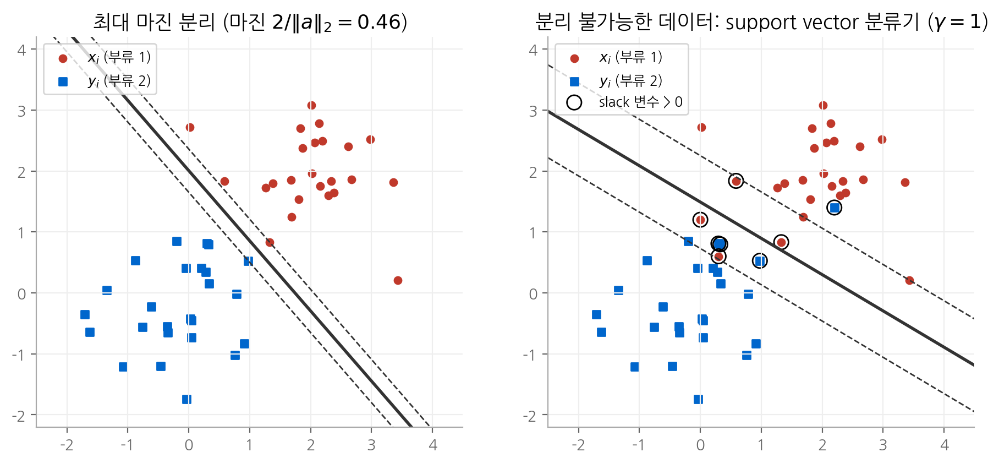
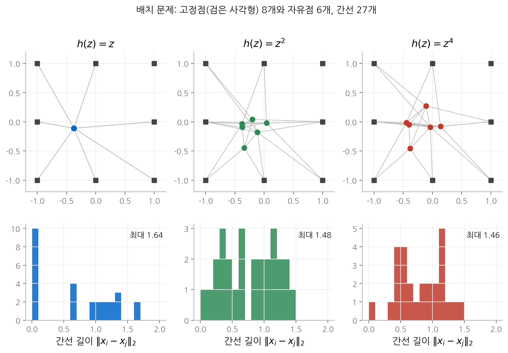

# 8. 기하 문제

응용편의 마지막 장은 **기하 문제(geometric problems)** 를 다룹니다. 점을 집합에 투영하고, 집합을 타원체로 감싸고,
집합의 "중심"을 정하고, 두 점 집합을 초평면으로 나누는 문제입니다. 문제마다 겉모습은 다르지만 풀이 방법은 같습니다.
기하 조건을 [2장](02-convex-sets.md)과 [3장](03-convex-functions.md)의 볼록 집합과 볼록 함수로 바꾸면 LP, QP, SOCP, 로그 행렬식 최대화
문제가 됩니다. support vector machine(SVM)과 내부점 방법의 analytic center도 이 장에서 처음 나옵니다.

!!! info "원문과 자료"
    - 교재: 8장 Geometric problems, p.397~
    - 슬라이드: [p.243–263](https://web.stanford.edu/~boyd/cvxbook/bv_cvxslides.pdf#page=243)

## 1. 집합으로의 투영

### 정의

점 $x_0$ 에서 닫힌 집합 $C$ 까지의 거리와, 그 거리를 이루는 점을 다음과 같이 정의합니다.

$$
\mathbf{dist}(x_0, C) = \inf\{\|x - x_0\| \mid x \in C\}, \qquad P_C(x_0) = \operatorname*{argmin}_{x \in C} \|x - x_0\|
$$

$P_C(x_0)$ 를 $x_0$ 의 $C$ 위로의 **투영(projection)** 이라고 합니다. $C$ 가 볼록이면 투영은 볼록 문제이고,
유클리드 노름처럼 엄격히 볼록한 노름을 쓰면 투영점이 유일합니다.

### 투영과 분리 초평면

$C$ 가 볼록이고 $x_0 \notin C$ 이면, 투영점 $P_C(x_0)$ 가 [2장](02-convex-sets.md)의 분리 초평면을 직접 줍니다.
유클리드 노름에서 투영점 $x^\star = P_C(x_0)$ 는 다음 조건을 만족합니다.

$$
(x_0 - x^\star)^\top (x - x^\star) \le 0 \quad \text{for all } x \in C
$$

따라서 법선 $x_0 - x^\star$ 를 갖고 $x^\star$ 와 $x_0$ 사이를 지나는 초평면이 $x_0$ 와 $C$ 를 엄격히 분리합니다.
다면체 $\{x \mid Ax \preceq b\}$ 로의 투영은 QP이고, 공 $\{x \mid \|x - x_c\|_2 \le r\}$ 로의 투영은
$x_c + r(x_0 - x_c)/\|x_0 - x_c\|_2$ 로 닫힌 형태입니다.

### 두 집합 사이의 거리

두 볼록 집합 $C$, $D$ 사이의 거리도 볼록 문제입니다.

$$
\mathbf{dist}(C, D) = \inf\{\|x - y\| \mid x \in C,\ y \in D\}
$$

이 문제의 쌍대 문제가 두 집합을 분리하는 초평면을 찾는 문제입니다([5장](05-duality.md)). 거리가 양수이면 쌍대 최적 해가
분리 초평면을 주고, 거리가 0이면 두 집합이 만납니다. 교재 8.3절은 점들 사이의 거리와 각도에 대한 조건을
Gram 행렬 $G = X^\top X \succeq 0$ 의 선형 조건으로 바꿔 SDP로 푸는 방법도 다룹니다.

## 2. 극값 부피 타원체

### 타원체의 부피

타원체를 두 가지로 매개화할 수 있습니다.

$$
\mathcal{E} = \{v \mid \|Av + b\|_2 \le 1\} \quad (A \in \mathbf{S}^n_{++}), \qquad
\mathcal{E} = \{Bu + d \mid \|u\|_2 \le 1\} \quad (B \in \mathbf{S}^n_{++})
$$

첫째 형태에서 부피는 $\det A^{-1}$ 에 비례하고, 둘째 형태에서는 $\det B$ 에 비례합니다.
$\log\det A^{-1}$ 은 $A$ 에 대해 볼록이고 $\log\det B$ 는 $B$ 에 대해 오목입니다([3장](03-convex-functions.md)).
그래서 부피를 다루는 문제가 볼록 문제로 바뀝니다.

### 최소 부피 외접 타원체 (Löwner-John 타원체)

집합 $C$ 를 포함하는 가장 작은 타원체를 **Löwner-John 타원체** 라고 합니다.

$$
\text{minimize} \quad \log\det A^{-1} \qquad \text{subject to} \quad \sup_{v \in C} \|Av + b\|_2 \le 1
$$

일반적인 $C$ 에서는 제약을 계산하기 어렵습니다. 그러나 $C$ 가 유한 점 집합 $\{x_1, \dots, x_m\}$ 이면 제약이 $\|Ax_i + b\|_2 \le 1$ 이 되어
쉽게 풀립니다. 점들의 볼록 껍질을 감싸는 타원체도 같은 문제로 얻습니다. 7장의 D-최적 설계의 쌍대가 이 문제의 특수한 경우입니다.

### 최대 부피 내접 타원체

볼록 집합 $C$ 안에 들어가는 가장 큰 타원체는 둘째 매개화로 구합니다. $C$ 가 다면체 $\{x \mid a_i^\top x \le b_i\}$ 이면
타원체가 반공간 $a_i^\top x \le b_i$ 안에 있을 조건은 다음과 같습니다.

$$
\sup_{\|u\|_2 \le 1} a_i^\top (Bu + d) = \|Ba_i\|_2 + a_i^\top d \le b_i
$$

$\sup$ 은 Cauchy-Schwarz 부등식에서 $u = Ba_i / \|Ba_i\|_2$ 일 때 나옵니다. 따라서 문제는 다음과 같습니다.

$$
\text{maximize} \quad \log\det B \qquad \text{subject to} \quad \|Ba_i\|_2 + a_i^\top d \le b_i, \quad i = 1, \dots, m
$$

### 근사의 효율

두 타원체는 $C$ 를 얼마나 잘 근사할까요? $C \subseteq \mathbf{R}^n$ 이 유계이고 내부가 비어 있지 않은 볼록 집합이면 다음이 성립합니다.

- Löwner-John 타원체를 중심에 대해 $1/n$ 로 축소하면 $C$ 안에 들어갑니다.
- 최대 부피 내접 타원체를 중심에 대해 $n$ 배 확대하면 $C$ 를 덮습니다.

$C$ 가 원점에 대해 대칭이면 배율 $n$ 을 $\sqrt{n}$ 으로 줄일 수 있습니다. 차원이 정해지면 타원체 근사의 오차가 유계라는 뜻입니다.

<figure markdown>

<figcaption markdown>
<b>Figure 1.</b> 극값 부피 타원체와 세 가지 중심

Löwner-John 타원체를 1/n 로 줄이면 다각형 안에 들어갑니다. Chebyshev 중심은 넓은 오른쪽으로 치우칩니다.
</figcaption>
</figure>

## 3. 중심

볼록 집합의 "중심"은 정의가 여럿입니다. 각 정의는 서로 다른 최적화 문제에 대응합니다.

### Chebyshev 중심

**Chebyshev 중심** 은 집합 안에 들어가는 가장 큰 공의 중심입니다. 다면체에서는 LP로 구합니다.
공 $\{x_c + u \mid \|u\|_2 \le r\}$ 이 반공간 $a_i^\top x \le b_i$ 안에 있을 조건은 $a_i^\top x_c + r\|a_i\|_2 \le b_i$ 입니다.
$\|a_i\|_2$ 는 상수이므로 $(x_c, r)$ 에 대해 선형입니다.

$$
\text{maximize} \quad r \qquad \text{subject to} \quad a_i^\top x_c + r\|a_i\|_2 \le b_i, \quad i = 1, \dots, m
$$

Chebyshev 중심은 경계에서 가장 먼 점입니다. 그러나 좌표를 아핀 변환하면 공이 타원이 되므로, 아핀 변환에 대해 불변이 아닙니다.
최대 부피 내접 타원체의 중심은 아핀 변환에 대해 불변입니다.

### analytic center

부등식 $f_i(x) \le 0$ ($i = 1, \dots, m$)의 **analytic center** 은 log barrier 함수를 최소화하는 점입니다.

$$
x_{\text{ac}} = \operatorname*{argmin}_x \; -\sum_{i=1}^m \log(-f_i(x))
$$

선형 부등식이면 $\phi(x) = -\sum_i \log(b_i - a_i^\top x)$ 를 최소화합니다. 각 제약의 여유 $b_i - a_i^\top x$ 를 곱한 값을 최대화하는 점입니다.
analytic center는 뉴턴 방법으로 쉽게 계산되며, [11장](11-interior-point.md)의 barrier method와 central path의 출발점입니다.
analytic center에서의 헤시안 $H = \nabla^2 \phi(x_{\text{ac}})$ 으로 다면체를 안팎에서 감쌀 수도 있습니다.

$$
\{x \mid (x - x_{\text{ac}})^\top H (x - x_{\text{ac}}) \le 1\} \subseteq \{x \mid a_i^\top x \le b_i\} \subseteq \{x \mid (x - x_{\text{ac}})^\top H (x - x_{\text{ac}}) \le m(m-1)\}
$$

### 작은 예: 삼각형의 중심

삼각형 $x \ge 0$, $y \ge 0$, $x + y \le 1$ 을 봅시다.

- **Chebyshev 중심**: 대칭이므로 $x_c = (r, r)$ 이고, 빗변 제약 $2r + \sqrt{2}\, r \le 1$ 에서 $r = 1/(2 + \sqrt{2}) \approx 0.293$ 입니다.
- **analytic center**: $\log x + \log y + \log(1 - x - y)$ 를 최대화합니다. 미분하면 $1/x = 1/(1 - x - y) = 1/y$ 이므로 $(1/3, 1/3)$ 입니다. 무게중심과 같습니다.

이제 빗변 제약 $x + y \le 1$ 을 **한 번 더** 적어 봅시다. 집합은 그대로입니다. 그러나 목적이 $\log x + \log y + 2\log(1 - x - y)$ 가 되므로
$1/x = 2/(1 - 2x)$ 에서 analytic center는 $(1/4, 1/4)$ 로 이동합니다. **analytic center는 집합이 아니라 부등식 표현에 의존합니다.**
Chebyshev 중심은 중복 제약의 영향을 받지 않습니다.

## 4. 분류

### 선형 판별

두 점 집합 $\{x_1, \dots, x_N\}$ 과 $\{y_1, \dots, y_M\}$ 을 초평면으로 나누는 문제입니다.

$$
a^\top x_i + b > 0, \qquad a^\top y_i + b < 0
$$

조건이 $(a, b)$ 에 대해 동차이므로 양수 배를 해도 성립합니다. 따라서 엄격한 부등식을 다음과 같이 바꿔도 동치입니다.

$$
a^\top x_i + b \ge 1, \qquad a^\top y_i + b \le -1
$$

이는 $(a, b)$ 에 대한 선형 부등식이므로 LP 실현 가능성 문제입니다.

### 강건한 선형 판별 = 최대 마진

두 초평면 $a^\top z + b = 1$ 과 $a^\top z + b = -1$ 사이의 거리는 $2/\|a\|_2$ 입니다. 이 거리를 **마진(margin)** 이라고 합니다.
마진을 최대화하려면 $\|a\|_2$ 를 최소화합니다.

$$
\text{minimize} \quad \tfrac{1}{2}\|a\|_2^2 \qquad \text{subject to} \quad a^\top x_i + b \ge 1,\ a^\top y_i + b \le -1
$$

QP입니다. 이것이 hard margin **support vector machine(SVM)** 입니다. 교재는 이 문제의 쌍대가
두 점 집합의 볼록 껍질 사이의 거리를 구하는 문제임을 보입니다. 1절의 "거리 문제의 쌍대 = 분리 초평면"과 같은 구조입니다.

### 분리 불가능한 경우: support vector 분류기

두 집합이 겹치면 실현 가능한 해가 없습니다. 그래서 위반량 $u_i, v_i \ge 0$ 을 허용합니다.

$$
\begin{aligned}
\text{minimize} \quad & \|a\|_2 + \gamma(\mathbf{1}^\top u + \mathbf{1}^\top v) \\
\text{subject to} \quad & a^\top x_i + b \ge 1 - u_i, \quad a^\top y_i + b \le -1 + v_i, \quad u \succeq 0,\ v \succeq 0
\end{aligned}
$$

최적에서 $u_i = \max\{0, 1 - (a^\top x_i + b)\}$ 입니다. 머신러닝의 **hinge 손실** 입니다.
$\gamma$ 는 마진의 역수 $\|a\|_2$ 와 분류 오류의 합 사이의 trade-off를 정합니다. $\|a\|_2$ 항을 빼면 위반량의 합만 최소화하는 LP가 됩니다.

<figure markdown>

<figcaption markdown>
<b>Figure 2.</b> 최대 마진 분리와 support vector 분류기

왼쪽은 최대 마진 초평면입니다. 오른쪽 support vector 분류기에서 동그라미 친 점은 slack 변수가 양수인 점입니다.
</figcaption>
</figure>

### 비선형 판별

판별 함수를 기저 함수의 선형 결합 $f(z) = \theta^\top F(z)$ 로 두면, $\theta$ 에 대한 조건은 여전히 선형입니다.

$$
\theta^\top F(x_i) \ge 1, \qquad \theta^\top F(y_i) \le -1
$$

이차 판별 $f(z) = z^\top P z + q^\top z + r$ 은 $(P, q, r)$ 에 대해 선형이므로 LP로 풉니다. $P \preceq -I$ 를 더하면 타원체로 분리합니다(SDP).
다항식 판별은 차수 $d$ 이하의 모든 단항식을 $F$ 로 씁니다. 커널 방법의 출발점이 이 아이디어입니다.

## 5. 배치와 시설 위치

### 문제

점 $x_1, \dots, x_N \in \mathbf{R}^2$ 중 일부는 위치가 고정되어 있고 나머지는 변수입니다. 연결된 점 쌍 $(i, j) \in \mathcal{E}$ 마다 비용을 매기고 합을 최소화합니다.

$$
\text{minimize} \quad \sum_{(i, j) \in \mathcal{E}} h(\|x_i - x_j\|_2)
$$

$h$ 가 볼록이고 비감소이면 $h(\|x_i - x_j\|_2)$ 는 볼록 함수의 합성이므로 볼록입니다([3장](03-convex-functions.md)).
공장과 창고의 위치(운송 비용), 집적 회로의 셀 배치(배선 길이)가 이 문제의 예입니다.

### $h$ 의 모양이 간선 길이 분포를 정합니다

[6장](06-approximation.md)에서 페널티 함수가 잔차 분포를 정했듯이, $h$ 의 모양이 간선 길이의 분포를 정합니다.

- $h(z) = z$: 0 근처에서도 기울기가 1이라 많은 간선의 길이가 정확히 0이 됩니다. 자유점들이 한 점에 모이기도 합니다.
- $h(z) = z^2$: 짧은 간선은 거의 공짜이고 긴 간선이 비쌉니다. 길이가 고르게 퍼집니다.
- $h(z) = z^4$: 긴 간선을 더 강하게 벌하므로 가장 긴 간선이 짧아집니다.

<figure markdown>

<figcaption markdown>
<b>Figure 3.</b> 배치 문제와 간선 길이 분포

h(z) = z 에서는 자유점이 한 점에 모입니다. 차수가 높을수록 가장 긴 간선이 1.64 → 1.46 으로 줄어듭니다.
</figcaption>
</figure>

교재 8.8절은 이 아이디어를 **평면 배치(floor planning)** 로 확장합니다. 직사각형 블록들이 겹치지 않으면서 전체 경계 상자를 최소화하는
문제입니다. 블록 사이의 상대 위치를 고정하면 LP나 기하 계획(GP)으로 풀립니다.

## 핵심 정리

| 개념 | 핵심 식 | 기억할 점 |
| --- | --- | --- |
| 투영 | $\min_{x \in C} \lVert x - x_0 \rVert$ | 투영점이 분리 초평면을 줍니다. |
| 집합 사이 거리 | $\min \lVert x - y \rVert$, $x \in C$, $y \in D$ | 쌍대 문제가 분리 초평면 문제입니다. |
| Löwner-John 타원체 | $\min \log\det A^{-1}$ s.t. $\lVert Ax_i + b \rVert_2 \le 1$ | $1/n$ 로 축소하면 집합 안에 들어갑니다. |
| 최대 내접 타원체 | $\max \log\det B$ s.t. $\lVert Ba_i \rVert_2 + a_i^\top d \le b_i$ | $n$ 배 확대하면 집합을 덮습니다. |
| Chebyshev 중심 | $\max r$ s.t. $a_i^\top x_c + r\lVert a_i \rVert_2 \le b_i$ | LP이고 아핀 불변이 아닙니다. |
| analytic center | $\min -\sum \log(b_i - a_i^\top x)$ | 표현에 의존하고 내부점 방법의 기초입니다. |
| 최대 마진 분류 | $\min \tfrac{1}{2}\lVert a \rVert_2^2$ s.t. 분리 조건 | 마진은 $2/\lVert a \rVert_2$, hard margin SVM입니다. |
| support vector 분류기 | $\lVert a \rVert_2 + \gamma \sum(\text{위반량})$ | 위반량은 hinge 손실입니다. |
| 배치 | $\min \sum h(\lVert x_i - x_j \rVert_2)$ | $h$ 의 모양이 간선 길이 분포를 정합니다. |

## 다음 장

응용편을 마칩니다. 지금까지는 문제를 볼록 문제로 바꾸는 데 집중했습니다. [다음 장](09-unconstrained.md)부터는 그 문제를
**실제로 푸는 알고리즘**을 다룹니다. 출발점은 제약 없는 최소화와 뉴턴 방법입니다.
