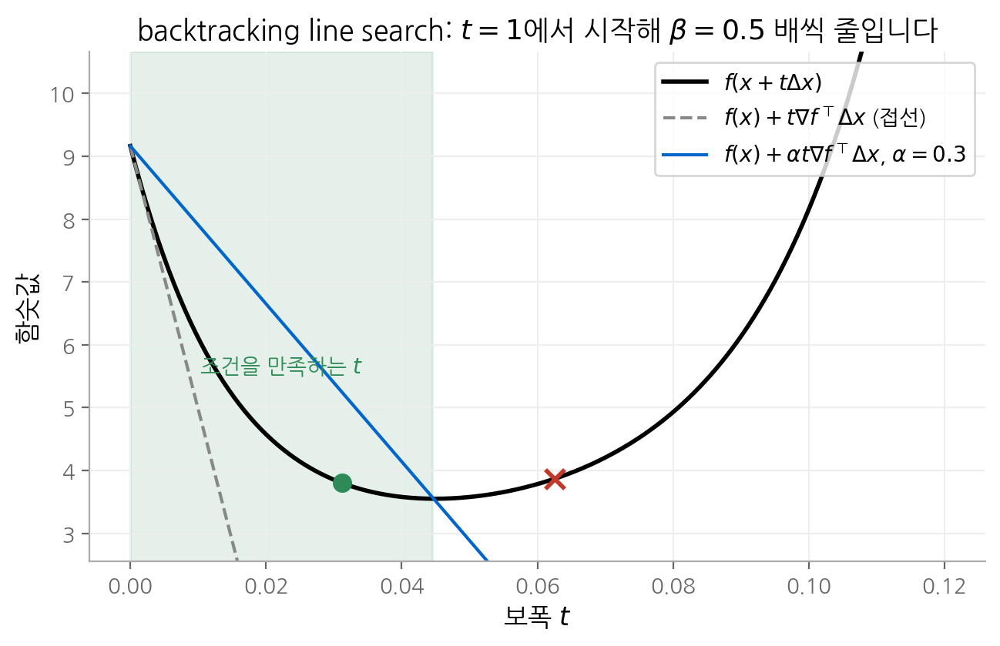
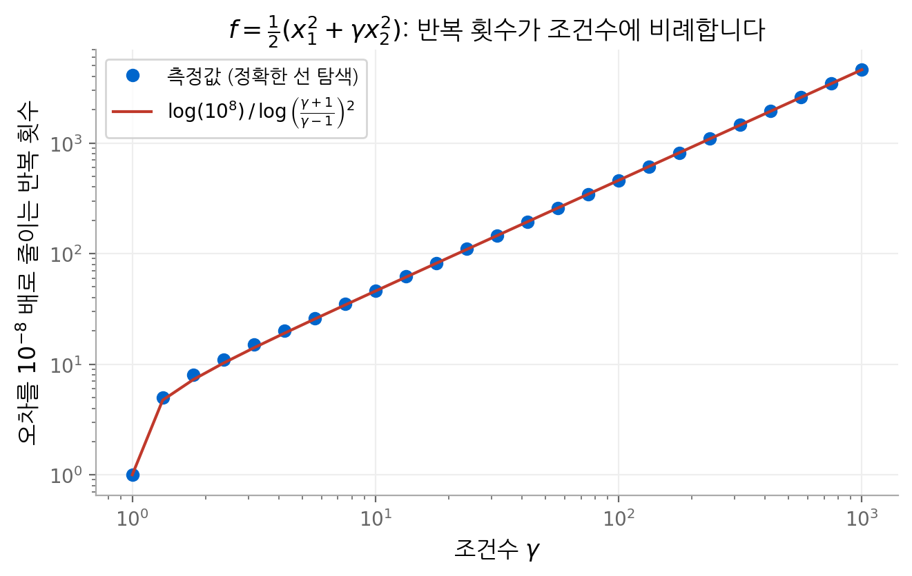
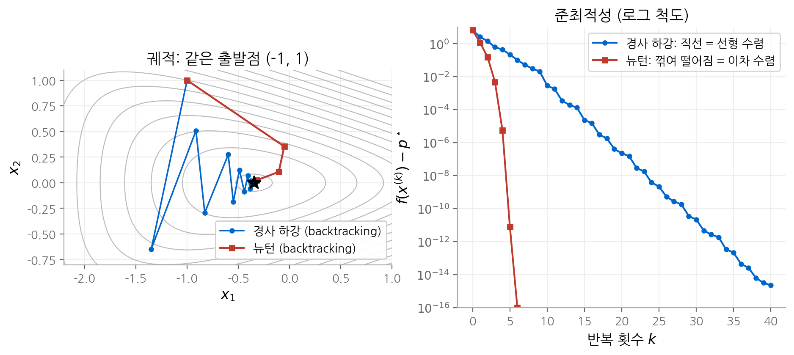

# 9. 제약 없는 최소화

3부(알고리즘)의 첫 장입니다. 이 장은 제약이 없는 문제 $\min f(x)$ 를 푸는 **하강법**(descent method)을 다룹니다.
경사 하강법이 조건수에 얼마나 민감한지 계산하고, 뉴턴법이 그 민감성을 어떻게 없애는지 유도합니다.
마지막으로 **self-concordant**라는 성질을 써서 뉴턴법의 반복 횟수를 문제 데이터와 무관하게 묶습니다.
10장과 11장의 알고리즘은 모두 이 장의 뉴턴법을 부품으로 씁니다.

!!! info "원문과 자료"
    - 교재: Boyd & Vandenberghe, *Convex Optimization*, 9장 Unconstrained minimization (p.457–520)
    - 슬라이드: [EE364a 강의 슬라이드 p.287–326](https://web.stanford.edu/~boyd/cvxbook/bv_cvxslides.pdf#page=287)
    - 함께 읽기: [신경망 기초 9장. 최적화 알고리즘](../../ai/d2l/09-optimization.md)은 경사 하강법과 학습률, 모멘텀을 다룹니다.
      이 장은 같은 질문을 일반 볼록 함수로 넓힙니다.

## 1. 문제와 가정

$$
\text{minimize} \quad f(x)
$$

$f : \mathbf{R}^n \to \mathbf{R}$ 은 볼록이고 두 번 연속 미분 가능하다고 가정합니다. 최적값 $p^\star = \inf_x f(x)$ 는 유한하고
최적점 $x^\star$ 가 존재한다고 둡니다. 최적 조건은 다음 방정식 하나입니다.

$$
\nabla f(x^\star) = 0
$$

이 방정식을 닫힌 형태로 풀 수 있는 경우는 이차 함수 정도뿐입니다. 그래서 점열 $x^{(0)}, x^{(1)}, \dots$ 를 만들어
$f(x^{(k)}) \to p^\star$ 가 되게 하는 반복법을 씁니다.

### 강볼록성과 두 상수 m, M

수렴을 분석하려면 함수의 곡률에 하한과 상한이 있어야 합니다. 시작점의 sublevel set
$S = \{x \mid f(x) \le f(x^{(0)})\}$ 위에서 다음이 성립한다고 가정합니다.

$$
m I \preceq \nabla^2 f(x) \preceq M I, \qquad x \in S
$$

왼쪽 부등식을 **강볼록성**(strong convexity)이라고 합니다. $\kappa = M/m$ 은 헤시안의 조건수에 대한 상한이고,
sublevel set이 얼마나 길쭉한지를 나타냅니다.

### 그래디언트로 준최적성을 잴 수 있습니다

테일러 정리와 $\nabla^2 f \succeq mI$ 를 쓰면, 모든 $x, y \in S$ 에서 다음이 성립합니다.

$$
f(y) \ge f(x) + \nabla f(x)^\top (y - x) + \frac{m}{2} \lVert y - x \rVert_2^2
$$

오른쪽은 $y$ 의 볼록 이차 함수이고, $y = x - (1/m)\nabla f(x)$ 에서 최소가 됩니다. 그 최솟값을 대입하면 다음을 얻습니다.

$$
f(y) \ge f(x) - \frac{1}{2m} \lVert \nabla f(x) \rVert_2^2
\quad \Longrightarrow \quad
f(x) - p^\star \le \frac{1}{2m} \lVert \nabla f(x) \rVert_2^2
$$

이 부등식은 실용적인 정지 조건을 줍니다. $\lVert \nabla f(x) \rVert_2 \le \sqrt{2m\epsilon}$ 이면 $f(x) - p^\star \le \epsilon$ 입니다.
같은 방법으로 $\lVert x - x^\star \rVert_2 \le (2/m) \lVert \nabla f(x) \rVert_2$ 도 얻습니다.
상한 $M$ 을 쓰면 반대 방향의 부등식 $f(x) - p^\star \ge \lVert \nabla f(x) \rVert_2^2 / (2M)$ 이 나옵니다.

실제로 $m$ 과 $M$ 의 값은 거의 알 수 없습니다. 이 상수들은 알고리즘의 입력이 아니라 **수렴을 설명하는 도구**입니다.

## 2. 하강법과 선 탐색

### 일반형

하강법은 다음 갱신을 반복합니다.

$$
x^{(k+1)} = x^{(k)} + t^{(k)} \Delta x^{(k)}, \qquad t^{(k)} > 0
$$

$\Delta x$ 는 **탐색 방향**, $t$ 는 **보폭**입니다. $f$ 가 볼록이면 $\nabla f(x)^\top (y - x) \ge 0$ 일 때 $f(y) \ge f(x)$ 입니다.
따라서 함숫값을 줄이려면 탐색 방향이 반드시 다음 조건을 만족해야 합니다.

$$
\nabla f(x)^\top \Delta x < 0
$$

이 조건을 만족하는 방향을 **하강 방향**이라고 합니다. 알고리즘마다 다른 것은 $\Delta x$ 를 고르는 규칙뿐입니다.

### 정확한 선 탐색과 backtracking line search

**정확한 선 탐색**(exact line search)은 반직선 위의 1차원 최소화로 보폭을 정합니다.

$$
t = \operatorname*{argmin}_{s \ge 0} f(x + s \Delta x)
$$

1차원 문제를 싸게 풀 수 있을 때만 씁니다. 실제로는 **backtracking line search**를 주로 씁니다.
두 상수 $\alpha \in (0, 0.5)$, $\beta \in (0, 1)$ 를 정하고 다음을 수행합니다.

1. $t := 1$ 로 시작합니다.
2. $f(x + t\Delta x) > f(x) + \alpha t \nabla f(x)^\top \Delta x$ 이면 $t := \beta t$ 로 줄입니다.
3. 2단계의 부등식이 거짓이 되면 멈춥니다.

정지 조건의 오른쪽은 접선의 기울기를 $\alpha$ 배로 완화한 직선입니다. 즉 **선형 근사가 예측한 감소량의 $\alpha$ 배 이상**
줄어드는 보폭을 받아들입니다. $\Delta x$ 가 하강 방향이면 충분히 작은 $t$ 에서 이 조건이 반드시 성립하므로
탐색은 유한 번 안에 끝납니다. 교재는 $\alpha$ 를 0.01~0.3, $\beta$ 를 0.1~0.8 범위에서 고르라고 권합니다.

<figure markdown>

<figcaption markdown>
<b>Figure 1.</b> backtracking line search

초록 영역이 정지 조건을 만족하는 보폭(t ≤ 0.044)입니다. t = 0.03125 가 처음으로 받아들여집니다.
</figcaption>
</figure>

신경망 학습은 대개 선 탐색 없이 고정 학습률이나 스케줄을 씁니다. 함숫값 $f(x + t\Delta x)$ 를 정확히 계산하려면
전체 데이터를 한 번 더 지나가야 하고, 미니배치 손실은 잡음이 커서 비교 기준이 되지 못하기 때문입니다.

## 3. 경사 하강법

### 알고리즘

탐색 방향으로 $\Delta x = -\nabla f(x)$ 를 씁니다. 정지 조건은 보통 $\lVert \nabla f(x) \rVert_2 \le \eta$ 입니다.

### 수렴 분석: 정확한 선 탐색

$\nabla^2 f \preceq MI$ 를 쓰면 그래디언트 방향의 함숫값에 이차 상한이 생깁니다.

$$
f(x - t\nabla f(x)) \le f(x) - t \lVert \nabla f(x) \rVert_2^2 + \frac{M t^2}{2} \lVert \nabla f(x) \rVert_2^2
$$

오른쪽은 $t = 1/M$ 에서 최소입니다. 정확한 선 탐색의 결과는 이 상한의 최솟값보다 작거나 같습니다.

$$
f(x^+) \le f(x) - \frac{1}{2M} \lVert \nabla f(x) \rVert_2^2
$$

양변에서 $p^\star$ 를 빼고, 1절의 부등식 $\lVert \nabla f(x) \rVert_2^2 \ge 2m (f(x) - p^\star)$ 를 대입합니다.

$$
f(x^+) - p^\star \le \left(1 - \frac{m}{M}\right) (f(x) - p^\star)
$$

오차가 매 반복 일정한 비율 $c = 1 - m/M$ 이하로 줄어듭니다. 이런 수렴을 **선형 수렴**이라고 합니다.
로그 척도 그래프에서 직선으로 보이기 때문입니다. 오차를 $\epsilon$ 이하로 줄이는 반복 횟수는 다음과 같습니다.

$$
k \le \frac{\log\big((f(x^{(0)}) - p^\star)/\epsilon\big)}{\log(1/c)} \approx \frac{M}{m} \log\frac{f(x^{(0)}) - p^\star}{\epsilon}
$$

마지막 근사는 $\kappa = M/m$ 이 클 때 $\log(1/c) = -\log(1 - m/M) \approx m/M$ 인 데서 나옵니다.
**반복 횟수는 조건수에 비례합니다.**

### backtracking line search일 때

backtracking line search는 $t \ge \min\{1, \beta/M\}$ 인 보폭을 고릅니다. 같은 논리로 다음 비율을 얻습니다.

$$
f(x^+) - p^\star \le c\,(f(x) - p^\star), \qquad c = 1 - \min\left\{2m\alpha,\; \frac{2\beta\alpha m}{M}\right\} < 1
$$

수렴 비율은 나빠지지만, 여전히 선형 수렴이고 조건수에 비례하는 반복 횟수가 필요합니다.

### 이차 함수 예제

$f(x) = \frac{1}{2}(x_1^2 + \gamma x_2^2)$, $\gamma \ge 1$ 에 정확한 선 탐색을 쓰고 $x^{(0)} = (\gamma, 1)$ 에서 출발하면
반복점을 닫힌 형태로 구할 수 있습니다.

$$
x^{(k)} = \left(\frac{\gamma - 1}{\gamma + 1}\right)^k \left(\gamma,\; (-1)^k\right), \qquad
f(x^{(k)}) = \left(\frac{\gamma - 1}{\gamma + 1}\right)^{2k} f(x^{(0)})
$$

$m = 1$, $M = \gamma$ 이므로 조건수가 $\gamma$ 입니다. 아래 그림은 $f$ 를 $10^{-8}$ 배로 줄이는 데 필요한 반복 횟수를 측정한 결과입니다.
$\gamma = 10$ 에서 46회, $\gamma = 100$ 에서 461회, $\gamma = 1000$ 에서 4606회입니다. 조건수가 10배 커질 때 반복 횟수도 정확히 10배가 됩니다.

<figure markdown>

<figcaption markdown>
<b>Figure 2.</b> 조건수와 반복 횟수

측정한 반복 횟수가 예측과 일치합니다. γ 가 크면 반복 횟수가 γ 에 비례합니다.
</figcaption>
</figure>

신경망 기초 7장은 고정 학습률에서 최적 수렴 배율이 $(\kappa - 1)/(\kappa + 1)$ 임을 보였습니다.
정확한 선 탐색도 같은 배율을 넘지 못합니다. 선 탐색은 보폭만 고를 뿐 **방향**을 바꾸지 않기 때문입니다.
경사 하강법의 약점은 방향에 있고, 이 약점을 고치는 것이 다음 두 절의 주제입니다.

## 4. steepest descent method

### 노름에 따라 달라지는 "가장 가파른 방향"

1차 근사 $f(x + v) \approx f(x) + \nabla f(x)^\top v$ 에서 $\nabla f(x)^\top v$ 를 가장 작게 만드는 단위 벡터를 고릅니다.

$$
\Delta x_{\text{nsd}} = \operatorname*{argmin}\{\nabla f(x)^\top v \mid \lVert v \rVert \le 1\}
$$

이 방향을 **정규화된 steepest descent 방향**이라고 합니다. 핵심은 "단위"를 재는 노름 $\lVert \cdot \rVert$ 를 고를 수 있다는 점입니다.
노름이 바뀌면 가장 가파른 방향도 바뀝니다. 비정규화 방향은 쌍대 노름을 곱해서 $\Delta x_{\text{sd}} = \lVert \nabla f(x) \rVert_* \Delta x_{\text{nsd}}$ 로 정의합니다.

| 노름 | steepest descent 방향 | 해석 |
| --- | --- | --- |
| $\ell_2$ 노름 | $-\nabla f(x)$ | 경사 하강법 |
| 이차 노름 $\lVert z \rVert_P = (z^\top P z)^{1/2}$ | $-P^{-1} \nabla f(x)$ | 좌표 변환 $\bar{x} = P^{1/2} x$ 뒤의 경사 하강법 |
| $\ell_1$ 노름 | $-\dfrac{\partial f}{\partial x_i} e_i$, $i = \operatorname{argmax}_j \lvert \partial f / \partial x_j \rvert$ | 탐욕적 좌표 하강법 |

### 이차 노름과 전처리

이차 노름의 steepest descent method는 변수를 $\bar{x} = P^{1/2} x$ 로 바꾼 뒤 경사 하강법을 쓰는 것과 같습니다.
변환된 함수 $\bar{f}(\bar{x}) = f(P^{-1/2} \bar{x})$ 의 헤시안은 $P^{-1/2} \nabla^2 f(x) P^{-1/2}$ 입니다.
$P$ 가 $\nabla^2 f(x^\star)$ 에 가까우면 이 행렬은 $I$ 에 가깝고, 변환된 문제의 조건수는 1에 가까워집니다.
이것이 **전처리**(preconditioning)입니다. 좋은 $P$ 는 경사 하강법을 매우 빠르게 만들고, 나쁜 $P$ 는 더 느리게 만듭니다.

Adam이나 AdaGrad는 $P$ 를 그래디언트 제곱의 이동 평균으로 만든 **대각 행렬**로 근사하는 셈입니다.
대각 전처리는 축 방향으로 정렬된 비대칭만 고칠 수 있고, 회전된 골짜기에는 효과가 작습니다.
Shampoo나 K-FAC 같은 방법은 $P$ 를 블록 Kronecker 곱으로 근사해 비대각 구조를 일부 반영합니다.
자세한 비교는 [신경망 기초 9장. 최적화 알고리즘](../../ai/d2l/09-optimization.md)를 참고하십시오.

## 5. 뉴턴법

### 뉴턴 단계

$$
\Delta x_{\text{nt}} = -\nabla^2 f(x)^{-1} \nabla f(x)
$$

$\nabla^2 f(x) \succ 0$ 이면 $\nabla f(x)^\top \Delta x_{\text{nt}} = -\nabla f(x)^\top \nabla^2 f(x)^{-1} \nabla f(x) < 0$ 이므로 하강 방향입니다.
뉴턴 단계는 세 가지로 해석할 수 있고, 세 해석이 모두 같은 식을 줍니다.

1. **2차 근사의 최소점**: $\hat{f}(x + v) = f(x) + \nabla f(x)^\top v + \frac{1}{2} v^\top \nabla^2 f(x) v$ 를 $v$ 에 대해 최소화하면 $v = \Delta x_{\text{nt}}$ 입니다.
2. **헤시안 노름의 steepest descent**: 4절에서 $P = \nabla^2 f(x)$ 로 두면 $-P^{-1}\nabla f(x)$ 가 뉴턴 단계입니다. 매 반복 현재 위치에서 가장 좋은 전처리를 고르는 셈입니다.
3. **최적 조건의 선형화**: $\nabla f(x + v) \approx \nabla f(x) + \nabla^2 f(x) v = 0$ 을 풀면 $v = \Delta x_{\text{nt}}$ 입니다.

### Newton decrement

$$
\lambda(x) = \left(\nabla f(x)^\top \nabla^2 f(x)^{-1} \nabla f(x)\right)^{1/2} = \left(\Delta x_{\text{nt}}^\top \nabla^2 f(x) \Delta x_{\text{nt}}\right)^{1/2}
$$

이 값을 **Newton decrement**라고 합니다. 2차 근사의 최솟값과 현재 함숫값의 차가 정확히 $\lambda(x)^2/2$ 입니다.

$$
f(x) - \inf_v \hat{f}(x + v) = \frac{1}{2} \lambda(x)^2
$$

그래서 $\lambda(x)^2 / 2$ 는 $f(x) - p^\star$ 의 추정값이 되고, 정지 조건 $\lambda(x)^2/2 \le \epsilon$ 으로 씁니다.
선 탐색에 필요한 방향 미분도 $\nabla f(x)^\top \Delta x_{\text{nt}} = -\lambda(x)^2$ 로 바로 구할 수 있습니다.

### 아핀 불변성

정칙 행렬 $T$ 로 변수를 $x = Ty$ 로 바꾸고 $\bar{f}(y) = f(Ty)$ 를 정의합니다. 연쇄 법칙으로 다음을 얻습니다.

$$
\nabla \bar{f}(y) = T^\top \nabla f(x), \qquad \nabla^2 \bar{f}(y) = T^\top \nabla^2 f(x) T
\quad \Longrightarrow \quad
\Delta y_{\text{nt}} = T^{-1} \Delta x_{\text{nt}}
$$

$y$ 공간의 뉴턴 단계는 $x$ 공간의 뉴턴 단계를 그대로 옮긴 것입니다. Newton decrement도 같습니다.
**뉴턴법은 좌표를 어떻게 잡든 같은 반복점을 만듭니다.** 그래서 조건수의 영향을 받지 않습니다.
경사 하강법은 그렇지 않습니다. $\Delta y_{\text{gd}} = -T^\top \nabla f(x)$ 이므로 좌표 변환이 방향을 바꿉니다.

### 알고리즘

1. 뉴턴 단계 $\Delta x_{\text{nt}}$ 와 감소량 $\lambda(x)^2$ 를 계산합니다.
2. $\lambda(x)^2 / 2 \le \epsilon$ 이면 멈춥니다.
3. backtracking line search로 $t$ 를 고릅니다.
4. $x := x + t \Delta x_{\text{nt}}$ 로 갱신하고 1단계로 돌아갑니다.

## 6. 뉴턴법의 수렴: 두 단계

### 가정

강볼록성($mI \preceq \nabla^2 f \preceq MI$)에 더해 헤시안이 Lipschitz 연속이라고 가정합니다.

$$
\lVert \nabla^2 f(x) - \nabla^2 f(y) \rVert_2 \le L \lVert x - y \rVert_2
$$

$L$ 은 $f$ 가 이차 함수에서 얼마나 벗어나는지를 잽니다. 이차 함수는 $L = 0$ 이고, 이때 뉴턴법은 한 번에 끝납니다.

### 결과

상수 $\eta \in (0, m^2/L]$ 와 $\gamma > 0$ 가 존재해서 각 반복은 다음 두 경우 중 하나입니다.

| 단계 | 조건 | 일어나는 일 |
| --- | --- | --- |
| 감쇠 뉴턴 단계 | $\lVert \nabla f(x) \rVert_2 \ge \eta$ | $f(x^+) - f(x) \le -\gamma$, 보폭 $t < 1$ 일 수 있음 |
| 이차 수렴 단계 | $\lVert \nabla f(x) \rVert_2 < \eta$ | 항상 $t = 1$, $\dfrac{L}{2m^2} \lVert \nabla f(x^+) \rVert_2 \le \left(\dfrac{L}{2m^2} \lVert \nabla f(x) \rVert_2\right)^2$ |

교재의 상수는 $\gamma = \alpha\beta\eta^2 m / M^2$, $\eta = \min\{1, 3(1 - 2\alpha)\} m^2 / L$ 입니다.

**감쇠 단계의 유도 요약.** $\nabla^2 f \preceq MI$ 와 $\lambda(x)^2 \ge m \lVert \Delta x_{\text{nt}} \rVert_2^2$ 를 쓰면 다음 상한을 얻습니다.

$$
f(x + t\Delta x_{\text{nt}}) \le f(x) - t\lambda(x)^2 + \frac{M}{2m} t^2 \lambda(x)^2
$$

$\hat{t} = m/M$ 은 선 탐색의 정지 조건을 만족하므로 backtracking 결과는 $t \ge \beta m / M$ 입니다. 따라서 감소량은
$\alpha t \lambda(x)^2 \ge \alpha\beta (m/M) \lambda(x)^2$ 이상입니다. 여기에 $\lambda(x)^2 \ge \lVert \nabla f(x) \rVert_2^2 / M \ge \eta^2/M$ 를 쓰면 $\gamma$ 가 나옵니다.

**이차 수렴 단계의 의미.** 한 번 $\lVert \nabla f \rVert_2 < \eta$ 가 되면 이후 모든 반복이 이 단계에 머뭅니다.
위 부등식을 반복 적용하면 $l \ge k$ 에서 다음이 성립합니다.

$$
f(x^{(l)}) - p^\star \le \frac{2m^3}{L^2} \left(\frac{1}{2}\right)^{2^{l - k + 1}}
$$

지수에 지수가 붙어 있습니다. **맞는 자릿수가 반복마다 대략 두 배**가 됩니다.

### 전체 반복 횟수

감쇠 단계는 매번 $f$ 를 $\gamma$ 이상 줄이므로 $(f(x^{(0)}) - p^\star)/\gamma$ 회를 넘을 수 없습니다. 둘을 더합니다.

$$
\frac{f(x^{(0)}) - p^\star}{\gamma} + \log_2 \log_2 \frac{\epsilon_0}{\epsilon}, \qquad \epsilon_0 = \frac{2m^3}{L^2}
$$

두 번째 항은 $\epsilon$ 에 대해 매우 느리게 자랍니다. 6회면 $\epsilon \approx 5 \cdot 10^{-20} \epsilon_0$ 에 도달하므로,
실용적으로는 상수 5~6으로 봐도 됩니다.

### 예제: 경사 하강법과 뉴턴법 비교

교재의 2변수 예제 $f(x) = e^{x_1 + 3x_2 - 0.1} + e^{x_1 - 3x_2 - 0.1} + e^{-x_1 - 0.1}$ 을 두 방법으로 풉니다.
최적점은 $x^\star = (-\tfrac{1}{2}\log 2, 0)$, $p^\star = 2\sqrt{2}\, e^{-0.1} \approx 2.559$ 입니다.
두 방법 모두 $(-1, 1)$ 에서 출발하고 backtracking line search($\alpha = 0.1$, $\beta = 0.7$)을 씁니다.

| 반복 $k$ | 0 | 1 | 2 | 3 | 4 | 5 |
| --- | --- | --- | --- | --- | --- | --- |
| 뉴턴법 $f - p^\star$ | $6.6$ | $1.2$ | $1.6 \times 10^{-1}$ | $4.8 \times 10^{-3}$ | $5.6 \times 10^{-6}$ | $7.9 \times 10^{-12}$ |

뉴턴법은 3회째부터 지수가 두 배씩 커집니다($10^{-3} \to 10^{-6} \to 10^{-12}$). 경사 하강법은 10회째에 $2.9 \times 10^{-3}$,
20회째에 $2.2 \times 10^{-7}$ 로, 10회마다 일정한 자릿수만큼 줄어듭니다.

<figure markdown>

<figcaption markdown>
<b>Figure 3.</b> 경사 하강법과 뉴턴법

경사 하강법은 지그재그로 선형 수렴하고, 뉴턴법은 최적점으로 바로 가며 이차 수렴합니다.
</figcaption>
</figure>

## 7. self-concordant 함수

### 고전적 분석의 문제

6절의 한계는 $m$, $M$, $L$ 에 의존합니다. 그런데 뉴턴법 자체는 아핀 불변인데, 이 상수들은 좌표를 바꾸면 값이 바뀝니다.
알고리즘의 성질과 분석의 성질이 맞지 않습니다. 또 세 상수는 실제 문제에서 거의 알 수 없으므로 한계를 계산할 수 없습니다.

### 정의

$f : \mathbf{R} \to \mathbf{R}$ 이 모든 정의역에서 다음을 만족하면 **self-concordant**라고 합니다.

$$
\lvert f'''(x) \rvert \le 2 f''(x)^{3/2}
$$

$\mathbf{R}^n$ 위의 함수는 모든 직선으로 제한한 1변수 함수가 self-concordant이면 self-concordant라고 합니다.
이 조건은 3차 도함수(헤시안의 변화율)를 헤시안 자신으로 잽니다. 그래서 아핀 변환에 대해 불변입니다.

| 함수 | self-concordant 여부 |
| --- | --- |
| 선형 함수, 볼록 이차 함수 | 예($f''' = 0$) |
| $-\log x$ | 예($f'' = 1/x^2$, $f''' = -2/x^3$ 이라 등호 성립) |
| $-\sum_i \log(b_i - a_i^\top x)$ | 예(self-concordant 함수의 합과 아핀 합성) |
| $-\log\det X$ ($X \succ 0$) | 예 |
| $e^x$ | 아니오 |

11장의 log barrier 함수가 모두 이 표에 있습니다. self-concordant는 내부점법의 복잡도 분석을 가능하게 하는 성질입니다.

### 준최적성 한계와 반복 횟수

self-concordant 함수에서 $\lambda(x) \le 0.68$ 이면 다음이 성립합니다.

$$
f(x) - p^\star \le \lambda(x)^2
$$

2차 근사의 추정값 $\lambda^2/2$ 를 두 배 하면 증명 가능한 상한이 됩니다. 반복은 다시 두 단계로 나뉩니다.
$\eta \in (0, 1/4]$ 에 대해 $\lambda(x) > \eta$ 이면 $f$ 가 $\gamma = \alpha\beta\eta^2/(1 + \eta)$ 이상 줄고,
$\lambda(x) \le \eta$ 이면 $t = 1$ 이며 $2\lambda(x^+) \le (2\lambda(x))^2$ 입니다. 결과는 다음과 같습니다.

$$
\frac{20 - 8\alpha}{\alpha\beta(1 - 2\alpha)^2} \big(f(x^{(0)}) - p^\star\big) + \log_2 \log_2 \frac{1}{\epsilon}
$$

이 한계에는 $m$, $M$, $L$ 이 없습니다. **초기 준최적성과 선 탐색 상수만으로** 반복 횟수가 정해집니다.
$\alpha = 0.1$, $\beta = 0.8$ 이면 첫 항의 계수는 $375$ 입니다. 이 값은 보수적이고, 실제 반복 횟수는 이보다 훨씬 적습니다.

## 8. 구현: 뉴턴 시스템 풀기

뉴턴법의 비용은 대부분 선형 방정식 $H \Delta x = -g$ ($H = \nabla^2 f(x)$, $g = \nabla f(x)$)를 푸는 데 듭니다.
$H$ 가 대칭 양의 정부호이므로 **촐레스키 분해** $H = LL^\top$ 를 씁니다.

| 헤시안 구조 | 비용 | 방법 |
| --- | --- | --- |
| 밀집 | $(1/3) n^3$ flops | 밀집 촐레스키 분해 |
| 띠 행렬(폭 $k$) | $n k^2$ flops | 띠 촐레스키 분해 |
| 희소 | 희소 패턴에 따라 다름 | 채움을 줄이는 순서로 희소 촐레스키 분해 |
| 대각 + 저랭크 $D + A^\top A$ | $p \ll n$ 이면 $O(np^2)$ | block elimination 또는 행렬 역 보조정리 |

예를 들어 $f(x) = \sum_{i=1}^n \psi_i(x_i) + \psi_0(Ax + b)$, $A \in \mathbf{R}^{p \times n}$ 이면 헤시안이 $D + A^\top H_0 A$ 꼴입니다.
보조 변수를 도입해 블록 시스템으로 풀면 비용이 $n^3$ 대신 $np^2$ 에 비례합니다.
행렬 계산의 세부 내용은 교재 부록 C(p.661, 슬라이드 p.264–286)에 있습니다.

### 신경망에서 뉴턴법을 쓰지 않는 이유

파라미터가 $n = 10^9$ 개이면 헤시안은 $10^{18}$ 개의 원소를 가집니다. 저장도 분해도 불가능합니다.
또 신경망 손실은 볼록이 아니어서 헤시안이 음의 고유값을 가질 수 있고, 이때 뉴턴 단계는 하강 방향이 아닐 수 있습니다.
그래서 실제로는 헤시안-벡터 곱만 쓰는 켤레 기울기법(Hessian-free), Kronecker 곱 근사(K-FAC, Shampoo),
대각 근사(Adam) 같은 **부분적인 2차 정보**를 씁니다.

## 핵심 정리

| 개념 | 핵심 내용 |
| --- | --- |
| 강볼록성 | $mI \preceq \nabla^2 f \preceq MI$, $f(x) - p^\star \le \lVert \nabla f \rVert_2^2 / (2m)$ |
| 하강 방향 | $\nabla f(x)^\top \Delta x < 0$ |
| backtracking line search | $f(x + t\Delta x) \le f(x) + \alpha t \nabla f^\top \Delta x$ 가 될 때까지 $t := \beta t$ |
| 경사 하강법 | 선형 수렴, 비율 $1 - m/M$, 반복 횟수 $\propto \kappa$ |
| steepest descent method | 노름에 따라 방향이 바뀜, 이차 노름은 전처리, $\ell_1$ 노름은 좌표 하강 |
| 뉴턴법 | $\Delta x_{\text{nt}} = -\nabla^2 f^{-1} \nabla f$, 아핀 불변, 감쇠 단계 후 이차 수렴 |
| Newton decrement | $\lambda^2 = \nabla f^\top \nabla^2 f^{-1} \nabla f$, $\lambda^2/2$ 가 준최적성 추정값 |
| self-concordant | $\lvert f''' \rvert \le 2 f''^{3/2}$, 반복 횟수 한계가 문제 상수와 무관 |

## 다음 장

[10. 등식 제약 최소화](10-equality-constrained.md)는 이 장의 뉴턴법에 등식 제약 $Ax = b$ 를 더합니다.
