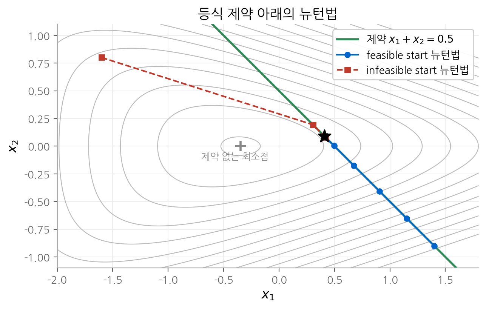
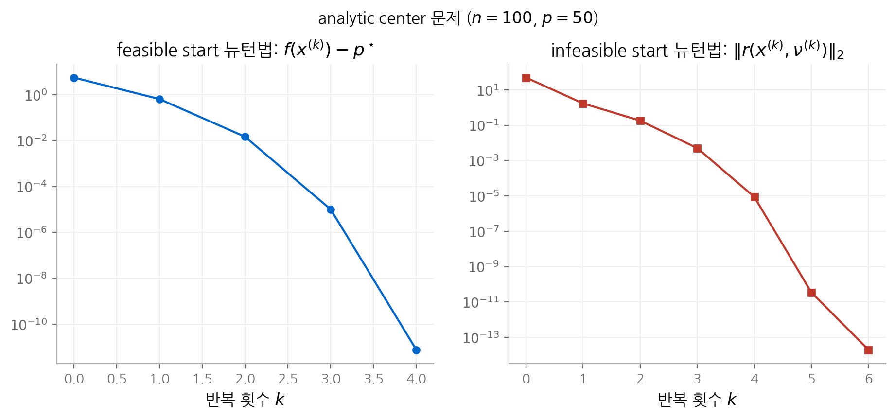

# 10. 등식 제약 최소화

9장의 뉴턴법에 등식 제약 $Ax = b$ 를 더합니다. 결론부터 말하면 뉴턴법의 구조는 거의 바뀌지 않습니다.
뉴턴 단계를 구할 때 푸는 선형 방정식이 헤시안 하나에서 **KKT 시스템**으로 커질 뿐입니다.
이 장은 등식 제약을 다루는 세 가지 방법(제거, 쌍대, 뉴턴)을 비교합니다. 그리고 시작점이 제약을 만족하지 않아도
쓸 수 있는 **infeasible start 뉴턴법**을 유도합니다. 이 방법은 11장 원시-쌍대 내부점법의 원형입니다.

!!! info "원문과 자료"
    - 교재: Boyd & Vandenberghe, *Convex Optimization*, 10장 Equality constrained minimization (p.521–560)
    - 슬라이드: [EE364a 강의 슬라이드 p.327–352](https://web.stanford.edu/~boyd/cvxbook/bv_cvxslides.pdf#page=327)
    - 선수 내용: [9. 제약 없는 최소화](09-unconstrained.md)의 뉴턴법, [5. 쌍대성](05-duality.md)의 KKT 조건

## 1. 문제와 최적 조건

$$
\begin{aligned}
\text{minimize} \quad & f(x) \\
\text{subject to} \quad & Ax = b
\end{aligned}
$$

$f : \mathbf{R}^n \to \mathbf{R}$ 은 볼록이고 두 번 연속 미분 가능합니다. $A \in \mathbf{R}^{p \times n}$ 이고 $\operatorname{rank} A = p < n$ 이라고 가정합니다.
즉 제약의 개수가 변수보다 적고, 중복된 제약이 없습니다.

5장의 KKT 조건에 따르면 $x^\star$ 가 최적일 필요충분조건은 다음을 만족하는 $\nu^\star \in \mathbf{R}^p$ 가 존재하는 것입니다.

$$
A x^\star = b, \qquad \nabla f(x^\star) + A^\top \nu^\star = 0
$$

첫 식은 **원시 가능성**(primal feasibility), 둘째 식은 **쌍대 가능성**(dual feasibility) 조건입니다.
미지수는 $n + p$ 개이고 방정식도 $n + p$ 개입니다. 둘째 식은 기하학적으로 다음을 뜻합니다.
최적점에서 그래디언트는 $A$ 의 행 공간 $\mathcal{R}(A^\top)$ 에 있습니다. 즉 그래디언트는 가능 집합에 수직입니다.

### 등식 제약 이차 문제

$f(x) = \frac{1}{2} x^\top P x + q^\top x + r$ ($P \succeq 0$)이면 최적 조건이 선형 방정식이 됩니다.

$$
\begin{bmatrix} P & A^\top \\ A & 0 \end{bmatrix}
\begin{bmatrix} x^\star \\ \nu^\star \end{bmatrix}
=
\begin{bmatrix} -q \\ b \end{bmatrix}
$$

왼쪽의 $(n+p) \times (n+p)$ 행렬을 **KKT 행렬**이라고 합니다. KKT 행렬이 정칙일 필요충분조건은 다음과 같습니다.

$$
\mathcal{N}(P) \cap \mathcal{N}(A) = \{0\} \quad \Longleftrightarrow \quad P + A^\top A \succ 0
$$

$P$ 가 특이 행렬이어도 됩니다. $P$ 가 곡률을 주지 않는 방향을 제약이 막아 주면 해가 하나로 정해집니다.
이 장의 모든 알고리즘은 결국 이 형태의 선형 방정식을 반복해서 풉니다.

## 2. 등식 제약을 다루는 세 가지 방법

### 방법 1: 제약 제거

$Ax = b$ 의 해 집합을 매개변수로 표현합니다.

$$
\{x \mid Ax = b\} = \{Fz + \hat{x} \mid z \in \mathbf{R}^{n-p}\}
$$

$\hat{x}$ 는 특수해이고, $F \in \mathbf{R}^{n \times (n-p)}$ 는 열이 $\mathcal{N}(A)$ 의 기저인 행렬입니다($AF = 0$, $\operatorname{rank} F = n - p$).
그러면 원래 문제는 제약 없는 문제가 됩니다.

$$
\text{minimize} \quad \tilde{f}(z) = f(Fz + \hat{x})
$$

이 문제를 9장의 방법으로 풀고 $x^\star = Fz^\star + \hat{x}$ 로 되돌립니다. 쌍대 변수는 $\nu^\star = -(AA^\top)^{-1} A \nabla f(x^\star)$ 로 복원합니다.

예를 들어 자원 배분 문제 $\min \sum_i f_i(x_i)$ s.t. $\sum_i x_i = b$ 는 $x_n = b - x_1 - \cdots - x_{n-1}$ 로 바꿔 제거할 수 있습니다.
신경망에서 확률 벡터를 직접 학습하지 않고 softmax 로 매개변수화하는 것도 같은 발상입니다.
다만 softmax 는 $\mathbf{1}^\top x = 1$ 과 $x \succ 0$ 을 함께 처리하는 비선형 매개변수화입니다.

제거의 단점은 구조 손실입니다. $\nabla^2 f$ 가 희소하거나 대각이어도 $F^\top \nabla^2 f F$ 는 대개 밀집 행렬입니다.
$F$ 의 선택에도 자유가 있습니다. $\tilde{F} = FT$ ($T$ 정칙)도 기저 행렬이고, 이 선택은 축소 문제의 좌표 변환에 해당합니다.

### 방법 2: 쌍대 문제 풀기

Lagrange 쌍대 함수는 켤레 함수 $f^*$ 로 표현됩니다.

$$
g(\nu) = -b^\top \nu + \inf_x \big(f(x) + \nu^\top A x\big) = -b^\top \nu - f^*(-A^\top \nu)
$$

쌍대 문제는 제약이 없는 최대화 문제입니다. Slater 조건이 성립하므로 강쌍대성이 성립합니다.
$g$ 가 두 번 미분 가능하면 9장의 방법으로 $\nu^\star$ 를 구하고, $\nabla f(x) + A^\top \nu^\star = 0$ 을 풀어 $x^\star$ 를 복원합니다.
$p \ll n$ 이면 쌍대 변수가 훨씬 적으므로 유리합니다.

### 방법 3: 등식 제약 뉴턴법

제약을 없애지 않고 원래 공간에서 뉴턴법을 확장합니다. 3절에서 유도합니다. 실제 솔버는 대부분 이 방법을 씁니다.

## 3. feasible start 뉴턴법

### 뉴턴 단계

현재 점 $x$ 가 가능점($Ax = b$)이라고 둡니다. 9장처럼 2차 근사를 최소화하되, 이동 후에도 제약을 만족하도록 $A\,\Delta x = 0$ 을 요구합니다.

$$
\begin{aligned}
\text{minimize} \quad & \hat{f}(x + v) = f(x) + \nabla f(x)^\top v + \tfrac{1}{2} v^\top \nabla^2 f(x) v \\
\text{subject to} \quad & A(x + v) = b
\end{aligned}
$$

이것은 1절의 등식 제약 이차 문제입니다. 최적 조건을 쓰면 뉴턴 단계 $\Delta x_{\text{nt}}$ 를 정의하는 KKT 시스템이 나옵니다.

$$
\begin{bmatrix} \nabla^2 f(x) & A^\top \\ A & 0 \end{bmatrix}
\begin{bmatrix} \Delta x_{\text{nt}} \\ w \end{bmatrix}
=
\begin{bmatrix} -\nabla f(x) \\ 0 \end{bmatrix}
$$

$w$ 는 이차 근사 문제의 쌍대 변수이고, $\nu^\star$ 의 추정값이 됩니다. 제약이 없으면($p = 0$) 이 식은 9장의 $\nabla^2 f \,\Delta x = -\nabla f$ 로 돌아갑니다.

**최적 조건의 선형화**로도 같은 식을 얻습니다. $x + \Delta x$ 와 $w$ 를 최적 조건에 대입하고 $\nabla f(x + \Delta x) \approx \nabla f(x) + \nabla^2 f(x) \Delta x$ 로 근사하면 다음과 같습니다.

$$
A(x + \Delta x) = b, \qquad \nabla f(x) + \nabla^2 f(x) \Delta x + A^\top w = 0
$$

$Ax = b$ 이므로 첫 식은 $A \Delta x = 0$ 입니다. 두 식을 모으면 위의 KKT 시스템입니다.

### Newton decrement

9장과 같은 식으로 정의합니다.

$$
\lambda(x) = \left(\Delta x_{\text{nt}}^\top \nabla^2 f(x) \Delta x_{\text{nt}}\right)^{1/2}
$$

성질도 그대로 유지됩니다. $f(x) - \inf\{\hat{f}(x + v) \mid A(x+v) = b\} = \lambda(x)^2/2$ 이고,
방향 미분은 $\frac{d}{dt} f(x + t\Delta x_{\text{nt}}) \big|_{t=0} = -\lambda(x)^2$ 입니다.
단, $\lambda(x)^2 = \nabla f(x)^\top \nabla^2 f(x)^{-1} \nabla f(x)$ 라는 식은 더 이상 성립하지 않습니다. 그래디언트 전체가 아니라 가능 방향 성분만 의미가 있기 때문입니다.

### 알고리즘

1. 가능점 $x \in \operatorname{dom} f$, $Ax = b$ 에서 시작합니다.
2. KKT 시스템을 풀어 $\Delta x_{\text{nt}}$ 와 $\lambda(x)^2$ 를 계산합니다.
3. $\lambda(x)^2 / 2 \le \epsilon$ 이면 멈춥니다.
4. backtracking line search로 $t$ 를 고르고 $x := x + t \Delta x_{\text{nt}}$ 로 갱신한 뒤 2단계로 돌아갑니다.

$A \Delta x_{\text{nt}} = 0$ 이므로 모든 반복점이 가능점으로 남습니다. 이런 방법을 **가능 하강법**(feasible descent method)이라고 합니다.

### 제거와의 관계

축소 문제 $\tilde{f}(z) = f(Fz + \hat{x})$ 에 9장의 뉴턴법을 쓴 결과를 생각합니다. 축소 문제의 뉴턴 단계 $\Delta z_{\text{nt}}$ 와
원래 공간의 뉴턴 단계는 $\Delta x_{\text{nt}} = F \Delta z_{\text{nt}}$ 로 정확히 대응합니다. Newton decrement도 같습니다.
**두 방법은 같은 반복점을 만듭니다.** 따라서 9장의 수렴 분석(감쇠 단계 후 이차 수렴, self-concordant일 때 문제와 무관한 반복 횟수 한계)이 그대로 적용됩니다.
차이는 계산 비용뿐이고, 원래 공간에서 풀면 $\nabla^2 f$ 의 희소 구조를 살릴 수 있습니다.

### 비교: 아핀 공간 위의 경사 하강법

헤시안 대신 단위 행렬을 넣으면($\nabla^2 f \to I$) KKT 시스템의 해는 그래디언트를 $\mathcal{N}(A)$ 로 사영한 방향입니다.

$$
\Delta x = -\left(I - A^\top (AA^\top)^{-1} A\right) \nabla f(x)
$$

이것이 **사영 경사 하강법**의 방향입니다. 9장과 같은 이유로 조건수에 비례하는 반복 횟수가 필요합니다.

<figure markdown>

<figcaption markdown>
<b>Figure 1.</b> 등식 제약 아래의 뉴턴법

두 뉴턴법 모두 제약 없는 최소점(+)이 아니라 직선 위의 최소점(★)으로 수렴합니다.
</figcaption>
</figure>

## 4. infeasible start 뉴턴법

### 왜 필요한가

3절의 방법은 $Ax = b$ 와 $x \in \operatorname{dom} f$ 를 함께 만족하는 시작점이 필요합니다.
$Ax = b$ 의 해는 쉽게 구하지만, $\operatorname{dom} f$ 조건(예: $x \succ 0$)까지 만족하는 점을 찾는 것은 그 자체로 하나의 문제입니다.
infeasible start 뉴턴법은 $x \in \operatorname{dom} f$ 만 요구합니다.

### 뉴턴 단계

$x$ 가 $Ax = b$ 를 만족하지 않을 때, 3절의 선형화를 그대로 반복합니다. 이번에는 $Ax - b \ne 0$ 이 오른쪽에 남습니다.

$$
\begin{bmatrix} \nabla^2 f(x) & A^\top \\ A & 0 \end{bmatrix}
\begin{bmatrix} \Delta x_{\text{nt}} \\ w \end{bmatrix}
=
-\begin{bmatrix} \nabla f(x) \\ Ax - b \end{bmatrix}
$$

$x$ 가 가능점이면 3절의 뉴턴 단계와 같습니다.

### 원시-쌍대 해석

최적 조건을 잔차 함수 $r(x, \nu) = 0$ 으로 씁니다.

$$
r(x, \nu) = \big(r_{\text{dual}}(x, \nu),\; r_{\text{pri}}(x, \nu)\big), \qquad
r_{\text{dual}} = \nabla f(x) + A^\top \nu, \quad r_{\text{pri}} = Ax - b
$$

$y = (x, \nu)$ 로 두고 $r(y + z) \approx r(y) + Dr(y) z = 0$ 을 풀면 원시-쌍대 뉴턴 단계 $\Delta y_{\text{pd}} = (\Delta x_{\text{pd}}, \Delta \nu_{\text{pd}})$ 를 얻습니다.

$$
\begin{bmatrix} \nabla^2 f(x) & A^\top \\ A & 0 \end{bmatrix}
\begin{bmatrix} \Delta x_{\text{pd}} \\ \Delta \nu_{\text{pd}} \end{bmatrix}
=
-\begin{bmatrix} \nabla f(x) + A^\top \nu \\ Ax - b \end{bmatrix}
$$

위 식과 비교하면 $\Delta x_{\text{pd}} = \Delta x_{\text{nt}}$, $\nu + \Delta \nu_{\text{pd}} = w$ 입니다. **infeasible start 뉴턴 단계는 원시 변수와 쌍대 변수를 함께 갱신하는 뉴턴법입니다.**

### 잔차 노름이 줄어듭니다

비가능점에서 $\Delta x_{\text{nt}}$ 는 $f$ 의 하강 방향이 아닐 수 있습니다. 방향 미분이 다음과 같기 때문입니다.

$$
\nabla f(x)^\top \Delta x_{\text{nt}} = -\Delta x_{\text{nt}}^\top \nabla^2 f(x) \Delta x_{\text{nt}} + (Ax - b)^\top w
$$

둘째 항의 부호는 정해져 있지 않습니다. 대신 잔차 노름은 항상 줄어듭니다.

$$
\frac{d}{dt} \lVert r(y + t\Delta y_{\text{pd}}) \rVert_2 \Big|_{t=0} = -\lVert r(y) \rVert_2
$$

그래서 선 탐색 기준을 $f$ 가 아니라 $\lVert r \rVert_2$ 로 바꿉니다.

1. $x \in \operatorname{dom} f$ 와 임의의 $\nu$ 에서 시작합니다.
2. $\Delta x_{\text{nt}}$, $\Delta \nu_{\text{nt}}$ 를 계산합니다.
3. $t := 1$ 에서 시작해 $\lVert r(x + t\Delta x, \nu + t\Delta \nu) \rVert_2 > (1 - \alpha t) \lVert r(x, \nu) \rVert_2$ 이면 $t := \beta t$ 로 줄입니다.
4. $x := x + t\Delta x_{\text{nt}}$, $\nu := \nu + t\Delta \nu_{\text{nt}}$ 로 갱신합니다.
5. $Ax = b$ 이고 $\lVert r \rVert_2 \le \epsilon$ 이면 멈추고, 아니면 2단계로 돌아갑니다.

선 탐색은 $x + t\Delta x \in \operatorname{dom} f$ 가 되도록 먼저 $t$ 를 줄여야 합니다.

### 원시 잔차는 한 번에 사라집니다

KKT 시스템의 둘째 행 $A \Delta x_{\text{nt}} = -(Ax - b)$ 에서 다음을 얻습니다.

$$
r_{\text{pri}}(x + t\Delta x_{\text{nt}}) = A(x + t\Delta x_{\text{nt}}) - b = (1 - t)\, r_{\text{pri}}(x)
$$

원시 잔차는 매 반복 $(1 - t)$ 배가 됩니다. **보폭 $t = 1$ 을 한 번이라도 받으면 그 뒤로 모든 반복점이 가능점입니다.**
그 시점부터 이 방법은 3절의 feasible start 뉴턴법과 같아집니다. 위 그림의 빨간 궤적이 이 성질을 보여 줍니다.

## 5. 예제: analytic center

$$
\begin{aligned}
\text{minimize} \quad & f(x) = -\sum_{i=1}^n \log x_i \\
\text{subject to} \quad & Ax = b
\end{aligned}
$$

정의역이 $x \succ 0$ 입니다. 이 문제의 해를 다면체 $\{x \mid Ax = b, x \succeq 0\}$ 의 **analytic center**라고 합니다.
11장의 barrier method가 매 단계 푸는 문제가 이 형태입니다. 헤시안은 대각 행렬 $\nabla^2 f(x) = \operatorname{diag}(1/x_1^2, \dots, 1/x_n^2)$ 입니다.

세 방법을 모두 쓸 수 있습니다.

| 방법 | 시작점 조건 | 매 반복 푸는 시스템 |
| --- | --- | --- |
| feasible start 뉴턴법 | $Ax^{(0)} = b$, $x^{(0)} \succ 0$ | KKT 시스템($n + p$ 차원) |
| infeasible start 뉴턴법 | $x^{(0)} \succ 0$ | KKT 시스템($n + p$ 차원) |
| 쌍대 뉴턴법 | $A^\top \nu^{(0)} \succ 0$ | $p \times p$ 시스템 |

쌍대 문제는 $\max_\nu\; -b^\top \nu + n + \sum_i \log (A^\top \nu)_i$ 이고, 원시 해는 $x_i = 1/(A^\top \nu)_i$ 로 복원합니다.

$n = 100$, $p = 50$ 인 무작위 문제를 풀었습니다. feasible start는 가능점 $\hat{x}$ 에서, infeasible start는 $x^{(0)} = \mathbf{1}$ 에서 출발했습니다.
두 방법 모두 6회 이내에 기계 정밀도에 도달합니다. infeasible start 뉴턴법은 첫 반복부터 보폭 1을 받았으므로
첫 반복 뒤 원시 잔차가 0이 되고, 잔차 노름이 $49.4 \to 1.7 \to 0.18 \to 5.1 \times 10^{-3} \to 8.8 \times 10^{-6} \to 3.5 \times 10^{-11}$ 로 줄었습니다.

<figure markdown>

<figcaption markdown>
<b>Figure 2.</b> analytic center 문제의 수렴

두 방법 모두 처음 몇 번은 완만하다가, 이차 수렴 단계에 들어서면 아래로 꺾입니다.
</figcaption>
</figure>

## 6. 구현: KKT 시스템 풀기

매 반복의 비용은 다음 형태의 시스템을 푸는 데 듭니다($H = \nabla^2 f(x)$).

$$
\begin{bmatrix} H & A^\top \\ A & 0 \end{bmatrix}
\begin{bmatrix} v \\ w \end{bmatrix}
= -\begin{bmatrix} g \\ h \end{bmatrix}
$$

KKT 행렬은 대칭이지만 양의 정부호가 아닙니다. 그래서 촐레스키 분해를 바로 쓸 수 없습니다. 세 가지 방법이 있습니다.

| 방법 | 내용 | 적합한 경우 |
| --- | --- | --- |
| $LDL^\top$ 분해 | 대칭 부정부호 행렬용 분해 | 일반적인 밀집·희소 문제 |
| block elimination | 아래 식처럼 $v$ 를 먼저 소거 | $H$ 를 싸게 풀 수 있을 때(대각, 띠) |
| 제거 | $F^\top H F$ 시스템을 풂 | $F$ 가 단순하고 $n - p$ 가 작을 때 |

**block elimination.** 첫 행에서 $v = -H^{-1}(g + A^\top w)$ 를 얻고, 둘째 행 $Av = -h$ 에 대입합니다.

$$
\left(A H^{-1} A^\top\right) w = h - A H^{-1} g, \qquad v = -H^{-1}(g + A^\top w)
$$

$S = -AH^{-1}A^\top$ 를 $H$ 의 **Schur complement**라고 합니다. $H$ 가 양의 정부호이고 $A$ 가 행 최대 랭크이면
$AH^{-1}A^\top$ 는 양의 정부호이므로 촐레스키 분해로 풉니다. analytic center 문제는 $H$ 가 대각이므로
$H^{-1}$ 계산이 $O(n)$ 이고, 전체 비용은 $AH^{-1}A^\top$ 를 만드는 $O(p^2 n)$ 과 분해하는 $O(p^3)$ 입니다.
위 예제의 그림도 이 방법으로 계산했습니다.

## 핵심 정리

| 개념 | 핵심 내용 |
| --- | --- |
| 최적 조건 | $Ax^\star = b$, $\nabla f(x^\star) + A^\top \nu^\star = 0$ |
| KKT 행렬 | $\begin{bmatrix} H & A^\top \\ A & 0 \end{bmatrix}$, 정칙 $\Leftrightarrow$ $\mathcal{N}(H) \cap \mathcal{N}(A) = \{0\}$ |
| 제약 제거 | $x = Fz + \hat{x}$ 로 제약 없는 문제로 바꿈, 희소 구조를 잃을 수 있음 |
| 쌍대 해법 | $\max\; -b^\top \nu - f^*(-A^\top \nu)$, $p \ll n$ 일 때 유리 |
| feasible start 뉴턴법 | KKT 시스템으로 $\Delta x_{\text{nt}}$ 계산, 제거한 문제의 뉴턴법과 같은 반복점 |
| infeasible start 뉴턴법 | 원시-쌍대 뉴턴법, $\lVert r \rVert_2$ 로 선 탐색, $t = 1$ 한 번이면 가능점 |
| block elimination | $(AH^{-1}A^\top) w = h - AH^{-1}g$, $H$ 가 단순할 때 효율적 |

## 다음 장

[11. 내부점법](11-interior-point.md)은 부등식 제약을 log barrier로 바꾸고, 이 장의 뉴턴법을 반복해서 써서 일반 볼록 문제를 풉니다.
